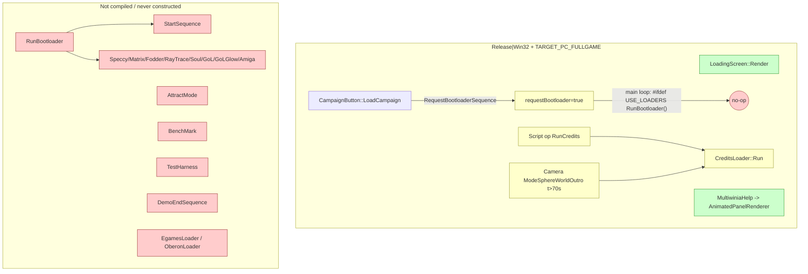
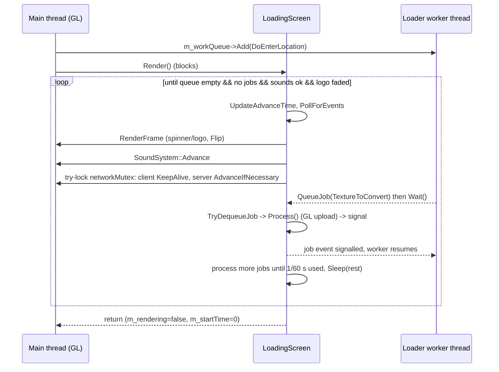

# P20_sequences_loaders_bench — Start/end sequences, attract mode, loading screen, boot-loader mini-programs, benchmark, test harness, animated help panels
Scope: `code/loaders/*` (24 files), `code/loading_screen.*`, `code/attract.*`, `code/benchmark.*`, `code/testharness.*`, `code/startsequence.*`, `code/demoendsequence.*`, `code/animatedpanel.*`, `code/animatedpanel_renderer.*` (38 files, 6 754 lines). Build baseline: see `build_matrix.md` (`Release|Win32` + `TARGET_PC_FULLGAME`, OpenGL).

Supporting files read outside scope (to resolve call sites / gates): `code/main.cpp` (RunBootloader, RunTheGame, EnterLocation, MainMenuLoop, game loops), `code/app.cpp`/`app.h`, `code/lib/work_queue.*`, `code/lib/runnable.*`, `code/lib/resource.cpp`, `code/lib/bitmap.cpp`, `code/landscape_renderer.cpp`, `code/sound/soundsystem.cpp`, `code/script.cpp`, `code/camera.cpp` (intro/outro modes), `code/renderer.cpp`, `code/multiwiniahelp.cpp`, `code/multiwinia.cpp` (grace period), `code/global_world.cpp/.h`, `code/UI/CampaignButton.h`, `code/UI/PrologueButton.h`, `code/UI/GameMenuWindow.cpp`, `code/interface/prefs_other_window.cpp`, `code/lib/preferences.cpp`, `code/lib/universal_include.h`, `code/3d_sierpinski_gasket.*`, `contrib/systemiv/lib/math/random_number.cpp`, `contrib/systemiv/lib/tosser/hash_table.cpp`, `contrib/systemiv/lib/filesys/text_stream_readers.cpp`, `data/input/input_preferences.txt`, `data/sounds.txt`, `data/scripts/attractmode.txt`, `data/scripts/endattract.txt`, `data/animations/*.anim` (headers only — grammar owned by another agent), `data/language/english.txt` (keys only), `data/betatesters.txt` (line count only), `targets/vs2005/Darwinia.vcproj`.

---

## [→ 09_meta_systems] 0. Build reality and reachability of every P20 feature

Every file in scope is listed in `targets/vs2005/Darwinia.vcproj` for all four configurations [C] (`manifest.csv` `vcproj_build=all`), but most of the *content* is removed by preprocessor gates or has no live call site. "Compiled" below means "the function bodies survive the preprocessor in `Release|Win32` + `TARGET_PC_FULLGAME`".

| Feature | Body compiled in [B:FULL]? | Gate(s) | Live call path in [B:FULL]? | Tag |
|---|---|---|---|---|
| `LoadingScreen` (spinner + logo + job pump) | yes | none | yes — startup, every level load, map-select thumbnail preload | **[B:FULL]** |
| `AnimatedPanel` + `AnimatedPanelRenderer` (game-mode "how to play" panel) | yes | none | yes — `MultiwiniaHelp` during the grace period | **[B:FULL]** |
| `Loader` base class (`SetupFor2D`, `FlipBuffers`, `AdvanceSound`, factory) | yes | enum members / factory cases for the 8 mini-programs under `USE_LOADERS` | only via `CreditsLoader` paths below | [B:LEGACY] |
| `CreditsLoader` ("darwinians carry the credits letters") | yes (no gate in file; `GenerateEGamesList` under `EGAMESBUILD`, one line under `OBERONBUILD`) | — | only `Script::RunCommand_RunCredits` (script op `RunCredits`, used by **no** file in `data/scripts`) and `Camera::AdvanceSphereWorldOutroMode` after 70 s (Darwinia `GameOver` ending, `data/scripts/gameover.txt`) — Darwinia campaign only | [B:LEGACY] |
| `SpeccyLoader`, `MatrixLoader`, `FodderLoader`, `RayTraceLoader`, `SoulLoader`, `GameOfLifeLoader` (+Glow), `AmigaLoader` | **no** — each `.h` and `.cpp` is wrapped in `#ifdef USE_LOADERS` | `USE_LOADERS` commented out in `code/lib/universal_include.h` (`//#define USE_LOADERS`) | no | [B:DEAD] |
| `Sierpinski3D` (used only by `AmigaLoader`) | yes (`code/3d_sierpinski_gasket.cpp` has no gate) | — | no caller outside `amiga_loader.cpp` | [B:DEAD] by call graph |
| `EgamesLoader` (AVI intro) | no — `#ifdef EGAMESBUILD` (defined nowhere) | `EGAMESBUILD` | no call site even if defined (header only included by `main.cpp`) | [B:DEAD] |
| `OberonLoader` (distributor splash) | no — body `#ifdef OBERONBUILD` (defined nowhere); class declaration in header is unguarded | `OBERONBUILD` | no call site even if defined | [B:DEAD] |
| `RunBootloader()` (boot-loader dispatcher + first-time intro) | no — `#ifdef USE_LOADERS` | `USE_LOADERS` | the main loop's call is also inside `#ifdef USE_LOADERS` | [B:DEAD] |
| `RequestBootloaderSequence()` / `IsFirsttimeSequencing()` | yes | — | `CampaignButton::LoadCampaign` sets the request; nothing consumes it (see §1.6 side effect) | [B:LEGACY] |
| `StartSequence` (90 s first-time intro) | yes (no gate) | — | its only constructor call is inside `RunBootloader` (`USE_LOADERS`) → never instantiated; `Renderer::Render`'s `if(g_app->m_startSequence)` hook is compiled but always false | [B:LEGACY] (compiled, unreachable) |
| `DemoEndSequence` (prologue end screen) | no — `#ifdef USE_SEPULVEDA_HELP_TUTORIAL` (defined nowhere) | `USE_SEPULVEDA_HELP_TUTORIAL` | `Script::RunCommand_ShowDemoEndSequence` compiles to an empty function | [B:DEAD] |
| `AttractMode` | yes (no gate in `attract.cpp`) | object only constructed under `#ifdef ATTRACTMODE_ENABLED` (defined nowhere); both `Advance` call sites gated too | no (`g_app->m_attractMode` stays `NULL`) | [B:DEAD] (feature); profile-name special cases in `App` are compiled → [B:LEGACY] |
| `BenchMark` | no — whole `.cpp` under `#ifdef BENCHMARK_AND_FTP`; only commented-out `//#define BENCHMARK_AND_FTP` inside the `TARGET_BETATEST_GROUP` block | `BENCHMARK_AND_FTP` | no (all 5 call sites in `app.cpp`/`main.cpp` gated) | [B:DEAD] |
| `TestHarness` | no — `#ifdef TEST_HARNESS_ENABLED` (defined nowhere) | `TEST_HARNESS_ENABLED` | no; `Script::IsRunningScript` still tests `g_app->m_testHarness` (always `NULL`) | [B:DEAD] |

Evidence: [C] `code/lib/universal_include.h` (macro block "PICK ONE OF THESE TARGETS" and `TARGET_BETATEST_GROUP` block); [C] `code/main.cpp:RunBootloader`, `code/main.cpp:RunTheGame`; [C] `code/app.cpp:App::App`; [C] per-file guards listed. `OpenMP` (used by `RayTraceLoader`) is explicitly `false` in `ReleaseDirect3D` and unset (default off) elsewhere [C] `targets/vs2005/Darwinia.vcproj`.

**Design consequence for the new game.** In the shipped Multiwinia PC build the only player-visible features from this partition are (a) the **loading screen** and (b) the **animated game-mode panels**. Everything else is Darwinia-era or dev tooling. The loaders, intro, credits, attract mode, benchmark and test harness are nevertheless specified below (precisely enough to re-implement) because they are design capabilities in the codebase; each section carries its tag.

## [→ 09_meta_systems] 1. Loading screen (`LoadingScreen`) [B:FULL]

### 1.1 Role
A blocking, main-thread "please wait" loop that (1) keeps the window alive and animated while a **background worker thread** performs a load, (2) executes on the main thread the OpenGL work the worker cannot do itself (texture upload/delete, display-list creation, VBO binding) and (3) keeps sound and networking ticking. It shows **no progress bar or percentage** — only an animated spinner and, on first start-up, a publisher logo [C] `code/loading_screen.cpp:LoadingScreen::RenderFrame`.

Single global instance `g_loadingScreen`, created in `code/main.cpp:Initialise` **before** `App` is constructed [C].

### 1.2 Data members [C] `code/loading_screen.h:LoadingScreen`

| Member | Type | Initial | Meaning |
|---|---|---|---|
| `m_rendering` | bool | **uninitialised** (ctor does not set it) [C] | true while `Render()` loop is executing; read by `IsRendering()` |
| `m_texId` | int | -1 | GL texture of the spinner sprite; set by `Resource` once resources are loaded (`code/lib/resource.cpp` L~954: `g_loadingScreen->m_texId = GetTexture("sprites/darwinian.bmp")`) or lazily by `RenderFrame` |
| `m_initialLoad` | bool | true | true only for the very first load (start-up); cleared in `code/main.cpp:RunTheGame` after `Initialise` |
| `m_platformLogoShown` | bool | false | Mac only (platform logo) |
| `m_startTime` | double | 0.0 | time of first rendered frame of the current `Render()`; reset to 0 on exit |
| `m_workQueue` | `WorkQueue*` | new | the background loader thread + its FIFO of `Runnable`s |
| `m_lock` | `NetMutex` | — | protects `m_jobs` |
| `m_jobs` | `LList<Job*>` | empty | FIFO of main-thread jobs queued by worker threads |
| `m_startFadeOutTime` | double | 0.0 | when the logo fade-out began |
| `m_fadeOutLogo` | bool | false | keeps the loop alive until the logo has faded out (initial load only) |

### 1.3 Threading model (loading **is** on a background thread)

- `WorkQueue` constructor starts one OS thread (`NetStartThread(WorkQueue::RunThread)`). The thread calls `StandardiseCPUPrecision()` (per-thread FPU mode — see 22) then loops: wait on `m_event`; pop-front-run-delete each `Runnable`; signal `m_doneJob`; exit on `m_quit` [C] `code/lib/work_queue.cpp:WorkQueue::Run`.
- The first item queued by `LoadingScreen::LoadingScreen` is `SetWorkingThreadProcessor`, which calls `SetThreadAffinityMask(thread, 0x01|0x04|0x10|0x40)` (= logical CPUs 0, 2, 4, 6) under `WIN32` [C].
- Work put on the loader thread (all [C]):

| Producer | Runnable queued | When |
|---|---|---|
| `App::App` | `App::Initialise` | start-up (then `g_loadingScreen->Render()` blocks the main thread) — `code/app.cpp:App::App` |
| `code/main.cpp:EnterLocation` | `DoEnterLocation` (start network/task manager, load level) | every level load |
| `GameMenuWindow::SetupMapSelectPage` | `GameMenuWindow::PreloadThumbnails` | entering the map-select page |
| `CampaignButton::MouseUp` / `PrologueButton::MouseUp` | `LoadCampaign` / `LoadPrologue` | Darwinia modes [B:LEGACY] |

- Sounds are **not** loaded on this thread on PC: after the initial `Render()` returns, `App::App` queues `SetWorkingThreadProcessor` + `App::LoadSounds` on a *second* `WorkQueue` (`App::m_soundsWorkQueue`), because "unrar not thread safe" (two archive reads must not overlap) [C] `code/app.cpp:App::App` (comment). On Mac both run on the loader queue before `Render()`.
- **Main-thread jobs.** A worker that needs GL creates a stack `Job` subclass, calls `g_loadingScreen->QueueJob(&job)` and blocks in `job.Wait()` (a `NetEvent`) until the main thread has run `Job::Process()` (= `Run()` + signal) [C] `code/lib/runnable.cpp:Job::Process`. Producers: `BitmapRGBA::ConvertToTextureAsync` (`TextureToConvert`), `Resource::DeleteTextureAsync` (`DeleteTextureByName`), `Resource::CreateDisplayListAsync` and two further resource jobs (`code/lib/resource.cpp` L~766/830/848), `LandscapeRenderer` VBO binding (`RunnableJob` over `LandscapeRenderer::DoBindBuffers`). Each producer first checks `NetGetCurrentThreadId() == g_app->m_mainThreadId` and runs synchronously if already on the main thread [C].
- Jobs queued while no loading screen is up are drained by `g_loadingScreen->RunJobs()` once per frame in the location game loop [C] `code/main.cpp` (L~496, "Clear out any display lists wanting to be created").
- While `IsRendering()` is true: `Resource::GetTextureWithFlags` takes `Resource::m_mutex` around texture-map lookups [C] `code/lib/resource.cpp`; `SoundSystem::NotReadyForGameSoundsYet()` returns true (all `TriggerEntityEvent/TriggerOtherEvent/...` calls are dropped) [C] `code/sound/soundsystem.cpp`.
- `RenderFrame` holds `g_openGLMutex` for the whole frame [C].

### 1.4 `Render()` loop — exact behaviour [C] `code/loading_screen.cpp:LoadingScreen::Render`

1. `m_rendering = true`; `m_fadeOutLogo = m_initialLoad`; `m_startFadeOutTime = 0`.
2. Loop **while** any of: worker queue not empty; `m_jobs` not empty; `g_app->m_requireSoundsLoaded && !g_app->m_soundsLoaded`; `m_fadeOutLogo`; [B:D3D] `GeneratingMipmaps()`.
   - `UpdateAdvanceTime()` (global frame clock, capped 0.25 s — see 01).
   - `g_inputManager->PollForEvents()` only (input is **not** `Advance`d, so no control events fire during loading).
   - If `g_app`, `m_resource`, `m_renderer` exist: `RenderFrame()`; `SoundSystem::Advance()` if initialised; if `g_app->m_networkMutex.TryLock()` succeeds: `m_clientToServer->KeepAlive()` and `m_server->AdvanceIfNecessary(now)` (so a hosting server keeps ticking and clients don't time out during a level load), unlock.
   - Run one main-thread job; then keep running jobs until `frameStart + 1/60 s`; `Sleep(remaining ms)` if time remains → loading screen frame-rate cap **60 Hz**.
3. `m_rendering = false`; `m_startTime = 0`.

`m_requireSoundsLoaded` is set true when the player leaves `MainMenuLoop` [C] `code/main.cpp:MainMenuLoop` — hence the first level load waits for the background sound load to finish; the main menu itself does not.

### 1.5 What a frame shows [C] `code/loading_screen.cpp:LoadingScreen::RenderFrame`

If `m_texId == -1`: try `Resource::DoesTextureExist("sprites/darwinian.bmp")` → `GetTexture`; draw nothing, no `Flip` (screen keeps last frame).

Otherwise:
1. `m_startTime` := now on first such frame. Clear colour (0,0,0,0) + depth.
2. **Menu backdrop**: if `!m_initialLoad && !g_app->m_loadingLocation && g_app->m_atMainMenu && renderer fade complete` → render `GameMenu` and `UserInput` (e.g. during thumbnail preload the menu stays visible under the spinner).
3. `g_editorFont.BeginText2D()` (2D pixel projection), blend on, cull off.
4. **Publisher logo (initial load only)**. PC constants: `platformLogoDuration = 0`, `ivLogoStartTime = 0`, `ivLogoFadeInDuration = 1.0 s`. `alpha = min(elapsed, 1)`; when the worker queue is empty and no jobs remain, the fade-out starts: `alpha = 1 − (now − m_startFadeOutTime)` (1 s), and when `alpha ≤ 0` → `m_fadeOutLogo = false` (lets the loop end). Logo texture `textures/ivlogo.bmp` (600×600 source), drawn centred, size `500·(ScreenH/1024)` square, colour (1,1,1,alpha) [C] `RenderIVLogo`.
   - **Rating notice** (`WAN_PLAY_ENABLED && !TARGET_OS_MACOSX` → [B:FULL]): if language phrase `esrb_warning` exists, draw it centred at (ScreenW/2, 0.95·ScreenH), font size `0.02·ScreenH`, `g_editorFont`, colour (1,1,1, alpha−0.5) (i.e. at most 50 % opacity) [C].
5. **Spinner** (always on PC): sprite `sprites/darwinian.bmp`, 100×100 px, centre at (ScreenW−100, ScreenH−100), colour (0.2, 0.8, 0.2, 1), rotation `fmod(t·90°, 360°)` about its centre (90°/s; a commented alternative stepped 18° at 5 Hz) [C] `RenderSpinningDarwinian`. Restores cull on, blend off.
6. `EndText2D`, `g_windowManager->Flip()`.

[B:DEAD] Mac-only: 5 s platform logo (`RenderPlatformLogo`, 1 s fade in / 1 s fade out) shown before the publisher logo; spinner hidden during it.

### 1.6 Side effect: `RequestBootloaderSequence` in [B:FULL] [C]
`CampaignButton::LoadCampaign` calls `RequestBootloaderSequence()` which sets `requestBootloader = true` **and** `g_RenderingFirstTimeBL = true`. Only `RunBootloader` (compiled out) resets `g_RenderingFirstTimeBL`; the main loop clears `requestBootloader` but not the other flag. `Renderer::Render` skips `RenderFadeOut()` while `IsFirsttimeSequencing()` is true → after a Campaign launch in a FULL build, screen fade-outs are never drawn again for the session [C] `code/main.cpp`, `code/renderer.cpp:Renderer::Render` (L~671). Reachability of the Campaign button in FULL is decided by P18 (`PageDarwinia`); flagged here as a latent bug — do not replicate.

### 1.7 Re-implementation notes
- Keep: background loading thread; main-thread job queue for GPU work with a per-frame time budget; network keep-alive and server ticking during loads; first-run publisher splash with fade; minimal spinner; menu-backdrop variant for small loads.
- Change (recommended): add real progress reporting (the original has none); initialise `m_rendering`; replace fixed affinity masks with the OS scheduler; DX12 permits multi-threaded resource creation (copy queue), removing most of the job marshalling.

