# Routed draft sections for document 02

<!-- from P03_entity_core -->
## [→ 02_units_and_entities] Darwinian (the core unit)

[C] `code/worldobject/darwinian.h`, `code/worldobject/darwinian.cpp` unless stated. Class `Darwinian : Entity`, type `Entity::TypeDarwinian` (12).

### Role, acquisition and container
- The population unit of every Multiwinia mode. Not built directly: produced by spawn points / buildings / crates (P06/P08), via `Location::SpawnEntities(pos, team, unitId = −1, TypeDarwinian, n, vel, spread)` → lives in `Team::m_others` (no Unit) [C] `code/location.cpp:Location::SpawnEntities`; a spawned Darwinian's `m_front` is a random synced horizontal unit vector `(SFRAND(1), 0, SFRAND(1))` normalised.
- Control model: autonomous AI driven by a priority task search; players influence it indirectly (officer GOTO/FOLLOW/formation, armour loading, direct group selection `m_underPlayerControl` + `GiveOrders`, crate power-ups), never by per-unit commands.
- Converted by: subversion lasers (destroyed + respawned as the shooter's team, `code/worldobject/weapons.cpp:Laser::Advance`), Assault pulse wave of the Futurewinian team (below), promotion to Officer (`Location::PromoteDarwinian`).

### Stats [C] `data/stats.txt` row 12 + code constants
| Stat | Value | Source |
|---|---|---|
| Health | 50 (max 255 byte) | stats.txt |
| Speed | 20 units/s (×0.2 = 4 when Idle/WorshipSpirit; ×1.75 = 35 UnderControl; terrain factor 0.3–2.0) | stats.txt + `AdvanceToTargetPosition` |
| Reload (Rate) | 3 s (between laser shots; initial phase `syncfrand(3)`) | stats.txt + `Entity::SetType` |
| Laser: speed / life / range | 150 units/s; life by `TypeLaser` research: 0→0.2, 1→0.4, **2→0.6 s (MP)**, 3→0.8, 4→1.0 ⇒ MP range ≈ 90 | `Entity::Attack`, `code/location.cpp:Location::FireLaser` |
| Laser damage | `20 + syncfrand(20)` → int, `DamageTypeLaser`; hit if 2D point–segment distance < 5 and (MP) `\|Δy\| < 5`; knock-back `vel += (vel dir × syncfrand(10), y = 7+syncfrand(5))` | `code/worldobject/weapons.cpp:Laser::Advance` (P04) |
| Aim error | target ± `syncsfrand(15)` (±7.5) on x and z, from muzzle +3 y | `Entity::Attack` |
| Subversion laser | speed 75, life ×2 (same range), from +2 y | `Darwinian::FireSubversion`, `Location::FireLaser` |
| Threat search range | 90 (`DARWINIAN_SEARCHRANGE_THREATS`), dynamic (see targeting) | `#define` |
| Grenade interval | 12 + `syncfrand(8)` s (first: `syncfrand(5)`) | `AdvanceCombat`, ctor |
| Lifetime | unlimited; drowns instantly in water; burns ~2 hp per 0.5 s while on fire | below |
| Grid radius | `m_radius = 4.0` (`Begin`), `m_centrePos = (0,2,0)` | `Darwinian::Begin` |

Multiplayer research levels (fixed per match) [C] `code/location.cpp:Location::Init` (MP branch): every research = 3 except Squad 1, Laser 2, Grenade 2, Rocket 2, AirStrike 2, **Darwinian 4**. Hence in MP every Darwinian is a "soldier" (`CurrentLevel(TypeDarwinian) > 2`) and "has grenades" (`> 3`). In single-player, team 1 (red) is always soldier+grenades [B:LEGACY].

### `#define` constants [C] `darwinian.h`
| Macro | Value | Use |
|---|---|---|
| DARWINIAN_SEARCHRANGE_OFFICERS | 100 | GOTO officers that hand out orders |
| DARWINIAN_SEARCHRANGE_OFFICERFOLLOW | 150 | FOLLOW officers (and shamans) |
| DARWINIAN_SEARCHRANGE_ARMOUR | 150 | loading armour |
| DARWINIAN_SEARCHRANGE_SPIRITS | 50 | worship (SP only) |
| DARWINIAN_SEARCHRANGE_THREATS | 90 | enemy search |
| DARWINIAN_SEARCHRANGE_GRENADES | 60 | incoming grenades/airstrike markers |
| DARWINIAN_SEARCHRANGE_TURRETS | 50 | (defined, unused in this file) [C] grep |
| DARWINIAN_SEARCHRANGE_PORTS | 100 | building ports (minus building radius) |
| DARWINIAN_SEARCHRANGE_CARRYABLE | 150 | statues / carryables (minus radius) |
| DARWINIAN_SEARCHRANGE_CRATES | 150 | crates |
| DARWINIAN_UNDERCONTROL_MAXPUSHRANGE | 100 | squad mind-control focus clamp |
| DARWINIAN_FEARRANGE | 200 | stop being scared beyond; soldiers retreat inside 100 |
| DARWINIAN_INFECTIONRANGE | 30 | plague spread |
| `CRATE_SCAN_RANGE` | 35.0 | `code/worldobject/crate.h` |
| `BLITZKRIEG_FLAGCAPTURE_RANGE` | 20.0 | `code/worldobject/multiwiniazone.h` |

### Members [C] `darwinian.h`, ctor `Darwinian::Darwinian`
| Member | Default | Meaning |
|---|---|---|
| `m_state` | StateIdle | state enum below |
| `m_promoted` | false | set by `Location::PromoteDarwinian`; next `Advance` returns true (removed, **no spirit**) |
| `m_wayPoint` | = pos (Begin) | movement target; `g_zeroVector` means "don't move" |
| `m_retargetTimer` | 0 | countdown to next `SearchForNewTask`, reset to `1 + syncfrand(1)` s |
| `m_threatId` | invalid | current threat (entity, effect, or building id) / capturing ant |
| `m_armourId` | invalid | armour being approached / ridden |
| `m_officerId` | invalid | officer being followed / formation |
| `m_shamanId` | invalid | legacy shaman |
| `m_spiritId` | -1 | worshipped spirit slot (SP) |
| `m_buildingId` | -1 | target building (port, crate, zone, carryable, rocket…) — shadows `Entity::m_buildingId` |
| `m_portId` | -1 | port index on `m_buildingId` |
| `m_boxKiteId` | invalid | SP worship box kite effect |
| `m_spaceshipId` | invalid | abducting ship |
| `m_threatRange` | 90 | adaptive search radius |
| `m_scared` | **true** | flee rather than fight |
| `m_controllerId` | -1 | InsertionSquad mind-control task id |
| `m_teleportRequired` | false | (unused in this file) |
| `m_underPlayerControl` | false | part of the player's current Darwinian group selection |
| `m_followingPlayerOrders` | false | "current order given directly; obey to the exclusion of all else" |
| `m_manuallyApproachingArmour` | false | player sent us to an armour |
| `m_idleTimer` | 60 + syncfrand(60) | idle-wander-to-useful-building timer (see AdvanceIdle — dead in practice) |
| `m_orders`, `m_ordersBuildingId` (-1), `m_ordersSet` (false) | — | pending GOTO destination, teleport to enter, flag |
| `m_grenadeTimer` | syncfrand(5) | grenade cooldown |
| `m_officerTimer` | 0 | re-target timer for follow/under-control |
| `m_shadowBuildingId` | -1 | spectacle casting a shadow on us (render) |
| `m_avoidObstruction` | zero | avoidance override — never set non-zero (all writes commented out) ⇒ inert |
| `m_sacraficeTimer`, `m_targetPortal` (-1), `m_burning` (false) | — | legacy shaman sacrifice |
| `m_boosterTaskId`, `m_hotFeetTaskId`, `m_subversionTaskId`, `m_rageTaskId` | -1 | crate power-up task ids (validated every tick against the team task manager) |
| `m_infectionState` | Clean | {`InfectionStateClean`, `InfectionStateInfected`, `InfectionStateImmune`} |
| `m_infectionTimer` | 0 | plague event timer |
| `m_paralyzeTimer` | -1 | >0 ⇒ cannot move |
| `m_insane` | false | plague insanity: attacks anyone, always grenades |
| `m_previousTeamId` (-1), `m_colourTimer` (-1) | — | colour cross-fade after subversion conversion (render) |
| `m_fireDamage` | 0 | accumulated fire damage (flame weapons) |
| `m_futurewinian` | false | "Futurewinian" variant: member of the Futurewinian team or of the team in level option `FuturewinianTeam` (set in `Begin`) |
| `m_startedThreatSound` | false | threat-sound latch |
| `m_wallHits` | 0 | wall collision counter (read by AI, P08) [I] |
| `m_closestAITarget` | -1 | (AI use) |
| `m_scaleFactor` | 1.0 → pref `DarwinianScaleFactor` | render scale with distance |

Constructor RNG order (synced): `SetType` → `m_reloading = syncfrand(3)`, then `m_grenadeTimer = syncfrand(5)`, then `m_idleTimer = 60 + syncfrand(60)` [C].
`Begin()`: `Entity::Begin`; `m_onGround = true`; `m_wayPoint = m_pos`; centre (0,2,0); radius 4.0; read `DarwinianScaleFactor`; `m_futurewinian = (team == Location::GetFuturewinianTeamId()) || (LevelOptionFuturewinianTeam != −1 && it equals GetTeamPosition(team))` [C].

### Per-tick pipeline — `Darwinian::Advance(Unit*)` [C]
1. `m_destroyed` → return true (removed, no spirit). `m_promoted` → return true.
2. `Entity::Advance` (reload countdown, render-damage flicker, water (base), world clamp, `FollowRoute()` if `m_routeId != −1`).
3. If alive & not dead & `m_onGround` & state ≠ OnFire:
   a. `m_retargetTimer -= dt`; when ≤ 0: `SearchForNewTask()`; if state is Idle → `BeginVictoryDance()`; `m_retargetTimer = 1 + syncfrand(1)` (re-evaluation every 1–2 s).
   b. Multiplayer: `m_idleTimer = 60` (forced every tick).
   c. State dispatch: Idle, ApproachingPort, OperatingPort, ApproachingArmour, InsideArmour, WorshipSpirit, UnderControl, FollowingOrders, FollowingOfficer, Combat, CapturedByAnt, WatchingSpectacle, BoardingRocket, AttackingBuilding, CarryingBuilding, FollowingShaman, OpeningCrate, RaisingFlag, ApproachingCarriableBuilding → their `Advance*()`.
4. Always (even airborne/dead): BeingSacraficed → `AdvanceSacraficing`; InVortex → `AdvanceInVortex`; BeingAbducted → `AdvanceBeingAbducted`.
5. Box kite released if held and (state ≠ WorshipSpirit or dead).
6. If `m_controllerId != −1` & alive: controller squad's `m_numControlledThisFrame++`.
7. Not on ground and not Sacrificed/Abducted → `Entity::AdvanceInAir` (gravity 15).
8. OnFire → `AdvanceOnFire`; InWater → `Darwinian::AdvanceInWater`; Infected → `AdvanceInfection` (each only if not already dead).
9. `m_pos.y < 0` and state ≠ InsideArmour → state = InWater, `m_onGround = false` (next tick: instant death).
10. Dead & on ground: corpse slides `vel *= 0.9; pos += vel·dt`.
11. Power-up validity: booster (`GlobalResearch::TypeBooster`), hot feet (`TypeHotFeet`, also `AdvanceHotFeet()` each tick; on expiry speed reset to blueprint), subversion (`TypeSubversion`), rage (`TypeRage`, speed reset on expiry) — task must still exist in the team task manager with that type, else cleared.
12. `m_paralyzeTimer` countdown (→ −1).
13. **Assault pulse wave** (`GameTypeAssault`, alive, `PulseWave::s_pulseWave` exists, wave team not friend, within `wave->m_radius`): if the wave team's position == `LevelOptionFuturewinianTeam` → spawn a Darwinian of the wave's team at our pos/vel and die silently (`amIDead = m_dead = true`, no spirit — conversion); else `vel = away × 20` and `ChangeHealth(−1000)`.
14. If removed while InsideArmour → `armour->RemovePassenger()`.
Returns `amIDead`.

### Task search — `SearchForNewTask()` (every 1–2 s, on ground, not burning) [C]
Pre-checks: Idle with `m_controllerId != −1` → UnderControl. If `m_followingPlayerOrders` and state ≠ Idle → only `SearchForThreats()`.
| Current state | Searches, in priority order (first success wins) |
|---|---|
| Idle | Threats → Ports → CarryableBuilding (MP only) → Crates → Armour → Flags (Blitzkrieg only) → Officers → Spirits (SP only) → RandomPosition (always "succeeds") |
| WorshipSpirit, WatchingSpectacle | Threats → Ports → CarryableBuilding → Armour → Officers |
| ApproachingArmour, FollowingOrders, FollowingOfficer | Threats → Ports → CarryableBuilding |
| OperatingPort | Threats only in single-player; **none in MP** (port operators never flee/fight) |
| ApproachingPort, WatchingGodDish, OpeningCrate, UnderControl, Combat, ApproachingCarriableBuilding | Threats |
| BoardingRocket, OnFire, CarryingBuilding | none |
| any other (InsideArmour, CapturedByAnt, AttackingBuilding, InWater, FollowingShaman, BeingSacraficed, InVortex, BeingAbducted, RaisingFlag) | none |

### Player group control (implemented in `Location`, P01/P09; summarised for completeness)
- `Location::SelectDarwinians(team, pos, radius)`: every own-team Darwinian within `radius` (entity grid) not OperatingPort / BeingSacraficed / OnFire / InsideArmour gets `m_underPlayerControl = true` (+ "Selected" sound for the local team) [C] `code/location.cpp`.
- `Location::IssueDarwinianOrders(team, pos, directRoute)`: target snaps to a connected RadarDish within its radius; centre of selected Darwinians computed; `m_routingSystem.GenerateRoute(centre, pos, directRoute)`; if a friendly Armour with free capacity is within 30 of the target, every selected Darwinian → ApproachingArmour (`m_manuallyApproachingArmour = true`, unloading armour switched to Idle); otherwise each gets `GiveOrders(target, routeId)` + `m_followingPlayerOrders = true`; sound "GivenOrdersFromPlayer" [C] `code/location.cpp:Location::IssueDarwinianOrders`.
- `Team::Advance` counts `m_underPlayerControl` Darwinians and their centroid each slice-0 (`m_numDarwiniansSelected`, `m_selectedDarwinianCentre`) [C] `code/team.cpp:Team::Advance`.
- Selection clearing: within P03 files `m_underPlayerControl` is cleared only on teleport entry in `AdvanceFollowingOrders`; other clears live in P09 code — see Unknown U1.

### State enum (values = declaration order) and behaviour [C]
| # | State | Entered by | Per-tick behaviour (`Advance*`) | Exits |
|---|---|---|---|---|
| 0 | Idle | default; most failure paths | `AdvanceToTargetPosition()` at 0.2× speed (wander target from `SearchForRandomPosition`). MP "useful building" idle search is **dead code** (step 3b resets `m_idleTimer` to 60 each tick; it would otherwise pick SpawnPoint/MultiwiniaZone/Crate/Statue/GunTurret/SolarPanel or GOTO/FOLLOW officer at 100–500 range). If `m_controllerId != −1` → UnderControl | via SearchForNewTask |
| 1 | ApproachingPort | `SearchForPorts` | building gone → Idle; port occupied by another → Idle; calls `building->OperatePort(port, team)` every tick (P06: capture contribution); walk to port position; on arrival face port front, vel 0 → OperatingPort | Idle / OperatingPort |
| 2 | OperatingPort | arrival; also spawned directly onto ports at match start (`location.cpp` ≈L3370) | building gone or `GetPortOccupant(port) != me` → Idle; vel = 0. In MP searches nothing (stays until displaced) | Idle |
| 3 | ApproachingArmour | `SearchForArmour`; player order onto armour | armour gone, or (not `IsLoading()` and not manual), or full (`GetNumPassengers() ≥ Capacity()`), or (not manual and entrance > 150 away) → Idle; walk to armour entrance (ground height); arrived or < 20 → `AddPassenger()`, InsideArmour (manual: clear flag; unloading armour → Idle) | Idle / InsideArmour |
| 4 | InsideArmour | arrival | armour gone/dead → ejected: `vel = (SFRAND(1), 1, SFRAND(1))` length `20+syncfrand(20)`, airborne, **state = OnFire** (burns). Else `pos = armour.pos`, `vel = armour.vel`; if `IsUnloading()` and land under entrance > 0 → `RemovePassenger()`, exit dir rotated `syncsfrand(π/2)` (±45°), `vel = dir×10`, `vel.y = 5+syncfrand(10)`, `pos = entrance`, airborne, `m_ordersSet = false`, Idle; else `RegisterPassenger()`. Invulnerable (non-Unresistable), not rendered, not selectable | Idle / OnFire |
| 5 | WorshipSpirit | `SearchForSpirits` (SP only) [B:LEGACY] | MP: immediately Idle. Spirit slot invalid or spirit not Birth/Floating → Idle, retarget 3 s (release kite). Stand at range `20 + uid%20` from spirit (waypoint updated only when it moved > 10); on arrival face spirit; if no BoxKite effect within 50 → create one | Idle |
| 6 | UnderControl | `TakeControl(task)` (InsertionSquad controller grenade, `weapons.cpp`), or Idle with controller | controller task/unit gone → `LoseControl()`. Every `0.5+syncfrand(0.5)` s: target = squad centre + (focus − centre) clamped to 100; not walkable → Idle; else waypoint = target + random disc of radius `syncfrand(numControlled)`. Moves at 1.75× speed | Idle |
| 7 | FollowingOrders | `GiveOrders`, `SearchForOfficers` (GOTO handout or pending orders) | `AdvanceToTargetPosition`; if `m_ordersBuildingId` set try `EnterTeleports(id)` (success → `m_underPlayerControl = false`, arrived). On arrival with a teleport pending: teleport not connected → drop it; else wiggle (entrance + disc 10). On arrival otherwise → Idle, retarget 0, clear orders, `m_ordersSet = m_followingPlayerOrders = false`. Route following via `FollowRoute` | Idle |
| 8 | FollowingOfficer | `SearchForOfficers` (FOLLOW officer) | officer gone/dead/not `OrderFollow`/disabled → Idle; officer in formation & `FormationFull()` & we aren't in it → Idle. Every 5 s: not walkable to officer → follow into the officer's teleport if any (`m_ordersBuildingId = officer.m_ordersBuildingId`, waypoint = entrance) else Idle; walkable → waypoint = officer + disc 40. Formation officer: `RegisterWithFormation(uid)` and waypoint = `GetFormationPosition(uid)` every tick. Teleport entry as above. Arrived (no formation) → new jitter (teleport entrance+10, or officer+40); arrived in formation → face officer's front | Idle |
| 9 | Combat | `SearchForThreats` success; plague insanity | see Combat | FollowingOfficer (if officer) / Idle |
| 10 | CapturedByAnt | `ArmyAnt` (`AntCapture`) [B:LEGACY] | ant gone/dead → Idle; else pos/vel = ant carry marker | Idle |
| 11 | BoardingRocket | `EscapeRocket`/`FuelStation` (`BoardRocket`, `rocket.cpp`) — Rocket Riot | building must be a FuelStation that `IsLoading()` and whose linked EscapeRocket has < 100 passengers, else Idle; walk to `GetEntrance()`; on arrival `station->BoardRocket(id)` true → **removed (no spirit)** | Idle / removed |
| 12 | WatchingSpectacle | GodDish / EscapeRocket (`WatchSpectacle`) | building must be GodDish or EscapeRocket. GodDish (legacy): not activated & timer < 1 → Idle; face moving point (wall-clock based). EscapeRocket: `!IsSpectacle()` → Idle; keep ≥ 200 (MP 100) away: if closer, waypoint = rocket + away×(min+syncfrand(min/2)); on arrival face it | Idle |
| 13 | AttackingBuilding | `EscapeRocket` (`AttackBuilding`, `rocket.cpp`); ant-nest search | building gone, or SP and not EscapeRocket → Idle; waypoint = building + away×(100+syncfrand(50)); within 200 → `ThrowWeapon(pos, building+(0,50,0), grenade, team **1**)` (hard-coded team id 1 — legacy demo2 quirk) → Idle | Idle |
| 14 | OnFire | `SetFire()` (laser fence, flame weapons via `FireDamage`, trees, lightning, portal, rockets, ejection from destroyed armour) | every tick waypoint = pos + (SFRAND(100), 0, SFRAND(100)) (±50) — panicked running at full speed; fire particles; damage `ChangeHealth(−2)` when `syncfrand(10) < 2.0/gameSpeed` (20 % per tick at speed 1 ⇒ ≈4 hp/s ⇒ ~12.5 s to die from 50 hp). **No exit** — burns until dead. Not selectable. Search disabled | death |
| 15 | InWater | `pos.y < 0` (step 9) | `ChangeHealth(−999)` — instant death (spirit released) | death |
| 16 | ApproachingCarriableBuilding | `SearchForCarryableBuilding` (MP) | carryable gone → Idle; carryable now owned by our team (enough lifters) → CarryingBuilding; if waypoint > 60 from it → waypoint = carryable + (30,0,0) rotated `syncfrand(2π)`; arrived → `SearchForRandomPosition` (mill around) | Idle / CarryingBuilding |
| 17 | CarryingBuilding | above | carryable gone / not ours → Idle; target = `GetCarryPosition(uid)` (zero → Idle); lifting if arrived or within `20 × gameSpeed × speed/blueprintSpeed`; lifting → `m_numLiftersThisFrame++`; sounds: period `f = 15 + int((1 − min(1, numLifters/maxLifters))×20)` sequence ids — `seq % f == 0` "LiftBuilding", `== f/2` "GivenOrdersFromPlayer". `GiveOrders` while carrying is forwarded to the carryable (`SetWaypoint(target, route)`; WallBuster always direct) | Idle |
| 18 | WatchingGodDish | never set in the code base [C] grep | no Advance handler (only listed in SearchForNewTask) | — |
| 19 | FollowingShaman | `SearchForShamans` — call commented out ⇒ unreachable [B:LEGACY] | shaman checks, follow like officer (5 s, disc 10/40) | Idle |
| 20 | BeingSacraficed | `Sacrafice()` by Shaman [B:LEGACY] | rise 1.5/s for 5 s then orbit portal; >10 s → spirit (`Spirit::StateShaman`) + Zombie effect, removed | removed |
| 21 | OpeningCrate | `SearchForCrates` | crate gone → Idle; walk to scatter point; on arrival face crate; within 1.1×35 emit team-coloured `TypeBlueSpark` particles (cosmetic). Capture progress is computed by the Crate from nearby Darwinians (P08) [I] | Idle |
| 22 | InVortex | `Location` dust-ball vortex: Darwinians on ground within 50 of `DustBall::s_vortexPos` (`location.cpp` ≈L1559) | spiral up: speed `max(100·y/1000, 30)`, orbit radius `300·y/1000`, angle = network time + uid×20, target height `min(y+50, 500 + 5·(uid%100))`; vortex gone → Idle with `vel.SetLength(50)` (flung, then falls) | Idle |
| 23 | BeingAbducted | `SpaceShip` (`Abduct`) | airborne; ship alive & `ShipStateAbducting`: steer `vel = lerp(vel, toShip×(2·speed) + (ship moving: horizontal toward ship × \|shipVel\|) + tangent×50, k)` with `k = dt·0.25 + (uid mod 10)·0.1·dt`; 50 % chance per tick (synced) of a blue spark; within 20 or above the ship → `ship->IncreaseAbductees()`, **removed (no spirit)**; ship gone → Idle | removed / Idle |
| 24 | RaisingFlag | `SearchForFlags` (Blitzkrieg) | zone must be a MultiwiniaZone not ours and not `m_blitzkriegLocked`, else Idle; walk; on arrival face zone (capture computed by the zone, P02) | Idle |

```mermaid
stateDiagram-v2
    [*] --> Idle
    Idle --> Combat: SearchForThreats
    Idle --> ApproachingPort: SearchForPorts
    Idle --> ApproachingCarriableBuilding: SearchForCarryableBuilding (MP)
    Idle --> OpeningCrate: SearchForCrates
    Idle --> ApproachingArmour: SearchForArmour / player order
    Idle --> RaisingFlag: SearchForFlags (Blitzkrieg)
    Idle --> FollowingOfficer: FOLLOW officer ≤150
    Idle --> FollowingOrders: GOTO officer ≤100 / pending orders / GiveOrders
    Idle --> WorshipSpirit: spirit ≤50 (SP only)
    Idle --> UnderControl: controller set
    ApproachingPort --> OperatingPort: arrived
    ApproachingPort --> Idle: port taken / building gone
    OperatingPort --> Idle: displaced
    ApproachingArmour --> InsideArmour: arrived / <20
    ApproachingArmour --> Idle: armour gone/full/not loading/>150
    InsideArmour --> Idle: unload over land
    InsideArmour --> OnFire: armour destroyed
    FollowingOrders --> Idle: arrived / teleported
    FollowingOrders --> Combat: threat
    FollowingOfficer --> Idle: officer lost / not FOLLOW / formation full
    FollowingOfficer --> Combat: threat
    Combat --> FollowingOfficer: threat gone & officer valid
    Combat --> Idle: threat gone
    ApproachingCarriableBuilding --> CarryingBuilding: carryable now ours
    CarryingBuilding --> Idle: lost
    OpeningCrate --> Idle: crate gone
    RaisingFlag --> Idle: zone ours/locked/gone
    UnderControl --> Idle: lose control / unwalkable
    WatchingSpectacle --> Idle: spectacle over
    AttackingBuilding --> Idle: grenade thrown
    BoardingRocket --> [*]: boarded (removed)
    BeingAbducted --> [*]: abducted (removed)
    InVortex --> Idle: vortex ends
    Idle --> InVortex: dust-ball vortex
    Idle --> BeingAbducted: SpaceShip
    Idle --> OnFire: SetFire
    Combat --> OnFire: SetFire
    OnFire --> [*]: dies (spirit)
    Idle --> InWater: y < 0
    InWater --> [*]: dies (spirit)
```
(Any non-armour state can go to OnFire/InWater/InVortex/BeingAbducted/BoardingRocket/WatchingSpectacle/AttackingBuilding by external calls; edges shown from Idle/Combat for readability.)

### Targeting — `SearchForThreats()` [C]
Executed in order; first match returns:
1. `m_threatRange = 90·dt + m_threatRange·(1 − dt)` (exponential relaxation back toward 90 with factor `SERVER_ADVANCE_PERIOD` per call; calls happen every 1–2 s). In formation → `m_threatRange = 90`.
2. Approaching a GunTurret port, or CarryingBuilding → return false (task has absolute priority).
3. **Projectile threats** (skipped while `HasRage()`): nearest effect within 60 of type `EffectThrowableGrenade` or `EffectThrowableAirstrikeMarker` (**any team, including our own**), SP-only enemy `EffectGunTurretTarget`, enemy `EffectSpamInfection` → state Combat, `m_scared = true`, sound "SeenThreatRunAway" if the threat id changed.
4. **Burning trees**: any `Tree` with `IsOnFire()` within `2 × GetBurnRange()` → Combat, `m_threatId = tree id`, scared, sound; if `m_ordersSet` → cancel orders (prevents re-entering the fire).
5. `searchRange = m_threatRange`. With probability 1/500 (`syncrand() % 500 == 0`): enemy AntHill/Triffid in our obstruction cell within range → `AttackBuilding(id)` — **bug**: passes the loop index into the cell list, not the building id [C].
6. **AITarget quick reject** (not in formation): for each `AITarget` building within `target->GetRange()` of us, if `target->m_enemyCount[myTeam] == 0` → return false immediately (no enemies nearby according to the AI-target census, P08).
7. Range adjustments: OperatingPort → range × 0.5, and 0 if the port belongs to a GunTurret. Formation → search centre shifted `officer.front × range × 0.66` ahead. Under squad control → centre = pos + (focus − pos) clamped to 30, range 90.
8. If `EntityGrid::AreEnemiesPresent(centre, range)` (cell-capacity over-approximation): `EntityGridCache::GetEnemies(centre, range)` (≤ 1 s old). Candidate filter: alive; not a burning Darwinian; not a Darwinian being sacrificed; not `TypeEgg`, `TypeHarvester`, `TypeEngineer`; Armour only if `GetSpeed() < 15` (moving armour is ignored). Count `numEnemies`; pick the nearest to **our position** (not the shifted centre). Note the cached list is not re-range-checked.
9. If a threat was found: state Combat. `m_scared` = (non-soldier) true; (soldier) `numEnemies > 5 && !AreFriendsPresent(pos, range)`; forced false when squad-controlled or boosted; forced **true** when the threat is SporeGenerator, Tripod, Spider, SoulDestroyer, TriffidEgg, InsertionSquadie, Armour or SpaceInvader. New threat → sounds (scared: "SeenThreatRunAway"; brave: "SeenThreatAttack" and, with unsynced `frand(200) < 1` and ≥ 4 s game time since the last horn of *any* Darwinian (function-static), "SeenThreatAttackHorn"). If `m_ordersSet` and within 50 of the order point and not player orders → `m_ordersSet = false`. `m_threatRange = distance to threat`. Return true.
10. Otherwise clear `m_threatId`, stop "Darwinian SeenThreat" sounds, return false.

### Combat — `AdvanceCombat()` [C]
- Insane & no threat → `GetBestEnemy(pos, 0, 90, team 255)` (team 255 has no friends ⇒ **every** team, own included, is a candidate).
- Threat resolution through `GetWorldObject` (entity, effect or building). Missing or dead → FollowingOfficer if `m_officerId` valid else Idle; `m_retargetTimer = 0`; stop threat sound. Gun-turret target effect farther than 90 (60×1.5) → same exit.
- `soldier` = Darwinian research > 2 (always in MP). Booster → `m_scared = false`. If in formation → `officer->RegisterWithFormation(uid)`.
- **Movement**:
  - In formation: waypoint = `officer->GetFormationPosition(uid)` (hold formation, even vs grenades).
  - Soldier & not scared: if distance < 100 and not squad-controlled and we are not > 25 below the threat (`heightDiff > −25`) → **retreat** to pos + 30 × away-direction rotated `syncsfrand(π/2)` (±45°); else **close in**: waypoint = pos + (threat − pos) rotated ±45° with length `dist − (20 + syncfrand(20))` (keep 20–40 away).
  - Otherwise (scared or non-soldier): if distance > 200 → `m_scared = false`, forget threat; **flee** waypoint = pos + 30 × away rotated ±45°.
  - Waypoints pass through `PushFromObstructions` and are snapped to ground; then `AdvanceToTargetPosition`.
- **Shooting** (only if the threat is an entity): `attackRate = 10` (booster 7, futurewinian 3) `/ gameSpeed`. Soldiers only:
  - In formation: volley schedule — `idx = GetFormationIndex(uid)`, `size = min(90, formationEntities.Size())`, `t = gameTime × 10`; fire when `int(fmodf(t + idx, size/4)) == 0` (rage: also `fmod(t + idx, size/16)`). (Uses synced game time, but `fmodf` is single-precision.)
  - Not in formation: fire when `attackRate ≥ 1 && syncrand() % int(attackRate) == 0` (≈1/10 per tick ⇒ ~1 attempt/s); rage → every tick.
  - Fire = `FireSubversion(threat + (0,2,0))` if subversion power-up or futurewinian, else `Attack(threat + (0,2,0))` (rage adds ±30 x/z scatter and clears `m_reloading` after the shot ⇒ continuous fire). `Attack`/`FireSubversion` only shoot when `m_reloading == 0` (3 s reload).
- **Grenades/rockets**: allowed if Darwinian research > 3 (MP: yes) and not in formation, no subversion, not futurewinian, and not (MultiwiniaTutorial2 before `m_tutorial2AICanSpawn`). `m_grenadeTimer -= dt`; when ≤ 0 → reset to `12 + syncfrand(8)`; if distance > 75 (or insane): (SP team 0: abort if any team-2 entity in cells around the target within 50); require our and target terrain normals `.y > 0.7` and `heightDiff > −50`; then
  - "grenade-worthy" targets (SporeGenerator, Spider, TriffidEgg, InsertionSquadie, Armour, Tank) → throw if the target is < 40 above ground;
  - otherwise throw if `GetNumEnemies(target, 50) > 5 && GetNumFriends(target, 50) < 2` (cell-square counts);
  - insane → always; SpaceShip target → never.
  - Throw = `Location::FireRocket(pos, target + (0,10,0) [insane: ±2 jitter], team, −1.0, −1, infected)` if the team has `Team::EvolutionRockets == 1` (granted by the "Rocketwinians" crate, `crate.cpp:Crate::RunRocketDarwinians`), else `Location::ThrowWeapon(pos, target, EffectThrowableGrenade, team)` (P04).

### Movement — `AdvanceToTargetPosition()` [C]
Returns "arrived". Steps:
1. Paralysed (`m_paralyzeTimer > 0`) or waypoint = zero → false, no movement.
2. Infected: 1/20 per tick (`syncrand() % 20 == 0`) stop dead (vel 0, waypoint = pos) and return true.
3. Horizontal distance `d` to waypoint: `d == 0` → vel 0, return true; `d < 1` → snap to waypoint, vel = Δ/dt, return false (arrival reported next tick).
4. `speed = m_stats[Speed]`; ×0.2 Idle/WorshipSpirit; ×1.75 UnderControl.
5. Turn: `dir = normalise(front × (1 − 0.4) + toTarget × 0.4)` (turn blend `dt × 4`).
6. Slope: `factor = 1 + (h(cur) − h(next))/3`, clamped [0.3, 2.0] (downhill faster, uphill slower; `next = pos + dir·speed·dt`).
7. Arrival slow-down: `d < 10` → speed × d/10.
8. `newPos = PushFromObstructions(pos + dir·speed·dt)`; displacement clamped to `speed·dt`; `pos = newPos`; `vel = Δ/dt`; `front = normalise(Δ)`.
(`PushFromCliffs` is not used — commented out.)

### Obstacle handling — `Darwinian::PushFromObstructions(pos, killem=true)` [C]
- Editing mode → unchanged. On ground → y = terrain.
- **Water**: if `y ≤ 1`: `pushAngle = syncsfrand(1)`; spiral `d = 40, 45, …, 95`, angle `d·pushAngle·π`; first point with height > 1 is taken.
- **Buildings in the obstruction cell** (each):
  - Enabled enemy `LaserFence`: `closest = 5 + uid%10`. If the fence sphere-hits our **current** position (radius 1) and `killem` → `SetFire()` + `Electrocute(pos)` (Darwinians burn rather than die instantly). Else if it hits the candidate within `closest` → push perpendicular to the fence line (`(next − this) × up`, sign chosen from the cross product with the to-centre vector) in 20-unit steps until clear. Friendly fences are ignored (pass-through).
  - `Wall`: if hit within 4 → push 5 units along ±`wall.front` (sign = side of the wall we are on) until no hit at radius 1; `m_wallHits++`.
  - Any other building within 30: push 4 units directly away from its centre (flattened) while `DoesSphereHit(result, 2.0)`, re-snapping y.
- `m_avoidObstruction` override (inert, see members).
- Callers pass `killem = false` when computing waypoints for orders/routes (no burning from merely *planning* through a fence).

### Officer & formation response (Darwinian side) [C]
- `SearchForOfficers()` (SP: not red team): pending `m_ordersSet` → resume FollowingOrders (waypoint = `m_orders` or current route waypoint, ±20 jitter). Else over the team's `m_specials` list: FOLLOW officers within 150 whose formation isn't full → nearest is chosen **first** (requires `IsWalkable(pos, officer, cliffs)`) → FollowingOfficer (`m_officerTimer = 5`). Otherwise GOTO officers within 100 → one chosen by `syncrand() % n`: copy `m_orderPosition`, `m_orderRouteId` (route waypoint index reset), `m_ordersBuildingId`; waypoint = orders ± 20 (disc) → FollowingOrders, sound "GivenOrders". (This is the "officer as signpost" mechanic: GOTO officers redirect every idle Darwinian passing within 100.)
- `IsInFormation()` returns the officer iff `m_officerId` resolves to an Officer with `m_formation` and `officer->IsInFormation(uid)`.
- Formation membership effects: explosive damage × 0.6 (not futurewinian); no grenades; volley fire schedule; threat search centred ahead of the officer with full range 90; waypoint pinned to `GetFormationPosition(uid)`.

### Route following — `Darwinian::FollowRoute()` [C]
Only in FollowingOrders or FollowingOfficer. Route from routing system (MP). First call jumps to waypoint index 1 (index 0 is the start); thereafter advance when within 20 of the current `m_wayPoint`; each new waypoint gets ±40 disc jitter (`syncfrand` radius/angle) and `PushFromObstructions(·, false)`; past the end → route cleared (the final `GiveOrders` waypoint then applies via `m_orders`? — no: `m_wayPoint` keeps the last jittered route point) [I].

### `GiveOrders(target, routeId = −1)` [C]
`m_orders = target`, `m_ordersSet = true`, clear `m_ordersBuildingId`; if CarryingBuilding → forward to the carryable and return (state unchanged). If a RadarDish/Bridge is within 5 of the target (obstruction cell) → `m_ordersBuildingId` = it and `m_orders` = its entrance (no jitter). Else waypoint = target + disc(`syncfrand(20)`), pushed (`killem=false`). `m_routeId = routeId`, waypoint index −1, state FollowingOrders. (Callers: `Location::IssueDarwinianOrders`, AI (`ai.cpp`), `location.cpp` ≈L3468.)

### Other searches [C]
| Search | Rule |
|---|---|
| `SearchForPorts` | buildings with ports, `(dist − radius) < 100`, not all ports occupied, `IsWalkable(pos, building)`; a random pick (`syncrand`) is drawn but then **overridden by the nearest** candidate; among its ports: unoccupied and `GetPortOperatorCount(p, team) < limit` (SP 20, **MP 1**); random port (`syncrand`). Waypoint = port position. |
| `SearchForCarryableBuilding` (MP) | carryables (`CarryableBuilding::IsCarryableBuilding`) with `(dist − radius) < 150`, skipping ones already ours with `numLifters ≥ maxLifters`; random pick (`syncrand`). |
| `SearchForCrates` | first (building order) `Crate` with `m_onGround`, < 150 away and walkable. Waypoint: stay if < 35; else a point `35/3 + syncfrand(70/3)` from the crate toward us plus a random offset ≤ 35/3. |
| `SearchForFlags` (Blitzkrieg) | first non-own, unlocked `MultiwiniaZone` with distance < `zone->m_size`; waypoint = stay if < 20 else zone ± SFRAND(20) (±10). |
| `SearchForArmour` | (SP: not red) own team `m_specials` Armour alive, ≤ 150, `IsLoading()`; random pick (`syncrand`). |
| `SearchForSpirits` | **SP only** (MP returns false before consuming RNG); 1/5 chance (`syncrand() % 5`); nearest Birth/Floating spirit < 50. |
| `SearchForRandomPosition` | 70 % (`syncfrand(1) < 0.7`): waypoint 20 units away at angle `syncsfrand(2π)`, pushed; always returns true. |
| `BeginVictoryDance` | team 0, on ground, `syncfrand(5) < 1` (RNG consumed only for team 0), `y > 10`, and **all** `m_levelFile->m_primaryObjectives` evaluate true → `vel.y += 15 + syncfrand(15)`, airborne, "VictoryJump". MP level files declare `NeverTrue` primary objectives (e.g. `data/levels/mp_koth_2P_1.txt`), and `LevelFile::GenerateAutomaticObjectives` inserts a `NeverTrue` objective when none exist [C] `code/level_file.cpp` ⇒ never fires in MP, but team-0 Idle Darwinians still consume one `syncfrand(5)` per re-target [B:LEGACY]. |

### Damage model — `Darwinian::ChangeHealth(amount, damageType)` [C]
Evaluated in order:
1. InsideArmour or BeingSacraficed and type ≠ Unresistable → return false (immune).
2. Booster active and type ≠ Unresistable → immune; an **Explosive** hit additionally consumes the booster (`m_boosterTaskId = −1`). Returns false.
3. In formation (and not futurewinian) and Explosive → `amount × 0.6` (int truncation).
4. Rage → `amount × 0.75`. Futurewinian → `amount × 2.0` (futurewinians take double damage).
5. `Entity::ChangeHealth(amount)` (note: the damage type is **not** forwarded) → death at ≤ 0 (health set to 100 as fade counter, "Die", spirit spawned).
`IsInvincible(againstExplosions)`: explosions → InsideArmour‖BeingSacraficed; otherwise also booster [C] (used by weapons, P04).
`FireDamage(amount, teamId)` (flame weapons, `weapons.cpp`): `m_fireDamage += amount`; once ≥ 100 → `SetFire()` and the attacking team's `m_teamKills++` — **on every subsequent call** too (kill over-count) [C].
`SetFire()`: ignored if InsideArmour, BeingSacraficed, boosted, or on the monster team; else state = OnFire.

### Status effects and crate power-ups [C]
| Effect | Granted by | Mechanics |
|---|---|---|
| Booster (shield) | crate task (`Crate` → `SetBooster(task)`, `code/worldobject/crate.cpp`) | immune to all but Unresistable damage; one explosive hit pops it; not scared; attack rate 7 instead of 10; cannot be set on fire; bubble render; ignored while InsideArmour |
| Hot Feet | crate (`GiveHotFeet`) | speed ×2 if current/blueprint < 3.5 (20→40→80); per tick fire trail particles and `Tree::Damage(−1.0)` on trees within 2 (sets forests alight); speed reset on expiry |
| Rage | crate (`GiveRage`); **also global during Blitzkrieg while `Location::m_bitzkreigTimer > 0`** (`HasRage`) | speed ×1.5 if ratio < 3 (20→30→45→67); damage taken ×0.75; ignores incoming-grenade fear; fires every tick with ±30 scatter and no reload; formation volley ×4 density; size pulsing render |
| Subversion (mind-control) | crate (`GiveMindControl`) | shoots subversion lasers (speed 75) that **convert** enemy Darwinians to our team (`Laser::Advance`: spawn new Darwinian of shooter team, old one `m_destroyed`); no grenades; brainwave render. Converted Darwinian cross-fades colour over 4 s (`m_colourTimer = 4`) |
| Plague infection | crate (`Infect()` on Darwinians, `crate.cpp`), spread by infected | Clean → Infected: timer `syncfrand(10)`, speed ×0.75. Every `5 + syncfrand(5)` s: each alive Darwinian (any team) within 30 has 50 % (`syncrand()%2`) to be infected; then one roll `syncrand()%20`: 0 → `Location::Bang(pos, 5.0, 25)` + `ChangeHealth(−100)` (explodes); 1 → `ChangeHealth(−100)`; 2 → speed /2; 3 → paralysed `5 + syncfrand(10)` s; 4 → insane + Combat; 5–6 → Immune (speed restored, no longer contagious); 7–19 → nothing. Movement: 1/20 per tick random stop. Rockets fired while infected carry the infection flag |
| Insane | plague roll 4 | targets anyone (team 255 search); always throws grenades/rockets regardless of range/conditions (±2 rocket jitter) |
| Paralysed | plague roll 3 | no movement (`AdvanceToTargetPosition` returns false); grey render |
| Futurewinian | team = Futurewinian team or level option `FuturewinianTeam` | shoots subversion lasers at attack rate 3; double damage taken; no grenades; formation explosive reduction not applied; futurewinian sprite + glow; in Assault their pulse wave converts enemies |

### Death, spirit and removal [C]
| Cause | Spirit? | Path |
|---|---|---|
| Health ≤ 0 by any `ChangeHealth` (lasers, fire, drowning, plague, pulse wave in non-futurewinian case, laser fence via fire) | **yes** — `Location::SpawnSpirit(pos, vel×0.5, team, id)` (suppressed for the monster team) | `Entity::ChangeHealth` → `m_dead`; corpse fades (`AdvanceDead`: −4 health/tick on ground, −2 in air from 100 ⇒ ~2.5 s) then removed |
| Promoted to Officer | no | `m_promoted` → removed next tick |
| Boarded rocket (Rocket Riot) | no | removed; counted by the rocket |
| Abducted | no | removed; `SpaceShip::IncreaseAbductees` |
| Converted by subversion laser | no | `m_destroyed`; new Darwinian spawned for converter |
| Converted by futurewinian pulse wave (Assault) | no | `m_dead = true`, `amIDead = true` |
| Sacrificed by shaman [B:LEGACY] | yes (state `StateShaman`) | |
Spirits are the input to the population economy — see the Spirit section and [→ 05].

### Team colour, rendering and VFX [C] `Darwinian::Render` (render-only; P12 owns the pipeline)
- Sprite billboard: base size 3.0 (half-width) × 6 tall, ×(1 + 0.03·((index·uid) mod 10)) per-individual variation; far-distance enlargement `size *= 1 + DarwinianScaleFactor·(camDist − 100)/1000` beyond 100, and progressive camera-facing beyond 300 (blend factor `(camDist−300)/1000`). Oriented by terrain normal ("up") and `m_front`; airborne Darwinians tumble (rotation ∝ accurate time × (uid%10)×0.1, direction by uid parity); worshipping/operating/watching/crate states sway ±0.3 rad.
- Colour = team colour × (0.3 + 0.7·health/50); dead: black at alpha `2.5·health` and drawn as 3 drifting sprite fragments; paralysed (150,150,150).
- Textures: `sprites/darwinian.bmp` (body), `sprites/darwinian_ouch4.bmp` (burning, and the monster team), `sprites/darwinian_ouch1..3.bmp` (30 % of airborne corpses), `sprites/darwinian_side.bmp` (edge-on view when |front×toCamera| > 0.95), `sprites/futurewinian.bmp`, `sprites/santahat.bmp` (Christmas mod: team 0 or MP, uid%3 == 0), `sprites/brainwaves.bmp` (subversion), `textures/glow.bmp` (futurewinian/plague bubbles), `textures/bubble.bmp` (booster), `textures/laser.bmp` (crate capture beam).
- Overlays: local-team selection/control glow (additive blue, pulsing ≥ 0.3), rage glow, plague green bubble (90,130,10), booster bubble (team colour), spectacle shadows (GodDish / EscapeRocket), ground blob shadow (alpha 150×detail; monster ×0.3) within 2000.
- Particles (all created with unsynced `frand/sfrand/AppRandom`, cosmetic): `TypeControlFlash` (take/lose control, promotion), `TypeDarwinianFire` + `TypeMissileTrail` (fire, power-up grant bursts ×20), `TypeHotFeet`, `TypePlague`, `TypeBlueSpark` (crate capture, abduction).
- Render mutates two members: `m_colourTimer -= predictionTime` and clears `m_shadowBuildingId` when the spectacle ends (render-side state; frame-rate dependent) [C].

### Sound events [C] `Darwinian::ListSoundEvents` + `Entity::ListSoundEvents`
| Event | Trigger |
|---|---|
| Create | `Entity::Begin` |
| Attack | laser / subversion shot |
| LoseHealth | any damage |
| EnterTeleport | `EnterTeleports` success |
| ExitTeleport | (listed; triggered by teleports, P06) |
| Die | death |
| Selected | `Location::SelectDarwinians` (local team) |
| SeenThreatAttack | brave reaction to new threat |
| SeenThreatAttackHorn | rare (unsynced 1/200, global 4 s cooldown) |
| SeenThreatRunAway | scared reaction / incoming grenade / burning tree |
| TakenControl / EscapedControl | squad mind control start / end (stops "Darwinian TakenControl") |
| GivenOrders | GOTO officer handout |
| GivenOrdersFromPlayer | player group order; also alternating with LiftBuilding while carrying |
| VictoryJump | SP victory dance |
| OnFire | burning (unsynced 1/30 per tick; 1/100 while sacrificed-burning) |
| LiftBuilding | carrying a statue/carryable (period by lifter fraction) |
"Darwinian SeenThreat" sounds are stopped when the threat ends.

### BoxKite (`class BoxKite : WorldObject`, effect `EffectBoxKite`) [C] [B:LEGACY] (SP worship only)
States `StateHeld`/`StateReleased`. Ctor: shape `boxkite.shp`, birth = network time, `m_size = 1 + syncsfrand(1)` (0.5–1.5). Held: positioned by the owner's Render. `Release()`: deathTime = now + 180 s. Released Advance: `vel = (sin(t + index), 2 + syncfrand(2), sin(t + index))`, up blends to vertical (1 %/tick), removed after deathTime; every tick `m_brightness = 0.5 + syncfrand(0.5)` (synced RNG spent on a cosmetic). Render: scale grows over 10 s to size, shrinks in the last 20 s; candle `textures/starburst.bmp` colour (1.0, 0.75, 0.2, brightness).

<!-- from P03_entity_core -->
## [→ 02_units_and_entities] Officer

[C] `code/worldobject/officer.h`, `code/worldobject/officer.cpp`. Class `Officer : Entity`, type `TypeOfficer` (13). Listed in `EntityIsBlocked` (cannot be placed by level files) but fully live: created at runtime by promotion.

### Role and acquisition
- A promoted Darwinian that acts as a **signpost / rally banner**: it never fights directly (except via the legacy spirit shield) and Darwinians decide by themselves to obey it (see Darwinian "Officer & formation response").
- Creation: player requests promotion of a Darwinian (`LocationInput` → `ClientToServer::RequestPromoteDarwinian` → on execution `Location::PromoteDarwinian(team, entityIndex)` [C] `code/network/clienttoserver.cpp`, `code/location.cpp`): refused if the Darwinian is on fire; spawns an Officer at its position/velocity (SP: the local team), control-flash particles, marks the Darwinian `m_promoted` (removed next tick, no spirit), registers a marker for the local team (`MarkerSystem::RegisterMarker_Officer`). The same network command applied to an Officer **demotes** it: `Location::DemoteOfficer` sets `m_demoted = true` (the officer is removed on its next `Advance`, no spirit) and spawns one Darwinian of the same team at its position/velocity; the server handler then clears the team selection [C] `code/location.cpp:Location::DemoteOfficer`, `code/network/clienttoserver.cpp` (promote/demote toggle). (`Task::Promote` in `code/taskmanager.cpp` is a Darwinia-era task-based path, [B:LEGACY].)
- Container: `Team::m_others`; also registered in `Team::m_specials` on `Begin` and unregistered in the destructor (the list Darwinians scan for officers/armour).

### Stats [C] `data/stats.txt` row 13 (applied by `SpawnEntities → SetType`; the Officer ctor sets only `m_type`)
| Stat | Value |
|---|---|
| Health | 255 |
| Speed | 30 (×0.2 when Idle; ×0.4 in formation; terrain factor clamp [0.1, 2.0]) |
| Rate | 3 (unused — officers don't shoot) |
| Arrival threshold | 10 (formation mode: 3) |
| Turn blend per tick | `dt×6` (0.6); formation `dt×0.6` (0.06); order facing `dt×3` (formation ×0.2) |
| `OFFICER_ATTACKRANGE` | 10 (shield attack) |
| `OFFICER_ABSORBRANGE` | 10 (absorb) |
| Grid radius | shape radius × 2 (`Begin`); centre + 1 up |

### Members [C] `officer.h`, ctor
| Member | Default | Meaning |
|---|---|---|
| `m_state` | StateIdle | {StateIdle, StateToWaypoint, StateGivingOrders} |
| `m_orders` | OrderNone | {OrderNone=0, OrderPrepareGoto=1, OrderGoto=2, OrderFollow=3, NumOrderTypes}; names via `GetOrderType`: "None","PrepareGoto","Goto","Follow" |
| `m_wayPoint` | pos (Begin) | where the officer itself walks |
| `m_wayPointTeleportId` | -1 | teleport to enter at the waypoint |
| `m_targetFront`, `m_turnToTarget` (false) | zero | AI facing target (never reset to zero once set) |
| `m_shield` | 0 | number of absorbed souls orbiting (legacy absorb) |
| `m_demoted` | false | `Advance` returns `amIDead \|\| m_demoted` |
| `m_absorb`, `m_absorbTimer` (2.0) | false | legacy absorb mode |
| `m_noFormations` | false | disables formation toggle |
| `m_orderPosition` | — | GOTO destination handed to Darwinians; in formation = facing target |
| `m_ordersBuildingId` | -1 | teleport at destination (also the teleport the officer last used — followers use it) |
| `m_orderRouteId` | -1 | routing-system route for the GOTO order |
| `m_lastOrdersSet`, `m_lastOrderCreated` | 0 | debounce / order-effect timers |
| `m_formation` | false | formation mode flag |
| `m_formationEntities` | empty `DArray<OfficerFormation>` | slots `{int m_entityUniqueId; double m_timer}` |
| `m_formationAngleSet` | false | formation has finished turning toward its waypoint |
| `m_flagMarker` | — | shape marker "MarkerFlag" (release-assert if missing) |
| `m_flag` | `Flag` (size 20) | cloth banner (`code/worldobject/flag.h`, P12) |

### Advance [C] `Officer::Advance`
1. Not on ground → `AdvanceInAir`. `Entity::Advance`. If `m_inWater != −1` → `AdvanceInWater` **again** (it already ran inside `Entity::Advance`, so officers drown after ~5 s instead of 10). On ground & alive → snap y to terrain.
2. **MP: `OrderNone` is immediately replaced by `OrderPrepareGoto`.**
3. If alive, on ground, not in water — state dispatch:
   - `AdvanceIdle`: orders ≠ None → GivingOrders; vel 0.
   - `AdvanceToWaypoint`: in formation mode and not yet `m_formationAngleSet` → `AdvanceToTargetPositionInFormation` (turn in place at `dt×0.6` until `|targetDir × front| < 0.1`); else `AdvanceToTargetPosition`. While `m_formation`: `m_orderPosition = pos + front×100`. Arrived → Idle.
   - `AdvanceGivingOrders`: Goto → face `m_orderPosition` (MP: face route waypoint[1]); PrepareGoto → if the team's `m_currentEntityId` is no longer this officer → OrderNone (and step 2 flips it back to PrepareGoto next tick); Follow with `m_orderPosition ≠ 0` → turn toward it (`dt×3`, formation ×0.2) until `front·dir > 0.99`, then clear it. vel 0.
4. Dead → `vel.y -= 20` per tick and sink (`pos.y += vel.y·dt`) while `AdvanceDead` fades.
5. **Order visualisation effects** while `OrderGoto`: SP 5 %/tick (`syncfrand(1) < 0.05`) spawns an `OfficerOrders` effect; MP every 2.0 s of network time spawns a `MultiwiniaOfficerOrders` effect (pos + 2 up, waypoint = order pos, route = order route). Both are `m_effects` world objects with `GenerateUniqueId`.
6. `m_absorb` → `Absorb()`: nearest friendly alive Darwinian within 10; every 1 s (first after 2 s) it is `m_destroyed` (no spirit) and `m_shield++` [B:LEGACY in MP: absorb mode only reachable via research level 4 mode cycling, which is SP-only] [I].
7. **Formation upkeep** (`m_formation`): each slot's `m_timer -= dt`; expired slots are removed (Darwinians refresh their slot by `+dt` per tick via `RegisterWithFormation` and start at 5.0 s, so a member that stops registering drops out after ≤ 5 s); if the run of consecutive gaps exceeds half the array size, the whole array is emptied (re-pack; members re-join next tick, getting new indices).
8. **Shield attack** (`m_shield > 0`): `GetBestEnemy(pos, 0, 10)` → `ChangeHealth(−10)` on it, `m_shield--`, spawn a spirit (team 0 hard-coded, invalid owner id) flying from it to the officer (one per tick).
9. Teleports: if `m_wayPointTeleportId` set and `EnterTeleports(id)` succeeds → `m_ordersBuildingId = id`; waypoint = exit + exitFront×30; Goto → None.
10. `m_targetFront` facing (AI): when not walking, turn toward it at `dt×0.6`.
11. **MP route upkeep** for Goto: if the officer is > 50 from its route's first waypoint, regenerate `GenerateRoute(pos, route end)` (old route not deleted) and highlight for the local team.

### Orders & formation API [C]
- `SetWaypoint(wp)`: walk there (StateToWaypoint); in formation mode re-arm the turn-first behaviour (unless wp ≈ pos); connected RadarDish/Bridge within 5 → enter it.
- `IsFormationToggle(mouse)`: true iff not Tutorial1, not `m_noFormations`, no RadarDish entrance within √5 of the click, and click distance from the officer < **50** — i.e. *clicking close to the officer toggles formation*.
- `SetOrders(orders, directRoute)` (player/AI order target):
  - SP and unwalkable → ignored (Sepulveda line compiled out).
  - Already in formation mode → move formation: target = orders (or a 1-unit step toward it if it was a toggle click) → `SetWaypoint(target)`, `SetFormation(target)`, deselect the team's unit.
  - Toggle click, not yet in formation → MP: `SetWaypoint(pos + dir)`, `SetFormation(pos + dir)`; SP: (0.3 s debounce) research Officer > 2 → OrderFollow.
  - Otherwise **GOTO**: `m_orderPosition = orders`, OrderGoto, absorb/formation off, `m_orderRouteId = GenerateRoute(pos, orders, directRoute)` (highlighted for the local team); RadarDish entrance within √5 → `m_ordersBuildingId` and order pos = entrance, else order pos = `PushFromObstructions(order pos)`; SP-only immediate particle preview; sound "SetOrderGoto"; MP deselects the unit. The officer itself does **not** walk for a GOTO order — it stands and redirects passing Darwinians.
- `SetFormation(target)` (no-op in Tutorial1): first time → `m_orderPosition = 0`, face target; already formation → `m_orderPosition = target`. Sets OrderFollow, `m_formation = true`, re-arm turning. Local team: preview route + two `TypeMuzzleFlash` (size 40) particles at each of `EvolutionFormationSize` slot positions; sound "SetOrderFormation".
- `CancelOrders()`: None, formation off, waypoint = pos. `SetFollowMode()`: research Officer > 2 → Follow.
- `SetNextMode/SetPreviousMode`: **return immediately in MP**; SP cycle depends on `TypeOfficer` research (0–2: None only; 3: None→Goto→Follow→None (SP); 4: None→Follow→Follow+absorb→None) with a function-static 0.3 s debounce and mode sounds. `GetNextMode/GetPreviousMode` are the query forms (the level-4 branch of `GetNextMode` nonetheless mutates `m_absorb`/`m_orders` — bug). MP officer research level is 3.
- `FormationFull()`: SP → always true (formations disabled); Tutorial1 → true; else `(used slots) ≥ team->m_evolutions[EvolutionFormationSize]` (= **90** from `Team` ctor; the crate "formation increase" that would set 200 is commented out, `crate.cpp:Crate::RunFormtationIncrease`).
- `GetFormationPosition(uid)`: existing slot index, or (if not full) a new slot `{uid, timer 5.0}` in the first free array index; full → zero vector. Position = `GetFormationPositionFromIndex(officerPos, index, front, arraySize)`:

| Array size (incl. gaps) | Row size |
|---|---|
| ≤ 24 | 6 |
| 25–47 | 9 |
| 48–89 | 12 |
| 90–199 | 15 |
| ≥ 200 | 25 |

  `col = idx % rowSize`, `row = idx / rowSize`, spacing 6 × 6; `pos + front·(6·row + 12) + right·(6·col − 3·rowSize)`, y = terrain (`right = normalise(front × up)`). **The block forms in front of the officer**, first rank 12 units ahead, centred laterally, deepening forward as it fills.

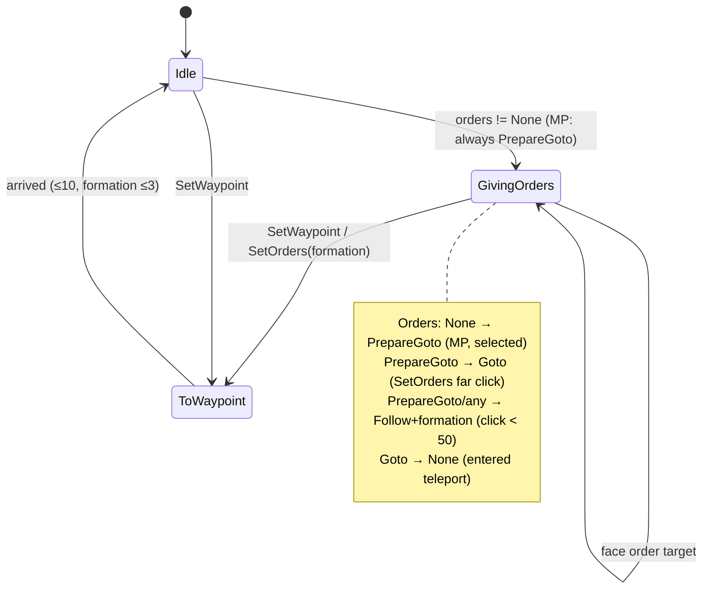

### CPU AI hook — `Officer::RunAI(AI*)` (called by the AI entity, P08) [C]
Every 1 s (`m_aiTimer`):
- OrderGoto: next think in 10 s; `FindNearestTarget(pos)` → `FindTargetBuilding(target, team)`; if the chosen AITarget is > 60 from the current order point → new order at target + random offset radius `20 + syncfrand(20)`, angle `syncfrand(2π)` (radar-target AITargets: use the RadarDish entrance in that cell) → `SetOrders`. Return.
- Otherwise ensure formation (`SetFormation(pos + front×50)` if not). If > 10 enemies within 270 (3 × 90): stop (`SetWaypoint(pos)`) and face their centroid. If walking, return. Nearest AITarget `t`: if `t->IsImportant()`: walk to it if > 20 away; if `t->NeedsDefending(team)` → hold and face away from an enemy-owned neighbour; else face the first neighbour. If not holding and `FormationFull()`: choose the nearest walkable AITarget that is enemy-owned or important & neutral → `GetBuilding(id)` with **the array index instead of the unique id (bug)** → `SetWaypoint`.

### Damage, death [C]
`ChangeHealth`: if hit while `m_shield > 0`: `loss = min(shield×10, −amount)`; spawn `ceil(loss/10)` free spirits (team 0, random horizontal velocity `SFRAND(40)`), `shield -= int(loss/10)`, `amount += loss`. Then base `ChangeHealth` (255 hp, spirit on death). On death `g_explosionManager.AddExplosion(shape, transform)` (shape shatters, P12).

### Rendering, flag, sounds [C]
- Shape `officer.shp`; MP per-team copy `officer.shp_<colourId>_<coopGroupPosition>` recoloured with `ConvertShapeColoursToTeam(…, convertAll = true)` (entire model in team colour). Distance scaling and camera-facing like Darwinians (`DarwinianScaleFactor`); damaged flicker (unsynced `frand`); `RenderPixelEffect` only in SP.
- Flag at marker "MarkerFlag", size 20 (MP grows with distance `1 + scale·(d−100)/1500`, camera-facing by d/200); wobbles while orders ≠ None; textures `icons/banner_none.bmp` (None/PrepareGoto/Goto), `icons/banner_follow.bmp`, `icons/banner_formation.bmp`, `icons/banner_absorb.bmp`; Goto flag points at the order position (MP: route waypoint 1). The local team's flags are drawn by `markersystem.cpp`, others by `Officer::Render`.
- Shield: `m_shield` green souls (100,250,100) orbiting 10 above (`RenderSpirit`: quads 0.5/1.5 and `textures/glow.bmp` 10).
- `CalculateBoundingSphere`: centre +4 y, radius 8 (scaled with distance) — picking.
- Sounds: Entity's + "SetOrderNone", "SetOrderGoto", "SetOrderFollow", "SetOrderAbsorb", "SetOrderFormation" (`CancelOrderSounds` stops all five).

### Order effect objects [C]
| Class | Type | Behaviour |
|---|---|---|
| `OfficerOrders` (SP) | `EffectOfficerOrders` | travels at `clamp(1.1·\|v\|, 30, 150)` along the ground (+2) to the waypoint; local team: `TypeMuzzleFlash` trail particles (size 30); arrives when the next step overshoots or < 10; fades 1 s; render `textures/starburst.bmp` size 15 (SP colour (1,0.3,1,0.7)) |
| `MultiwiniaOfficerOrders` (MP) | `EffectOfficerOrders` | follows the officer's route (`FollowRoute`: start at waypoint 1, advance within 10) at `clamp(\|v\|·(1+dt), 30, 100)`; every 0.2 s game time drops an `OfficerOrderTrail`; arrives when the route ends; fades 1 s; rendered for friends of the local team |
| `OfficerOrderTrail` | `EffectOfficerOrderTrail` | ground-aligned arrow `icons/widearrow.bmp`, size `max(5, 20·camDist/2000)`, alpha `0.6·(1 − age)`, removed after 1 s; rendered for the local team only |

<!-- from P03_entity_core -->
## [→ 02_units_and_entities] Spirit (soul)

[C] `code/worldobject/spirit.h`, `code/worldobject/spirit.cpp`. `class Spirit : WorldObject` — not an Entity; stored **by value** in `Location::m_spirits` (`FastDArray<Spirit>`, initial size 100, step 100, sliced over `NUM_SLICES_PER_FRAME`) [C] `code/location.cpp:Location::Location` (≈L147–156). Note `spirit.cpp` `#undef`s `TRACK_SYNC_RAND`, so spirit RNG calls are never sync-logged even in debug builds [C].

### Creation — `Location::SpawnSpirit(pos, vel, team, ownerId)` [C] `code/location.cpp`
- Returns −1 (no spirit) if `team == GetMonsterTeamId()`.
- `index = m_spirits.GetNextFree()`; `pos = _pos + (0,1,0)`; `vel = _vel` (deaths pass `entity.vel × 0.5`); `m_teamId = team`; `m_worldObjectId = ownerId` (the dead entity's id; officers' shield spirits pass an invalid id and **team 0**); `m_id = (team, UNIT_SPIRITS, index, uniqueId −1)`; `Begin()`.
- Producers [C] grep `SpawnSpirit(`: `Entity::ChangeHealth` (every entity death), `Officer` (shield loss / shield attack), `Darwinian` (sacrifice, legacy), `anthill.cpp`, `sporegenerator.cpp`, `tree.cpp`, `triffid.cpp`, `location.cpp` (2 sites), `interface/cheat_window.cpp` [B:DEBUG].

### Members
| Member | Default | Meaning |
|---|---|---|
| `m_teamId` | 255 | owning team (colour) |
| `m_state` | StateUnknown | see enum |
| `m_worldObjectId` | — | id of the entity that died (used by `Location::GetSpirit(WorldObjectId)` lookups) |
| `m_nearbyEggs[SPIRIT_MAXNEARBYEGGS = 8]`, `m_numNearbyEggs`, `m_eggSearchTimer` | 0 | legacy Virii/egg fertilisation cache (`NumNearbyEggs()` re-searches every 3 s network time within `VIRII_MAXSEARCHRANGE` for dormant on-ground Eggs) [B:LEGACY] |
| `m_broken` | −1 | seconds since the soul was "broken" (`BreakSpirit()`); ≥ 0 hides the inner core and drops the shell |
| `m_harvesterId` | — | harvester carrying us |
| `m_timeSync` | 6.0 (Begin) | state timer (counts down) |
| `m_hover` | — | wobble velocity component |
| `m_positionOffset` | `syncfrand(10)` | wobble phase |
| `m_xaxisRate`, `m_yaxisRate`, `m_zaxisRate` | `syncfrand(2)` each | wobble amplitudes (random walk in [0,2]) |
| `m_groundHeight` | terrain at spawn | floor |
| `m_pushFromBuildings` | true | push out of buildings until clear |
| `m_shellPos` | — | outer shell position when broken |

### States [C] `spirit.h` enum (values in order)
| # | State | Meaning / behaviour in `Advance` |
|---|---|---|
| 0 | StateUnknown | constructed, before `Begin` |
| 1 | StateBirth | rise: `hover.y = max(hover.y, syncfrand(0.5))`; if > 10 above ground: `hover.y = (−10 − syncfrand(10)) × min(h/100, 1)` (pulled back down); else when `m_timeSync ≤ 0` (6 s) → Floating with `m_timeSync = 120 + syncsfrand(60)` (90–150 s), **÷3 in MP (30–50 s)** |
| 2 | StateFloating | wobble; capturable (harvesters, engineers, eggs, Darwinian worship in SP); timer expiry → Death with `m_timeSync = 180` (**÷2 in MP = 90 s**); SP also `AddToGlobalWorld()` (`GlobalLocation::AddSpirits(1)`) |
| 3 | StateAttached | held by a collector (Engineer, legacy): no wobble, no floor clamp (`CollectorArrives` / `CollectorDrops` → Floating, re-enable building push, new ground height) |
| 4 | StateInStore | in a SpiritStore (legacy): wobble and `m_timeSync` countdown still run but the state has no transition logic (never expires); no building push |
| 5 | StateInEgg | fertilising an Egg (legacy): no wobble/floor (`InEgg`; `EggDestroyed` → Floating) |
| 6 | StateDeath | ascend: `hover.y = max(hover.y, 2 + syncfrand(2))` (rises 2–4 u/s); when `m_timeSync ≤ 0` → **removed** (`Advance` returns true); no building push |
| 7 | StateShaman | used by a shaman (legacy): timer forced 0; no wobble (`SetShamanMode` sets 5.0 then Advance zeroes it) |
| 8 | StateHarvested | being sucked up by a Harvester (`Harvest(id)`): no wobble (harvester moves it, P04) |
| 9 | StateCollected | in a harvester's collector: no timer/wobble update; `vel = harvester.vel`; harvester gone → Floating |

### Per-tick motion [C] `Spirit::Advance`
1. `vel *= (1 − dt)` (drag 10 %/tick).
2. Unless Attached/InEgg/Shaman/Harvested: (unless Collected) `m_timeSync -= dt`, `m_positionOffset += dt`, each axis rate `+= syncsfrand(1) × gameSpeed` (±0.5) clamped to [0,2]; `hover = sin(offset) × rates` (all three axes share the same phase); then the state switch above.
3. Push from buildings (if enabled and not InStore/Death): for each building in the obstruction cell with `DoesSphereHit(pos, 5)`: `vel += (pos − building.pos) × 0.1`, `vel.y = 0`, `|vel| ≤ 10`; when nothing is hit and `|vel| < 1` the push is disabled permanently.
4. `pos += (vel + hover) × dt`; clamp x,z to the world; unless InEgg/Death/Attached: `pos.y ≥ groundHeight + 2` (ground height cached at spawn — spirits do not follow terrain).
5. `m_broken` timer advances if set.
RNG per spirit per tick: 3 × `syncsfrand` (+1 `syncfrand` in Birth/Death) — a significant, population-proportional consumer of the shared stream (X3).

Lifetime totals (no capture): MP ≈ 6 + 40 ± 10 + 90 ≈ 126–146 s; SP ≈ 6 + 120 ± 30 + 180 s [C/I arithmetic].

### Other API [C]
`SkipStage()` (`m_timeSync = 0`, used by SP MasterSpawnPoint to accelerate spirits to heaven), `SetShamanMode()`, `BreakSpirit()` (once: `m_broken = 0`, shell position saved, 5 `TypeControlFlash` particles using **synced** `FRAND(5)` velocities — cosmetic consuming sync RNG), `Harvest`, `InEgg`, `EggDestroyed`, `CollectorArrives` (sound "PickedUp", `SoundSourceBlueprint::TypeSpirit`), `CollectorDrops`, `AddToGlobalWorld`, `PushFromBuildings`, `NumNearbyEggs`, `GetNearbyEggs`.

### Rendering [C] `Spirit::Render`, `RenderWithoutGlBegin` (batched quads by `Location`)
Two camera-facing quads: inner size 1.0 alpha 255, outer size 3.0 alpha 100 (**MP halves both sizes and alphas**); team colour (255 → white); Birth grows with `1.2 − timeSync/6`; Death shrinks/fades with `timeSync / (180 or 90)`; monster team: invisible (alpha 0, blend `SRC_ALPHA, ONE_MINUS_SRC_COLOR`); broken: inner hidden, shell sinks `m_broken` units/s and fades 10 alpha/s. Render uses `predictionTime − SERVER_ADVANCE_PERIOD` (draws one tick behind).

```mermaid
stateDiagram-v2
    [*] --> Birth: SpawnSpirit (death)
    Birth --> Floating: 6 s and ≤10 above ground
    Floating --> Death: 30–50 s (MP) / 90–150 s (SP)
    Floating --> Harvested: Harvester::Harvest
    Harvested --> Collected: in collector (harvester.cpp)
    Collected --> Floating: harvester lost
    Collected --> [*]: delivered (spawn point / incubator)
    Floating --> Attached: CollectorArrives (Engineer, legacy)
    Attached --> Floating: CollectorDrops
    Floating --> InEgg: egg fertilised (legacy)
    InEgg --> Floating: EggDestroyed
    Floating --> Shaman: SetShamanMode (legacy)
    Death --> [*]: 90 s (MP) / 180 s (SP)
```

<!-- from P03_entity_core -->
## [→ 02_units_and_entities] EntityLeg — legged locomotion helper

[C] `code/worldobject/entity_leg.h`, `code/worldobject/entity_leg.cpp`. Used only by `Tripod` (`code/worldobject/tripod.cpp`, 3 legs) — `TypeTripod` is blocked under `BLOCK_OLD_DARWINIA_OBJECTS` ⇒ **[B:LEGACY]** in Multiwinia. (`spider.cpp` includes the header but uses its own `SpiderParameters` gait.) `AdvanceSpiderPounce` exists for a pouncing spider gait.

### Data
`EntityFoot`: `m_pos`, `m_targetPos`, `m_state` ∈ {`OnGround`, `Swinging`, `Pouncing`}, `m_leftGroundTimeStamp`, `m_lastGroundPos`, `m_bodyToFoot` (pounce).
`EntityLeg`: tuning `m_legLift` (foot lift height, "metres"), `m_idealLegSlope` (0 = vertical, 1 = 45°), `m_legSwingDuration` (s), `m_lookAheadCoef` (velocity look-ahead); `m_legNum`, `m_foot`, `m_rootMarker` (marker on the parent shape), `m_shapeUpper`/`m_shapeLower` (thigh/shin shapes), `m_thighLen`/`m_shinLen` (= distance to each shape's `MarkerEnd`), `m_parent`.
Tripod tuning [C] `tripod.cpp` `#define`s: `IDEAL_LEG_SLOPE 0.2`, `LEG_LIFT 3.0`, `LEG_SWING_DURATION 0.5`, `LOOK_AHEAD_COEF 1.2`, `FOOT_MOVE_THRESHOLD 1.0`; shapes `tripod_leg_part.shp` ×2.

### Algorithm
1. **Leg root** = parent shape marker transformed by `Matrix34(parent.front, up, parent.pos)`.
2. **Foot home** (`CalcFootHomePos(hover)`): root + horizontal(root − body centre) × groundNormal.y × (`idealLegSlope × hover`), then y −= hover (foot splayed outward proportionally to body height).
3. **Desire to move** (`CalcFootsDesireToMove`): distance from the foot to its home (direction weighting is commented out). The owner (Tripod) lifts the foot with the highest score, only when all feet are planted and score > `FOOT_MOVE_THRESHOLD` — a one-foot-at-a-time gait.
4. **Lift** (`LiftFoot`): target = home + parent velocity rotated by half the expected yaw (`1.2 × angVel.y × 0.5`) × `lookAheadCoef`, y snapped to terrain; state Swinging; timestamp = `g_gameTime`; remember last ground pos.
5. **Swing** (`Advance`): `f = RampUpAndDown(start, duration, g_gameTime)` (ease-in-out: `f = 2t²` for t < 0.5, else `1 − 2(1−t)²`; returns 1.0001 after the duration) — position = lerp(lastGround, target, f) + vertical arc (`3·f·lift` in the first third, `3·(1−f)·lift` in the last third, `lift` in between). `f > 1` → **plant** (pos = target, OnGround) and return true.
6. **Knee** (`CalcKneePos`): rotate the vector foot→root, scaled to shin length, about the horizontal axis perpendicular to centre→root by `θ = −acos(min(1, 0.4·|root−foot| / thighLen))` (the FIXME notes cos θ could exceed 1). Shin rendered foot→knee, thigh knee→root (`Render`, `RenderPixelEffect` marks pixel-effect cells).
7. **Pounce** (`AdvanceSpiderPounce(f)`): foot = body − bodyToFoot × (1−f for f<0.5, else f) + vel × f × 0.05.
**Determinism**: swing timing uses `g_gameTime`, which is **wall-clock** (`GetHighResTime`, `code/main.cpp`) — foot positions, and anything the owner derives from them (Tripod body height/fall), are not lockstep-safe. Irrelevant in Multiwinia (Tripod blocked) but must not be copied.

<!-- from P04_entities_military -->
## [→ 02_units_and_entities] 0. Common conventions used in this partition

### 0.1 Simulation clock
- One simulation tick = `SERVER_ADVANCE_PERIOD` = `0.1 * m_gameSpeed` seconds of game time [C] `code/gametimer.cpp:GameTimer::GetServerAdvancePeriod`. At normal speed one tick = 0.1 s (10 Hz). All "per tick" values below are converted to per-second at game speed 1.0 unless stated.
- `GetNetworkTime()` = `g_gameTimer.GetGameTime()` (accumulated sim time) [C] `code/gametimer.h`.
- Several weapons subtract gravity as `m_vel.y -= 9.8 * GetGameSpeed()` **per tick**; because the tick length also scales by game speed this equals a constant **98 world-units/s²** of game time [I] (arithmetic: 9.8·s per tick × 10/s ticks per game second).

### 0.2 Random number sources (determinism)
| Function | Generator | Range actually produced | Net-safe? | Ref |
|---|---|---|---|---|
| `syncfrand(x)` | `_syncfrand` = `_syncrand()·x/2^32`, `_syncrand` is a Mersenne-Twister (MT19937, `mt[]`/`mti`, `MATRIX_A`) seeded by `syncrandseed` | `[0, x)` | yes | [C] `contrib/systemiv/lib/math/random_number.cpp:_syncfrand` |
| `syncsfrand(x)` | `(_syncfrand(1)-0.5)*x` | **`(-x/2, +x/2)`** (header comment says ±x — wrong) | yes | [C] `contrib/systemiv/lib/math/random_number.cpp:_syncsfrand` |
| `syncrand()` | synced integer | `[0, 2^32)` | yes | [C] same file |
| `FRAND(x)` / `SFRAND(x)` (upper-case, used inside `Vector3` constructors) | `_syncfrand` / `_syncsfrand` with guaranteed left-to-right order | `[0,x)` / `(-x/2,x/2)` | yes | [C] `code/lib/vector3.cpp:FromRand`, `code/lib/vector3.h` |
| `frand(x)` | `AppRandom()` (local MS-CRT style LCG, seeded `AppSeedRandom(1)` at `Location` init) | `[0, x]` | **no** — also consumed by renderer | [C] `contrib/systemiv/lib/math/random_number.cpp:frand`, `code/location.cpp:Location::Init` |
| `sfrand(x)` | `AppRandom()` | `(-x/2, x/2]` | **no** | [C] `random_number.cpp:sfrand` |
| `AppRandom()` | local LCG `holdrand*214013+2531011`, `>>16 & 0x7fff` | `[0, 32767]` | **no** | [C] `random_number.cpp:AppRandom` |

Every sim-side use of a non-synced generator in this partition is listed in §X3 (determinism notes).

### 0.3 Research levels in Multiwinia
Many weapon parameters are switch tables over `GlobalResearch::CurrentLevel(type)`. In Multiwinia (`App::Multiplayer()` ≡ `m_gameMode == GameModeMultiwinia`) `Location::Init` forces **all** research types to level **3**, then overrides: `TypeSquad=1`, `TypeLaser=2`, `TypeGrenade=2`, `TypeRocket=2`, `TypeAirStrike=2`, `TypeDarwinian=4` [C] `code/location.cpp:Location::Init` (block after `InitFuturewinianTeam`). The tables below therefore name the **Multiwinia value** explicitly; other levels are Darwinia [B:LEGACY].

| Research type | Multiwinia level | Used by (this partition) |
|---|---|---|
| Squad | 1 | squad size `2 + level` = **3** squaddies (`code/taskmanager.cpp:Task::TargetSquad`) |
| Laser | 2 | laser lifetime 0.6 s (`code/location.cpp:Location::FireLaser`) |
| Grenade | 2 | max throw force 110 (`ThrowableWeapon::GetMaxForce`) |
| Rocket | 2 | rocket max life 0.75 s; tank missile life 15 s |
| AirStrike | 2 | **2** bombers per airstrike marker (`AirStrikeMarker::Advance` passes the level as unit size) |
| Armour | 3 | turret-shell life table (overridden to 0.6 s in Multiplayer) |
| Controller | 3 | — (controller grenade not reachable in Multiwinia, see §1.5) |
| Darwinian | 4 | (Darwinian partition) |

### 0.4 Entity stats source
`data/stats.txt` is read **positionally** (row *n* → entity type *n*; the NAME column is stored but not used for lookup) into `EntityBlueprint::m_stats[type][HLTH,SPED,RATE]` as doubles [C] `code/worldobject/entity.cpp:EntityBlueprint::Initialise`. `EntityBlueprint::GetStat` multiplies SPEED by `(1 + m_difficultyLevel/10)` for every type except `SpaceInvader` [C] `entity.cpp:EntityBlueprint::GetStat`; `m_difficultyLevel` defaults to 0 (`code/app.cpp:App::App`) and is overwritten by a level's stored difficulty if the level file has one (`code/location.cpp:Location::Init`) [C]. Each entity copies the stats into `unsigned char m_stats[3]` in `Entity::SetType` [C] `code/worldobject/entity.h`, so **fractional values truncate** (e.g. InsertionSquadie RATE 0.5 → per-entity 0) and values are capped 0..255. `Entity::SetType` also sets `m_reloading = syncfrand(RATE)` [C].

| Row | Type | HLTH | SPED | RATE | Partition use |
|---|---|---|---|---|---|
| 1 | LaserTroop | 20 | 15 | 1 | §8 |
| 2 | Engineer | 255 | 28 | 0 | §10 |
| 4 | InsertionSquadie | 75 | 30 | 0.5 | §4 |
| 10 | SpaceInvader | 10 | 40 | 1 | §2 (airstrike bomber) |
| 15 | Armour | 200 | 60 | 5 | §5 |
| 19 | Shaman | 200 | 25 | 2 | §9 |
| 20 | Harvester | 255 | 28 | 0 | §7 |
| 21 | Nuke | 255 | 100 | 0 | §3 |
| 24 | Tank | 150 | 50 | 2 | §6 |
[C] `data/stats.txt`.

### 0.5 Base `Entity` behaviour relied on by every unit here
- `Entity::ChangeHealth(amount, type)` (base): ignores damage type; if `health+amount <= 0` → `m_stats[Health]=100`, `m_dead=true`, sound `Die`, and **spawns one spirit** at `m_pos` with `m_vel*0.5` (`Location::SpawnSpirit`); else clamps to 255. Plays `LoseHealth` on any negative amount. Always returns true [C] `code/worldobject/entity.cpp:Entity::ChangeHealth`.
- `Entity::AdvanceDead`: dead bodies fade: health −40/s on ground, −20/s in air; removed when ≤ 0 [C] `entity.cpp:Entity::AdvanceDead`.
- `Entity::AdvanceInWater`: after 10 s in water `ChangeHealth(-500)`; swims at forced speed 5 u/s, `y = -sin(t·3) − 4` [C] `entity.cpp:Entity::AdvanceInWater`.
- `Entity::AdvanceInAir`: gravity 15 u/s², lands when `y <= ground+0.1` [C] `entity.cpp:Entity::AdvanceInAir`.
- `Entity::Advance`: decrements `m_reloading`; computes `m_renderDamaged` with **non-synced** `frand(0.75)` (render-only flag) [C]; clamps position to world bounds `[0,sizeX]×[0,sizeZ]`.
- `Entity::Attack(pos)` (generic laser): if `m_reloading==0`: target jittered `syncsfrand(15)` in x,z (±7.5), fires from `m_pos+3y` a laser at speed **150**, `m_reloading = RATE`, sound `Attack` [C] `entity.cpp:Entity::Attack`.

### 0.6 Damage types
`Entity::DamageType{Unresistable=0, Laser, Explosive, TurretShell, Fire}` [C] `code/worldobject/entity.h`. Per-type resistance is implemented by overriding `ChangeHealth` in each class (tables in each unit section).

### 0.7 Shared explosion: `Location::Bang(pos, range R, damage D, teamId=-1, fromBuildingId=-1)`
Not in this partition but every explosive in it calls it; restated here because the falloff is non-obvious [C] `code/location.cpp:Location::Bang`:
1. Cosmetic particles: `numCores = R·D·0.01 (+frand)` `TypeExplosionCore` at `pos + up·0.3R`; `numDebris = clamp(R·D·0.01, 2, 30)` `TypeExplosionDebris` (non-synced `frand`, cosmetic).
2. Entities: all neighbours within **2R** (any team, including the attacker's own). `fraction = (2R − d) / R * 2` — **operator-precedence bug**: evaluates as `((2R−d)/R)·2`, clamped to [0,1]. Net effect: **full damage `D` for d ≤ 1.5R, linear falloff to 0 at d = 2R**. Damage dealt `ChangeHealth(−D·fraction, DamageTypeExplosive)`.
3. Knock-back (if `ChangeHealth` returned true, and type not InsertionSquadie/Officer/Shaman): `push = normalise(entity−pos)` with `push.y = D` if on ground else −1, normalised, ×fraction; added to `m_vel`, `m_onGround=false` (so knock-back magnitude ≤ 1 u/s — tiny; vertical dominated) [C].
4. Kill count: entities that transitioned to dead and whose team ≠ `teamId`; Multiwinia credits `darwinianKills` only to `teams[teamId].m_teamKills` (if teamId valid) [C].
5. Spawns a `Shockwave(teamId, size = R/20)` at pos (§1.8). Under `USE_DIRECT3D` also `g_deformEffect->AddPunch(pos, R)` [B:D3D].
6. Buildings: every building with centre distance < **3R** receives `Damage(−D·(1 − d/3R))` [C].
Returns `numKilled`.

<!-- from P04_entities_military -->
## [→ 02_units_and_entities] [→ 04_crates_powerups_and_weapons] 1. Projectile & effect classes (`code/worldobject/weapons.{h,cpp}`)

All classes below derive from `WorldObject` and live in `Location::m_effects` (except `Laser`, pooled in `Location::m_lasers`). Their `WorldObject::m_type` is one of the `Effect*` values of `WorldObject` [C] `code/worldobject/worldobject.h`. They are advanced once per tick and removed when `Advance()` returns true.

### 1.0 Class inventory
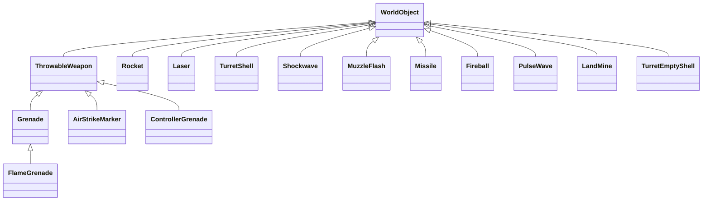

| # | Class | `m_type` | Who creates it in Multiwinia | Build/reachability |
|---|---|---|---|---|
| 1 | `ThrowableWeapon` (abstract base) | set by subclass | — | [B:FULL] |
| 2 | `Grenade` | `EffectThrowableGrenade` (or `EffectThrowableAirstrikeBomb` when dropped by bombers) | InsertionSquad grenade (`InsertionSquad`), Darwinian grenade-throw (`code/worldobject/darwinian.cpp`), Mortar gun-turret (`code/worldobject/gunturret.cpp:GunTurret::Advance`, `explodeOnImpact=true`, life 1000), `Unit` AI grenade (`code/unit.cpp`), airstrike bomber (`SpaceInvader::Advance`) | [B:FULL] |
| 3 | `FlameGrenade` | `EffectFlameGrenade` | Napalm airstrike bombers only (`SpaceInvader::Advance` when `m_napalm`) | [B:FULL] |
| 4 | `AirStrikeMarker` | `EffectThrowableAirstrikeMarker` | `Crate::RunAirStrike` via `Location::ThrowWeapon` (3–7 per strike) | [B:FULL] |
| 5 | `ControllerGrenade` | `EffectThrowableControllerGrenade` | Only via `Location::ThrowWeapon(EffectThrowableControllerGrenade)`; InsertionSquad's controller weapon path (§4) | [B:LEGACY] (see §1.5) |
| 6 | `Rocket` | `EffectRocket` | InsertionSquad rocket, Darwinian rocket instead of grenade when `team->m_evolutions[Team::EvolutionRockets]==1` (rocket-Darwinians crate `Crate::RunRocketDarwinians`; `m_firework=true` when the Darwinian is infected) [C] `code/worldobject/darwinian.cpp` (threat-response block), Rocket gun-turret (life 1.0), Tank (§6) | [B:FULL] |
| 7 | `Laser` | (pooled, `m_type` unused) | `Entity::Attack` (generic, speed 150), Darwinian lasers, InsertionSquad lasers, Subversion turret / Subversion Darwinians (`m_mindControl=true`), Tripod, camera debug | [B:FULL] |
| 8 | `TurretShell` | `EffectGunTurretShell` | Standard gun-turret via `Location::FireTurretShell`; Armour turret (§5) | [B:FULL] |
| 9 | `Shockwave` | `EffectShockwave` | every `Location::Bang` (`Location::CreateShockwave`) | [B:FULL] |
| 10 | `MuzzleFlash` | `EffectMuzzleFlash` | `Location::ThrowWeapon`, `FireRocket`, `FireTurretShell`, `FireLaser`; also embedded (not registered) inside `Missile` | [B:FULL] (cosmetic) |
| 11 | `Missile` | not set → `TypeInvalid` (0) [C] `code/worldobject/worldobject.cpp:WorldObject::WorldObject` | Tank only (§6); the Armour missile code is commented out [C] `code/worldobject/armour.cpp` | [B:FULL] compiled; reachable only with Tank (§6) |
| 12 | `Fireball` | `EffectFireball` | Flame gun-turret via `Location::LaunchFireball` (life 1.0) | [B:FULL] |
| 13 | `PulseWave` | `EffectPulseWave` | `code/worldobject/pulsebomb.cpp` (Assault-mode pulse bomb) | [B:FULL] |
| 14 | `LandMine` | not set → `TypeInvalid` (0) [C] | Tank (§6) | [B:FULL] compiled, reachable only with Tank |
| 15 | `TurretEmptyShell` | `EffectTurretEmptyShell` | Gun-turret shell-casing ejection (`code/worldobject/gunturret.cpp`) | [B:FULL] (cosmetic, but uses sim tick) |

### 1.1 `ThrowableWeapon` (base)
- Construction (`ThrowableWeapon::ThrowableWeapon(type, startPos, front, force)`): shape `throwable.shp`; `m_pos=startPos`; `m_vel = front·force`; `m_force=1.0` (bounce energy, **not** the throw force); `m_birthTime = GetNetworkTime()`; orientation `m_up=front`, `m_front` built perpendicular [C].
- `Initialise()` → sound event `Create` [C].
- Sound routing `TriggerSoundEvent(event)`: Grenade / AirstrikeMarker / ControllerGrenade → `SoundSourceBlueprint::TypeGrenade`; AirstrikeBomb / FlameGrenade → `TypeAirstrikeBomb` [C] `weapons.cpp:ThrowableWeapon::TriggerSoundEvent`. Airstrike bombs/napalm bombs are created directly with `new` in `SpaceInvader::Advance` and never `Initialise()`d, so they play no `Create` event (the bomber plays `DropGrenade` instead) [C].
- `Advance()` per tick:
  1. Trail: unless type is AirstrikeMarker, with probability `syncfrand(1) > 0.1/gameSpeed` emit `Particle::TypeMissileTrail` (size 60) at `pos − vel·dt`, vel `vel/4 + syncsfrand(5)` per axis (synced RNG consumed for a cosmetic particle) [C].
  2. If `m_force > 0.1`: gravity (98 u/s², §0.1); `pos += vel·dt`; if `pos.y < ground+1`: `WorldObject::BounceOffLandscape()` (snaps `y` to ground — the "midpoint" it intends is computed from `lastPos = m_pos`, so it is the current position — reflects velocity about the terrain normal `v' = 2(n·(−v))n − (−v)` and multiplies by `COEF_OF_RESTITUTION = 0.85` [C] `code/worldobject/worldobject.cpp:WorldObject::BounceOffLandscape`), then `m_force *= 0.75`, `m_vel *= m_force`, clamp to ground+1, sound `Bounce` [C]. With `m_force ≤ 0.1` the object is at rest. Speed retained at bounce *k* (k=1,2,…) = `0.85 · 0.75^k` of the incoming speed (0.64, 0.48, 0.36, …); `m_force` drops below 0.1 after the 9th bounce (0.75^8 = 0.100, 0.75^9 = 0.075) [I] (arithmetic).
  3. Returns false (never self-destructs).
- `Render`: tumbling shape; once per second (from `numFlashes = int(now − birth)`) triggers sound `Flash` **from the render path** (client-side, cosmetic); draws a `textures/starburst.bmp` flash billboard in `m_colour` for the last 20 % of each second [C].
- `GetMaxForce(level)`: 0→50, 1→80, **2→110 (Multiwinia)**, 3→140, 4→170, other→0 [C].
- `GetApproxMaxRange(maxForce)` = `F + 0.75F + 0.5625F` = 2.3125·F (≈254 for F=110) [C]. (A heuristic used by AI/UI; real ballistic range differs [I].)
- `RemoveForce()` sets `m_force=0` (freezes in place); `ResetForce()` sets 1 [C]. Used by Harvester (§7).

Throw helper `Location::ThrowWeapon(pos, target, type, team, force=0, lifeTime=0, explodeOnImpact=false)` [C] `code/location.cpp:Location::ThrowWeapon`:
- `force = sqrt(|target−pos|)·8`, capped at `GetMaxForce(grenadeResearch)` (= 110 in Multiwinia; Darwinia team 1 single-player uses level 4); if `_force != 0` it overrides (no cap).
- `front = normalise(target−pos)`, then `front.y = 1`, renormalise → **45°-ish launch** (exactly 45° only when horizontal; generally `atan(1/|horiz|)` after normalisation) [C].
- Creates the weapon, registers in `m_effects` with id team = thrower; calls `Initialise`. For Grenade, `lifeTime≠0` overrides `m_life`.
- Spawns a `MuzzleFlash(pos, front, size 20, life 3)`.
- For ControllerGrenade, sets `m_squadTaskId` to the team's current task if it is a Squad task.

### 1.2 `Grenade`
| Field | Default | Ref |
|---|---|---|
| `m_life` (fuse) | 3.0 s | [C] `weapons.cpp:Grenade::Grenade` |
| `m_power` | 25.0 | [C] |
| `m_colour` (flash) | (255,100,100) | [C] |
| `m_explodeOnImpact` | false (Mortar turret: true) | [C] |
| `m_collected` | false; set by Harvester | [C] |

`Grenade::Advance`: if `m_collected` → return false (frozen, does nothing; Harvester owns it). Else `m_life -= dt`; explode when `m_life ≤ 0`, or if `m_explodeOnImpact` and `pos.y < ground + 2`. Explosion: sound `Explode`, `Location::Bang(pos, R = power/2, D = power·2, team = thrower)` → default grenade **R 12.5, D 50** (full damage ≤ 18.75, zero at 25; buildings < 37.5). Then removed. Otherwise runs `ThrowableWeapon::Advance` [C].

Airstrike bomb variant (created in `SpaceInvader::Advance`, §2): `m_type = EffectThrowableAirstrikeBomb`, `m_life = 1.5`, `m_power = 50` → **Bang R 25, D 100** (full ≤ 37.5, zero at 50, buildings < 75) [C].

### 1.3 `FlameGrenade` (napalm bomb)
Derived from `Grenade`; colour (255,100,100); `m_type=EffectFlameGrenade` [C]. Created only by napalm bombers with `m_life=1.5`, `m_power=50`. `FlameGrenade::Advance` (note: does **not** honour `m_collected` or `m_explodeOnImpact`) [C]:
- `m_life -= dt`; on `≤0`: sound `Explode`; **no Bang**; every `Darwinian` within `power·1.25 = 62.5` of **any team** (all `include[]` true) → `Darwinian::SetFire()`; 80 cosmetic particles (`TypeFireball` ×51, `TypeFire` ×20, `TypeMissileTrail` ×9; sizes 150–250, non-synced); every building of type `Tree` or `Triffid` with centre distance < `power·2 = 100` takes `Damage(power·−4 = −200)` (a `fraction` is computed but unused — no falloff) [C]. Removed.
- Otherwise `ThrowableWeapon::Advance`.

### 1.4 `AirStrikeMarker` — see §2 (airstrike delivery). Class facts: colour (255,100,100); `m_naplamBombers` (sic) false by default; `m_airstrikeUnit` id [C].

### 1.5 `ControllerGrenade`
- Colour (100,100,255); `m_squadTaskId=-1` [C].
- `Advance`: runs base throw physics; after **3.0 s** from birth: sound `ExplodeController` (TypeGrenade), particle shower `TypeControlFlash` (5–9 random up-flashes + a 50-particle ring of radius 50, non-synced RNG), then every `Darwinian` **of the thrower's team** within 50 → `Darwinian::TakeControl(m_squadTaskId)`; removed [C].
- Reachability: only created by `Location::ThrowWeapon(EffectThrowableControllerGrenade)`, whose only caller is `Squadie::FireSecondaryWeapon` when the squad's `m_weaponType == TypeController` [C]. No reachable Multiwinia path sets that weapon type (§4.5), and no crate gives a Controller → [B:LEGACY] [I].

### 1.6 `Rocket`
| Param | Value | Ref |
|---|---|---|
| Spawn | `pos = start + (0,2,0)`; `vel = normalise(target−pos)·50` | [C] `Rocket::Rocket` |
| Acceleration | each tick while `|vel| < 150`: `vel *= 1.2` (50→60→72→86.4→103.7→124.4→149.3→179.2; stops growing once ≥150, so cruise ≈ **179 u/s**) | [C] `Rocket::Advance` |
| Shape | `throwable.shp` | [C] |
| Max life (Multiwinia: Rocket research 2) | **0.75 s** (table 0→0.25, 1→0.5, 2→0.75, 3→1.0, 4→1.5); overridden by `m_lifeTime` if non-zero (`FireRocket` sets it when `_lifeTime != -1`, e.g. Rocket turret 1.0 s) | [C] |
| Firework curl (`m_firework`, set for infected Darwinians' rockets) | per tick add to vel.x/z: `sign(Δ)·min(Δ²,16)` where Δ = vel·dt component — rockets spiral outward | [C] |
| Explodes when | life expired; or `ground ≥ pos.y`; or any building in the obstruction cell `DoesSphereHit(pos, 3.0)` | [C] |
| Explosion | `Bang(pos, R=15, D=25, team, fromBuilding)` → full 25 dmg ≤ 22.5, 0 at 30; buildings < 45 | [C] `Rocket::Explode` |
| Firework extras | extra `TypeExplosionCore` particles in a random colour (non-synced `frand/sfrand`) | [C] |
| Kills credit | if fired by a GunTurret: `RegisterKill(255, numKills)` | [C] |
| Sounds | `Create` / `Explode` (TypeRocket); stops `Rocket Create` loop on explode | [C] |
| Trail | sim: `TypeFire` particle with prob. `syncfrand(1) > 0.2`; render: 5× `TypeMissileFire` per frame (non-synced) | [C] |

Effective rocket range in Multiwinia: the rocket lives 7–8 ticks (expiry test `now > spawnTime + 0.75`), covering (60+72+86.4+103.7+124.4+149.3+179.2)·0.1 ≈ **77.5 u**, or ≈ 95 u if an 8th tick runs, before timing out [I] (arithmetic; acceleration is applied before the move, so the first tick moves at 60).

### 1.7 `Laser`
- Pooled; `Initialise(lifeTime)`: `m_harmless=false`, `m_bounced=false`, sound `Create` (TypeLaser) [C].
- Lifetime (from `Location::FireLaser`): Laser research 2 → **0.6 s** (table 0→0.2, 1→0.4, 2→0.6, 3→0.8, 4→1.0); ×2 for mind-control lasers ("subversion lasers are half speed") [C] `code/location.cpp:Location::FireLaser`. Speed is the caller's velocity (generic `Entity::Attack`: 150 → range 90 u; squaddie 200 → 120 u; Subversion Darwinian `Darwinian::FireSubversion`: 75 with ×2 life → 90 u; subversion turret: shell vel/4).
- `FireLaser` also spawns `MuzzleFlash(pos, dir, size 25·lifetime, life 1.5)` [C].
- `Laser::Advance` per tick [C]:
  1. If `m_fromTeamId` is −1/255 → removed. `m_life -= dt`; ≤0 → removed.
  2. Move `pos += vel·dt`.
  3. **Terrain**: if `pos.y ≤ ground`: first time → ricochet: ray-cast from old position to terrain hit point, reflect velocity about terrain normal (`v' = 2(n·(−v))n − (−v)`), continue the remaining step length from the hit point, `m_bounced=true`. Second ground contact → removed.
  4. Out of world bounds → removed.
  5. **Buildings** (obstruction-grid cell): `DoesRayHit(pos, dir, step)` → particle `TypeRocketTrail`, sound `HitBuilding`, removed. (No building damage.)
  6. **Entities** (only while not `m_harmless`): enemies of `m_fromTeamId` within `2·|halfStep|` of pos; hit if (Multiwinia) `|entity.y − laser.y| < 5` **and** 2-D point-to-segment distance < 5 (segment = pos ± half step). (Single-player skips the vertical test.) On first hit:
     - Mind-control laser vs Darwinian: spawn a new Darwinian of `m_fromTeamId` at the victim's pos/vel, mark victim `m_destroyed` (vanishes without spirit), new Darwinian `m_previousTeamId = old team`, `m_colourTimer = 4.0` (colour-fade effect) [C].
     - Otherwise damage `20 + syncfrand(20)` (int-truncated → 20..39) via `ChangeHealth(−dmg, DamageTypeLaser)`; if the hit killed it: `teams[from].m_teamKills++` **only for Darwinians** (Multiwinia), sound `KilledEntity`; if survived and Darwinian: sound `InjuredEntity`. If `ChangeHealth` returned true: push vector = laser direction length `syncfrand(10)`, `y = 7 + syncfrand(5)`; sets `m_front` (except InsertionSquadie/Virii/Shaman) and adds to `m_vel` (except Virii/Shaman).
     - Laser becomes `m_harmless` (keeps flying, renders, but cannot hit again).
- Render: team-coloured 10-unit billboard quad (white for the monster team); mind-control lasers use `textures/subversion.bmp` at double width; camera shake 0.5 if within √200 ≈ 14 u of camera [C].

### 1.8 `Shockwave`
Created by every `Bang` with `size = R/20` and `m_life = size` seconds [C] `Shockwave::Shockwave`, `code/location.cpp:Location::CreateShockwave`.
- Per tick while `m_life > 0` (then removed): ring radius `r = 35 + 40·(size − life)` (starts at 35, expands 40 u/s); every entity (any team) whose centre distance satisfies `|d − r| < 10` is hit: `fraction = life/size` (1→0). Darwinians: with probability `syncfrand(4) < 0.1` (**2.5 %** per tick) `SetFire()` instead of damage; otherwise (and for all non-Darwinians) `ChangeHealth(−40·fraction, Explosive)`. Kill credit: if the victim died and its team ≠ the shockwave's id-team: Darwinian victims (team valid) add `m_teamKills` to `m_teamId`; GunTurret source registers the kill. Knock-back if on ground (not InsertionSquadie/Officer/Shaman): `push = normalise(victim−centre)`, `y=3`, length `25·fraction`, `m_onGround=false` [C] `Shockwave::Advance`.
- Because the ring band is 20 u wide and expands 40 u/s, a stationary entity is inside the band for ≈0.5 s = **≈5 ticks** and is hit each tick [I] (arithmetic). Shockwave damage therefore extends lethal range well beyond `2R` for big bangs (Nuke: rings out to 35+40·2.5 = 135).
- Size by source: grenade R12.5 → 0.625 s (r 35→60); bomb R25 → 1.25 s (35→85); rocket R15 → 0.75 s; missile R20 → 1.0 s; nuke R50 → 2.5 s (35→135); land-mine R20 → 1.0 s.
- Render: yellow→pink triangle-fan disc at y+5 with alpha `0.6·life/size`; full-screen white flash for the first 0.1 s if on-screen, alpha `(1 − age/0.1)·max(0, 1 − dist/500)` plus camera shake; `starburst.bmp` and `glow.bmp` billboards for the first 1 s [C].

### 1.9 `MuzzleFlash`
Cosmetic. `Advance`: removed when `life ≤ 0`; moves `front·10·dt` per tick; `life -= 10·dt` (so `life` is in tenths of a second: life 3 → 0.3 s) [C]. Render: 5 nested quads of `textures/muzzleflash.bmp`, alpha `clamp(life·0.75, 0, 1)`, depth test disabled if `size < 50` [C].

### 1.10 `Missile`
- Shape `missile.shp`, requires marker `MarkerBooster` (fatal assert if missing) [C].
- `m_life = 5 + rocketResearch·5` → **15 s** in Multiwinia [C] `Missile::Missile`.
- `Advance`: `life -= dt`, expired → explode. If the firing Tank (`m_tankId`) still exists, `m_target = Tank::GetMissileTarget()` (re-targeted every tick — player-guided). `AdvanceToTargetPosition(target)`: turn rate blend `front·(1−0.2) + targetDir·0.2` per tick (amountToTurn = 2·dt); terrain look-ahead 100 u along targetDir — if that point is below ground and the target is > 100 away, steer straight **up**; speed **200 u/s**; if the next position is below ground → returns true (explode); arrival when within **20** of target → explode [C].
- Trail: 2 `TypeMissileTrail` particles per tick at the booster marker (synced RNG for size `50+syncfrand(150)`).
- `Explode`: `Bang(pos, R=20, D=100)` with **teamId −1** (no kill credit; damages everyone) → full 100 ≤ 30, 0 at 40; buildings < 60 [C].
- Render: shape, embedded `MuzzleFlash` booster flame (size 30–50, non-synced), 5× `TypeMissileFire` per frame [C].

### 1.11 `TurretShell`
- `TurretShell(life)`; `Location::FireTurretShell` sets life by armour research (0/1→0.5, 2→1.0, 3→1.5, 4→2.0) but **Multiplayer forces 0.6 s**; in single-player the shell's id team is forced to 255 [C] `code/location.cpp:Location::FireTurretShell`. Muzzle flash size 60, life 2.
- Per tick: move `pos += vel·dt`; life ≤0 → `ExplodeShape(0.2)` (shape-fragment explosion of `turretshell.shp` via `g_explosionManager`) and removed; leaves world → removed.
- **Entity hits**: enemies of the shell's team within `|step|` of the step midpoint; precise test `entity->RayHit(oldPos, dir)`; damage **15** (`DamageTypeTurretShell`). If it killed: sound `KilledEntity`; kill count 1 (+ Armour passengers if the victim is Armour; 0 if the victim Darwinian was already on fire); add to team kills; GunTurret source `RegisterKill`. If on ground: push = away + `SFRAND(3)` jitter per axis, length 20, airborne. **Shell continues** (pierces) [C].
- **Buildings**: `DoesRayHit(oldPos, dir, step)` → 3 `TypeMissileTrail` sparks; if building is `Tree`, `AntHill` or `Triffid` → `Damage(−2)`; `ExplodeShape(0.1)`; removed [C].
- **Terrain**: end or mid-point below ground → ray-hit, `TypeRocketTrail` dust, `ExplodeShape(0.2)`, removed [C].
- Render: lit shape + white tracer line (length `vel·0.05`, alpha 0.5; doubled length and alpha 1.0 if the local player is currently controlling the firing turret) [C].

### 1.12 `Fireball` (flame turret)
- Defaults `life 1.0`, `radius 3.0`; `LaunchFireball` sets pos/vel/life and id team **−1** [C].
- First tick: 80 `TypeFireball` particles (non-synced).
- Per tick: `life -= dt`; `pos += vel·dt`; `radius = 20·min(1, |1 − life|)` (grows from 0 to 20 as life goes 1→0); every **Darwinian** within radius not already in `m_damaged`: `damage = 30·(radius / max(1,d))·max(1, life)` → `Darwinian::FireDamage(damage, team −1)`; remember id; if it newly entered `StateOnFire` and source is a GunTurret, `RegisterKill`. Buildings in the obstruction cell of type `Tree` → `Damage(−100)` per tick. Removed when `life ≤ 0` or it touches the ground [C].
- Only Darwinians are affected (other entity types ignored) [C].

### 1.13 `PulseWave` (Assault pulse bomb)
- Singleton pointer `PulseWave::s_pulseWave` (set on construct, cleared on destruct) [C].
- `Advance`: `radius += radius·0.03` per tick (3 % geometric growth; starts at 0 unless the creator sets it — `code/worldobject/pulsebomb.cpp`, P-other) ; removed when `radius ≥ worldSizeX` [C]. **No damage in this class** — the kill logic belongs to the pulse-bomb building [I] (not in this partition).
- Render: full-screen white flash for the first 0.3 s + camera shake; three team-coloured animated quad-strip cylinders (ground outline 200 high; `laser-long.bmp` glow tube 400 high; faint sky tube 1000 high) with alpha `×(1 − r/worldSizeX)` [C].

### 1.14 `LandMine`
- Shape `flying_egg.shp` [C].
- `Advance`: if `GetNumEnemies(pos, 15, team) > 0` → `Bang(pos, R=20, D=20, team)` + shape explosion; removed [C]. No arming delay, no lifetime.
- Render: shape only (team-coloured beacon commented out) [C].

### 1.15 `TurretEmptyShell` (shell casing)
- Shape `emptyshell.shp`; `m_force=1` [C].
- `Advance`: while `m_force > 0.2`: gravity 98 u/s²; spin around `front + (frac(id·0.1), frac(id·0.3), frac(id·0.7))`; bounce: `m_force *= 0.5`, `vel *= m_force`; once `m_force ≤ 0.2` removed (≈3 bounces) [C]. Cosmetic but uses only deterministic inputs.

### 1.16 Weapon summary table (Multiwinia values)
| Weapon | Damage | Radius / falloff | Speed | Life | Damage type | Friendly fire |
|---|---|---|---|---|---|---|
| Laser (generic) | 20–39 (`20+syncfrand(20)`) single target | hit radius 5 (2-D), vertical ±5 | caller (150 generic) | 0.6 s | Laser | No (enemies only) |
| Mind-control laser | converts 1 Darwinian | as laser | caller | 1.2 s | — | No |
| Grenade (squad/Darwinian) | 50 | full ≤18.75, 0 at 25; shockwave ring 35→60 ×40·f | throw ≤110 | 3 s fuse | Explosive | **Yes** (Bang hits all) |
| Airstrike bomb | 100 | full ≤37.5, 0 at 50; ring 35→85 | bomber velocity | 1.5 s | Explosive | Yes |
| Napalm bomb | ignite | all Darwinians ≤62.5 set on fire; trees ≤100 −200 | bomber velocity | 1.5 s | Fire (via Darwinian) | Yes |
| Rocket | 25 | full ≤22.5, 0 at 30 | 50→179 | 0.75 s (turret 1.0) | Explosive | Yes |
| Tank missile | 100 | full ≤30, 0 at 40 | 200 | 15 s | Explosive | Yes (team −1) |
| Turret shell | 15 per entity, pierces | ray | caller | 0.6 s | TurretShell | No |
| Fireball | `30·r/d·max(1,life)` once per Darwinian | grows 0→20 | caller | 1.0 s | Fire | Yes (team −1) |
| Land mine | 20 | full ≤30, 0 at 40; trigger 15 | static | ∞ | Explosive | Yes |
| Shockwave | 40·(life/size) per tick in ring | ring width 20, expands 40 u/s from 35 | — | R/20 s | Explosive | Yes |

<!-- from P04_entities_military -->
## [→ 02_units_and_entities] [→ 04_crates_powerups_and_weapons] 2. Airstrike and Napalm Strike (`code/worldobject/airstrike.{h,cpp}`, `AirStrikeMarker` in `weapons.cpp`)

Classes: `AirstrikeUnit : Unit` (the bomber flight), `SpaceInvader : Entity` (one bomber, entity type `TypeSpaceInvader`), `AirStrikeMarker : ThrowableWeapon` (the smoke marker), bombs = `Grenade` (`EffectThrowableAirstrikeBomb`) or `FlameGrenade` (napalm). Build: [B:FULL]. Note `Entity::TypeSpaceInvader` is in `Entity::EntityIsBlocked` [C] `code/worldobject/entity.cpp:Entity::EntityIsBlocked`, which only prevents placing it via a level file's `InstantUnits` (`code/level_file.cpp:LevelFile::ParseInstantUnits`); runtime creation is unaffected [C].

### 2.1 How it is obtained
| Trigger | Path | Napalm? | Team that owns the bombers | Ref |
|---|---|---|---|---|
| Crate reward *Airstrike* (captured) | `team->m_taskManager->RunTask(TypeAirStrike)` → player targets a point → `Task::TargetAirStrike` → `Crate::RunAirStrike(pos, team, m_option==1)`; task is terminated immediately after launching | no | capturing team | [C] `code/worldobject/crate.cpp:Crate::CaptureCrate`, `code/taskmanager.cpp:Task::TargetAirStrike` |
| Crate reward *Napalm Strike* (captured) | as above but task `m_option = 1` | **yes** | capturing team | [C] `crate.cpp:Crate::CaptureCrate` (`CrateRewardNapalmStrike`) |
| Uncaptured (bad) crate *Airstrike* / *NapalmStrike* | `Crate::RunAirStrike(crate pos, monsterTeam[, true])` — fires immediately at the crate's own position | per reward | monster team (hostile to all) | [C] `crate.cpp:Crate::RunUncapturedCrate` |
The crate outcome table and probabilities belong to P08; this section specifies the effect.

### 2.2 Launch: `Crate::RunAirStrike(pos, team, special)`
1. `numMarkers = 3 + syncrand() % 5` → **3..7** markers (10 in the Multiwinia tutorial `g_app->m_multiwiniaTutorial`) [C].
2. For each marker: `target = pos + (SFRAND(100), 0, SFRAND(100))` → uniform offset **±50** in x and z; `y = ground`. `Location::ThrowWeapon(pos, target, EffectThrowableAirstrikeMarker, team)` — thrown **from the target point itself** outward with `force = 8·sqrt(dist) ≤ 8·√70.7 ≈ 67` [C]; `marker->m_naplamBombers = special` [C].
3. Message: `crate_message_run_airstrike` / `crate_message_run_napalm` (`%T` → team name) or `crate_message_auto_airstrike` / `crate_message_auto_napalm` if the monster team; `Location::SetCurrentMessage(msg, team)`; fixed map marker icon `icons/icon_airstrike.bmp` at `pos`; crate sound event `"Airstrike"` (`SoundSourceBlueprint::TypeCratePowerup`) [C].
4. Returns the id of the **last** marker (the airstrike `Task` stores it but is already terminated) [C].

### 2.3 `AirStrikeMarker::Advance` (per tick)
- Runs `ThrowableWeapon::Advance` (no missile trail for markers), and **every tick** emits a `Particle::TypeFire` smoke particle (size 100, vel `vel/4 + syncsfrand(5)`) "for the bombers to see" [C].
- Summon condition: `now > birthTime + 2.0` **and** `m_force ≤ 0.1` (marker has come to rest) [C].
  - First time: `team->NewUnit(TypeSpaceInvader, numEntities = CurrentLevel(TypeAirStrike), …, m_pos)` → an `AirstrikeUnit` with **2 bombers** in Multiwinia (level 2); `unit->m_effectId = marker index`; `unit->m_napalm = m_naplamBombers`; remember unit id [C].
  - Subsequently: if the unit no longer exists, or its state is `StateLeaving`, the marker removes itself [C].
- So each marker summons exactly one flight of 2 bombers → a strike = **6..14 bombers, 6..14 bombs** [I] (arithmetic from 3..7 × 2).

### 2.4 `AirstrikeUnit` flight path
Construction: `m_attackPosition = marker pos` with `y = ground + 70`; `m_speed = SpaceInvader SPED·10 = 400` [C] `AirstrikeUnit::AirstrikeUnit`.

`Begin()`: four candidate corners at height **500**, inset **100** from the map edges: (100,500,100), (100,500,Z−100), (X−100,500,Z−100), (X−100,500,100). **Exit** = corner nearest the attack position; **entry** = second-nearest corner. Waypoint starts at entry, `m_front = normalise(mapCentre − entry)` (centre at y=0, so it points down-inward). Spawns `numInvaders` `SpaceInvader`s at the entry with `front` [C].

`Advance()` each tick: if the marker effect index is still valid, re-read the marker position (marker can still be moving/bouncing) → `m_attackPosition = marker + 70` above ground. Then:

```mermaid
stateDiagram-v2
  [*] --> Approaching : Begin() at entry corner
  Approaching --> Leaving : waypoint within 10 of attackPosition
  Leaving --> [*] : Unit::Advance returns true when no SpaceInvader remains (all left the world or were shot down)
```
`AdvanceToTargetPosition(target)` [C]:
- `targetFront = normalise(target − waypoint)`; `front = normalise(front·(1−a) + targetFront·a)` with `a = dt = 0.1` (10 % blend per tick).
- `desiredSpeed = 40` (SPED); ×10 = **400** if (Approaching and distance from waypoint to attackPosition > 600) or (Leaving and that distance > 100). `m_speed = m_speed·(1−a) + desiredSpeed·a`.
- `waypoint += front·m_speed·dt`; returns true when within 10 of `target`.
- In `StateLeaving` the "arrived" result is ignored; the flight keeps steering to the exit corner. Because the turn blend is only 10 %/tick at ~400 u/s, the flight overshoots the corner, which is only 100 from the map edge, and crosses the world boundary where every bomber deletes itself (no explicit despawn exists) [I]. A re-implementation (`_work/scripts/P04_airstrike_sim.py`, flat terrain, maps 1500–3000 wide) gives: waypoint within 90 of the attack point ≈ 5.3–6.9 s after the flight spawns, flying at ≈ 44 u/s (decelerated), and leaving the world ≈ 13.5–15.4 s after spawning [I]. Dropped bombs inherit ≈ 44 u/s forward velocity from ≈ 70 above ground and fall ≈ 1.2 s (98 u/s²) before bouncing, so they land ≈ 50 u past the release point, i.e. close to the marker [I].

### 2.5 `SpaceInvader` (bomber) — stats and behaviour
| Stat | Value | Ref |
|---|---|---|
| Health | 10 | `data/stats.txt` row SpaceInvader |
| Speed | 40 (×10 cruise = 400); **not** scaled by difficulty | [C] `entity.cpp:EntityBlueprint::GetStat` |
| Rate | 1 (unused) | |
| Shape | `spaceinvader.shp`, rendered ×2 scale; carried bomb `throwable.shp` 12 below while armed | [C] |
| Bombs | 1 per bomber (`m_armed` true→false); `m_napalmDrops = 30` is **unused** | [C] |

`SpaceInvader::Advance(unit)` [C]:
1. If `m_dead` → removed.
2. Position = unit waypoint + `Unit::GetFormationOffset(FormationAirstrike, formationIndex)`: rows of 4: `x = (i%4 − 2)·24`, `y = −(⌊i/4⌋ − 2)·12`, `z = (⌊i/4⌋ − 2)·24`, each plus a per-index synced noise `s_offsets[i%100] ∈ [0,1)` (spacedOut 4) [C] `code/unit.cpp:Unit::GetFormationOffset`. Velocity derived from displacement. `m_front = unit front`.
3. Bomb release: if armed and 3-D distance to `m_attackPosition` < **90**: create bomb at `pos − 12·up` with velocity `front·|vel|`, `m_life = 1.5`, `m_power = 50`; standard → `Grenade` with `m_type = EffectThrowableAirstrikeBomb` (Bang R25 D100, §1.2); napalm → `FlameGrenade` (§1.3). Registered in `m_effects` owned by the bomber's team. Sound `DropGrenade`. `m_armed = false`.
4. Leaves the world bounds → removed.

Damage model `SpaceInvader::ChangeHealth`: **only `DamageTypeTurretShell` hurts** (lasers, explosions, fire ignored → returns false). Health 10 so one turret shell (15) kills; on death no spirit is spawned, sound `Die`; while alive each hit spawns a `TypeMuzzleFlash` particle; a shape-fragment explosion is shown when a 50-health band is crossed or on death, `fractionDead` computed against **Engineer** max health (255) — copy-paste bug, purely visual [C].

Sounds: `ListSoundEvents` adds `DropGrenade` to the Entity list (`Create`, `LoseHealth`, `Die`, …) [C]. Team colouring: none in code (shape colours) [I].

### 2.6 Timeline (typical)
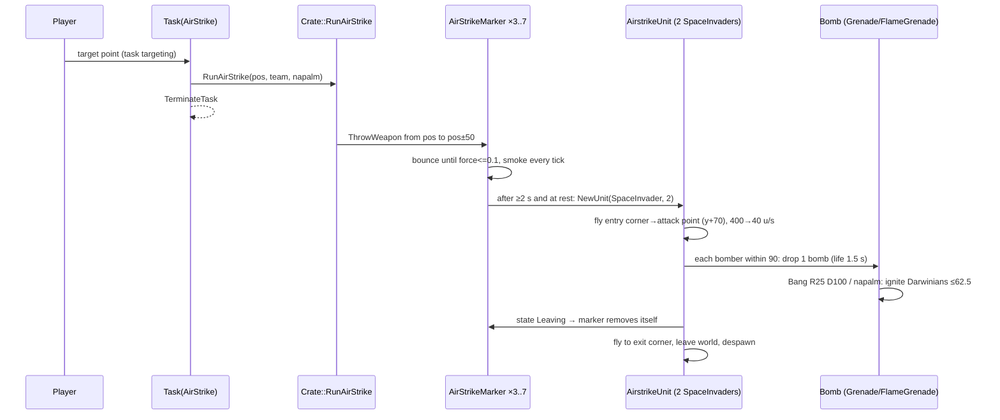

<!-- from P04_entities_military -->
## [→ 02_units_and_entities] [→ 04_crates_powerups_and_weapons] 3. Nuke (`code/worldobject/nuke.{h,cpp}`)

`Nuke : Entity` (type `TypeNuke`). Build: [B:FULL], created only by `Crate::RunNuke`, which is compiled only under `INCLUDE_CRATES_ADVANCED` (defined in FULLGAME) [C] `code/worldobject/crate.cpp:Crate::RunNuke`. `TypeNuke` is in `EntityIsBlocked` (level-file placement only) [C].

### 3.1 How it is obtained
Captured crate reward *Nuke* → `RunTask(TypeNuke)` → player targets a point → `Task::TargetNuke(pos)` → `Crate::RunNuke(pos, team)` and the task is terminated [C] `code/taskmanager.cpp:Task::TargetNuke`. (The uncaptured-crate Nuke is commented out [C] `crate.cpp:Crate::RunUncapturedCrate`.)

### 3.2 Launch: `Crate::RunNuke(pos, team)` [C]
1. Spawns **10** Nuke entities. For each: choose a random **sea** location: `(FRAND(sizeX−100), 0, FRAND(sizeZ−100))`, re-rolled while terrain height > 0 (loops forever on a map with no water [I]).
2. Target: nuke 0 → exactly `pos` and `m_renderMarker = true` (draws the ground marker); nukes 1..9 → `pos + (syncsfrand(300), 0, syncsfrand(300))` = **±150** scatter. `target.y = ground − 5`.
3. Message `crate_message_run_nuke` (`%T` team name) or `crate_message_auto_nuke` (monster team); fixed map marker `icons/icon_nuke.bmp` at `pos`.

### 3.3 Stats
| Stat | Value | Ref |
|---|---|---|
| Health | 255 (no `ChangeHealth` override — can in principle be damaged; see note) | `data/stats.txt` Nuke |
| Speed | 100 (×(1+difficulty/10)) → flight speed 50..100 | [C] |
| `m_radius` | 5 | [C] `Nuke::Begin` |
| Sub rise/sink | 1 u per tick = **10 u/s**, from y −30 to +30 | [C] `Nuke::AdvanceSub` |
| Sub surfaced wait | `m_subTimer = 2.5 s` | [C] |
| Explosion | `Bang(groundPos, R=50, D=100)` teamId −1 | [C] `Nuke::AdvanceToTarget` |
| Post-explosion linger | `m_casualtyMessageTimer = 5 s` | [C] |
| History trail sample | every 0.5 s | [C] |

### 3.4 State machine
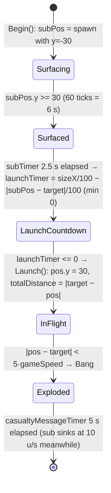
- The launch countdown `sizeX/100 − distance/100` (seconds) makes farther nukes launch sooner (intent: simultaneous arrival). Because the lofted flight averages only ≈ 47 u/s (simulation below), arrival is **not** simultaneous: total time after surfacing ≈ `2.5 + (sizeX − D)/100 + D/47` s, so nearer subs still hit first (e.g. sizeX 2000: D=500 → ≈ 28 s, D=1000 → ≈ 34 s, D=1500 → ≈ 39 s) [I] (re-implementation `_work/scripts/P04_nuke_sim.py`, flat terrain).
- Flight `Nuke::AdvanceToTarget` per tick [C]:
  - `f = 1 − remaining/totalDistance` (0 at launch → 1 at target).
  - `heightFactor = |subPos − target| / 3`; `fractionNorth = max(2, 5·pos.y / heightFactor)`.
  - `front = normalise(target − pos)`, rotated about `r = normalise(normalise(target − subPos) × up)` by `π/fractionNorth`, then by `−f·π/fractionNorth` → net pitch-**up** offset `(1−f)·π/fractionNorth` (≤ 90° since fractionNorth ≥ 2) that decays to 0 at the target — a lofted arc. Sign verified from `Vector3::FastRotateAround` (Rodrigues `a + c·n1 + s·(n×n1)`) and the right-handed `operator^` [C] `code/lib/vector3.cpp`, `code/lib/vector3.h`. Launch from y=30 with fractionNorth = 2 means the warhead initially climbs vertically; simulated apex ≈ 0.31·D and flight time ≈ D/47 s (D=300: 6.0 s/apex 94; 1000: 21.1 s/310; 2000: 42.6 s/620) [I] (`_work/scripts/P04_nuke_sim.py`).
  - Speed `= SPD/2 + SPD/2·f²` (50 → 100 u/s); `pos += vel·dt`.
  - `m_armed = true` once `pos.y > 150` (flag is never read) [C].
  - Arrival within `5·gameSpeed` → explode at `(pos.x, ground(target), pos.z)`.
- Explosion effects: `Bang(R 50, D 100)` → **full 100 damage to every entity of every team within 75, linear to 0 at 100**; buildings within 150 take `100·(1 − d/150)`; plus `Shockwave(size 2.5)` ring expanding 35→135 over 2.5 s doing `40·(life/2.5)` per tick in a 20-wide band (2.5 % per tick chance to ignite a Darwinian instead) (§0.7, §1.8). `m_numDeaths` (all teams' entity deaths, since teamId −1) is added to the **launching team's** `m_teamKills` [C]. Sound `Explode`.
- Co-op achievement: if `m_coopMode` and the nuke belongs to the local player and a **friendly** SpawnPoint is within 120 of the target → `App::DarwiniaAchievementWrongGame` + message `dialog_wronggame` [C].
- Note: `Nuke::Advance` never checks `m_dead`; base `Entity::ChangeHealth` could mark it dead (spawning a spirit) if lasers/explosions reach it at sea level, but it would keep flying [I] (no override; low practical relevance).

### 3.5 Visuals and sounds
- Submarine: two camera-facing 100-unit billboards `sprites/subshadow.bmp` (subtractive) and `sprites/sub.bmp` in team colour, alpha `max(subPos.y,0)/30` [C] `Nuke::RenderSub`.
- Warhead: additive billboard `sprites/nuke.bmp`, size 10·(1 + 0.03·((index·uniqueId) % 10)), team colour (monster team: white, subtractive) [C].
- Trail: history samples rendered as triple-stacked `textures/laser.bmp` ribbons of width 10, fading alpha [C] `Nuke::RenderHistory`.
- Ground marker (nuke 0 only): `icons/nukesymbol.bmp` red (200,20,20) pulsing size `40 + 25·sin(realTime)` on the terrain plus a generated blurred `shadow_icons/nukesymbol.bmp` (`BitmapRGBA::ApplyBlurFilter(10)`) [C] `Nuke::RenderGroundMarker`.
- `Nuke::RenderDeaths` ("Darwinia Hit, %d Dead" text) exists but the call is commented out [C] → appendix.
- Sounds: Entity events + `Explode` [C] `Nuke::ListSoundEvents`.

<!-- from P04_entities_military -->
## [→ 02_units_and_entities] [→ 04_crates_powerups_and_weapons] 4. Insertion Squad (`code/worldobject/insertion_squad.{h,cpp}`)

Classes: `InsertionSquad : Unit` (the squad), `Squadie : Entity` (type `TypeInsertionSquadie`), `HistoricWayPoint` (breadcrumb record: `m_pos`, monotonically increasing `m_id` from static `s_lastId`). Build: [B:FULL].

### 4.1 How it is obtained
- Captured crate reward *Squad* → `RunTask(TypeSquad)` → player targets ground → `Task::TargetSquad(pos)`: `numEntities = 2 + CurrentLevel(TypeSquad)` = **3** squaddies; `Team::NewUnit(TypeInsertionSquadie, 3, …, pos)` creates an `InsertionSquad`, `Location::SpawnEntities(pos, team, unit, TypeInsertionSquadie, 3, zero, spread 10)`; the unit is selected; optional camera entity-tracking (pref `OTHER_AUTOMATICCAM` = 2, or gamepad); crate sound `"Squad"` [C] `code/taskmanager.cpp:Task::TargetSquad`.
- Level `InstantUnits` with `runAsTask` (`TypeInsertionSquadie` → `TypeSquad`) [C] `code/location.cpp`.
- **Lifetime**: `Task::Start` sets `m_lifeTimer = 60 s`; in Multiplayer `Task::Advance` counts it down and calls `Task::Stop()`, which applies `ChangeHealth(-1000)` to every squaddie → squad dies after **60 s** [C]. The task also ends when the unit has no live entities.

### 4.2 Stats & constants
| Item | Value | Kind / Ref |
|---|---|---|
| Health | 75 | `data/stats.txt` InsertionSquadie |
| Speed | 30 u/s (×(1+difficulty/10)) × slope factor | stats.txt; [C] `Squadie::Advance` |
| RATE | 0.5 s (blueprint double) — per-entity `m_stats[RATE]` truncates to **0** | stats.txt; [C] `entity.h` (`unsigned char m_stats`) |
| Squad size | 3 (Multiwinia) | [C] `Task::TargetSquad` |
| Spacing | `GAP_BETWEEN_MEN = 10.0` along the breadcrumb path | `#define` [C] `insertion_squad.h` |
| Laser speed / life / range | 200 u/s / 0.6 s / **120 u** | [C] `Squadie::Attack`, `Location::FireLaser` |
| Laser aim jitter | `syncsfrand(7)` in x,z (±3.5) | [C] |
| Laser damage | 20–39 (§1.7) | |
| Auto-target search | `EntityGrid::GetBestEnemy(pos, 0, 100, team)`, re-evaluated every 1.0 s | [C] `Squadie::RunAI` |
| Max turn rate | 20 rad/s (`angVel = (front × desired)·4`, y-axis only) | [C] |
| Secondary cooldown per squaddie | Grenade 4.0 s, Rocket 4.0 s, AirStrike marker 20.0 s, Controller 4.0 s | [C] `Squadie::FireSecondaryWeapon` |
| Shape | `squad.shp`, markers `MarkerLaser` (muzzle), `MarkerBrass` (ejection) — fatal assert if missing | [C] `Squadie::Squadie` |

### 4.3 Squad movement & formation
- `InsertionSquad::SetWayPoint(pos)`: `m_wayPoint = m_focusPos = pos`; pushes a `HistoricWayPoint` at the **point man's current position** (or `pos` if no point man) to the front of `m_positionHistory` (never pruned) [C]. If the squad runs a Controller task, appends the new breadcrumb to the controller's route when > 20 from its last waypoint [B:LEGACY]. If `pos` is within 5 of a connected `RadarDish` or `Bridge` (Teleport), `m_teleportId` is set and the waypoint becomes the teleport entrance [C].
- `GetTargetPos(d)`: d ≤ 0 or teleporting → waypoint; else walk back from the point man along `pointMan → history[0] → history[1] → …` and return the point at path-distance d (the end of history if shorter) [C]. Squaddie *i* (formation index *i*) targets `GetTargetPos(10·i)` → **single-file "snake" following the leader's footsteps**; the point man (index 0) heads straight to the waypoint.
- `Squadie::Advance` (alive, on ground, not in water) [C]:
  - velocity toward target at SPEED; **slope factor** `f = 1 − (h_next − h_now)/3`, clamped [0.2, 2.0]; if terrain normal `y < 0.6` and going uphill (f < 1) → f = 0 (cannot climb steep slopes). Arrival snap if the remaining distance < one step. `PushFromObstructions`; y = ground + 0.1.
  - Facing: if this squad is the team's **currently selected unit**, face the team's mouse position (`team->m_currentMousePos`); otherwise face velocity, run `Squadie::RunAI`, and face the current enemy if any. Teleporting: face the target directly.
  - If `y ≤ 0` (water): `m_inWater = syncfrand(3)` (the 10 s drowning clock starts 0–3 s advanced) [C].
  - Airborne (knocked up) → `Entity::AdvanceInAir`. Position clamped to the world. If teleporting and `Entity::EnterTeleports(m_teleportId)` succeeds → squaddie removed from this unit (re-created at the other end by the teleport, which copies `m_weaponType`) [C] `code/worldobject/teleport.cpp`.
  - On death the unit `RecalculateOffsets()`.
- Player-controlled squad ignores `Unit` formation offsets; formation = breadcrumb snake [C].

### 4.4 Squaddie state machine
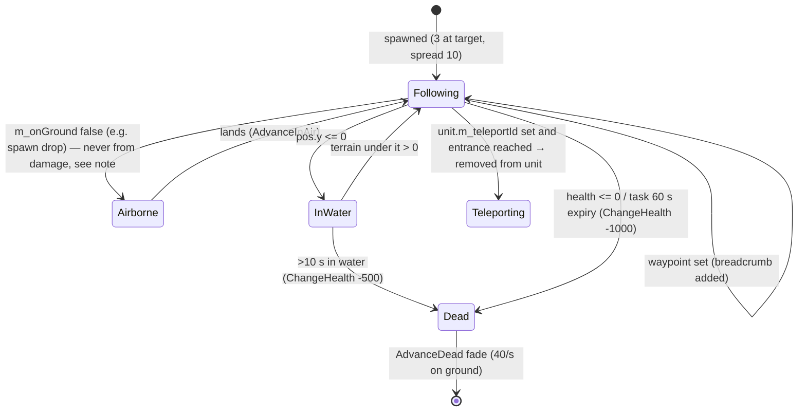
Note: `Squadie::ChangeHealth` always returns **false**, so lasers, `Bang` and shockwaves never apply knock-back to squaddies (and `Bang`/`Shockwave` explicitly exclude `TypeInsertionSquadie` anyway) [C].

### 4.5 Combat
**Primary (lasers)** — two paths:
1. *Player-fired* `InsertionSquad::Attack(pos, withSecondary=false)` (sent each tick while the primary fire control is held): builds the list of alive, enabled squaddies with `m_reloading == 0` (always true, RATE truncated to 0); `m_attackAccumulator += dt / (RATE_blueprint / N)` = `0.2·N` per tick; while accumulator ≥ 1 pick a random (`syncfrand`) eligible squaddie (without replacement) and call `Squadie::Attack(pos)` → **2 shots/s per squaddie, 6 shots/s for a full squad**, evenly spread [C] `InsertionSquad::Attack`.
2. *Autonomous* (squad not selected): `Squadie::RunAI` each tick fires at the current best enemy with probability `P(syncfrand(d/2) < 2) = min(1, 4/d)` where d is the distance → e.g. 10 %/tick at 40 u, every tick within 4 u; no reload gate [C].
- `Squadie::Attack(pos)`: laser from `MarkerLaser` world position, speed 200 toward `pos ± 3.5`; `TypeBrass` particle ejected from `MarkerBrass` (`front·(5+syncfrand(10)) + SFRAND(5)` per axis); sounds `Attack`, `FireLaser` [C].

**Secondary** — `InsertionSquad::Attack(pos, true)`: the alive, enabled squaddie **nearest to the target** whose secondary timer ≤ 0 calls `FireSecondaryWeapon(pos)` (in addition to the primary laser logic) [C]. Requires `HasResearch(m_weaponType)` (level > 0). Weapon by `m_weaponType` (default **`TypeGrenade`**):
| Weapon | Effect | Cooldown | Sound |
|---|---|---|---|
| Grenade | `ThrowWeapon(muzzle, pos, EffectThrowableGrenade)` (force ≤ 110, fuse 3 s, Bang R12.5 D50) | 4 s | `ThrowGrenade` |
| Rocket | `FireRocket(muzzle, pos, team)` (§1.6) | 4 s | `FireRocket` |
| AirStrike | `ThrowWeapon(…, EffectThrowableAirstrikeMarker)` → one marker → 2 bombers (§2) | 20 s | `ThrowAirStrike` |
| Controller | `ThrowWeapon(…, EffectThrowableControllerGrenade)` (§1.5) | 4 s | `ThrowController` |
When the timer expires: sound `WeaponReturns` [C].

**Weapon selection in Multiwinia**: `CycleSecondary()` (Grenade → Rocket → AirStrike → Controller → Grenade, skipping types with research 0) is only called for gamepad control **in single-player** (`code/location.cpp` team-control block under `IsSinglePlayer()`); the keyboard weapon-cycle block in `code/location_input.cpp` and the Multiwinia task-manager weapon shortcuts (`code/taskmanager_interface_multiwinia.cpp`) are commented out; `TaskManager::RunTask(TypeGrenade/TypeRocket/TypeController)` would call `SetWeaponType` but Multiwinia crates never run those task types, and in Multiplayer `RunTask(TypeAirStrike)` creates a stand-alone airstrike task instead [C]. ⇒ In Multiwinia a squad's secondary is **always the grenade** [I] (no reachable setter found). Rocket/AirStrike/Controller squad secondaries → [B:LEGACY].

### 4.6 Player control model
| Control | Effect | Ref |
|---|---|---|
| Select | squad becomes `team->m_currentUnitId`; squaddies face the mouse | [C] |
| Left button held (without primary fire) | `unitMove`: `SetWayPoint(mouse)`, `m_targetDir`, `RecalculateOffsets`; ground cursor marker on release (`m_endSetTarget`) | [C] `code/location.cpp` (team-control block) |
| Primary fire target held | `unit->Attack(mouse, false)` each tick → lasers | [C] |
| Primary + secondary fire held | `unit->Attack(mouse, true)` → also one grenade | [C] (`secondaryFire = primaryFireTarget && secondaryFireTarget`) |
| Gamepad direct control | `InsertionSquad::DirectControl`: (only while camera entity-tracking or look-around) move point man by `(dx, dy)` stick deltas (snaps to a connected teleport's position if the target cell contains one); stop by re-setting the waypoint to the point man when moving; fire at `(m_directUnitTargetDx, 0, m_directUnitTargetDy)` (absolute target) and grenade when secondary is held | [C] `InsertionSquad::DirectControl` |
| Terminate task | `Task::Stop` kills all squaddies | [C] `Task::Stop` |
Exact key bindings → 06_player_control_and_input (P-other).

### 4.7 AI (`InsertionSquad::RunAI`, CPU teams) [→ 07_ai]
- `maxRange = GetApproxMaxRange(GetMaxForce(grenadeLevel))` = 2.3125·110 ≈ **254.4** [C].
- Every 1.0 s: scan enemies within 500 of the squad centre; iterate nearer-first (updating the running minimum) and pick the first enemy whose 75-radius contains ≥ 20 enemies → waypoint `pos − 0.8·maxRange·dir` (stand off ≈ 204 short of it). Otherwise go to the highest-priority (`AITarget::m_priority[team]`) walkable neighbour of the nearest AITarget, or that AITarget itself [C].
- Every tick: if enemies within maxRange: target = their centroid + `syncsfrand(30)` (±15) in x,z; if within maxRange → `Attack(target, syncrand()%5 == 0)` (grenade attempt with 20 % chance per tick, still gated by the 4 s cooldown) [C].

### 4.8 Damage, death, visuals, sounds
- `Squadie::ChangeHealth`: accepts all damage types equally; at ≤ 0 → health 100 (fade counter), `m_dead`, sound `Die`, shape-fragment explosion of `squad.shp`; **no spirit spawned** [C]. Returns false always.
- Render: lit `squad.shp` (no team recolour in this class — [I] team identity comes from shape/selection UI); damaged flicker uses non-synced `frand()`; `RenderPixelEffect` disabled in Multiplayer [C].
- Sounds: Entity events + `FireLaser`, `ThrowGrenade`, `FireRocket`, `ThrowAirStrike`, `ThrowController`, `WeaponReturns` [C] `Squadie::ListSoundEvents`.

<!-- from P04_entities_military -->
## [→ 02_units_and_entities] [→ 04_crates_powerups_and_weapons] 5. Armour (troop transport) (`code/worldobject/armour.{h,cpp}`)

`Armour : Entity` (type `TypeArmour`). Build: [B:FULL]. A hovering transport that carries Darwinians; **it has no weapon** in Multiwinia (the missile-launch code `Armour::SetMissileTarget/LaunchMissile` is commented out [C]). It is a "special" of its team (`Team::RegisterSpecial` in `Begin`, unregistered in the destructor) [C].

### 5.1 How it is obtained
| Source | Mechanism | Ref |
|---|---|---|
| Crate reward *Armour* | `RunTask(TypeArmour)` → player targets ground → `Task::TargetArmour(pos)` spawns 1 Armour at pos, selects it; crate sound `"Armour"` | [C] `code/taskmanager.cpp:Task::TargetArmour` |
| Trunk-port armour reinforcements (level option `LevelOptionTrunkPortArmour`; Rocket Riot) | `Multiwinia::AdvanceTrunkPorts` creates a `Task(TypeArmour)` and targets `trunkport.pos + front·75` (y +5) when the team has fewer than `maxArmour` armour tasks (or `maxArmour==0`) | [C] `code/multiwinia.cpp:Multiwinia::AdvanceTrunkPorts` |
| Level `InstantUnits` with `runAsTask` | converted to `TypeArmour` task | [C] `code/location.cpp` (instant-unit spawn) |
Crate validity: Armour crate disabled in Rocket Riot and when `LevelOptionTrunkPortArmour > 0` [C] `code/worldobject/crate.cpp:Crate::IsValid` (P08 owns the table). The task ends when the armour is dead/gone (`Task::Advance`) [C].

### 5.2 Stats & constants
| Item | Value | Kind | Ref |
|---|---|---|---|
| Health | 200 | stats.txt | `data/stats.txt` Armour |
| Max speed | 60 u/s (×(1+difficulty/10)) | stats.txt | [C] `Armour::AdvanceToTargetPos` uses `m_stats[StatSpeed]` |
| RATE | 5 (unused) | stats.txt | |
| Capacity | **100** in Multiplayer (Darwinia: research 0/1→10, 2→20, 3→30, 4→40) | code | [C] `Armour::Capacity` |
| Unload period | `ARMOUR_UNLOADPERIOD = 0.1` s (max one Darwinian per 0.1 s) | `#define` | [C] `armour.h` |
| Loading search range (Darwinian side) | `DARWINIAN_SEARCHRANGE_ARMOUR = 150` | `#define` | [C] `code/worldobject/darwinian.h` |
| Board distance | entrance within 20 (or arrived) | code | [C] `code/worldobject/darwinian.cpp:Darwinian::AdvanceApproachingArmour` |
| New-orders lockout | loading/unloading only after `m_newOrdersTimer > 1.0` s | code | [C] `Armour::IsLoading/IsUnloading` |
| Conversion point arrival | 15 | code | [C] `Armour::Advance` |
| Orders: "special" threshold | > 50 from current position (or awaiting deployment) | code | [C] `Armour::SetOrders` |
| Armour–armour separation | 40 | code | [C] `Armour::DetectCollisions` |
| Entrance obstruction test | building sphere 20 at entrance marker, push in 3-unit steps until sphere 5 clear | code | [C] |
| Death explosion | `Bang(pos, R=20, D=50, team)` | code | [C] `Armour::ChangeHealth` |
| Flag size | 20 (flag render commented out) | code | [C] |
| Shape | `armour.shp`, Multiwinia: per-colour copy `armour.shp_<colourId>_<coopGroup>` whose fragment colours are all set to team colour ×0.1 | code | [C] `Armour::Begin`, `ConvertShapeColours` |
| Required marker | `MarkerEntrance` (fatal assert) | data | [C] |

### 5.3 Damage model (`Armour::ChangeHealth`)
| Damage type | Effect |
|---|---|
| Laser | **immune** (returns false → no knock-back) |
| TurretShell | amount ÷ 3 (integer) → 15/3 = **5 per shell** |
| Explosive / Fire / Unresistable | full amount (Multiplayer). In single-player, any hit between −1 and −999 is reduced to −1 [B:LEGACY] |
- Health clamped 0..255; a shape-fragment explosion is spawned whenever health crosses a 20-point band (fraction `0.5·(1 − h/200)`, or 1.0 at death); turret-shell hits always add a 0.05 fragment puff [C].
- At 0 health: `m_dead = true`, `Bang(pos, 20, 50, ownTeam)`, sound `Die`; **no spirit** is spawned for the armour itself. `Advance` returns true next tick (removed) [C].
- Passengers when the armour dies: each `Darwinian` in `StateInsideArmour` finds its armour dead and is **ejected on fire** (`m_state = StateOnFire`, vel random horizontal + up, length 20..40, airborne) [C] `code/worldobject/darwinian.cpp:Darwinian::AdvanceInsideArmour`. Turret shells that kill an armour credit `1 + passengers` kills [C] `weapons.cpp:TurretShell::Advance`.

### 5.4 Movement (`Armour::AdvanceToTargetPos`, per tick)
1. Turn: if waypoint > 10 away, rotate `m_front` toward the horizontal direction to the waypoint by `angle·0.05` rad per tick (5 % of the remaining angle; ~40 % per second); clamp `front.y` to ±0.1 [C].
2. Speed: if horizontal distance > 100 **and** heading error < 1 rad: accelerate +10 u/s per second (`+10·dt`) up to max; else if distance > 10: `speed = 0.95·speed + 0.05·(0.2·distance)`, clamped [0, max]; else decelerate −5 u/s per second to 0 [C].
3. Move `pos += front·speed·dt`; `PushFromObstructions`. Ground = max(terrain, 0) (**hovers over water at sea level 0**) [C]. If at/below ground: y eased toward ground (factor `5·dt` = 0.5/tick), `m_up` eased toward terrain normal (0.5/tick), horizontal step clamped to `speed·dt`. If above ground: `vel.y -= 5` per tick (fall), clamp to ground, `m_up` eased slower (0.05/tick).
4. `m_vel = Δpos/dt`.
- Collisions (`DetectCollisions`, run in Multiplayer only when |vel| < 5): push away from any other live Armour within 40 by `0.02·(40 − d)` per tick; if the entrance marker is inside a building (sphere 20), shift away; the waypoint shifts with the body if within 40 [C].
- Exhaust smoke each tick: `1 + int(|vel|/20)` `TypeMissileTrail` particles (synced RNG for direction/size) [C].
- Routing: `CreateRoute(pos)` uses the direct line if `IsRouteClear` (no enabled **enemy** laser fence intersected in 20-unit steps), else a route from `Location::m_seaRoutingSystem` (`GenerateRoute(from, to, false, true, true)`); `FollowRoute` (Multiplayer only) advances to the next route waypoint whenever the straight line to it is clear. The AI re-checks the path every 1 s while moving [C] `Armour::CreateRoute/FollowRoute/RunAI`.
- Render: body bobs `y += 2·sin(t + uniqueId)`, up-vector wobble ±0.05; smoothing `4·g_advanceTime`; damaged flicker uses non-synced `frand()` (render only) [C]. `RayHit` reproduces the bob so shells hit the visible model [C].

### 5.5 States and conversion (load/unload) orders
`m_state ∈ {StateIdle, StateUnloading, StateLoading}`; plus a pending *conversion point* `m_conversionPoint` with a *conversion order* `m_conversionOrder ∈ {Idle, Unloading, Loading}`, and `m_awaitingDeployment` (turret conversion, single-player only).

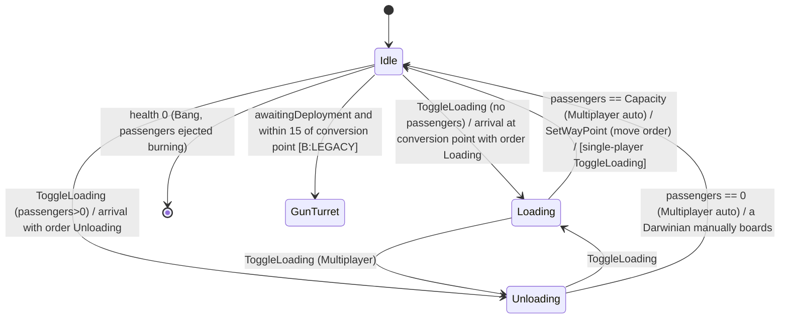
Rules [C] `Armour::Advance/SetOrders/SetWayPoint/SetConversionPoint/ToggleLoading/ToggleConversionAction`:
- **Move order** (`SetWayPoint`): rejected outside the landscape; clears conversion point/order; waypoint y = terrain; if Loading → Idle.
- **Special order** (`SetOrders(pos)`): if `|pos − armour| > 50` (or awaiting deployment) → `SetConversionPoint(pos)`: waypoint = pos, conversion order = Unloading if it carries passengers else Loading, state Idle. Within 50 → ignored (toggling is done by clicking the unit).
- On reaching within **15** of the conversion point: if awaiting deployment → `ConvertToGunTurret` (removes the armour); else if order ≠ Idle → `m_state = order`; `m_newOrdersTimer = 2.0` (so loading/unloading may start immediately, the 1 s lockout already satisfied); conversion point cleared.
- `ToggleLoading()` Multiplayer: Idle → Unloading (if passengers) / Loading; Unloading → Loading; Loading → Unloading; clears conversion order. Single-player: Loading → Idle instead [B:LEGACY].
- `ToggleConversionAction()` (secondary toggle on the order marker): cycles the pending conversion order Idle → Unloading (if any passengers) / Loading; Loading → Idle; Unloading → Loading (if not full) / Idle; Idle clears the point, otherwise sets it to the current waypoint and state Idle.
- Multiplayer auto-transitions each tick: Loading with passengers == Capacity → Idle; Unloading with 0 passengers → Idle.
- `SetDirectOrders()` (next/previous-weapon key while the armour is the selected entity) → `ToggleLoading` at most once per 0.3 s (static timer shared by all armours) [C] `code/network/clienttoserver.cpp` (`NET_DARWINIA_NEXTWEAPON/PREVWEAPON` handlers).
- **Passenger accounting**: `m_numPassengers` is rebuilt every tick from `RegisterPassenger()` calls made by Darwinians inside (`m_registeredPassengers`), plus `m_passengerOverflow` from boardings in the same tick; `GetNumPassengers() = m_numPassengers + m_passengerOverflow` [C] `Armour::Advance/AddPassenger/RegisterPassenger`.

### 5.6 Loading/unloading rules (Darwinian side, for implementers) [C] `code/worldobject/darwinian.cpp`
- An idle friendly Darwinian searching for armour considers team specials of type Armour, alive, within **150** and `IsLoading()` (Loading, passengers < 100, `m_newOrdersTimer > 1`); picks one at random (`syncrand`) and enters `StateApproachingArmour` [C] `code/worldobject/darwinian.cpp:Darwinian::SearchForArmour`.
- Approaching: abort to Idle if the armour stops loading (unless manually ordered), is full, or the entrance is > 150 away (unless manual); walk to the `MarkerEntrance` position; board when arrived or within 20 → `AddPassenger` (sound `LoadDarwinian`), state `StateInsideArmour`. A manual boarding into an Unloading armour switches it to Idle.
- Manual boarding: when the player orders selected Darwinians to a point within 30 of a friendly armour with free capacity, they get `StateApproachingArmour` + `m_manuallyApproachingArmour` [C] `code/location.cpp` (issue-orders block).
- Inside: position/velocity locked to the armour. When `IsUnloading()` (Unloading, passengers > 0, 1 s lockout passed, ≥ 0.1 s since last exit) **and the terrain under the entrance is above water (height > 0)**: `RemovePassenger` (sound `UnloadDarwinian`), jump out of the entrance with direction rotated by `syncsfrand(π/2)` (±45°), speed 10 horizontal, `y = 5 + syncfrand(10)`, state Idle, `m_ordersSet=false`. Otherwise keep registering. Effective unload rate: **≤ 10 Darwinians/s** [I] (one per 0.1 s unload period; all passengers test the same timer each tick).
- A passenger killed while inside calls `RemovePassenger` [C].

### 5.7 Player control model
[C] `code/location_input.cpp` (Armour branch, Multiplayer), `code/network/clienttoserver.cpp` (`NET_DARWINIA_ORDERGOTO`, `NET_DARWINIA_TOGGLEENTITY`):
| Input | Effect |
|---|---|
| Select (click the armour) | becomes the team's current entity |
| Left click on terrain (control method 0) / move order | `RequestArmourOrders(pos, deploy=false)` → `ORDERGOTO` with `FORCEONLYMOVE` → `SetWayPoint(pos)` |
| Right click on terrain (`ControlIssueSpecialOrders`, or gamepad special-move) | `deploy = specialMove` (inverted for control method 0) → `ORDERGOTO`; deploy=true → `SetOrders(pos)` (go-and-load/unload at destination) and the armour is deselected; sound `SetOrders`; order marker registered; route highlighted |
| Right click on the armour itself (`controlUnitToggle`) | `RequestToggleEntity` → `ToggleLoading`; if the click was on the armour's order marker → `ToggleConversionAction` and deselect; UI sound `ToggleUnitState` |
| Next/previous weapon keys | `SetDirectOrders` → `ToggleLoading` (0.3 s debounce) |
| Single-player only: special order sets `m_awaitingDeployment`; unit-create key with it set → `SetOrders(own pos)` → converts into a dynamic `GunTurret` (shape explosion + `GunTurret::ExplodeBody`) | [B:LEGACY] |

### 5.8 AI (CPU teams) — `Armour::RunAI` [→ 07_ai]
Dispatch by game type: Rocket Riot → `RunRocketRiotAI`; Assault → `RunAssaultAI`; Blitzkrieg → `RunBlitzkriegAI`; all others → `RunStandardAI`. Think interval `m_aiTimer`: Hard 1 s, Standard 10 s (Assault 5 s), Easy 20 s (Assault 10 s) [C]. Path re-check every 1 s while moving. Conversion points set by the AI (`AISetConversionPoint`) are pushed out of obstructions and jittered `SFRAND(10)` (±5), then routed (`CreateRoute`).
- **Standard**: if heading to a suicide building (`m_suicideBuildingId`) and within 10 → `ChangeHealth(-1000)` (self-destruct Bang). If empty and Idle → conversion point `nearestOwnSpawnPoint.pos + front·100` (load). If > 50 passengers and no conversion point → nearest enemy SpawnPoint, point **behind** it (`pos − front·100`) (unload). If empty after unloading → 50 % (`syncrand()%2`) pick the nearest enemy SpawnPoint farther than 200 and drive into it to explode, else go Idle (reload next think).
- **Assault**: if armour objectives exist, carrying nothing, and current AI objective has no armour marker → `RunMobileBombAI` (drive to the nearest enemy GunTurret or SpawnPoint, self-destruct within 20). Tracks objective changes (stop when objective changes). When stopped with > 20 passengers and nobody approaching → unload at the objective's armour marker or a random valid objective marker (attacker: non-friendly markers; defender: any). When empty, or nobody approaching and not unloading → `FindPickupPoint` (AIObjectiveMarker with `m_pickupAvailable`, `m_armourObjective==1`, > 225 away and > 25 friends within 150; or own TrunkPort `pos + front·75`; jitter ±5). Within 150 of the pickup point → Loading. Carrying and within 75 of conversion point → Unloading.
- **Blitzkrieg**: carrying and within 100 of the conversion point → Unloading (if turret-rushing, keep driving 100 forward + 50 right so Darwinians drop onto the turret). When empty → load in front of an own TrunkPort that has > 20 friends within 200. With > 20 passengers, stationary and nobody approaching → choose an enemy zone linked to one of ours (prefer a linked enemy *base* zone whose team isn't eliminated; if our base is under threat (`BLITZKRIEGSCORE_UNDERTHREAT`) Easy always / Standard 50 % retarget to zones linked to our base); random choice (`syncrand`); Easy drives to the zone centre, others use `GetBlitzkriegDropPoint` (if enemy GunTurrets within `zone.size·1.2` (default 200): rush the (last found) turret).
- **Rocket Riot**: `PreventLoadOverlap` (don't load if another own armour within 150 is Loading). If own rocket is in `EscapeRocket::StateLoading` → ferry mode (limit 0): collect from the AITarget with the most idle own Darwinians (> 10, > 400 from rocket, no other own armour converting/loading within 100) else trunkport, drop at the rocket (±100 random ring for non-Easy). Otherwise (limit 20): pick up at own TrunkPort / AITarget within 250 of the rocket / own SpawnPoint with > 20 friends within 200 (`pos + front·100`); with > 20 passengers, stationary, nobody approaching → `RRFindDropoffPoint`: attack an enemy rocket with fuel ≥ 75 and more fuel than ours; else an uncontrolled solar-panel objective; else the enemy-held panel group with most panels where enemies > 1.3×friends; else reinforce the friendly panel group with fewest friends (≤ 5 per panel preferred); non-Easy adds a random 100-unit ring offset, re-rolled until walkable.

### 5.9 Sounds & effects
Entity events + `LoadDarwinian`, `UnloadDarwinian`, `SetOrders` [C] `Armour::ListSoundEvents`. Exhaust `TypeMissileTrail` smoke; shape-fragment damage explosions; death `Bang`. Team colouring: whole hull recoloured to team colour ×0.1 (lighting brightens it) [C].

<!-- from P04_entities_military -->
## [→ 02_units_and_entities] 6. Tank (`code/worldobject/tank.{h,cpp}`)

`Tank : Entity` (type `TypeTank`). Build/reachability: class compiled in [B:FULL]; **not obtainable in the baseline**: the crate reward `CrateRewardTank` is commented out [C] `code/worldobject/crate.cpp:Crate::CaptureCrate`, `Task::TargetTank` body is commented out (a Tank task spawns nothing) [C] `code/taskmanager.cpp:Task::TargetTank`, and the only maps placing tanks (`data/levels/mp_tankbattle_{2P,3P,4P}.txt`, instant units) belong to `GameTypeTankBattle`, whose mode logic `Multiwinia::AdvanceTankBattle` is compiled only with `INCLUDEGAMEMODE_TANKBATTLE` (TARGET_DEBUG only) [C] `code/multiwinia.cpp`, build_matrix §3. Tag: **[B:DEBUG]** (Tank Battle) / unreachable in FULL. `Entity::TypeTank` is not in `EntityIsBlocked` so a level file could place one [C].

### 6.1 Stats & constants
| Item | Value | Ref |
|---|---|---|
| Health | 150 | `data/stats.txt` Tank |
| Max speed | 50 u/s; accel +10 u/s² when waypoint > 50 away, else decel −20 u/s² | [C] `Tank::Advance` |
| Hull turn | 0.05 rad per tick (0.5 rad/s) while `dot(front, toWaypoint) < 0.999` | [C] |
| Turret turn | `0.05 + 0.15·(1 − dot)` rad per tick toward attack target (only in `StateCombat`) | [C] |
| Arrival | within 5 → waypoint cleared | [C] |
| RATE | 2 s between shots (TankBattle); **÷4 = 0.5 s** in any other game type | [C] `Tank::PrimaryFire` |
| Main gun | `FireRocket(barrelEnd − 2y, target, team, lifeTime 2.0)` → Rocket R15 D25, life 2.0 s (range ≈ 310 u [I] from §1.6 acceleration table) | [C] |
| Misaligned turret | if `dot(turretFront, toTarget) < 0.75` the shell is fired straight along the turret to `pos + turretFront·300` | [C] |
| Mine | `DropMine`: `LandMine` at hull position, `m_mineTimer = 1.0` s, also resets the gun timer | [C] — **never called** (no caller in the tree) |
| Missile | `LaunchMissile`: one guided `Missile` (§1.10) from `pos + 30y`, initial dir `normalise(front + up)`, speed 200, steered to `GetMissileTarget()`; `m_missileFired` is pre-set true outside TankBattle | [C] — **never called** (no caller) |
| Capacity | `TANK_CAPACITY = 40`, `TANK_UNLOADPERIOD = 0.1`, `TANK_NUMFLOATERS = 3` | `#define` [C] `tank.h` — passenger code is dead (no state change to Loading/Unloading, no Darwinian caller) |
| Shapes | `tank_body.shp` (markers `MarkerTurret`, `MarkerEntrance`), `tank_turret.shp` (marker `MarkerBarrelEnd`); per-team copies `tank_body.shp_<colour>_<group>` recoloured to team colour ×0.5 | [C] `Tank::Begin`, `ConvertShape` |

### 6.2 Behaviour
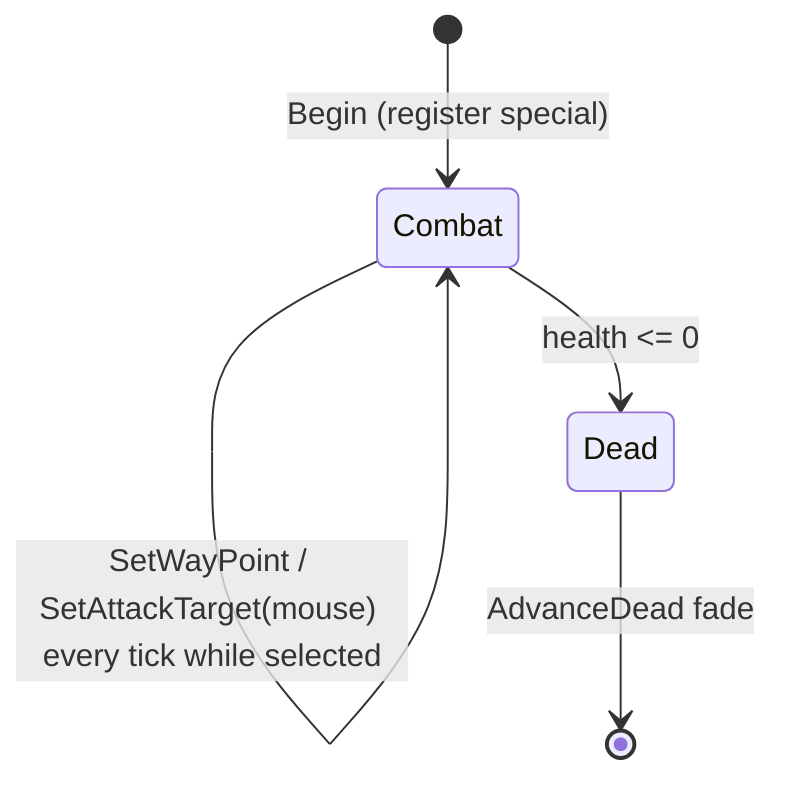
- `m_state` is always `StateCombat` (Loading/Unloading only reachable through commented-out code) [C].
- Movement ignores obstructions (no `PushFromObstructions`), y = terrain height (can go below sea level; render clamps to ≥ 0), `m_up` = terrain normal [C].
- Quirk: when idle (`m_wayPoint == 0`), the hull still turns toward the world origin because the turn step uses `m_wayPoint − m_pos` unconditionally [C].
- `Tank::ChangeHealth`: lasers ignored (false); other damage full; at ≤ 0: `m_dead`, stop all its sounds, `Die`; shape-fragment explosion of body and turret on every hit and on death; **no spirit, no Bang** [C].
- Control (when selected) [C] `code/location.cpp` (team-control block, `TypeTank`): move → `SetWayPoint(mouse)`; primary fire (mouse) or secondary mode (gamepad) → `PrimaryFire()`; every tick `SetAttackTarget(mouse)`.
- AI [C] `Tank::RunAI`: TankBattle → best enemy within 50..3000, waypoint = enemy ± `syncsfrand(250)` (±125), attack target = enemy, fire if 50 < d < 300. Other modes → if no waypoint, go to the nearest enemy-owned `AITarget` farther than 50; fire at the best enemy within 50..300.
- In Multiplayer non-TankBattle, the Tank task has a 30 s life (`Task::Start`) and `Task::Stop` kills it [C] (moot in FULL).
- Render: body bobs `2·sin(t+id)`, damaged flicker uses non-synced `frand()`; `RenderPixelEffect` disabled [C].
- Tank Battle mode scoring (`Multiwinia::AdvanceTankBattle`, [B:DEBUG]): each team's score = `NumTanks` option − tank deaths; when a team has no tank it loses one life and the mode re-runs a Tank task at the team's instant-unit tank position (which spawns nothing because `TargetTank` is commented out) [C]/[I].

<!-- from P04_entities_military -->
## [→ 02_units_and_entities] [→ 04_crates_powerups_and_weapons] 7. Harvester (`code/worldobject/harvester.{h,cpp}`)

`Harvester : Entity` (type `TypeHarvester`). Build: [B:FULL]. A flying soul-collector: it **vacuums up floating spirits (souls of dead Darwinians of any team) and converts each into one new Darwinian at a friendly Spawn Point** (or deposits it in a friendly Incubator). A team "special" [C] `Harvester::Begin`.

### 7.1 How it is obtained
- Captured crate reward *Harvester* → `RunTask(TypeHarvester)` → player targets ground → `Task::TargetHarvester(pos)` spawns it at `pos + 50y`, selects it; crate sound `"Harvester"` [C] `code/taskmanager.cpp:Task::TargetHarvester`. The crate is only generated on maps with ≥ 1 spawn point (any team) [C] `code/worldobject/crate.cpp:Crate::IsValid` (P08).
- Level instant unit with `runAsTask` [C].
- Task ends when the harvester is dead/gone. Terminating the task (`Task::Stop`) sets `m_vunerable = true` and applies `ChangeHealth(-1000)` (destroying it; collected spirits are **not** released by this path) [C].

### 7.2 Stats & constants
| Item | Value | Kind / Ref |
|---|---|---|
| Health | 255 | `data/stats.txt` Harvester |
| Speed | 28 u/s max (×(1+difficulty/10)); idle drift 0.25× = 7 u/s | stats.txt; [C] `Harvester::AdvanceToTargetPos` |
| Capacity `GetMaxSpirits()` | research 0→0, 1→25, 2→50, **3→100 (Multiwinia)**, 4→200 | [C] `Harvester::GetMaxSpirits` |
| Collection radius | `HARVESTER_COLLECTION_RANGE = 75` (horizontal) | `#define` [C] `harvester.cpp` |
| Spirit search range | `ENGINEER_SEARCHRANGE = 200` | `#define` [C] `code/worldobject/engineer.h` |
| Retarget interval | `ENGINEER_RETARGETTIMER = 1.0` s | `#define` [C] |
| "Spirit field" threshold | > 30 floating spirits within 75 → re-centre on their centroid | [C] `AdvanceToSpirit` |
| Hover height | 50 above max(terrain, 0) with bob `±2.5·sin(t + 20·uniqueId)` | [C] `GetHoverHeight` |
| Collector position | `pos + 15y` | [C] `GetCollectorPos` |
| Spirit/grenade suck speed | `40·(1 − horizDist/150)`; 20 when nearly level with the harvester | [C] `AdvanceSpirits/AdvanceGrenades` |
| Grenade pickup | grenade on ground (`y < terrain + 2`) within 25 (= 75/3) horizontally, only while harvesting with spirits present | [C] `AdvanceHarvesting` |
| Arrival tolerance | 5 (horizontal) | [C] |
| Idle wander | random point 30 away (`syncsfrand(2π)` → angle in (−π, π)) | [C] `SearchForRandomPosition` |
| Shape | `harvester.shp`, engine markers `MarkerEngine1..4` (optional) | [C] |

### 7.3 State machine
```mermaid
stateDiagram-v2
  [*] --> Idle : Begin (waypoint = spawn pos)
  Idle --> ToSpirit : every 1 s: nearest Floating, unbroken spirit within 200 and carried < capacity
  Idle --> ToSpawnPoint : carrying > 0 and a friendly SpawnPoint exists
  Idle --> ToIncubator : carrying > 0, no friendly SpawnPoint, friendly Incubator exists
  Idle --> ToWaypoint : SetWaypoint (player/AI)
  ToWaypoint --> Idle : within 5 of waypoint
  ToSpirit --> Harvesting : arrived and ≥1 floating spirit within 75
  ToSpirit --> Idle : arrived and none within 75
  Harvesting --> Idle : no Floating-in-range-with-room and no StateHarvested spirit left
  ToSpawnPoint --> ToWaypoint : last spirit delivered
  ToIncubator --> ToWaypoint : last spirit delivered
  ToSpawnPoint --> Idle : no friendly SpawnPoint
  ToIncubator --> Idle : no friendly Incubator
  Harvesting --> Destroyed : a sucked-up grenade reaches the harvester
  Idle --> Destroyed : Task::Stop
  Destroyed --> [*]
```
Per-state details [C]:
- **Idle** (`AdvanceIdle`): releases any held grenades (`ReleaseGrenades`: `m_collected=false`, `ResetForce`); every 1 s `SearchForSpirits`; if carrying spirits → `SearchForSpawnPoint` (nearest building of type SpawnPoint with `IsFriend(team)`) else `SearchForIncubator` (nearest friendly Incubator, distance penalised +10 per spirit inside); otherwise wander.
- **ToWaypoint**: fly to `m_wayPoint`.
- **ToSpirit**: target = chosen spirit position; on the way, if > 30 floating spirits are within 75 the target becomes their centroid (once, `m_fieldFound`).
- **Harvesting** (stationary): every Floating spirit within 75 (horizontal) is collected while `count < capacity` (`CollectSpirit` → `Spirit::Harvest(id)` → spirit state `StateHarvested`); grenades are captured (see 7.5). Stays while any spirit is in `StateHarvested` (still being drawn in).
- **ToSpawnPoint**: target = spawn point position at hover height; on arrival (within 5) each tick **one** spirit is deleted and `SpawnPoint::SpawnDarwinian()` creates one Darwinian of the spawn point's team at its door (Multiplayer: door-forward velocity ×10 with ±0.5 jitter, airborne); sound `DropSpirit`. Re-search requires the spawn point to be the harvester's own team (`sp->m_id.GetTeamId() != m_id.GetTeamId()` → Idle) [C] `AdvanceToSpawnPoint`. **Yield: 1 Darwinian per spirit, 10 per second at the spawn point** [I] (one per tick).
- **ToIncubator**: dock via `Incubator::GetDockPoint`; on arrival one spirit per tick `Incubator::AddSpirit` [C]. (Incubators are Darwinia buildings; Multiwinia maps normally have none [I] → P05/P03.)

### 7.4 Spirit transport
- `AdvanceSpirits` (every tick, for spirits in `StateHarvested`): steer each toward a point orbiting the harvester at radius `75·heightScale`, `heightScale = (50 − (spiritY − ground))/50` (spiral funnel that narrows as it rises), angular position `t + i`; when within 2 of that point (or within 50 and |Δy| < 5) → `StateCollected`, snapped to collector `+ syncsfrand(7.5)` per axis [C].
- `StateCollected` spirits ride with the harvester (`m_vel = harvester.m_vel`) and do not expire; if the harvester disappears they revert to `StateFloating` [C] `code/worldobject/spirit.cpp:Spirit::Advance`. (A spirit left in `StateHarvested` has no fallback [I].)
- Spirit source: any `Spirit` in `Location::m_spirits` — spawned by `Entity::ChangeHealth` death of Darwinians and most entities, **regardless of team** [C]/[I] (spirit team not checked in `SearchForSpirits`/`AdvanceHarvesting`). Multiwinia spirit life: Floating for `(120 ± 30)/3` = 30–50 s, then rising (`StateDeath`) 90 s [C] `Spirit::Advance`.

### 7.5 Damage & counter-play
- `Harvester::ChangeHealth`: ignored unless `m_vunerable` **and** the damage type is `DamageTypeUnresistable` → immune to lasers, explosions, turret shells and fire [C].
- **Grenade counter**: while Harvesting (spirits present), a live `EffectThrowableGrenade` (any team; airstrike bombs/napalm have other types and are ignored) resting on the ground within 25 is captured: `m_collected = true` (fuse frozen), `RemoveForce`; it is drawn up the funnel (`AdvanceGrenades`, radius `75·heightScale`, angle `t + 50i`). When within 2 of the harvester: `m_vunerable = true`, grenade `m_life = 0`, `m_collected = false` (it explodes next tick: Bang R12.5 D50), `ChangeHealth(-999)` → **harvester destroyed**, `ReleaseSpirits()` (each spirit `Begin()` re-initialised, velocity away from the harvester `syncfrand(150)`), `ReleaseGrenades()` [C].
- Death: health 0, `m_dead`, sound `Die`; no spirit; shape-fragment explosion whenever a 50-band is crossed / at death (fraction relative to **Engineer** max health — copy-paste) [C].

### 7.6 Movement
`AdvanceToTargetPos`: if horizontal distance > 5: `desiredSpeed = min(distance, SPEED)` (Idle: `0.25·SPEED`), heading blend `front·(1−a) + dir·a` with `a = 9.5·dt = 0.95` (Idle: `2·dt = 0.2`); `vel = 0.92·vel + 0.08·targetVel` (`factor1 = 0.8·dt`); `pos += vel·dt`; `y` = hover height; `m_front = horizontal(vel)`. **No obstruction avoidance** (flies over buildings/water) [C]. When not moving it still bobs at hover height.

### 7.7 Control, AI, visuals, sounds
- Player: select; move order → `SetWaypoint(mouse)` (state ToWaypoint, retarget timer 0) and the selection is cleared [C] `code/location.cpp` (`TypeHarvester` branch). Everything else is autonomous.
- AI (`Harvester::RunAI`, every 1 s): if Idle → waypoint = nearest spirit in the world (any state) [C].
- Visuals: lit shape; collector bubble billboard `textures/bubble.bmp` (16 size, additive, alpha 150) at collector+3; while Harvesting: 5 team-coloured animated rings (radius `75·heightScale`) cycling from ground to hover height ("tractor beam"); shadow; engine exhaust per engine marker: 5 blue `TypeMissileFire` (size 75, colour (50,50,250)) + 1 `TypeMissileTrail` per tick using **non-synced** `sfrand/frand` inside `Advance` (cosmetic only) [C].
- Sounds: `DropSpirit` (triggered, not listed); `ListSoundEvents` lists `BeginReprogramming`, `EndReprogramming`, `ReprogrammingComplete` (Engineer leftovers, never triggered here) [C].
- UI action strings: `engineer_idle`, `engineer_towaypoint`, `engineer_tospirit`, `engineer_toincubator` (Harvesting/ToSpawnPoint fall back to `engineer_idle`) [C] `Harvester::GetCurrentAction`.

<!-- from P04_entities_military -->
## [→ 02_units_and_entities] 8. LaserTrooper (`code/worldobject/lasertrooper.{h,cpp}`) — [B:LEGACY]

`LaserTrooper : Entity` (type `TypeLaserTroop`). Compiled in FULL, unreachable in Multiwinia: `TypeLaserTroop` is in `EntityIsBlocked` (level files cannot place it) and the only runtime creator is `Lander` (`code/worldobject/lander.cpp`), which itself is blocked and has no other spawner [C]. Stats: health 20, speed 15, rate 1 s [C] `data/stats.txt`.
- `Advance`: moves straight toward `m_targetPos` at SPEED (snap when within one step); `m_front = vel`; `EnterTeleports()`; air/water handling; own reload countdown; dead fade; optional victory dance (1 % per tick hop `10 + syncfrand(10)` up) [C]. `m_targetPos` is fed by `Unit::Advance` for `TypeLaserTroop` (moves the target ≤ 1 unit per tick toward `m_unitTargetPos` = waypoint + rectangle-formation offset) [C] `code/unit.cpp:Unit::Advance`, `Unit::RecalculateOffsets`. Fires via the generic `Unit::Attack`/`Entity::Attack` (laser speed 150, reload RATE) [C].
- Render: team-coloured sprite quad (×0.7 while reloading, ×(0.5+0.5·health)), ground shadow, side-on additive line; dead → 3 black fragments drifting apart (alpha = health·2.55) [C]. The previous Darwinia `Advance` is commented out (appendix).

<!-- from P04_entities_military -->
## [→ 02_units_and_entities] 9. Shaman (`code/worldobject/shaman.{h,cpp}`) and Shaman Interface (`code/shaman_interface.{h,cpp}`) — [B:LEGACY]

### 9.1 Reachability
- `Shaman::Advance` has its entire body commented out and **returns true**, so a Shaman is deleted on its first simulation tick [C] `code/worldobject/shaman.cpp:Shaman::Advance`.
- Creation paths: `Task::TargetShaman` (task type `TypeShaman`) — no crate/UI path runs it in FULL; the `GameTypeShaman` start-up block is commented out [C] `code/location.cpp` (team init), `code/multiwinia.cpp:Multiwinia::Advance`; level-file instant units are blocked (`EntityIsBlocked` lists `TypeShaman`) [C]. ⇒ Shaman is a cut "Shaman" game-mode unit. The task manager refuses to terminate Shaman tasks (`TaskManager::TerminateTask`: "you can't terminate shamans") [C] `code/taskmanager.cpp`.
- Stats if it existed: health 200, speed 25, rate 2 [C] `data/stats.txt`; shape `officer.shp` [C].

### 9.2 Abilities as coded (for the record; none reachable)
| Ability | Trigger | Mechanics | Cost / cooldown | Ref |
|---|---|---|---|---|
| Move | move order → `SetWaypoint` | walk at SPEED with slope factor clamp [0.1, 2.0], turn blend 0.6/tick, `PushFromObstructions`; waypoint within 5 of a connected RadarDish/Bridge → enter teleport, exit + 30 | — | [C] `Shaman::AdvanceToTargetPosition`, `SetWaypoint` |
| Change mode | primary fire on/near (≤ 20) itself → `ChangeMode` (else shows teleport target rings) | cycles `ModeNone → ModeCreateDarwinians → ModeFollow → ModeNone`; label "Creating Darwinians" / "Darwinians Following" drawn above it | 0.3 s debounce | [C] `Shaman::ChangeMode`, `Render` |
| Create Darwinians (mode) | `AdvanceCreateDarwinians` (called only from the commented-out Advance) | every Floating spirit within 50 → spawn one Darwinian of the shaman's team, spirit set to `StateDeath` + `SkipStage()` | none | [C] |
| Follow (mode) | `CallingDarwinians()` true in ModeFollow → Darwinians follow it (`Darwinian::SearchForShamans`) | — | — | [C]/[I] `code/worldobject/darwinian.cpp` |
| Teleport | secondary fire → `TeleportToPos(mouse)` | instant jump if the target is inside any own-team `Portal` radius (`Portal::m_portalRadius`); entity grid updated | 0.3 s debounce (shared with mode change) | [C] `Shaman::TeleportToPos`, `ValidTeleportPos`, `GetTargetArea` |
| Summon (via Shaman Interface) | `ShamanInterface` ring menu → `RequestShamanSummon` → `Shaman::SummonEntity(type)` → `BeginSummoning` (**body commented out**) | sacrifice Darwinians within 50 (`SacraficeDarwinians`: one batch per 1.0 s, each `Darwinian::Sacrafice(shamanId, portal)`) until `GetSoulRequirement(type)` | souls below | [C] (inert) |
| Capture portal | icon "capture" (`Entity::NumEntityTypes`) shown if `CanCapturePortal()`: nearest Portal not ours, ≤ 300 away, no summonable monster within 300 | 25 souls | — | [C] |
| Paralyze | `Paralyze()` (final summon) | freezes, invulnerable, health reset | — | [C] |

Summon table (`Shaman::GetSummonTime/GetDefaultSpawnNumber/GetSoulRequirement/GetEggType`, `IsSummonable`) [C]:
| Entity | Summonable (`IsSummonable`) | Summon time (s) | Spawn count | Souls | Egg type (`Triffid::Spawn*`) | Icon |
|---|---|---|---|---|---|---|
| Centipede | yes | 20 | 1 | 30 | SpawnCentipede | `shaman_centipede.bmp` |
| ArmyAnt | no | 10 | 3 | 20 | SpawnAnts | `shaman_ants.bmp` |
| SoulDestroyer | yes | 60 | 1 | 100 | SpawnSoulDestroyer | `shaman_souldestroyer.bmp` |
| Spider | yes | 30 | 3 | 25 | SpawnSpider | `shaman_spider.bmp` |
| SporeGenerator | yes | 10 | 1 | 15 | SpawnSporeGenerator | `shaman_sporegenerator.bmp` |
| Tripod | no | 15 | 1 | 15 | — | `shaman_tripod.bmp` |
| Virii | yes | 5 | 1 | 15 | SpawnVirii | `shaman_virii.bmp` |
| Darwinian | no | 10 | 1 | 20 | SpawnDarwinians | `shaman_darwinian.bmp` |
| Special final summon (255 / −1) | — | — | — | 200 | — | `shaman_special.bmp` |
| Capture portal (`NumEntityTypes`) | — | — | — | 25 | — | `shaman_capture.bmp` |
| other | — | −1 | 0 | 999 | −1 | none |
`CanSummonEntity` always returns false (portal-count rules commented out) [C]. `MAX_EGGS = 3` (unused) [C].
- Damage: `Shaman::ChangeHealth` only while `m_vunerable` (default true); death → shape explosion, no spirit [C]. Lasers and Bang/Shockwave never push it (excluded types) [C].

### 9.3 Shaman Interface (radial summon menu) [C] `code/shaman_interface.cpp`
- Shown when the local player's current entity is a Shaman and the task-manager key is pressed (`taskmanager_interface_multiwinia.cpp`/`taskmanager_interface_icons.cpp` hijack); hidden by `ControlIconsTaskManagerHide` or after a selection. `ShamanInterface::Advance` is called every frame from `code/main.cpp`; `Render` from `code/renderer.cpp`.
- Icons: one per `IsSummonable` type (Centipede, SoulDestroyer, Spider, SporeGenerator, Virii — in enum order), + special-summon icon (condition commented out → never), + capture icon if `CanCapturePortal`. Ring of radius 175 px around screen centre, starting at −90°, icon size 120 px (scaled by 8/N when N > 8), shadow `icons/shaman_shadow.bmp`, background `textures/shaman_background.bmp` (550 px), selection ring `icons/mouse_selection.bmp` (130 px, yellow) at the top slot; centre shows the current summon's icon greyed [C].
- Input: `ControlMenuLeft/Right` rotate the ring one slot (animation `0.1 rad` per frame until `2π/N`), sound `MouseOverIcon` (TypeInterface); `ControlActivateTMButton` → `RequestShamanSummon(team, shamanUniqueId, iconType)` and hide [C]. Mouse hover selection (`AdvanceMouseInIcon`, 60 px) is disabled [C].
- Network: letter `NET_DARWINIA_SHAMANSUMMON` {`TEAMID`, `ENTITYID` = shaman unique id, `ENTITYTYPE` = summon type (uchar)} [C] `code/network/clienttoserver.cpp:ClientToServer::RequestShamanSummon`; the handler finds the shaman among the team's specials and calls `Shaman::SummonEntity(type)` [C].

<!-- from P04_entities_military -->
## [→ 02_units_and_entities] [→ 04_crates_powerups_and_weapons] 10. Engineer (`code/worldobject/engineer.{h,cpp}`)

`Engineer : Entity` (type `TypeEngineer`). Build: [B:FULL] (Darwinia-heritage unit kept for Multiwinia). A small hovering drone that **collects spirits one by one (snake-train) and returns each to a friendly Spawn Point as a new Darwinian**; in maps with Darwinia buildings it also reprograms Control Towers/Research Items and operates Bridges. Registered as a team special only in `GameModeMultiwinia` [C] `Engineer::Begin`.

### 10.1 How it is obtained
- Captured crate reward *Engineer* (a "basic" crate, `Crate::IsBasicCrate`) → `RunTask(TypeEngineer)` → player targets ground → `Task::TargetEngineer(pos)`: spawn at `pos + 10y`, select it, sound `GestureSuccess` (TypeGesture) [C] `code/taskmanager.cpp:Task::TargetEngineer`. Crate only valid on maps with spawn points [C] `crate.cpp:Crate::IsValid`.
- Level instant units with `runAsTask` [C].
- Task ends when the engineer is dead; `Task::Stop` → `ChangeHealth(-1000)` [C].

### 10.2 Stats & constants
| Item | Value | Kind / Ref |
|---|---|---|
| Health | 255 | `data/stats.txt` Engineer |
| Speed | 28 u/s (×(1+difficulty/10)); idle 0.25× | stats.txt; [C] `Engineer::AdvanceToTargetPos` |
| Spirit capacity `GetMaxSpirits` | research 0→0, 1→10, 2→15, **3→25 (Multiwinia)**, 4→30 | [C] |
| Search range | `ENGINEER_SEARCHRANGE = 200` | `#define` |
| Retarget interval | `ENGINEER_RETARGETTIMER = 1.0` s | `#define` |
| Hover height | 15 above max(terrain, 0) | [C] |
| Turn blend | `3·dt = 0.3` per tick | [C] |
| Arrival | 5 (horizontal) | [C] |
| Idle wander | random point 30 away | [C] `SearchForRandomPosition` |
| Idle rotate rate | `syncsfrand(0.5)` (stored, unused) | [C] |
| Spawn-point drop position | `spawnPoint.pos + front·50` (pushed out of obstructions) | [C] `AdvanceToIncubator` |
| Bridge-hold range | ends own bridge if > 100 away | [C] |
| Bridge building | `BeginBridge` requires Engineer research ≥ **5** (max is 4) → **never builds** | [C] — dead in all builds |
| Shape | `engineer.shp` | [C] |

### 10.3 State machine
```mermaid
stateDiagram-v2
  [*] --> Idle
  Idle --> ToResearchItem : every 1 s, priority 1: ResearchItem needing reprogram within 200
  Idle --> ToControlTower : priority 2: ControlTower (enemy-owned or ownership<100) with free console within 200
  Idle --> ToBridge : priority 3: Bridge with free position and status<100 within 200
  Idle --> ToSpirit : priority 4: nearest Birth/Floating unbroken spirit within 200 and carried<capacity
  Idle --> ToIncubator : carrying>0 and friendly Incubator or (Multiwinia) friendly SpawnPoint exists
  Idle --> ToWaypoint : SetWaypoint
  ToWaypoint --> Idle : arrived
  ToSpirit --> Idle : arrived → CollectSpirit (spirit Attached)
  ToSpirit --> ToWaypoint : spirit gone / Death / already Attached
  ToIncubator --> ToWaypoint : last spirit delivered
  ToIncubator --> Idle : no target building
  ToControlTower --> Reprogramming : arrived at console (BeginReprogram)
  ToControlTower --> Idle : tower ours at 100% / no free console / gone
  Reprogramming --> Idle : ControlTower::Reprogram finished / tower gone
  ToBridge --> OperatingBridge : arrived (Bridge::BeginOperation)
  ToBridge --> Idle : no free position / gone
  OperatingBridge --> Idle : bridge gone
  ToResearchItem --> Researching : arrived (35 short of the item)
  ToResearchItem --> Idle : item no longer needs reprogramming
  Researching --> Idle : ResearchItem::Reprogram done / item gone
  Idle --> Dead : health 0
  Dead --> [*]
```
- Delivery (`AdvanceToIncubator`, despite the name): target = nearest friendly Incubator (distance + 10·its spirits) **or**, in Multiwinia, nearest friendly SpawnPoint (plain distance) [C] `Engineer::SearchForIncubator`. At a SpawnPoint: one spirit per tick removed and `SpawnPoint::SpawnDarwinian()` (one Darwinian of the spawn point's team), sound `DropSpirit` [C]. At an Incubator: `Incubator::AddSpirit` [C].
- Spirit train: collected spirits (`Spirit::CollectorArrives` → `StateAttached`) are placed on the engineer's position history (spirit *i* at history *i+1*, one tick behind each other); history length = capacity + 1 [C] `Engineer::Advance`.
- Reprogramming a Control Tower calls `ControlTower::Reprogram(team)` **10 times per tick**; the engineer bobs around the console (`±2` along front, `±3` sideways, `sin/cos(t + 10·id)`), blue control-laser beam rendered to the console [C]. Moving away (player waypoint) ends the reprogram (`EndReprogram`, sound `EndReprogramming`).
- Research items: `ResearchItem::Reprogram()` per tick + 2 `TypeBlueSpark` particles (non-synced RNG) [C]. Research items/control towers/incubators appear only in `mp_sandbox*.txt` among MP maps [C] `data/levels/` (grep) → effectively Darwinia/sandbox features [B:LEGACY] for shipped maps [I].

### 10.4 Damage, death, control, AI, sounds
- `Engineer::ChangeHealth`: **lasers ignored**; others full; muzzle-flash particle on every non-lethal hit; shape-fragment explosion per 50-band; at < 0 → health 0, `m_dead`, `Die`, **no spirit** [C]. On removal: carried spirits `CollectorDrops()`; ends any reprogram/research/bridge operation [C].
- Player control: move → `SetWaypoint(mouse)` + deselect (`team->SelectUnit(-1,-1,-1)`, task deselected); secondary fire → `BeginBridge(mouse)` (no-op, research < 5) [C] `code/location.cpp` (`TypeEngineer` branch).
- AI (`Engineer::RunAI`, every 1 s): if Idle → waypoint = nearest spirit (any state) [C].
- Render: lit shape (front y halved), shadow, blue (0.2,0.4,1.0) pulsing `textures/laser.bmp` beam while reprogramming/operating/researching; `RenderPixelEffect` disabled in Multiplayer [C].
- Sounds: Entity events + `BeginReprogramming`, `EndReprogramming`, `ReprogrammingComplete`, `DropSpirit` [C] `Engineer::ListSoundEvents`. UI strings `engineer_idle`, `engineer_towaypoint`, `engineer_tospirit`, `engineer_toincubator`, `engineer_reprogramming`, `engineer_researching`, `engineer_bridge` [C] `Engineer::GetCurrentAction`.

<!-- from P04_entities_military -->
## [→ 02_units_and_entities] 12. Team colouring summary
| Entity / effect | Colouring rule | Ref |
|---|---|---|
| Laser | billboard in `teams[fromTeam].m_colour`; monster team white; mind-control lasers use `subversion.bmp` | [C] `Laser::Render` |
| Armour | per-(colourId, coopGroup) shape copy, every fragment colour = team colour × 0.1 | [C] `Armour::Begin` |
| Tank | per-(colourId, coopGroup) shape copies of body and turret, colour × 0.5 | [C] `Tank::Begin` |
| Harvester | shape native colours; tractor-beam rings in team colour | [C] `Harvester::RenderBeam` |
| Engineer | native shape; blue beam (0.2,0.4,1.0) | [C] |
| Squaddie | native `squad.shp` colours (no recolour in class) | [C]/[U] |
| SpaceInvader | native `spaceinvader.shp` ×2 scale | [C] |
| Nuke | warhead sprite and trail in team colour (monster: white subtractive); sub sprite in team colour | [C] |
| PulseWave | rings in team colour of the id | [C] |
| Grenade / marker / bomb flash | fixed (255,100,100); controller grenade (100,100,255) | [C] |
| Shockwave | fixed yellow→pink | [C] |
| LaserTrooper | sprite in team colour (dim when reloading/damaged) | [C] |
| Shaman | native `officer.shp`; sacrifice ring in team colour (grey for team 255) | [C] |

<!-- from P04_entities_military -->
## [→ 02_units_and_entities] [→ 10_audio_design] 13. Sound events and visual assets used by this partition

### 13.1 Sound events
| Source (`SoundSourceBlueprint` type / entity) | Event names | Ref |
|---|---|---|
| TypeGrenade (Grenade, AirStrikeMarker, ControllerGrenade) | `Create`, `Bounce`, `Flash` (render path, once per second), `Explode`, `ExplodeController` | [C] `weapons.cpp` |
| TypeAirstrikeBomb (bomb, FlameGrenade) | `Bounce`, `Flash`, `Explode` | [C] |
| TypeRocket | `Create`, `Explode`; `StopAllSounds(id, "Rocket Create")` | [C] `Rocket` |
| TypeLaser | `Create`, `HitBuilding`, `KilledEntity` (also turret-shell kills), `InjuredEntity` | [C] `Laser::Advance`, `TurretShell::Advance` |
| TypeCratePowerup | crate name strings: `"Airstrike"`, `"Squad"`, `"Armour"`, `"Harvester"` (via `Crate::TriggerSoundEvent`) | [C] `code/taskmanager.cpp`, `crate.cpp` |
| TypeGesture | `GestureSuccess` (Engineer/Shaman spawn; single-player for others), `GestureBegin` | [C] |
| TypeInterface | `MouseOverIcon` (Shaman interface) | [C] |
| TypeMultiwiniaInterface | `ToggleUnitState` (right-click armour) | [C] `code/location_input.cpp` |
| Entity base (all) | `Create` (Begin), `LoseHealth`, `Die`, `Attack`, `EnterTeleport` | [C] `entity.cpp` |
| SpaceInvader | `DropGrenade` | [C] |
| Nuke | `Explode` | [C] |
| Armour | `LoadDarwinian`, `UnloadDarwinian`, `SetOrders` | [C] |
| Squadie | `FireLaser`, `ThrowGrenade`, `FireRocket`, `ThrowAirStrike`, `ThrowController`, `WeaponReturns` | [C] |
| Harvester | `DropSpirit` (+ listed-but-unused `BeginReprogramming`, `EndReprogramming`, `ReprogrammingComplete`) | [C] |
| Engineer | `BeginReprogramming` (looping; stopped via `StopAllSounds(id, "Engineer BeginReprogramming")`), `EndReprogramming`, `ReprogrammingComplete`, `DropSpirit` | [C] |
| Tank | Entity events; `StopAllSounds(id)` on death | [C] |

### 13.2 Particle types used
`TypeMissileTrail`, `TypeFire`, `TypeControlFlash`, `TypeExplosionCore`, `TypeExplosionDebris` (via Bang), `TypeMissileFire`, `TypeRocketTrail`, `TypeFireball`, `TypeMuzzleFlash`, `TypeBrass`, `TypeBlueSpark` [C] (`code/particle_system.h` owned by another partition).

### 13.3 Shapes, textures, sprites
| Kind | Assets |
|---|---|
| Shapes | `throwable.shp` (grenade, marker, bomb, rocket, carried bomb), `missile.shp` (marker `MarkerBooster`), `turretshell.shp`, `emptyshell.shp`, `flying_egg.shp` (land mine), `spaceinvader.shp`, `armour.shp` (`MarkerEntrance`), `squad.shp` (`MarkerLaser`, `MarkerBrass`), `tank_body.shp` (`MarkerTurret`, `MarkerEntrance`), `tank_turret.shp` (`MarkerBarrelEnd`), `harvester.shp` (`MarkerEngine1..4`), `engineer.shp`, `officer.shp` (Shaman) |
| Textures | `textures/starburst.bmp`, `textures/glow.bmp`, `textures/laser.bmp`, `textures/subversion.bmp`, `textures/muzzleflash.bmp`, `textures/laser-long.bmp`, `textures/bubble.bmp`, `textures/shaman_background.bmp` |
| Sprites | `sprites/nuke.bmp`, `sprites/sub.bmp`, `sprites/subshadow.bmp` |
| Icons | `icons/icon_airstrike.bmp`, `icons/icon_nuke.bmp`, `icons/nukesymbol.bmp` (+ generated `shadow_icons/nukesymbol.bmp`), `icons/icon_engineer.bmp` (single-player), `icons/shaman_shadow.bmp`, `icons/mouse_selection.bmp`, `shadow_icons/mouse_selection.bmp`, `icons/shaman_{centipede,ants,souldestroyer,spider,sporegenerator,tripod,virii,darwinian,special,capture}.bmp`; commented-out banners `icons/banner_{none,unload,follow}.bmp` |
Explosions of shapes use `g_explosionManager.AddExplosion(shape, matrix, fraction)` (fragment debris) [C] `code/explosion.h` (other partition).

<!-- from P04_entities_military -->
## [→ 02_units_and_entities] 14. Consolidated constants table
| Constant | Value | Unit | Kind | Ref |
|---|---|---|---|---|
| SERVER_ADVANCE_PERIOD | 0.1·gameSpeed | s | code | `code/gametimer.cpp:GameTimer::GetServerAdvancePeriod` |
| Throwable gravity | 9.8·gameSpeed per tick (≈98 u/s²) | u/s per tick | literal | `ThrowableWeapon::Advance` |
| COEF_OF_RESTITUTION | 0.85 | — | `#define` | `code/worldobject/worldobject.cpp` |
| Throwable bounce energy | ×0.75 per bounce; rest at force ≤ 0.1 | — | literal | `ThrowableWeapon::Advance` |
| Throw force | `8·sqrt(dist)`, cap GetMaxForce | u/s | literal | `Location::ThrowWeapon` |
| GetMaxForce | 50/80/110/140/170 (levels 0–4) | u/s | literal | `ThrowableWeapon::GetMaxForce` |
| Grenade fuse / power | 3.0 s / 25 | s / — | literal | `Grenade::Grenade` |
| Bomb fuse / power | 1.5 s / 50 | | literal | `SpaceInvader::Advance` |
| Napalm ignite radius | power·1.25 = 62.5 | u | literal | `FlameGrenade::Advance` |
| Napalm tree radius / damage | power·2 = 100 / power·4 = 200 | u / HP | literal | |
| Controller grenade | 3.0 s, radius 50 | | literal | `ControllerGrenade::Advance` |
| Airstrike marker wait | 2.0 s and at rest | s | literal | `AirStrikeMarker::Advance` |
| Markers per strike | 3 + syncrand()%5 (tutorial 10) | count | literal | `Crate::RunAirStrike` |
| Marker scatter | SFRAND(100) → ±50 | u | literal | |
| Bombers per marker | Airstrike research level (2) | count | research | `AirStrikeMarker::Advance` |
| Corner inset / altitude | 100 / 500 | u | literal | `AirstrikeUnit::Begin` |
| Attack altitude | ground + 70 | u | literal | `AirstrikeUnit` |
| Bomber speed | 40 (×10 when far: >600 approaching, >100 leaving) | u/s | stats + literal | |
| Bomb release distance | 90 | u | literal | `SpaceInvader::Advance` |
| Rocket initial / growth / cap | 50 / ×1.2 per tick / growth stops at ≥150 | u/s | literal | `Rocket` |
| Rocket life | 0.25/0.5/0.75/1.0/1.5 (MW 0.75) | s | literal | |
| Rocket Bang | R15 D25 | | literal | `Rocket::Explode` |
| Rocket building hit sphere | 3.0 | u | literal | |
| Laser life | 0.2/0.4/0.6/0.8/1.0 (MW 0.6), ×2 mind-control | s | literal | `Location::FireLaser` |
| Laser damage | 20 + syncfrand(20) | HP | literal | `Laser::Advance` |
| Laser hit tolerance | 5 (2-D seg dist), vertical 5 (MP) | u | literal | |
| Laser push | horiz syncfrand(10), y 7+syncfrand(5) | u/s | literal | |
| Shockwave size / radius / damage | R/20 s; 35+40·age; 40·life/size; band ±10 | | literal | `Shockwave::Advance` |
| Shockwave ignite chance | syncfrand(4) < 0.1 (2.5 %/tick) | | literal | |
| Shockwave push | 25·fraction, y 3 | u/s | literal | |
| Missile life / speed / turn / arrive | 5+5·rocketLevel (15) / 200 / 0.2 per tick / 20 | | literal | `Missile` |
| Missile look-ahead | 100 | u | literal | |
| Missile Bang | R20 D100 | | literal | |
| Turret shell life | 0.5/0.5/1.0/1.5/2.0; MP 0.6 | s | literal | `Location::FireTurretShell` |
| Turret shell damage / push | 15 / 20 | HP / u/s | literal | `TurretShell::Advance` |
| Fireball radius / damage | 20·min(1,|1−life|) / 30·r/max(1,d)·max(1,life) | | literal | `Fireball::Advance` |
| Fireball tree damage | 100 per tick | HP | literal | |
| PulseWave growth | ×1.03 per tick | | literal | `PulseWave::Advance` |
| Land-mine trigger / Bang | 15 / R20 D20 | | literal | `LandMine::Advance` |
| Empty shell bounce | ×0.5; remove at force ≤ 0.2 | | literal | |
| Bang falloff | full ≤ 1.5R, 0 at 2R; buildings < 3R | | literal | `Location::Bang` |
| Squad size | 2 + squadLevel (3) | count | research | `Task::TargetSquad` |
| Squad lifetime (MP) | 60 | s | literal | `Task::Start` |
| GAP_BETWEEN_MEN | 10.0 | u | `#define` | `insertion_squad.h` |
| Squaddie laser speed / jitter | 200 / ±3.5 | | literal | `Squadie::Attack` |
| Squaddie target search / retarget | 100 / 1.0 s | | literal | `Squadie::RunAI` |
| Squaddie max turn | 20 | rad/s | literal | |
| Squad secondary cooldowns | grenade 4, rocket 4, airstrike 20, controller 4 | s | literal | `Squadie::FireSecondaryWeapon` |
| Squad AI think / scan / cluster | 1.0 s / 500 / ≥20 enemies in 75 | | literal | `InsertionSquad::RunAI` |
| Armour capacity (MP) | 100 | Darwinians | literal | `Armour::Capacity` |
| ARMOUR_UNLOADPERIOD | 0.1 | s | `#define` | `armour.h` |
| DARWINIAN_SEARCHRANGE_ARMOUR | 150 | u | `#define` | `darwinian.h` |
| Armour accel / decel | +10 / −5 | u/s² | literal | `Armour::AdvanceToTargetPos` |
| Armour turn | 5 % of angle per tick | | literal | |
| Armour conversion arrival / special-order min distance | 15 / 50 | u | literal | |
| Armour new-orders lockout | 1.0 (2.0 set on arrival) | s | literal | |
| Armour separation | 40 | u | literal | |
| Armour death Bang | R20 D50 | | literal | |
| Armour shell divisor | 3 | | literal | `Armour::ChangeHealth` |
| Armour AI think (Hard/Std/Easy) | 1 / 10 / 20 s (Assault 1/5/10) | s | literal | `Armour::Run*AI` |
| Tank accel / decel / turn | +10 / −20 u/s²; 0.05 rad/tick | | literal | `Tank::Advance` |
| Tank fire interval | RATE (2) / 4 outside TankBattle | s | stats+literal | `Tank::PrimaryFire` |
| Tank rocket life | 2.0 | s | literal | |
| TANK_CAPACITY / TANK_UNLOADPERIOD / TANK_NUMFLOATERS | 40 / 0.1 / 3 | | `#define` (dead) | `tank.h` |
| Tank mine timer | 1.0 | s | literal (dead) | |
| Tank AI ranges | 50..300 (TankBattle 50..3000, waypoint ±125) | u | literal | `Tank::Run*AI` |
| HARVESTER_COLLECTION_RANGE | 75 | u | `#define` | `harvester.cpp` |
| Harvester capacity | 0/25/50/100/200 (MW 100) | spirits | literal | `Harvester::GetMaxSpirits` |
| Harvester hover | 50 ± 2.5 | u | literal | |
| Harvester field threshold | > 30 spirits | count | literal | |
| Harvester grenade pickup | 25 horiz, < ground+2 | u | literal | |
| ENGINEER_SEARCHRANGE / ENGINEER_RETARGETTIMER | 200 / 1.0 | u / s | `#define` | `engineer.h` |
| Engineer capacity | 0/10/15/25/30 (MW 25) | spirits | literal | `Engineer::GetMaxSpirits` |
| Engineer hover | 15 | u | literal | |
| Engineer bridge min research | 5 (unreachable) | | literal | `Engineer::BeginBridge` |
| Nuke count / scatter | 10 / ±150 | | literal | `Crate::RunNuke` |
| Nuke sub rise / wait | 1 u per tick from −30 to 30 / 2.5 s | | literal | `Nuke::AdvanceSub` |
| Nuke launch delay | sizeX/100 − dist/100 (≥0) | s | literal | |
| Nuke speed | SPD/2 + SPD/2·f² (50→100) | u/s | stats+literal | |
| Nuke Bang | R50 D100 at ground | | literal | |
| Nuke casualty linger | 5 | s | literal | |
| Nuke "wrong game" radius | 120 | u | literal | |
| Shaman ranges (dead) | sacrifice 50 every 1.0 s; create-Darwinians 50; capture 300; mode debounce 0.3 s | | literal | `shaman.cpp` |
| Shaman interface ring | radius 175 px, icon 120 px, background 550 px, selector 130 px | px | literal | `shaman_interface.cpp` |

<!-- from P05_entities_creatures -->
## [→ 02_units_and_entities] Partition summary — every class and its liveness in Multiwinia

28 classes are defined in this partition. "Blocked" = listed in `Entity::EntityIsBlocked` / `Building::BuildingIsBlocked`, which only filters level-file/editor by-name creation (see conventions below); liveness is therefore decided by who creates each type in code (grep of `SpawnEntities`, `NewEntity`, `CreateBuilding`, `new <Class>` across `code/`).

| # | Class (base) | Role | Blocked? | Created in Multiwinia by | Build tag |
|---|---|---|---|---|---|
| 1 | `AntHill` (Building) | Monster ant nest | no | `Crate::RunAntNest` (Ant Nest crate: task or uncaptured) | [B:FULL] |
| 2 | `AntObjective` (struct) | AntHill target record `{m_pos, m_targetId, m_numToSend}` | – | `AntHill::Advance` | [B:FULL] |
| 3 | `ArmyAnt` (Entity) | Ant worker/fighter | **yes** | `AntHill::SpawnAnt`, `Crate::RunAntNest`, `TriffidEgg::Spawn` (`SpawnAnts`) | [B:FULL] |
| 4 | `Triffid` (Building) | Egg-launching plant | no | `Crate::RunTriffids` (uncaptured-crate outcome) | [B:FULL] |
| 5 | `TriffidEgg` (Entity) | Timed monster egg | **yes** | `Triffid::Launch`, `Crate::RunEggs` (Eggs crate task), `TriffidEgg::Spawn` | [B:FULL] |
| 6 | `Egg` (Entity) | Spirit-fertilised Virii egg | **yes** | `SporeGenerator::AdvanceEggLaying`, `Spider::AdvanceEggLaying`, `TriffidEgg::Spawn` (`SpawnEggs`) | [B:FULL] (indirect) |
| 7 | `Virii` (Entity) | Worm swarm | no | `TriffidEgg::Spawn`, `Egg::Advance`, `SpamInfection::AdvanceAttackingSpirit`; cheat window [B:DEBUG]; `Cave` [B:LEGACY] | [B:FULL] |
| 8 | `ViriiUnit` (Unit) | Virii group container | – | `Team::NewUnit` for `TypeVirii` | [B:FULL] |
| 9 | `ViriiHistory` | Virii trail sample | – | `Virii::RecordHistoryPosition` | [B:FULL] |
| 10 | `SporeGenerator` (Entity) | Flying egg layer | no | `TriffidEgg::Spawn` | [B:FULL] |
| 11 | `Centipede` (Entity) | Segmented predator | no | `TriffidEgg::Spawn`, `Centipede::EatSpirits` (growth) | [B:FULL] |
| 12 | `Spider` (Entity) | Pouncing walker | no | `TriffidEgg::Spawn`, `SpamInfection::AdvanceAttackingSpirit` | [B:FULL] |
| 13 | `SpiderParameters` | Spider gait parameter set (3 instances) | – | `Spider::Spider` | [B:FULL] |
| 14 | `SoulDestroyer` (Entity) | Soul-eating flyer | no | `TriffidEgg::Spawn` (Triffids crate / nested eggs; max 2, not Assault) | [B:FULL] |
| 15 | `Zombie` (WorldObject) | Ghost effect | – | `SoulDestroyer::Attack`, `Tree::Advance` (Dark Forest); `Darwinian::AdvanceSacraficing` [B:LEGACY] | [B:FULL] |
| 16 | `SpamInfection` (WorldObject) | Infection-crate swarm | – | `Crate::RunInfection` (Infection crate); `Spam::SpawnInfection` [B:LEGACY] | [B:FULL] |
| 17 | `Spam` (Building) | Darwinia SPAM pod | **yes** | `GodDish::SpawnSpam` (blocked), Darwinia maps | [B:LEGACY] |
| 18 | `WallBuster` (CarryableBuilding) | Assault wall-breach charge | no | level file `mp_assault_2P_1` | [B:FULL] |
| 19 | `Meteor` (Entity) | Meteor-shower projectile | **yes** | `Crate::RunMeteorShower` (Meteor crate task) | [B:FULL] |
| 20 | `SpaceShip` (Entity) | Futurewinian abductor UFO | **yes** | `Crate::RunSpaceShip` (uncaptured crate, once per game, not Assault) | [B:FULL] |
| 21 | `Lightning` (WorldObject) | Storm strike | – | `Location::AdvanceLightning` (level `Effects lightning`) | [B:FULL] |
| 22 | `Snow` (WorldObject) | Ambient snowflake | – | `Location::AdvanceChristmas` (level `Effects snow` or Christmas mode) | [B:FULL] |
| 23 | `DustBall` (WorldObject) | Dust-storm particle + vortex | – | `Location::AdvanceDustWind` (level `Effects dustwind`) | [B:FULL] |
| 24 | `DropShip` (Entity) | Reinforcement transport | **yes** | `Task::TargetDropShip` — only reachable via an unshipped level option | [B:LEGACY] |
| 25 | `Tentacle` (Entity) | Portal tentacle | **yes** | `Portal::AdvanceStateExpanding` ← `Crate::RunTheBeast` (`INCLUDE_THEBEAST` = `TARGET_DEBUG` only) / Shaman maps | [B:DEBUG] / [B:LEGACY] |
| 26 | `Tripod` (Entity) | Three-legged laser walker | **yes** | none | [B:LEGACY] |
| 27 | `TripodNavData` | Tripod hex-direction navigator | – | `Tripod` member | [B:LEGACY] |
| 28 | `Lander` (Entity) | Beach landing craft | **yes** | none | [B:LEGACY] |

### Stats from `data/stats.txt` for every entity type in this partition
Blueprint values (HLTH / SPED m/s / RATE s), with the value the code actually uses. [C] `data/stats.txt`; per-class refs in each section.

| Type | HLTH | SPED | RATE | Effective use |
|---|---|---|---|---|
| Virii | 10 | 32 | 0 | as listed; slope factor 0.1–2.0 |
| Egg | 10 | 0 | 0 | health also = dormant-decay scale |
| SporeGenerator | 200 | 20 | 10 | rate unused |
| Lander | 255 | 40 | 1 | rate = landed spawn interval |
| Tripod | 155 | 20 | 1 | speed/rate unused (own navigation) |
| Centipede | 255 | 80 | 1 | health × 2 × segment size (cap 255) |
| Spider | 200 | 50 | 1 | speed unused (walks ≤ 30 m/s) |
| ArmyAnt | 20 | 25 | 0 | speed × (1 ± 0.2) per ant, ×2 when attacking/collecting |
| SoulDestroyer | 255 | 150 | 1 | speed overridden to 130 |
| TriffidEgg | 50 | 100 | 1 | speed/rate unused |
| Tentacle | 255 | 100 | 0 | invulnerable |
| Meteor | 255 | 350 | 0 | speed read as double (350) |
| SpaceShip | 255 | 500 | 0 | invulnerable; byte stat overflow (see SpaceShip) |
| DropShip | 255 | 255 | 0 | invulnerable; speed cap 10 × 255 |

<!-- from P05_entities_creatures -->
## [→ 02_units_and_entities] Common conventions used by every creature in this partition

These facts are shared engine behaviour that every class below relies on; they are documented in full by the entity-core partition but are restated here so each creature spec is self-contained.

| Item | Value | Ref |
|---|---|---|
| Simulation tick | `SERVER_ADVANCE_PERIOD` = `0.1 * g_gameTimer.m_gameSpeed` seconds (10 Hz at normal speed; the Slow-Down/Speed-Up-Time crates change `m_gameSpeed`) | [C] `code/gametimer.h:SERVER_ADVANCE_PERIOD`, `code/gametimer.cpp:GameTimer::GetServerAdvancePeriod` |
| Stats storage | `Entity::m_stats[3]` is `unsigned char` (0–255). `SetType` copies `EntityBlueprint` stats (doubles from `data/stats.txt`) into it, so blueprint values > 255 wrap/are undefined (Meteor speed 350, SpaceShip speed 500) and fractional values are truncated. Code that needs the true value reads `EntityBlueprint::GetStat` directly (e.g. Meteor). | [C] `code/worldobject/entity.h:Entity::m_stats`, `code/worldobject/entity.cpp:Entity::SetType`; [I] wrap behaviour = MSVC double→unsigned-char conversion |
| Initial reload | `SetType` sets `m_reloading = syncfrand(m_stats[StatRate])` (random phase) | [C] `code/worldobject/entity.cpp:Entity::SetType` |
| Generic death | `Entity::ChangeHealth(amount)`: if `health+amount <= 0` → `m_stats[StatHealth]=100`, `m_dead=true`, sound `"Die"`, **one spirit** spawned at `m_pos` with `vel*0.5` and the entity's team (`Location::SpawnSpirit`). Health clamps at 255. Any negative amount triggers sound `"LoseHealth"`. Classes that override `ChangeHealth` may bypass this. | [C] `code/worldobject/entity.cpp:Entity::ChangeHealth` |
| Dead fade-out | `Entity::AdvanceDead`: health (reset to 100 at death) decreases `40/s` on ground, `20/s` in air; entity removed when it reaches 0 ⇒ 2.5 s (ground) / 5 s (air) corpse/fade time. | [C] `code/worldobject/entity.cpp:Entity::AdvanceDead` |
| Ballistic fall | `Entity::AdvanceInAir`: gravity `-15` m/s²; lands when `y <= ground+0.1`; enters water (`m_inWater=0`) if `y <= 0`. | [C] `code/worldobject/entity.cpp:Entity::AdvanceInAir` |
| Drowning | `Entity::AdvanceInWater`: after `m_inWater > 10.0` s → `ChangeHealth(-500)`; swims at 5 m/s, bobbing `y = -sin(3t) - 4`. | [C] `code/worldobject/entity.cpp:Entity::AdvanceInWater` |
| Map clamp | `Entity::Advance` clamps x,z into `[0, worldSize]`. | [C] `code/worldobject/entity.cpp:Entity::Advance` |
| Spawning | `Location::SpawnEntities(pos, team, unitId, type, n, vel, spread, range)`: if team is the Monster team (id **4**) or Futurewinian team (id **5**) and unused, initialises it first (`InitMonsterTeam`/`InitFuturewinianTeam`); then `SetType`, position = `FindValidSpawnPosition(pos, spread)`, `m_onGround=false`, `m_spawnPoint=pos`, `m_roamRange = range` (or `spread` if `range==-1`), `Begin()`. | [C] `code/location.cpp:Location::SpawnEntities` |
| Monster team | Team 4, `TeamTypeCPU`, colour RGB(10,10,10) near-black, `m_colourId = MULTIWINIA_NUM_TEAMCOLOURS`. Returns -1 if `m_allowMonsterTeam` is false, but the only writers set it true (constructor and `Location::Init`). | [C] `code/location.cpp:Location::GetMonsterTeamId`, `Location::InitMonsterTeam` |
| Futurewinian team | Team 5, `TeamTypeCPU`, colour RGB(200,200,200), `m_colourId = MULTIWINIA_NUM_TEAMCOLOURS+1`. Owner of the crate SpaceShip. | [C] `code/location.cpp:Location::GetFuturewinianTeamId`, `Location::InitFuturewinianTeam` |
| Level-file blocking | `Entity::EntityIsBlocked` (true for `TypeAI, TypeArmyAnt, TypeDropShip, TypeEgg, TypeLander, TypeLaserTroop, TypeMeteor, TypeNuke, TypeOfficer, TypeShaman, TypeSpaceInvader, TypeTentacle, TypeTriffidEgg, TypeTripod, TypeInvalid, TypeSpaceShip`) is consulted **only** when loading `InstantUnits` from a level file and by the (editor-only) instant-unit window. It does **not** stop code from creating these types with `SpawnEntities`/`NewEntity`. Likewise `Building::BuildingIsBlocked` only filters `Building::CreateBuilding(char *name)` (level-file/editor by-name creation), not `CreateBuilding(int type)`. | [C] `code/worldobject/entity.cpp:Entity::EntityIsBlocked`, `code/level_file.cpp:LevelFile::ParseInstantUnits` (L684), `code/interface/instant_unit_window.cpp` (L324), `code/worldobject/building.cpp:Building::CreateBuilding(char*)` |
| Random numbers | `syncrand()/syncfrand(x)/syncsfrand(x)` = network-synchronised MT19937 (`syncfrand(x)∈[0,x)`, `syncsfrand(x)∈[-x/2,x/2)`). `FRAND(x)/SFRAND(x)` are wrapper structs that resolve to `_syncfrand/_syncsfrand` (i.e. **synced**) when passed to `Vector3` constructors/`FromRand`. Bare `frand(x)/sfrand(x)` are the **unsynced** LCG (`AppRandom`, `frand∈[0,x]`, `sfrand∈(-x/2,x/2]`) and must only affect rendering. | [C] `contrib/systemiv/lib/math/random_number.cpp:_syncfrand,_syncsfrand,frand,sfrand`, `code/lib/vector3.h:FRAND`, `code/lib/vector3.cpp:FromRand` |

<!-- from P05_entities_creatures -->
## [→ 02_units_and_entities] AntHill (Building) and ArmyAnt (Entity) — ant colony

### Role and build tag
- **AntHill** — a monster-team nest building that sends ArmyAnts out to fetch Darwinians, spirits and attack enemies. **[B:FULL]** live in Multiwinia as the **Ant Nest** crate outcome (`CrateRewardAntNest`): either as a player-placeable task (`GlobalResearch::TypeAntsNest` → `Task::TargetAntNest` → `Crate::RunAntNest`) when the crate is captured, or immediately at the crate position when an uncaptured crate expires (`Crate::RunUncapturedCrate`). [C] `code/worldobject/crate.cpp:Crate::CaptureCrate`, `Crate::RunUncapturedCrate`, `Crate::RunAntNest`; `code/taskmanager.cpp:Task::TargetAntNest`. Also placed by Darwinia campaign maps (13 instances in `data/levels/map_*.txt`/`mission_*.txt`) → that path is [B:LEGACY]. `TypeAntHill` is **not** in `Building::BuildingIsBlocked`. [C] `code/worldobject/building.cpp:Building::BuildingIsBlocked`.
- **ArmyAnt** — small fast ground creature. **[B:FULL]** live, created only by code: `AntHill::SpawnAnt`, the wake-up ant in `Crate::RunAntNest`, and `TriffidEgg::Spawn` case `SpawnAnts` (Triffids crate). `TypeArmyAnt` **is** in `Entity::EntityIsBlocked`, which only prevents ants being placed as level-file InstantUnits. [C] `code/worldobject/anthill.cpp:AntHill::SpawnAnt`, `code/worldobject/crate.cpp:Crate::RunAntNest`, `code/worldobject/triffid.cpp:TriffidEgg::Spawn`, `code/worldobject/entity.cpp:Entity::EntityIsBlocked`. The Shaman summon path (`code/worldobject/shaman.cpp`) is [B:LEGACY] (Shaman blocked).

### Crate effect mechanics — `Crate::RunAntNest(pos, teamId)` [→ 04_crates_powerups_and_weapons]
[C] `code/worldobject/crate.cpp:Crate::RunAntNest`
1. Creates **2** AntHills, **always owned by the Monster team (4)** regardless of `teamId` (the triggering player only gets the marker/message).
2. Each hill: position = `pos + (syncsfrand(200), 0, syncsfrand(200))` (i.e. ±100 m), y = terrain height; `m_front` = normalised `(syncsfrand(1),0,syncsfrand(1))`; `m_numAntsInside = 75 - syncrand()%25` → **51–75 ants**; `SetDetail(1)`; new building id from `GlobalWorld::GenerateBuildingId`; an explosion effect of the hill shape is played at creation (`g_explosionManager.AddExplosion(shape, mat, 1.0)`).
3. Spawns **one ArmyAnt** for the Monster team at `pos` (comment: wakes up the monster team — `SpawnEntities` initialises team 4 if unused).
4. `m_obstructionGrid->CalculateAll()`.
5. Marker `icons/icon_antnest.bmp` for `teamId`; message `crate_message_run_antnest` (team name substituted for flag `T`) or `multiwinia_exclamation` with the crate name if `teamId` is the monster team; sound `Crate::TriggerSoundEvent(CrateRewardAntNest, pos, teamId)`.
- Crate validity cap: Ant Nest is invalid when `(#AntHills in level) + 2 × (#queued TypeAntsNest tasks across teams) >= 4`. [C] `code/worldobject/crate.cpp:Crate::IsValid`.

### AntHill stats and fields
| Field | Value | Ref |
|---|---|---|
| Shape | `anthill.shp` | [C] `code/worldobject/anthill.cpp:AntHill::AntHill` |
| `m_health` | 100 (own integer health, separate from Building damage) | [C] `AntHill::AntHill` |
| `ANTHILL_SEARCHRANGE` | 400.0 m (`#define`) | [C] `code/worldobject/anthill.h` |
| First spawn delay | `m_spawnTimer = now + 5.0` s after `Initialise` | [C] `AntHill::Initialise` |
| Objective cap | SP: 3; MP: `m_numAntsInside/10` clamped to [1,6] | [C] `AntHill::Advance` |
| Objective search interval | `now + syncrand()%2` s (0 or 1 s) | [C] `AntHill::Advance` |
| Ants per objective | SP: `int(5 + 5×difficulty/10)`; MP: `n = int(5 + syncfrand(5))` (5–9), then `n = int(n + m_numAntsInside/20.0)` | [C] `AntHill::Advance` |
| Ant release interval | MP: 0.2 s; SP: `0.2 - 0.2*difficulty/10` | [C] `AntHill::Advance` |
| Spirit→ant conversion | each conversion consumes 1 stored spirit: SP +3 ants, next after 5.0 s; MP **+6 ants**, next after 1.0 s | [C] `AntHill::Advance` |
| Empty-hill decay (MP) | if `m_numAntsInside <= 0` for **30 consecutive Advance calls** (3.0 s at 10 Hz) → `m_numAntsInside = 10`, `Damage(-10)` | [C] `AntHill::Advance` |
| Level-file field | one integer `m_numAntsInside` after the generic Building fields; values outside [0,10000] reset to 0 | [C] `AntHill::Read`, `AntHill::Write` |

### AntHill behaviour
- **Only runs when its team is `TeamTypeCPU`** (the Monster team is CPU). [C] `AntHill::Advance`.
- **Population lock** (`AntHill::PopulationLocked`): in multiplayer with a level population cap (`m_populationCap != -1`): locked when `team->m_others.NumUsed() - Virii::s_viriiPopulation[team] >= m_populationCap / m_numPlayers` (team 255 never locked). Otherwise (or no cap), looks once for the nearest `SpawnPopulationLock` building whose `m_searchRadius` contains the hill and is locked when `lock->m_teamCount[team] >= lock->m_maxPopulation`. A locked hill neither creates objectives nor releases ants (spirit conversion continues). [C] `code/worldobject/anthill.cpp:AntHill::PopulationLocked`.
- **Objective selection** (when not locked, timer expired and below cap): MP chooses one search uniformly with `syncrand()%5`: 0,1 → nearest-listed enemy **Darwinian** within 400 m not already `StateCapturedByAnt` and not already targeted; 2 → any enemy entity within 400 m not already targeted; 3 → a spirit within 400 m in `StateBirth`/`StateFloating` not within 20 m of an existing objective; 4 → scout point at radius `200 + syncfrand(200)` m, random angle, accepted only if terrain height > 0. SP tries the four in that order. A found target becomes an `AntObjective {m_pos, m_targetId, m_numToSend}`. [C] `AntHill::SearchForDarwinians`, `SearchForEnemies`, `SearchForSpirits`, `SearchForScoutArea`, `SearchingArea`, `TargettedEntity`.
- **Release** (`AntHill::SpawnAnt`): picks a random objective (`syncrand()%size`), creates/reuses the hill's ant Unit (`Team::NewUnit(TypeArmyAnt, m_numAntsInside, ...)`), spawns 1 ant at the hill (terrain height, spread 10), sets `m_buildingId`, `m_orders = ScoutArea`, `m_wayPoint = objective.pos + random offset radius syncfrand(30)`, pushed from obstructions; decrements `m_numAntsInside` and the objective's `m_numToSend` (objective deleted at 0).
- **Damage** (`AntHill::Damage(d)`, d negative): `m_health += d`; every crossing of a 20-HP band plays a partial explosion (fraction `1 - health/100`) and building sound `"Damage"`. At `m_health <= 0`: full explosion, **releases `m_numAntsInside + m_numSpiritsInside` spirits** (team = hill team) in a 20 m disc with speed `syncfrand(50)`, sound `"Explode"`; `Advance` returns true (building removed). `Destroy()` sets health 0. [C] `AntHill::Damage`, `AntHill::Destroy`.
- **Burning** (`AntHill::Burn`, called by burning Trees within `100 + treeRadius`): 30% chance per call of `Damage(-1)`, and always releases one ant toward a random point 200 m away (fleeing). [C] `AntHill::Burn`; caller `code/worldobject/tree.cpp:Tree::Advance` (L224).
- Visual: damaged flicker using unsynced `frand` (render-only). Sound events listed: building defaults + `"Explode"`.

### ArmyAnt stats
| Stat | Value | Ref |
|---|---|---|
| Health | 20 (`data/stats.txt` ArmyAnt HLTH) | [C] `data/stats.txt` |
| Speed | 25 m/s × `(1 + syncsfrand(0.4))` per ant (20–30 m/s), ×2 while `CollectEntity`/`AttackEnemy` | [C] `ArmyAnt::Begin`, `ArmyAnt::AdvanceToTargetPosition` |
| Rate | 0 (unused) | [C] `data/stats.txt` |
| Scale | `1.0 + syncsfrand(0.9)` (0.55–1.45) | [C] `ArmyAnt::Begin` |
| Self search range | `ARMYANT_SEARCHRANGE` = 10 m (`#define`) for spirits and enemies on the way | [C] `code/worldobject/armyant.h` |
| Bite damage | 1 HP per tick while at target (`ChangeHealth(-1)`) | [C] `ArmyAnt::AdvanceAttackEnemy` |
| Stray return | `SearchForRandomPosition`: return chance `dist(spawnPoint)/400`; else random 100 m step | [C] `ArmyAnt::SearchForRandomPosition` |
| New-base search | friendly AntHill within 500 m | [C] `ArmyAnt::SearchForAntHill` |

### ArmyAnt state machine (`m_orders`)
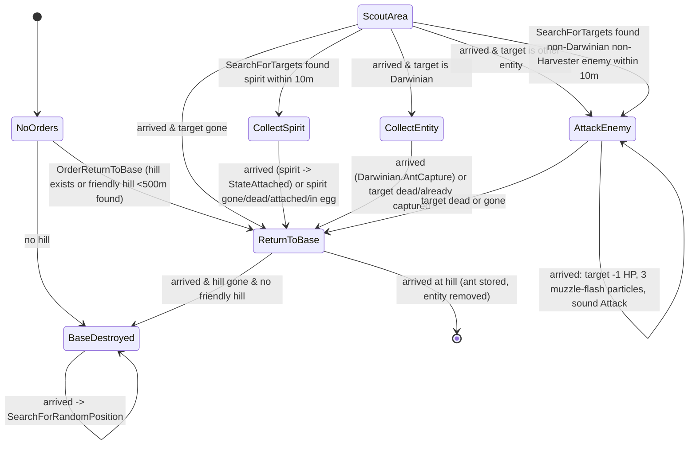
[C] `code/worldobject/armyant.cpp:ArmyAnt::Advance` and the `Advance*` methods.
- `SearchForTargets` runs every tick while `!m_targetFound` (spirits first, then enemies); once a target is found it is not re-searched until a failure clears `m_targetFound`. [C] `ArmyAnt::Advance`, `ArmyAnt::SearchForTargets`.
- **Delivery at the hill** (`AdvanceReturnToBase`): hill `m_numAntsInside++`; a carried spirit in `StateAttached` is removed from the world and `m_numSpiritsInside++`; a carried Darwinian in `StateCapturedByAnt` is killed with `ChangeHealth(-2 × health)` (which spawns its spirit next to the hill). The ant entity is then removed (`Advance` returns true). [C] `ArmyAnt::AdvanceReturnToBase`.
- **Carrying**: an attached spirit, and a captured Darwinian (via `Darwinian::AdvanceCapturedByAnt`), are teleported every tick to the ant's `MarkerCarry` shape marker. If the ant dies the Darwinian returns to `StateIdle`. [C] `ArmyAnt::GetCarryMarker`; `code/worldobject/darwinian.cpp:Darwinian::AntCapture`, `Darwinian::AdvanceCapturedByAnt`.
- **Movement**: straight line toward `m_wayPoint` at speed, y snapped to terrain (no obstruction pushing while walking — the call is commented out), heading jittered by `syncsfrand(0.2)` rad per tick; arrival when distance < `|vel|·dt` or < 1 m. Ants fall ballistically when `!m_onGround` (spawned with velocity by triffid eggs). [C] `ArmyAnt::AdvanceToTargetPosition`, `Entity::AdvanceInAir`.
- **Death**: `ChangeHealth` → generic death (spirit spawned) + shape explosion scaled by `m_scale`; drops any attached spirit (`Spirit::CollectorDrops`, inherits ant velocity). [C] `ArmyAnt::ChangeHealth`.
- **Team colouring**: three animation shapes `armyant.shp`, `armyant2.shp`, `armyant3.shp`, each copied and recoloured per team colour/coop group (cached as `<shape>_<colourId>_<groupId>`). Every tick a different one of the three is chosen with `syncrand()%3` (leg animation). [C] `ArmyAnt::SetShape`, `ArmyAnt::Advance`.
- **Sounds**: `"Attack"` (bite), plus generic `"LoseHealth"`, `"Die"`. **Effects**: `Particle::TypeMuzzleFlash` ×3 per bite, shape explosion on death. [C] `ArmyAnt::AdvanceAttackEnemy`.
- **Interaction with Darwinians**: Darwinians treat enemy AntHills and Triffids as attack targets. [C] `code/worldobject/darwinian.cpp:Darwinian::SearchForThreats` (L2827: enemy `TypeAntHill`/`TypeTriffid` buildings are threats).

<!-- from P05_entities_creatures -->
## [→ 02_units_and_entities] Triffid (Building) and TriffidEgg (Entity) — egg launcher and monster egg

### Role and build tag
- **Triffid** — a rooted plant building that periodically lobs TriffidEggs; each egg bursts after a timer and releases a creature group. **[B:FULL]** live via the **Triffids** crate outcome (`CrateRewardTriffids`, only reachable as an *uncaptured-crate* outcome — `Crate::CaptureCrate` re-rolls it away; `Crate::RunUncapturedCrate` includes it). Darwinia campaign maps place 30 Triffids → [B:LEGACY]. Not in `BuildingIsBlocked`. [C] `code/worldobject/crate.cpp:Crate::CaptureCrate`, `Crate::RunUncapturedCrate`, `Crate::RunTriffids`.
- **TriffidEgg** — **[B:FULL]** live: launched by Triffids (`Triffid::Launch`), spawned directly by the **Eggs** crate (`Crate::RunEggs`, task `GlobalResearch::TypeEggSpawn` or uncaptured — note: `RunUncapturedCrate` has a case for `CrateRewardEggs` but Eggs is not in its acceptable list, so that case is only reached with a fixed `m_rewardId`), and recursively by `SpawnTriffidEggs`. `TypeTriffidEgg` is in `EntityIsBlocked` (level-file only). [C] `code/worldobject/crate.cpp:Crate::RunEggs`, `code/taskmanager.cpp:Task::TargetEggs`, `code/worldobject/triffid.cpp:Triffid::Launch`.

### Crate effect mechanics [→ 04_crates_powerups_and_weapons]
**`Crate::RunTriffids(pos, teamId)`** [C] `code/worldobject/crate.cpp:Crate::RunTriffids`
- Creates `1 + syncrand()%3` (**1–3**) Triffids owned by the **Monster team**, at `pos + (syncsfrand(50),0,syncsfrand(50))` (±25 m), `m_front` pointing away from `pos`.
- Per triffid: `m_pitch = 0.6 + syncfrand(0.6)`, `m_force = 60 + syncfrand(60)`, `m_variance = syncfrand(0.5)`, `m_reloadTime = 40 + syncfrand(60)` s; `m_size` default 1.0; `m_useTrigger` default 0; spawn mask = **all types except `SpawnSpirits` and `SpawnEggs`** (so Virii, Centipede, Spider, TriffidEggs, Ants, SporeGenerator, SoulDestroyer, Darwinians).
- Message `multiwinia_exclamation` with the crate name; marker `icons/icon_triffid.bmp`; sound event for `CrateRewardTriffids` (team 255).

**`Crate::RunEggs(pos, teamId)`** [C] `code/worldobject/crate.cpp:Crate::RunEggs`
- Spawns `2 + syncrand()%3` (**2–4**) TriffidEggs **owned by `teamId`** (the player who used the task — so the hatched creatures fight *for* that player, except Soul Destroyers which are forced to the Monster team in multiplayer, see `TriffidEgg::Spawn`). Start = `pos + (0,20,0)`, velocity direction `(SFRAND(1), 4, SFRAND(1))` with length `50 + syncfrand(50)`.
- Each egg: spawn type drawn with `syncrand()%NumSpawnTypes` until it is **not** Spirits, Eggs, SoulDestroyer, Ants or Darwinians → one of **Virii, Centipede, Spider, TriffidEggs, SporeGenerator** (uniform over these 5); `m_size = 1.0`; burst timer `4 + syncfrand(4)` s; `m_spawnPoint = pos`; `m_roamRange = 300` — these last two have **no effect** on the hatched creatures: `TriffidEgg` declares its own `m_spawnPoint` (shadowing `Entity::m_spawnPoint`) and `TriffidEgg::Spawn` spawns at the egg's `m_pos` with fixed roam ranges (see spawn table). [C] `code/worldobject/triffid.h:TriffidEgg`, `TriffidEgg::Spawn`.
- Marker `icons/icon_egg.bmp`; message `crate_message_auto_eggs` (monster team) or `crate_message_run_eggs` (team name); sound for `CrateRewardEggs`.

### Triffid fields, stats and constants
| Field | Default | Crate value | Level-file order | Ref |
|---|---|---|---|---|
| `m_size` | 1.0 | 1.0 | 1 | [C] `Triffid::Triffid`, `Triffid::Read` |
| `m_pitch` | 0.6 | 0.6–1.2 | 2 | |
| `m_force` | 250.0 | 60–120 | 3 | |
| `m_variance` | π/8 | 0–0.5 | 4 | |
| `m_reloadTime` (s) | 60.0 | 40–100 | 5 | |
| `m_useTrigger` (enemies needed; 0 = always armed) | 0 | 0 | 6 | |
| `m_triggerLocation.x/.z` (offset) | 0,0 | 0,0 | 7,8 | |
| `m_triggerRadius` (m) | 100.0 | 100.0 | 9 | |
| `m_spawn[10]` (0/1 flags in enum order) | all false | see above | 10–19 | |
| `m_damage` ("health") | 50.0 | 50.0 | – | [C] `Triffid::Triffid` |
| `m_numEggs` (MP egg budget) | 3 | 3 | – | |
| Shape / markers | `triffidhead.shp`, `MarkerLaunchPoint`, `MarkerTriffidStem` | | | |

### Triffid behaviour
- **Initial timer**: `m_timerSync = now + (syncrand() % int(m_reloadTime)) + 10` s. Trigger check timer starts at `syncfrand(5)`. [C] `Triffid::Initialise`, `Triffid::Triffid`.
- **Arming**: if `m_useTrigger == 0` or burning → armed. Else every 5 s armed = `EntityGrid::AreEnemiesPresent(pos+triggerLocation, triggerRadius, team)`. On transition unarmed→armed the timer is re-randomised as above. [C] `Triffid::Advance`.
- **Launch** when armed and `now > m_timerSync`: in **multiplayer only while `m_numEggs > 0`**; each launch decrements it and when it reaches 0 calls `Damage(-100)` (sets itself on fire). Single-player launches forever. Next timer `now + reload × (1 + syncsfrand(0.1))`. [C] `Triffid::Advance`.
- **`Triffid::Launch`**: picks uniformly among enabled spawn types (`syncrand()%count`; nothing if none); egg velocity = launch marker forward × `m_force × m_size × (1 + syncsfrand(0.2))`; egg `m_size = 1 + syncsfrand(0.3)`, `m_spawnPoint = pos + triggerLocation`, `m_roamRange = triggerRadius`; MP: burst timer `4 + syncfrand(4)` s. Building sound `"LaunchEgg"`. [C] `Triffid::Launch`.
- **Head pose** (`GetHead`, used for launch direction, rendering and ray hits — computed from network time so it is deterministic): head at `pos + up×30×size`, pitched by `m_pitch×0.5×(1+0.1 sin t)`, bobbing offset `(4 sin(t/1.3), sin(t/1.5), 3 sin(t/1.2))`, recoil `-front×10×((timer-now)/reload)^5`, scale `size×(1+0.1 sin t)` where `t = now + uniqueId×10`. When burning: head thrashes (`front` rotated by `sin(5t)×variance`, larger offsets). [C] `Triffid::GetHead`.
- **Damage/burning**: `Damage(d)` adds `d` to `m_damage`; when it first drops ≤ 0 → sound `"Burn"`. While burning every tick: two `Particle::TypeFire` (size `100 + syncsfrand(100×size)`), 10% (unsynced) debris particle, `m_size -= 0.006`, `m_timerSync -= 0.5`; at `m_size <= 0.3` the head explodes and the building is removed (≈117 ticks ≈ 11.7 s from size 1.0). [C] `Triffid::Damage`, `Triffid::Advance`. Fire sources: flame grenades set Trees and Triffids within `2×power` alight (`code/worldobject/weapons.cpp:FlameGrenade::Advance`, L2050–2065); turret shells can hit Trees, AntHills and Triffids (`code/worldobject/weapons.cpp:TurretShell::Advance`, L1470).
- **Render**: yellow stem lines, head shape, a held egg drawn when within the last 25% of the reload. Editor-only trajectory preview under `LOCATION_EDITOR` [B:EDITOR]. [C] `Triffid::Render`, `Triffid::RenderAlphas`.

### Triffid spawn types (`Triffid::Spawn*` enum) and what `TriffidEgg::Spawn` creates
| # | Enum | Creates (team = egg team unless noted) | SP count | MP count | Spawn args (spread, roam range) | Ref |
|---|---|---|---|---|---|---|
| 0 | `SpawnVirii` | Virii | `5 + rand%5` (5–9) | `20 + rand%20` (20–39), **0 if team already has ≥ `VIRII_POPULATIONLIMIT` (250)** | 0, 100 | [C] `TriffidEgg::Spawn` |
| 1 | `SpawnCentipede` | one Centipede unit of `size` segments (unit created on egg team) | `5 + rand%5` (5–9) | `5 + rand%10` (5–14) | 0, 200 | |
| 2 | `SpawnSpider` | 1 Spider | 1 | 1 | 0, 150 | |
| 3 | `SpawnSpirits` | spirits, horizontal speed `20 + syncfrand(20)` | `5 + rand%5` | same | – | |
| 4 | `SpawnEggs` | Virii `Egg`s, velocity up+random, length `20 + syncfrand(20)` | `5 + rand%5` | same | 0, 0 | |
| 5 | `SpawnTriffidEggs` | TriffidEggs, speed `75 + syncfrand(50)`; each egg type = `syncrand() % 9` (never Darwinians); in MP a SoulDestroyer roll is re-rolled in Assault or when ≥ 2 Soul Destroyers exist; these sub-eggs keep the default burst timer **20–30 s** (no `SetTimer`) | `2 + rand%3` (2–4) | same | 0, 0 | |
| 6 | `SpawnAnts` | ArmyAnts thrown up, speed `10 + syncfrand(20)` (no hill: they roam via `BaseDestroyed`) | `20 + rand%10` (20–29) | same | 0, 0 | |
| 7 | `SpawnSporeGenerator` | 1 SporeGenerator | 1 | 1 | 0, 200 | |
| 8 | `SpawnSoulDestroyer` | 1 SoulDestroyer **on the Monster team in MP**; allowed if (not Assault **and** `SoulDestroyer::s_numSoulDestroyers < 2`) or single-player; otherwise **falls through to `SpawnVirii`** | 1 | 1 | 0, 200 | |
| 9 | `SpawnDarwinians` | Darwinians thrown up, speed `10 + syncfrand(20)` | `10 + rand%10` (10–19) | same | 0, 0 | |
(`rand` = `syncrand()`.) A commented-out `SpawnTripod` case exists. [C] `code/worldobject/triffid.cpp:TriffidEgg::Spawn`.

### TriffidEgg stats and behaviour
| Item | Value | Ref |
|---|---|---|
| Health | 50 (`data/stats.txt` TriffidEgg) | [C] `data/stats.txt` |
| Speed / Rate (blueprint) | 100 / 1 — not used by the egg logic | [C] `data/stats.txt`; `TriffidEgg::Advance` |
| Default burst timer | `m_life = 20 + syncfrand(10)` s (SP); overridden to `4 + syncfrand(4)` s by MP launches and by `RunEggs` | [C] `TriffidEgg::TriffidEgg`, `Triffid::Launch`, `Crate::RunEggs` |
| Gravity | `vel.y -= 9.8 × m_force` **per tick** (≈ 98 m/s² at `m_force=1`, not scaled by tick length) | [C] `TriffidEgg::Advance` |
| Bounce | when `y < ground + 3`: `WorldObject::BounceOffLandscape`, `m_force *= 0.65` (`TRIFFIDEGG_BOUNCEFRICTION`), `vel *= m_force`; sound `"Bounce"` while `m_force > 0.1` | [C] `TriffidEgg::Advance`, `code/worldobject/triffid.h` |
| Tumble | `m_up` rotated about `(up × vel)` by `m_force² × 30 × dt`; self-rights when `up.y < 0.3` and `m_force < 0.4` | [C] `TriffidEgg::Advance` |
| Damage | **immune to `DamageTypeLaser`**; otherwise generic death (spirit) + shape explosion | [C] `TriffidEgg::ChangeHealth` |
| Burst | at `now > m_timerSync`: shape explosion, `Spawn()`, sound `"BurstOpen"`, egg removed | [C] `TriffidEgg::Advance` |
| Visual | `triffidegg.shp` (team-coloured, `SetShape(..., true)`), pulsating size `m_size + abs(sin 2t)×(1-age)×0.4`, shadow `size×10` | [C] `TriffidEgg::Render` |

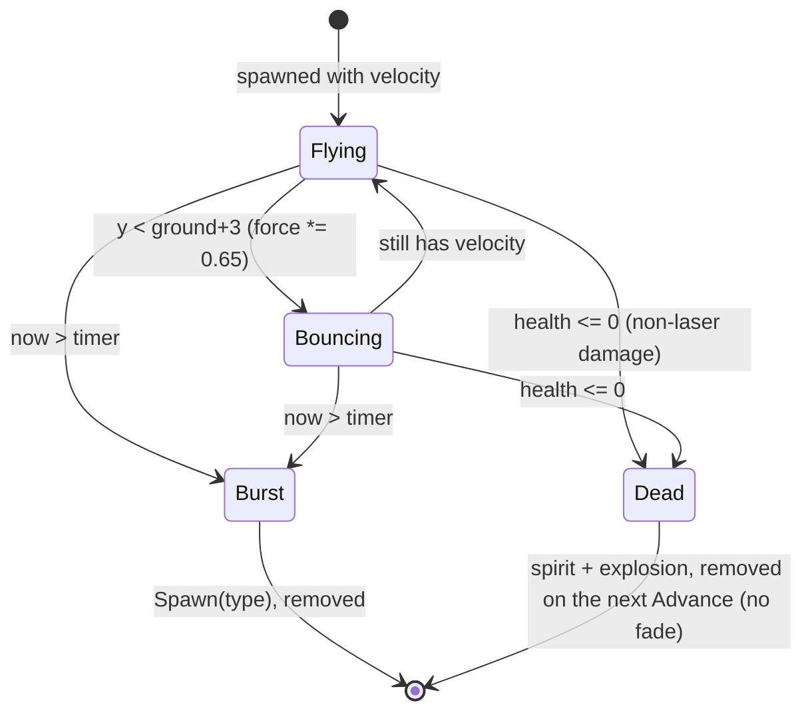

<!-- from P05_entities_creatures -->
## [→ 02_units_and_entities] Egg (Virii egg) — spirit-fertilised hatchery

### Role and build tag
Small sprite egg that, when a spirit is placed inside it, hatches 4 Virii after 15 s. **[B:FULL]** reachable in Multiwinia only indirectly: laid by **SporeGenerators** and **Spiders**, and thrown by `TriffidEgg` spawn type `SpawnEggs` (which crate Triffids/Eggs exclude — so in Multiwinia only via SporeGenerator/Spider, or a `SpawnTriffidEggs` sub-egg that rolls `SpawnEggs`). `TypeEgg` is in `EntityIsBlocked` (level-file only). [C] `code/worldobject/sporegenerator.cpp:SporeGenerator::AdvanceEggLaying`, `code/worldobject/spider.cpp:Spider::AdvanceEggLaying`, `code/worldobject/triffid.cpp:TriffidEgg::Spawn`.

### Stats
| Item | Value | Ref |
|---|---|---|
| Health | 10 (`data/stats.txt`) | [C] |
| Speed / Rate | 0 / 0 | [C] `data/stats.txt` |
| `EGG_DORMANTLIFE` | 120 s (`#define`) | [C] `code/worldobject/egg.h` |
| Hatch time | 15.0 s after fertilisation | [C] `Egg::Advance` |
| Hatch output | 4 Virii (egg team), spread 0, roam range 200, only if team Virii population < 250 | [C] `Egg::Advance` |

### States (`Egg::StateDormant`, `StateFertilised`, `StateOpen`)
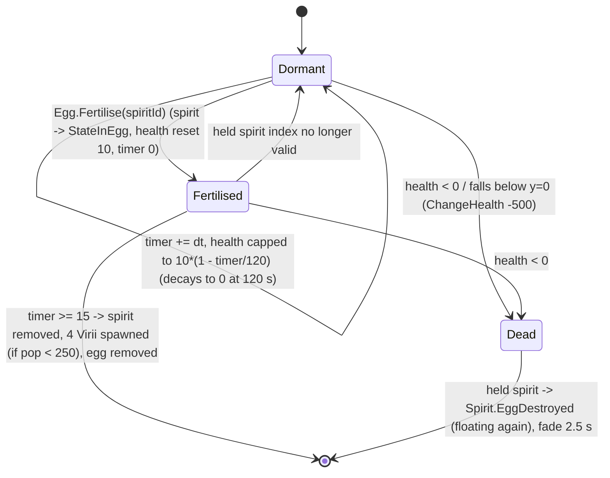
- `StateOpen` is declared but never entered. [C] `code/worldobject/egg.h`, `Egg::Advance`.
- **Death override**: `Egg::ChangeHealth` kills only when `health + amount < 0` (strictly), does **not** spawn a spirit and plays no sound (unlike `Entity::ChangeHealth`). [C] `Egg::ChangeHealth`.
- While fertilised, the spirit is pinned 3 m above the egg each tick. [C] `Egg::Advance`.
- **Fertilisers**: Virii carrying a spirit (`Virii::AdvanceToEgg`), SporeGenerator (25% of laid eggs pre-fertilised with a fresh spirit), spirits themselves track nearby eggs (`Spirit::SearchForNearbyEggs`, range `VIRII_MAXSEARCHRANGE`). [C] `code/worldobject/virii.cpp:Virii::AdvanceToEgg`, `code/worldobject/sporegenerator.cpp:SporeGenerator::AdvanceEggLaying`, `code/worldobject/spirit.cpp:Spirit::SearchForNearbyEggs`.
- **Physics**: ballistic via `Entity::AdvanceInAir` until grounded; snaps to ground; `y <= 0` (water) → `ChangeHealth(-500)`. [C] `Egg::Advance`.
- **Visual**: camera-facing 8×8 m (`size 4`) additive sprite `sprites/egg.bmp`, alpha = health/10 (min 0.1); fertilised eggs add two throbbing sprites (alpha `|sin t|×8×t`, growing over the 15 s); dead eggs break into 3 drifting quarter-sprite fragments. Team colour is fetched but the sprite is drawn white. [C] `Egg::Render`.

<!-- from P05_entities_creatures -->
## [→ 02_units_and_entities] Virii, ViriiUnit, ViriiHistory — worm swarm

### Role and build tag
Fast red worm-like creatures leaving a glowing trail; they bite enemies (20 HP), and ferry floating spirits into Eggs to breed. **[B:FULL]** reachable via: TriffidEgg `SpawnVirii` (Eggs/Triffids crates; also the fallback when a Soul Destroyer is disallowed), Egg hatching, and the debug cheat window [B:DEBUG]. **SpamInfection** particles converting spirits (Infection crate — see Spam section), and the debug cheat window [B:DEBUG] (`CHEATMENU_ENABLED`). Cave (`code/worldobject/cave.cpp`, blocked building) and Shaman (blocked) paths are [B:LEGACY]. Darwinia campaign maps place 118 Virii [B:LEGACY]. `TypeVirii` is **not** blocked. [C] `code/worldobject/triffid.cpp:TriffidEgg::Spawn`, `code/worldobject/egg.cpp:Egg::Advance`, `code/worldobject/spam.cpp:SpamInfection::AdvanceAttackingSpirit`, `code/interface/cheat_window.cpp:CheatWindow` (L141, inside `#ifdef CHEATMENU_ENABLED`), `code/worldobject/cave.cpp` (L30).

### Classes
| Class | Base | Purpose | Ref |
|---|---|---|---|
| `ViriiUnit` | `Unit` | Created by `Team::NewUnit` for `TypeVirii`; each Advance sets `m_enemiesFound = AreEnemiesPresent(centre, radius + 60, team)` (cheap pre-check before individual searches); renders all its Virii in one additive `GL_QUADS` batch with `sprites/viriifull.bmp`, choosing detail 1–4 from `RenderEntityDetail` pref and camera distance (detail 2 beyond 1000 m at pref 1; 3 beyond 1000 m / 2 beyond 500 m at pref 2; 4 always at pref 3). `m_cameraClose` is unused. | [C] `code/worldobject/virii.cpp:ViriiUnit::Advance`, `ViriiUnit::Render`; `code/team.cpp:Team::NewUnit` |
| `Virii` | `Entity` | The worm. | [C] |
| `ViriiHistory` | – | One trail sample: `m_pos`, `m_right` (perpendicular on land normal), `m_glowDiff` (10 m step vector), `m_distance` (to previous sample), `m_required` (true = direction change/state sample; false = smoothing for height change). | [C] `code/worldobject/virii.h` |
Virii not in a unit (spawned with unitId −1 by eggs/triffids) live in the team's `m_others` list and are batch-rendered by `Team::RenderVirii` (same detail rules). [C] `code/team.cpp:Team::RenderVirii`.

### Stats and constants
| Item | Value | Ref |
|---|---|---|
| Health | 10 | [C] `data/stats.txt` |
| Speed | 32 m/s; ×slope factor `clamp(1 + Δh/5, 0.1, 2.0)` where Δh = next−current terrain height (uphill slower, downhill faster) | [C] `data/stats.txt`, `Virii::AdvanceToTargetPos` |
| Rate | 0 | [C] |
| Hover height | 0.1 m | [C] `Virii::Virii` |
| `VIRII_MINSEARCHRANGE` / `MAXSEARCHRANGE` | 30 / 60 m (`#define`) | [C] `code/worldobject/virii.h` |
| `VIRII_TAILLENGTH` | 175 m (the code uses a literal 175.0) | [C] `Virii::RecordHistoryPosition` |
| `VIRII_POPULATIONLIMIT` | 250 per team (`#define`) | [C] `code/worldobject/virii.h` |
| Bite | `ChangeHealth(-20)` on arrival at the enemy (unresistable type) | [C] `Virii::AdvanceAttacking` |
| Retarget period (idle) | 1.0 s (first after `syncfrand(2.0)`) | [C] `Virii::AdvanceIdle`, `Virii::Virii` |
| History sample period (non-idle) | 0.5 s, plus extra non-required samples when height differs > 3 m | [C] `Virii::Advance` |
| Fall gravity | −10 m/s², lands at ground + 2 | [C] `Virii::Advance` |
| Population counter | `Virii::s_viriiPopulation[team]` ++ in `Begin`, −− in destructor; excluded from AntHill pop-cap counting | [C] `Virii::Begin`, `Virii::~Virii`, `AntHill::PopulationLocked` |

### State machine (`Virii::StateIdle`, `StateAttacking`, `StateToSpirit`, `StateToEgg`)
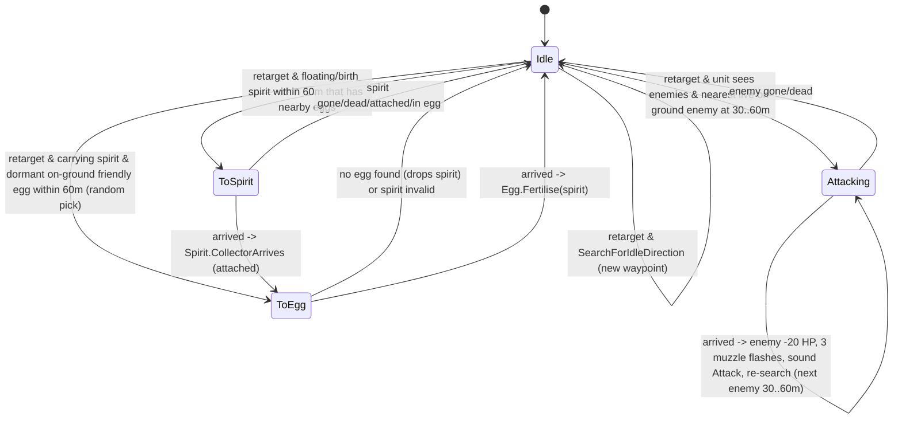
[C] `code/worldobject/virii.cpp:Virii::AdvanceIdle`, `AdvanceAttacking`, `AdvanceToSpirit`, `AdvanceToEgg`, `SearchForEnemies`, `SearchForSpirits`, `SearchForEggs`, `FindNearbyEgg(Vector3)`.
- **Bite cadence**: after a bite the Virii looks for the nearest enemy at ≥ 30 m; if none is found it keeps the current target and, being on top of it, bites again on the next tick (−20 HP per 0.1 s). [I] from `Virii::AdvanceAttacking` + `EntityGrid::GetBestEnemy` min-range rule (`code/entity_grid.cpp:EntityGrid::GetBestEnemy`).
- **Idle wandering** (`SearchForIdleDirection`): return-to-spawn chance `d/roamRange` (forced 0 below 0.75); returning picks one of 8 compass directions toward spawn; otherwise up to 3 tries of a random compass direction `(int(syncfrand(3))-1, 0, int(syncfrand(3))-1)` whose endpoint (`speed × retargetTimer` ahead) is above sea level. Each new direction records a required history point and plays `"ChangeDirection"`. [C] `Virii::SearchForIdleDirection`.
- **Spirits targeted**: only spirits with `NumNearbyEggs() > 0` in `StateBirth`/`StateFloating`. Carried spirits follow at `pos + (0,2,0)`; dropped (`CollectorDrops`) when the Virii dies. [C] `Virii::SearchForSpirits`, `Virii::Advance`.
- **Trail**: `m_positionHistory` (newest first) is trimmed once its summed length exceeds 175 m. Rendered as a 3 m-half-width textured worm strip (alpha `wormColour.a − cumulative distance`) plus a 12 m-half-width glow strip (skipped at detail 4). Lower detail levels drop non-required samples and render only `1 − 0.25×min(detail−1,2)` of the history. [C] `Virii::RecordHistoryPosition`, `Virii::Render`.
- **Team colouring**: worm colour = team colour × health fraction (alpha 200); glow = RGB(200,100,100) single-player / team colour multiplayer (alpha 150). **Monster-team Virii are rendered white/transparent (`wormColour (255,255,255,0)`, glow `(200,200,200,50)`)**. Dead Virii fade as near-white (alpha ∝ remaining fade health). [C] `Virii::Render`.
- **Death**: generic `Entity::ChangeHealth` (spirit spawned, `"Die"`), velocity zeroed, then 2.5 s fade via `Entity::AdvanceDead`. `Virii::AdvanceDead()` (trail scatter in 8 compass directions at 10 m/s) is **never called** (it does not override the `Entity::AdvanceDead(Unit*)` signature). [C] `Virii::Advance`, `Virii::AdvanceDead`, `Virii::AdvanceDeadPositionVector`; grep shows no caller.
- **Push immunity**: a laser hit does not push or turn a Virii (it still takes damage). [C] `code/worldobject/weapons.cpp:Laser::Advance` (L782–788 skip `TypeVirii`).
- **Map clamp** repeated in `Virii::Advance`. Water damage is commented out (Virii can cross water). [C] `Virii::Advance`.
- **Sounds**: `"ChangeDirection"`, `"Attack"`, generic `"LoseHealth"`, `"Die"`. **Effects**: `Particle::TypeMuzzleFlash` ×3 per bite.

<!-- from P05_entities_creatures -->
## [→ 02_units_and_entities] SporeGenerator — flying egg layer

### Role and build tag
A hovering creature with four tails that drifts around its spawn point and lays Virii Eggs near floating spirits (and at random). **[B:FULL]** reachable via TriffidEgg `SpawnSporeGenerator` (Eggs and Triffids crates). Shaman path and campaign placements (26) [B:LEGACY]. Not blocked. [C] `code/worldobject/triffid.cpp:TriffidEgg::Spawn`.

### Stats and constants
| Item | Value | Ref |
|---|---|---|
| Health | 200 | [C] `data/stats.txt` |
| Speed | 20 m/s (scaled by `dist/50` within 50 m of target) | [C] `data/stats.txt`, `SporeGenerator::AdvanceToTargetPosition` |
| Rate | 10 (unused) | [C] `data/stats.txt` |
| `SPOREGENERATOR_HOVERHEIGHT` | 100 m (`#define`, cpp) — **not applied on spawn in multiplayer** (spawns at ground level, rises toward targets) | [C] `SporeGenerator::Begin` |
| `SPOREGENERATOR_EGGLAYHEIGHT` | 20 m | [C] |
| `SPOREGENERATOR_SPIRITSEARCHRANGE` | 200 m | [C] |
| `SPOREGENERATOR_NUMTAILS` | 4 (`#define`, h) | [C] |
| Retarget period (idle) | 6.0 s | [C] `SporeGenerator::AdvanceIdle` |
| Egg interval | `2 + syncfrand(2) − difficulty/10` s while within 50 m of the lay target | [C] `SporeGenerator::AdvanceEggLaying` |
| Pre-fertilised eggs | 25% (`syncrand()%4 == 0`) — a new spirit is spawned in the egg | [C] |
| Random lay chance | `10 + 20×difficulty/10` % per random retarget | [C] `SporeGenerator::SearchForRandomPos` |
| Panic | 10 s after any hit ≥ 2 HP; velocity set to `up × speed × 3` | [C] `SporeGenerator::ChangeHealth` |

`g_app->m_difficultyLevel` is 0 in Multiwinia [I]: `App` initialises it to 0 (`code/app.cpp`, L632) and `Location::Init` copies the level-file value only when non-negative (`code/location.cpp`, L348–356).

### State machine (`StateIdle`, `StateEggLaying`, `StatePanic`)
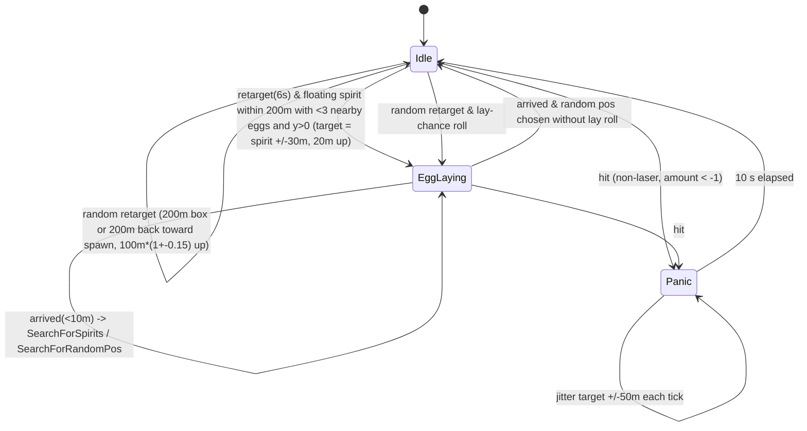
- **Steering**: `vel = vel×(1 − dt/2) + targetVel×dt/2`, rotated around the right axis by `sin(3·now)×dt×1.5` (deterministic wobble); arrival < 10 m. [C] `SporeGenerator::AdvanceToTargetPosition`.
- **Return-to-spawn rule**: chance `d/roamRange` (roam range 200 when hatched from an egg). [C] `SporeGenerator::SearchForRandomPos`.
- **Damage**: **immune to lasers**; hits of exactly −1 are ignored; others apply generic damage, play a partial shape explosion (fraction dead) and trigger Panic. Death → generic spirit + `"Die"`. [C] `SporeGenerator::ChangeHealth`.
- **Eggs laid** at shape marker `MarkerEggs`, inheriting the generator's velocity, team = generator team. Sound `"LayEgg"`. [C] `SporeGenerator::AdvanceEggLaying`.
- **Visual**: `sporegenerator.shp` (not team-coloured: `SetShape(..., false)`), four 3-segment quad-strip tails in team colour from markers `MarkerTail01`–`04`, animated with sin offsets and a function-static smoothed velocity (shared between all generators — render-only quirk); damaged flicker; 20 m shadow. [C] `SporeGenerator::Render`, `SporeGenerator::RenderTail`.

<!-- from P05_entities_creatures -->
## [→ 02_units_and_entities] Centipede — segmented ground predator

### Role and build tag
A chain of linked segments (one Entity per segment, all in one Unit) led by a head that hunts enemies, eats floating spirits and grows. **[B:FULL]** reachable via TriffidEgg `SpawnCentipede` (Eggs and Triffids crates). Campaign InstantUnits (55) and Shaman are [B:LEGACY]. `TypeCentipede` is **not** blocked, and `LevelFile::ParseInstantUnits` has a difficulty-based splitting rule for long centipedes (campaign only). [C] `code/worldobject/triffid.cpp:TriffidEgg::Spawn`, `code/level_file.cpp:LevelFile::ParseInstantUnits`. Must be created in a Unit (`AppReleaseAssert`). [C] `Centipede::Advance`.

### Stats and constants
| Item | Value | Ref |
|---|---|---|
| Base health | 255 (stats) × `2 × m_size`, clamped [0,255] per segment (≥ 255 when size ≥ 0.5; tail size 0.2 → 102) | [C] `data/stats.txt`, `Centipede::Begin` |
| Speed | 80 m/s × slope factor `clamp(1 + Δh/10, 0.6, 1.0)` (only uphill slows) | [C] `data/stats.txt`, `Centipede::AdvanceToTargetPosition` |
| Rate | 1 (unused) | [C] |
| Turn blend | `dt × 3` per tick for the head (`× 1.5` if trailing) | [C] `Centipede::AdvanceToTargetPosition` |
| `CENTIPEDE_MINSEARCHRANGE` / `MAXSEARCHRANGE` | 75 / 150 m (enemy search scaled by head `m_size`; spirit search unscaled) | [C] `code/worldobject/centipede.h` |
| `CENTIPEDE_SPIRITEATRANGE` | 10 m (horizontal) | [C] |
| `CENTIPEDE_NUMSPIRITSTOREGROW` / `_MP` | 4 / 4 | [C] |
| `CENTIPEDE_MAXSIZE` | 20 segments (no eating or spirit seeking above this) | [C] |
| Eat chance | `m_size/2` per candidate spirit per tick, at most one spirit per tick | [C] `Centipede::EatSpirits` |
| Contact damage | every segment, every tick: enemies within `m_radius` (= `10 × m_size` fixed at `Begin`) are pushed out to the radius and take `int((radius − distance) × 10)` damage | [C] `Centipede::Attack` |
| Panic | `2 + syncfrand(2)` s when a hit drops a segment into a lower third of its max health; propagated to every segment toward the head | [C] `Centipede::ChangeHealth`, `Centipede::Panic` |
| Water/building avoidance | a target with y < 0, or a building within 150 m ahead (`Location::GetBuildingId(pos, front, 255, 150)`), counts as "arrived" (forces a retarget) | [C] `Centipede::AdvanceToTargetPosition` |
| Arrival | < 20 m | [C] |

### Segment logic
- **Linking at spawn** (`Centipede::Begin`): when a segment begins without a leader, all segments of its Unit are relinked in unit-array order: entity 0 is the **head** (no `m_next`), each next entity follows the previous one (`m_next` = guy in front, `m_prev` = guy behind). Sizes: head `min(0.2 × 1.1^N, 10)`, each following segment `/1.1`. Segment shapes: per-team recoloured `centipedehead.shp` / `centipede.shp` (cached `<name>_<colourId>_<groupId>`, statics `s_shapeHead[team]`, `s_shapeBody[team]`). [C] `Centipede::Begin`.
- **Size convergence** every tick: tail target size 0.2; others `min(1.1 × size_of_segment_behind, 1.0)`; size moves 10% toward target when off by > 0.01, health rescaled to keep the same fraction. ⇒ steady state tail 0.2, growing ×1.1 per segment toward the head, capped 1.0. [C] `Centipede::Advance`.
- **Following**: a trailing segment copies its leader's interpolated trail point: with the leader's last 3 recorded positions (`RecordHistoryPosition` keeps 3, newest first), `pos = h[k+1] + (h[k] − h[k+1]) × (1 − m_size)`, `vel = (h[k] − h[k+1]) / dt`, where `k = 0` if the leader's entity index is greater than the follower's (leader not yet advanced this tick) else 1. It inherits the leader's `m_panic`. `m_linked` (render gate) requires the leader linked and ≥ 2 own history samples. If the leader dies the segment becomes a new head. [C] `Centipede::Advance`, `Centipede::GetTrailPosition`, `Centipede::RecordHistoryPosition`.
- **Death of a segment**: generic death (spirit), scaled shape explosion, unlinks from both neighbours (`next->m_prev` invalidated) — so a centipede **splits** into two independent centipedes when a middle segment dies. In single-player each health-band drop also plays an explosion. Dead segments run `Entity::AdvanceDead` only. [C] `Centipede::ChangeHealth`, `Centipede::Advance`.
- **Growth** (`EatSpirits`, head only): after eating ≥ 4 spirits, appends `floor(eaten/4)` new segments behind the current tail (new Unit entity, size = tail size ≥ 0.2, placed at `m_spawnPoint`, same roam settings), sound `"Grow"`. [C] `Centipede::EatSpirits`.
- **GetSize** counts segments from this one backwards through `m_prev`. [C] `Centipede::GetSize`.

### Head state machine
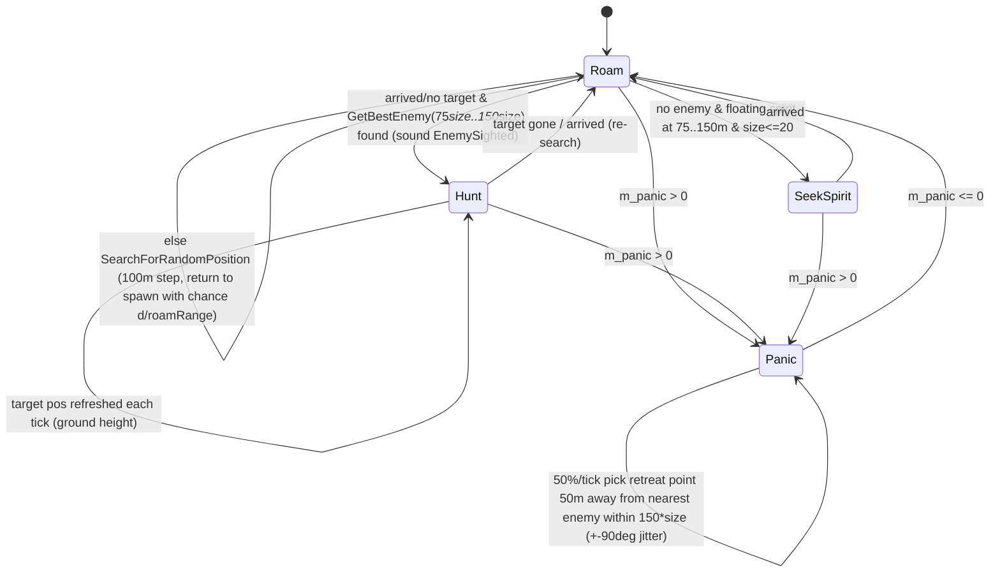
[C] `Centipede::Advance`, `SearchForTargetEnemy`, `SearchForSpirits`, `SearchForRandomPosition`, `SearchForRetreatPosition`.
- Every tick (head and body) `EatSpirits` (head only) and `Attack(m_pos)` run regardless of state.
- **Sounds**: `"Panic"` (on entering panic), `"EnemySighted"`, `"Grow"`, `"Attack"` (each contact), generic `"LoseHealth"`/`"Die"`. **Effects**: shape explosions; terrain-normal-aligned rendering; a commented-out D3D tearing effect.

<!-- from P05_entities_creatures -->
## [→ 02_units_and_entities] Spider — eight-legged pouncer

### Role and build tag
Large walker with 8 procedurally animated legs that pounces on enemies and lays Virii eggs near spirits. **[B:FULL]** reachable via TriffidEgg `SpawnSpider` (Eggs/Triffids crates) and **SpamInfection** (5% of spirit conversions, Infection crate). Campaign (45) and Shaman [B:LEGACY]. Not blocked. [C] `code/worldobject/triffid.cpp:TriffidEgg::Spawn`, `code/worldobject/spam.cpp:SpamInfection::AdvanceAttackingSpirit`.

### Stats and constants
| Item | Value | Ref |
|---|---|---|
| Health | 200 | [C] `data/stats.txt` |
| Speed (blueprint 50) | **unused**; walking speed is `min(distance, 30)` m/s | [C] `Spider::AdvanceToTarget` |
| Rate | 1 (unused) | [C] |
| `SPIDER_NUM_LEGS` | 8 | [C] `code/worldobject/spider.h` |
| `HOVER_HEIGHT` | 3.0 m (body follows terrain + 3 with blend `dt` per tick) | [C] `code/worldobject/spider.cpp`, `Spider::Advance` |
| `TURN_RATE` | 0.1 rad/tick (0.05 when dot > 0.9; must face within dot 0.999 before `FaceTarget` succeeds; moves only when dot > 0.5) | [C] `Spider::FaceTarget`, `Spider::AdvanceToTarget` |
| `ATTACK_SEARCH_MIN/MAX_RADIUS` | 100 / 250 m | [C] |
| `SPIRIT_MIN/MAXSEARCHRANGE` | 30 / 100 m (spirits higher than 10 m with < 3 nearby eggs) | [C] `Spider::SearchForSpirits` |
| `MAX_PATH_HEIGHT` | 100 m (random wander target rejected if the path crosses terrain > 100 m or < 0.1 m; 10 tries) | [C] `Spider::IsPathOK`, `Spider::SearchForRandomPos` |
| Pounce trigger distance | ≤ 150 m from pounce target (and facing) | [C] `Spider::AdvanceAttack` |
| Pounce launch | `vel = normalise(dir with y = 0.5) × 24 × sqrt(distance)` | [C] |
| Pounce gravity | `vel.y -= 40` **per tick** | [C] `Spider::AdvancePouncing` |
| Landing squash | enemies within 40 m: `fraction = (40 − d)/40 × (1 + syncfrand(0.3))`; those within **20 m** take `100 × fraction` damage; all are pushed (`front` with y = 5×length(front), length `min(30×fraction, 20)`) and made airborne | [C] `Spider::AdvancePouncing` |
| Retarget | 5 s idle/egg-laying; 3 s set at pounce; 6 s after landing | [C] |
| Spider–spider avoidance | if another spider within 22 m of `pos + vel`, retarget 40 m along the summed escape vector (uses `syncrand()%numFound`, bug: picks a random neighbour, not the spider found) | [C] `Spider::DetectCollisions` |
| `NORMAL_SPEED` 300, `ATTACK_SPEED` 90, `FOOT_MOVE_THRESHOLD` 5, `FOOT_EMERGENCY_THRESHOLD` 12, `FOOT_DAMAGE_RADIUS` 20, `FOOT_DAMAGE_STRENGTH` 10, `ATTACK_PREAMBLE` 5 | `NORMAL_SPEED`, `ATTACK_SPEED`, `ATTACK_PREAMBLE` unused; foot thresholds drive the gait; `StompFoot` (foot damage) is never called | [C] `code/worldobject/spider.cpp` defines, `Spider::UpdateLegs` (call commented out) |

### State machine (`StateIdle`, `StateEggLaying`, `StateAttack`, `StatePouncing`)
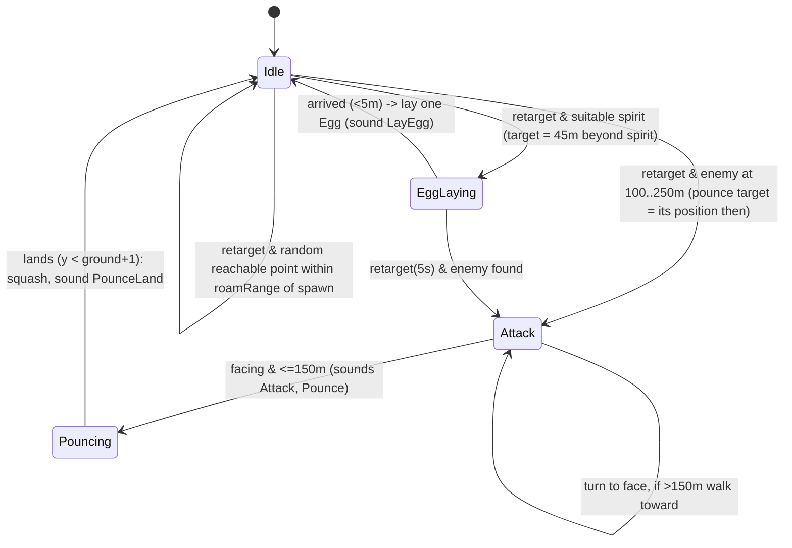
[C] `code/worldobject/spider.cpp:Spider::Advance`, `AdvanceIdle`, `AdvanceEggLaying`, `AdvanceAttack`, `AdvancePouncing`.
- The pounce target is a **position snapshot** taken at search time; the spider does not track the moving enemy. [C] `Spider::SearchForEnemies`.
- **Gait** (`Spider::UpdateLegs`): up to two feet lifted per tick, chosen by `EntityLeg::CalcFootsDesireToMove` (> 12 = emergency lift, best > 5 lifted, then `m_delayBetweenLifts` lock-out); parameter set chosen by the nearest ideal speed: {10 m/s: swing 0.4 s, lift delay 0.11 s, look-ahead 0.75}, {30: 0.25, 0.06, 0.3}, {50: 0.25, 0.04, 0.2}; leg lift 3.0, ideal slope `2.6 × 2.5`. Sound `"FootFall"` when a foot plants. During a pounce legs follow `EntityLeg::AdvanceSpiderPounce(2 × elapsed)`. Leg geometry/IK lives in `code/worldobject/entity_leg.cpp` (other partition). [C] `Spider::UpdateLegs`, `Spider::CalcWhichFootToMove`, `Spider::Spider`.
- **Damage**: **immune to lasers**; hits of −1 ignored; others generic + partial shape explosion. Death → spirit, `"Die"`. [C] `Spider::ChangeHealth`.
- **Team colouring**: `spider.shp` fully team-coloured (`SetShape(..., true)`); legs `spider_leg_upper.shp`/`spider_leg_lower.shp`; markers `MarkerEggLay`, `MarkerLeg0`–`7`. Damaged flicker scales the body. A D3D-only tearing deform effect follows the pounce [B:D3D]. [C] `Spider::Begin`, `Spider::Render`, `Spider::AdvancePouncing` (`#ifdef USE_DIRECT3D`).
- **Sounds**: `"Pounce"`, `"PounceLand"`, `"FootFall"`, `"LayEgg"`, `"Attack"`.

<!-- from P05_entities_creatures -->
## [→ 02_units_and_entities] WallBuster — Assault-mode carryable wall charge

### Role and build tag
A `CarryableBuilding` explosive that Darwinians carry (10–30 lifters) to breach Walls. **[B:FULL]** live in Assault: `data/levels/mp_assault_2P_1.txt` places 3 WallBusters (team 255). Referenced by help hints (`code/multiwiniahelp.cpp`), selection (`code/location_input.cpp`), AI (`code/worldobject/ai.cpp`) and Darwinian carrying (`code/worldobject/darwinian.cpp`). Not blocked. [C] `data/levels/mp_assault_2P_1.txt`; `code/worldobject/carryablebuilding.cpp` (L528 lists `TypeWallBuster` as carryable).

### Parameters
| Item | Value | Ref |
|---|---|---|
| Shape / scale | `wallbuster.shp`, `m_scale = 10` | [C] `WallBuster::WallBuster` |
| Lifters | min 10, max 30; `m_speedScale = 0.6` | [C] |
| Carry radius | 13 m (also `m_radius`) | [C] `WallBuster::Initialise` |
| Wall trigger | any `Wall` building in the obstruction cell whose shape `DoesSphereHit(pos, 20)` | [C] `WallBuster::Advance` |
| Breach | `ExplodeShape(1.0)`; **every Wall within 200 m takes `Damage(-1000)`**; `Location::Bang(pos, 50, 150)`; WallBuster destroyed; global message `dialog_wallbreach` | [C] `WallBuster::Advance`, `WallBuster::BreakWalls` |
| Defender scuttle | if owned by a **non-attacking** team (≠ 255) and carried by ≥ 10 lifters: `m_destructTimer` (10 s) counts down; at 0 → destroyed + `Bang(pos, 50, 500)`; resets to 10 s whenever the condition fails | [C] `WallBuster::Advance` |
| AI target | `m_aiTarget` follows the bomb if > 1.5 × carry radius away (creation code is commented out, so normally NULL) | [C] `WallBuster::Advance` |
| AI routing (`RunAI`) | when waypoint is unset/reached, once per second: route (`RoutingSystem::GenerateRoute`) to the nearest Wall that lies within 500 m of any marker of the AI's current `AIObjective` | [C] `WallBuster::RunAI` |
| Render | uses special lights (`SetupSpecialLights`) then restores | [C] `WallBuster::Render` |
Ownership/capture by carrying, lifter movement and drop rules are in `CarryableBuilding` (other partition). [I] team ownership = team of its lifters.

<!-- from P05_entities_creatures -->
## [→ 02_units_and_entities] Ambient weather objects — Lightning, Snow, DustBall (level effects)

All three are `WorldObject`s stored in `Location::m_effects` with team −1, created by `Location` when the level file's `Effects` line enables them. They are **not crate outcomes**. Creation runs in `Location::Advance` on slice 3 (once per 0.1 s tick). **All three generators share one timer, `Location::m_christmasTimer`** (initial −99.9). [C] `code/location.cpp:Location::Advance` (L1388–1397), `Location::Location` (L120), `code/level_file.cpp:LevelFile::ParseMultiwiniaOptions` (`Effects` keyword, L421–431).

Shipped Multiwinia maps using effects [C] `data/levels/mp_*.txt` `Effects` lines:
| Effect keyword | Maps |
|---|---|
| `snow` | mp_assault_3p_3, mp_blitzkrieg_2P_4, mp_blitzkrieg_4P_2, mp_cts_2p_2, mp_koth_2P_3, mp_koth_2P_3b |
| `lightning` | mp_blitzkrieg_3P_2, mp_cts_4P_2 |
| `dustwind` | mp_cts_3p_1 |
| `SpecialLighting` (not this partition) | mp_koth_2P_3, mp_koth_2P_3b, mp_koth_3P_1 |
| `soulrain` (`AdvanceSoulRain`, not this partition) | none |
Snow is additionally forced on every map when **Christmas mode** is active (`Location::m_christmasMode`, copied from `ClientToServer::m_christmasMode`, which the server/metaserver can switch on; `App::UseChristmasMode`) — also brightens light colours ×(1.3,1.2,1.2). [C] `code/location.cpp:Location::Init` (L212–215), `Location::ChristmasModEnabled`, `Location::SetupLights` (L4750); `code/network/clienttoserver.cpp:ClientToServer::Advance` (L567), `ClientToServer::ProcessServerUpdates` (L3024). **[B:FULL]** all three.

### Lightning (`EffectLightning`) — storm strikes
| Item | Value | Ref |
|---|---|---|
| Generator | `Location::AdvanceLightning`: when shared timer ≤ 0 → timer = `syncfrand(15)` s; spawn one Lightning at random `(FRAND(sizeX), 1200, FRAND(sizeZ))`, re-rolled until terrain height > 1 (over land) | [C] `code/location.cpp:Location::AdvanceLightning` |
| Strike chance | each tick `syncfrand(1) < 0.01` (1%/tick ≈ 10%/s); may strike repeatedly | [C] `Lightning::Advance` |
| Lifetime | none until the first strike; each strike sets `m_life = 1.2` s; removed when it counts down to 0 | [C] |
| Strike effect | **sets on fire (`Darwinian::SetFire`) every Darwinian within 30 m** (any team); every **Tree** in the obstruction cell under the strike takes `Damage(-100)` (catches fire) | [C] `Lightning::Advance` |
| FX | 5 `TypeExplosionDebris` (150–250) + 10 `TypeFire` (160–280) particles at ground (unsynced sizes/velocities) | [C] |
| Render | idle: pulsing 200 m `textures/glow.bmp` cloud glow (alpha `abs(sin 2t)`); striking: 3 stacked bolt quads `textures/lightning.bmp` from the cloud to the ground, width 30 ×1.2 per layer, alpha halving | [C] `Lightning::Render` |
No sound event is triggered by Lightning code. [C] (no `m_soundSystem` call in `code/worldobject/lightning.cpp`).

### Snow (`EffectSnow`) — purely ambient
| Item | Value | Ref |
|---|---|---|
| Generator | `Location::AdvanceChristmas`: first call (timer < −90) creates **150** flakes at random XZ, y `syncfrand(1000)`; thereafter one flake every 0.1 s at y `700 + syncfrand(300)` | [C] `code/location.cpp:Location::AdvanceChristmas` |
| Motion | `vel *= 0.9`/tick; wobble `hover.xz = sin(offset) × rate`, rates random-walk by `syncsfrand(1)` per tick within [0,2]; fall `hover.y = −(20 + syncfrand(20)) × clamp(heightAboveGround/100, 0.2, 1)` m/s; clamped to the map | [C] `Snow::Advance` |
| Removal | when ≥ 10 m below the terrain surface | [C] |
| Gameplay effect | **none** (no entity/building interaction) | [C] `code/worldobject/snow.cpp` |
| Render | 20 m white `textures/starburst.bmp` 3-D sprite | [C] `Snow::Render` |
| `GetLife` | 0→1 over the first 10 s (fade-in helper; no caller in this partition) | [C] `Snow::GetLife` |
Snow consumes ~4 synced random numbers per flake per tick (deterministic but a cost); `snow.cpp` `#undef`s `TRACK_SYNC_RAND` so these calls are excluded from desync logging. [C] `code/worldobject/snow.cpp` (L36).

### DustBall (`EffectDustBall`) — dust storm and vortex
| Item | Value | Ref |
|---|---|---|
| `DUSTBALL_SPEED` | 500 m/s | [C] `code/worldobject/dustball.cpp` |
| Generator | `Location::AdvanceDustWind`: first call creates **300** balls (y `syncfrand(1000)`, size `20 + syncfrand(20)`); then **2** balls per 0.1 s at random XZ, y `syncfrand(1000)` | [C] `code/location.cpp:Location::AdvanceDustWind` |
| Wind | every `15 + syncfrand(15)` s (`DustBall::s_vortexTimer`): with probability 1/10 (`syncrand()%10 == 0`) and no active vortex → **vortex** at a random land point (height > 1), y `FRAND(500)`; otherwise vortex cleared and a new wind direction = normalise(random point − random point) | [C] |
| Ball motion (wind) | steer toward `pos + wind × 2000` with turn blend `3 × dt`, speed 500 | [C] `DustBall::Advance` |
| Ball motion (vortex) | orbit target `vortex + (cos τ, sin τ) × 300 × y/1000` at own height, τ = now + uniqueId×20 | [C] |
| Removal | leaves the map rectangle | [C] |
| **Vortex gameplay** | each tick every on-ground Darwinian within 50 m of the vortex ground point enters `Darwinian::StateInVortex` and becomes airborne; it then spirals (speed `max(100 × y/1000, 30)`, radius `300 × y/1000`, climbing +50 m/step up to `500 + 5 × (uniqueId % 100)` m) until the vortex clears, then returns to `StateIdle` with speed 50 (falls) | [C] `Location::AdvanceDustWind`; `code/worldobject/darwinian.cpp:Darwinian::AdvanceInVortex` |
| Render | `textures/cloudyglow.bmp` sprite RGBA(0.6,0.46,0.12,0.2), size `m_size` | [C] `DustBall::Render` |
| Reset | `s_vortexTimer = 0`, `s_vortexPos = 0` in `Location::Init` | [C] `code/location.cpp:Location::Init` |

<!-- from P05_entities_creatures -->
## [→ 02_units_and_entities] SoulDestroyer and Zombie — the soul-eating flyer and its ghosts

### Role and build tag
- **SoulDestroyer** — a fast flying serpent (head + tail segments drawn from its own position history) that dives through enemies, killing them and **destroying their spirits** (so the souls never return to the spawn economy). **[B:FULL]** reachable via TriffidEgg `SpawnSoulDestroyer` from **Triffids-crate** triffids (spawn mask includes it) and from `SpawnTriffidEggs` sub-eggs (Eggs or Triffids crates). Multiplayer limits: not in Assault, and at most **2** alive (`s_numSoulDestroyers < 2`), always on the **Monster team**; otherwise the egg yields Virii instead. The Eggs crate excludes it from its first-level roll. Campaign placements (8) and Shaman [B:LEGACY]. Not blocked. [C] `code/worldobject/triffid.cpp:TriffidEgg::Spawn`, `code/worldobject/crate.cpp:Crate::RunEggs`, `Crate::RunTriffids`.
- **Zombie** (`WorldObject`, `EffectZombie`) — a drifting ghost sprite left behind by Darwinians killed by a SoulDestroyer or by Dark-Forest evil trees. Purely visual (no other code reads `EffectZombie`). **[B:FULL]**. Creators: `SoulDestroyer::Attack`, `code/worldobject/tree.cpp:Tree::Advance` (L373, Dark Forest crate), `code/worldobject/darwinian.cpp:Darwinian::AdvanceSacraficing` (Shaman portal, [B:LEGACY]). [C]

### SoulDestroyer stats and constants
| Item | Value | Ref |
|---|---|---|
| Health | 255 | [C] `data/stats.txt` |
| Speed | blueprint 150 is **overridden: hard-coded 130 m/s** | [C] `SoulDestroyer::AdvanceToTargetPosition` |
| Rate | 1 (unused) | [C] |
| `SOULDESTROYER_MINSEARCHRANGE` / `MAXSEARCHRANGE` | 200 / 300 m (target dropped beyond 300 m) | [C] `code/worldobject/souldestroyer.h`, `SoulDestroyer::Advance` |
| `SOULDESTROYER_DAMAGERANGE` | 25 m: every tick (when not panicking, `m_panic < 0.1`) each enemy within 25 m is pushed out to 25 m and takes `int((25 − d) × 50)` damage (a direct hit ≈ −1250 → instant kill) | [C] `SoulDestroyer::Attack` |
| `SOULDESTROYER_MAXSPIRITS` | 50 (render-only "eaten soul" list) | [C] |
| Turn blend | `dt × 2` per tick; when no target entity the heading weaves: target direction rotated about the right axis by `sin(6 × now) × 1.5` rad | [C] `SoulDestroyer::AdvanceToTargetPosition` |
| Ground avoidance | if the point 50 m ahead along the target direction is under terrain → steer straight up | [C] |
| Arrival | < 40 m; retarget every 5 s or on arrival | [C] `SoulDestroyer::Advance` |
| Acquire rule | only when ≥ 50 m above terrain and not on a scripted route (`m_routeId == -1`); nearest enemy at 200..300 m (sound `"EnemySighted"`) | [C] `SoulDestroyer::SearchForTargetEnemy` |
| Wander | 160 m steps at `100 ± 50` m above terrain; return-to-spawn chance `horizontal d / roamRange` (roam 200 when egg-spawned) | [C] `SoulDestroyer::SearchForRandomPosition` |
| Panic | any non-laser hit → `Panic(2 + syncfrand(2))` s; while panicking 50%/tick retreat 50 m directly away (±90°) from the nearest enemy within 300 m (y capped 300) and no attacks | [C] `SoulDestroyer::ChangeHealth`, `SoulDestroyer::SearchForRetreatPosition` |
| Tail length | history of tail-marker positions, `clamp(roamRange/30, 9, 25)` samples (9 when egg-spawned) | [C] `SoulDestroyer::RecordHistoryPosition` |
| Hit radius | shape radius × 1.5 ("easier to hit with missiles") | [C] `SoulDestroyer::Begin` |
| Spawn | at terrain height (rises after) | [C] `SoulDestroyer::Begin` |
| Damage immunity | **lasers ignored**; only `amount < 0` processed | [C] `SoulDestroyer::ChangeHealth` |
| Counter | `s_numSoulDestroyers` ++ctor/−−dtor; reset in `Location::Init` | [C] |

### Behaviour
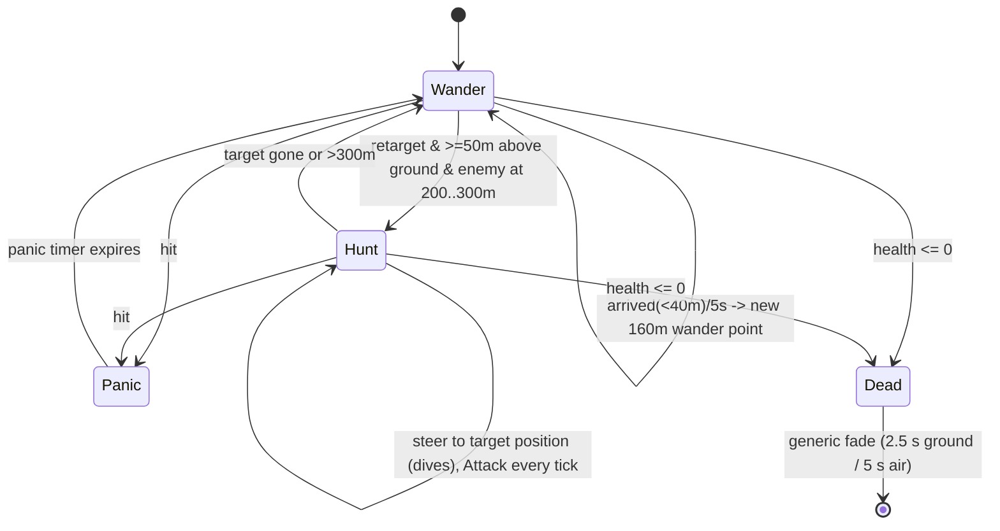
- **Soul destruction**: when its contact damage kills an entity, the spirit just spawned by that death (`Location::GetSpirit(victimId)`) is **removed** from the world; if the victim was a Darwinian a Zombie is created at the corpse (front = victim front, up tilted by `syncsfrand(1)`, velocity = 0.5 × SD velocity with y = `20 + syncfrand(25)`, team = victim team). The eaten soul is added to a render list (timestamp `GetHighResTime`, slot chosen by unsynced `AppRandom` when full) and drawn orbiting the head as fading red-brown sprites for 60 s. [C] `SoulDestroyer::Attack`, `SoulDestroyer::Render`, `SoulDestroyer::RenderSpirit`.
- **Damage FX bug**: `ChangeHealth` explodes every tail segment on **every** hit, not only on death (`if( fractionDead )` with `fractionDead ≥ 0.5`). [C] `SoulDestroyer::ChangeHealth`.
- **Team colouring**: per-team recoloured `souldestroyerhead.shp` and `souldestroyertail.shp` (marker `MarkerTail`); tail segments scale `max(1.5 × (1 − i/n), 0.5)`, last one 0.8; shadows 50 m (head) and `20 × scale`. D3D-only tearing deform along the tail [B:D3D]. [C] `SoulDestroyer::Begin`, `SoulDestroyer::RenderShapes`, `SoulDestroyer::Advance` (`#ifdef USE_DIRECT3D`).
- **Scripting hook**: `SetWaypoint` sets `m_targetPos`; `m_routeTriggerDistance = 50` for route following. [C] `SoulDestroyer::SetWaypoint`, `SoulDestroyer::SoulDestroyer`.
- **Sounds**: `"EnemySighted"`, `"Panic"`, `"Attack"` (per contact), generic `"Create"`, `"LoseHealth"`, `"Die"`.

### Zombie
| Item | Value | Ref |
|---|---|---|
| Life | 600 s, then removed | [C] `Zombie::Advance` |
| Motion | `vel *= 0.9`/tick; wobble like Snow (rates random-walk `syncsfrand(1)`/tick in [0,2], `hover = sin(offset) × rate`) | [C] |
| Render | 5 m (inner) + 10 m (outer) `sprites/ghost.bmp` quads, colour (0.9,0.9,1.0), alpha `clamp(1 − life/10, 0.1, 0.7)`, outer `(0.7 − alpha) × 0.1`, fading over the final 100 s | [C] `Zombie::Render` |

<!-- from P05_entities_creatures -->
## [→ 02_units_and_entities] DropShip — reinforcement transport (unreachable)

### Role and build tag
A small (0.2-scale `spaceship.shp`) transport that flies from the map corner nearest the target to 250 m above it, drops 20 Darwinians of its team one per tick, and leaves. Created only by `Task::TargetDropShip` for a `GlobalResearch::TypeDropShip` task. No code issues that task directly; it can only arise as a **level-option reinforcement type** (`defenderreinforcementtype`/`attackerreinforcementtype DropShip`), used solely by `data/levels/old/mp_assault_3P_1.txt`, which is outside the shipped `levels/mp_*` listing (`GameMenu` lists `levels/` non-recursively). ⇒ **[B:LEGACY]** (dormant feature). `TypeDropShip` is in `EntityIsBlocked`. [C] `code/taskmanager.cpp:Task::TargetDropShip`; `code/multiwinia.cpp` (L998–999 reinforcement types); `code/level_file.cpp:LevelFile::ParseMultiwiniaOptions` (L485–489); `code/game_menu.cpp` (L733 `ListResources("levels/", "mp_*", false)`); `tools/multiwinia_exclusions.txt` (L21 `levels/old/*`, consumed by `tools/build_multiwinia_data.bat`) excludes the `old/` maps from the shipped data archives. [C]

| Item | Value | Ref |
|---|---|---|
| Entry | the corner (x ∈ {100, X−100}, y = 500, z ∈ {100, Z−100}) nearest the target | [C] `Task::TargetDropShip` |
| `DROPSHIP_HOVERHEIGHT` | 250 m above target terrain | [C] `code/worldobject/dropship.cpp` |
| `DROPSHIP_ABDUCTIONBEAM_RADIUS` | 20 m (beam render only) | [C] |
| Passengers | 20 Darwinians, 1 per tick, team = ship team | [C] `DropShip::DropShip`, `DropShip::Advance` |
| Speed | initial 1000; `+100×dt` capped `10 × speedStat` (stat 255); within 500 m `−100×dt` floored `0.1 × speedStat`; same `dt²` integration quirk as SpaceShip; arrival < 10 m | [C] `DropShip::AdvanceToTargetPos` |
| Leave | when out of passengers and the last drop is on the ground or dead: waypoint +1000 m up; removed on arrival or y > 1000 | [C] `DropShip::Advance` |
| Damage | invulnerable (`ChangeHealth` returns false) | [C] |
| Side effect | constructor calls `m_shape->ScaleRadius(0.2)` on the **shared** `spaceship.shp` resource (also used by SpaceShip) [I] affects the SpaceShip's bounding radius | [C] `DropShip::DropShip` |
States: `DropShipStateArriving` → (arrived) `Dropping` → `Leaving` → removed. The task is tracked as running until the ship entity is gone (`code/taskmanager.cpp` L712–716). [C]

<!-- from P05_entities_creatures -->
## [→ 02_units_and_entities] Tripod and TripodNavData — three-legged walker (legacy)

**[B:LEGACY]**: `TypeTripod` is in `EntityIsBlocked`; no code path spawns it in Multiwinia (the Triffid `SpawnTripod` case is commented out; `Shaman::CanSummonEntity` always returns false). Darwinia campaign maps place none in this tree [C grep of `data/levels`]. Specified briefly for completeness. [C] `code/worldobject/entity.cpp:Entity::EntityIsBlocked`, `code/worldobject/triffid.cpp:TriffidEgg::Spawn`, `code/worldobject/shaman.cpp:Shaman::CanSummonEntity`.

| Item | Value | Ref |
|---|---|---|
| Stats | health 155, speed 20, rate 1 | [C] `data/stats.txt` |
| Legs | 3 `EntityLeg`s (`tripod_leg_part.shp`, markers `MarkerLeg0`–`2`), `LEG_LIFT` 3.0, `IDEAL_LEG_SLOPE` 0.2, `LEG_SWING_DURATION` 0.5 s, `LOOK_AHEAD_COEF` 1.2, `FOOT_MOVE_THRESHOLD` 1.0; a foot moves only when all three are planted | [C] `code/worldobject/tripod.cpp` defines, `Tripod::Begin`, `Tripod::CalcWhichFootToMove` |
| Hover heights | start 27; `STATIONARY_HOVER_HEIGHT` 30 − 0.2 × abs(speed) (`HOVER_LOWER_WITH_SPEED_FACTOR`); `ATTACK_HOVER_HEIGHT` 18; body y blends to terrain + hover at `dt` per tick | [C] `Tripod::AdvanceWalk`, `Tripod::Advance` |
| Navigation (`TripodNavData`) | six hex directions (60° apart); picks the direction with the largest dot to the destination, steps ±1 direction when the angle exceeds 30°; adds 1.0 m/s per tick of velocity in that direction; new destination within ±150 m (no enemies) or ±50 m of a random enemy within `NAVIGATION_SEARCH_RADIUS` 1000 m, re-rolled with chance 1/40 per tick | [C] `Tripod::DoNavigation`, `Tripod::ChooseDestination`, `TripodNavData::TripodNavData` |
| Two-leg fall | when a foot is lifted the body pivots about the line between the planted feet under `GRAVITY` (`Tripod::DoFallForTwoLegs`; contains an operator-precedence bug `!state == OnGround`) | [C] |
| Attack cycle | `ModeWalking` → (≥ 17 s since last attack and nearest enemy within `ATTACK_SEARCH_RADIUS` 200 m) `ModePreAttack` (stop, crouch to 18 m, tilt toward target) → `ModeAttacking` for `ATTACK_DURATION` 7 s: after 1 s, on odd 0.1-s slots fires **two lasers** (±4 m either side, speed 80, aim jitter `syncsfrand(0.1)`) via `Location::FireLaser` → `ModePostAttack` (rise to 30 m) → `ModeWalking` | [C] `Tripod::AdvanceWalk`, `AdvancePreAttack`, `AdvanceAttack`, `AdvancePostAttack` |
| Damage | lasers ignored; **only damageable while `ModeAttacking`** | [C] `Tripod::ChangeHealth` |
| Death | when the body falls below terrain: explosion, removed | [C] `Tripod::Advance` |
| Determinism defect | mode timers use `g_gameTime` and rotation uses `g_advanceTime` (render clocks) inside `Advance` | [C] `Tripod::AdvanceWalk`, `Tripod::Advance` |

<!-- from P05_entities_creatures -->
## [→ 02_units_and_entities] Tentacle — portal tentacles ("The Beast", debug-only)

**[B:DEBUG]** / **[B:LEGACY]**: Tentacles are spawned only by `Portal::AdvanceStateExpanding` (6 tentacles × 12 segments on the Monster team, `NUM_TENTACLES` 6). Portals come from Darwinia/Shaman maps (`TypePortal` is blocked; those maps exist only in `data/levels/old/`, which `tools/multiwinia_exclusions.txt` keeps out of the shipped data) or from the **The Beast** crate (`Crate::RunTheBeast`), which exists only when `INCLUDE_THEBEAST` is defined — and `code/worldobject/crate.h` defines it only under `TARGET_DEBUG`. `TypeTentacle` is in `EntityIsBlocked`. [C] `code/worldobject/portal.cpp:Portal::AdvanceStateExpanding`, `code/worldobject/portal.h`, `code/worldobject/crate.cpp:Crate::RunTheBeast`, `code/worldobject/crate.h`.

| Item | Value | Ref |
|---|---|---|
| Stats | health 255 (× `2 × size`), speed 100, rate 0; **invulnerable** (`ChangeHealth` returns false) | [C] `data/stats.txt`, `Tentacle::ChangeHealth` |
| Segments | one Unit of N (12 from portals). Linking: entity *i* gets `m_next` = entity *i−1* and `m_prev` = entity *i+1*. The segment with **no `m_prev`** (the last entity) is the **base** and runs the state machine; the segment with no `m_next` (entity 0) is the tip and uses the head shape. Sizes: entity 0 = 1.0, ×1.05 per index (thicker toward the base); radius `25 × size`; `m_positionId = i` | [C] `Tentacle::Begin`, `Tentacle::Advance` |
| Shapes | reuses per-team `centipedehead.shp`/`centipede.shp`; head shape on the segment with no `m_next` | [C] `Tentacle::Begin`, `Tentacle::Advance` |
| Follow | each non-base segment asks the segment below it (`m_prev`) for `pos = below.pos + below.lastRecordedDirection × 3 × below.m_positionId`, and moves there only if that point is ≥ size/2 above terrain, higher than itself, or the state is Swipe (else it only copies the direction); it also copies the base's state | [C] `Tentacle::GetTrailPosition`, `Tentacle::Advance` |
| Base states | `TentacleStateIdle` (sway ±0.1; 1/50 per tick → Slam unless portal exploding), `TentacleStateSlamGround` (bend toward a point 10 m outward and 5 m below ground at blend `2×dt`; on reaching it 20 dust particles, then 2/3 → `SwipeAcross` (2 s delay) else Idle 4 s), `TentacleStateSwipeAcross` (bend across toward the portal centre at `3×dt`, then Idle) | [C] `Tentacle::AdvanceIdle`, `AdvanceSlam`, `AdvanceSwipe` |
| Contact | every segment, every tick: **any** entity (all teams) within `m_radius` except Tentacles/Shamans is flung away at 60 m/s and takes `ChangeHealth(-255)` | [C] `Tentacle::Attack` |
| Ground impact | upper segments below `size` above terrain are clamped, with a 20-particle `TypeRocketTrail` puff per impact | [C] `Tentacle::HandleGroundCollision` |
| Lifetime | removed when its portal no longer exists | [C] `Tentacle::Advance` |
| Constructor bug | sets `m_type = TypeCentipede` (corrected by `SetType(TypeTentacle)` during `SpawnEntities`) | [C] `Tentacle::Tentacle` |
| Render | when the portal is in `SummonStateExplode` the head draws `Portal::RenderBeam` to the portal | [C] `Tentacle::Render` |

<!-- from P05_entities_creatures -->
## [→ 02_units_and_entities] Lander — Darwinia beach-landing craft (legacy)

**[B:LEGACY]**: only creatable via `Entity::NewEntity` from level-file InstantUnits, which `EntityIsBlocked` forbids; no code spawns it. [C] `code/worldobject/entity.cpp:Entity::EntityIsBlocked`; grep shows no `TypeLander` creator.
| Item | Value | Ref |
|---|---|---|
| Stats | health 255, speed 40, rate 1 | [C] `data/stats.txt` |
| `StateSailing` | heads −X (`m_front = (−1,0,0)` forced each tick) at speed 40 on the sea; lands when terrain > 0 | [C] `Lander::AdvanceSailing` |
| `StateLanded` | every `m_stats[StatRate]` (1) s spawns `int(2 + syncfrand(2))` (2–3) LaserTroopers in a new unit (unit created on **team 0** but entities on the lander's team — bug) and sends them 750 m ahead ± 100 m sideways | [C] `Lander::AdvanceLanded` |
| Death | after the generic fade, `Location::Bang(pos, 30, 50)` | [C] `Lander::Advance` |
| Overload defects | `ChangeHealth(int)` and `Render(double,int)` do **not** override the virtual `Entity` signatures, so the generic versions run instead (only a muzzle flash would show if called directly) | [C] `code/worldobject/lander.h` vs `code/worldobject/entity.h` |
| Shape | `lander.shp`, team-colour tint, darker while reloading | [C] `Lander::Render` |

<!-- from P05_entities_creatures -->
## [→ 02_units_and_entities] Constants table — every `#define` in this partition

All are compile-time `#define`s (no `static const`, no preference-driven values in these files). Units: m = world units (metres), s = seconds. [C] each file listed.

| Constant | Value | File | Used? |
|---|---|---|---|
| `ANTHILL_SEARCHRANGE` | 400.0 m | `code/worldobject/anthill.h` | yes |
| `ARMYANT_SEARCHRANGE` | 10 m | `code/worldobject/armyant.h` | yes |
| `CENTIPEDE_MINSEARCHRANGE` | 75.0 m | `code/worldobject/centipede.h` | yes |
| `CENTIPEDE_MAXSEARCHRANGE` | 150.0 m | `code/worldobject/centipede.h` | yes |
| `CENTIPEDE_SPIRITEATRANGE` | 10.0 m | `code/worldobject/centipede.h` | yes |
| `CENTIPEDE_NUMSPIRITSTOREGROW` | 4 | `code/worldobject/centipede.h` | yes |
| `CENTIPEDE_NUMSPIRITSTOREGROW_MP` | 4 (a commented copy in `tentacle.h` says 2) | `code/worldobject/centipede.h` | yes |
| `CENTIPEDE_MAXSIZE` | 20 segments | `code/worldobject/centipede.h` | yes |
| `DROPSHIP_HOVERHEIGHT` | 250.0 m | `code/worldobject/dropship.cpp` | yes |
| `DROPSHIP_ABDUCTIONBEAM_RADIUS` | 20.0 m | `code/worldobject/dropship.cpp` | render only |
| `DUSTBALL_SPEED` | 500.0 m/s | `code/worldobject/dustball.cpp` | yes |
| `EGG_DORMANTLIFE` | 120 s | `code/worldobject/egg.h` | yes |
| `SOULDESTROYER_MINSEARCHRANGE` | 200.0 m | `code/worldobject/souldestroyer.h` | yes |
| `SOULDESTROYER_MAXSEARCHRANGE` | 300.0 m | `code/worldobject/souldestroyer.h` | yes |
| `SOULDESTROYER_DAMAGERANGE` | 25.0 m | `code/worldobject/souldestroyer.h` | yes |
| `SOULDESTROYER_MAXSPIRITS` | 50 | `code/worldobject/souldestroyer.h` | render list |
| `SPACESHIP_HOVERHEIGHT` | 500.0 m | `code/worldobject/spaceship.cpp` | yes |
| `SPACESHIP_ABDUCTIONBEAM_RADIUS` | 45.0 m | `code/worldobject/spaceship.cpp` | yes |
| `SPAM_RELOADTIME` | 60.0 s | `code/worldobject/spam.h` | legacy |
| `SPAM_DAMAGE` | 100.0 | `code/worldobject/spam.h` | legacy |
| `SPAMINFECTION_MINSEARCHRANGE` | 100.0 m | `code/worldobject/spam.h` | yes |
| `SPAMINFECTION_MAXSEARCHRANGE` | 200.0 m | `code/worldobject/spam.h` | yes |
| `SPAMINFECTION_LIFE` | 10.0 s | `code/worldobject/spam.h` | yes |
| `SPAMINFECTION_TAILLENGTH` | 30 samples | `code/worldobject/spam.h` | yes |
| `SPIDER_NUM_LEGS` | 8 | `code/worldobject/spider.h` | yes |
| `FOOT_MOVE_THRESHOLD` (spider) | 5.0 | `code/worldobject/spider.cpp` | yes |
| `FOOT_EMERGENCY_THRESHOLD` | 12.0 | `code/worldobject/spider.cpp` | yes |
| `FOOT_DAMAGE_RADIUS` | 20.0 m | `code/worldobject/spider.cpp` | only in uncalled `StompFoot` |
| `FOOT_DAMAGE_STRENGTH` | 10.0 | `code/worldobject/spider.cpp` | only in uncalled `StompFoot` |
| `HOVER_HEIGHT` (spider) | 3.0 m | `code/worldobject/spider.cpp` | yes |
| `TURN_RATE` | 0.1 rad/tick (a commented-out block has 0.18) | `code/worldobject/spider.cpp` | yes |
| `NORMAL_SPEED` | 300.0 | `code/worldobject/spider.cpp` | unused |
| `ATTACK_SPEED` | 90.0 | `code/worldobject/spider.cpp` | unused |
| `MAX_PATH_HEIGHT` | 100.0 m | `code/worldobject/spider.cpp` | yes |
| `ATTACK_SEARCH_MAX_RADIUS` | 250.0 m | `code/worldobject/spider.cpp` | yes |
| `ATTACK_SEARCH_MIN_RADIUS` | 100.0 m | `code/worldobject/spider.cpp` | yes |
| `ATTACK_PREAMBLE` | 5.0 s | `code/worldobject/spider.cpp` | unused |
| `SPIRIT_MAXSEARCHRANGE` (spider) | 100.0 m | `code/worldobject/spider.cpp` | yes |
| `SPIRIT_MINSEARCHRANGE` (spider) | 30.0 m | `code/worldobject/spider.cpp` | yes |
| `SPOREGENERATOR_HOVERHEIGHT` | 100.0 m | `code/worldobject/sporegenerator.cpp` | yes |
| `SPOREGENERATOR_EGGLAYHEIGHT` | 20.0 m | `code/worldobject/sporegenerator.cpp` | yes |
| `SPOREGENERATOR_SPIRITSEARCHRANGE` | 200.0 m | `code/worldobject/sporegenerator.cpp` | yes |
| `SPOREGENERATOR_NUMTAILS` | 4 | `code/worldobject/sporegenerator.h` | render |
| `TRIFFIDEGG_BOUNCEFRICTION` | 0.65 | `code/worldobject/triffid.h` | yes |
| `FOOT_MOVE_THRESHOLD` (tripod) | 1.0 | `code/worldobject/tripod.cpp` | legacy |
| `IDEAL_LEG_SLOPE` | 0.2 | `code/worldobject/tripod.cpp` | legacy |
| `LEG_LIFT` | 3.0 | `code/worldobject/tripod.cpp` | legacy |
| `LEG_SWING_DURATION` | 0.5 s | `code/worldobject/tripod.cpp` | legacy |
| `LOOK_AHEAD_COEF` | 1.2 | `code/worldobject/tripod.cpp` | legacy |
| `ATTACK_HOVER_HEIGHT` | 18.0 m | `code/worldobject/tripod.cpp` | legacy |
| `STATIONARY_HOVER_HEIGHT` | 30.0 m | `code/worldobject/tripod.cpp` | legacy |
| `HOVER_LOWER_WITH_SPEED_FACTOR` | 0.2 | `code/worldobject/tripod.cpp` | legacy |
| `NAVIGATION_SEARCH_RADIUS` | 1000.0 m | `code/worldobject/tripod.cpp` | legacy |
| `ATTACK_SEARCH_RADIUS` (tripod) | 200.0 m | `code/worldobject/tripod.cpp` | legacy |
| `ATTACK_DURATION` | 7.0 s | `code/worldobject/tripod.cpp` | legacy |
| `VIRII_MAXSEARCHRANGE` | 60.0 m | `code/worldobject/virii.h` | yes (also spirits' egg search) |
| `VIRII_MINSEARCHRANGE` | 30.0 m | `code/worldobject/virii.h` | yes |
| `VIRII_TAILLENGTH` | 175.0 m | `code/worldobject/virii.h` | value duplicated as a literal |
| `VIRII_POPULATIONLIMIT` | 250 per team | `code/worldobject/virii.h` | yes |
| `wormWidth`, `wormTexW`, `wormTexHeight`, `glowWidth`, `glowTexXpos`, `glowTexH` | 3.0; 32/160; 20/1024; 12.0; 32/160; 128/512 | `code/worldobject/virii.cpp:Virii::Render` (local) | render |
| `POWERUP_EFFECT_RANGE` (external) | 70.0 m | `code/taskmanager.h` | meteor area ×6, plague radius |
| `NUM_TENTACLES` (external) | 6 | `code/worldobject/portal.h` | legacy/debug |
| Inline literals worth noting | Triffid default force 250, reload 60, damage 50, eggs 3; SoulDestroyer speed 130; Spider pounce ≤150 m, squash 40/20 m, damage 100; Meteor Bang(50,100), slow-mo (0.4, 0.1, 4.0) within 200 m; WallBuster lifters 10–30, breach radius 200, Bang(50,150)/(50,500), scuttle 10 s; AntHill MP conversion +6 ants per spirit per 1 s; SpamInfection 200 m/s, +1 s life per hit | per-class sections | – |
