# Routed draft sections for document 03

<!-- from P02_game_modes -->
## [→ 03_buildings_and_world_objects] 5. Mode buildings and world objects

Common level-file line (all buildings, read by `Building::Read`, P06): `<TypeName> <id> <x> <z> <tm> <frontX> <frontZ> <isGlobal> <type-specific fields…>` [C] `code/worldobject/building.cpp:Building::Read`. `tm` is a **map position**; at load `Location::InitBuildings` remaps any `tm ∉ {255,-1}` via `GetTeamFromPosition(tm)` (→ 255 when no team occupies that position) [C] `code/location.cpp:Location::InitBuildings`. Type names are the `Building::GetTypeName` strings (`MultiwiniaZone`, `EscapeRocket`, `FuelGenerator`, `FuelPipe`, `FuelStation`, `TrunkPort`, `PulseBomb`, `ControlStation`, `Statue`) [C] `code/worldobject/building.cpp:CreateBuilding`.

### 5.1 `MultiwiniaZone` (KOTH hill, CTS drop/spawn zone, Blitzkrieg flag) [B:FULL] `code/worldobject/multiwiniazone.{h,cpp}`

| Member | Type | Default | Meaning |
|---|---|---|---|
| `m_size` | double | 50.0 | zone radius (KOTH counting radius, ring radius, `m_radius` after `SetDetail`) |
| `m_life` | double | -1.0 | > -1 → zone deletes itself when it reaches 0 (only used by a commented-out zone spawner) |
| `m_recountTimer` | double | 0.0 | next game time to recount |
| `m_totalCount`, `m_teamCount[6]` | int | 0 | Darwinian counts |
| `m_blitzkriegFlag` | Flag* | NULL | lazily created cloth flag (size 50) |
| `m_aiTarget` | AITarget* | NULL | **never assigned** → priority code in `Advance` is dead [C] |
| `m_blitzkriegLinks` | LList<int> | — | linked zone ids (level file + reverse links) |
| `m_numStandardLinks` | int | 0 | link count from the level (written, unused) |
| `m_blitzkriegOwnership` | double | 0.0 | 0–100 capture progress |
| `m_blitzkriegCaptureTeam` | int | 255 | team currently gaining/holding progress |
| `m_blitzkriegUpOrDown` | int | 0 | -1/0/+1 last change direction |
| `m_blitzkriegLocked` | bool | true | |
| `m_blitzkriegUnderAttackMessageTimer` | double | 0.0 | 20 s message throttle |
| static `s_blitzkriegBaseZone[6]` | int | reset to -1 in `Location` init | base flag id per team |

Level fields: `<size:float> [<linkId:int> …]` (rest of line) [C] `MultiwiniaZone::Read`/`Write` (`"%-6.2f"` then `"   %d"` per link). Initialise copies size and links; `m_centrePos = pos + (0, radius/2, 0)`. Not collidable (`DoesSphereHit`/`DoesShapeHit` false; `DoesRayHit` only in the editor). `GetBuildingLink()` = first link; `SetBuildingLink(id)` appends if absent (editor linking). Sound event list: `CaptureStatue`. Per-mode behaviour: §4.2 (KOTH), §4.3 (CTS), §4.6 (Blitzkrieg); in Domination, Assault and Rocket Riot a zone does nothing. Static `GetNumZones(team)` counts zones owned by a team.

`GetBlitzkriegPriority(zone, team)` (AI hint, Standard/Hard AI only) [C]: by the team's Blitzkrieg status score — SAFE: 1.0 for zones not owned by the team; ENEMYOCCUPIED/UNDERATTACK/UNOCCUPIED: 1.0 for base flags owned by a live team; UNDERTHREAT: 1.0 for zones linked to the team's base and not owned by it; then forced 0.0 for any non-base zone the team already owns.

Blitzkrieg flag ownership state machine (per zone, evaluated each game second):
```mermaid
stateDiagram-v2
    [*] --> Neutral : Initialise (ownership 0, captureTeam 255)
    Neutral --> Capturing : unlocked AND leader L present → captureTeam=L, ownership += 0.5·top·frac per s
    Capturing --> Neutral : no Darwinians → ownership −1/s to 0 → captureTeam=255
    Capturing --> Capturing : different leader → ownership decreases; at 0 captureTeam = new leader
    Capturing --> Owned : ownership ≥ 100 → SetTeamId(L)
    Owned --> Locked : no neighbour owned by another team (and ownership is 0 or 100)
    Locked --> Owned : an adjacent flag becomes enemy-owned
    Owned --> Contested : enemy leader → ownership decreases (flag lowered)
    Contested --> Owned : owner's Darwinians lead again → ownership increases
    Contested --> Neutral : ownership ≤ 0 → SetTeamId(255), captureTeam = enemy
```

### 5.2 `Statue` (CTS carryable) [B:FULL; `BuildingIsBlocked` for level placement] `code/worldobject/statue.{h,cpp}`

Derives `CarryableBuilding` (P06). Members: `AITarget *m_aiTarget`, `double m_waypointCheck`, `bool m_renderSpecial`. Constants: min lifters 20, max lifters 50, carry radius 33. Behaviour, ownership, scoring: §4.3. `Initialise`: random of 8 shapes (synced), `ExplodeShape(0.5)` "materialise" burst unless in grace. `Destroy()`: full shape explosion, `m_destroyed`, destroys its AITarget. `Render`: sets special lights; billboard variant would render `carryspecialshape.shp` if it existed. No level fields of its own (CarryableBuilding/Building only); created by code (§4.3). `#ifdef INCLUDEGAMEMODE_CTS` gates the Advance body [C].

### 5.3 `Flag` (cloth-flag render primitive) [B:FULL] `code/worldobject/flag.{h,cpp}`

Not a building. Used by Blitzkrieg zones, `Armour` (`m_flag`, `m_deployFlag`) and `Officer` (`m_flag`) [C] `code/worldobject/armour.h`, `officer.h`.
- Grid `m_flag[6][6]` (`FLAG_RESOLUTION 6`) of vertices; `Initialise` lays them on the front/up plane.
- `Render(teamId, fileName)`: each frame relaxes vertices toward a target (column 0 attached to the pole at `pos + up·size/2 + …`, others trail the previous column by `size/5`); factor `advanceTime·10·(6−x)/6` (1.0 for x=0; 0.7 if size > 40 or highlighted/selected); wind wobble `cos/sin(gameTime + x·k)·x/6` (×0.3 when highlighted); max link length `size/2`. Draws a white pole quad (width 0.4, height `size·1.5`), then the textured flag. In multiplayer with a filename: per-team recoloured texture cached as `<file>_<colourId>_<groupPos>` (`_255` neutral grey, `_selected_…` brighter) via `BitmapRGBA::ConvertRedChannel(teamColour)` (half colour unless selected). Optional goto-arrow overlay (`icons/arrow.bmp`) towards `m_target` rotated by screen-space angle.
- `RenderText(x,y,caption)` draws text on a cell (both sides); `RayHit` sphere pre-test + per-quad triangle tests (used for clicking officer/armour flags).
- Uses `g_advanceTime`/`g_gameTime` (render-time, non-deterministic, presentation only).

### 5.4 Escape rocket and fuel chain [B:FULL MP branch; non-MP branches B:LEGACY] `code/worldobject/rocket.{h,cpp}`

Class hierarchy:
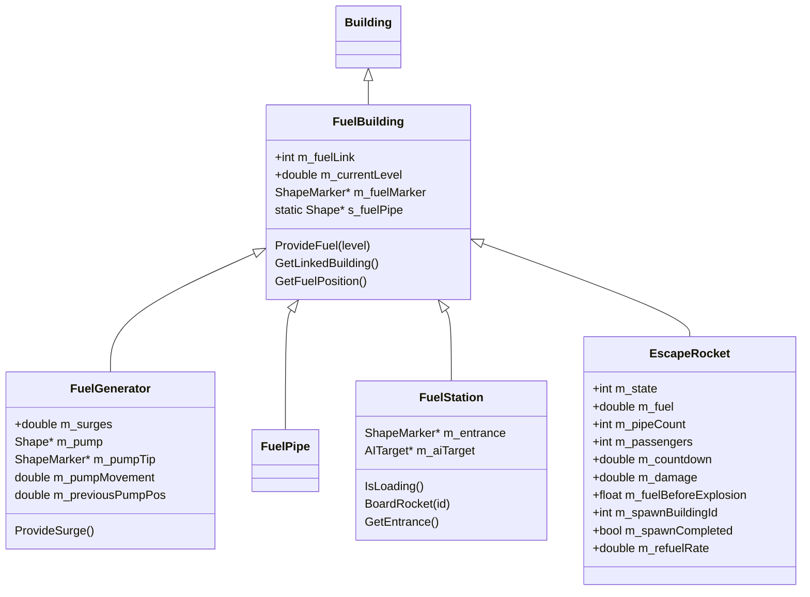

**Fuel flow.** Power (surges) arrives at a FuelGenerator from a `PylonEnd` whose power link is that generator (`PylonEnd::TriggerSurge` → `FuelGenerator::ProvideSurge`) [C] `code/worldobject/generator.cpp:PylonEnd::TriggerSurge`. On Rocket Riot maps the chain is SolarPanel → PowerSplitter → Pylon… → PylonEnd → FuelGenerator → FuelPipe(s) → FuelStation → EscapeRocket (each FuelStation's `fuelLink` is the rocket id; 3 stations per team) [C] `data/levels/mp_rocketriot_2P_4.txt`. Solar panel capture and surge generation are P06/P07.

| Class | Per-tick behaviour (MP) | Level fields after the common 7 | Shape / sounds |
|---|---|---|---|
| `FuelBuilding` (base) | `Advance`: pass `m_currentLevel` to `GetLinkedBuilding()->ProvideFuel()` (link must be FuelGenerator/Pipe/Station/EscapeRocket). `ProvideFuel(level)`: `f = 0.2·SERVER_ADVANCE_PERIOD` (×3 if level < current); `current = current·(1−f) + level·f`, clamp [0,1]. `Destroy`: also explodes the connecting pipe shape. Render: pipe shape `fuelpipe.shp` from own marker `MarkerFuel` to the linked building's; alpha pass: animated `textures/fuel.bmp` beam, colour (1,0.4,0.1,0.4·level), 1–3 loops by `RenderBuildingDetail` | `<fuelLink:int>` (`"%6d "`) | — |
| `FuelGenerator` | `maxSurges` = 20 (MP; 10 non-MP); `surges -= 1.0/s`, clamp [0,max]; `surges > 8` → GlobalBuilding online (Darwinia remnant); `ProvideFuel(surges/max)`; particles `TypeDarwinianFire` from pump tip (non-synced rand); sounds `PumpUp`/`PumpDown` at pump extremes. Render pump uses `maxSurges` 15 (MP) — inconsistent with Advance [C] | `<fuelLink>` | `fuelgenerator.shp`, `fuelgeneratorpump.shp` (`MarkerTip`); objective counter "Fuel Pressure n%" |
| `FuelPipe` | ambient `PumpFuel` sound while `current > 0.2` | `<fuelLink>` | `fuelpipebase.shp` |
| `FuelStation` | if linked rocket is `StateLoading` and `SafeToLaunch()` (always true in MP): ensure an AITarget at its position (priority modifier 1.0); each tick pick one random own-team entity within 300 units; if a Darwinian in `StateIdle`/`StateWorshipSpirit` → `Darwinian::BoardRocket(stationId)` (walks to `MarkerEntrance`, then `FuelStation::BoardRocket` → rocket `BoardRocket` → `++passengers`; 4–7 `TypeControlFlash` particles, sound `LoadPassenger`). Otherwise remove the AITarget. Alpha pass: when rocket Countdown ≤ 10 or Flight, a 60×60 screen 150 above showing `(int)countdown+1` (or blinking "0") | `<fuelLink>` (rocket id) | `fuelstation.shp` (`MarkerEntrance`) |
| `EscapeRocket` | state machine below | `<fuelLink> <fuel:float> <passengers:int> <spawnBuildingId:int> <spawnCompleted:int>` (`"%6.2f %6d %6d %6d"`); RR maps: `-1 0.00 0 -1 0` | `rocket.shp` copy, recoloured in MP to team colour ×0.3 (`ConvertFragmentColours`); markers `MarkerBooster`, `MarkerWindow01..03`; sounds `Refueling`, `Happy`, `Unhappy`, `Flight`, `Malfunction`, `Explode`, `EngineBurn` |

**EscapeRocket states** (`StateRefueling=0, StateLoading=1, StateIgnition=2, StateReady=3, StateCountdown=4, StateExploding=5, StateFlight=6`; names for scripts via `GetStateId`: "Refueling","Loading","Ignition","Ready","Countdown","Exploding","Flight") [C] `code/worldobject/rocket.h`, `rocket.cpp:EscapeRocket::GetStateId`.

```mermaid
stateDiagram-v2
    [*] --> Refueling
    Refueling --> Loading : fuel >= 95 (msg "Your Rocket has been refueled!")
    Loading --> Ignition : fuel > 95 AND passengers >= 100 (countdown=18; msg "...preparing for launch!")
    Ignition --> Ready : MP: countdown forced 0 → countdown=10, camera shake 5
    Ready --> Countdown : countdown -= 0.1/tick to <= 0 → countdown=10
    Countdown --> Flight : countdown -= 0.05/tick, clamped, == 0
    Refueling --> Exploding : damage > 100
    Loading --> Exploding : damage > 100
    Ignition --> Exploding : damage > 100
    Ready --> Exploding : damage > 100
    Countdown --> Exploding : damage > 100
    Flight --> Exploding : damage > 100 (Damage() only excludes Exploding)
    Exploding --> Refueling : damage <= 0 → damage 0, level 0, spawnCompleted
    Flight --> [*] : y > 600 → Multiwinia declares winner
```

Per-state detail (MP) [C] `EscapeRocket::Advance*`:
- Every tick: if `damage > 0` → `damage -= 0.33/s` (×0.1 per tick); at 0 clear the attack warning. After the state step: `SetupSounds()` (ambience: Refueling state → `Refueling` if level > 0.2 else `Unhappy`, `Malfunction` if damage ≥ 75; Loading..Countdown → `Happy` (`Malfunction` if damage ≥ 75); Exploding → `Malfunction` if fuel > 0 else `Unhappy`; Flight → `Flight`; `EngineBurn` loop in Ready/Countdown/Flight); camera shake decays; in Ready/Countdown/Flight emits 15 booster particles per tick (11 `TypeMissileFire`, 4 `TypeMissileTrail`, size 500, non-synced rand).
- **Refuel()** (Refueling and Loading): `newRate = pipeCount × m_currentLevel × 0.4`; `m_refuelRate = 0.99·rate + 0.01·newRate`; `fuel += rate × 0.1` per tick, max 100; `pipeCount = 0`. `pipeCount` = number of `ProvideFuel(level > 0.1)` calls since the last refuel (one per feeding station). Max steady rate with 3 stations at full pressure: 1.2 fuel-%/game-s (≈ 80 s from 0 to 95 plus the ~10 s EMA lag) [I: derived].
- **SetupAttackers()** (Refueling, Loading, Ready, Countdown; only while `state < Exploding` and `fuel > 33`): every `1 + syncfrand(2)` game s, find enemies within 150 units; choose `1 + syncrand() % (1 + int(numFound × 0.05))` random ones; each live, non-burning Darwinian → `AttackBuilding(rocketId)` (they run to 100–150 units from the rocket and shoot it within 200 units, P03).
- **Damage(d)** (`d` negative): `Building::Damage` (sound `Damage`); if not Exploding: local owner gets "Your Rocket is under attack!" once per damage episode; `m_damage -= d × 0.2`; if `m_damage > 100` → `m_fuelBeforeExplosion = fuel`, state Exploding, sound `Explode`, owner message "Your Rocket is on fire!".
- **Exploding**: per tick `damage -= 0.1` (1/s); fuel loses 0.5/tick (5/game-s) down to 50% of `m_fuelBeforeExplosion`; one passenger ejected per tick from a random window as an own-team Darwinian with outward velocity 10–40, 50% set on fire; shape explosion debris while fuel > 0; 3 fire + 3 smoke particles per tick; once passengers = 0 and fuel at minimum an extra `damage -= 0.2`/tick; at `damage <= 0` → Refueling (passengers must be re-loaded; fuel ≥ 95 re-check).
- **Ready**: `m_spawnCompleted == false` branch spawns Darwinia "launchpad" attackers only if buildings 18/51/52/54 are team-0 spawn points **and** `countdown > 95` — impossible in MP (Ready countdown is 10) [C]; `countdown -= 0.1/tick`.
- **Countdown**: `countdown -= 0.05/tick` (half speed), clamp ≥ 0, → Flight at exactly 0.
- **Flight**: `thrust = max(2·sqrt(y − ground), 0.1)`; `vel = (0, thrust, 0)`; `pos += vel × 0.1`. Rendered with velocity prediction.
- Not collidable (`DoesSphereHit/ShapeHit` false; ray only in editor).
- Glow sprites (`textures/starburst.bmp`) with alpha = fuel/100; detail scaled by `RenderBuildingDetail`.
- HUD objective counter "Fuel n%, Passengers n%".

### 5.5 `TrunkPort` [B:FULL] `code/worldobject/trunkport.{h,cpp}`

| Member | Default | Meaning |
|---|---|---|
| `m_targetLocationId` | -1 | Darwinia destination location (single-player only label) |
| `m_destination1/2` | markers | label anchors (`MarkerDestination1/2`) |
| `m_heightMapSize` | 16 (`TRUNKPORT_HEIGHTMAP_MAXSIZE`) / detail | portal surface grid |
| `m_heightMap` | NULL | pre-computed 90×90 surface grid around `MarkerSurface` |
| `m_openTimer` | 0.0 | real time the portal opened (Darwinia; MP always draws the surface) |
| `m_populationLock` | -1 | cached nearby SpawnPopulationLock id (-2 = none) |

- Shape `trunkport_mp.shp` in Multiwinia (`trunkport.shp` in Darwinia). Level fields: optional `<targetLocationId:int>` (`"%-8d"`); MP maps use -1.
- Advance: Darwinia online check only (GlobalBuilding) → sound `PowerUp`. Render: Darwinia destination text [B:LEGACY]; alpha pass: animated portal surface (`textures/laserfence.bmp` + `textures/glow.bmp`) tinted with the owner team colour at 70% alpha in MP.
- Ownership: fixed from the level (`tm` position); neutralised (255) by `Team::Eliminate()`, by a Pulse Bomb destruction (all non-defender ports) and detonation (all non-bomb-team ports) [C] `code/team.cpp`, `pulsebomb.cpp`. Neutral ports produce nothing.
- Function: emits reinforcement waves (§6.1); `PopulationLocked()` (§6.2) gates spawning.
- `ReprogramComplete()`: Darwinia world-map unlock [B:LEGACY].

### 5.6 `PulseBomb` (Assault "WMD") [B:FULL] `code/worldobject/pulsebomb.{h,cpp}`

| Member | Default | Meaning |
|---|---|---|
| `m_active` | true | unused |
| `m_scale` | 0.75 | shape scale (shape copy `pulsebomb.shp`, radius scaled) |
| `m_detonateTime` | 0.0 | game time of detonation |
| `m_startTime` | 0.0 | countdown length in seconds (level value) |
| `m_links` | — | linked ControlStation ids (de-duplicated by `SetBuildingLink`) |
| `m_oneMinuteWarning` | false | |
| static `s_pulseBombs[6]` | -1 (Location init) | bomb id per owning team |
| static `s_defaultTime` | 0.0 (`Multiwinia::Reset`) | first round's `m_startTime` |

Level fields: `<startTime:float> <linkId> …` (`"%-6.2f  "` then `"%-4d"` per link); official maps `900.00` with 3–4 station ids [C] level files.
- `Initialise`: copy start time & links; register `s_pulseBombs[team]`; if `Multiwinia::m_pulseTimer > 0` use it as start time; set `s_defaultTime` once; **set `Multiwinia::m_timeRemaining = (int)m_startTime`**. `SetDetail`: snap to ground, compute centre/radius from the scaled shape.
- `Advance` (skipped once destroyed): call `LinkToPulseBomb(id)` on every linked ControlStation; if every linked station is owned and owned by a non-friend of the bomb team → `Destroy()` + `RecordDefenseTime(startTime − GetPreciseTimeRemaining(), team)`; at `m_timeRemaining <= 60` once → "One Minute to WMD Detonation!"; at `m_timeRemaining <= 0` and not yet detonated → `RecordDefenseTime(startTime, team)`, `m_detonateTime = now`, spawn `PulseWave` (radius 200, owned by bomb team, P04), set every trunk port not owned by the bomb team to 255. (The capture check keeps running after detonation [I: possible double RecordDefenseTime if stations are captured during the wave].)
- `Destroy()`: shape explosion, `m_destroyed`, defender = last team index with a bomb; all trunk ports not owned by the defender → 255; `Location::Bang(pos, 75, 5)`; message "WMD Destroyed!".
- Rendering: glow blobs (team colour, up to 20 by detail) rising `200 × (1 − remaining/start)` above the bomb and growing; at `m_timeRemaining <= 10` a 3D countdown screen (team colour) 50 above.
- Collidable via its scaled shape (sphere, ray, shape tests).

### 5.7 `ControlStation` [B:FULL] `code/worldobject/controlstation.{h,cpp}`

Members: `m_controlBuildingId` (-1), `m_pulseBombId` (-1). Level field: `<controlBuildingId:int>` (`"%6d"`) [C] `ControlStation::Read/Write`.
- Shape: `controlstation.shp` (5 ports: `MarkerPort01..05`); after `LinkToPulseBomb(id)` (first call only) → `pulsebombcontrolstation.shp` (3 ports + `MarkerDishDirection`), lights/ports rebuilt via `Building::Initialise(this)` [C] `data/shapes/*.shp` markers. `Location::InitBuildings` links Assault stations at load so the dish shows during grace [C] `code/location.cpp`.
- Ownership every tick (`RecalculateOwnership`): count port occupants per team (ports are operated by Darwinians, P06); threshold `num = 2` (needs ≥ 3) or `1` when linked to a pulse bomb (needs ≥ 2); winner = first team above threshold, replaced by any later team with strictly more; none → station team 255 (controlled building unchanged); else station **and** `m_controlBuildingId` building take the winner's team.
- Uses: Assault bomb objectives (link -1); KOTH map `mp_koth_3P_1` uses 6 stations controlling RadarDish buildings [C] level file.
- Render: port status lights (`textures/starburst.bmp`, grey free / occupant team colour); when linked to an intact bomb and owned, an animated team-coloured beam from `MarkerDishDirection` toward 75% of the way to the bomb (+100 up). Always "in view" when linked (beam visible).

### 5.8 Mode usage matrix [C]

| Object | Domination | KOTH | CTS | Assault | Rocket Riot | Blitzkrieg |
|---|---|---|---|---|---|---|
| MultiwiniaZone | – | hill | drop zone / statue spawn | – | – | flag |
| Statue | – | – | ✔ (spawned) | – | – | – |
| EscapeRocket, Fuel* | – | – | – | – | ✔ | – |
| TrunkPort | if level option | if level option | if level option | ✔ | ✔ | ✔ |
| PulseBomb | – | – | – | ✔ (1) | – | – |
| ControlStation | – | radar control (koth_3P_1) | – | ✔ | – | – |
| Flag (render) | – | – | – | – | – | ✔ (+ officers/armour everywhere) |

---

<!-- from P06_buildings_core -->
## [→ 03_buildings_and_world_objects] Building base class (`Building`, `BuildingPort`)

Source: `code/worldobject/building.h`, `code/worldobject/building.cpp`. Build tag: **[B:FULL]** (whole class), with debug-only render helpers under `DEBUG_RENDER_ENABLED` (globally on → also [B:FULL]).

### 1. Role and object model

`Building` derives from `WorldObject` (position `m_pos`, velocity `m_vel`, id `m_id`, type `m_type`) and is the base of every static or semi-static world object that the level file places in a `Buildings_StartDefinition` block, plus several runtime-created objects (crates, statues, turrets from crates, portals, AI targets). [C] `building.h:class Building`.

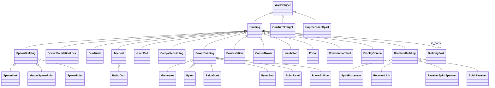
(Only classes in this partition are shown; `Bridge` also derives from `Teleport` [C] `code/worldobject/entity.cpp:Entity::EnterTeleports` casts; `Statue`, `WallBuster`, `ChessPiece` derive from `CarryableBuilding` [C] `carryablebuilding.cpp:IsCarryableBuilding`.)

### 2. Data members (every member)

| Member | Type | Default (ctor) | Meaning | Ref |
|---|---|---|---|---|
| `m_front` | Vector3 | (1,0,0) | facing; level file stores x,z only, then normalised | [C] `Building::Building`, `Building::Read` |
| `m_up` | Vector3 | `g_upVector` (0,1,0) | up vector (SolarPanel/SpiritReceiver use terrain normal) | [C] |
| `m_timeOfDeath` | double | −1.0 | unused by this partition's classes [I] (no reads in scope) | [C] ctor |
| `m_dynamic` | bool | false | "only appears on this level, not all levels for this map" (Darwinia map/mission split); set from `Read(_in,_dynamic)` | [C] `building.h` comment, `Read` |
| `m_isGlobal` | bool | false (forced true for 6 types, §9) | building is mirrored in `GlobalWorld` (Darwinia campaign persistence) | [C] `CreateBuilding(int)` |
| `m_centrePos` | Vector3 | — | bounding-sphere centre: `Shape::CalculateCentre(mat)` or `m_pos` if no shape | [C] `Initialise`, `SetDetail` |
| `m_radius` | double | **13.0** | bounding-sphere radius: `Shape::CalculateRadius` or 13.0 if no shape | [C] ctor, `Initialise` |
| `m_destroyed` | bool | false | when true, next `Advance()` returns true → location deletes the building | [C] `Building::Advance`, `Location::AdvanceBuildings` |
| `m_shape` | Shape* | NULL | render/collision shape (set by subclass ctor via `SetShape`) | [C] |
| `m_lights` | LList<ShapeMarker*> | empty | every shape marker whose name **contains** `MarkerLight` (recursive) | [C] `SetShapeLights` (`strstr`) |
| `m_ports` | LList<BuildingPort*> | empty | every marker whose name **contains** `MarkerPort` | [C] `SetShapePorts` |
| `s_controlPad` (static) | Shape* | `controlpad.shp` | port pad shape, loaded by first Building ctor | [C] ctor |
| `s_controlPadStatus` (static) | ShapeMarker* | marker `MarkerStatus` of controlpad.shp | where the port status light is drawn | [C] ctor |
| `s_neighbours` (static, protected) | `std::vector<WorldObjectId>` | — | shared scratch buffer for entity-grid queries (not re-entrant) | [C] |
| team (in `m_id`) | uchar | **255 in Multiwinia**, 1 in single-player (Darwinia) | owner | [C] ctor `IsSinglePlayer()` branch |

`BuildingPort` members: `m_marker` (ShapeMarker*), `m_occupant` (WorldObjectId of the Darwinian operating it, invalid if empty), `m_mat` (world matrix of the port), `m_counter[NUM_TEAMS]` (per-team reservation counter). [C] `building.h:class BuildingPort`.

### 3. Lifecycle (template → instance)

1. **Parse.** `LevelFile::ParseBuildings` reads each line; first token = type name → `Building::CreateBuilding(char*)` (honours `BuildingIsBlocked`, returns NULL for blocked or unknown names, and the line is then silently skipped) → `building->Read(_in,_dynamic)`. Duplicate unique ids are a fatal `AppReleaseAssert`. Types TrunkPort, ControlTower, RadarDish, Incubator, FenceSwitch must have `isGlobal = 1` or loading asserts. Team-1-owned SpawnPopulationLocks get `m_maxPopulation *= 1 + difficulty/5` when the level difficulty is < 0 (Darwinia). [C] `code/level_file.cpp:LevelFile::ParseBuildings`.
2. **Instantiate.** For each parsed template, `Location` calls `CreateBuilding(type)` (int overload: **no** block check), maps the template's team **position** to a real team with `GetTeamFromPosition` (if team ≠ 255/−1), then `newBuilding->Initialise(template)` and `newBuilding->SetDetail(1)`. [C] `code/location.cpp` building-instantiation loop (≈L465–495).
   There is **no separate `BuildingDefinition` type**: the "definition" is a template `Building` object of the same class, created by `CreateBuilding(char*)` and filled by `Read()`; `Initialise(template)` copies from it (subclasses down-cast the template to read their extra fields). [C] `level_file.cpp:ParseBuildings`, every `Initialise` in scope.
3. **`Initialise(template)`** (base): copies `m_id, m_pos, m_front, m_up, m_dynamic, m_isGlobal, m_destroyed`; snaps `m_pos.y` to the heightmap; computes `m_centrePos/m_radius` from the shape; collects lights and ports; if a `GlobalBuilding` record exists for (uniqueId, requested location) its team overrides; triggers sound event `Create`. [C] `Building::Initialise`.
4. **`SetDetail(detail)`**: re-snaps y, recomputes centre/radius, **deletes and rebuilds all ports** (so port occupancy resets). `_detail` is ignored by the base class. [C] `Building::SetDetail`.
5. **`Advance()`** each tick: if `m_destroyed` return true (delete me); else `EvaluatePorts()`; return false. Subclasses call it last. [C] `Building::Advance`.
6. **Removal**: `Location::AdvanceBuildings` deletes the building when `Advance()` returns true, then recalculates the whole obstruction grid (and AI targets when an AITarget or Wall was removed). [C] `code/location.cpp:Location::AdvanceBuildings`.

Runtime-created buildings (crate turrets, statues, crates, portals, AI targets) follow the same pattern with a stack-allocated template: `CreateBuilding(int)` → `m_buildings.PutData` → `Initialise(&template)` → `m_id.SetUniqueId(GlobalWorld::GenerateBuildingId())`. [C] `code/worldobject/crate.cpp:Crate::RunGunTurret`, `gunturret.cpp:GunTurret::Advance` (AITarget).

### 4. Virtual / member function catalogue (every member)

| Function | Base behaviour | Overridden in this partition by | Ref |
|---|---|---|---|
| `Building()` ctor | defaults above; loads `controlpad.shp` once | all | [C] |
| `~Building()` | `m_ports.EmptyAndDelete()` | SpawnBuilding (links), PowerBuilding (surges), RadarDish (shape copy + AITarget), Incubator (empty) | [C] |
| `Initialise(Building*)` | §3 | SpawnBuilding, SpawnPoint, SpawnPopulationLock, ControlTower, PowerBuilding, PylonStart, SolarPanel, PowerSplitter, GunTurret, RadarDish, JumpPad, CarryableBuilding, Incubator, ReceiverBuilding, SpiritProcessor, SpiritReceiver | [C] |
| `Advance()` → bool | §3 step 5 | every class (JumpPad does **not** call the base → no port evaluation, `m_destroyed` ignored) | [C] `jumppad.cpp:JumpPad::Advance` |
| `SetShape(Shape*)` | stores pointer | Teleport (looks up `MarkerTeleportEntrance`), CarryableBuilding (pass-through) | [C] |
| `SetShapeLights(frag)` | recursive collect `*MarkerLight*` markers | — | [C] |
| `SetShapePorts(frag)` | recursive; for each `*MarkerPort*` marker: world matrix, position pushed out of the building by `PushFromBuilding(pos, 5.0)`, y snapped to terrain, counters zeroed | — | [C] |
| `SetDetail(int)` | §3 step 4 | GunTurret (re-forces centre = pos, radius = 30), RadarDish (caches entrance pos/front) | [C] |
| `IsInView()` | `camera->SphereInViewFrustum(m_centrePos, m_radius)` | SpawnBuilding, ControlTower, PowerBuilding, GunTurret, Teleport, CarryableBuilding (always true), ReceiverBuilding, SpiritProcessor (always true) | [C] |
| `Render(t)` | debug arrow when editing; `m_shape->Render(t, mat(front,up,pos))` | many (see per-class) | [C] |
| `RenderAlphas(t)` | `RenderLights(); RenderPorts();` | many | [C] |
| `RenderLights()` | if team ≠ 255 and lights exist: flash star sprites (size 6, 10 nested quads, team colour) only when `(lastValidSequenceIdFromServer % 10) / 2 == teamId` (or editing) — i.e. teams 0–4 each flash for 2 of every 10 server ticks; team 5 never flashes | — | [C] `Building::RenderLights` |
| `RenderPorts()` | per port: control-pad shape (if `RenderBuildingDetail` < 3) and status star: green (0.3,1,0.3) occupied / red (1,0.3,0.3) empty | SpawnPoint, GunTurret (grey/team colour), SolarPanel, SpiritReceiver | [C] |
| `RenderHitCheck()` | `DEBUG_RENDER_ENABLED`: shape hit-check or sphere | — | [C] |
| `RenderLink()` | `DEBUG_RENDER_ENABLED`: magenta arrow to `GetBuildingLink()` target | — | [C] |
| `PerformDepthSort(Vector3&)` | false | SpawnPoint (true, centre) | [C] |
| `SetTeamId(int)` | if changed: set team, mirror into `GlobalBuilding.m_teamId` (if any), sound `ChangeTeam` | — (subclasses call it) | [C] |
| `Reprogram(double)` | no-op | — | [C] |
| `ReprogramComplete()` | sound `ReprogramComplete`; toggles `GlobalBuilding.m_online`; `GlobalWorld::EvaluateEvents()` | Generator (enable) | [C] |
| `Damage(double)` | sound `Damage` only — **base buildings are indestructible** | GunTurret | [C] |
| `Destroy(double intensity)` | `m_destroyed = true`; 3× `g_explosionManager.AddExplosion(shape)`; `Location::Bang(m_pos, intensity, intensity/4)`; sound `Explode`; `(int)(intensity/4)` particles `TypeExplosionCore` size 100 with velocity `syncsfrand(100)` per axis (∈[−50,50)) | — | [C] |
| `PushFromBuilding(pos, r)` | if a sphere (pos,r) hits the building, step it by 2.0 units away from `m_pos` until clear | — | [C] |
| `EvaluatePorts()` | §5 | — | [C] |
| `GetNumPorts()` | `m_ports.Size()` | — | [C] |
| `GetNumPortsOccupied()` | count of ports with valid occupant | — | [C] |
| `GetPortOccupant(i)` | occupant id or invalid | — | [C] |
| `GetPortPosition(i,&pos,&front)` | port matrix pos/front; false if bad index | — | [C] |
| `OperatePort(i, team)` | `counter[team] = min(counter[team]+1, 50)` | — | [C] |
| `GetPortOperatorCount(i, team)` | `counter[team]`, or −1 for a bad index | — | [C] |
| `GetObjectiveCounter(UnicodeString&)` | empty string | MasterSpawnPoint, Generator, SpiritProcessor (Darwinia objectives) | [C] |
| `DoesSphereHit(pos,r)` | shape sphere test, else `length(pos−m_pos) ≤ r + m_radius` | SpawnPopulationLock, JumpPad, Portal, CarryableBuilding (all false); RadarDish (radius ×1.5) | [C] |
| `DoesShapeHit(shape, mat)` | shape-vs-shape, else sphere | SpawnPopulationLock, JumpPad, Portal, CarryableBuilding (false) | [C] |
| `DoesRayHit(start,dir,len,pos,norm)` | shape ray test (`pos/norm` not filled), else ray-sphere | GunTurret, RadarDish, JumpPad, Portal, CarryableBuilding | [C] |
| `ListSoundEvents(list)` | `Create`, `Reprogramming` (comment "Remove me"), `ReprogramComplete`, `ChangeTeam`, `Damage` | most | [C] |
| `Read(TextReader*, bool dynamic)` / `Write(TextWriter*)` | §8 | per-class | [C] |
| `GetBuildingLink()` / `SetBuildingLink(id)` | −1 / no-op | SpawnBuilding (adds link), ControlTower, PowerBuilding, PowerSplitter (adds), Powerstation, RadarDish (adds valid link), ReceiverBuilding | [C] |
| `GetTypeName(int)` (static) | name table (§9); asserts and returns NULL out of range | — | [C] |
| `GetTypeId(name)` (static) | case-insensitive lookup, **ignores** the block list; −1 if not found | — | [C] |
| `CreateBuilding(int)` / `CreateBuilding(char*)` (static) | §9 | — | [C] |
| `GetTypeNameTranslated(type,&dest)` | language phrase `buildingname_<TypeName>` if present, else the raw type name | — | [C] |
| `LogState(msg)` | sync-log line hashing pos, vel, front, centre, radius (used by `SyncRandLogText` around every building advance) | — | [C] `Location::AdvanceBuildings` |
| `BuildingIsBlocked(int)` (static) | §10 | — | [C] |

### 5. Ports, occupancy and reservation

* **Creation**: one `BuildingPort` per shape marker containing `MarkerPort`; position pushed 5.0 units clear of the building, y on terrain. [C] `Building::SetShapePorts`.
* **Occupancy (every tick, `EvaluatePorts`)**: for each port, `m_occupant` is cleared, then the entity grid is queried within **5.0** units of the port; the first entity that is a `Darwinian` in `StateOperatingPort` becomes the occupant (any team; no check that the Darwinian is operating *this* port). [C] `Building::EvaluatePorts`.
* **Reservation counters**: if the port is occupied, all `m_counter[t]` = 0; otherwise each `m_counter[t] -= 4`, floored at 0. A Darwinian walking to a port calls `OperatePort(port, team)` every tick (`+1`, cap 50). [C] `Building::EvaluatePorts`, `code/worldobject/darwinian.cpp:Darwinian::AdvanceApproachingPort`.
* **Darwinian side (cross-partition)**: an idle (or worshipping/watching-spectacle/following-orders/following-officer/approaching-armour) Darwinian calls `SearchForPorts()`: candidate buildings have ≥1 port, `|building.pos − pos| − building.radius < 100` (`DARWINIAN_SEARCHRANGE_PORTS`), at least one free port, and a walkable path; it picks the **nearest** candidate (the random pick `syncrand() % n` is overwritten by the nearest loop but still consumes a synced random number), then picks uniformly (`syncrand()`) among ports with no occupant and `GetPortOperatorCount(p, team) < limit` where **limit = 1 in Multiwinia** (20 in Darwinia). Arrival → `StateOperatingPort`. The Darwinian leaves the port when `GetPortOccupant(port) != me` (e.g. displaced) or the building disappears. [C] `darwinian.cpp:Darwinian::SearchForPorts/AdvanceOperatingPort`; `darwinian.h:DARWINIAN_SEARCHRANGE_PORTS`.
* **Net effect in Multiwinia** [I]: a counter value ≥ 1 means "a team-mate is already walking to this port", so at most one Darwinian per team heads for each free port; counters decay by 4/tick once nobody is approaching. Different teams may race for the same port; whoever is first in `StateOperatingPort` within 5 units wins it.

### 6. Team ownership and capture — summary across the partition

Every capture rule in this partition is computed from **port occupants** (Darwinians standing on the building's pads) except where noted.

| Class | Ports (shape) | Recalc period | Rule | Contested result | Ref |
|---|---|---|---|---|---|
| SpawnPoint | 5 (`spawnpointmultiwinia.shp`) | 2.0 + syncfrand(1.0) s (first: syncfrand(2.0)) | owner = a team with **≥ 3** occupants (a later team index displaces the leader only if it has > 2 and strictly more); all other occupants must be friends of the owner | neutral (255) | [C] `SpawnPoint::RecalculateOwnership` |
| GunTurret | 4 (`battlecannonbase.shp`) | 1.0 s (`GUNTURRET_OWNERSHIPTIMER`) | owner = team with most occupants (≥1; ties → lowest team index); all occupants must be friends | neutral | [C] `GunTurret::RecalculateOwnership` |
| SolarPanel | 5 (`solarpanel.shp`) | every tick (Multiwinia only) | owner = team with most occupants (strictly greater wins; ties → lowest index); **enemies may co-occupy** | majority team | [C] `SolarPanel::RecalculateOwnership` |
| CarryableBuilding | 0 (proximity) | 1.0 s | team with most live Darwinians within 50 units, if ≥ `m_minLifters`; only switches if new team is not a friend of the current | 255 if nobody qualifies | [C] `CarryableBuilding::CalculateOwnership` |
| RadarDish | 0 | — | no own rule: team is set by a linked `ControlStation` (other partition) | — | [C] `code/worldobject/controlstation.cpp:ControlStation::RecalculateOwnership` (`b->SetTeamId(winningTeam)`) |
| ControlTower | 0 (3 reprogrammer slots) | per Engineer call | Engineer reprogramming moves `m_ownership` ±0.1 per call | — | [C] `ControlTower::Reprogram` |
| Incubator, JumpPad, Portal, SpawnLink, MasterSpawnPoint, SpawnPopulationLock, Pylon/PylonEnd/PowerSplitter | — | — | team fixed by level file / creator | — | [C] (no ownership code) |

`Building::SetTeamId` is the single mutation point (fires sound `ChangeTeam`, mirrors to GlobalBuilding). `RecalculateOwnership` variants call it every evaluation, but it is a no-op when unchanged. [C].

### 7. Damage, health, destruction

* Base `Damage()` only plays a sound: buildings without an override cannot be destroyed by weapons. [C] `Building::Damage`.
* `Location::Bang(pos, range, damage, team, fromBuilding)` calls `building->Damage(−damage × clamp(1 − dist/(3·range), 0, 1))` on **every** building within `3 × range` — this is the main source of building damage (grenades, rockets, air strikes, nukes, portal explosion). [C] `code/location.cpp:Location::Bang`.
* Other sources: `TurretShell` hits deal `Damage(−2)` but only to Tree/AntHill/Triffid buildings [C] `code/worldobject/weapons.cpp:TurretShell::Advance`; tasks call `Damage(−1000)` to self-destruct turrets [C] `code/taskmanager.cpp:Task::Advance/Task::Stop`; `WallBuster` deals −1000 [C] `code/worldobject/wallbuster.cpp`.
* In this partition only **GunTurret** has health (60). Sign convention: `Damage()` receives a **negative** number for harm (`m_health += _damage`). [C] `GunTurret::Damage`.
* `Destroy(intensity)` is the scripted-destruction path (§4). [C].

### 8. Level-file line (base fields, in order)

Header comment in every level: `# Type id x z tm rx rz isGlobal` [C] `data/levels/mp_koth_2P_1.txt`.

| # | Token | Parsed as | Meaning | Write format |
|---|---|---|---|---|
| 0 | type name | `CreateBuilding(char*)` (case-insensitive) | §9 names | `\t%-20s` |
| 1 | id | int | unique building id (must be unique per level) | `%-8d` |
| 2 | x | `iv_atof` | world x | `%-8.2f` |
| 3 | z | `iv_atof` | world z (y always from heightmap) | `%-8.2f` |
| 4 | team | int | team **position** in the level (0..5) or 255 neutral; remapped by `GetTeamFromPosition` at instantiation | `%-8d` |
| 5 | front.x | `iv_atof` | facing x | `%-8.2f` |
| 6 | front.z | `iv_atof` | facing z (then `m_front.Normalise()`, y = 0) | `%-8.2f` |
| 7 | isGlobal | `(bool)atoi` | §2 | `%-8d` |
| 8.. | subclass fields | per class `Read` | see each class | per class |

`m_id.Set(teamId, UNIT_BUILDINGS, −1, buildingId)`; `m_dynamic = _dynamic` (true for the second `Buildings_StartDefinition` block, the "mission" half). [C] `Building::Read/Write`; [I] which block is `_dynamic` is decided in `LevelFile` (other agent).

### 9. Type enum, name strings and factory

`CreateBuilding(int)` is a `switch` over the enum that `new`s the class, then for **RadarDish, ControlTower, TrunkPort, Incubator, DynamicHub, FenceSwitch** forces `m_isGlobal = true`, and sets `m_type`. `CreateBuilding(char*)` loops over all types, **skips blocked types**, and compares names case-insensitively; unknown/blocked → NULL. [C] `Building::CreateBuilding` (both overloads). The name table must stay in enum order (comment in source). `GetTypeId` does not check the block list. [C].

"Official MP / dev / Darwinia maps" = number of level files containing at least one line of that type (49 official MP levels; 9 dev `mp_*` files not in `level_enum.txt`; 30 Darwinia `map_*`/`mission_*` files). [C] `drafts/P06_level_building_usage.csv` via `scripts/P06_level_building_usage.py`.

| Value | Enum | Level-file name | Class (factory) | Header | `BuildingIsBlocked` | Forced global | Official MP / dev / Darwinia maps | Partition owner |
|---|---|---|---|---|---|---|---|---|
| 0 | `TypeInvalid` | `Invalid` | — (NULL) | | no | | 0/0/0 | — |
| 1 | `TypeFactory` | `Factory` | `Factory` | `factory.h` | **BLOCKED** | | 0/0/0 | other |
| 2 | `TypeCave` | `Cave` | `Cave` | `cave.h` | **BLOCKED** | | 0/0/0 | other |
| 3 | `TypeRadarDish` | `RadarDish` | `RadarDish` | `radardish.h` | no | yes | 7/0/11 | **P06** |
| 4 | `TypeLaserFence` | `LaserFence` | `LaserFence` | `laserfence.h` | no | | 14/1/1 | other |
| 5 | `TypeControlTower` | `ControlTower` | `ControlTower` | `controltower.h` | no | yes | 0/2/12 | **P06** |
| 6 | `TypeGunTurret` | `GunTurret` | `GunTurret` | `gunturret.h` | no | | 13/1/2 | **P06** |
| 7 | `TypeBridge` | `Bridge` | `Bridge` | `bridge.h` | **BLOCKED** | | 0/0/0 | other |
| 8 | `TypePowerstation` | `Powerstation` | `Powerstation` | `powerstation.h` | **BLOCKED** | | 0/0/0 | **P06** |
| 9 | `TypeTree` | `Tree` | `Tree` | `tree.h` | no | | 39/6/8 | other |
| 10 | `TypeWall` | `Wall` | `Wall` | `wall.h` | no | | 9/2/0 | other |
| 11 | `TypeTrunkPort` | `TrunkPort` | `TrunkPort` | `trunkport.h` | no | yes | 28/3/12 | other |
| 12 | `TypeResearchItem` | `ResearchItem` | `ResearchItem` | `researchitem.h` | **BLOCKED** | | 0/0/6 | other |
| 13 | `TypeLibrary` | `Library` | `Library` | `library.h` | **BLOCKED** | | 0/0/0 | other |
| 14 | `TypeGenerator` | `Generator` | `Generator` | `generator.h` | **BLOCKED** | | 0/0/1 | **P06** |
| 15 | `TypePylon` | `Pylon` | `Pylon` | `generator.h` | no | | 16/1/3 | **P06** |
| 16 | `TypePylonStart` | `PylonStart` | `PylonStart` | `generator.h` | **BLOCKED** | | 0/0/1 | **P06** |
| 17 | `TypePylonEnd` | `PylonEnd` | `PylonEnd` | `generator.h` | no | | 16/1/2 | **P06** |
| 18 | `TypeSolarPanel` | `SolarPanel` | `SolarPanel` | `generator.h` | no | | 16/1/2 | **P06** |
| 19 | `TypePowerSplitter` | `PowerSplitter` | `PowerSplitter` | `generator.h` | no | | 7/0/0 | **P06** |
| 20 | `TypeTrackLink` | `TrackLink` | `TrackLink` | `mine.h` | **BLOCKED** | | 0/0/2 | other |
| 21 | `TypeTrackJunction` | `TrackJunction` | `TrackJunction` | `mine.h` | **BLOCKED** | | 0/0/1 | other |
| 22 | `TypeTrackStart` | `TrackStart` | `TrackStart` | `mine.h` | **BLOCKED** | | 0/0/1 | other |
| 23 | `TypeTrackEnd` | `TrackEnd` | `TrackEnd` | `mine.h` | **BLOCKED** | | 0/0/2 | other |
| 24 | `TypeRefinery` | `Refinery` | `Refinery` | `mine.h` | **BLOCKED** | | 0/0/1 | other |
| 25 | `TypeMine` | `Mine` | `Mine` | `mine.h` | **BLOCKED** | | 0/0/1 | other |
| 26 | `TypeYard` | `Yard` | `ConstructionYard` | `constructionyard.h` | **BLOCKED** | | 0/0/1 | **P06** |
| 27 | `TypeDisplayScreen` | `DisplayScreen` | `DisplayScreen` | `constructionyard.h` | **BLOCKED** | | 0/0/0 | **P06** |
| 28 | `TypeUpgradePort` | `UpgradePort` | `UpgradePort` | `upgrade_port.h` | **BLOCKED** | | 0/0/0 | other |
| 29 | `TypePrimaryUpgradePort` | `PrimaryUpgrade` | `PrimaryUpgradePort` | `upgrade_port.h` | **BLOCKED** | | 0/0/0 | other |
| 30 | `TypeIncubator` | `Incubator` | `Incubator` | `incubator.h` | no | yes | 0/2/14 | **P06** |
| 31 | `TypeAntHill` | `AntHill` | `AntHill` | `anthill.h` | no | | 0/0/2 | other |
| 32 | `TypeSafeArea` | `SafeArea` | `SafeArea` | `safearea.h` | **BLOCKED** | | 0/0/3 | other |
| 33 | `TypeTriffid` | `Triffid` | `Triffid` | `triffid.h` | no | | 0/0/9 | other |
| 34 | `TypeSpiritReceiver` | `SpiritReceiver` | `SpiritReceiver` | `spiritreceiver.h` | **BLOCKED** | | 0/0/1 | **P06** |
| 35 | `TypeReceiverLink` | `ReceiverLink` | `ReceiverLink` | `spiritreceiver.h` | **BLOCKED** | | 0/0/2 | **P06** |
| 36 | `TypeReceiverSpiritSpawner` | `SpiritSpawner` | `ReceiverSpiritSpawner` | `spiritreceiver.h` | **BLOCKED** | | 0/0/1 | **P06** |
| 37 | `TypeSpiritProcessor` | `SpiritProcessor` | `SpiritProcessor` | `spiritreceiver.h` | **BLOCKED** | | 0/0/1 | **P06** |
| 38 | `TypeSpawnPoint` | `SpawnPoint` | `SpawnPoint` | `spawnpoint.h` | no | | 32/2/3 | **P06** |
| 39 | `TypeSpawnPopulationLock` | `SpawnPopulationLock` | `SpawnPopulationLock` | `spawnpoint.h` | no | | 21/1/6 | **P06** |
| 40 | `TypeSpawnPointMaster` | `SpawnPointMaster` | `MasterSpawnPoint` | `spawnpoint.h` | no | | 32/2/3 | **P06** |
| 41 | `TypeSpawnLink` | `SpawnLink` | `SpawnLink` | `spawnpoint.h` | no | | 21/2/3 | **P06** |
| 42 | `TypeAITarget` | `AITarget` | `AITarget` | `ai.h` | no | | 49/4/4 | other |
| 43 | `TypeAISpawnPoint` | `AISpawnPoint` | `AISpawnPoint` | `ai.h` | **BLOCKED** | | 0/0/1 | other |
| 44 | `TypeBlueprintStore` | `BlueprintStore` | `BlueprintStore` | `blueprintstore.h` | **BLOCKED** | | 0/0/1 | other |
| 45 | `TypeBlueprintConsole` | `BlueprintConsole` | `BlueprintConsole` | `blueprintstore.h` | **BLOCKED** | | 0/0/1 | other |
| 46 | `TypeBlueprintRelay` | `BlueprintRelay` | `BlueprintRelay` | `blueprintstore.h` | **BLOCKED** | | 0/0/1 | other |
| 47 | `TypeScriptTrigger` | `ScriptTrigger` | `ScriptTrigger` | `scripttrigger.h` | **BLOCKED** | | 0/0/11 | other |
| 48 | `TypeSpam` | `Spam` | `Spam` | `spam.h` | **BLOCKED** | | 0/0/1 | other |
| 49 | `TypeGodDish` | `GodDish` | `GodDish` | `goddish.h` | **BLOCKED** | | 0/0/1 | other |
| 50 | `TypeStaticShape` | `StaticShape` | `StaticShape` | `staticshape.h` | no | | 19/0/2 | other |
| 51 | `TypeFuelGenerator` | `FuelGenerator` | `FuelGenerator` | `rocket.h` | no | | 7/0/1 | other |
| 52 | `TypeFuelPipe` | `FuelPipe` | `FuelPipe` | `rocket.h` | no | | 7/0/1 | other |
| 53 | `TypeFuelStation` | `FuelStation` | `FuelStation` | `rocket.h` | no | | 7/0/1 | other |
| 54 | `TypeEscapeRocket` | `EscapeRocket` | `EscapeRocket` | `rocket.h` | no | | 7/0/1 | other |
| 55 | `TypeFenceSwitch` | `FenceSwitch` | `FenceSwitch` | `switch.h` | **BLOCKED** | yes | 0/0/0 | other |
| 56 | `TypeDynamicHub` | `DynamicHub` | `DynamicHub` | `generichub.h` | **BLOCKED** | yes | 0/0/0 | other |
| 57 | `TypeDynamicNode` | `DynamicNode` | `DynamicNode` | `generichub.h` | **BLOCKED** | | 0/0/0 | other |
| 58 | `TypeFeedingTube` | `FeedingTube` | `FeedingTube` | `feedingtube.h` | **BLOCKED** | | 0/0/0 | other |
| 59 | `TypeMultiwiniaZone` | `MultiwiniaZone` | `MultiwiniaZone` | `multiwiniazone.h` | no | | 25/2/1 | other |
| 60 | `TypeChessPiece` | `ChessPiece` | `ChessPiece` | `chess.h` | **BLOCKED** | | 0/0/0 | other |
| 61 | `TypeChessBase` | `ChessBase` | `ChessBase` | `chess.h` | **BLOCKED** | | 0/0/0 | other |
| 62 | `TypeCloneLab` | `CloneLab` | `CloneLab` | `clonelab.h` | no | | 0/0/0 | other |
| 63 | `TypeControlStation` | `ControlStation` | `ControlStation` | `controlstation.h` | no | | 9/1/0 | other |
| 64 | `TypePortal` | `Portal` | `Portal` | `portal.h` | **BLOCKED** | | 0/0/0 | **P06** |
| 65 | `TypeCrate` | `Crate` | `Crate` | `crate.h` | **BLOCKED** | | 0/0/0 | other |
| 66 | `TypeStatue` | `Statue` | `Statue` | `statue.h` | **BLOCKED** | | 0/1/0 | other |
| 67 | `TypeWallBuster` | `WallBuster` | `WallBuster` | `wallbuster.h` | no | | 1/0/0 | other |
| 68 | `TypePulseBomb` | `PulseBomb` | `PulseBomb` | `pulsebomb.h` | no | | 8/1/0 | other |
| 69 | `TypeRestrictionZone` | `RestrictionZone` | `RestrictionZone` | `restrictionzone.h` | no | | 14/0/0 | other |
| 70 | `TypeJumpPad` | `JumpPad` | `JumpPad` | `jumppad.h` | no | | 3/0/0 | **P06** |
| 71 | `TypeAIObjective` | `AIObjective` | `AIObjective` | `aiobjective.h` | no | | 8/1/0 | other |
| 72 | `TypeAIObjectiveMarker` | `AIObjectiveMarker` | `AIObjectiveMarker` | `aiobjective.h` | no | | 15/1/0 | other |
| 73 | `TypeEruptionMarker` | `EruptionMarker` | `EruptionMarker` | `eruptionmarker.h` | no | | 1/0/0 | other |
| 74 | `TypeSmokeMarker` | `SmokeMarker` | `SmokeMarker` | `smokemarker.h` | no | | 1/0/0 | other |
| 75 | `NumBuildingTypes` | — | — | | | | | — |

Notes:
* Name ≠ enum suffix for three types: `TypePrimaryUpgradePort` ↔ `"PrimaryUpgrade"`, `TypeReceiverSpiritSpawner` ↔ `"SpiritSpawner"`, `TypeYard` ↔ class `ConstructionYard`. [C] `GetTypeName` table.
* **Blocked ≠ impossible.** The block list only stops *level-file* creation by name and hides types in the editor (`interface/buildings_window.cpp`). Blocked types are still created at runtime through `CreateBuilding(int)`: `Crate` (`Location::AdvanceCrates`, cheat/help code), `Statue` (CTS mode, `code/multiwinia.cpp`), `Portal` ("The Beast" crate, `crate.cpp:Crate::RunTheBeast`), `ChessPiece` (`chess.cpp`), `Bridge` (Engineer), `Spam` (GodDish). [C] grep of `CreateBuilding(` callers.
* A Darwinia level line naming an unknown type (`CarryableBuilding` in `data/levels/map_sandbox.txt`) is silently dropped. [C].

### 10. `BuildingIsBlocked` — verbatim list as a table

Under `#ifdef BLOCK_OLD_DARWINIA_OBJECTS` (on in FULLGAME) the function returns true for exactly these 39 types (source order); otherwise false. [C] `Building::BuildingIsBlocked`.

| # | Blocked type | # | Blocked type | # | Blocked type |
|---|---|---|---|---|---|
| 1 | `TypeBlueprintConsole` | 14 | `TypeGenerator` | 27 | `TypeSpam` |
| 2 | `TypeBlueprintRelay` | 15 | `TypeGodDish` | 28 | `TypeSpiritProcessor` |
| 3 | `TypeBlueprintStore` | 16 | `TypeLibrary` | 29 | `TypeSpiritReceiver` |
| 4 | `TypeBridge` | 17 | `TypeMine` | 30 | `TypeStatue` |
| 5 | `TypeCave` | 18 | `TypePortal` | 31 | `TypeTrackEnd` |
| 6 | `TypeChessBase` | 19 | `TypePowerstation` | 32 | `TypeTrackJunction` |
| 7 | `TypeChessPiece` | 20 | `TypePrimaryUpgradePort` | 33 | `TypeTrackLink` |
| 8 | `TypeCrate` | 21 | `TypeReceiverLink` | 34 | `TypeTrackStart` |
| 9 | `TypeDisplayScreen` | 22 | `TypeReceiverSpiritSpawner` | 35 | `TypeUpgradePort` |
| 10 | `TypeDynamicHub` | 23 | `TypeRefinery` | 36 | `TypeYard` |
| 11 | `TypeDynamicNode` | 24 | `TypeResearchItem` | 37 | `TypePylonStart` |
| 12 | `TypeFactory` | 25 | `TypeSafeArea` | 38 | `TypeFeedingTube` |
| 13 | `TypeFenceSwitch` | 26 | `TypeScriptTrigger` | 39 | `TypeAISpawnPoint` |

Exact source order (single list, for unambiguous re-implementation): BlueprintConsole, BlueprintRelay, BlueprintStore, Bridge, Cave, ChessBase, ChessPiece, Crate, DisplayScreen, DynamicHub, DynamicNode, Factory, FenceSwitch, Generator, GodDish, Library, Mine, Portal, Powerstation, PrimaryUpgradePort, ReceiverLink, ReceiverSpiritSpawner, Refinery, ResearchItem, SafeArea, ScriptTrigger, Spam, SpiritProcessor, SpiritReceiver, Statue, TrackEnd, TrackJunction, TrackLink, TrackStart, UpgradePort, Yard, PylonStart, FeedingTube, AISpawnPoint. [C].

Not blocked although Darwinia-era: AntHill, Triffid, ControlTower, Incubator, TrunkPort, LaserFence, Pylon/PylonEnd/SolarPanel/PowerSplitter, FuelGenerator/FuelPipe/FuelStation/EscapeRocket, StaticShape, CloneLab. [C].

### 11. Global vs local buildings

`m_isGlobal` marks a building that is mirrored as a `GlobalBuilding` record (team, online flag, link) in `g_app->m_globalWorld` — the Darwinia campaign's cross-level persistence. Touch points in this partition: `Initialise` (team from GlobalBuilding), `SetTeamId` (writes team), `ReprogramComplete` (toggles online), ControlTower/Generator/SpiritProcessor/ConstructionYard/MasterSpawnPoint (set `m_online`), RadarDish (stores `m_link`). In Multiwinia `GlobalBuilding` lookups are harmless no-ops or campaign leftovers [I] (MP levels still set `isGlobal=1` on RadarDish/TrunkPort because `ParseBuildings` asserts it). [C] `building.cpp`, `level_file.cpp:ParseBuildings`.

### 12. Shapes, markers and hit tests used by this partition

| Shape | `MarkerPort*` | `MarkerLight*` | Other markers used | Ref |
|---|---|---|---|---|
| `spawnpointmultiwinia.shp` (MP) / `spawnpoint.shp` (SP) | 5 | 3 | MarkerDoor, MarkerSpiritLink | [C] `data/shapes/*.shp` via `scripts/P06_shape_markers.py` |
| `spawnlink.shp`, `masterspawnpoint.shp` | 0 | 0 | MarkerSpiritLink | [C] |
| `battlecannonbase.shp` (turret base) | 4 | 0 | MarkerStatus01–04 (code asks for 5; #5 NULL, harmless because only 4 ports) | [C] |
| `battlecannonturret.shp` | 0 | 0 | MarkerBarrel, MarkerKills | [C] |
| `cannon_bullets.shp`, `cannon_flame.shp`, `cannon_rocket.shp`, `battlecannonbarrel.shp` | 0 | 0 | MarkerBarrelEnd01–04; MarkerShells01–04 only on cannon_bullets | [C] |
| `radardish.shp` (per-instance copy) | 0 | 2 | MarkerTeleportEntrance, MarkerFocus; fragments `Dish`, `UpperMount` | [C] |
| `controltower.shp` | 0 | 1 (`MarkerLightPos` matches the `strstr` test) | MarkerReprogrammer0–2, MarkerConsole0–2, MarkerDishPos | [C] |
| `solarpanel.shp` | 5 | 0 | MarkerStatus01–05, MarkerGlow01–04, MarkerPowerLocation | [C] |
| `pylon.shp` | 0 | 1 | MarkerPowerLocation | [C] |
| `generator.shp` | 0 | 0 | MarkerPowerLocation, MarkerCounter | [C] |
| `powerstation.shp` | 4 | 0 | — | [C] |
| `constructionyard.shp` | 12 | 0 | MarkerPrimitive01–09 | [C] |
| `incubator.shp` | 0 | 4 | MarkerExit, MarkerSpirits, MarkerDock, MarkerSpiritIncoming0–2 | [C] |
| `spiritreceiver.shp` | 5 | 0 | MarkerHead, MarkerStatus01–05 | [C] |
| `controlpad.shp` | 0 | 0 | MarkerStatus | [C] |

Hit-test overrides: buildings that must never block movement or projectiles return false from `DoesSphereHit/DoesShapeHit` (SpawnPopulationLock, JumpPad, Portal, CarryableBuilding); RadarDish inflates its sphere test ×1.5 so its door registers in obstruction-grid cells; GunTurret ray test = turret shape ∪ barrel shape ∪ sphere r=12 at pos+(0,10,0) (exact picking for selection). [C] respective `DoesSphereHit/DoesRayHit`.

### 13. Level-file parameters of every class in this partition

Tokens after the 8 base fields (`Type id x z team fx fz isGlobal`); "*" = repeated until end of line; [opt] = read only if a token is available. [C] each class's `Read/Write`.

| Level-file type | Class | Extra tokens (order) | Write format | Notes |
|---|---|---|---|---|
| `SpawnPoint`, `SpawnLink`, `SpawnPointMaster` | SpawnBuilding subclasses | `linkId*` | `%-6d` each | links = outgoing spawn links |
| `SpawnPopulationLock` | SpawnPopulationLock | `searchRadius maxPopulation` | `%-8.2f %-6d` | both mandatory |
| `GunTurret` | GunTurret | [opt] `state` [opt] `targetX targetZ targetRadius targetForce` | `%-4d` + 4×`%-2.2f ` | mortar fields relative to turret |
| `RadarDish` | RadarDish | [opt] `forceConnection` [opt] `autoConnectAtStart` `validLinkId*` | `%-5d` each | isGlobal must be 1 |
| `JumpPad` | JumpPad | `force angle` | `%-2.2f ` each | angle in radians |
| `SolarPanel`, `Pylon`, `PylonEnd`, `Generator`* | PowerBuilding subclasses | `powerLink` | `%-8d` | *Generator blocked |
| `PylonStart`* | PylonStart | `powerLink reqBuildingId` | `%-8d %-8d` | *blocked |
| `PowerSplitter` | PowerSplitter | `powerLink linkId*` | `%-8d` then `%-4d` each | splitter ignores powerLink when routing |
| `Powerstation`* | Powerstation | `linkedBuildingId` | `%-8d` | *blocked |
| `ControlTower` | ControlTower | `controlBuildingId` | `%6d` | isGlobal must be 1 |
| `Incubator` | Incubator | [opt] `numStartingSpirits` | `%6d` | isGlobal must be 1 |
| `SpiritReceiver`*, `ReceiverLink`*, `SpiritSpawner`*, `SpiritProcessor`* | ReceiverBuilding subclasses | `spiritLink` | `%-8d` | *blocked |
| `Yard`*, `DisplayScreen`*, `Portal`* | — | none | — | *blocked |
| (no level type) | CarryableBuilding, Teleport | — | — | abstract/bases |

<!-- from P06_buildings_core -->
## [→ 03_buildings_and_world_objects] Spawn network buildings (SpawnBuilding, SpawnPoint, SpawnLink, MasterSpawnPoint, SpawnPopulationLock)

Source: `code/worldobject/spawnpoint.{h,cpp}`. Build tag: **[B:FULL]** (all five classes; single-player branches are [B:LEGACY]). The economic behaviour (rates, caps, handicap) is specified in the `[→ 05]` section below; this section is the building-level spec.

### Overview

A level's spawn network is a **directed tree of links** rooted at one `SpawnPointMaster`, with `SpawnLink` relay nodes and `SpawnPoint` leaves (a SpawnPoint may also relay). When an owned SpawnPoint wants a Darwinian it asks the master; the master emits a *virtual* spirit (`SpawnBuildingSpirit` — not a `Spirit` entity) that travels link by link (1 s per link) to the requesting SpawnPoint, which then spawns one Darwinian at its door if it is still owned. [C] `MasterSpawnPoint::RequestSpirit`, `SpawnBuilding::TriggerSpirit/Advance`, `SpawnPoint::TriggerSpirit/SpawnDarwinian`.

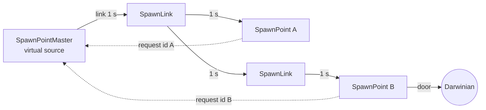

### SpawnBuilding (abstract base of SpawnLink / MasterSpawnPoint / SpawnPoint)

| Member | Meaning | Ref |
|---|---|---|
| `m_links : LList<SpawnBuildingLink*>` | outgoing links. Each link: `m_targetBuildingId` (direct neighbour), `m_targets` (ids of every SpawnPoint reachable down this link, filled by `ExploreLinks`), `m_spirits` (spirits in transit on this link) | [C] `spawnpoint.h` |
| `m_spiritLink : ShapeMarker*` | lazily looked-up `MarkerSpiritLink` (asserts if missing); link beams start/end here | [C] `GetSpiritLink` |
| `m_visibilityMidpoint/Radius` | cached culling sphere covering the building and all link targets (recomputed while editing) | [C] `IsInView` |
| `SpawnBuildingSpirit` | `m_targetBuildingId` (requesting SpawnPoint), `m_currentProgress` ∈ [0,1] along the current link | [C] |

Functions:
* `SetBuildingLink(id)` — appends a link unless one to `id` already exists (the type check of the target is commented out). [C].
* `ClearLinks()` — deletes all links. [C].
* `ExploreLinks()` — recursive DFS: returns this building's id if it is a SpawnPoint, plus everything reachable through each link whose target is a spawn building; stores the reachable set per link in `m_targets`. Self-link → `AppReleaseAssert` "SpawnPoint %d Linked to itself". **No cycle detection** (a cycle would recurse forever) and no memoisation. [C] `SpawnBuilding::ExploreLinks`. All shipped levels are acyclic trees with every SpawnPoint reachable and exactly one path to each (see `drafts/P06_spawn_graph.csv`). [C] data via `scripts/P06_spawn_graph.py`.
* `TriggerSpirit(spirit, progress)` — puts the spirit on **every** outgoing link whose `m_targets` contains the spirit's target, setting its progress to the carried-over value; if no link matches, the spirit is deleted (lost). [C]. Latent defect: if two links could reach the same target the *same pointer* would be placed on both lists (double advance, double delivery, double delete) [I]; impossible in shipped data because the graphs are trees [C].
* `Advance()` — for each link and each spirit on it: `progress += dt`; when ≥ 1.0 the spirit is removed and handed to the link's target building's `TriggerSpirit(spirit, progress − 1.0)` if the target exists and is a spawn building, else deleted. Then `Building::Advance()`. ⇒ **each link takes exactly 1.0 s of game time regardless of its length**. [C].
* `IsSpawnBuilding(type)` — SpawnPoint, SpawnLink, SpawnPointMaster. [C].
* `RenderAlphas` — draws each link as a textured beam (`textures/laser.bmp`, width 1 inner / 3 outer) between spirit-link markers, and every in-transit spirit as a diamond (inner 2, outer 6 units) coloured with the **current team colour of the target SpawnPoint** (grey 120 if neutral; Darwinia brown 150,50,25 outside Multiwinia). [C] `SpawnBuilding::RenderAlphas/RenderSpirit`.
* `Read` — base fields, then **every remaining token is a link id** (`SetBuildingLink`). `Write` — base fields then `%-6d` per link. [C].

### SpawnLink

Pure relay node: shape `spawnlink.shp` (no ports), no behaviour beyond SpawnBuilding. Level line: `SpawnLink id x z team fx fz isGlobal link*`. [C] `SpawnLink::SpawnLink`. Placed in 21 official MP levels (Domination 8, KOTH 8, Blitzkrieg 3, CTS 2). [C] data.

### MasterSpawnPoint (`SpawnPointMaster`)

| Aspect | Spec | Ref |
|---|---|---|
| Function | virtual source of all spawn spirits; exactly one per level (32 official MP levels, one each) | [C] code + data |
| Shape | `masterspawnpoint.shp`; rendered only if `m_isGlobal` or editing (in MP level files the master has isGlobal 0 in most levels → invisible, isGlobal 1 in 11 `mp_*` files → visible) [C] data | [C] `Render/RenderAlphas` |
| Static | `s_masterSpawnPointId` = id of the last master that advanced (never reset between levels) | [C] |
| First Advance | runs `ExploreLinks()` once (logs time taken) | [C] |
| `RequestSpirit(targetId)` | new `SpawnBuildingSpirit{target}` → `TriggerSpirit(spirit, 0)` | [C] |
| `GetMasterSpawnPoint()` | building with `s_masterSpawnPointId` if its type is master, else NULL (→ SpawnPoints cannot spawn until the master has advanced once) | [C] |
| Darwinia-only (`!Multiplayer()`) [B:LEGACY] | if global: forces every Spirit in Birth/Floating state to `SkipStage()`; if red team (1) has < 10 entities, sets GlobalBuilding online (mission objective); `GetObjectiveCounter` shows `objective_redpopulation` | [C] |
| Capture / damage | none / indestructible | [C] |

### SpawnPoint

| Aspect | Spec | Ref |
|---|---|---|
| Function | the territory node of the economy: when owned, periodically requests spirits and emits Darwinians for its owner | [C] |
| Shape | MP `spawnpointmultiwinia.shp`, SP `spawnpoint.shp`; door marker `MarkerDoor` (asserted); **5 ports**; 3 lights | [C] ctor; data/shapes |
| Capture | Darwinians stand on the 5 ports (§base 5). Ownership re-evaluated every 2.0 + syncfrand(1.0) s (first evaluation after syncfrand(2.0) s): owner must have **≥ 3 occupants** and every other occupant must be its friend; otherwise neutral. Full algorithm in [→ 05] §2 | [C] `RecalculateOwnership` |
| Activation | on every ownership change `m_activationTimer = 30.0` s; counts down only while owned; skipped (→0) if this is the team's only spawn point, if level option `instantspawnpointcapture`, or outside Multiwinia | [C] `Advance` |
| Inputs | virtual spirits from the master (one per request) | [C] |
| Outputs | one Darwinian per arriving spirit, at the door marker, initial velocity `(door.front + syncsfrand(1)·(1,1,1)) × 10` in MP (zero in SP), `m_onGround = false` | [C] `SpawnDarwinian` |
| Rate / caps | [→ 05] §3–§5 | |
| Links | outgoing spawn links (normally none on leaves) | [C] |
| Damageability | none (base `Damage` = sound only) | [C] |
| Static counters | `s_numSpawnPoints[NUM_TEAMS+1]`: index `team+1` = spawn points owned by team, index 0 = neutral. Incremented in `Initialise`, moved in `RecalculateOwnership` | [C] |
| Sounds | `TurnOn` (became owned), `TurnOff` (became neutral) + base list | [C] `ListSoundEvents`, `RecalculateOwnership` |
| Visuals | status stars over each port: grey (150,150,150) empty / occupant's team colour; 20 (detail 1) / 10 (detail 2) / 3 (detail 3) glow blobs (`textures/cloudyglow.bmp`) above the building, alpha = occupied/total, colour lerps from grey (100,100,100,200) to team colour as `m_activationTimer` goes 30 → 0 | [C] `RenderPorts/RenderAlphas` |
| Level line | `SpawnPoint id x z team fx fz isGlobal link*` (links rarely used on leaves) | [C] SpawnBuilding::Read |
| Starting ownership in data | across all `mp_*` files: 162 SpawnPoints start owned by a team position (0: 53, 1: 57, 2: 33, 3: 19) and 124 start neutral; all have isGlobal 0 | [C] data grep |
| Mode usage (official levels containing it) | Domination 9/9, KOTH 8/9 (not `mp_koth_3P_4`), CTS 9/9, Blitzkrieg 4/7 (2-player maps), Rocket Riot 2/7 (`2P_2`, `4P_1`), Assault 0/8. Count per level 1–15 | [C] `drafts/P06_level_building_usage.csv` |
| Mode-specific consumers | Domination score adds `s_numSpawnPoints[t+1]` per scoring tick and eliminates teams with 0 spawn points after a 30-s grace; KOTH/CTS elimination requires 0 spawn points and < 50 Darwinians; crates Harvester/Engineer/SpawnMania are suppressed on maps with no spawn points | [C] `code/multiwinia.cpp` (Domination scoring block, `Multiwinia::IsEliminated`), `code/worldobject/crate.cpp` (IsValid) — owned by other agents |

```mermaid
stateDiagram-v2
    [*] --> Neutral : team 255 in level file
    [*] --> Activating : team set in level file (InitialiseTeam then forces Active)
    Neutral --> Activating : evaluation finds owner T (>=3 ports, no enemies); activationTimer = 30
    Activating --> Active : activationTimer <= 0 (instant if only spawn point of T or instantspawnpointcapture)
    Activating --> Neutral : evaluation fails (contested / <3); activationTimer = 30
    Active --> Neutral : evaluation fails
    Active --> Activating : evaluation finds different owner U; activationTimer = 30
    state Active {
        [*] --> Burst
        Burst --> Burst : every 0.2 s request 1 spirit (counter < N)
        Burst --> Pause : counter reaches N = int(20*H); timer = 10 + syncfrand(5)
        Pause --> Burst : timer <= 0
        Burst --> Locked : PopulationLocked()
        Pause --> Locked : PopulationLocked()
        Locked --> Burst : unlocked during a burst (timer resumes)
        Locked --> Pause : unlocked during a pause (timer resumes)
    }
```
[C] `SpawnPoint::Advance`, `RecalculateOwnership`, `PopulationLocked`; `code/location.cpp:Location::InitialiseTeam` (starting spawn points).

### SpawnPopulationLock

| Aspect | Spec | Ref |
|---|---|---|
| Function | invisible regional population limiter (Darwinia design, still used as fallback) | [C] |
| Fields | `m_searchRadius` (default 500.0), `m_maxPopulation` (default 100), `m_originalMaxPopulation`, `m_teamCount[NUM_TEAMS]`, `m_recountTimer` (initial syncfrand(10)), `m_recountTeamId` (initial 10); statics `s_overpopulationTimer`, `s_overpopulation` (reset by `Reset()` from `Location::Init`) | [C] |
| Level line | `SpawnPopulationLock id x z team fx fz isGlobal searchRadius maxPopulation` (`%-8.2f %-6d` on write) | [C] `Read/Write` |
| Behaviour | **Disabled in Multiwinia when the level sets `PopulationCap` ≠ −1** (Advance returns immediately, counts stay 0). Otherwise: every 1.0 s of network time, `s_overpopulation = Σ_locks max(0, teamCount[0] − originalMax) / 2` (green team only); `m_maxPopulation = max(0, originalMax − s_overpopulation)`; recount cycle of 10 + syncsfrand(2) s (∈[9,11)) during which team *k* is recounted when `(int)m_recountTimer` drops to *k* (`EntityGrid::GetNumFriends(pos, searchRadius, k)`), teams 0..5 | [C] `SpawnPopulationLock::Advance` |
| Use by SpawnPoint | only when no level cap applies; see [→ 05] §4.4 | [C] |
| Hit tests | none (never collides); rendered only in editor (sphere r=30 + text) | [C] |
| Usage | 21 official MP levels (KOTH 7, CTS 6, Blitzkrieg 4, Assault 2, Domination 2) — all of these also set `PopulationCap`, so the locks are inert in those levels [C] data cross-check | [C] |

<!-- from P06_buildings_core -->
## [→ 03_buildings_and_world_objects] GunTurret (and GunTurretTarget)

Source: `code/worldobject/gunturret.{h,cpp}`. Build tag: **[B:FULL]**; the `underPlayerControl` lose-control branch and team-2 remap are Darwinia-only ([B:LEGACY]); mortar/subversion editor previews are [B:EDITOR].

### Function
A Darwinian-manned automatic weapon emplacement: a fixed base (`battlecannonbase.shp`, 4 ports) with a rotating turret (`battlecannonturret.shp`) and a barrel shape that depends on the turret type. It is owned by whichever team mans its ports, automatically engages enemies in range, and can be steered manually by its owner. [C] `GunTurret::GunTurret/Advance`.

### Turret types (enum `GunTurret::GunTurretType*`)

| Value | Type | Language key (`GetTurretTypeName`) | MP barrel model (`GetTurretModelName`) | Weapon call per barrel | Reload `GetReloadTime` | Min range (MP / SP) | Max range (MP / SP) | Barrels examined per trigger | Ref |
|---|---|---|---|---|---|---|---|---|---|
| 0 | Standard | `buildingname_gunturret` | `cannon_bullets.shp` | `Location::FireTurretShell(barrelEnd − v·dt·0.5, v = barrelFront·500, team, id)` | 0.1 s | 50 / 100 (`GUNTURRET_MINRANGE`×0.5 in MP) | 225 / 300 (`GUNTURRET_MAXRANGE`×0.75 in MP) | 2 | [C] |
| 1 | Rocket | `buildingname_rocketturret` | `cannon_rocket.shp` | `Location::FireRocket(barrelEnd, barrelEnd + barrelFront·500, team, life 1.0, id)` | 1.5 s | 100 | 200 | **1** (loop breaks) | [C] |
| 2 | Mortar ("grenade turret") | `buildingname_grenadeturret` | `cannon_bullets.shp` (default branch) | `Location::ThrowWeapon(barrelEnd, pos + targetPos ± syncsfrand(targetRadius) in x,z, Grenade, team, force = targetForce + syncsfrand(0.1), life 1000, explodeOnImpact)` | 4.0 s | n/a (targets an area) | n/a | 2 | [C] |
| 3 | Flame | `buildingname_flameturret` | `cannon_flame.shp` | `Location::LaunchFireball(barrelEnd, barrelFront·100, life 1.0, id)` (fireball team −1 = hurts everyone) | 0.1 s | 10 | 150 | 2 | [C] |
| 4 | Subversion | `buildingname_subversionturret` | `battlecannonbarrel.shp` | `Location::FireLaser(barrelEnd, barrelFront·500/4 = 125 u/s, team, mindControl=true)` | 0.5 s | 10 | 150 | 2 | [C] |

Single-player always uses `battlecannonbarrel.shp`. A Standard turret fires a *subversion* laser from any barrel whose operating Darwinian has `m_subversionTaskId != −1` (per-shot override). [C] `GunTurret::PrimaryFire`.

Projectile characteristics (owned by the weapons agent; summarised for completeness):

| Weapon | Speed | Lifetime | Damage model | Ref |
|---|---|---|---|---|
| TurretShell | 500 u/s, straight | 0.6 s in MP (≈300 u); Darwinia: 0.5/0.5/1.0/1.5/2.0 s by armour research 0–4 | each enemy entity whose `RayHit` intersects the swept segment: `ChangeHealth(−15, DamageTypeTurretShell)`; knock-back 20 u/s + airborne; tree/anthill/triffid buildings −2; kills credited to turret (`RegisterKill`) and team. MP shell team = turret team; SP shell team = 255 | [C] `location.cpp:FireTurretShell`, `weapons.cpp:TurretShell::Advance` |
| Rocket | starts 50 u/s, ×1.2 per tick until ≥150 | 1.0 s (turret override) or ground/building contact | `Bang(pos, 15, 25, team, turretId)` | [C] `weapons.cpp:Rocket::Rocket/Advance/Explode` |
| Grenade (mortar) | ballistic, `force` from level | explodes on impact (life 1000) | power 25 → `Bang(pos, 12.5, 50, team)` | [C] `weapons.cpp:Grenade::Advance`, `location.cpp:ThrowWeapon` |
| Fireball | 100 u/s | 1.0 s; radius 20·min(1, abs(1−life)) | Darwinians in radius (once each): `FireDamage(30 · radius/dist · max(1, life))` | [C] `weapons.cpp:Fireball::Advance` |
| Subversion laser | 125 u/s | Darwinia laser-research lifetime (level 0–4: 0.2, 0.4, 0.6, 0.8, 1.0 s) × 2 | mind-control laser (converts) | [C] `location.cpp:FireLaser`; [U] MP research level of `TypeLaser` (set by `Multiwinia::SetGameResearch`, other agent) |

### Effective fire rate (derived)
Barrel *i* fires only if **port *i*** is occupied. `PrimaryFire` returns at once if `m_fireTimer > 0`; otherwise it examines `m_nextBarrel` and the next barrel (one barrel for Rocket), firing each whose port is manned, and sets `m_fireTimer = reload` after a shot (the second barrel in the same call still fires). `m_fireTimer` is decremented by dt before `PrimaryFire` in the same tick. [C] `GunTurret::Advance/PrimaryFire`.
⇒ Standard / Flame at dt = 0.1 s: every tick 2 of the 4 barrels are examined → **shots per second = 5 × (occupied ports)** (max 20 shells/s). Mortar: up to 2 grenades per volley, one volley per ~4.0 s. Subversion: up to 2 lasers per ~0.5 s. Rocket: 1 rocket per ~1.5 s plus 0.1 s per skipped unmanned barrel. [I] arithmetic from the code above.

### Capture / ownership
* Re-evaluated every **1.0 s** (`GUNTURRET_OWNERSHIPTIMER`); first evaluation on the first tick. [C].
* Count port occupants per team; winner = first team (by index) with ≥ 1 occupant, replaced by any later team with strictly more; if any occupant is not a friend of the winner → **neutral**. No minimum count (1 Darwinian suffices). [C] `GunTurret::RecalculateOwnership`.
* Becoming neutral restores the neutral turret/barrel shapes. Becoming owned in MP swaps in the team-coloured turret copy `battlecannonturret.shp_<colourId>_<coopGroupPosition>` and barrel `<model>_<colourId>_<group>` (built once by `SetupTeamShapes()`: colour copies for `MULTIWINIA_NUM_TEAMCOLOURS+2` colours × 3 group variants, turret colours scaled ×0.2; barrel copies are *not* recoloured). [C] `RecalculateOwnership`, `SetupTeamShapes`, `ConvertColours`.
* Futurewinian rules: a Subversion turret captured by a non-Futurewinian team, or any non-Subversion turret captured by the Futurewinian team, **self-destructs** (`Damage(−1000)`). [C].
* Darwinia: green (0) capture is shown as team 2 (yellow, the player). [C] [B:LEGACY].

### Targeting and aiming (per tick, while owned and not player-controlled)
1. Every **1.0 s** in MP (3.0 s SP; `GUNTURRET_MULTIWINIA_RETARGETTIMER` / `GUNTURRET_RETARGETTIMER`) `SearchForTargets()`:
   * Mortar: `EntityGrid::GetBestEnemy(pos + targetPos, 0, targetRadius, team)`; aim point forced to `pos + targetPos`.
   * Others: all enemies within `GetMaxRange()`; skip `TypeAI`, `TypeHarvester`, dead; choose the **nearest** with `dist ≥ GetMinRange()` and clear line of sight (`ClearLOS`: samples every 30 units from target back toward the turret, ray-tests buildings in each obstruction cell). Sound `TargetSighted` on a new target.
   * No target and owned → `SearchForRandomPos()` (idle sweep: first time random angle, distance 200 + syncfrand(200), height syncfrand(100); later rotate current aim by syncsfrand(π/2) (±π/4) and height syncsfrand(50)).
2. With a valid target: aim point = target position + wobble `(sin(3t)·20, |sin(2t)·10|, cos(3t)·20)` (t = network time); fire if horizontal angle between aim and turret front < **0.3 rad** and no friendly-fire warning. `m_hadTargetTimer` = now; for **1.0 s after the last target** the turret keeps firing ("hosing"). [C] `GunTurret::Advance`.
3. Aim point closer than **75** units is pushed out to 75. Turret yaw turns by `angle × 0.2` per tick toward the aim point; barrel pitch blends `barrelUp = barrelUp·(1−2dt) + target·2dt`. [C].
4. Flame turret friendly-fire guard: if > **10** friends within **20** units of `pos + turretFront·60`, `m_friendlyFireWarning` blocks firing and the kill counter flashes "FF!". [C].
5. Overheat (cosmetic smoke only, no gameplay effect): each firing call sets `m_overheatTimer = now` and `temperature += 1` (cap 40). Whenever > 0.2 s have elapsed since `m_overheatTimer`, the timer is reset to now and `temperature −= 0.3` (so cooling of 1.5/s starts only after firing pauses ≥ 0.2 s); at < 0 it clamps to 0 and stops. Each cooling step emits `syncfrand(int(1 + temperature/10))` smoke particles per barrel — **synced RNG consumed for a visual effect**. [C] `GunTurret::Advance`.

### Player control
The owner can select the turret (`LocationInput`: only if the turret's team is the local player's team) → `Team::m_currentBuildingId`; `Team::SelectUnit` sets `m_fireTimer = 0.5` and the camera enters `ModeTurretAim`. While selected, automatic targeting is off; `Location` (team-controls processing) sets the aim point to the networked mouse position and calls `PrimaryFire()` on move/fire/left-button. [C] `code/location_input.cpp`, `code/team.cpp:Team::SelectUnit`, `code/location.cpp:Location::UpdateTeam` (≈L4007–4024).

### Health and damage
`m_health = 60`; `Damage(d)` adds `d` (negative = harm); at ≤ 0 the turret explodes its turret and barrel shapes, sets `m_destroyed`, and destroys its AITarget. `Advance` returns true when health ≤ 0. Sources: `Location::Bang` falloff (§base 7), task self-destruct (−1000) when a crate-turret is captured by an enemy or its task ends. [C] `GunTurret::Damage`, `code/taskmanager.cpp`.

### Companion objects
* **AITarget**: on first Advance an `AITarget` building is created at the turret (`m_turretTarget = true`, new building id, `RecalculateAITargets`) so CPU players fight for it; destroyed with the turret. [C] `GunTurret::Advance`.
* **GunTurretTarget** (`EffectGunTurretTarget`, a WorldObject in `m_effects`): every tick moves to the turret's aim point if any port is manned, else to (0,0,0); in MP adopts the turret's team for Standard turrets only; self-removes when the turret is gone. Comment: "a GunTurret target that darwinians can run from". [C] `GunTurretTarget::Advance`; [I] consumed by Darwinian threat avoidance (other agent).
* Kill counter `m_kills[team]` (rendered at `MarkerKills`, size 2 or 1.5 above 999): +kills on enemies, −kills on friends. [C] `RegisterKill`, `Render`.

### Level-file line
`GunTurret id x z team fx fz isGlobal [state [targetX targetZ targetRadius targetForce]]` — `state` = turret type (0–4, default 0); the 4 mortar fields are offsets relative to the turret position, radius and throw force. Write format `%-4d` then four `%-2.2f `. **The level front vector is discarded**: `Initialise` forces `up = (0,1,0)`, `front = (1,0,0)×up = (0,0,1)`. Centre = pos, radius 30. [C] `GunTurret::Read/Write/Initialise`.

### Stats / parameter table

| Parameter | Value | Kind | Ref |
|---|---|---|---|
| Health | 60 | ctor literal | [C] |
| Ports / status markers | 4 / `GUNTURRET_NUMSTATUSMARKERS` 5 (4 present) | shape / `#define` | [C] |
| Barrels | `GUNTURRET_NUMBARRELS` 4 | `#define` | [C] |
| Ownership period | `GUNTURRET_OWNERSHIPTIMER` 1.0 s | `#define` | [C] |
| Retarget period | 3.0 s SP, 1.0 s MP | `#define` | [C] |
| Ranges | `GUNTURRET_MINRANGE` 100, `GUNTURRET_MAXRANGE` 300, `FLAMETURRET_MINRANGE` 10, `FLAMETURRET_MAXRANGE` 150, `ROCKETTURRET_MINRANGE` 100, `ROCKETTURRET_MAXRANGE` 200, `SUBVERSIONTURRET_MINRANGE` 10, `SUBVERSIONTURRET_MAXRANGE` 150 | `#define` | [C] |
| MP standard range scaling | min ×0.5, max ×0.75 | code | [C] `GetMinRange/GetMaxRange` |
| Fire cone | 0.3 rad | literal | [C] |
| Keep-firing window | 1.0 s | literal | [C] |
| Minimum aim distance | 75 | literal | [C] |
| LOS step | 30 | literal | [C] |
| Shell speed / rocket aim distance | 500 | literal | [C] |
| Selection pick sphere | r = 12 at +10 y; editor/default radius 30 | literal | [C] |

### State machine
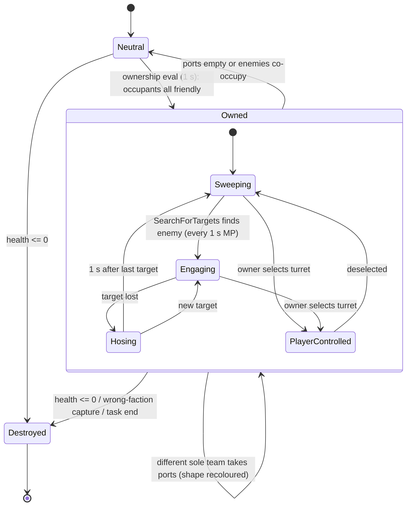

### Mode usage and variants
* **Level-placed**: 13 official MP levels — Assault 8/8 (12–40 per level), Blitzkrieg 2 (`2p_2`: 4, `2P_4`: 18), Domination 1 (`skirmish_3P_1`: 6), KOTH 1 (`3P_4`: 6), Rocket Riot 1 (`3P_3`: 6). All 207 placed MP turrets start **neutral**; types used: Standard ×196, Flame ×11 (Assault `2p_3`, `3p_1`, `3p_3`); no level places Rocket, Mortar or Subversion. [C] data.
* **Crate-delivered**: crate rewards GunTurret / RocketTurret / FlameTurret start a `GlobalResearch::TypeGunTurret` task with `m_option` = Standard / Rocket / Flame; when the player targets a point, `Crate::RunGunTurret(pos, team, type)` builds the turret from a template (team = default 255 → it starts **neutral** and must be manned), regenerates the obstruction grid, explodes its shapes for a build-in effect, registers a map marker `icons/icon_gunturret.bmp` and shows `crate_message_run_gunturret`. The task self-destructs the turret if an enemy captures it. [C] `code/worldobject/crate.cpp:Crate::RunGunTurret` and reward switch; `code/taskmanager.cpp:Task::TargetGunTurret`.
* **Reinforcement turrets**: Rocket Riot / Blitzkrieg periodically grant GunTurret tasks (`TurretFrequency`, `MaxTurrets` game options; Blitzkrieg swaps to AirStrike after enough zones; `nogunturrets` level option disables) [C] `code/multiwinia.cpp` (≈L1100–1125), `data/multiwinia.txt` — owned by the modes agent.
* **Armour conversion**: an Armour unit can convert itself into a turret (`Armour::ConvertToGunTurret`, dynamic template). [C] `code/worldobject/armour.cpp`.

<!-- from P06_buildings_core -->
## [→ 03_buildings_and_world_objects] Teleport base and RadarDish

Source: `code/worldobject/teleport.{h,cpp}`, `code/worldobject/radardish.{h,cpp}`. Build tag: **[B:FULL]** (D3D-only vertex-declaration fix in `RadarDish::RenderAlphas` is [B:D3D]; `ValidReceiverDish` multiplayer block is commented out).

### Teleport (abstract)

| Member | Meaning | Ref |
|---|---|---|
| `m_timeSync` | seconds until the next entity may enter (counts down to 0) | [C] `Teleport::Advance` |
| `m_sendPeriod` | minimum time between sends (1.0 default; RadarDish 0.1) | [C] |
| `m_entrance` | marker `MarkerTeleportEntrance` (asserted in `SetShape`) | [C] |
| `m_inTransit : LList<WorldObjectId>` | entities currently inside the beam | [C] |
| static `m_teleportMap : LList<TeleportMap{teamId, fromUnitId, toUnitId}>` | maps a unit entering a teleport onto the unit its members are re-assembled into on the far side; entries are removed when the source unit no longer exists | [C] `Teleport::Advance/EnterTeleport` |

Virtuals: `Connected()` (false), `ReadyToSend()` (`m_timeSync ≤ 0`), `GetEntrance` (entrance marker), `GetExit/GetStartPoint/GetEndPoint/UpdateEntityInTransit` (assert — must be overridden). [C].

`EnterTeleport(id, relay)`:
1. If the entity belongs to a **Unit** (any entity whose `m_id` has a unit id, e.g. insertion squads) and this is not a relay: find (or create via `Team::NewUnit(troopType, size, &id, m_pos)`) the destination unit through `m_teleportMap`; an Insertion Squad gets its squad Task re-created on the new unit (old task removed, its `m_lifeTimer` carried over in MP, task selected, weapon type and controller task copied, controller route gains this teleport as waypoint); the new unit inherits the route (next waypoint) or gets a waypoint 50 units past the exit ± SFRAND(35) (synced). The entity is copied into the new unit (new index/unique id), `m_enabled = false`, `m_onGround = false`, `vel = 0`; `RecalculateOffsets()`. [C] `Teleport::EnterTeleport`.
2. Entity position = `GetStartPoint()`; `UpdateEntityInTransit(entity)` once; push id on `m_inTransit`; `m_timeSync = m_sendPeriod`. [C].

`Advance()`: `m_timeSync -= dt` (floor 0); advance every in-transit entity via `UpdateEntityInTransit` (remove when it returns true or the entity is gone); prune the static teleport map; `Building::Advance()`. [C].

Entities enter teleports themselves: `Entity::EnterTeleports(requiredId)` scans buildings in the entity's obstruction cell; for a RadarDish it requires `ReadyToSend()`, distance to the entrance < **15** and `entity.front · entrance.front < 0` (walking into the door). Bridges (Darwinia, blocked) use 25. Called by Darwinians/officers/squads/lasertroopers/shamans in their movement code. [C] `code/worldobject/entity.cpp:Entity::EnterTeleports`.

### RadarDish

| Aspect | Spec | Ref |
|---|---|---|
| Function | one-way long-range transporter: entities walking into its door are carried along its beam to the **receiver** dish it is aimed at, and exit from the receiver's door | [C] |
| Shape | per-instance copy of `radardish.shp` (so colours can be changed per team); fragments `Dish` (pitch) and `UpperMount` (yaw); markers `MarkerFocus` (beam origin), `MarkerTeleportEntrance`; 2 lights; no ports | [C] ctor; data/shapes |
| Ownership | no own capture logic. In MP it is set by a linked **ControlStation** (port-based capture, other partition) via `b->SetTeamId(winner)`; MP dishes are placed neutral (team 255) except two team-0 dishes in `mp_assault_2p_3` (auto-connected, with `forceradarteammatch`). On team change in MP the dish's shape copy is recoloured to the team colour (white when neutral) | [C] `RadarDish::Advance`; `code/worldobject/controlstation.cpp:ControlStation::RecalculateOwnership`; data |
| Aiming | `Aim(worldPos)`: if the dish has a *valid-link list* and `m_forceConnection` is set, the request is ignored unless the ray from the focus toward `worldPos` hits (ray–sphere on centre/radius) one of the listed dishes with terrain visibility. Otherwise stores `m_target`, clears both alignment flags, plays `BeginRotation`. Aim requests come from the network command for the owning team only (team must equal the dish's team) and from the AI; the human can only select their own dish, and not at all with level option `noradarcontrol` | [C] `RadarDish::Aim`; `code/network/clienttoserver.cpp:ClientToServer::ProcessServerUpdates` (`NET_DARWINIA_AIMBUILDING`, ≈L2684); `code/location_input.cpp`; `code/worldobject/ai.cpp` (`noradarcontrol` check) |
| Rotation | Yaw first: rotation axis = currentFront × targetFront (horizontal); `axis.y /= 4`; while `abs(axis.y) > π/3000`, `UpperMount.angVel.y = sign(axis.y)·sqrt(abs(axis.y))`; then pitch: target direction y clamped to [−0.2, +0.3], `Dish.angVel = Dish.transform.r × (worldMat.u · targetFront)` until `length(angVel) < 0.001`. Both integrated with dt. Sounds `BeginRotation`/`EndRotation` | [C] `RadarDish::Advance` |
| Connection test (every tick, once a target exists) | among all other RadarDishes: the ray from this focus along the focus front must hit the other's bounding sphere, the other's dish front must face back (`dot < 0`), focus-to-focus terrain visibility (`Location::IsVisible`), nearest such dish wins, and it must pass `ValidReceiverDish` | [C] `RadarDish::Advance` |
| `ValidReceiverDish(id)` | in the MP tutorial building 11 is never valid; if level option `forceradarteammatch`: receiver team must equal ours; else if the valid-link list is empty any dish is valid, otherwise only listed ids | [C] |
| Connected state | `m_receiverId`, `m_range` (focus-to-focus distance), `m_signal = 1`; `Connected() = receiver ≠ −1 && signal > 0`; `ReadyToSend = Connected && m_timeSync ≤ 0`. Transitions play `ConnectionEstablished` / `ConnectionLost` and set `GlobalBuilding.m_link` | [C] |
| Transport | `m_sendPeriod = RADARDISH_TRANSPORTPERIOD` **0.1 s** → at most **10 entities/s** may enter one dish; each moves at `RADARDISH_TRANSPORTSPEED` **50 u/s** along the beam (`pos += front·50·dt`), disabled and airborne, unit position kept in sync. Travel time = range / 50 s. No capacity limit on entities in transit | [C] `radardish.h`, `RadarDish::UpdateEntityInTransit` |
| Arrival | when distance travelled ≥ range: placed at the receiver's entrance marker, facing out, enabled, on ground, vel 0; Darwinians → `StateIdle`, waypoint = own position, orders cleared; insertion-squad members re-waypoint their unit to the exit; re-added to the entity grid; sound `ExitTeleport` | [C] |
| Failure | if the signal drops (`m_signal == 0`) or a `PulseWave` is active, every entity in transit takes `ChangeHealth(−500)` (fatal for Darwinians), is re-enabled, gets a random kick (SFRAND 10, FRAND 10, SFRAND 10 — synced), and falls from the beam | [C] |
| AI target | MP only: while connected an `AITarget` (`m_radarTarget = true`) is kept at the entrance and linked to the receiver dish's AI target; destroyed on disconnect | [C] `AdvanceAITarget` |
| Hit tests | sphere test radius ×1.5 (door must register in obstruction cells); ray test on shape with up = (0,1,0) | [C] |
| Damage | indestructible | [C] |
| Rendering | 4 nested beam tubes (radius 10/9/8/4, alpha 0.4/0.2/0.2/0.5) textured `laserfence.bmp` × `radarsignal.bmp`, clipped by the two dish planes; preview beams to all valid links when the owner hovers/selects it | [C] `RenderAlphas/RenderSignal` |
| Level line | `RadarDish id x z team fx fz isGlobal [forceConnection [autoConnectAtStart [validLinkId*]]]` (write `%-5d` each). isGlobal must be 1 (load assert). `autoConnectAtStart` = aim at the first valid link on the first tick (if there is no GlobalBuilding link) | [C] `Read/Write/Advance`, `level_file.cpp:ParseBuildings` |
| Mode usage | 7 official MP levels: Assault (`2p_3` 4, `3p_1` 2, `4P_1` 6), Domination (`domination_4P_2` 8, `koth_2P_2` 6), KOTH (`3P_1` 12, `4P_3` 8). Patterns in data: sender dishes `force 1` with 1–3 valid links (often with `auto 1`), plain receivers `force 0 auto 0` with no links; `mp_assault_2p_3` uses `forceradarteammatch noradarcontrol` with team-0-owned auto-connected dishes | [C] data |

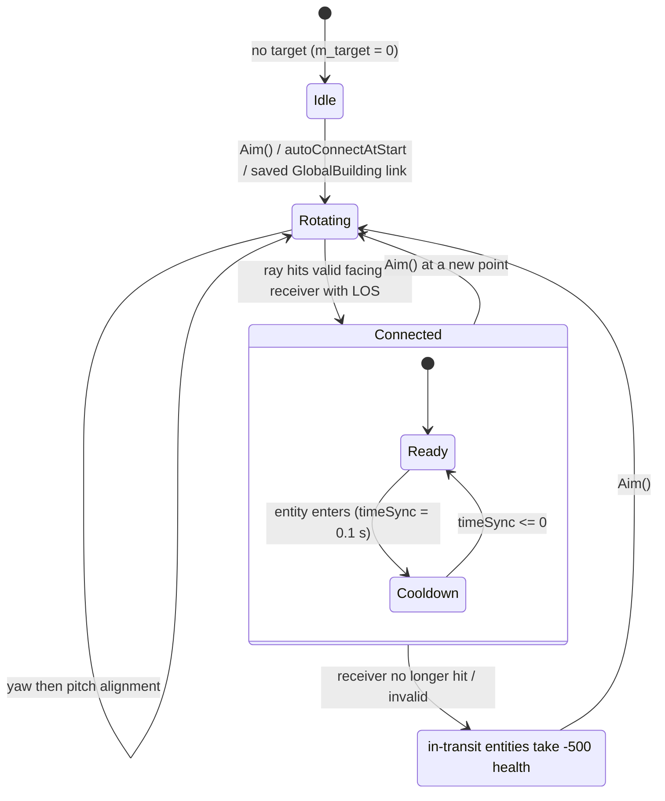

<!-- from P06_buildings_core -->
## [→ 03_buildings_and_world_objects] JumpPad

Source: `code/worldobject/jumppad.{h,cpp}`. Build tag: **[B:FULL]** (trajectory preview [B:EDITOR]).

| Aspect | Spec | Ref |
|---|---|---|
| Function | launches Darwinians standing on it into a ballistic jump | [C] |
| Shape | none (no collision; `DoesSphereHit/DoesShapeHit` false; ray test = sphere m_radius 13) | [C] |
| Ownership | none — works for every team | [C] |
| Behaviour | every **0.3 s** (`m_launchTimer`): launch vector = `m_front` rotated about `m_front × up` by `m_angle` (radians), length `m_force`; every Darwinian from the entity grid within `JUMPPAD_RADIUS` **40** that is on the ground and not `StateInsideArmour` gets `vel = launch`, `m_onGround = false`, `StateIdle`, waypoint cleared, orders cleared | [C] `JumpPad::Advance` |
| Note | does **not** call `Building::Advance` (no port evaluation; `m_destroyed` never honoured) | [C] |
| Damage | indestructible (base `Damage`) | [C] |
| Rendering | animated arrow strip (`icons/thickarrow.bmp`) 80 units long, ±20 wide, brightness pulsing `0.3 + 0.7·abs(sin t)` | [C] `RenderAlphas` |
| Level line | `JumpPad id x z team fx fz isGlobal force angle` (write `%-2.2f ` each) | [C] |
| Data | 23 placed in 3 official MP levels (Assault `2P_2` 3, Blitzkrieg `2P_3` 2, Domination `skirmish_3P_1` 18); force 76.17–227.38, angle 0.51–1.08 rad | [C] data |

<!-- from P06_buildings_core -->
## [→ 03_buildings_and_world_objects] Power network (PowerBuilding, SolarPanel, Pylon, PylonEnd, PowerSplitter; legacy Generator, PylonStart, Powerstation)

Source: `code/worldobject/generator.{h,cpp}`, `code/worldobject/powerstation.{h,cpp}`. Build tags: SolarPanel, Pylon, PylonEnd, PowerSplitter **[B:FULL]**; Generator, PylonStart, Powerstation **[B:LEGACY]** (blocked from level files, no runtime creator).

### PowerBuilding (base)

| Aspect | Spec | Ref |
|---|---|---|
| Members | `m_powerLink` (id of the next building in the line), `m_powerLocation` (marker `MarkerPowerLocation`, asserted on first use), `m_surges : LList<PowerSurge{teamId, percent}>` | [C] `generator.h` |
| `TriggerSurge(init, team)` | pushes a new surge at the **front** of the list with `percent = init`; sound `TriggerSurge` | [C] |
| `Advance` | each surge: `percent += dt × 2` in Multiwinia (× 4 in Darwinia) → **0.5 s per segment** (0.25 s SP); at ≥ 1.0 the surge is deleted and `powerLink->TriggerSurge(0, surge.team)` is called (no type or team check) | [C] `PowerBuilding::Advance` |
| Rendering | power line beam between the two `MarkerPowerLocation`s; surges as star sprites (size 20) in the surge team's colour (MP; monster/Futurewinian teams skipped for the trail) with a 3-sprite trail | [C] `RenderAlphas` |
| Level line | base fields + `powerLink` (`%-8d`) | [C] `Read/Write` |
| Link API | `GetBuildingLink/SetBuildingLink` = `m_powerLink` | [C] |
| Damage | all power buildings are indestructible (base `Damage`) | [C] |

### SolarPanel — the capturable power source

| Aspect | Spec | Ref |
|---|---|---|
| Shape | `solarpanel.shp`: **5 ports**, 5 status markers, 4 glow markers; orientation forced to the terrain normal, front = (1,0,0)×normal | [C] ctor, `Initialise` |
| Capture | MP: every tick, team with the most port occupants (strict max; ties → lower team index); zero occupants → 255. Enemies may share the panel | [C] `SolarPanel::RecalculateOwnership` |
| Output | each tick, with probability `fractionOccupied / 20` (`syncfrand(20) ≤ fraction`), emits a surge tagged with the panel's team (a neutral panel has fraction 0 → never). Per tick P = fraction/20; at 10 ticks/s the expected rate is **0.5 × fraction surges/s** (0.5 surges/s with all 5 ports manned, 0.1 per manned port). The synced random draw happens **every tick** for every panel | [C] `SolarPanel::Advance`; [I] rate arithmetic |
| Operating flag | `fraction > 0.6` → operating (sound `Operate`); `< 0.3` → not operating (sound stopped); purely cosmetic/AI | [C] |
| Assault rule | if the panel has a starting team (level file ≠ 255) and is now owned by a **different** team in Assault, all its ports are deleted → next evaluation sets it neutral and it never produces again (attackers permanently knock out defender panels) | [C] `SolarPanel::Advance` + `RecalculateOwnership` (`GetNumPorts()==0 → 255`); [I] design intent |
| Start of game | `Location::InitialiseTeam` spawns one Darwinian per port on every SolarPanel owned by the team and evaluates ownership | [C] `code/location.cpp:Location::InitialiseTeam` |
| Rendering | status lights green/red; when occupied & owned, 4 glow quads (60×40) pulsing `0.5 + 0.5·abs(sin t)` in team colour (Darwinia: blue 100,100,250) | [C] |
| Level line | base + `powerLink` | [C] |

### Pylon / PylonEnd / PowerSplitter

| Class | Function | Specifics | Ref |
|---|---|---|---|
| `Pylon` | relay segment (`pylon.shp`) | plain PowerBuilding; team from level file (Rocket Riot pylons are team-owned so splitters can route) | [C] |
| `PylonEnd` | line terminator (rendered invisibly: `RenderAlphas` does nothing) | its `TriggerSurge` does **not** store a surge; it delivers immediately to its link: `ConstructionYard::AddPowerSurge` (legacy), `FuelGenerator::ProvideSurge` (Rocket Riot fuel), or `LaserFence::ProvidePower` **only if the surge team is a friend of the fence's team** | [C] `PylonEnd::TriggerSurge` |
| `PowerSplitter` | router (rendered only in editor) | `m_links` list (level-file tail tokens, `%-4d`); `TriggerSurge` forwards to the **first** linked `Pylon` whose team equals the surge's team; otherwise the surge is dropped; ignores its own `m_powerLink` | [C] `PowerSplitter::TriggerSurge/Read` |

Topologies in shipped data [C] (analysis of `mp_*` files): SolarPanels are daisy-chained (`SolarPanel→SolarPanel` 155 links, `→Pylon` 35, `→PowerSplitter` 39, `→PylonEnd` 2); Pylons link to Pylon 211, PylonEnd 87, PowerSplitter 3; PylonEnds feed LaserFence (31, Assault/Blitzkrieg/Domination) or FuelGenerator (57, Rocket Riot); PowerSplitters (Rocket Riot only, 26) route to team pylons. Chain lengths panel→terminal: 3–14 buildings.

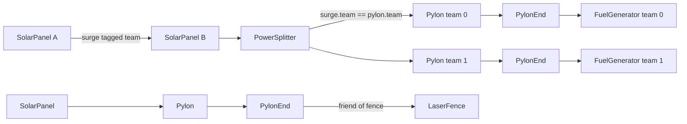

Mode usage: SolarPanel / Pylon / PylonEnd in 16 official levels — Rocket Riot 7/7, Assault 5/8, Blitzkrieg 3/7, Domination 1 (`domination_2P_1`); PowerSplitter only in Rocket Riot 7/7. [C] data.

### Legacy power buildings [B:LEGACY]
* **Generator** (`generator.shp`, blocked): power source enabled by `ReprogramComplete` (control tower) or by finding a ControlTower linked to it with the same team; surges only when enabled; throughput EMA per second `t = 0.8t + 0.2·n`; GlobalBuilding online when `t > 6.5`; objective text `objective_output` "%d Gq/s" (throughput×10). [C] `Generator::*`.
* **PylonStart** (blocked): emits a surge with probability 0.3 per tick (`syncfrand(1) > 0.7`) when the campaign Generator location's generator is online **and** its required building (`m_reqBuildingId`, extra level token) is online. [C] `PylonStart::Advance/Read`.
* **Powerstation** (`powerstation.shp`, 4 ports, blocked): linked LaserFence (`m_linkedBuildingId`, level token `%-8d`) is enabled when all ports are occupied and disabled when occupied ≤ 3/4 of ports. **Dereferences the link without a null check** (crash if the id is invalid). [C] `Powerstation::Advance`.

<!-- from P06_buildings_core -->
## [→ 03_buildings_and_world_objects] CarryableBuilding (base of Statue, WallBuster, ChessPiece)

Source: `code/worldobject/carryablebuilding.{h,cpp}`. Build tag: **[B:FULL]** — the whole `Advance` body is inside `#if defined(INCLUDEGAMEMODE_CTS) || defined(INCLUDEGAMEMODE_ASSAULT) || defined(INCLUDEDGAMEMODE_PROLOGUE)` (note the typo `INCLUDEDGAMEMODE_PROLOGUE`); CTS and Assault are defined in FULLGAME, so it is live. Not itself a level-file type (no enum value); concrete subclasses are `Statue` (CTS), `WallBuster` (placed only in `mp_assault_2P_1`), `ChessPiece` (blocked). [C] `CarryableBuilding::IsCarryableBuilding`.

| Member | Meaning |
|---|---|
| `m_carryRadius` | radius of the carrier ring; also the collision radius against other carryables |
| `m_scale` | render scale; collision push force |
| `m_numLifters` / `m_numLiftersThisFrame` | carriers last tick / being counted this tick (incremented by carrying Darwinians [I], via `GetCarryPosition` gate) |
| `m_minLifters` / `m_maxLifters` | lifters needed to move it / ring capacity |
| `m_lifted` | currently moving |
| `m_recountTimer` | next ownership recount (network time) |
| `m_waypoint`, `m_routeId`, `m_routeWayPointId` | current goal and optional route |
| `m_speedScale` | base speed multiplier (subclass-set) |
| `m_requestedWaypoint`, `m_requestedRouteId`, `m_numRequests` | carriers' votes for a new goal this tick |

Behaviour per tick [C] `CarryableBuilding::Advance`:
1. **Ownership** (every 1.0 s of network time): for each used team, count non-dead Darwinians of that team within **50** units; new owner = team with the highest count that is also ≥ `m_minLifters` (else 255). The team only changes if the new team is not a friend of the old one; on change the goal is reset to the current position. A neutral carryable never moves. [C] `CalculateOwnership`.
2. **Goal vote**: if `m_numRequests > 0.66 × m_numLiftersThisFrame`, adopt the requested waypoint/route. Requests reset each tick. [C] `SetWaypoint` / `Advance`.
3. Follow route waypoints (advance when within 10 units; route ends → stop). [C] `FollowRoute`.
4. **Lift / speed**: `m_numLifters = m_numLiftersThisFrame` (then reset to 0). `GetCarryPercentage = lifters / maxLifters` if lifters ≥ minLifters else 0. Push speed = `percentage × 16 × GetSpeedScale() × |sin(networkTime)|` u/s (the sine gives a heave-ho rhythm). `GetSpeedScale` = `m_speedScale`, multiplied by the mean speed ratio of the carriers (`stats[Speed]/blueprint speed`) when at least one carrier is under a Hot Feet task. Sounds `Lift`+`Carry` on pick-up (goal reset), `Drop` on set-down. [C].
5. **Movement & collision**: desired position = pos + dir·speed·dt (y on terrain); no move if it would not get closer to the goal. Collision factor = Σ over other carryables of `(rA + rB − dist)` for overlaps (using `m_carryRadius`). Move only if currently not colliding or the move reduces overlap; otherwise stop and call `HandleCollision(m_scale / numEnemies)` on each **enemy** carryable hit (base implementation empty; subclasses may react). Up vector follows terrain normal with y ×1.5. [C].
6. `Building::Advance()`.

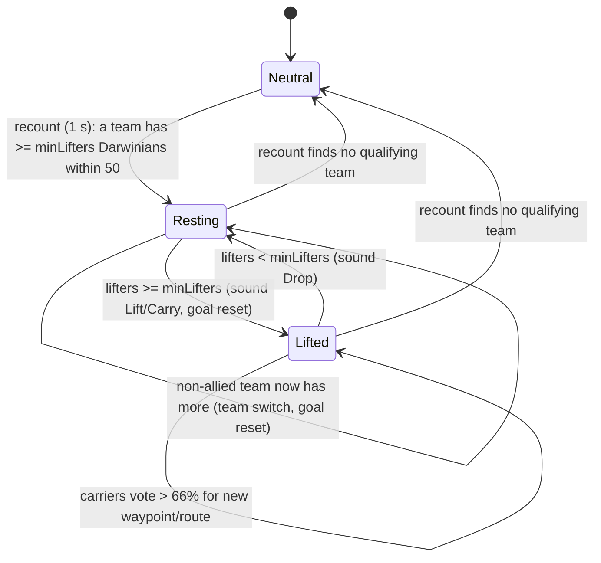

Damage: none at this level (base `Damage`; `HandleCollision` empty) — subclasses define collision damage. [C].

`GetCarryPosition(uniqueId)`: zero vector if the ring is full (`m_numLiftersThisFrame ≥ m_maxLifters`), else a point on the ring at angle `uniqueId × 123.467` rad offset by `vel × 0.5`, on terrain. Hit tests: none in game (ray test only in editor). Always in view. [C].

<!-- from P06_buildings_core -->
## [→ 03_buildings_and_world_objects] ControlTower

Source: `code/worldobject/controltower.{h,cpp}`. Build tag: **[B:FULL]** code, but only placed in Darwinia maps and the GameTypes-none dev maps `mp_sandbox`/`mp_sandbox_all` → effectively **[B:LEGACY]** content in Multiwinia. [C] data; [I] reachability.

| Aspect | Spec | Ref |
|---|---|---|
| Function | remote "reprogramming" console: an Engineer standing at one of 3 reprogrammer slots changes its ownership; full ownership hands the linked building to the Engineer's team | [C] |
| Shape | `controltower.shp` (markers MarkerReprogrammer0–2, MarkerConsole0–2, MarkerLightPos, MarkerDishPos) + static `controltowerdish.shp` aimed at the target building's centre (computed on first Advance); radius forced 4.0 | [C] ctor, `Advance` |
| `m_ownership` | 0..100 (100 = strongly owned). First Advance: 0 if the target building is neutral, else 100 | [C] |
| `Reprogram(team)` (called by `Engineer` each tick while reprogramming) | if `team ≠ owner`: ownership −0.1; at ≤ 0 the tower and the target (if different) switch to `team`. If `team == owner` and ownership < 100: +0.1 (cap 100), target `Reprogram(ownership)`; at 100: sound `ReprogramComplete`, `target->ReprogramComplete()`, `SetTeamId`, research points `GLOBALRESEARCH_POINTS_CONTROLTOWER`, GlobalBuilding online, profile saved → returns true. 0.1 per call ⇒ 1000 calls (≈100 s at one call/tick) from 0 to 100 | [C] `ControlTower::Reprogram`; `code/worldobject/engineer.cpp` |
| Slots | `GetAvailablePosition` → first free slot of 3; `BeginReprogram/EndReprogram(slot)`; sparks while a slot is busy | [C] |
| TrunkPort link | every 2.0 s: if linked to a TrunkPort whose `m_openTimer > 0` and the tower is not team 2, the tower becomes team 2 with ownership 100 (campaign) | [C] |
| Damage | indestructible | [C] |
| Level line | base + `controlBuildingId` (`%6d`); isGlobal must be 1 | [C] `Read/Write`; `level_file.cpp` |
| Rendering | pulsing "control line to heaven" (10 segments, height 50 + id%50 each), brightness 1.0 within 200 of the camera else 0.1 (smoothed); signal flash size `ownership/5` | [C] `RenderAlphas` |

<!-- from P06_buildings_core -->
## [→ 03_buildings_and_world_objects] Incubator

Source: `code/worldobject/incubator.{h,cpp}`. Build tag: **[B:FULL]** code (not blocked; forced global); only placed in Darwinia missions and the dev maps `mp_sandbox*` → effectively **[B:LEGACY]** content. Flow specified in [→ 05] §8.

| Aspect | Spec | Ref |
|---|---|---|
| Shape | `incubator.shp`: MarkerSpirits (store centre), MarkerExit, MarkerDock, MarkerSpiritIncoming0–2, 4 lights | [C] |
| Members | `m_spirits : FastDArray<Spirit>` (step 20), `m_troopType` (= TypeDarwinian), `m_timer` (5.0), `m_incoming` (beam effects), `m_numStartingSpirits` | [C] |
| Ownership | fixed from the level file (no capture code) | [C] |
| Level line | base + `[numStartingSpirits]` (optional; `%6d` on write); isGlobal must be 1 | [C] |
| Damage | indestructible | [C] |

<!-- from P06_buildings_core -->
## [→ 03_buildings_and_world_objects] Portal ("The Beast")

Source: `code/worldobject/portal.{h,cpp}`. Build tag: **[B:FULL]** via the crate reward *The Beast* (`INCLUDE_THEBEAST` defined in `crate.h`); blocked from level files; `SpecialSummon` (Shaman) is **[B:LEGACY]** (Shaman entity is blocked). [C] `code/worldobject/crate.cpp:Crate::RunTheBeast`, `building.cpp:BuildingIsBlocked`.

| Aspect | Spec | Ref |
|---|---|---|
| Creation | `RunTheBeast(pos)`: template at crate position → `CreateBuilding(TypePortal)` → `Initialise` → id `(monsterTeam, UNIT_BUILDINGS, −1, newBuildingId)` → `SetDetail(1)`; message `crate_message_thebeast` | [C] |
| Shape | none (shape line commented out); no collision; ray test = sphere r 13 | [C] |
| Initial state | `SummonStatePortalExpand` (constructor), radius 0 | [C] |
| Damage aura | in every state after Lowering: **every Darwinian within `m_portalRadius`** of the centre is `SetFire()`d each tick | [C] `AdvanceFinalSummon` |
| On death | `Building::Advance` returns true (`m_destroyed`) → `Location::AddBurnPatch(pos, 2 × radius)` | [C] `Portal::Advance` |

| State (enum value) | Duration / exit condition | Actions | Ref |
|---|---|---|---|
| `SummonStateInactive` (0) | — (never advanced) | — | [C] |
| `SummonStateLoweringPortal` (1) | body commented out (never used) | — | [C] |
| `SummonStatePortalExpand` (2) | radius +1.0 per tick until ≥ 100 (10 s) | on exit: `explosionTimer = 45`; spawn **6 Tentacle units × 12 entities** for the monster team, at angles −π/2 + i·2π/6, radius 90 from centre; each tentacle `SetPortalId`, explosion effect | [C] |
| `SummonStateThrash` (3) | 45 s | — | [C] |
| `SummonStateExplode` (4) | 10 s | on exit: `Location::Bang(centre, 200, 255, team)`; `explosionTimer = 1` | [C] |
| `SummonStateCoolDown` (5) | 1 s | full-screen white flash + camera shake (render); then `m_destroyed = true` | [C] |
| `SummonStateFinished` (6) | — | — | [C] |

Rendering uses **unsynced** `rand()`/`frand()` for fire particles (cosmetic only). [C] `Portal::RenderAlphas`.

```mermaid
stateDiagram-v2
    [*] --> PortalExpand : created by The Beast crate
    PortalExpand --> Thrash : radius >= 100 (10 s); spawn 6x12 tentacles
    Thrash --> Explode : 45 s
    Explode --> CoolDown : 10 s, then Bang(200, 255)
    CoolDown --> [*] : 1 s, m_destroyed, burn patch
    note right of PortalExpand : every tick in all states:; Darwinians within radius set on fire
```

<!-- from P06_buildings_core -->
## [→ 03_buildings_and_world_objects] Legacy Darwinia buildings in this partition (ConstructionYard, DisplayScreen, spirit-receiver network, SpiritStore)

All **[B:LEGACY]**: blocked from level files (`Yard`, `DisplayScreen`, `SpiritReceiver`, `ReceiverLink`, `SpiritSpawner`, `SpiritProcessor`) and never created at runtime in Multiwinia [C] `BuildingIsBlocked`, grep of `CreateBuilding(` callers. Documented fully because the code is compiled into the shipped binary.

### ConstructionYard (`Yard`) — tank factory
| Aspect | Spec | Ref |
|---|---|---|
| Shape | `constructionyard.shp` (12 ports, MarkerPrimitive01–09), rungs `constructionyardrung.shp` (MarkerSpike01–06), primitive `mineprimitive1.shp` | [C] ctor |
| Inputs | primitives via `AddPrimitive()` (max `YARD_NUMPRIMITIVES` 9; from mine carts, other partition) and power surges via `AddPowerSurge()` (from PylonEnd) | [C] |
| Online | GlobalBuilding online when any port occupied, ≥ 1 surge and ≥ 1 primitive | [C] `Advance` |
| Build cycle | idle (`m_timer < 0`) → when primitives = 9 and surges > 50: `m_timer = 30`; timer decreases by `fractionPopulated × dt` (12 ports); at ≤ 0: if ≥ 5 Armour already in the *local player's* team specials → retry in 30 s, else spawn 1 `Armour` for **team 2** at MarkerPrimitive06, front (0,0,1), waypoint pos + (0,0,500); primitives = 0, surges = 1 | [C] `Advance`, `IsPopulationLocked` |
| Visuals | rung bobbing ∝ fractionPopulated; glow alpha → `1 − timer/60` while building | [C] |

### DisplayScreen
Cosmetic: `displayscreen.shp` with 3 ray markers projecting light rays onto a slowly rotating ×3-scale `armour.shp` hologram 75 units above the centre. No gameplay. [C] `DisplayScreen::RenderAlphas`.

### ReceiverBuilding family (spirit-receiver network)
| Class | Shape | Behaviour | Ref |
|---|---|---|---|
| `ReceiverBuilding` (base) | — | `m_spiritLink` (next building id; level token `%-8d`), `m_spirits : LList<double>` progress values; each tick progress += **0.8·dt** (1.25 s per link); at ≥ 1 forwards `TriggerSpirit(0)` to the link; `TriggerSpirit` pushes a new spirit at the list front + sound `TriggerSpirit`; spirit beam drawn between `MarkerSpiritLink`s | [C] |
| `SpiritProcessor` | `spiritprocessor.shp` | owns the world's **UnprocessedSpirit** cloud: 150 spawned at Initialise (x,z = FRAND(world size), y = syncfrand(1000)), then one more every 0.2 s at y = 700 + syncfrand(300). Throughput: every 10 s, `n = arrivals × 7`; `throughput = n` if higher else `0.8·t + 0.2·n`; GlobalBuilding online when > 50; objective text `objective_throughput`. Static lookup `ReceiverBuilding::GetSpiritProcessor()` caches the first processor | [C] |
| `ReceiverLink` | `receiverlink.shp` | relay | [C] |
| `ReceiverSpiritSpawner` | `receiverlink.shp` | injects a spirit with probability 0.1 per tick (`syncfrand(10) < 1`) | [C] |
| `SpiritReceiver` | `spiritreceiver.shp` (5 ports, 5 status markers) + `spiritreceiverhead.shp`; orientation follows terrain normal | if any port occupied: every floating UnprocessedSpirit within 200 is pulled (`vel += dir·20·(1 − d/200)·fractionOccupied·dt`, target raised by up to 100 when within 100); captured at < 10 → deleted and `TriggerSpirit(0)` into the network | [C] `SpiritReceiver::Advance` |
| `UnprocessedSpirit` (WorldObject) | — | states Falling (hover y = (−10 − syncfrand(10))·min(1, h/100) until < 15 above ground) → Floating for 30 + syncsfrand(30) s ∈ [15,45) → Death 10 s (fade) → removed; drift: `vel *= 0.9` per tick, hover axes random-walk ±0.5 per tick clamped [0,2]; clamped to the world rectangle | [C] |

### SpiritStore (helper, not a Building)
A box-shaped container of `Spirit` objects: `Initialise(initial, max, pos, sx, sy, sz)` sets capacity (`max`, step `max/2`) and pre-fills `initial` team-0 spirits; `AddSpirit` copies a spirit to a synced-random position within ±0.75·size (syncsfrand(1.5·size)) and sets `StateInStore`, `m_numNearbyEggs = 0`; `RemoveSpirits(n)` removes the first *n*; `Advance` advances each; `Render` draws a translucent `triangleOutline.bmp` box plus the spirits. Only user: the Darwinia `Factory` building (member `m_spiritStore`, initialised with capacity 200 and box half-size 5×10×5 at marker `MarkerSpiritStore`; the factory consumes one stored spirit per produced unit via `RemoveSpirits(1)`) [C] `code/worldobject/factory.cpp:Factory::Factory/Advance`. `Factory` is blocked → **[B:LEGACY]**. [C] `spiritstore.cpp`.

<!-- from P06_buildings_core -->
## [→ 03_buildings_and_world_objects] Consolidated constants table (non-economy)

| Constant | Value | Kind | Ref |
|---|---|---|---|
| Default building radius (no shape) | 13.0 | ctor literal | [C] `Building::Building` |
| Port push-out radius / step | 5.0 / 2.0 | literal | [C] `SetShapePorts`, `PushFromBuilding` |
| Port occupant search radius | 5.0 | literal | [C] `EvaluatePorts` |
| Port counter decay / cap | −4 per tick when empty / 50 | literal | [C] `EvaluatePorts`, `OperatePort` |
| Darwinian port search range | 100 (`DARWINIAN_SEARCHRANGE_PORTS`) beyond building radius | `#define` | [C] `darwinian.h` |
| Port reservation limit | 1 (MP) / 20 (SP) approaching per team | literal | [C] `Darwinian::SearchForPorts` |
| Light flash schedule | team t flashes when `(seq % 10)/2 == t` | literal | [C] `RenderLights` |
| Destroy() | 3 explosions; Bang(intensity, intensity/4); intensity/4 particles | literal | [C] `Building::Destroy` |
| Building blast damage falloff | `damage × (1 − d/(3·range))` within 3·range | literal | [C] `Location::Bang` |
| GunTurret | see GunTurret parameter table | | |
| RadarDish transport period / speed | `RADARDISH_TRANSPORTPERIOD` 0.1 s / `RADARDISH_TRANSPORTSPEED` 50 u/s | `#define` | [C] `radardish.h` |
| RadarDish entry distance | 15 | literal | [C] `Entity::EnterTeleports` |
| RadarDish yaw dead-band / pitch clamp | π/3000 / y ∈ [−0.2, 0.3] | literal | [C] `RadarDish::Advance` |
| RadarDish beam-loss damage | −500 health | literal | [C] `UpdateEntityInTransit` |
| Teleport default send period | 1.0 s | ctor literal | [C] `Teleport::Teleport` |
| JumpPad radius / period | `JUMPPAD_RADIUS` 40 / 0.3 s | `#define` / literal | [C] |
| Power surge speed | 2 segments/s MP (dt×2), 4 SP | literal | [C] `PowerBuilding::Advance` |
| SolarPanel surge probability | fraction/20 per tick | literal | [C] |
| SolarPanel operate thresholds | > 0.6 on, < 0.3 off | literal | [C] |
| Carryable ownership radius / period | 50 / 1.0 s | literal | [C] |
| Carryable speed | 16 × (lifters/max) × speedScale × abs(sin t) | literal | [C] |
| Carryable vote threshold | > 0.66 × lifters | literal | [C] |
| Carryable route waypoint reach | 10 | literal | [C] |
| ControlTower ownership step | ±0.1 per Reprogram call, range 0–100 | literal | [C] |
| ControlTower trunk-port check | 2.0 s | literal | [C] |
| ControlTower radius | 4.0 | literal | [C] |
| Portal | +1 radius/tick to 100; 6 × 12 tentacles; 45 s thrash; 10 s build-up; Bang(200, 255); 1 s cooldown; burn patch 2 × radius | literal / `NUM_TENTACLES` 6 | [C] |
| Incubator | `INCUBATOR_PROCESSTIME` 5.0, `INCUBATOR_PROCESSTIME_MULTIPLAYER` 0.2 | `#define` | [C] |
| ConstructionYard | `YARD_NUMPRIMITIVES` 9, `YARD_NUMRUNGSPIKES` 6, > 50 surges, 30 s build, max 5 armour | `#define` / literal | [C] |
| SolarPanel markers | `SOLARPANEL_NUMGLOWS` 4, `SOLARPANEL_NUMSTATUSMARKERS` 5 | `#define` | [C] |
| SpiritReceiver markers | `SPIRITRECEIVER_NUMSTATUSMARKERS` 5 | `#define` | [C] |
| DisplayScreen rays | `DISPLAYSCREEN_NUMRAYS` 3 | `#define` | [C] |
| ReceiverBuilding spirit speed | 0.8 link/s | literal | [C] |
| SpiritProcessor | 150 initial spirits, +1 per 0.2 s, throughput window 10 s ×7, online > 50 | literal | [C] |
| Generator | throughput EMA 0.8/0.2 per 1 s, online > 6.5 | literal | [C] |

<!-- from P07_buildings_misc -->
## [→ 03_buildings_and_world_objects] Partition summary — classes and build status

| Class | File | Building type enum / name string | Blocked by `BuildingIsBlocked`? | In shipped MP levels (`mp_*`) | Created by MW code | Build tag | Evidence |
|---|---|---|---|---|---|---|---|
| `Tree` | tree.cpp | `TypeTree` / "Tree" | no | 755 lines in 45 maps | yes — `Crate::GenerateTrees`, `Crate::GenerateEvilTrees`, `Tree::CreateAnotherTree` | **[B:FULL]** | census; `code/worldobject/crate.cpp:Crate::GenerateTrees` |
| `LaserFence` | laserfence.cpp | `TypeLaserFence` / "LaserFence" | no | 703 lines in 15 maps | no | **[B:FULL]** | census |
| `Wall` | wall.cpp | `TypeWall` / "Wall" | no | 356 lines in 11 maps | no | **[B:FULL]** | census |
| `StaticShape` | staticshape.cpp | `TypeStaticShape` / "StaticShape" | no | 193 lines in 19 maps | no | **[B:FULL]** | census |
| `RestrictionZone` | restrictionzone.cpp | `TypeRestrictionZone` / "RestrictionZone" | no | 35 lines in 14 maps | no | **[B:FULL]** | census |
| `SmokeMarker` | smokemarker.cpp | `TypeSmokeMarker` / "SmokeMarker" | no | 6 lines in 1 map (`mp_assault_3p_1`) | no | **[B:FULL]** | census |
| `EruptionMarker` | eruptionmarker.cpp | `TypeEruptionMarker` / "EruptionMarker" | no | 1 line in 1 map (`mp_blitzkrieg_3P_2`) | no | **[B:FULL]** | census |
| `CloneLab` | clonelab.cpp | `TypeCloneLab` / "CloneLab" | **no** | 0 (15 lines in 4 `old/` prototype maps) | no | [B:FULL] compiled+loadable, but unused by shipped data → effectively **[B:LEGACY]** (MW prototype) | census of `data/levels/old` |
| `ScriptTrigger` | scripttrigger.cpp | `TypeScriptTrigger` | **yes** | 0 (25 in campaign files) | no | [B:LEGACY] | `BuildingIsBlocked` |
| `FenceSwitch` | switch.cpp | `TypeFenceSwitch` / "FenceSwitch" | **yes** | 0 | no | [B:LEGACY] | `BuildingIsBlocked` |
| `BlueprintStore`, `BlueprintConsole`, `BlueprintRelay` | blueprintstore.cpp | `TypeBlueprintStore/Console/Relay` | **yes** (all three) | 0 | no | [B:LEGACY] | `BuildingIsBlocked` |
| `Bridge` | bridge.cpp | `TypeBridge` | **yes** | 0 | only by `Engineer` (itself legacy) | [B:LEGACY] | `code/worldobject/engineer.cpp` |
| `Cave` | cave.cpp | `TypeCave` | **yes** | 0 | no | [B:LEGACY] | |
| `ChessBase`, `ChessPiece` | chess.cpp | `TypeChessBase` / `TypeChessPiece` | **yes** | 0 (ChessBase ×2 in `old/mp_chess1`) | ChessPiece only by ChessBase | [B:LEGACY] | |
| `Factory` | factory.cpp | `TypeFactory` | **yes** | 0 | no | [B:LEGACY] | |
| `FeedingTube` | feedingtube.cpp | `TypeFeedingTube` | **yes** | 0 | no | [B:LEGACY] | |
| `DynamicBase`, `DynamicHub`, `DynamicNode` | generichub.cpp | `TypeDynamicHub` / `TypeDynamicNode` (DynamicBase is abstract) | **yes** | 0 | no | [B:LEGACY] | |
| `GodDish` (+ creates `Spam`) | goddish.cpp | `TypeGodDish` | **yes** | 0 (1 in `old/mp_temple`) | no | [B:LEGACY] | |
| `Library` | library.cpp | `TypeLibrary` | **yes** | 0 | no | [B:LEGACY] | |
| `TrackLink`, `TrackJunction`, `TrackStart`, `TrackEnd`, `Refinery`, `Mine`, `MineCart` (non-building helper) | mine.cpp | `TypeTrack*`, `TypeRefinery`, `TypeMine` | **yes** (all six building types) | 0 | no | [B:LEGACY] | |
| `Randomiser` | randomiser.cpp | *(not a Building — `WorldObject` effect `EffectRandomiser`)* | n/a | n/a | yes — `Crate::RunRandomiser` (`INCLUDE_CRATES_ADVANCED`, on in FULLGAME) | **[B:FULL]** | `code/worldobject/crate.cpp:Crate::RunRandomiser` |
| `ResearchItem` | researchitem.cpp | `TypeResearchItem` | **yes** | 0 | no | [B:LEGACY] | |
| `SafeArea` | safearea.cpp | `TypeSafeArea` | **yes** | 0 | no | [B:LEGACY] | |
| `UpgradePort`, `PrimaryUpgradePort` | upgrade_port.cpp | `TypeUpgradePort` / "UpgradePort", `TypePrimaryUpgradePort` / "PrimaryUpgrade" | **yes** (both) | 0 (none in any file) | no | [B:LEGACY] | |

Counts: 38 classes in scope — 33 concrete building classes (including `PrimaryUpgradePort`), 4 abstract/helper classes (`BlueprintBuilding`, `DynamicBase`, `MineBuilding`, `MineCart`) and 1 effect (`Randomiser`); 8 live in MW (Tree, LaserFence, Wall, StaticShape, RestrictionZone, SmokeMarker, EruptionMarker, Randomiser), 1 compiled-and-loadable but data-unused (CloneLab), the rest blocked.

Additional non-building / abstract classes defined in scope: `BlueprintBuilding` (abstract base of the three Blueprint classes), `DynamicBase` (abstract base of DynamicHub/Node), `MineBuilding` (abstract base of the track/refinery/mine family), `MineCart` (plain helper struct, not a WorldObject), `Randomiser` (a `WorldObject` effect, not a Building), `PrimaryUpgradePort` (declared in `upgrade_port.h`). `Bridge` derives from `Teleport` (P06), `CloneLab` from `Incubator` (P06), `ChessPiece` from `CarryableBuilding` (P06).

---

<!-- from P07_buildings_misc -->
## [→ 03_buildings_and_world_objects] Tree — procedural flammable spreading scenery [B:FULL]

**Function.** Decorative but gameplay-relevant scenery: blocks movement/projectiles via hit spheres, catches fire, burns down and regrows, sets nearby units on fire, can drop spirits ("magic" trees), can spread new trees, and in its *evil* variant kills Darwinians and corrupts nearby trees. Trees are the most numerous *visible* building in Multiwinia maps (755 level lines in 45 of 57 `mp_*` files; only the invisible `AITarget`, 1112 lines, is more numerous) [C] census. They are also created at runtime by the Dark Forest crate outcomes (`Crate::GenerateTrees`, `Crate::GenerateEvilTrees`) [C] `code/worldobject/crate.cpp`, and by tree self-propagation (`Tree::CreateAnotherTree`) [C].

**Ownership.** Always neutral in practice. Level lines use team 255 (704 lines) or team slot 1 (51 lines in `mp_domination_4P_2`, `mp_koth_4P_3`, `mp_skirmish_2p_4`, `mp_sandbox_all`) [C] census; the team id has no effect on any tree logic [C] (no `m_id.GetTeamId()` read in `code/worldobject/tree.cpp`). Runtime-created trees use team 255 [C] `Tree::CreateAnotherTree`. Not capturable, no ports.

### Level-file parameters (fields after the 7 base fields) [C] `code/worldobject/tree.cpp:Tree::Read`, `Tree::Write`

| # | Field | Type | Default (ctor) | Meaning | Observed in `mp_*` (755 lines) |
|---|---|---|---|---|---|
| 8 | height | float | 50.0 | World-unit scale of the whole tree (the generated tree is unit-height) | 43.54 … 272.65 |
| 9 | budsize | float | 1.0 | Width multiplier of the **leaf** quads only (branch quads use width factor 0.1, leaves 0.1×budsize) | 0 … 43.97 (most common 1.00, 3.00, 0.00, 10.00) |
| 10 | pushOut | float | 1.0 | Sideways reach of child branches | 0.34 … 1.31 |
| 11 | pushUp | float | 1.0 | Upward reach of child branches | 0.43 … 1.32 |
| 12 | iterations | int | 6 | Recursion depth N (trunk = level 1, leaves = level N) | 4 (24), 5 (165), 6 (516), 7 (50) |
| 13 | seed | int | 0 | Seed of the generation RNG | 0 … 99992 |
| 14 | branchColour | int (signed 32-bit, written `%-12d`) | 0xffffffff | Packed RGBA, **R in the low byte**: R=v&0xFF, G=(v>>8)&0xFF, B=(v>>16)&0xFF, A=(v>>24)&0xFF (`intToArray`) | 33 distinct, e.g. -1 = (255,255,255,255) |
| 15 | leafColour | int | 0xffffffff | Same packing | 39 distinct |
| 16 | leafDropRate | int, optional | 0 | 0 = off; otherwise visual leaf-particle rate (see below), editor range 0..50 | 0 (737), 35 (18) |
| 17 | spiritDropRate | int, optional (read only if 16 present) | 0 | 0 = off; >0 = "magic tree" that spawns spirits (synced), editor range 0..50 | always 0 in `mp_*` |
| 18 | evil | int, optional (read only if 17 present); `==1` → true | 0 | Evil tree (see evil logic) | 1 on 127 lines (all of `mp_cts_3P_2` ×45, `mp_cts_4P_2` ×59, `mp_tankbattle_4P` ×23 — all with colours -1/-1) |

Parsing quirk: fields 16–18 are read only while `TokenAvailable()`, each nested inside the previous, so a line may stop after 15, 16 or 17 [C] `Tree::Read`. Editor ranges (editor build only, [B:EDITOR]): height 1–1000 step 1; budsize 0–50 step 0.05; pushUp/pushOut 0–5 step 0.01; iterations 1–10; seed 0–99999; leafDrop/spiritDrop 0–50; evil 0–1 [C] `code/interface/tree_window.cpp:TreeWindow::Create`.

Runtime-only state (not in level files): `m_onFire` (burn/regrow phase, see state machine), `m_fireDamage` (ignition accumulator), `m_spawnsRemaining` (propagation budget), `m_spawnTimer`, `m_destroyable`, `m_corruptCheckTimer` (initial 5.0), `m_corrupted`, `m_renderCorruptShadow`, `m_burnSoundPlaying`, hit-check `m_hitcheckCentre` (unit space) / `m_hitcheckRadius` / `m_numLeafs`, display-list ids [C] `code/worldobject/tree.h`.

### Procedural generation algorithm (exact) [C] `Tree::Generate`, `Tree::GenerateBranches`, `Tree::GenerateLeaves`, `Tree::RenderBranch`

The tree is generated **once in unit space** (trunk from (0,0,0) to (0,1,0)); `height` is applied only as a uniform scale at render/hit-test time, so `height` does not change the shape. The RNG is the non-synced application LCG, re-seeded with the tree's seed at the start of every pass, so each pass reproduces identical geometry:

```
RNG (AppSeedRandom / AppRandom, code/../contrib/systemiv/lib/math/random_number.cpp):
  state : 32-bit signed long on Win32, wraps modulo 2^32 (portable form: uint32 s; s = s*214013u + 2531011u; return (s >> 16) & 0x7FFF)
  seed(s):  state = s
  next():   state = state*214013 + 2531011 ; return (state >> 16) & 0x7FFF      // 0..32767
  frand(r): r * next() / 32767.0                                              // 0..r inclusive

Branch(from, to, n, pass):
  if n == 0: return
  n = n - 1
  if n == 0 (this segment is a LEAF):
      if pass == RADIUS: hitR = max(hitR, |to - hitC|)
      elif pass == LEAF:  hitC += to ; numLeafs += 1
  d   = to - from
  A   = normalise(d × to)            // normalise(v): if |v|^2 <= 1e-10 → (0,0,1)
  B   = normalise(A × d)
  len = |d|
  w   = 0.1 * (n == 0 ? budsize : 1.0)
  if (n == 0 and pass == LEAF) or (n != 0 and pass == BRANCH):
      emit quad  [from - A*len*w uv(0,0)], [from + A*len*w uv(0,1)], [to + A*len*w uv(1,1)], [to - A*len*w uv(1,0)]
      emit quad  same with B                         // two crossed planes per segment
  for i in 0..3:                                     // ALWAYS 4 children, even below a leaf
      dir   = [A, -A, B, -B][i]
      t     = 0.3 + frand(0.6)                       // consumes 1 RNG draw per child
      cFrom = from + d*t
      cTo   = cFrom + dir*len*0.4*pushOut + d*(1 - t)*pushUp
      Branch(cFrom, cTo, n, pass)                    // with n==0 this returns immediately

Generate():
  hitC = 0; hitR = 0; numLeafs = 0
  unpack colours; (optional leaf-alpha boost, see rendering)
  seed(seed); BRANCH pass → compiled into display list 1   (GL_QUADS)
  seed(seed); LEAF pass   → compiled into display list 2   (GL_QUADS; accumulates hitC)
  hitC = hitC / numLeafs
  seed(seed); RADIUS pass (no geometry)
  hitR = hitR * 0.8
```

Derived quantities for depth N: segments at recursion level k (k = 0 trunk … N−1 leaves) = 4^k; leaf segments = 4^(N−1) (N=6 → 1024 leaves); branch segments = (4^(N−1) − 1)/3 (N=6 → 341); quads = 2 per segment; RNG draws per pass = 4 × total segments. For the trunk, d × to = (0,1,0)×(0,1,0) = 0 so A = (0,0,1) and B = A × d = (−1,0,0) [C] `code/lib/vector3.h:Vector3::Normalise`. The leaf-centroid/radius are computed *inside the display-list compile callbacks*, i.e. the simulation's hit volume is a by-product of render-list compilation; `Resource::CreateDisplayListAsync` executes the callback synchronously on the main thread, or queues it to the loading-screen thread and blocks until done [C] `code/lib/resource.cpp:Resource::CreateDisplayListAsync`.

After generation, `Tree::SetDetail(1)` sets `m_centrePos = m_pos + hitC*m_height` and `m_radius = hitR*m_height*1.5` [C] `Tree::SetDetail`. `SetDetail` asserts `_detail == 1` because any other value changes the iteration count (`iterations -= detail-1`, min 3) and hence centre/radius, which "causes a sync error" (source comment) [C].

### Hit volumes [C] `Tree::DoesSphereHit`, `Tree::DoesShapeHit`, `Tree::DoesRayHit`

Two spheres, using the **current** (burnt) height `hA = GetActualHeight(0)`:
1. Trunk sphere: centre `m_pos`, radius 10.0 (constant, independent of height).
2. Crown sphere: centre `m_pos + hitC*hA`, radius `hitR*hA`.

A sphere/shape/ray hits the tree if it hits either sphere. `IsInView` uses sphere (`m_pos`, `m_height`) [C] `Tree::IsInView`. Quirk [I]: rendering rotates the tree by `m_front` (local X→`up×front`, local Z→`front`, `code/lib/matrix34.h:Matrix34(f,u,pos)`) while `hitC` is applied unrotated, so the crown sphere is slightly offset from the drawn crown for non-default facings; the error is small because the 4-way branching is near-symmetric about the trunk.

### Fire, burn-down and regrowth

`GetActualHeight(p) = m_height * (1 − |m_onFire'|)`, clamped to ≥ `0.01*m_height`, where `m_onFire'` = `m_onFire` plus `p*regrow` when regrowing (render prediction only) [C] `Tree::GetActualHeight`.

| Constant | Value | Unit | Kind | Evidence |
|---|---|---|---|---|
| Ignition threshold on `m_fireDamage` | > 50.0 | damage units | literal | `Tree::Damage` |
| `m_fireDamage` decay | −1.0 per second (−`SERVER_ADVANCE_PERIOD` per tick), clamped to [0,100] | /s | literal | `Tree::Advance` |
| Initial `m_onFire` on ignition from healthy | 0.01 | phase | literal | `Tree::Damage` |
| Burn progression | +0.02 per second | phase/s | literal | `Tree::Advance` |
| Full burn duration from ignition | (1.0−0.01)/0.02 = 49.5 s | s | derived | |
| Regrow rate single-player | +0.01 per second (100 s from stump) | phase/s | literal | `Tree::Advance`, `GetActualHeight` |
| Regrow rate multiplayer (`g_app->Multiplayer()`) | +0.05 per second (20 s from stump) | phase/s | literal | same |
| Ignite-others radius test | `ourH*ourHitR*1.5 + theirH*theirHitR*1.5 ≥ distance` (H = actual heights) | world units | formula | `Tree::Advance` |
| Damage applied to neighbour trees | `Damage(-1.0)` per tick per burning neighbour | | literal | same |
| AntHill ignition test | `ourH*ourHitR*1.5 + 100 ≥ distance` → `AntHill::Burn()` | | literal | same |
| Unit burn radius | `actualHeight/2` (also `GetBurnRange()`) | world units | formula | `Tree::Advance`, `Tree::GetBurnRange` |
| Unit burn effect | Darwinian → `SetFire()`; any other entity → `ChangeHealth(-1, DamageTypeFire)` per tick (all teams) | | literal | `Tree::Advance` |

`Tree::Damage(d)` (fire damage is passed as a **negative** number): call `Building::Damage` (plays "Damage" sound event); if `m_fireDamage < 50`: `m_fireDamage += −d`; if it now exceeds 50: if `m_onFire == 0` → `m_onFire = 0.01`; else if `m_onFire < 0` (regrowing) → `m_onFire = −m_onFire` (resumes burning at the same height); start "Burn" sound once [C] `Tree::Damage`. A tree that is already burning (`m_onFire > 0`) is unaffected. Neighbour spread therefore needs > 50 net damage: at +1/tick against −0.1/tick decay, ≈ 56 ticks ≈ 5.6 s of continuous contact [I] (arithmetic).

External ignition sources (other partitions): Darwinians under the Hot Feet powerup touching the tree (`Darwinian::AdvanceHotFeet`, called while `m_hotFeetTaskId != -1`; sphere radius 2, `Damage(-1)` per tick); `Lightning::Advance` (`Damage(-100)` for trees in its obstruction cell); `Fireball::Advance` (`Damage(-100)`); `FlameGrenade::Advance` (`Damage(m_power*-4)` within `m_power*2`); the Extinguisher crate outcome flips burning trees to regrowing (`SetFireAmount(-GetFireAmount())` within `POWERUP_EFFECT_RANGE*2 = 140`); `TurretShell` hits deal `Damage(-2)` [C] `code/worldobject/darwinian.cpp:Darwinian::AdvanceHotFeet`, `code/worldobject/lightning.cpp:Lightning::Advance`, `code/worldobject/weapons.cpp:Fireball::Advance`, `FlameGrenade::Advance`, `TurretShell::Advance`, `code/worldobject/crate.cpp:Crate::RunExtinguisher`, `code/taskmanager.h:POWERUP_EFFECT_RANGE`. Darwinians flee burning trees within `2*GetBurnRange()` [C] `code/worldobject/darwinian.cpp:Darwinian::SearchForThreats`.

End of burn (`m_onFire` exceeds 1.0): set `m_onFire = −1.0` (stump, height 1%); if `m_corrupted && m_evil` → both cleared (fire cleanses a corrupted tree); if `m_destroyable` → stop burn sound and return true from `Advance` (the building is removed) [C] `Tree::Advance`. Level-placed trees are never destroyable (`m_destroyable` defaults false and is not in the level format); only crate-created trees (and their offspring, via `Clone`) are [C] `code/worldobject/crate.cpp:Crate::GenerateTrees`.

### Healthy-phase behaviours (only while −0.3 < `m_onFire` ≤ 0, i.e. ≥ 70% regrown and not burning) [C] `Tree::Advance`

1. **Leaf drop (visual, unsynced):** if `leafDropRate > 0` and `rand() % (51 − leafDropRate) == 0` (CRT `rand`): one `Particle::TypeLeaf` at `m_pos + (0,h,0) + (sfrand(h), sfrand(h/4), sfrand(h))` coloured with the leaf RGB. (`sfrand(r)` returns [−r/2, r/2].)
2. **Spirit drop (synced, "magic tree"):** if `!evil && spiritDropRate > 0` and `syncrand() % (51 − spiritDropRate) == 0`: position = `(syncfrand(h), h, 0)` rotated about Y by `syncfrand(2π)` plus `m_pos`; team = `int(syncfrand(6))` re-drawn until it is not −1, not the monster team and not the Futurewinian team; `Location::SpawnSpirit(pos, 0, team, none)`. Per-tick probability = 1/(51 − rate) (rate 15 → 1/36 per tick ≈ 0.28 spirits/s).
3. **Propagation:** if `m_spawnsRemaining > 0`: if `m_spawnTimer < 0` → `m_spawnTimer = now + 5 + syncfrand(5)`; else when `now ≥ m_spawnTimer` → `--m_spawnsRemaining`, `m_spawnTimer = −1`, `CreateAnotherTree()`.

`CreateAnotherTree()` [C] `Tree::CreateAnotherTree`, `PushFromObstructions`:
1. Centroid of all *other* trees within 100 units.
2. `fullH = GetActualHeight(0)`; `range = fullH + syncfrand(fullH)` (drawn unconditionally).
3. If any neighbour: offset = `(m_pos − centroid)` set to length `fullH`, rotated about Y by `syncsfrand(π/4)` (±π/8); else offset = `(range,0,0)` rotated about Y by `syncfrand(2π)`.
4. `PushFromObstructions`: for each building in the obstruction-grid cell, while the building's `DoesSphereHit(pos, 1.0)` is true move `pos` by 2.0 units directly away from the building's `m_pos`. Then resample Y; **abort if Y < 0** (underwater).
5. Create a Tree (team 255, new global building id), `Clone` this tree's parameters (height, budsize, pushOut, pushUp, iterations, seed, colours, leafDrop, spawnsRemaining (already decremented), destroyable, spiritDrop, evil), `Initialise`, then seed = `int(syncfrand(99999))`, height = `(height*0.75)*(1 + syncsfrand(0.2))` (×0.65…0.85, evaluated through `volatile` temporaries for bit-exact ordering), `SetFireAmount(−1)` (starts as a stump and regrows, without burning anything), `SetDetail(1)`, and recompute the whole obstruction grid.

### Evil trees and corruption [C] `Tree::Advance`

- **Kill aura:** each tick, with probability `syncfrand(10) < 0.2` (2% per tick): `GetBestEnemy(pos, range = actualHeight/2, team = monster team)`; if that is a Darwinian not in `StateOperatingPort`, `ChangeHealth(−999)`; if this killed it, its spirit is removed from `m_spirits` and a `Zombie` effect is spawned at its position (`vel.y = 20 + syncfrand(25)`, up-vector tilted by `syncsfrand(1)` about its front) [C]. Evil trees never drop spirits.
- **Corrupting:** only when fully grown (`GetActualHeight(0) == m_height`, i.e. `m_onFire == 0`): `m_corruptCheckTimer` counts down; at ≤ 0 it resets to `10 + syncfrand(5)` and the **first** tree (building-array order) that is not evil, not corrupted and within `actualHeight` units becomes corrupted: `spiritDropRate = 0`, `m_corruptCheckTimer = −10`, `m_corrupted = true` (one victim per check).
- **Becoming evil:** a non-evil tree with `m_corruptCheckTimer < 0` adds dt each tick; when it passes 0 the timer resets to 5 and `m_evil = true` (10 s after corruption).

### State machine

```mermaid
stateDiagram-v2
    [*] --> Healthy : level load (m_onFire=0)
    [*] --> Regrowing : runtime-created (SetFireAmount(-1))
    Healthy --> Burning : fireDamage > 50 (m_onFire=0.01)
    Burning --> Removed : m_onFire > 1 and destroyable
    Burning --> Stump : m_onFire > 1 (m_onFire=-1; corrupted+evil → cleansed)
    Stump --> Regrowing : each tick m_onFire += dt*regrow
    Regrowing --> Burning : fireDamage > 50 (m_onFire = -m_onFire)
    Burning --> Regrowing : extinguish crate (m_onFire = -m_onFire)
    Regrowing --> Healthy : m_onFire reaches 0
    note right of Healthy
      leaf drop / spirit drop / propagation
      run while -0.3 < m_onFire <= 0
    end note
```

Orthogonal corruption sub-state: `Normal → Corrupted (timer=-10) → Evil (after 10 s) → [burn-out] → Normal`; level-placed `evil=1` trees start in Evil and are only "cleansed" by burning if they were also `m_corrupted` (level evil trees are not, so they stay evil) [C].

### Sound events [C] `Tree::ListSoundEvents`, `Tree::Initialise`
`CreateNormal`, `CreateEvil`, `CreateMagic` (chosen in `Initialise`: evil → CreateEvil, spiritDropRate>0 → CreateMagic, else CreateNormal), `Burn` (looping; stopped with `StopAllSounds(id, "Tree Burn")`), plus base `Create`, `Damage`.

### Determinism notes (→ 22) [C]/[I]
- Geometry RNG is the **unsynced** global LCG (`AppSeedRandom`/`AppRandom`); it is deterministic because every pass reseeds it with the tree seed, but any other `frand()` consumer (fire particles in `Tree::Advance`, leaf drop uses CRT `rand()`) shares that global state — harmless only because generation reseeds first [I].
- The simulation-relevant crown sphere is derived from the generated geometry using `iv_sqrt`-based `Normalise`/`Mag` in double precision; a reimplementation must reproduce the generator bit-exactly on all peers or treat the hit sphere as data [I].
- Synced draws: spirit drop, team choice, spawn timer, propagation offsets, offspring seed/height, evil kill roll, Zombie launch, corruption timer. Offspring-height computation is deliberately written with `volatile` temporaries to fix evaluation order (source comment) [C].
- `RenderTreeDetail` / `RenderBuildingDetail` prefs alter only visuals; the code forbids `SetDetail != 1` to protect sync [C].

### Rendering (→ 24_rendering) [C] `Tree::RenderAlphas`, `Tree::Render`
- `Render` draws nothing; all drawing is in the alpha pass (`PerformDepthSort` returns true with sort centre `m_pos + hitC*m_height`).
- State: `GL_TEXTURE_2D` on, texture `textures/tree.bmp` (loaded with alpha), MAG `GL_LINEAR`, MIN `GL_LINEAR_MIPMAP_LINEAR`; blend `SRC_ALPHA, ONE` (additive); cull off; depth write off. Transform = `Matrix34(m_front, up, m_pos)` × uniform scale `actualHeight`. Draw branch list with branch colour, then (unless Christmas mod or evil) the leaf list with leaf colour. Restore: depth write on, cull on, blend `SRC_ALPHA, ONE_MINUS_SRC_ALPHA`, texture off, blend off.
- Sway: `actualHeight *= 1 + sin((realTime + uniqueId*2)*2) * 0.003` (evil: amplitude 0.01) — a breathing scale, not per-branch animation (a per-branch wobble is commented out).
- Magic tree (spiritDropRate>0): leaf blue channel pulses `B = B*f + 255*(1−f)`, `f = |sin(realTime + uniqueId*10)|`.
- Evil: branch colour (0,0,0,200), leaves hidden, normal alpha blend (dark silhouette).
- Corrupting (timer ≤ 0, not yet evil): rendered **twice** in one call — pass A darkens branch RGB and alpha by `factor = (10 + timer + prediction)/10`, leaf alpha ×(1−factor); pass B (recursive call) draws the black silhouette with branch alpha `200*factor`.
- Burning: alpha blend; branch RGB scaled towards black by `min(m_onFire*10, 1)`, branch alpha 255; leaves black with alpha ×(1−m_onFire); plus 4 camera-facing billboards of `textures/starburst.bmp` with depth test off, colour (0.8,0.2,0.1, 0.5*actualH/height), centre `m_pos + (sin(2g+i)*i*1.7, 0.8*actualH + cos(2g+i), cos(2g+i)*i*1.7)` with g = game time, half-size `max(2*actualH, 5)`.
- Regrowing: leaves invisible while |m_onFire| > 0.5, else alpha ×(1 − 2|m_onFire|).
- Christmas mod (`Location::ChristmasModEnabled`): branches (180,100,50), no leaves.
- `RenderTreeDetail` pref (default 1, not exposed in the graphics options UI): if > 1, leaf alpha ×1.3^detail (capped 255) at generation. Fire particle count per tick = `int(actualHeight/12) / RenderBuildingDetail`.
- Fire particles (`Particle::TypeFire`, unsynced `frand`): per tick, count above; position radius `frand(0.6h)`, height `0.7h + 0.3*frand(h)`, random yaw; size `2h*(1+sfrand(0.5))`.
- D3D path [B:D3D]: the colour is baked into the display list (`glColor4ubv` inside `GenerateBranches/GenerateLeaves`), so runtime colour changes do not apply under D3D except via the global colour [C] (`#ifdef USE_DIRECT3D` in `Tree::GenerateBranches`).
- `Location::FlushOpenGlState` deletes all tree display lists (e.g. on video-mode change); they are regenerated lazily on the next `RenderAlphas` [C] `code/location.cpp:Location::FlushOpenGlState`.
- Debug: `RenderHitCheck` draws both hit spheres under `DEBUG_RENDER_ENABLED` (call commented out in `Render`).

---

<!-- from P07_buildings_misc -->
## [→ 03_buildings_and_world_objects] LaserFence — linked energy barrier [B:FULL]

**Function.** A post (shape `laserfence.shp`) that, when raised, projects an energy curtain to the **next** fence post named by its link id. Chains of posts form barrier lines. Enemy units touching a raised curtain are killed (generic entities) or set on fire (Darwinians); raised curtains also block walking routes and AI routing. 703 lines in 15 `mp_*` maps (Assault: `mp_assault_2P_2`, `2p_3`, `3P_2`, `3p_1`, `4P_1`, `4P_2`, `stress`; Blitzkrieg: `mp_blitzkrieg_2P_3`, `2p_1`, `3P_1`, `3P_2`, `4P_2`; plus `mp_domination_2P_1`, `mp_rocketriot_2p_3`, `mp_skirmish_3P_1`) [C] census.

### Level-file parameters [C] `code/worldobject/laserfence.cpp:LaserFence::Read`, `LaserFence::Write`

| # | Field | Type | Default | Meaning | Observed in `mp_*` (703 lines) |
|---|---|---|---|---|---|
| 8 | nextLaserFenceId | int | −1 | Building id of the next post in the chain (−1 = end of chain, no curtain from this post) | 36 lines with −1 |
| 9 | scale | float, optional | 1.0 | Uniform scale of the post shape and therefore of curtain height | 0.30 … 2.50 (1.00 ×252, 2.00 ×137, 1.50 ×124) |
| 10 | mode | read with `iv_atof`, stored as int, optional | 0 (`ModeDisabled`) | Initial mode (enum below) | 0 ×20, 2 ×658, 4 ×2, 5 ×23 |

Team ids in use: slots 0 (288), 1 (154), 2 (77), 3 (43) and 255 (141); `isGlobal` always 0 [C] census. Write format: `%-8d %-6.2f %d` [C].

### Modes [C] `code/worldobject/laserfence.h` enum

| Value | Name | Meaning |
|---|---|---|
| 0 | `ModeDisabled` | Down (status 0). Responds to `Enable`. |
| 1 | `ModeEnabling` | Rising at `LASERFENCE_RAISESPEED` |
| 2 | `ModeEnabled` | Up (status 1) |
| 3 | `ModeDisabling` | Falling |
| 4 | `ModeNeverOn` | Never raises; acts as a **relay**: `Enable()`/`Disable()` are forwarded immediately to the next fence. No curtain is drawn or tested (status stays 0). Sparks still fire. |
| 5 | `ModeAlwaysOn` | Permanently up; `Enable`/`Disable`/`Toggle` and solar loss have no effect. |

`IsEnabled()` = mode ∈ {Enabled, Enabling, AlwaysOn} [C].

### Constants

| Name | Value | Unit | Kind | Evidence |
|---|---|---|---|---|
| `LASERFENCE_RAISESPEED` | 0.3 | status per second (full raise/lower = 3.33 s) | `#define` | `laserfence.h` |
| Chain hand-off threshold | status 0.5 (≈1.67 s into a transition) | | literal | `LaserFence::Advance` |
| Spark interval | first `syncfrand(10)` s after `Initialise`, then `8 + syncfrand(4)` s; only while mode ≠ Disabled | s | literal | `Initialise`, `Advance` |
| Solar power timeout | 5.0 s since last `ProvidePower()` | s | literal | `Advance` |
| Curtain full height | `markerFence02.y − markerFence01.y` of the scaled shape = 48.28 × scale (shape data) | world units | data | `GetFenceFullHeight`, `data/shapes/laserfence.shp` markers `MarkerFence01` (0.37,0,−0.30) / `MarkerFence02` (0.37,48.28,−0.30) |
| Curtain below-ground skirt | height/3 below each post's base | | literal | `RenderAlphas`, `DoesRayHit` |
| Curtain alpha | 150 / 255 | | literal | `RenderAlphas` |

### Advance (per tick) [C] `LaserFence::Advance`
1. First tick after `SetDetail`: if the link resolves, `m_centrePos = midpoint(this, next)`, `m_radius = |next − this|/2 + m_radius` (enlarged for visibility/obstruction purposes).
2. Spark timer (see constants) → `Spark()` (unsynced `frand` particles of `Particle::TypeSpark`, 5–10 sparks of size 25–50 flung perpendicular to the curtain at 40–60 units/s, plus sound "Spark").
3. Solar mode (`m_solarMode`, set by `ProvidePower`): if `now − m_surgeReceived > 5` and (enabled or NeverOn) → `Disable()`; else if not enabled → `Enable()`.
4. Mode machine: Enabling: `status += 0.3*dt`; when status ≥ 0.5 and link set and not yet toggled → `next->Enable()` once; at ≥ 1 → status 1, `ModeEnabled`. Disabling: when status ≤ 0.5 (checked **before** decrement) → `next->Disable()` once; `status −= 0.3*dt`; at ≤ 0 → 0, `ModeDisabled`. Enabled/AlwaysOn: force status 1. Disabled: force 0. NeverOn: no change.
5. `Building::Advance` (port evaluation; fences have no ports).

`Enable()`: if mode ∉ {Enabled, NeverOn, AlwaysOn} → Enabling; if NeverOn → forward `Enable()` to next; reset `m_nextToggled`. `Disable()` symmetrical. `Toggle()`: Disabled/Disabling → Enable; Enabled/Enabling → Disable; resets `m_nextToggled` [C].

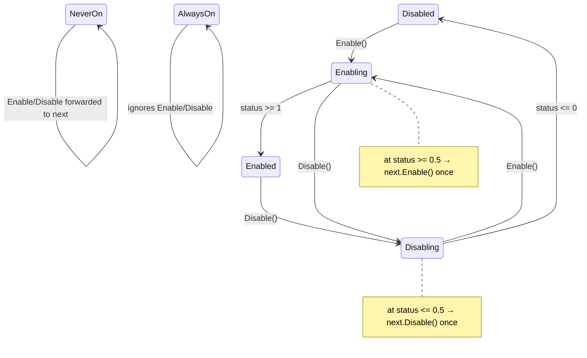

### Who switches fences in Multiwinia [C]
- **Solar power** is the only live runtime controller: `PylonEnd::TriggerSurge` calls `ProvidePower()` on its linked fence if `IsFriend(surgeTeam, fenceTeam)` [C] `code/worldobject/generator.cpp:PylonEnd::TriggerSurge`. `ProvidePower` sets `m_solarMode = true`, stamps `m_surgeReceived = now`, and (if not already) `SetSolarLinked()`, which marks this fence and, recursively along `nextLaserFenceId`, every downstream fence `m_solarLinked = true` (stops at AlwaysOn fences or already-linked fences). Solar-linked fences render with the pulsing solar style; only the directly powered fence runs the 5-s timeout, the rest follow via chain hand-off. Because `IsFriend(255, x)` is always false [C] `code/location.cpp:Location::IsFriend`, neutral (team 255) fences can never be solar-powered.
- `FenceSwitch` (blocked, [B:LEGACY]) and `Powerstation` (blocked) also call `Enable/Disable` — unreachable in MW.
- Network command `NET_DARWINIA_TOGGLELASERFENCE` ("cg") is handled by `ClientToServer::ProcessServerUpdates` (`Toggle()`), but its sender `ClientToServer::RequestToggleFence` has **no callers** [C] (grep) → dead in MW.

### Damage to crossing entities (implemented by the entities, not the fence) [C]
- Generic entities: `Entity::PushFromObstructions(pos, killem)` — if the entity's shape/sphere(1.0)/swept ray hits an enabled fence whose team is not a friend → `ChangeHealth(−9999)` and `fence->Electrocute(pos)` (plays "Electrocute"); otherwise ordinary push-out [C] `code/worldobject/entity.cpp:Entity::PushFromObstructions`.
- Darwinians: `Darwinian::PushFromObstructions` — enabled, non-friendly fence: if `DoesSphereHit(m_pos, 1.0)` and `killem` → `SetFire()` + `Electrocute`; else if within `closest = 5 + uniqueId % 10` → pushed out perpendicular to the curtain in 20-unit steps [C] `code/worldobject/darwinian.cpp:Darwinian::PushFromObstructions`.
- Routing: `Location::GetWalkingDistance` returns −1 and `Location::IsWalkable` reports the fence id for any **enabled** fence on the path (any team) [C] `code/location.cpp`; AI target graph skips neighbours behind enabled non-friendly fences [C] `code/worldobject/ai.cpp`; `Armour::IsRouteClear` refuses routes through enabled enemy fences [C] `code/worldobject/armour.cpp`.
- The fence itself takes no damage and cannot be destroyed or captured (no `Damage` override; team never changes) [C].

### Hit tests [C] `LaserFence::DoesSphereHit`, `DoesRayHit`, `DoesShapeHit`
- Disabled (or editing): post shape only (scaled `laserfence.shp`).
- Otherwise `DoesRayHit`: if link set and status > 0 → two triangles (pos1,pos2,pos4) and (pos4,pos3,pos1) where pos1/2 = this post base −h/3 / +h, pos3/4 = next post base −h/3 / +h, **h = this fence's full height × status** (the next post's own height is ignored for collision but used for rendering); normal = (pos1−pos3)×(pos1−pos2) normalised. Falls back to the post shape.
- `DoesSphereHit` approximates the sphere by two rays of length 2r through its centre along +X and +Z, then the post shape. `DoesShapeHit` = `DoesSphereHit(transform.pos, shape root radius)`.

### Obstruction grid (→ 21) [C] `code/obstruction_grid.cpp:ObstructionGrid::CalculateBuildingArea`
Fences with a link are rasterised into every cell along the segment to the next post (sample count = segment length + 1), with extra 4-neighbour cells added when consecutive samples jump diagonally, to avoid leaks.

### Rendering (→ 24_rendering) [C] `LaserFence::Render`, `LaserFence::RenderAlphas`
- Post: `laserfence.shp` with the transform scaled uniformly by `scale`, `GL_NORMALIZE` enabled during the draw.
- Curtain (alpha pass; only if mode ∉ {Disabled, NeverOn} and link valid): cull off, blend `SRC_ALPHA, ONE_MINUS_SRC_ALPHA`, depth write off. Colour: team 255 → (100,100,100,150); solar → lerp((20,20,20), 0.9×team colour, |sin(4×realTime)|), alpha 150; otherwise team colour, alpha 150. Predicted status = status ± 0.3×predictionTime (editor: 1). Quad corners: BL = this −(0,h/3,0), TL = this + (0,h,0), TR = next + (0,h',0), BR = next − (0,h'/3,0) with h, h' = each post's full height × predicted status.
- If `RenderBuildingDetail < 3`: two-texture pass — unit 0 `textures/laserfence.bmp` (combine REPLACE), unit 1 `textures/laserfence2.bmp` (combine MODULATE), both REPEAT + trilinear; unit-0 UV s ∈ [timeOff, timeOff + dx], t ∈ [0, dz] with `dx = distance/(2·fullHeight)`, `dz = status`, `timeOff = gameTime/15` (scrolling); unit-1 UV s ∈ [0,1], t ∈ [texY, texY+texH]. Solar: `texY = gameTime/1.5`, `texH = 7`, `timeOff = 0`, and unit 1 also uses `laserfence.bmp`.
- Always: additive overlay (`SRC_ALPHA, ONE`) of `textures/laserfence2.bmp` with UV s ∈ [0,1], t ∈ [texY, texY+texH] ("burn effect").
- A smoothed `GL_LINES` edge from TL to TR, width 2.0 (0.5 solar).
- `PerformDepthSort`: sorted at `m_centrePos` when not disabled and linked. `IsInView` returns true during the game's grace period. `RenderLights` empty (no ownership lights).
- Render-side mutation [C]: `RenderAlphas` resets `m_nextLaserFenceId = −1` if the link no longer resolves to a LaserFence — a sim-state write from the render path (determinism hazard only for invalid links) [I].

### Sound events [C] `LaserFence::ListSoundEvents`
`Spark`, `Electrocute` (+ base).

### Determinism (→ 22)
Synced: spark timer. Unsynced/visual: spark particles (`frand`). The solar timeout uses `GetNetworkTime()` (game time) [C].

---

<!-- from P07_buildings_misc -->
## [→ 03_buildings_and_world_objects] Wall — destructible barrier segment [B:FULL]

**Function.** A straight wall segment (shape `wall.shp`) that blocks movement and line-of-fire; destroyed by a single heavy hit. Used mainly by Assault maps (attackers break through with the WallBuster, P06/P04) and a few others: 356 lines in 11 `mp_*` maps (`mp_assault_2P_1` 78, `mp_assault_2P_2` 14, `mp_assault_2p_3` 20, `mp_assault_3P_2` 29, `mp_assault_3p_1` 94, `mp_assault_3p_3` 25, `mp_assault_4P_2` 34, `mp_assault_stress` 30, `mp_blitzkrieg_2p_2` 17, `mp_koth_3P_4` 12, `mp_sandbox` 3); always team 255 [C] census.

### Level-file parameters [C] `code/worldobject/wall.cpp:Wall::Read`, `Wall::Write`

| # | Field | Type | Default | Meaning | Observed |
|---|---|---|---|---|---|
| 8 | objectiveLink | int, optional (`%4d`) | −1 | Id of an `AIObjective`; on first `Advance` the wall writes its own id into `AIObjective::m_wallTarget` | −1 ×317, absent ×33, AIObjective ids (27,33,39,41,47,50) ×6 |

`AIObjective::m_wallTarget` is written but never read anywhere [C] (grep `wallTarget`: only `aiobjective.cpp` ctor, `aiobjective.h`, `wall.cpp`) → the link is vestigial. `m_scale` (1.0), `m_fallSpeed`, `m_damage` exist but are not in the level file and the sinking/falling animation in `Advance` is commented out [C].

### Constants [C] `code/worldobject/wall.cpp` (`#define`)

| Name | Value | Unit | Use |
|---|---|---|---|
| `WALL_LENGTH` | 100.0 | world units | collision length along `front × up` |
| `WALL_DEPTH` | 20.0 | world units | collision depth along `front` |
| `WALL_HEIGHT` | 75.0 | world units | ray-hit quad spans base → base + 37.5 (`WALL_HEIGHT/2`) |
| Destruction threshold | single `Damage(d)` with d ≤ −300.0 | damage | literal in `Wall::Damage` |

Visual mesh extent (data): ±40.58 along local X, 0…70.93 high, ±1.38 thick [C] `data/shapes/wall.shp` fragment `Box01` positions — the collision footprint (100×20, infinite height for spheres) is deliberately larger than the visual (81×2.8).

### Behaviour [C]
- `Advance`: if `m_destroyed` → return true (Location deletes it, marks obstruction grid changed and calls `RecalculateAITargets()` because "the destruction of walls will create new holes for ai links") [C] `code/location.cpp` building-advance loop (≈L1216); registers the objective link once.
- `Damage(d)`: if d ≤ −300 → `g_explosionManager.AddExplosion(wall.shp, transform, 3.0)` and `m_destroyed = true`; records `m_lastDamageTime`. Smaller hits do nothing (no health accumulation; `m_damage += d` is commented out). Does **not** call `Building::Damage` (no "Damage" sound).
- Damage sources: `WallBuster::BreakWalls` (`Damage(-1000)` on every wall within 200 units when the WallBuster touches a wall within its 20-unit sphere) [C] `code/worldobject/wallbuster.cpp`; `Location::Bang(pos, range, damage)` damages every building within `3*range` by `damage*(1 − dist/(3*range))` [C] `code/location.cpp:Location::Bang` — so any explosion delivering ≥ 300 at the wall's position destroys it; cheat window (`Damage(-999)`) [B:DEBUG].
- Not capturable; team irrelevant.

### Hit tests [C] `Wall::DoesSphereHit`, `Wall::DoesRayHit`, `Wall::DoesShapeHit`
- Sphere: rectangle of 100 × 20 centred on `m_pos`, axes `right = normalise(front × up)` and `front`, **flattened to y = 0** together with the sphere centre (infinite-height prism); tested as two triangles (t1,t2,t3), (t2,t3,t4) with `SphereTriangleIntersection`. (Returns true if the wall has no shape.)
- Ray: vertical quad along `right`, 100 long; bottom corners at terrain height under each end, top corners at `m_pos.y + 37.5`; triangles (t1,t2,t3), (t2,t3,t4).
- Shape: true mesh-vs-mesh test with the scaled `wall.shp`.

### Interaction rules in other partitions [C]
- Darwinians: if within 4 units (sphere test) they are pushed along ±front in 5-unit steps until clear of radius 1, and `m_wallHits++` [C] `code/worldobject/darwinian.cpp:Darwinian::PushFromObstructions`.
- Routing: `Location::GetWalkingDistance` (sphere stepSize/2) and `Location::IsWalkable` (stepSize×0.66) treat walls as impassable [C] `code/location.cpp`.
- `AIObjective` never chooses a Wall/LaserFence/StaticShape/AITarget/AIObjectiveMarker as its objective building [C] `code/worldobject/aiobjective.cpp` (≈L304).

### Rendering (→ 24) [C] `Wall::Render`
Shape render with `Matrix34(front, up, pos − (0, fallSpeed·prediction, 0))` scaled by `m_scale`; nothing when destroyed. Destruction uses the shape-shattering explosion manager (`explosion.h`).

---

<!-- from P07_buildings_misc -->
## [→ 03_buildings_and_world_objects] StaticShape — arbitrary decorative/obstructing mesh [B:FULL]

**Function.** Places any `.shp` from `data/shapes` as a solid, non-interactive obstacle (rocks, temple ruins, landing obstructions). 193 lines in 19 `mp_*` maps, all team 255 [C] census.

### Level-file parameters [C] `code/worldobject/staticshape.cpp:StaticShape::Read`, `StaticShape::Write`

| # | Field | Type | Default | Meaning | Observed |
|---|---|---|---|---|---|
| 8 | scale | float (`%6.2f`) | 1.0 | Uniform scale applied to the shape transform | 1.00 ×163; 0.83–1.76; one 6.10 |
| 9 | shapeName | token (`%s`, no spaces) | "none" | File under `data/shapes/`; "none" = no shape | `beachheadobstruction.shp` 67, `temple2.shp` 56, `rockhead.shp` 32, `temple4.shp` 27, `temple3.shp` 8, `statue.shp` 1, `spaceship.shp` 1, `carryspider.shp` 1 |

### Behaviour [C]
- `Initialise` copies scale and calls `SetShapeName` (loads the shape through `Resource::GetShape` and computes centre/radius with the scaled transform). `SetDetail` re-samples Y and recomputes centre/radius. `Advance` = `Building::Advance` (no ports in practice). No damage, no team logic, no lights (`SetShapeLights` is never called for StaticShape because the shape is set after `Building::Initialise`).
- Hit tests: exact mesh tests on the scaled shape (`SphereHit`, `RayHit`, `ShapeHit`); with no shape, a sphere of `m_radius` (13.0 default).
- Missing shape file: `Resource::GetShapeCopy` looks for `data/shapes/<name>` (path lower-cased) on disk, then in the data archive, and raises a fatal `AppReleaseAssert("Couldn't find shape file …")` if absent [C] `code/lib/resource.cpp:Resource::GetShapeCopy` — a level referencing an unknown shape aborts loading. Shapes are cached by name (`Resource::GetShape`), so all StaticShapes using one file share one Shape instance.
- `SetStringId` is declared in `staticshape.h` but never defined [C] (grep).

### Rendering (→ 24) [C] `StaticShape::Render`
Scaled shape render with `GL_NORMALIZE` on (because of non-unit scale). With no shape: `RenderSphere(m_pos, 40)` (debug-render helper, compiled in because `DEBUG_RENDER_ENABLED` is global).

---

<!-- from P07_buildings_misc -->
## [→ 03_buildings_and_world_objects] RestrictionZone — invisible no-drop / no-powerup circle [B:FULL]

**Function.** Invisible, non-colliding circle that (a) prevents random crates from landing inside it and (b) optionally blocks map-wide powerup targeting inside it (e.g. to protect starting islands). Source comment: "doesn't do anything itself, although it prevents crates from dropping inside their area" [C] `code/worldobject/restrictionzone.cpp` header comment. 35 lines in 14 `mp_*` maps, all team 255 [C] census.

### Level-file parameters [C] `RestrictionZone::Read`, `RestrictionZone::Write`

| # | Field | Type | Default | Meaning | Observed |
|---|---|---|---|---|---|
| 8 | size | float (`%-2.2f`) | 300.0 | Radius (horizontal) in world units | 300.00 … 1118.80 |
| 9 | blockPowerups | int, optional (`%5d`) | 0 | 1 = also blocks powerups whose target area is "anywhere" | 0 ×26, 1 ×9 (lines) |

### Behaviour [C]
- Static registry `s_restrictionZones` (list of unique ids): added in `Initialise`, removed in the destructor.
- `IsRestricted(pos, powerups=false)`: for each registered zone, compare horizontal distance (`pos.y` replaced by zone Y) `< size`; returns true if `!powerups` or the zone has `blockPowerups == 1`.
- Callers: `Location::CreateRandomCrate` — random-position fallback re-rolls while height < 20 or `IsRestricted(pos)` (max 100 tries, then no crate) [C] `code/location.cpp:Location::CreateRandomCrate`; `TaskManager::IsValidTargetArea` — for the GunTurret task (`IsRestricted(pos, true)` → invalid) and for any target area whose centre is (0,0,0) (the radius-99999.9 "anywhere" area used by Booster, HotFeet, GunTurret, Shaman, Infection, MagicalForest, DarkForest, AntsNest, Plague, EggSpawn, MeteorShower, Extinguisher, Rage, DropShip) [C] `code/taskmanager.cpp:TaskManager::IsValidTargetArea`, `TaskManager::GetTargetArea`. A commented-out use exists in `Multiwinia::AdvanceRetribution` [C].
- `Advance` does nothing; `DoesSphereHit`/`DoesShapeHit` always false; `DoesRayHit` only in the editor → no collision, not in pathing, not selectable in game.
- Rendering: only under `LOCATION_EDITOR` (sphere 30 and, when selected, sphere of `size`) → [B:EDITOR]; invisible in shipped build.

---

<!-- from P07_buildings_misc -->
## [→ 03_buildings_and_world_objects] SmokeMarker — permanent smoke plume emitter [B:FULL]

**Function.** Emits a continuous rising column of grey smoke (atmospherics). 6 lines, all in `mp_assault_3p_1` (team 255) [C] census. No extra level fields (base 7 only).

### Behaviour [C] `code/worldobject/smokemarker.cpp:SmokeMarker::Advance`
Every tick: 3 particles of `Particle::TypeMissileTrail` at `m_pos`, velocity = `(sfrand(0.4), 1, sfrand(0.4))` set to length 50 units/s, size `200 + frand(100)`. Uses the unsynced RNG (visual only). `TypeMissileTrail` = life 5.0 s, base size 200, gravity 1.0, friction 0, colour (100,100,100)→(200,200,200) [C] `code/particle_system.cpp` type table.

### Signature bug — collision is NOT disabled [C]/[I]
The header declares `RenderAlphas(float)`, `DoesSphereHit(Vector3 const&, float)` and `DoesRayHit(..., float _rayLen, ...)`, whereas the `Building` virtuals take `double` [C] `code/worldobject/smokemarker.h` vs `code/worldobject/building.h`. These therefore **do not override**; only `DoesShapeHit(Shape*, Matrix34)` matches. Consequence [I]: in-game the base `Building::DoesSphereHit`/`DoesRayHit` apply — with no shape this is a sphere of radius 13.0 at `m_pos`, and `ObstructionGrid::CalculateAll` registers every building without filtering [C] `code/obstruction_grid.cpp`, so each SmokeMarker is an invisible 13-unit obstacle that pushes units and stops rays; the editor-sphere drawing in `SmokeMarker::RenderAlphas(float)` is never called (and is `LOCATION_EDITOR`-only anyway). Compare `EruptionMarker`, which uses `double` and is correctly non-colliding. A new design should make markers non-colliding explicitly.

---

<!-- from P07_buildings_misc -->
## [→ 03_buildings_and_world_objects] EruptionMarker — random volcanic eruption emitter [B:FULL]

**Function.** Atmospheric volcano vent. 1 line (`mp_blitzkrieg_3P_2`, id 80, team 255) [C] census. No extra level fields.

### Behaviour [C] `code/worldobject/eruptionmarker.cpp:EruptionMarker::Advance`

| Parameter | Value | Kind |
|---|---|---|
| Eruption start test (when idle) | `syncrand() % 1000 == 0` per tick (p = 0.001/tick, mean wait 100 s) | literal, **synced** RNG |
| Eruption duration | `3.0 + syncfrand(4.0)` s (3–7 s) | literal, synced |
| Particles while erupting | 10 per tick, `Particle::TypeVolcano`, velocity `(sfrand(1), 1, sfrand(1))` set to length 100, size `300 + frand(200)` | literal, unsynced |
| `TypeVolcano` particle | life 12.0 s, size 400, gravity 10.0, friction 0, colour (150,50,50)→(150,120,50); dies on touching the ground | `code/particle_system.cpp` |

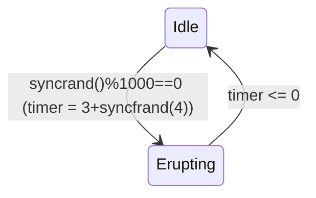
No collision (all three hit tests use `double` and return false outside the editor). Visual only — no damage — but it consumes the synced RNG every idle tick, so it is part of the deterministic RNG stream (→ 22).

---

<!-- from P07_buildings_misc -->
## [→ 03_buildings_and_world_objects] CloneLab — capturable spirit-to-Darwinian converter (prototype) [B:FULL compiled, unused in shipped maps]

**Function.** An `Incubator` (P06) variant with shape `clonelab.shp` and **5 control ports** (`MarkerPort01…05`) [C] `data/shapes/clonelab.shp`. It holds a stock of spirits; whichever team controls it converts the stored spirits into its own Darwinians at the incubator rate. Not blocked by `BuildingIsBlocked`, but appears only in 4 prototype maps under `data/levels/old/` (`mp_firetop`, `mp_kingspass`, `mp_sabrepoint`, `mp_silverisle`, 15 lines) and in **no** shipped `mp_*` map [C] census → effectively legacy/prototype content; a new game may treat it as an optional design idea.

### Level-file parameters (inherited from Incubator) [C] `code/worldobject/clonelab.cpp:CloneLab::Read` → `code/worldobject/incubator.cpp:Incubator::Read`

| # | Field | Type | Default | Meaning | Observed (old maps) |
|---|---|---|---|---|---|
| 8 | numStartingSpirits | int, optional (`%6d`) | 0 | Spirits stocked at start | 150, 250 |

### Capture rule [C] `CloneLab::RecalculateOwnership` (every tick)
Count port occupants per team; the owning team is the first team (index order) with **> 2** occupants, replaced by any later team with > 2 and strictly more occupants; if none, the lab becomes neutral (255). `SetTeamId` fires "ChangeTeam" sound on change.

### Behaviour [C] `CloneLab::Advance`
1. If no AI target and spirits > 0 → create an `AITarget` at the lab's exit marker (Y at the lab's ground height), give it a new global building id and add it to the building list (AI attraction).
2. Remember `m_startingSpirits` on first tick (unused afterwards [C]).
3. Recalculate ownership.
4. If spirits == 0 and AI target exists → mark target destroyed (removed from AI graph): "this building is now worthless".
5. Owned → `Incubator::Advance` (spawns one Darwinian per `INCUBATOR_PROCESSTIME_MULTIPLAYER` = 0.2 s in multiplayer, 5.0 s base in single player) [C] `code/worldobject/incubator.h`; neutral → spirits only orbit, then `Building::Advance` (port evaluation).
- Quirk [C]: the Incubator constructor looks up `MarkerSpirits`, `MarkerExit`, `MarkerDock` in `incubator.shp`; CloneLab then swaps the shape to `clonelab.shp` without re-resolving these markers, so spirit-centre/exit/dock positions come from the incubator mesh's marker transforms.
- Destructor marks its AI target destroyed.

### Rendering (→ 24) [C] `CloneLab::RenderPorts`
Per port a 6-unit camera-facing `textures/starburst.bmp` billboard (additive, depth write off) 5 units above ground at the control-pad status marker, grey (150,150,150) if empty or the occupant's team colour.

---

<!-- from P07_buildings_misc -->
## [→ 03_buildings_and_world_objects] Randomiser — crate-spawned team-scrambling field [B:FULL]

**Function.** Not a Building: a `WorldObject` effect (`m_type = EffectRandomiser`) placed in `Location::m_effects` by the "Randomiser" crate outcome (`Crate::RunRandomiser`, compiled under `INCLUDE_CRATES_ADVANCED`, which FULLGAME defines) [C] `code/worldobject/randomiser.cpp`, `code/worldobject/crate.cpp:Crate::RunRandomiser`, `code/lib/universal_include.h`. Routed here because it lives in `worldobject/`; crate selection rules belong to [→ 04_crates_powerups_and_weapons]. No level-file presence.

| Parameter | Value | Kind | Evidence |
|---|---|---|---|
| `RANDOMISER_RANGE` | 100.0 world units | `#define` | `randomiser.cpp` |
| Lifetime `m_life` | 15.0 s | ctor literal | `Randomiser::Randomiser` |
| Pulse interval | first pulse on the first tick (`m_timer` starts 0), then `0.5 + syncfrand(2.5)` s (0.5–3.0 s) | literal, synced | `Randomiser::Advance` |

**Pulse** [C] `Randomiser::Advance`: for every entity within 100 units (all teams) that is a Darwinian not in `Darwinian::StateInsideArmour`: spawn one new Darwinian at its position with its velocity for team `syncrand() % levelFile->m_numPlayers` (team indices 0…numPlayers−1, the original team is possible), then mark the original `m_destroyed = true`. Ownership of the crate is irrelevant to the effect (the crate's team only receives the message and a fixed map marker `icons/icon_randomizer.bmp`).

**Rendering** (→ 24) [C] `Randomiser::Render`: each frame two `Particle::TypeMuzzleFlash` particles (size 60) on opposite ends of a 100-unit radius rotating at 3 rad/s of game time, 5 units above ground, each coloured with a random team colour (CRT `rand() % NUM_TEAMS`, unsynced; spawning particles from the render path).

Determinism: pulse timer and team picks are synced; the spawned Darwinians go through `Location::SpawnEntities` (P03).

---

<!-- from P07_buildings_misc -->
## [→ 03_buildings_and_world_objects] ScriptTrigger — Darwinia campaign script/tutorial trigger [B:LEGACY]

**Status.** Blocked by `BuildingIsBlocked` (`TypeScriptTrigger`) [C]; 25 lines exist only in campaign `map_*`/`mission_*` files, none in `mp_*` [C] census. Documented for completeness because the brief flags it.

**Function.** Invisible trigger that, when its condition is met, runs a script file (`Script::RunScript`) or (only with `USE_SEPULVEDA_HELP_TUTORIAL`, never defined → [B:DEAD]) walks through numbered Sepulveda phrases `<name>_1`, `<name>_2`, ….

### Level-file parameters [C] `code/worldobject/scripttrigger.cpp:ScriptTrigger::Read`, `Write` (`%-6d %-6.2f %s %s`)

| # | Field | Type | Default | Meaning |
|---|---|---|---|---|
| 8 | linkId | int | −1 | Building to highlight (Sepulveda path only) |
| 9 | range | float | 100.0 | Trigger radius (world units) |
| 10 | scriptFilename | token | "NewScript" | If it contains ".txt" → script file to run; otherwise a phrase-id prefix |
| 11 | entityType | token | "never" | `always` (999), `never` (998), `camenter` (997), `camview` (996), or an entity type name (`Entity::GetTypeId`) |

### Behaviour [C] `ScriptTrigger::Advance`, `ScriptTrigger::Trigger`
- Mode `never` (`SCRIPTRIGGER_RUNNEVER` = 998): does nothing.
- Otherwise, while not triggered and no script is running and the camera is interactive, every 1.0 s (first check on the first tick) test: `always` → fire; `camenter` → camera within `range` and camera speed < 5; `camview` → (camera within `range + 300`, speed < 5, interactive, and camera forward ray hits sphere(pos, range)) **or** (within `range`, speed < 5); entity type → at least one entity of that type **and of the trigger's own team** within `range`.
- `Trigger()`: filename contains ".txt" → `RunScript`, `m_triggered = −1` → next tick the trigger removes itself. Otherwise `m_triggered = 1` → with Sepulveda compiled out, the next tick removes itself without effect.
- Non-colliding (sphere/shape false; ray only in editor). Editor render: two spheres of `range` in team colour + filename/state text [B:EDITOR in practice, `g_app->m_editing` gated].

---

<!-- from P07_buildings_misc -->
## [→ 03_buildings_and_world_objects] FenceSwitch — port-operated laser-fence switch [B:LEGACY]

**Status.** Blocked (`TypeFenceSwitch`) and absent from every level file [C]. `Building::CreateBuilding(int)` still forces `m_isGlobal = true` for this type and `LevelFile::ParseBuildings` asserts non-global FenceSwitches as an error [C] `code/worldobject/building.cpp`, `code/level_file.cpp`. Shape `fenceswitch.shp` with 4 ports (`MarkerPort01–04`) and `MarkerConnectionLocation` [C] `data/shapes/fenceswitch.shp`.

### Level-file parameters [C] `FenceSwitch::Read`, `Write`

| # | Field | Type | Default | Meaning |
|---|---|---|---|---|
| 8 | linkedBuildingId | int | −1 | Primary LaserFence |
| 9 | linkedBuildingId2 | int | −1 | Optional second LaserFence (toggled opposite to the first) |
| 10 | switchValue | int | −1 → set to linkedBuildingId | Which link is currently "selected" (the enabled one) |
| 11 | lockable | int | 0 | 1 = lock after the first switch |
| 12 | script | token | "none" | Script file run when the switch acts (if it contains ".txt") |
| 13 | locked | int, optional | 0 | 1 = start locked |

### Behaviour [C] `FenceSwitch::Advance`, `FenceSwitch::Switch`
- 20 s start-up delay (`m_timer` 20.0, raised to at least 10.0 by `SetDetail`) before any logic.
- Team: set to team 2 (the Darwinia single-player "player" team; team 0 = green, 1 = red per `Location::IsFriend`'s table) when all ports are occupied and none by team 1, else set to team 1 (red) — every tick.
- When all ports are occupied and its `GlobalBuilding` is offline: if friendly → `m_switchable = true` and apply `switchValue` (enable the selected fence, disable the other); if hostile → force primary enabled, secondary disabled. Then mark the GlobalBuilding online and `EvaluateEvents()`. When ports are no longer all occupied and it is online: reset to primary; with no second link, disable the primary; with a second link, enable primary/disable secondary; mark offline.
- Any actual change → run script, and lock if lockable.
- `Switch()` (called **locally** from `LocationInput::SelectObjectUnderMouse` when the player clicks the switch, not via a network message [C] `code/location_input.cpp`): if switchable and not locked, flip `switchValue` between the two links and set the GlobalBuilding offline so the next tick re-applies. (A sim-state change from local input — would desync in multiplayer [I]; unreachable because the type is blocked.)
- Rendering (→ 24): additive `textures/laser.bmp` ribbon (half-width 2.0, camera-facing) from `MarkerConnectionLocation` to each linked fence's top marker, yellow (0.9,0.9,0.5) for the selected link and grey (0.5,0.5,0.5) for the other; ownership lights are green when the primary link is selected, red otherwise (10 stacked starbursts, size up to 6).

---

<!-- from P07_buildings_misc -->
## [→ 03_buildings_and_world_objects] Consolidated constants table (live classes)

| Class | Constant | Value | Unit | Kind | Evidence |
|---|---|---|---|---|---|
| Tree | default height / budsize / pushOut / pushUp / iterations / seed | 50.0 / 1.0 / 1.0 / 1.0 / 6 / 0 | wu / – | ctor | `Tree::Tree` |
| Tree | branch quad half-width factor | 0.1 × segment length | – | literal | `Tree::RenderBranch` |
| Tree | leaf quad half-width factor | 0.1 × budsize × segment length | – | literal | same |
| Tree | children per segment | 4 (±A, ±B) | – | literal | same |
| Tree | child start parameter t | 0.3 + frand(0.6) | fraction of parent | literal | same |
| Tree | child sideways reach | 0.4 × len × pushOut | – | literal | same |
| Tree | crown radius shrink | ×0.8 (hit), ×1.5 (`m_radius`) | – | literal | `Tree::Generate`, `SetDetail` |
| Tree | trunk hit sphere | 10.0 | wu | literal | `Tree::DoesSphereHit` |
| Tree | min actual height | 1% of height | – | literal | `GetActualHeight` |
| Tree | ignition threshold / decay / clamp | > 50 / −1 per s / [0,100] | dmg | literal | `Damage`, `Advance` |
| Tree | burn rate | 0.02 /s | phase | literal | `Advance` |
| Tree | regrow SP / MP | 0.01 /s / 0.05 /s | phase | literal | `Advance` |
| Tree | healthy window | −0.3 < onFire ≤ 0 | phase | literal | `Advance` |
| Tree | drop chance per tick | 1/(51 − rate) | – | literal | `Advance` |
| Tree | propagation delay | 5 + syncfrand(5) | s | literal | `Advance` |
| Tree | propagation neighbourhood | 100 | wu | literal | `CreateAnotherTree` |
| Tree | offspring height | height × 0.75 × (1 + syncsfrand(0.2)) | – | literal | `CreateAnotherTree` |
| Tree | obstruction push step / probe radius | 2.0 / 1.0 | wu | literal | `PushFromObstructions` |
| Tree | AntHill ignition reach | ourCrownR×1.5 + 100 | wu | literal | `Advance` |
| Tree | evil kill chance | 2% per tick (`syncfrand(10) < 0.2`) | – | literal | `Advance` |
| Tree | evil kill damage | −999 | hp | literal | `Advance` |
| Tree | zombie launch vy | 20 + syncfrand(25) | wu/s | literal | `Advance` |
| Tree | corruption check interval | initial 5.0, then 10 + syncfrand(5) | s | literal | `Tree::Tree`, `Advance` |
| Tree | corruption → evil delay | 10 | s | literal | `Advance` |
| Tree | sway amplitude normal / evil | 0.003 / 0.01, ω = 2 rad/s | – | literal | `RenderAlphas` |
| Tree | fire particle count | int(actualH/12) / RenderBuildingDetail | per tick | literal | `Advance` |
| Tree | fire glow billboards | 4, colour (0.8,0.2,0.1), alpha 0.5×H/h, half-size max(2H,5) | – | literal | `RenderAlphas` |
| Tree | RenderTreeDetail leaf alpha boost | ×1.3^detail if detail > 1 | – | literal | `Generate` |
| LaserFence | raise speed | 0.3 /s | status | `#define` | `laserfence.h` |
| LaserFence | chain hand-off | status 0.5 | – | literal | `Advance` |
| LaserFence | spark interval | initial syncfrand(10); then 8 + syncfrand(4) | s | literal | `Initialise`, `Advance` |
| LaserFence | spark particles | 5 + frand(5) sparks, speed 40 + frand(20) (+jitter), size 25 + frand(25); spawn height frand(50×scale) | – | literal | `Spark` |
| LaserFence | solar timeout | 5.0 | s | literal | `Advance` |
| LaserFence | full height | 48.28 × scale (shape markers) | wu | data | `laserfence.shp` |
| LaserFence | curtain skirt | h/3 below base | – | literal | `RenderAlphas`, `DoesRayHit` |
| LaserFence | curtain alpha | 150 | /255 | literal | `RenderAlphas` |
| LaserFence | texture scroll | gameTime/15 (normal), gameTime/1.5 with 7× tiling (solar) | uv | literal | `RenderAlphas` |
| LaserFence | edge line width | 2.0 (0.5 solar) | px | literal | `RenderAlphas` |
| LaserFence | entity kill | `ChangeHealth(−9999)` | hp | literal | `Entity::PushFromObstructions` |
| LaserFence | Darwinian push band | 5 + uniqueId % 10, step 20 | wu | literal | `Darwinian::PushFromObstructions` |
| Wall | collision length / depth / ray height | 100 / 20 / 37.5 | wu | `#define` | `wall.cpp` |
| Wall | destroy threshold | single hit ≤ −300 | dmg | literal | `Wall::Damage` |
| Wall | WallBuster break radius / damage | 200 / −1000 | wu / dmg | literal | `WallBuster::BreakWalls` |
| Wall | Darwinian wall push | probe 4, step 5 along ±front, clear radius 1 | wu | literal | `Darwinian::PushFromObstructions` |
| StaticShape | default scale / shape | 1.0 / "none" | – | ctor | `StaticShape::StaticShape` |
| StaticShape | placeholder sphere | 40 | wu | literal | `StaticShape::Render` |
| RestrictionZone | default size / blockPowerups | 300.0 / 0 | wu / bool | ctor | `RestrictionZone::RestrictionZone` |
| RestrictionZone | crate re-roll limit | 100 tries, also rejects height < 20 | – | literal | `Location::CreateRandomCrate` |
| SmokeMarker | particles | 3/tick, speed 50, jitter ±0.2 xz, size 200 + frand(100), `TypeMissileTrail` | – | literal | `SmokeMarker::Advance` |
| SmokeMarker | accidental hit sphere | 13.0 (Building default radius) | wu | ctor default | `Building::Building` |
| EruptionMarker | start chance / duration | 1/1000 per tick / 3 + syncfrand(4) s | – | literal | `EruptionMarker::Advance` |
| EruptionMarker | particles | 10/tick, speed 100, size 300 + frand(200), `TypeVolcano` | – | literal | same |
| CloneLab | capture threshold | > 2 occupants of 5 ports, plurality | Darwinians | literal | `RecalculateOwnership` |
| CloneLab | conversion interval | 0.2 s (MP) / 5.0 s base (SP) | s | `#define` | `incubator.h` |
| Randomiser | range / life / pulse | 100 / 15 s / 0.5 + syncfrand(2.5) s | – | `#define`/literal | `randomiser.cpp` |
