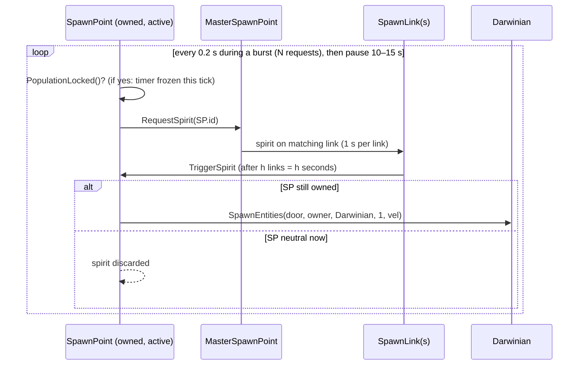

# Routed draft sections for document 05

<!-- from P02_game_modes -->
## [→ 05_economy_and_population] 6. Reinforcements, population caps and other throughput rules owned by the rules object

### 6.1 Trunk-port reinforcement waves — `Multiwinia::AdvanceTrunkPorts` [C] `code/multiwinia.cpp`

Called every tick from `AdvanceRocketRiot` and `AdvanceBlitkrieg`, and from `Multiwinia::Advance` when the level has `trunkportreinforcements > 0` or `trunkportarmour > 0` (Assault maps, `mp_koth_3P_4`, `mp_cts_3p_3`, and three Blitzkrieg maps — where it therefore runs twice per tick, §8 D3). `#ifndef MULTIWINIA_DEMOONLY`.

Algorithm (per call):
1. `m_reinforcementTimer -= SERVER_ADVANCE_PERIOD`; at ≤ 0 → `= 1.0`, `--m_reinforcementCountdown`.
2. If `m_reinforcementCountdown <= 0` → **wave**:
   1. Help notification. `timer = ReinforcementTimer` option (−1 → 60); `m_reinforcementCountdown = timer`, minus 1 on the very first wave.
   2. Parameters: `maxArmour = MaxArmour`, `reinforcementCount = ReinforcementCount`, `turretTimer = TurretFrequency`, `maxTurrets = MaxTurrets` (−1 → 2). If `reinforcementCount == -1` (mode lacks the option) → level `trunkportreinforcements`; in Assault `defenderCount = level defenderreinforcements`, `attackerCount = level attackerreinforcements`, each defaulting to `reinforcementCount`. Level `defenderreinforcementtype` / `attackerreinforcementtype` (GlobalResearch type names, e.g. `AirStrike`, `Armour`, `HotFeet`) read always. `maxArmour == -1` → level `trunkportarmour`. Level `nogunturrets` → `turretTimer = 0`.
   3. Turret cadence: if `turretTimer > 0`: `--m_turretTimer`; at ≤ 0 → `giveTurrets = true`, `m_turretTimer = turretTimer` → turrets on waves 1, N+1, 2N+1, ….
   4. For every **owned** TrunkPort (team ≠ 255):
      - Assault: count = attackerCount if the owner's position is attacking else defenderCount.
      - If not `PopulationLocked()`: spawn `count` Darwinians one by one at `portPos + up·50 + r`, where `r` = up-vector rotated about the port's front by `syncfrand(2π)` and scaled to `syncfrand(40)`; velocity = port front with `y = syncfrand(1)`, scaled by `20 + syncfrand(15)`; spawned airborne (`m_onGround = false`).
      - Armour: if `CountNumTasks(Armour) < maxArmour` or `maxArmour == 0` (unlimited), and the team's side has no override type (defender side uses `defenderreinforcementtype == -1`, attacker side `attackerreinforcementtype == -1`; in non-Assault modes every team counts as "defender" because `m_attacking[]` is all false): create an Armour `Task`, `RunTask`; on success mark source 1 (trunk port), target it at `portPos + front·75` (ground + 5) and register a task marker. The UI's current task selection is restored afterwards; `m_blockUnitChange` and (after the first wave) `m_blockMostRecentPopup` are set around the grant.
      - Turret: `taskType = GunTurret`; Blitzkrieg upgrades it to `AirStrike` (§4.6). If `giveTurrets && CountNumTasks(taskType) < maxTurrets` → `RunTask(taskType)` (untargeted; player places it), source 1.
   5. If `defenderreinforcementtype != -1`: every used team in slots `< NumPlayers` whose position is **not** attacking gets one task of that type with `m_option = defendreinforcementoption`.
   6. If `attackerreinforcementtype != -1`: every used team whose position is attacking — **or every team in non-Assault modes** — gets one task of that type with `m_option = attackreinforcementoption` (e.g. `mp_cts_3p_3`: HotFeet for everyone each wave).
   7. Note steps 5–6 are per team, independent of how many trunk ports it owns; steps 4.x are per port (a team with 3 ports may receive up to 3 armour/turret tasks per wave, bounded by the caps).
3. `m_firstReinforcements = false` (end of every call).

Timing: the first wave fires on the first post-grace tick; the second after 59 further countdown steps, later waves every `ReinforcementTimer` steps; each step = 11 ticks (1.1 game s) when called once per tick, 6 ticks when called twice [I: derived from §8 D1/D3].

Defaults per mode: Rocket Riot 40 Darwinians/port every 60 steps, armour cap 2, turret every 7th wave cap 3; Blitzkrieg 40/60, armour 2, turret every 2nd wave cap 2 [C] `data/multiwinia.txt`. Assault/KOTH/CTS maps: count from the level (60–100), timer 60, armour only if `trunkportarmour` set (as the cap), no turrets (TurretFrequency absent → −1) [C].

### 6.2 Population caps at trunk ports — `TrunkPort::PopulationLocked` [C] `code/worldobject/trunkport.cpp`

In multiplayer:
1. Assault with `DefenderPopulationCap != -1`: neutral port → never locked; `pop = Team::m_others.NumUsed() − Virii::s_viriiPopulation[team]`; defender locked at `pop >= DefenderPopulationCap`; attacker locked at `pop >= (PopulationCap − numDefenders × DefenderPopulationCap) / numAttackers` (integer division).
2. Else if `PopulationCap != -1`: locked at `pop >= PopulationCap / NumPlayers`.
3. Fallback (and when no cap): the first `SpawnPopulationLock` within its `m_searchRadius` of the port (cached); locked when that lock's `m_teamCount[team] >= m_maxPopulation` (P06). The cached id is only queried when `> 0`, so a lock with unique id 0 is ignored [C].
Worked example `mp_assault_2P_1` (PopulationCap 2000, DefenderPopulationCap 350, 1 attacker): defender 350, attacker 1650 [C level file, I arithmetic]. `pop` counts every non-unit entity of the team (Darwinians, plus other `m_others` such as engineers/armour?) minus Virii [I: `m_others` contents are P01/P03].
Official-map caps (from `MultiwiniaOptions`, [C] level files): Domination 1500–2000 (one map −1 = uncapped), KOTH 1500–2000 (4P_3 uncapped), CTS 1500–2000, Assault 1500–2000 with DefenderPopulationCap 200–350 (two maps −1), Rocket Riot 1500–1800, Blitzkrieg 1400–2000, TankBattle uncapped. Spawn-point production obeys the same caps (P06).
The same Assault formula is duplicated in `SpawnPoint` (P06) [C] `code/worldobject/spawnpoint.cpp` (L~715).

### 6.3 Handicap (option `Handicap`) — consumer `SpawnPoint::CalculateHandicap` (P06) [C] `code/worldobject/spawnpoint.cpp`

Returns a spawn-rate multiplier: 1.0 if level `nohandicap`; 0.0 for team 255; 1.0 while any neutral spawn point exists (`s_numSpawnPoints[0] > 0`); 1.0 if Handicap is 0/−1 or the team is alone. Else `average = (Σ other used teams' spawn points) / (number of other used teams)` (integer division); if `average > own × 1.5` → `1 + Handicap/100 × factor` with `factor = 1 − ((own − 1) / total)` — `(own−1)/total` is integer division and therefore 0 for every reachable value, so the multiplier is effectively **binary: 1.0 or 1 + H/100 (1.9 at the default 90)** [C code, I consequence].

### 6.4 Starting powerups (option `StartingPowerups`) — consumer `Location::InitialiseTeam` (P01) [C] `code/location.cpp` (L~3307)

N (0–3) rewards per non-special team at start, each drawn with `syncrand() % Crate::NumCrateRewards` until a reward is valid (`Crate::IsValid`) and not one of: Randomiser, CrateMania, Darwinians, Bitzkreig, SpawnMania, Plague, RocketDarwinians, SpaceShip, Spam, Triffids, SpeedUpTime, SlowDownTime, Forest, TheBeast (`INCLUDE_THEBEAST`); granted via `Crate::CaptureCrate` (P08).

### 6.5 Crate drops (options `CrateDropRate`, `CrateDropMode`) — consumer `Location::AdvanceCrates` / `CreateRandomCrate` (P08 owns the details) [C] `code/location.cpp`

No crates in tutorial 1 or before tutorial-2 AI release; max simultaneous crates `int(worldSizeX / 500)`; interval `CrateDropRate × (1.5 − syncfrand(1))` game seconds (0.5×–1.5×), re-rolled per drop. Weighted mode: `chance = max(high/total, 1 − low/total)`; with that probability the crate is dropped near a random building of a team chosen with weight `total/score` (score 0 → weight `total`), otherwise random placement.

### 6.6 Territory → score summary

| Mode | Territory unit | Score unit per mode second |
|---|---|---|
| Domination | spawn point | +owned (cumulative) or = owned |
| KOTH | zone | per ScoreMode table §4.2 |
| CTS | statue delivered | +1 per delivery (event) |
| Blitzkrieg | flag | time-out score = flags + 10 × eliminations |
| Rocket Riot | solar panel → fuel | fuel% + passengers + rocket height |
| Assault | control stations | defence time (s) |

---

<!-- from P03_entity_core -->
## [→ 05_economy_and_population] Souls, deaths and population accounting (P03 view)

- **Death → soul.** Every entity death through `Entity::ChangeHealth` spawns exactly one Spirit of the dead entity's team at its position (velocity = half the corpse velocity), except for the monster team [C] `entity.cpp:Entity::ChangeHealth`, `location.cpp:Location::SpawnSpirit`. Deaths that *remove* units without `ChangeHealth` (promotion, rocket boarding, abduction, subversion conversion, futurewinian pulse conversion, officer absorb) produce **no** soul [C] (Darwinian "Death, spirit and removal").
- **Soul → population (MP).** In Multiwinia free-floating souls are not consumed by spawn points directly (the "accelerate spirits to heaven" and spirit-consuming logic in `MasterSpawnPoint::Advance` is single-player only) [C] `code/worldobject/spawnpoint.cpp:MasterSpawnPoint::Advance`. Souls become new Darwinians only when a **Harvester** (crate unit, P04) collects `Floating`, unbroken souls within `ENGINEER_SEARCHRANGE` and delivers them to an owned SpawnPoint, which calls `SpawnPoint::SpawnDarwinian()` once per soul (sound "DropSpirit") [C] `code/worldobject/harvester.cpp:Harvester::SearchForSpirits, AdvanceToSpawnPoint`. Note the spirit's team is ignored — **enemy souls are harvested into the harvester owner's Darwinians** [I] (no team check in `SearchForSpirits`; verify in P04). Souls are also destroyed by the SoulDestroyer (P05). Uncollected souls expire after ~2–2.5 min (MP timings above).
- **Darwinian worship of souls** (`StateWorshipSpirit`, BoxKites) is disabled in MP (`SearchForSpirits` returns false; `AdvanceWorshipSpirit` resets to Idle) [C].
- **Population counters in scope**: `Entity::s_entityPopulation` (all live Entity objects, ++ctor/−−dtor); the population-cap check in `SpawnEntities` is commented out (`/*if( Entity::s_entityPopulation >= m_levelFile->m_populationCap …*/`) [C] `location.cpp:Location::SpawnEntities` — caps are enforced by the spawning buildings instead (P06/P02). `Team::Advance` counts selected Darwinians; team kill counters `Team::m_teamKills` are incremented by lasers (Darwinian kills), `Darwinian::FireDamage` (over-counts); other increment sites are outside P03 (P04 weapons) [I].
- **Territory → throughput hooks in scope**: Darwinians operate building ports (`StateApproachingPort/OperatingPort`, `Building::OperatePort`, MP limit 1 operator per team per port) — this is the capture mechanic for spawn points and other port buildings (P06); crates are captured by standing near (`StateOpeningCrate`, P08); Blitzkrieg flags by `StateRaisingFlag` (P02); statues by `StateCarryingBuilding` (P02/P07).

<!-- from P05_entities_creatures -->
## [→ 05_economy_and_population] Creature interactions with spirits and population

| Creature | Effect on spirits / population | Ref |
|---|---|---|
| Any entity death (generic) | spawns 1 spirit of the dead entity's team (`Entity::ChangeHealth`); Egg deaths and abductions spawn none | [C] `code/worldobject/entity.cpp:Entity::ChangeHealth`, `Egg::ChangeHealth`, `Darwinian::AdvanceBeingAbducted` |
| ArmyAnt / AntHill | ants carry floating spirits (and captured Darwinians, who are killed at the hill, their spirit spawning there) home; each stored spirit becomes +6 ants (MP); a destroyed hill releases (ants + spirits) spirits of the **Monster** team | [C] `ArmyAnt::AdvanceReturnToBase`, `AntHill::Advance`, `AntHill::Damage` |
| Virii | ferry floating spirits (only those near Eggs) into Eggs; a fertilised Egg turns 1 spirit into 4 Virii after 15 s | [C] `Virii::AdvanceToEgg`, `Egg::Advance` |
| SporeGenerator | lays Eggs near floating spirits; 25% of its eggs come with a new spirit (creates spirits from nothing) | [C] `SporeGenerator::AdvanceEggLaying` |
| Spider | lays one Egg 45 m beyond a floating spirit | [C] `Spider::AdvanceEggLaying` |
| Centipede | eats floating spirits within 10 m (chance size/2), +1 segment per 4 eaten, max 20 segments | [C] `Centipede::EatSpirits` |
| SoulDestroyer | deletes the spirit of every entity it kills (souls lost to the economy) | [C] `SoulDestroyer::Attack` |
| SpamInfection | deletes floating spirits it reaches and spawns a Monster Virii/Spider; 50% of hit entities become Monster Darwinians (no spirit) | [C] `SpamInfection::AdvanceAttackingSpirit`, `AdvanceAttackingEntity` |
| SpaceShip | removes abducted Darwinians without spirits; adds the same number (≤ 100) of Futurewinian Darwinians | [C] `SpaceShip::AdvanceDropping` |
| Population caps | Virii have their own cap (250 per team, `VIRII_POPULATIONLIMIT`) and are excluded from the team count used by `AntHill::PopulationLocked`; creature spawns do **not** check the level population cap (the check in `Location::SpawnEntities` is commented out) | [C] `code/worldobject/virii.h`, `AntHill::PopulationLocked`, `code/location.cpp:Location::SpawnEntities` |

<!-- from P06_buildings_core -->
## [→ 05_economy_and_population] Spawn-point economy (territory → Darwinians)

Sources: `code/worldobject/spawnpoint.cpp` (all functions), with supporting refs as cited. Build tag **[B:FULL]** unless marked. All times assume dt = 0.1 s (normal game speed).

### 1. Overview

In every Multiwinia mode that has spawn points (Domination, KOTH, CTS, 2-player Blitzkrieg maps, two Rocket Riot maps — see the SpawnPoint mode-usage row), **territory is the only steady source of new Darwinians from buildings**: each *owned and activated* SpawnPoint runs a burst/pause request cycle; each request becomes a virtual spirit that travels from the level's master spawn point along spawn links to that SpawnPoint and turns into one Darwinian for the SpawnPoint's *current* owner. The per-team population cap and the handicap modulate this. Other population sources (not in this partition): starting `InstantUnits` in the level file, trunk-port reinforcements (Rocket Riot natively via its `ReinforcementTimer`/`ReinforcementCount` game options, and any level with LevelOption `trunkportreinforcements` — all 8 Assault maps, `mp_blitzkrieg_2P_3`, `mp_blitzkrieg_2p_1`, `mp_blitzkrieg_2p_2`, `mp_cts_3p_3`, `mp_koth_3P_4`), crate rewards (e.g. *Darwinians*, *Spawn Mania*), Futurewinian/monster teams. [C] spawnpoint.cpp; [C] `data/levels/*` LevelOptions; [I] list of other sources from grep, owned by other agents.



### 2. Ownership acquisition (exact algorithm)

`SpawnPoint::RecalculateOwnership()` runs when `m_evaluateTimer` ≤ 0; the timer starts at `syncfrand(2.0)` (ctor) and is reset to `2.0 + syncfrand(1.0)` (∈ [2, 3) s) after each run. Also run once at game start for team-owned points (§7). [C] `SpawnPoint::SpawnPoint/Advance`.

```
teamCount[t] = number of the 5 ports whose occupant is a Darwinian of team t   (§base 5)
winner = 255; multiple = false
for t in 0..NUM_TEAMS-1:
    if teamCount[t] > 0 and winner == 255:              winner = t
    elif winner != 255 and teamCount[t] > 2 and teamCount[t] > teamCount[winner]: winner = t
    if winner != 255 and teamCount[t] > 0:               multiple = true   # also true for the winner itself
    if winner != 255 and teamCount[winner] < 3:          winner = 255
if multiple:
    for t: if teamCount[t] > 0 and not IsFriend(t, winner): winner = 255; break
if winner != current team: update s_numSpawnPoints (current+1 −−, winner+1 ++), play TurnOn/TurnOff
if winner != current team: m_activationTimer = 30.0
SetTeamId(winner)
```
[C] `SpawnPoint::RecalculateOwnership` (verbatim logic restated). Consequences:
* **Capture needs ≥ 3 of the 5 ports** held by one team, and **no enemy Darwinian on any port** (an enemy on a single port neutralises the point at the next evaluation). [C].
* Allies (`IsFriend`: same team, or same co-op group when `m_coopMode`) may share ports; the allied team with ≥ 3 (largest, later index wins only with > 2 and strictly more) becomes owner. Two allies with 2 + 2 → neutral. [C] `code/location.cpp:Location::IsFriend`.
* Losing ports below 3 → neutral (not "keep until taken"). [C].
* A direct owner swap A → B is possible if, at an evaluation instant, only B holds ≥ 3 ports. [C].
* `IsFriend(t, 255)` is false, so `multiple` with no winner is harmless. [C].

### 3. Activation delay

When owned (`team ≠ 255`) and `m_activationTimer > 0`: `timer −= dt`, then forced to 0 if **any** of: the team now owns exactly one spawn point (`s_numSpawnPoints[team+1] == 1`, "first (or last) spawn point"), not Multiwinia, or level option `instantspawnpointcapture` (> 0); clamped ≥ 0. Spawning starts only when the timer is 0. Every ownership change (including to neutral) resets it to **30.0 s**. [C] `SpawnPoint::Advance`. Levels with `instantspawnpointcapture`: `mp_cts_2p_2`, `mp_cts_3P_2`, `mp_cts_3p_1`, `mp_cts_4P_2`. [C] data.

### 4. Population caps (`SpawnPoint::PopulationLocked`)

Evaluated every tick of an active, owned SpawnPoint before its spawn timer is decremented; when locked the timer is **frozen** (not decremented) and no request is made. Checks in order (first that applies decides) [C]:

**4.1 Population count used.** `currentPop = team->m_others.NumUsed() − Virii::s_viriiPopulation[team]` — every non-unit entity the team owns (Darwinians and other "others" such as armour/engineers [I]) minus its Virii (Virii have their own limit). Spirits already in transit are **not** counted, so a team can overshoot by the spirits in flight (up to N per SpawnPoint, §5). [C] `PopulationLocked`; `code/team.cpp` (`m_others`); docs `multiwinia-changes.txt` ("Virii no longer count towards your population limit").

**4.2 Tutorial 2** (`m_multiwiniaTutorial && type == MultiwiniaTutorial2 && !m_tutorial2AICanSpawn`): locked if this point has requested ≥ 100 spirits (`m_numSpawned`, only counted in this tutorial), or its team is not 0 (AI cannot spawn), or team 0 has > 200 entities. [C].

**4.3 Assault with `DefenderPopulationCap` ≠ −1**: neutral → not locked; defending team (`Location::IsDefending`) locked iff `currentPop ≥ DefenderPopulationCap`; attacking team locked iff `currentPop ≥ (PopulationCap − numDefenders × DefenderPopulationCap) / numAttackers` (integer division), where `numDefenders = level NumPlayers − Location::GetNumAttackers()`. (No official Assault map has spawn points, so in practice this rule governs nothing in this partition [C] data; trunk ports apply the same formula [C] `code/worldobject/trunkport.cpp` ≈L370–390.)

**4.4 Map cap `PopulationCap` ≠ −1** (MultiwiniaOptions block; the last `PopulationCap` line wins): neutral → not locked; else locked iff `currentPop ≥ PopulationCap / NumPlayers` (integer division by the **level's NumPlayers**, not by the number of teams actually playing). [C] `PopulationLocked`, `code/level_file.cpp:ParseMultiwiniaOptions`.

**4.5 Fallback — SpawnPopulationLock buildings** (only reached if no map cap, or not Multiwinia): on first use the SpawnPoint caches the **first** lock in building-list order whose `m_searchRadius` contains it (`−2` = none found); locked iff `lock.m_teamCount[team] ≥ lock.m_maxPopulation`. Lock counts are regional recounts (see the SpawnPopulationLock spec). [C].

**4.6 Otherwise** not locked — e.g. `mp_domination_4P_2` and `mp_koth_4P_3` (co-op 2v2, `PopulationCap -1`, no SpawnPopulationLock) have **no spawn-point population limit**. [C] data; [I] no other cap applies (the generic `Location::SpawnEntities` cap is commented out [C] `code/location.cpp` ≈L584).

Per-level spawn economy (all 32 official MP levels with spawn points; per-team cap = PopulationCap / NumPlayers; hops = links from master to each SpawnPoint = spirit latency in seconds) [C] data via `scripts/P06_spawn_graph.py`:

| Level | GameTypes | NumPlayers | PopulationCap | Per-team cap | SpawnPoints | SpawnLinks | Hops (s) | Instant capture |
|---|---|---|---|---|---|---|---|---|
| `mp_blitzkrieg_2P_3` | Blitzkrieg | 2 | 2000 | 1000 | 4 | 9 | 3–8 |  |
| `mp_blitzkrieg_2P_4` | Blitzkrieg | 2 | 1800 | 900 | 3 | 7 | 3–4 |  |
| `mp_blitzkrieg_2p_1` | Blitzkrieg | 2 | 1500 | 750 | 1 | 0 | 1–1 |  |
| `mp_blitzkrieg_2p_2` | Blitzkrieg | 2 | 2000 | 1000 | 6 | 8 | 2–5 |  |
| `mp_cts_2p_1` | CaptureTheStatue | 2 | 2000 | 1000 | 6 | 0 | 1–1 |  |
| `mp_cts_2p_2` | CaptureTheStatue | 2 | 2000 | 1000 | 4 | 0 | 1–1 | yes |
| `mp_cts_2p_3` | CaptureTheStatue | 2 | 2000 | 1000 | 4 | 6 | 3–6 |  |
| `mp_cts_2p_4` | CaptureTheStatue | 2 | 2000 | 1000 | 4 | 0 | 1–1 |  |
| `mp_cts_3P_2` | CaptureTheStatue | 3 | 1500 | 500 | 9 | 0 | 1–1 | yes |
| `mp_cts_3p_1` | CaptureTheStatue | 3 | 1800 | 600 | 6 | 0 | 1–1 | yes |
| `mp_cts_4P_1` | CaptureTheStatue | 4 | 2000 | 500 | 12 | 0 | 1–1 |  |
| `mp_cts_4P_2` | CaptureTheStatue | 4 | 2000 | 500 | 8 | 0 | 1–1 | yes |
| `mp_cts_4p_3` | CaptureTheStatue | 4 | 2000 (file has `-1` then `2000`; last wins) | 500 | 8 | 17 | 3–9 |  |
| `mp_domination_2P_1` | Domination | 2 | 2000 | 1000 | 8 | 13 | 2–7 |  |
| `mp_domination_2P_2` | Domination | 2 | 2000 | 1000 | 8 | 7 | 2–5 |  |
| `mp_domination_3P_1` | Domination | 3 | 1800 | 600 | 10 | 14 | 4–9 |  |
| `mp_domination_4P_1` | Domination | 4 | 2000 | 500 | 10 | 18 | 2–10 |  |
| `mp_domination_4P_2` | Domination (co-op) | 4 | −1 | none | 12 | 20 | 3–5 |  |
| `mp_koth_2P_1` | KingOfTheHill | 2 | 2000 | 1000 | 6 | 7 | 3–5 |  |
| `mp_koth_2P_2` | Domination | 2 | 2000 | 1000 | 9 | 10 | 3–7 |  |
| `mp_koth_2P_3` | Domination | 2 | 1500 | 750 | 10 | 11 | 4–8 |  |
| `mp_koth_2P_3b` | KingOfTheHill | 2 | 1500 | 750 | 10 | 9 | 2–6 |  |
| `mp_koth_3P_1` | KingOfTheHill | 3 | 1800 | 600 | 9 | 23 | 3–8 |  |
| `mp_koth_3P_2` | KingOfTheHill | 3 | 1800 | 600 | 9 | 14 | 4–9 |  |
| `mp_koth_3P_3` | KingOfTheHill | 3 | 1800 | 600 | 9 | 15 | 5–6 |  |
| `mp_koth_4P_1` | KingOfTheHill | 4 | 2000 | 500 | 10 | 18 | 2–11 |  |
| `mp_koth_4P_3` | KingOfTheHill (co-op) | 4 | −1 | none | 12 | 20 | 3–5 |  |
| `mp_koth_4P_4` | KingOfTheHill | 4 | 2000 | 500 | 12 | 4 | 2–2 |  |
| `mp_rocketriot_2P_2` | RocketRiot | 2 | 1500 | 750 | 2 | 0 | 1–1 |  |
| `mp_rocketriot_4P_1` | RocketRiot | 4 | 1800 | 450 | 12 | 0 | 1–1 |  |
| `mp_skirmish_2p_4` | Domination | 2 | 1800 | 900 | 10 | 11 | 3–8 |  |
| `mp_skirmish_3P_1` | Domination | 3 | 1800 | 600 | 15 | 0 | 1–1 |  |

All 32 graphs: one master, every SpawnPoint reachable, exactly one path each, no cycles, no self-links. [C] `drafts/P06_spawn_graph.csv`.

### 5. Request cycle and spawn-rate formula (Multiwinia)

State per SpawnPoint: `m_spawnTimer` (ctor: `2.0 + syncfrand(2.0)`), `m_spawnCounter` (0). **Neither is reset on capture or loss** — a new owner inherits a part-elapsed timer and part-used burst. [C] ctor/`Advance`.

Each tick, if activated (`m_activationTimer ≤ 0`), owned, and not `PopulationLocked()`:
```
m_spawnTimer -= dt
if m_spawnTimer <= 0 or Location.m_spawnManiaTimer > 0:
    if master exists: master.RequestSpirit(this.id)            # (tutorial 2: m_numSpawned++)
    m_spawnTimer = 0.2
    m_spawnCounter += 1
    if m_spawnCounter >= int(20 * CalculateHandicap(team)):
        m_spawnCounter = 0
        m_spawnTimer = 10 + syncfrand(5)                      # ∈ [10, 15) s
```
[C] `SpawnPoint::Advance`. (`fractionOccupied` is computed but unused in Multiwinia.)

**Handicap H** = `SpawnPoint::CalculateHandicap(team)` [C]:
1. level option `nohandicap` → 1.0; team 255 → 0.0; any **neutral** spawn point left on the map (`s_numSpawnPoints[0] > 0`) → 1.0;
2. `h` = game option `Handicap` (Domination, KOTH, Assault: 0–90 step 10, **default 90**; CTS/Rocket Riot/Blitzkrieg have no such option → −1 → 1.0); `h ∈ {0, −1}` → 1.0 [C] `data/multiwinia.txt`, `Multiwinia::GetGameOption`;
3. over used teams other than me: `others = Σ s_numSpawnPoints`, `n = count`; `n == 0` → 1.0;
4. `average = others / n` — **integer division** (then converted to double);
5. if `average > 1.5 × mine`: `factor = 1 − ((mine − 1) / total)` with integer division (total = all used teams' owned points incl. mine) — evaluates to **1** whenever mine ≥ 1 (always true when called from an owned SpawnPoint); return `1 + h/100 · factor`; else 1.0.

So effectively: **H = 1 + h/100 when every spawn point is owned and the (integer) average holding of the other teams exceeds 1.5 × yours; otherwise H = 1.** Burst size `N = int(20·H)`: h = 0, 10, 20, 30, 40, 50, 60, 70, 80, 90 → N = 20, 22, 24, 26, 28, 30, 32, 34, 36, 38 respectively (verified floating-point truncation). [C]+[I] arithmetic.

**Timing per cycle** (in ticks of 0.1 s): emissions at ticks 0, 2, 4, …, 2(N−1) (0.2 s timer ⇒ exactly 2 ticks); then a pause of P = ⌈(10 + u)/0.1⌉ (+1 when float accumulation leaves a residue, e.g. 10.0 → 101 ticks), u ~ U[0,5). Cycle C = 2(N−1) + P ticks.

| Quantity | Formula | N = 20 (H = 1) | N = 38 (H = 1.9) |
|---|---|---|---|
| Burst duration | (N−1)·0.2 s | 3.8 s | 7.4 s |
| Pause | 10–15 s (mean ≈ 12.55 s) | | |
| Cycle (mean) | (N−1)·0.2 + 12.55 s | ≈ 16.35 s | ≈ 19.95 s |
| Darwinians per spawn point per second (mean) | N / cycle | **≈ 1.22 /s (≈ 73/min)** | **≈ 1.90 /s (≈ 114/min)** |
| Range over u (u = 0 → 5) | N / ((N−1)·0.2 + 10 + u) | 1.45–1.06 /s | 2.18–1.70 /s |

[I] derived from the [C] constants above.

**Territory → throughput**: a team's spawn income ≈ `k × N / C` Darwinians/s for k owned, active, unlocked SpawnPoints — linear in territory, independent of how many ports are manned beyond the 3 needed to hold each point, delayed by the 30-s activation per newly captured point and by link latency (hops × 1 s), and clipped by the per-team cap. Example: 2-player KOTH `mp_koth_2P_1` (cap 2000/2 = 1000 per team; 40 starting Darwinians per team from `InstantUnits`): holding 3 points with H = 1 ≈ 3 × 1.22 ≈ 3.7 Darwinians/s ⇒ (1000 − 40)/3.7 ≈ 260 s ≈ 4.3 min to reach the cap with no losses. [I].

**Spawn Mania** (crate reward, `INCLUDE_CRATES_ADVANCED`): sets `Location::m_spawnManiaTimer = 5.0`, decremented by dt in `Location::Advance` slice 8 (Multiwinia only). While > 0, every active unlocked SpawnPoint requests **every tick** (10/s, ignoring the timer; the counter/pause bookkeeping still runs) ⇒ ≈ 50 requests per SpawnPoint during the 5 s (vs ≈ 6 at the normal mean rate). [C] `code/worldobject/crate.cpp:Crate::RunSpawnMania`, `code/location.cpp:Location::Advance`, `SpawnPoint::Advance`.

**Darwinia formula** [B:LEGACY] (not Multiwinia): `spawnTimer = 2 + 5·(1 − fractionOccupied) − (team == 1 ? 1.0 : 0.5)·difficulty/10 + syncfrand(1)`. [C].

### 6. Spirit transit and losses

* Request → spirit on the master's matching link(s) at progress 0; +dt per tick; on arrival forwarded with the overshoot carried, so **latency = number of links on the path × 1.0 s**, independent of distance. [C] `SpawnBuilding::Advance/TriggerSpirit`.
* At the target: spawn **only if the SpawnPoint is owned at arrival** (by whoever owns it then); otherwise the spirit is deleted. No population re-check at arrival. [C] `SpawnPoint::TriggerSpirit/SpawnDarwinian`.
* Lost spirits: target unreachable from the master (no matching link), a link whose target id is not a spawn building, or the master absent (`GetMasterSpawnPoint()` NULL → nothing requested; the counter/timer still advance). [C].
* Spawned Darwinian: `SpawnEntities(doorPos, owner, unit −1, TypeDarwinian, 1, vel, spread 0)` with `vel = (door.front + (syncsfrand(1), syncsfrand(1), syncsfrand(1))) × 10`, airborne. [C] `SpawnPoint::SpawnDarwinian`.

### 7. Start-of-game seeding

`Location::InitialiseTeam(team)` (Multiwinia): for every SpawnPoint and SolarPanel owned by the team at load, spawn one Darwinian **on each port** already in `StateOperatingPort` (5 per building), then `EvaluatePorts()` + `RecalculateOwnership()`; SpawnPoints also get `m_activationTimer = 0` (immediately productive). [C] `code/location.cpp:Location::InitialiseTeam`. `s_numSpawnPoints` is counted in `SpawnPoint::Initialise` from the (position-mapped) level team (index 0 = neutral) and zeroed in `Location::Init` for indices 0..5 only — **index 6 (team 5) is never reset between games**. [C] `SpawnPoint::Initialise`, `code/location.cpp:Location::Init` (loop `i < NUM_TEAMS`).

### 8. Other population flows in this partition

**Incubator** [B:FULL code / LEGACY content] — spirits in, Darwinians out [C] `incubator.cpp`:
* Inputs: `m_numStartingSpirits` from the level (team = owner, or `syncfrand(NUM_TEAMS)` if neutral; positions centre ± SFRAND(20)); `AddSpirit(spirit)` from Engineers that collected spirits (copies team, `StateInStore`, beam effect from entrance `syncrand()%2`; sound `AddSpirit`) [C] `code/worldobject/engineer.cpp`.
* Output: while owned and holding ≥ 1 spirit, `m_timer −= dt`; at ≤ 0 spawn one `m_troopType` (Darwinian) at MarkerExit and remove one spirit; next timer = **0.2 s in Multiwinia** (`INCUBATOR_PROCESSTIME_MULTIPLAYER`) or `max(0.5, 5.0 − spirits/10)` in Darwinia (`INCUBATOR_PROCESSTIME` 5.0). MP exit: pos + (0,20,0), vel = (exit.front + syncsfrand(0.2)·3 axes)×10. Darwinia: yellow (2) incubators spawn green (0) Darwinians. Spawn aborted if the team is invalid/unused. Uses unsynced `AppRandom`/`sfrand`/`frand` only for flash particles. No population-cap check. [C].
* Stored spirits are advanced each tick (`Spirit::Advance`, other agent).

**Spirit-receiver network** [B:LEGACY]: UnprocessedSpirits rain from the sky (150 + 5/s) → SpiritReceivers with manned ports attract and capture them within 200/10 units → ReceiverLinks relay at 1.25 s per link → SpiritProcessor counts throughput (online at > 50). No Darwinians produced. [C] `spiritreceiver.cpp`.

**SpiritStore / Factory** [B:LEGACY]: factory consumes stored spirits to produce units. [C] `factory.cpp`.

### 9. Transport of population (RadarDish / Teleport / JumpPad)

| Mechanism | Entry | Capacity / throughput | Speed | Exit | Ref |
|---|---|---|---|---|---|
| RadarDish | entity within 15 of the entrance, facing into it, dish connected and `m_timeSync ≤ 0` | **1 entity per 0.1 s per dish (10/s)**, unlimited in transit; any team may use any connected dish (no team check at entry) | 50 u/s along the beam (time = range/50) | receiver's entrance, idle, orders cleared; units re-assembled via the teleport map | [C] `entity.cpp:EnterTeleports`, `radardish.cpp` |
| Beam failure | dish loses its receiver or a PulseWave exists | — | — | every entity in transit −500 health | [C] |
| JumpPad | Darwinian on ground within 40 | all eligible every 0.3 s | launch `force` along front pitched by `angle` | ballistic landing, idle | [C] `jumppad.cpp` |

### 10. Economy-related constants (this partition)

| Constant | Value | Kind | Ref |
|---|---|---|---|
| SpawnPoint ports / capture threshold | 5 / ≥ 3 one team, no enemies | shape / literal | [C] |
| Ownership evaluation period | first syncfrand(2.0) s, then 2.0 + syncfrand(1.0) s | literal | [C] |
| Activation delay | 30.0 s | literal (`m_activationTimer`) | [C] |
| Initial spawn timer | 2.0 + syncfrand(2.0) s | literal | [C] |
| Burst interval | 0.2 s | literal | [C] |
| Base burst size | 20 × H (int) | literal | [C] |
| Pause | 10 + syncfrand(5) s | literal | [C] |
| Handicap | 1 + Handicap/100 (option 0–90, default 90) under the condition of §5 | option | [C] |
| Link traversal | 1.0 s per link | dt-driven | [C] |
| Per-team cap | PopulationCap / NumPlayers | level data | [C] |
| Tutorial-2 limits | 100 requests per point; team 0 > 200 | literal | [C] |
| SpawnPopulationLock defaults | radius 500, max 100, recount 10 ± 1 s, overpopulation sampling 1.0 s, overpopulation halved | literal | [C] |
| Spawn Mania | 5.0 s, request every tick | literal | [C] `crate.cpp` |
| Incubator interval | 0.2 s MP / max(0.5, 5 − n/10) s SP | `#define` | [C] |
| Darwinian exit speed | ×10 of (door front + jitter) | literal | [C] |
