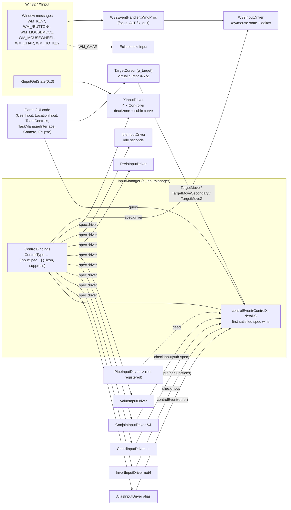
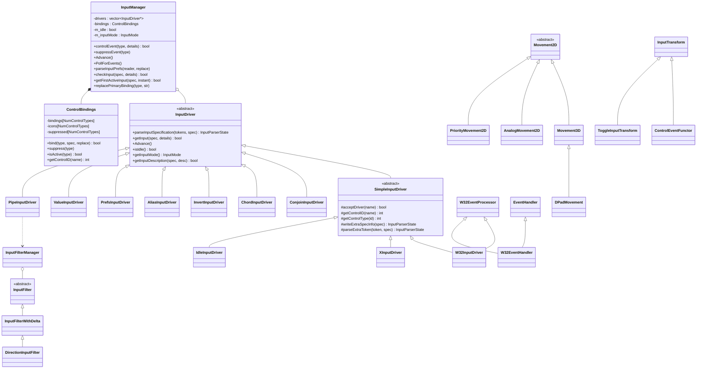
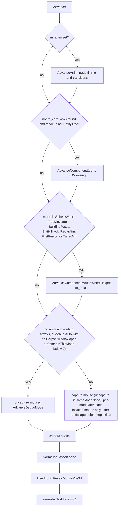
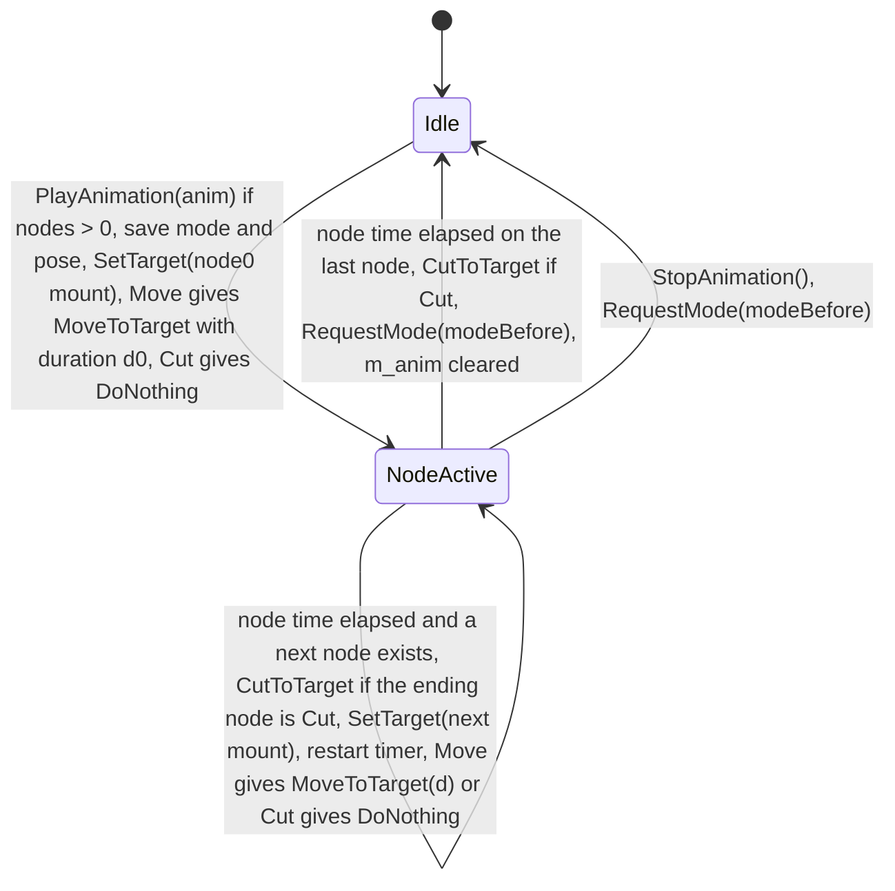

# Routed draft sections for document 06

<!-- from P01_app_core -->
## [→ 06_player_control_and_input] 5. In-match player input: `UserInput`, `LocationInput`, `TeamControls`

### 5.1 Pipeline and authority model

Input never mutates simulation state directly. Each frame the local client (a) samples controls, (b) sends **discrete command letters** (`ClientToServer::Request*`) immediately and **continuous controls** (`TeamControls`) at 10 Hz, (c) the server stamps everything received during a 0.1 s tick into one update with a sequence id, (d) every client (including the sender) applies the update's commands to the addressed team in `ProcessServerUpdates` before slicing the next tick (§2.5). Local UI feedback (sounds, route previews, help popups, camera modes) is applied immediately and locally [C] `code/location_input.cpp`, `code/network/clienttoserver.cpp:ProcessServerUpdates`.

Per-frame order inside `LocationGameLoop` (§2.6): `PollForEvents` → escape/interface keys → `TeamControls::Advance` (if no window) → `SendTeamControlsToNetwork` (10 Hz) → sim → `UserInput::Advance` → camera → `LocationInput::Advance` → `TaskManagerInterface::Advance` (P09).

Two default binding sets exist, chosen by preference **`MultiwiniaControlMethod`** (default **1** = RTS-style `data/input/input_preferences.txt`; 0 = Darwinia-style `data/input/input_preferences_darwinia.txt`), then overridden by `data/input/keyboards/<layout>.txt` and `<profile>user_input_preferences.txt` [C] `code/lib/input/file_paths.cpp:InputPrefs::GetSystemPrefsPath`, `code/main.cpp:ReadInputPreferences`. The same preference also changes several code paths below.

### 5.2 `UserInput` (`code/user_input.cpp`)

| Function | Semantics [C] |
|---|---|
| ctor | `EclInitialise(screenW, screenH)` (window framework) |
| `Advance()` | `g_inputManager->Advance()`; remove `dialog_toolsmenu` window if requested; `AdvanceMenus()`; `ControlGamePause` → `App::ToggleGamePaused()`; `CHEATMENU_ENABLED` and no windows: `ControlToggleCheatMenu` → `DebugKeyBindings::CheatButton()` [B:DEBUG]; `NETWORK_STATS_ENABLED`: `ControlToggleNetworkStats` → `DebugKeyBindings::NetworkButton()` [B:FULL] |
| `AdvanceMenus()` (priv.) | `EclUpdateMouse(x, y, ControlEclipseLMousePressed, ControlEclipseRMousePressed)`; `EclUpdate()`; if `ControlEclipseLMouseDown` over a window → `suppressEvent(ControlEclipseLMouseDown)` (clicks on UI do not reach the game) |
| `RecalcMousePos3d()` | called by `Camera` (P10) after it moves: camera click ray at cursor → `Landscape::RayHit` → `m_mousePos3d`; miss → hit the inside of a sphere centred (worldSize/2, 0, worldSize/2) of radius `GlobalWorld::GetSize() × 40` (ray reversed from 4 radii out); outside a location: sphere radius 36000 at origin |
| `GetMousePos3d()` | cached value |
| `Render()` | `EclRender()` with blend on, depth off |
| `m_mousePosHistory` | unused (render code commented out) |

`UserInput::Advance` is invoked once per frame normally and once more on a frame where `ControlMenuEscape` fires, so `InputManager::Advance` can run 2–3 times per frame (also at the bottom of `RunTheGame`'s loop) [C].

### 5.3 Continuous controls: `TeamControls::Advance` and `SendTeamControlsToNetwork`

`TeamControls::Advance` (§4.5) ORs control events into the flag bits each frame when no Eclipse window is open. Every `IAMALIVE_PERIOD = 0.1` s `SendTeamControlsToNetwork` [C] `code/main.cpp:SendTeamControlsToNetwork`:
1. If my team exists: `GetObjectUnderMouse(id, myTeam)`; if it resolves to an entity → `m_mousePos = entity->m_pos` (mouse snaps to the hovered unit); if it is a building of type RadarDish → `m_mousePos = dish->m_pos`. (`checkMouse`, `orderGiven`, `entityUnderMouse` are computed but unused [C].)
2. If the task-manager UI is visible, any Eclipse window is open, or the chat log is visible → `ClearFlags()` (position still sent).
3. `m_clientToServer->SendIAmAlive(myTeamId, teamControls)` → letter `NET_DARWINIA_ALIVE` with packed bytes; then `Clear()`.

Every client applies it in `Location::UpdateTeam(teamId, controls)` [C] `code/location.cpp:Location::UpdateTeam`:
- Multiplayer: ignored while `GamePaused()` or `GameOver()`.
- `team->m_currentMousePos = mousePos`. `unitMove = m_unitMove`; `primaryFire = m_primaryFireTarget`; `secondaryFire = primary && secondary`.
- **Selected unit** (`GetMyUnit`): InsertionSquad → `unitMove = leftButtonPressed && !primaryFire`; `unit->DirectControl(controls)`; if unitMove: `SetWayPoint(mouse)`, `m_targetDir = normalise(mouse − centre)`, `RecalculateOffsets()`; local team on `m_endSetTarget` after a move → `GameCursor::CreateMarker(mouse)` (uses a function-static `unitMoved` shared by all teams — cosmetic only); single-player + gamepad squad + secondary mode → `CycleSecondary()`; unless (gamepad && squad): primaryFire → `unit->Attack(mouse, false)`; secondaryFire → `Attack(mouse, true)` (grenade).
- **Selected entity** (`GetMyEntity`): local `m_endSetTarget` → marker; `entity->DirectControl(controls)`; then by type:
  - Engineer: unitMove → `SetWaypoint(mouse)`, deselect (`SelectUnit(-1,-1,-1)`, `SelectTask(-1)`); secondaryFire → `BeginBridge(mouse)` [B:LEGACY].
  - Officer: if `m_orders == OrderPrepareGoto` and speed < 5 → face the mouse (orders themselves come via `NET_DARWINIA_ORDERGOTO`).
  - Shaman: unitMove → `SetWaypoint`; primaryFire → `ChangeMode(mouse)`; secondaryFire → `TeleportToPos(mouse)`; neither → hide teleport targets.
  - Harvester: unitMove → `SetWaypoint`, deselect.
  - Tank: unitMove → `SetWayPoint`; keyboard: primaryFire → `PrimaryFire()`; gamepad: secondary mode → `PrimaryFire()`; always `SetAttackTarget(mouse)`.
  - Armour: handled by discrete orders (§5.4) — block commented out ("Armour control is now handled in LocationInput::AdvanceTeamControl").
- **Selected building** (GunTurret): `SetTarget(mouse)`; any of unitMove/primaryFire/directUnitMove/leftButtonPressed → `PrimaryFire()`.

### 5.4 Discrete actions: `LocationInput::Advance` / `AdvanceTeamControl` (`code/location_input.cpp`)

`LocationInput::Advance()`: if `myTeamId != 255`, no Eclipse window, chat log hidden → `AdvanceTeamControl()`; then Multiplayer extras (below).

Common inputs evaluated once per frame in `AdvanceTeamControl`: `team = GetMyTeam()`; `taskStarted` = current task exists and is in `Task::StateStarted` (placing a unit/power-up); `idUnderMouse` via `GetObjectUnderMouse(myTeam)`; `officerUnderMouse`; `highlightedObjectPos` = mouse 3-D pos, overridden to the RadarDish entrance, Crate position, non-full Armour position or Officer position under the mouse.

`GetObjectUnderMouse(id, team)` [C]: false for team 255 or while controlling a GunTurret; a marker under the mouse (`MarkerSystem::m_markerUnderMouse`) wins; otherwise building (only RadarDish, GunTurret, FenceSwitch are selectable), unit, entity (`ignoreDarwinians = true`); if no entity and a **Officer task** is being placed, `Task::FindDarwinian(mousePos, team)` (range 0); nearest of entity/unit/building by screen distance; building must be own or neutral. Unit ids are returned with `m_myTeamId` as team.

Action table (bindings: RTS default / Darwinia-style / XInput; "down" = press edge, "pressed" = held, "up" = release edge):

| # | Action | Control (default binding) | Conditions | Effect (network command → sim effect) |
|---|---|---|---|---|
| 1 | Quick-run program (single-player only) | `ControlIconsTaskManagerQuickUnitLeft/Right/Up` (XInput d-pad) | no task started, task UI hidden, not entity-tracking, nothing selected, `IsSinglePlayer()`, research owned | `RequestRunProgram(Engineer / Armour / Squad)` → `NET_DARWINIA_RUNPROGRAM` → `TaskManager::RunTask` [B:LEGACY] |
| 2 | Select object under mouse | `ControlUnitSelect` (mouse left down; XInput A) | task UI hidden | `SelectObjectUnderMouse` (below) |
| 3 | Toggle unit state | `ControlDarwinianPromote` (mouse right down; XInput X) | UI hidden, no task started, no Darwinians selected, not grace period, not game over, not paused; entity under mouse; nothing selected or it is the selected entity | Armour → `RequestToggleEntity(team, idx, secondary = order-marker under mouse)` → `NET_DARWINIA_TOGGLEENTITY` → `Armour::ToggleConversionAction()` if secondary else `ToggleLoading()`; marker-toggle on the selected armour also deselects. Officer → `RequestToggleEntity(…, false)` → if in formation or `OrderGoto`: `CancelOrders()`, else `SetOrders(pos + front)` and the handler sends `RequestSelectUnit(officer)`. Sound `ToggleUnitState`; return |
| 4 | Promote Darwinian to officer | `ControlDarwinianPromote` (same binding) | no task started and ((no Darwinians selected, not grace, not over, not paused) or single-player); nothing selected | `Task::FindDarwinian(mouse)`; if selectable → `RequestPromoteDarwinian(team, idx)` → `NET_DARWINIA_PROMOTE`: if the entity is an Officer → `DemoteOfficer` + deselect, else `PromoteDarwinian` + select the new officer; help `NotifyMadeOfficer`; return |
| 5 | Issue orders to selected Darwinians | `ControlIssueDarwinianOrders` (mouse **right** down RTS / mouse **left** down Darwinia-style; XInput X) | Multiplayer, UI hidden, no task, nothing selected, `m_numDarwiniansSelected > 0`, no circle being drawn; at most once per 1.0 s game time (`m_lastOrdersSet`) | direct route if `ControlOrderDirectRoute` (Ctrl held) or ≥ 25 % of selected Darwinians carry a WallBuster; target must be inside the landscape → `RequestIssueDarwinanOrders(team, highlightedPos, direct)` → `NET_DARWINIA_ORDERDGS` → `Location::IssueDarwinianOrders` (§5.5); sound `SetOrderGoto` |
| 6 | Begin selection circle | `ControlBeginSelectionCircle` (mouse left down; XInput A) | as #5 context but no Darwinians selected (else-branch), no circle, no officer under mouse, not grace period, `circleBlocked` false (not over a building, nor an own non-Darwinian entity/unit) | local: centre = mouse 3-D, radius 0, sound `SelectionCircle` |
| 7 | Enlarge selection circle | `ControlEnlargeSelectionCircle` (mouse left held; XInput A held) | same branch | radius += `g_advanceTime × 100` (100 units/s real time), max 100; when game time advanced since last send → `RequestSelectDarwinians(team, centre, radius)` → `NET_DARWINIA_SELECTDGS` → `Location::SelectDarwinians`; help `NotifyGroupSelectedDarwinians` |
| 8 | End selection circle | `ControlEndSelectionCircle` (mouse left up; XInput A up) | always | centre := 0, `m_lastOrdersSet = 0` (stop sound once) |
| 9 | Gamepad order to selection | `ControlUnitSecondaryFireDirected` (no PC binding; icon only) | UI hidden, no task, Darwinians selected, no circle, 1 s throttle | `RequestIssueDarwinanOrders(…, highlightedPos, false)` |
| 10 | Deselect | `ControlUnitDeselect` (Space; XInput B; SpaceNav right button) | always | `RequestSelectUnit(team, -1, -1, -1)` → `NET_DARWINIA_SELECTUNIT` → `Team::SelectUnit` + `TaskManager::SelectTask`; camera free movement; `m_previousTaskId = -1` |
| 11 | Place task / power-up | `ControlUnitCreate` (mouse left down; XInput A) | task started, UI hidden, and (single-player or not grace/over/paused) | `RequestTargetProgram(team, currentTaskId, mouse3d)` → `NET_DARWINIA_TARGETPROGRAM` → `TaskManager::TargetTask` (P09) |
| 12 | Right-click while placing | `ControlIssueSpecialOrders` (mouse right down) | task started, not enlarging circle, not gamepad placement | sound `MouseError`, `ShowSpaceDeselectHelp(true,false)` (hint: press Space) |
| 13 | Clear preview route | – | every frame | delete the route generated last frame (`m_routeId`) |
| 14 | Nothing selected | – | no unit/entity/building, 0 Darwinians | `AdvanceNoSelection()`: if UI hidden: `ControlSelectLocation` (mouse left down) → `SelectObjectUnderMouse`; `TaskManagerInterface::ControlEvent(TMTerminate)` (= `ControlIconsTaskManagerEndTask`: key **C** down; XInput Y — `code/taskmanager_interface_multiwinia.cpp`, `data/input/input_preferences.txt`) on a non-Darwinian entity → `RequestTerminateEntity(team, idx)` + deselect |
| 15 | Darwinian route preview | – | Darwinians selected, nothing else | local `GenerateRoute(selectedCentre → highlightedPos, direct)` with intensity 1.0 (deleted next frame) |
| 16 | Radar dish aiming | `ControlUnitSelect` | own selected building is a RadarDish (and no entity/unit) | `RequestAimBuilding(team, dish, otherDish->GetStartPoint() or mouse3d)` → `NET_DARWINIA_AIMBUILDING` → `RadarDish::Aim` (only if owned) |
| 17 | Release turret | `TMTerminate` or turret ownership lost | selected GunTurret | `RequestSelectUnit(-1,-1,-1)`, camera free |
| 18 | Officer: terminate (demote) | `TMTerminate` | selected Officer | `RequestTerminateEntity` + deselect + camera free (P09: Terminate → officer handling) |
| 19 | Officer orders (Multiplayer) | `ControlIssueSpecialOrders` (mouse right down RTS & Darwinia-style; XInput A RTS / X Darwinia-style) or gamepad `ControlOrderSpecialMove` | selected Officer | preview route (direct if Ctrl or formation mode); `RequestOfficerOrders(team, highlightedPos, directRoute = Ctrl, forceOnlyMove = specialMove)` where specialMove = Shift held (`ControlOrderSpecialMove`), inverted on gamepad → `NET_DARWINIA_ORDERGOTO`: forceOnlyMove → `Officer::SetWaypoint(pos)` (walk there), else `SetOrders(pos, direct)` (goto orders for Darwinians). Darwinia-style (`MultiwiniaControlMethod 0`): `ControlUnitSetTarget` (left held) also sends `RequestOfficerOrders(…, true)` (move), and right-click on a formation officer first sends `RequestOfficerNone` (`NET_DARWINIA_NONE`) |
| 20 | Officer orders (single-player) | QuickUnitLeft → `RequestOfficerFollow`; QuickUnitDown → `RequestOfficerNone`; `ControlIssueSpecialOrders` within 50 units (‖d‖² < 2500) of the officer → follow, else goto (radar dish snap) | single-player | [B:LEGACY] |
| 21 | Armour orders (Multiplayer) | `ControlIssueSpecialOrders` or gamepad `ControlOrderSpecialMove`; Darwinia-style also `ControlUnitSetTarget` | selected Armour, target in landscape | preview direct route; `deploy = specialMove` (inverted when method 0); `RequestArmourOrders(team, pos, deploy)` → `NET_DARWINIA_ORDERGOTO`: forceOnlyMove(deploy flag) → `Armour::SetWayPoint(pos)`, else `SetOrders(pos)`; friendly → order marker; deploy → deselect; sound `SetOrders` |
| 22 | Armour (single-player) | `ControlIssueSpecialOrders` → awaiting deployment; then `ControlUnitCreate` → `SetOrders(own pos)` | | **local direct mutation of sim state** (not networked) [B:LEGACY] |
| 23 | Other entity selected (Multiplayer) | – | | direct preview route entity → highlightedPos |
| 24 | Selected unit invalid | – | `m_currentUnitId` not valid | `RequestSelectUnit(-1…)`, camera free |
| 25 | Ready (grace period) | `ControlToggleReady` (Space; XInput A/B) | Multiplayer, grace period, no window | `RequestToggleReady(myTeam)` → `NET_DARWINIA_TOGGLE_READY` (toggles `LobbyTeam::m_ready` in menu / `Team::m_ready` in match) |
| 26 | Close chat on gamepad | – | chat open & gamepad mode | `ChatInputWindow::CloseChat()` |
| 27 | Open chat | `ControlLobbyChat` (Enter) | Multiplayer, chat closed, not toggled this update, not gamepad, no window | register `ChatInputWindow` (message sending P17b/P15 → `NET_DARWINIA_SEND_CHATMESSAGE` → `Location::NewChatMessage`) |
| 28 | Pause | `ControlGamePause` (Pause key) | `ToggleGamePaused` rules (§1.3) | `RequestPause()` → `NET_DARWINIA_PAUSE` → speed ramp to 0 / 1 (rate 0.2) |
| 29 | Toggle interface | `ControlToggleInterface` (Alt+X) | | `m_hideInterface` |
| 30 | Escape / in-game menu | `ControlMenuEscape` (Esc; XInput Start) | fade complete | close windows → hide task UI → open `LocationWindow` (§2.6) |
| 31 | Network stats | `ControlToggleNetworkStats` (F9) | `NETWORK_STATS_ENABLED` [B:FULL] | debug window |
| 32 | Cheat menu | `ControlToggleCheatMenu` (F11) | `CHEATMENU_ENABLED` [B:DEBUG] | |
| 33 | Debug quit | `ControlGameDebugQuit` | not bound in PC prefs (commented `XInput leftbumper`) | quit |
| 34 | Special lighting cheat | `ControlRTLoaderPixelWaveIncrease/Decrease` | `CHEATMENU_ENABLED` [B:DEBUG], inside `Location::RenderBuildings` | pref `RenderSpecialLighting` 1/0 |
| 35 | Continuous controls | `ControlUnitSetTarget` (mouse right held RTS / left held Darwinia-style; XInput X), `ControlUnitPrimaryFireTarget` (mouse right held; XInput right trigger), `ControlUnitSecondaryFireTarget` (left down + right held; XInput left trigger), `ControlUnitEndSetTarget` (mouse right up RTS / left up; XInput X up), `ControlLeftButtonPressed` (mouse left held), `ControlUnitMove` (left stick), `ControlUnitTargetDirected`/`ControlTargetMoveSecondary` (right stick), `ControlIssueSpecialOrders` | | `TeamControls` → `Location::UpdateTeam` (§5.3) |

`SelectObjectUnderMouse(id)` [C]:
- With pref `ControlRemap == 0` nothing new can be selected while anything is selected (task, entity, unit or Darwinians); also never while controlling a RadarDish or GunTurret.
- Own building: RadarDish (unless level option `LevelOptionNoRadarControl == 1`) → `RequestSelectUnit(team,-1,-1,dish)` + camera radar-aim; GunTurret or ChessPiece owned by me → select + camera turret-aim; FenceSwitch → `FenceSwitch::Switch()` **called directly on the local client** — `Switch()` toggles `m_switchValue` and the GlobalWorld building flag with no network message [C] `code/worldobject/switch.cpp:FenceSwitch::Switch`; a desync hazard if any Multiwinia map contains a FenceSwitch (X4/P07).
- Entity (non-Darwinian, `IsSelectable`, not already selected) or Unit (`IsSelectable`, not current) → `RequestSelectUnit(team, unit, index, -1)`.
- Success sound `SelectUnit` at most every 0.5 s real time.
- Clicked nothing with `MultiwiniaControlMethod 1`: if something selected and not placing a task, not controlling a squad, not gamepad-moving an officer/armour, and `ControlUnitSetTarget` not held → sound `MouseError` + `ShowSpaceDeselectHelp()`.

### 5.5 `Location::IssueDarwinianOrders(team, pos, directRoute)` (sim side)

[C] `code/location.cpp:Location::IssueDarwinianOrders`:
1. If a **connected** RadarDish (Teleport) footprint near `pos` (obstruction cell) contains `pos` within its radius → target = dish position, remember its entrance.
2. Centre = mean position of the team's `m_underPlayerControl` Darwinians (division by the count, which is 0 if none → NaN).
3. `routeId = m_routingSystem.GenerateRoute(centre, pos, directRoute)`; local team → `HighlightRoute`.
4. Look for a friendly Armour within 30 of the target with free capacity.
5. For every controlled Darwinian: armour found → `StateApproachingArmour`, `m_manuallyApproachingArmour = true`, `m_armourId`; unloading armour → `StateIdle`; else `GiveOrders(target, routeId)`, `m_followingPlayerOrders = true`; sound `GivenOrdersFromPlayer`.
6. Single-player local team: officer-orders particle trail [B:LEGACY]. Local team: `GameCursor::CreateMarker(pos)`.
7. `SelectUnit(-1,-1,-1)` — which also releases all Darwinians from player control (§4.2).

### 5.6 Command → sim effect map (this partition's call sites)

| Sender (this partition) | Letter command | Applied by (`ClientToServer::ProcessServerUpdates`) |
|---|---|---|
| `SendIAmAlive` | `NET_DARWINIA_ALIVE` | `Location::UpdateTeam` |
| `RequestSelectUnit` | `NET_DARWINIA_SELECTUNIT` | `Team::SelectUnit` + `TaskManager::SelectTask(WorldObjectId(team, unit, entity, -1))` |
| `RequestAimBuilding` | `NET_DARWINIA_AIMBUILDING` | `RadarDish::Aim` (owner check) |
| `RequestRunProgram` | `NET_DARWINIA_RUNPROGRAM` | `TaskManager::RunTask` |
| `RequestTargetProgram` | `NET_DARWINIA_TARGETPROGRAM` | `TaskManager::TargetTask` |
| `RequestTerminateEntity` | `NET_DARWINIA_TERMINATE` | `TaskManager::TerminateTask` or entity handling (P09/P15) |
| `RequestIssueDarwinanOrders` | `NET_DARWINIA_ORDERDGS` | `Location::IssueDarwinianOrders` |
| `RequestSelectDarwinians` | `NET_DARWINIA_SELECTDGS` | `Location::SelectDarwinians` |
| `RequestPromoteDarwinian` | `NET_DARWINIA_PROMOTE` | `DemoteOfficer` or `PromoteDarwinian` + `SelectUnit` |
| `RequestToggleEntity` | `NET_DARWINIA_TOGGLEENTITY` | Armour toggles / Officer cancel-or-set orders |
| `RequestOfficerOrders`, `RequestArmourOrders` | `NET_DARWINIA_ORDERGOTO` | Officer/Armour `SetWaypoint`/`SetOrders` |
| `RequestOfficerFollow` / `RequestOfficerNone` | `NET_DARWINIA_FOLLOW` / `NET_DARWINIA_NONE` | officer order mode (P15) |
| `RequestToggleReady` / `RequestSetTeamReady` (testbed) | `NET_DARWINIA_TOGGLE_READY` / `NET_DARWINIA_SET_TEAM_READY` | ready flags |
| `RequestPause` | `NET_DARWINIA_PAUSE` | `m_userRequestsPause` toggle + speed request |

<!-- from P08_crates_ai -->
## [→ 06_player_control_and_input] [→ 24_rendering] 16. MarkerSystem — objective/power-up markers and off-screen arrows

`MarkerSystem` (`g_app->m_markerSystem`, created in `App` ctor, `ClearAllMarkers` on level reset) is a **client-side presentation** list of `LocationMarker`s drawn as 2D icons over the 3D view, clamped to the screen edge with a compass arrow when off-screen. `Advance()` runs once per **render frame** in the client main loop (`code/main.cpp`, after sound/control-help) and `Render()` from `Renderer` after the 3D scene (`code/renderer.cpp`), before the MultiwiniaHelp/cursor/task-manager overlays [C]. Registration calls are made from simulation code, but markers never feed back into the simulation except via `m_markerUnderMouse`/`m_isOrderMarkerUnderMouse`, which the *local* input layer reads (`code/location_input.cpp`, `code/multiwiniahelp.cpp`) [C].

### 16.1 Marker types [C] `code/markersystem.h:LocationMarker`
| Type | Registered by | Tracks | Persistent | Off-screen arrow | Selectable | Flash on birth | Icon / colour |
|---|---|---|---|---|---|---|---|
| `TypeUnknown` (0) | — | — | — | — | — | — | — |
| `TypeFixed` | `RegisterMarker_Fixed(team,pos,icon,fromCrate=true)` — every crate/power-up effect (`Crate::Run*`) | fixed pos + 30 up | no: removed after `m_onscreenTimer ≥ 8 s` once seen | only until first seen | no | yes if team ≠ local team (after grace period) | given icon; colour circle in team colour (grey 155 in single-player); icon spins for 2.5 s (`rotation += (2.5−t)²`) |
| `TypeAttachedToCrate` | `RegisterMarker_Crate(id)` — `Location::CreateRandomCrate`, tutorials, cheat | crate pos + 20 up; dies with crate | yes | **always** | yes (all teams) | no | `icons/icon_crate.bmp`; colour circle filled bottom-up by `GetPercentCaptured()` in capturing team colour (grey 155,155,155 when neutral; α forced 1 when owned); icon rotation = `smoothedPercent × −10π` (`smoothed = 0.95·s + 0.05·p` per frame) |
| `TypeAttachedToTask` | `RegisterMarker_Task(objId, fromCrate)` — `TaskManager::TargetTask` (all task types except GunTurret, any team incl. CPU); trunk-port reinforcement armour (`Multiwinia::AdvanceTrunkPorts`, fromCrate=false) | `task->GetPosition()` + 20 up; dies when task ends | yes | for the local team | local team only | local team (after grace) | `icons/icon_<TaskName>.bmp` on team-colour circle; extra task info (`TaskManagerInterfaceMultiwinia::RenderExtraTaskInfo`) for friendly tasks; spin `(5−t)²` for 5 s if from crate. Note `RegisterMarker_Task` forces `m_fromCrate = true` regardless of the argument [C] |
| `TypeAttachedToStatue` | `RegisterMarker_Statue` — CTS statue creation (`code/multiwinia.cpp:Multiwinia::EnsureStartingStatue`, `Multiwinia::AdvanceCaptureStatue`) | statue pos + up × radius × 4 | yes | **always** | no | no | `icons/icon_statue.bmp`; circle = `(numLifters−minLifters)/(maxLifters−minLifters)` in carrying-team colour, α × 0.5 |
| `TypeAttachedToResearch` | `RegisterMarker_Research` — `Engineer` reprogramming a ResearchItem [B:LEGACY] | item + 20 up | no | until seen | no | no | crate icon, percent `(100 − reprogrammed)/100` |
| `TypeAttachedToOfficer` | `RegisterMarker_Officer` — officer promotion for the local team (`code/location.cpp`) | officer pos + 20 | yes | until seen | local team | no | draws the officer's 3D **flag** (`Officer::RenderFlag`) with ray-hit highlight instead of an icon |
| `TypeAttachedToOrders` | `RegisterMarker_Orders` — armour move orders by the local team (`code/location.cpp`) or a friendly team (`code/network/clienttoserver.cpp`) | armour waypoint (sorted +50 behind) | yes | until seen | local team, if nothing else selected or this unit selected | local team (after grace) | 0.7× size task icon + 3D ground highlight (`GameCursor::RenderUnitHighlightEffect`, size 10 + sin(5t)); deactivates when the waypoint changes or armour is within 15 wu of it; ground-sphere (r=8) mouse pick |

### 16.2 Per-frame update — `MarkerSystem::Advance` [C]
1. `SortMarkers()`: **one bubble-sort pass** per frame by squared camera distance with adjustments: own-team −50; age < 3 s → key = age (newest first); hovered (non-officer) → 0; orders +50. Nearest ends up last (drawn on top).
2. Remove inactive markers; update position from the tracked object (above table); smooth: `pos = pos·(1−5·dt) + new·5·dt` (`dt = g_advanceTime`, real frame time) unless pos is zero (snap).

### 16.3 Rendering — `MarkerSystem::Render` [C]
- Skipped when no location, in editor, or `m_hideInterface`.
- Screen position `CalculateScreenPosition`: project; on-screen if in front of camera and inside the viewport; otherwise project a point 100 wu from `camPos + front×1000` toward the target and intersect the centre→point ray with the screen rectangle (`FindScreenEdge`, slope/intercept form). Off-screen markers get `lineNormal` = direction from edge point to screen centre; all draw helpers then offset the icon 50 px inward along it and orient the compass along it.
- Alpha: on-screen accumulates `m_onscreenTimer`; seen after 1 s; seen & > 6 s → fade over 9 s; floor `minAlpha = max((camDist−350)/500, 1 − distToCentre/(0.5·screenH))`; non-persistent markers additionally fade over 2 s after 6 s; `AlwaysAtFullAlpha` (own tasks/orders) ≥ 0.75 when visible. Off-screen markers that may not show off-screen get α 0.
- Size: `icon = screenH/20`, `shadow = icon+10`, `compass = icon + screenH/30`; ×1.3 alternating 0.2/1.0 α every 0.2 s for 3 s when flashing; ×`(2 − camDist/500)` when camDist < 500; ×1.2 and α 1 when hovered/selected. On-screen icons are lifted `5·screenH/camDist` px.
- Layers: `icons/marker_shadow.bmp` (black, α 0.9), compass `icons/compass_shadow.bmp` + `icons/compass.bmp` (additive) or `icons/compass_empty.bmp` when on-screen (zero direction), `icons/marker_colour.bmp` colour circle (additive, filled to `percent`), then the icon (additive; texture coordinates rotated for spin).
- Hover: `IsMOuseInside` uses the icon's screen box; sets `m_newMarkerUnderMouse` → `m_markerUnderMouse` at end of frame. Order markers set `m_isOrderMarkerUnderMouse`.
- Other users of the helpers: `GameCursor` draws its own off-screen marker with `RenderShadow/RenderColourCircle/RenderIcon` (`code/gamecursor.cpp`); `Flag` and `MultiwiniaHelp` use `CalculateScreenPosition` [C].
- Debug/AI overlays (pref `RenderAIInfo` 1, `AIInfoTeam`): AITargets print per-team priority text and draw team-coloured arrows to neighbours; AIObjective/AIObjectiveMarker spheres only under `LOCATION_EDITOR` [C] `AITarget::Render/RenderAlphas`.

<!-- from P09_control_taskmanager -->
## [→ 06_player_control_and_input] 1. TaskManager — the Task ("program") model

### 1.1 Overview

Each `Team` owns one `TaskManager` (`new TaskManager(m_teamId)` [C] `code/team.cpp:Team::Team`). A **Task** (called a "program" on the wire and in UI strings — Darwinia's fiction) is a slot-limited, player-owned power: a spawned unit (squad, engineer, armour, harvester, officer-promotion, shaman, tank) or a targetable one-shot/duration power-up (air strike, nuke, booster, …). In Multiwinia tasks are **never** created by the player directly; they are granted by the simulation (crates, reinforcements, retribution, starting power-ups, instant units, AI). The player only **selects**, **targets (places)** and **terminates** them. All three player actions travel as network commands and are executed identically on every peer in lockstep (§1.9).

Lifetime in one sentence: *created (`RunTask`) → `StateStarted` (awaiting a target click, icon pulses) → `Target(pos)` spawns/fires the effect → `StateRunning` (tracked object alive / timer running) → removed when `Advance` returns true or `TerminateTask` is called; one-shot powers terminate themselves immediately inside `Target`.*

### 1.2 Data model

`Task` fields [C] `code/taskmanager.h:Task`, initial values [C] `code/taskmanager.cpp:Task::Task`:

| Field | Type | Init | Meaning |
|---|---|---|---|
| `m_teamId` | int | ctor arg | Owning team |
| `m_id` | int | -1 | Assigned by `TaskManager::RunTask/RegisterTask` from `m_nextTaskId++` (monotonic per team, never reused) |
| `m_type` | int | `GlobalResearch::TypeSquad` | Task type = `GlobalResearch` enum value (§1.3) |
| `m_state` | int | `StateIdle` | §1.4 |
| `m_objId` | WorldObjectId | invalid | The spawned unit/entity/building/effect being tracked |
| `m_pos` | Vector3 | (0,0,0) | Click position (air strike, turret) or running centroid of affected Darwinians (booster family); used by `GetPosition()` |
| `m_route` | Route* | NULL | Only for the (disabled) Controller task; deleted in dtor |
| `m_lifeTimer` | float (s) | 0 | Remaining life for time-limited tasks; `-1` = infinite (instant units) |
| `m_startTimer` | float (s) | 0 | Lock-out: while > 0 the task cannot be targeted or selected (UI greys it and shows the countdown) |
| `m_option` | int | -1 | Sub-variant: air strike `1` = napalm; gun turret = `GunTurret::GunTurretType*` (0 Standard, 1 Rocket, 2 Mortar, 3 Flame, 4 Subversion); reinforcement tasks get `LevelOptionDefend/AttackReinforcementMode` |
| `m_screenX`, `m_screenY`, `m_screenH` | float | 0 | **UI-only**: last on-screen position/size of this task's icon in the Multiwinia task bar (written by the renderer, read by the "recent task" fly-in animation) |

`TaskSource` [C] `code/taskmanager.h:TaskSource` — UI record for the "power-up received" pop-up: `m_taskId` (-1), `m_timer` (double, wall clock; positive = showing, negative = minimising since `-m_timer`), `m_source` (0 = crate, 1 = reinforcement, 2 = retribution), `m_rotation` (float, crate-icon spin angle).

`TaskTargetArea` [C] `code/taskmanager.h:TaskTargetArea`: `m_centre` (Vector3), `m_radius` (float), `m_stationary` (bool; true for building-anchored areas).

`TaskManager` fields [C] `code/taskmanager.h:TaskManager`, init [C] `code/taskmanager.cpp:TaskManager::TaskManager`:

| Field | Init | Meaning |
|---|---|---|
| `m_tasks` (LList<Task*>) | empty | Ordered slot list; **order matters** (UI slot index, keyboard 1–9) |
| `m_teamId` | ctor | |
| `m_nextTaskId` | 0 | Next id |
| `m_currentTaskId` | -1 | Currently selected task (the one the cursor will place) |
| `m_verifyTargetting` | true | If false, `IsValidTargetArea` accepts any in-landscape point (instant units; cheat window) |
| `m_mostRecentTaskId` | -1 | Id of last task created (read by sim code right after `RunTask`, and by help UI) |
| `m_mostRecentTaskIdTimer` | 0.0 | Wall-clock time of creation (UI) |
| `m_blockMostRecentPopup` | false | Set by reinforcement code; **no reader** (the guarding `if` in `RunTask` is commented out) [C] |
| `m_recentTasks` (DArray<TaskSource*>) | empty | Pop-up queue |
| `m_previousTaskId` | -1 | Last task explicitly selected (Tab-cycling anchor when nothing selected) |
| `m_mostRecentEntity` | invalid | Id of the most recently promoted Officer (read by AI) |

`#define POWERUP_EFFECT_RANGE 70.0` (world units) [C] `code/taskmanager.h`.

### 1.3 Task types — complete enumeration

Task type ids are the `GlobalResearch` enum [C] `code/global_world.h:GlobalResearch`; names from `GlobalResearch::GetTypeName` [C] `code/global_world.cpp` (used for icon file names `icons/icon_<Name>.bmp`, `icons/gesture_<Name>.bmp`, string ids `researchname_<Name>`, `crate_tooltip_<name>`, `newcontrols_select_<Name>`, `newcontrols_place_<Name>`, `newcontrols_delete_<Name>`).

| Id | Enum | Name string | Created by `RunTask(int)`? | `Start()` effect | `Target(pos)` effect | Terminates when (`Advance`) | `Stop()` (on terminate) | MP source |
|---|---|---|---|---|---|---|---|---|
| 0 | TypeDarwinian | Darwinian | no (returns false) | – | – | – | – | – (research level only) |
| 1 | TypeOfficer | Officer | yes | – | Promote nearest own Darwinian within 10 wu to Officer, then **terminate own task** (§1.6) | never (state forced back to Started each tick) | – | AI only (`ai.cpp` RunTask Officer); player promotion is a direct order, see §2.6 |
| 2 | TypeSquad | Squad | yes | `m_lifeTimer = 60` | Spawn squad unit of `2 + CurrentLevel(TypeSquad)` InsertionSquadies (MP level 1 → **3**) at pos, spread 10; select it; optional camera track | MP: life timer reaches 0 → `Stop()`; any: unit gone or `NumAliveEntities()==0` | all squaddies `ChangeHealth(-1000)` | Crate "Squad" |
| 3 | TypeLaser | Laser | no | – | – | – | – | – (squad weapon research) |
| 4 | TypeGrenade | Grenade | special: sets current squad's weapon | – | – | – | – | – |
| 5 | TypeRocket | Rocket | special: sets current squad's weapon | – | – | – | – | – |
| 6 | TypeController | Controller | special: sets current squad's weapon (Controller-task creation is commented out) | – | – | unit gone/empty (shares Squad branch) | – | – |
| 7 | TypeAirStrike | AirStrike | MP: normal task. SP: squad weapon (falls through to Grenade case) | – | `Crate::RunAirStrike(pos, team, m_option==1)` → `m_objId` = effect id; `m_pos=pos`; **terminate own task (no message)** | (effect gone) | – | Crate "Airstrike", "Napalm Strike" (`m_option=1`); Blitzkrieg reinforcement; retribution |
| 8 | TypeArmour | Armour | yes (`#ifndef DEMOBUILD`) | – | Spawn Armour at pos; select it | entity gone/dead | `ChangeHealth(-1000)`; **refused during Multiwinia tutorial** (`stop=false`) | Crate "Armour"; trunk-port reinforcement (Rocket Riot/Blitzkrieg) |
| 9 | TypeTaskManager | TaskManager | no | – | – | – | – | – (capacity research, SP only) |
| 10 | TypeEngineer | Engineer | yes | – | Spawn Engineer at pos + (0,10,0); select it | entity gone/dead | `ChangeHealth(-1000)` | Crate "Engineer" |
| 11 | TypeHarvester | Harvester | yes | – | Spawn Harvester at pos + (0,50,0); select it | entity gone/dead | set `m_vunerable=true`, `ChangeHealth(-1000)` | Crate "Harvester" |
| 12 | TypeNuke | Nuke | yes | – | `Crate::RunNuke(pos, team)`; terminate own task (no message) | (entity gone) | – | Crate "Nuke" |
| 13 | TypeSubversion | Subversion | yes | `m_lifeTimer = 30` | `Crate::RunSubversion(pos, team, m_id)`; Running; `SwitchTo()` | life timer ≤ 0, or no Darwinian of team still tagged `m_subversionTaskId==m_id` | – | Crate "Subversion" |
| 14 | TypeBooster | PersonalShield | yes | `m_lifeTimer = 30` | `Crate::RunBooster(...)`; Running; `SwitchTo()` | as Subversion (`m_boosterTaskId`) | – | Crate "Booster" (personal shield) |
| 15 | TypeHotFeet | HotFeet | yes | `m_lifeTimer = 30` | `Crate::RunHotFeet(...)`; Running; `SwitchTo()` | as Subversion (`m_hotFeetTaskId`) | – | Crate "Hot Feet" |
| 16 | TypeGunTurret | GunTurret | yes | – | `Crate::RunGunTurret(pos, team, m_option or Standard)`; `m_pos=pos`; if game option `MaxTurrets == -1` terminate own task, else stay Running and clear `m_currentTaskId` | building gone → done; building captured by another real team (team ≠ own and ≠ 255) → `Damage(-1000)` and done | if building still own: `Damage(-1000)`; else **refuse** (`stop=false`) | Crates "Gun Turret"/"Rocket Turret"/"Flame Turret"; reinforcement turret (Rocket Riot/Blitzkrieg) |
| 17 | TypeShaman | Shaman | yes | – | Spawn Shaman at pos; select it | (no branch — never auto-ends) | – | Instant units (`m_runAsTask`); **cannot be terminated** |
| 18 | TypeInfection | Infection | yes | – | `Crate::RunInfection`; terminate own | – | – | Crate "Spam"(Infection) |
| 19 | TypeMagicalForest | MagicalForest | yes | – | `Crate::RunMagicalForest`; terminate own | – | – | `Crate::CaptureCrate(id,team)` path (retribution "Forest") |
| 20 | TypeDarkForest | DarkForest | yes | – | `Crate::RunDarkForest`; terminate own | – | – | Crate "Dark Forest"; retribution |
| 21 | TypeAntsNest | AntNest | yes | – | `Crate::RunAntNest`; terminate own | – | – | Crate "Ant Nest" |
| 22 | TypePlague | Plague | yes | – | `Crate::RunPlague`; terminate own | – | – | none (crate mapping commented out) |
| 23 | TypeEggSpawn | Egg | yes | – | `Crate::RunEggs`; terminate own | – | – | Crate "Eggs"; retribution |
| 24 | TypeMeteorShower | MeteorShower | yes | – | `Crate::RunMeteorShower`; terminate own | – | – | Crate "Meteor"; retribution |
| 25 | TypeExtinguisher | FireExtinguisher | yes | – | **body commented out — no effect, task stays Started forever** | – | – | none (crate mapping commented out) |
| 26 | TypeRage | Rage | yes | `m_lifeTimer = 30` | `Crate::RunRage(...)`; Running; `SwitchTo()` | as Subversion (`m_rageTaskId`) | – | Crate "Rage" |
| 27 | TypeTank | Tank | yes | `m_lifeTimer = 30` unless game type TankBattle | **body commented out** | MP non-TankBattle: life timer → `Stop()`; entity gone/dead | `ChangeHealth(-1000)` | none in FULLGAME (TankBattle compiled out; crate mapping commented) |
| 28 | TypeDropShip | DropShip | no (not in `RunTask(int)` switch) | – | Spawn DropShip at the map corner nearest pos (corners inset 100 wu, height 500 wu), `SetWaypoint(pos)` | entity gone/dead | – | none found [I] (only reachable via `RunTask(Task*)`) |

Evidence: [C] `code/taskmanager.cpp:Task::Start`, `Task::Target` and every `Task::Target*`, `Task::Advance`, `Task::Stop`, `TaskManager::RunTask(int)`; crate mapping [C] `code/worldobject/crate.cpp:Crate::CaptureCrate()`, `Crate::CaptureCrate(int,int)` (P08 owns crate semantics); reinforcement [C] `code/multiwinia.cpp` reinforcement block and `Multiwinia::AdvanceRetribution`; shaman/instant units [C] `code/location.cpp:Location::InitialiseTeam`.

Notes:
- `TypeController`, `TypeGrenade`, `TypeRocket` (and `TypeAirStrike` in SP) are not slot tasks: `RunTask(type)` looks up the *current* task; if it is a Squad whose unit is an `InsertionSquad`, it calls `squad->SetWeaponType(type)` and shows `MessageSuccess`; otherwise `MessageFailure` and returns false [C] `TaskManager::RunTask(int)`. This is a squad **weapon selection**, not a new task.
- Unknown types return false [C].
- `MapGestureToTask(gestureId)`: 0→Squad, 1→Engineer, 2→Grenade, 3→Rocket, 4→AirStrike, 5→Controller, 6→Officer, 7→Armour, else -1 [C] `TaskManager::MapGestureToTask`. Gesture ids are the order of symbols in `data/gestures.txt` (§3.6).

### 1.4 Task states

`enum { StateIdle, StateStarted, StateRunning, StateStopping }` [C] `code/taskmanager.h:Task`.

```mermaid
stateDiagram-v2
    [*] --> Idle : new Task
    Idle --> Started : TaskManager::RunTask → Task::Start()
    Started --> Running : Target(pos) succeeds (spawn/effect)\n[blocked while m_startTimer > 0]
    Started --> [*] : Target() of one-shot types calls TerminateTask(self)\n(AirStrike, Nuke, Infection, MagicalForest, DarkForest,\nAntNest, Plague, Eggs, MeteorShower, GunTurret if MaxTurrets==-1,\nOfficer after promotion)
    Running --> Started : Officer only (Advance resets every tick)
    Running --> Stopping : Stop() (life timer expiry for Squad/Tank)
    Running --> [*] : Advance() returns true (object dead/gone, timer expired,\nno affected Darwinians left, turret lost)
    Stopping --> [*] : Advance() returns true (m_state == StateStopping)
    Started --> [*] : TerminateTask (player "delete") — Stop() then delete
    Running --> [*] : TerminateTask — Stop() then delete
```

- `Target()` is ignored unless `m_state == StateStarted` and `m_startTimer <= 0` [C] `Task::Target`.
- `Advance()` return value = "remove me"; it returns `m_state == StateStopping` at the end, after decrementing `m_startTimer` by one tick if > 0 [C] `Task::Advance`. `m_startTimer` therefore counts down in **all** states.
- When a Squad/Controller/Engineer/Armour/Harvester/Tank task dies while it is the current task and belongs to the local player, `MessageShutdown` is shown for 3.0 s [C].

### 1.5 Slots / capacity

`Capacity()` [C] `code/taskmanager.cpp:TaskManager::Capacity`:
- SP: `1 + research level(TypeTaskManager)` [B:LEGACY].
- MP: **6**, or **2** if `Multiwinia::IsEliminated(team)`.

`CapacityUsed()` = `m_tasks.Size()` — **every** task occupies a slot, including Started (unplaced) ones and running turrets [C].

`RunTask(Task*)` [C] `TaskManager::RunTask(Task*)`:
1. If `CapacityUsed() >= Capacity()`: local player in MP gets `dialog_powerup_limit` location message; in SP `MessageFailure` 2.5 s; the task is deleted; return false.
2. Else assign `m_id = m_nextTaskId++`.
3. **Insertion order**: MP — insert before the first task whose state is `StateStarted` (so placed/running tasks stay left of unplaced ones); if none, append. SP — append.
4. `Start()`.
5. SP only: auto-select it (`m_currentTaskId = id`). **MP never auto-selects a newly granted task** [C].
6. `m_mostRecentTaskId = id`, `m_mostRecentTaskIdTimer = GetHighResTime()`, push `TaskSource{id, GetHighResTime(), source 0}` into `m_recentTasks`.
7. MP and now full and local team → `dialog_powerup_limit` message.

`RegisterTask(Task*)`: capacity-checked append (at the end, no MP re-ordering) without `Start()` [C] `TaskManager::RegisterTask`. Users:
- **[B:FULL] Radar-dish squad migration**: when the first squaddie of an `InsertionSquad` enters a RadarDish/Teleport and a new unit is created at the destination, the old Squad task is removed (no `Stop()`), a new `Task{type=Squad, state=Running, objId=new unit}` is registered with the old `m_lifeTimer` carried over in MP, and — if registration succeeds — `SelectTask(newId)` is called (in the sim, on all peers). The new task gets a **new id** and moves to the **end of the slot list**; weapon type and controller id are copied to the new unit [C] `code/worldobject/teleport.cpp:Teleport::EnterTeleport`.
- [B:LEGACY] restoring saved Darwinia running programs (Engineer, InsertionSquad) [C] `code/location.cpp:Location::InitialiseTeam` (running-program block).

`TaskManager::Advance()` (sim; once per tick from `Team::Advance` slice 1) [C] `TaskManager::Advance`, `code/team.cpp:Team::Advance`:
1. MP: one bubble pass from the end: if task *i* is Running and *i-1* is Started, swap them (Running tasks drift left one position per tick).
2. `AdvanceTasks()`: if the current task is Started and the team is local, refresh `MessageSuccess(type)` for 2.5 s (keeps the "place your X" caption alive); then for each task call `Advance()`; if it returns true: if it was current → `m_currentTaskId=-1` and `Team::SelectUnit(-1,-1,-1)`; remove and delete.
3. `GlobalResearch::AdvanceResearch()` (note: called once per team per tick).
4. SP: clear `m_mostRecentTaskId` 1.0 s after creation. MP: after 3.0 s flip `m_mostRecentTaskIdTimer` negative (`-now`) = "minimising".
5. MP: for each `TaskSource`: after 3.0 s flip `m_timer` to `-now`; 1.0 s after that remove it.

`StopAllTasks()` empties/deletes all tasks without `Stop()`, `m_currentTaskId=-1` (team elimination) [C] `code/team.cpp` elimination block.

### 1.6 Targeting rules (`IsValidTargetArea`, `GetTargetArea`, `TargetTask`)

`TargetTask(id,pos)` [C] `TaskManager::TargetTask`: if `IsValidTargetArea(id,pos)` → `task->Target(pos)`; re-lookup the task (it may have deleted itself); if it still exists with a valid `m_objId` and type ≠ GunTurret → `MarkerSystem::RegisterMarker_Task(objId)` (on-screen off-screen marker, P08). Returns validity.

`IsValidTargetArea(id,pos)` [C] `TaskManager::IsValidTargetArea`:
1. False if task missing or `pos` outside the landscape.
2. If `m_verifyTargetting == false` → true.
3. Officer: true iff `EntityGrid::GetFriends(pos, r=10.0)` contains a Darwinian of the team.
4. GunTurret: false if `RestrictionZone::IsRestricted(pos, true)`; false if any building's `DoesSphereHit(pos, 10.0)`; false if within **400 wu** of a non-friendly owned (team ≠ 255) TrunkPort or within **200 wu** of a non-friendly owned SpawnPoint; else true.
5. Booster/HotFeet/Subversion/Rage: true iff at least one entity of the own team is within `POWERUP_EFFECT_RANGE` = 70 wu (`EntityGrid::GetNumNeighbours`).
6. Otherwise: true iff `pos` lies within any area from `GetTargetArea` (distance ≤ radius); for the "anywhere" area (centre (0,0,0)) a `RestrictionZone::IsRestricted(pos,true)` point is skipped.

`GetTargetArea(id)` [C] `TaskManager::GetTargetArea` (note the deliberate fall-throughs):

| Task type | Areas produced (MP) | Areas (SP, [B:LEGACY]) |
|---|---|---|
| Engineer, Harvester | circle r=**100** around each own unit whose troop type is InsertionSquadie or Engineer (non-stationary), **then falls through to Armour/Tank → (MP) falls through to Squad** | + own ControlTower r=75; + open TrunkPorts r=120 (break) |
| Armour, Tank | (MP) falls through to Squad list | open TrunkPorts (`m_openTimer>0`) r=120 |
| Squad | r=**75** (stationary) around every friendly (`IsFriend`) SpawnPoint, GunTurret, MultiwiniaZone, TrunkPort | friendly ControlTowers r=75 |
| Officer, AirStrike, Nuke, Subversion, Booster, HotFeet, GunTurret, Shaman, Infection, MagicalForest, DarkForest, AntsNest, Plague, EggSpawn, MeteorShower, Extinguisher, Rage, DropShip | one area centre (0,0,0), r=99999.9 ("anywhere") | same |

(For Officer/GunTurret/booster-family the special checks in `IsValidTargetArea` pre-empt the area list.)

`Promote(id)` [C] `Task::Promote`: spawn an Officer at the Darwinian's position with its velocity; create `5 + AppRandom()%5` `Particle::TypeControlFlash` particles with velocity (sfrand(5), frand(15), sfrand(5)); set `darwinian->m_promoted = true` (the Darwinian removes itself — P03). `Demote(id)` (static; unused in this scope) spawns a team-0 Darwinian at an entity's position with the same flash.

`TargetOfficer(pos)` [C] `Task::TargetOfficer`: refused if the team currently has a unit, entity or building selected; else `FindDarwinian(pos, team)` = nearest (squared distance) Darwinian of the team (MP: exactly the team; SP: any friendly team) within 10 wu; promote; `TerminateTask(self)`; select the new officer; `m_mostRecentEntity = officer id`; local: `MessageSuccess(Officer)` 2.5 s + sound `GestureSuccess`.

Spawn side effects for local team: Squad → if pref `OTHER_AUTOMATICCAM` (`"AutomaticCamera"`, P17b) is 2, or 0 while in gamepad mode, request camera entity-track of the squad [C] `Task::TargetSquad`. Sounds: MP Squad/Armour/Harvester use `Crate::TriggerSoundEvent(CrateReward*, pos, team)`; others `GestureSuccess` (TypeGesture).

### 1.7 Selection (`SelectTask`, `SwitchTo`, cycling)

- `SelectTask(int id)` [C]: `m_currentTaskId = id`; if ≠ -1: `m_previousTaskId = id`; find task (return silently if missing); `task->SwitchTo()`; `GameCursor::BoostSelectionArrows(2.0)` (UI-only effect called from sim — see §6 D5).
- `SelectTask(WorldObjectId)`: selects the task whose `m_objId` matches team/unit/index; else `m_currentTaskId=-1`. Called by the network `SelectUnit` command so that clicking a unit in the world also selects its task [C] `code/network/clienttoserver.cpp` `NET_DARWINIA_SELECTUNIT` handler.
- `SwitchTo()` [C] `Task::SwitchTo`: if local team and camera in RadarAim/TurretAim → camera FreeMovement. Then by type: Squad → `Team::SelectUnit(unitId,-1,-1)`; Engineer/Armour/Harvester/Shaman/Tank → `SelectUnit(-1, entityIndex, -1)`; Controller → select the Squad task with the same `m_objId`; Officer → deselect all; HotFeet/Booster/Subversion/Rage → for non-CPU teams set `m_underPlayerControl = true` on every Darwinian tagged with this task id, then deselect all (this is how the power-up's affected Darwinians become a directly controlled group); default → deselect all.
- `GetNextTaskId()` returns the id after the current one (wrapping; -1 current ⇒ first) [C]; used by the legacy interfaces.
- `TaskManagerInterface::AdvanceTab()` (all variants, client side) [C] `code/taskmanager_interface.cpp:TaskManagerInterface::AdvanceTab` — runs when the TM overlay is hidden or the input mode is keyboard:
  - **Cycle right** on `ControlUnitCycleRight` (keys `]`, **Tab**; pad right bumper; SpaceNav left button) or on `ControlGesturesSwitchUnit` (Tab) when pref `ControlMethod == 0`: anchor = current task, or `m_previousTaskId` if none; next index (wrap to 0).
  - **Cycle left** on `ControlUnitCycleLeft` (`[`; pad left bumper): previous index from the current task (wrap to last).
  - If no anchor found, index 0. Plays `MouseOverIcon` (TypeInterface). If the chosen task is a Squad → camera `RequestEntityTrackMode(objId)`, else camera `ModeFreeMovement`. Then SP: `SelectTask` directly; **MP: `ClientToServer::RequestSelectProgram(myTeam, taskId)`**.
- Deselect (`ControlUnitDeselect`, Space / pad B) is handled in `LocationInput` (P01): sends `RequestSelectUnit(-1,-1,-1)`, camera free, `m_previousTaskId = -1` [C] `code/location_input.cpp:LocationInput::Advance`.

### 1.8 Termination (`TerminateTask`)

`TerminateTask(id, showMessage=true)` [C] `TaskManager::TerminateTask`:
1. Not found → false.
2. Shaman → false (cannot be terminated).
3. Squad: `ShutdownController()` first — every Darwinian of the team with `m_controllerId == task id` calls `LoseControl()`; if any were found, show `MessageShutdown(Controller)` (3 s) and **return true without removing the squad** (first press releases controlled Darwinians, second press kills the squad).
4. GunTurret when `MaxTurrets != -1`: if the turret building now belongs to another team → false.
5. Multiwinia tutorial: if tutorial 1, or tutorial 2 before `m_tutorial2AICanSpawn` → false (cannot terminate) [C] (`g_app->m_multiwiniaTutorial`, P19).
6. If `showMessage` and local team → `MessageShutdown(type)` 3.0 s.
7. Remove from list, `Stop()`, delete; clear `m_currentTaskId` if it was current; return true.

Note `Stop()` may itself decline (`stop=false`: Armour in tutorial; turret not owned) but the task object is deleted regardless in step 7 [C] — i.e. the entity survives while its task slot is freed.

### 1.9 Mapping to network commands

All player task actions are sent as `ClientToServer` letters and executed by every peer when the server echoes them in the ordered update stream (P15) [C] `code/network/clienttoserver.cpp:ClientToServer::RequestRunProgram`, `RequestTargetProgram`, `RequestSelectProgram`, `RequestTerminateProgram` and the matching branches of the update processor:

| Player action | Sent by (client) | Command string (`NET_DARWINIA_COMMAND`) | Payload | Executed on every peer |
|---|---|---|---|---|
| Create task (SP/legacy only; MP UI never creates) | Icons/Gestures/Multiwinia `RunScreenZone("NewTask"/"SelectWeapon")`; `LocationInput` quick-unit d-pad (SP) (the squad weapon-cycling sender in `location_input.cpp` is commented out) | `RunProgram` | `TEAMID` (uchar), `PROGRAM` (uchar task type) | `team->m_taskManager->RunTask(program)` |
| Place / fire current task | `LocationInput::Advance` on `ControlUnitCreate` (mouse left down / pad A) while current task is Started, TM overlay not visible, and (MP) not grace period/game over/paused | `TargetProgram` | `TEAMID`, `PROGRAM` (uchar **task id**), `POSITION` (Vector3 = `UserInput::GetMousePos3d()`) | `TaskManager::TargetTask(id,pos)` |
| Select task | `AdvanceTab` (MP), Multiwinia/Icons `RunScreenZone("SelectTask")` | `SelectProgram` | `TEAMID`, `PROGRAM` (uchar task id) | `TaskManager::SelectTask(id)` |
| Terminate current task | Multiwinia `AdvanceTerminate` on `ControlIconsTaskManagerEndTask` (**C** key / pad **Y**) when no Eclipse window open; Icons equivalent | `Terminate` (`NET_DARWINIA_TERMINATE`) | `TEAMID`, `PROGRAM` (uchar task id), `ENTITYID` = -1 | if `PROGRAM != 255`: `TerminateTask(program)`; else kill `team->m_others[ENTITYID]` (`RequestTerminateEntity`) |
| Select unit in world | `LocationInput` (P01) | `SelectUnit` | team, unit, entity, building ids | `Team::SelectUnit(...)` then `TaskManager::SelectTask(WorldObjectId)` |

Wire-format consequences [C] (from the `unsigned char` parameter types):
- Task **ids** are truncated to 8 bits on the wire while `m_nextTaskId` is an unbounded int. A team's 256th and later tasks (id ≥ 256) can no longer be selected/targeted/terminated correctly (the receiver looks up `id mod 256`). [I] Rarely reached in a match (needs ≥ 256 tasks granted to one team); a new design should use ≥ 16-bit ids.
- Terminating with no current task sends `PROGRAM = (uchar)-1 = 255` → interpreted as "terminate entity" with `ENTITYID = -1` → no-op. Task id 255 itself can never be terminated over the network.

```mermaid
sequenceDiagram
    participant Sim as Sim (all peers)
    participant UI as Local client UI
    participant Net as ClientToServer
    Sim->>Sim: Crate captured → TaskManager::RunTask(type)\n(state Started, not selected in MP)
    Sim-->>UI: m_recentTasks pop-up (wall-clock timers)
    UI->>Net: Tab / [ / ] / bumpers / key 1-9 → RequestSelectProgram(team, taskId)
    Net->>Sim: SelectProgram → SelectTask(id) → SwitchTo()
    UI->>Net: Left click (ControlUnitCreate) → RequestTargetProgram(team, currentTaskId, mousePos3d)
    Net->>Sim: TargetProgram → TargetTask → IsValidTargetArea → Task::Target(pos)
    Sim->>Sim: spawn/effect; one-shots terminate themselves
    UI->>Net: C / pad Y → RequestTerminateProgram(team, currentTaskId)
    Net->>Sim: Terminate → TerminateTask(id) → Stop()
```

### 1.10 Edge cases and defects (task core)

| # | Behaviour [C] | Ref |
|---|---|---|
| E1 | Multiwinia tutorial 1 (and tutorial 2 until `MultiwiniaHelp::m_tutorial2AICanSpawn`): `TerminateTask` refuses, so one-shot tasks (Nuke, Infection, forests, AntNest, Plague, Eggs, Meteor) whose `Target` relies on self-termination remain `StateStarted` and **can be fired again**; AirStrike sets Running first and is then removed by `Advance` when the effect object disappears. | `Task::TargetNuke` etc., `TaskManager::TerminateTask` |
| E2 | `Task::Stop()` refusing (`stop=false`) does not stop `TerminateTask` from deleting the task — the armour/turret survives without a slot. | `TaskManager::TerminateTask` |
| E3 | Extinguisher and Tank `Target*` bodies are commented out: such a task would stay Started forever (not reachable in FULLGAME). | `Task::TargetExtinguisher`, `Task::TargetTank` |
| E4 | `Capacity()` in MP ignores research; an eliminated team gets 2 slots (for retribution powers). | `TaskManager::Capacity`; `Multiwinia::AdvanceRetribution` checks `CapacityUsed() < Capacity()` before granting |
| E5 | Squad life timer only counts down in MP and only while `> 0`; instant-unit squads get `m_lifeTimer = -1` (permanent). | `Task::Advance`, `Location::InitialiseTeam` |
| E6 | `StartingPowerups` game option: each team gets N random crate rewards at team init (excluding Randomiser, CrateMania, Darwinians, Bitzkreig, SpawnMania, Plague, RocketDarwinians, SpaceShip, Spam, Triffids, SpeedUpTime, SlowDownTime, Forest, TheBeast and invalid ones); then every non-Shaman task gets `m_startTimer = 30.0` s (locked, greyed, countdown shown). | `code/location.cpp:Location::InitialiseTeam` |
| E7 | `TaskManager::Advance` calls `GlobalResearch::AdvanceResearch()` once per team per tick (research is a single global object). | `TaskManager::Advance` |
| E8 | A squad passing through a RadarDish gets a **new task id** and moves to the last slot (keyboard 1–9 mapping changes); if registration fails (e.g. capacity dropped to 2 on elimination) the squad continues **without a task** (no life timer, no slot, cannot be terminated via the task bar). | `Teleport::EnterTeleport` |
| E9 | Tab is bound to both `ControlUnitCycleRight` and `ControlIconsTaskManagerDisplay`: with a Shaman selected, one Tab press both requests the next task and opens the Shaman UI (the select request applies a round-trip later) [I]. | `data/input/input_preferences.txt`; `TaskManagerInterfaceMultiwinia::Advance` |

---

<!-- from P09_control_taskmanager -->
## [→ 06_player_control_and_input] 2. Task-manager user interfaces

### 2.1 Variant selection (build/runtime)

All three variants are compiled into FULLGAME. `TaskManagerInterface::CreateTaskManager()` [C] `code/taskmanager_interface.cpp`:

```
delete old g_app->m_taskManagerInterface
if inputMode != GAMEPAD and IsSinglePlayer() and pref "ControlMethod" == 0 → TaskManagerInterfaceGestures
else if Multiplayer()                                                      → TaskManagerInterfaceMultiwinia
else                                                                       → TaskManagerInterfaceIcons
```

Called at app init (`App::App`, game mode None → Icons), at every location entry (`code/main.cpp:DoEnterLocation`), when the keybinding/control preferences window changes the control method (`code/interface/prefs_keybindings_window.cpp`), and by `SwitchTaskManagerForX360Controller()` each client frame when the input mode switches to/from gamepad while the overlay is hidden (`code/main.cpp`). `NET_DARWINIA_START_GAME` sets `m_gameMode = GameModeMultiwinia` before the location loads [C] `code/network/clienttoserver.cpp`, so **every Multiwinia match (including the tutorial) uses `TaskManagerInterfaceMultiwinia`** [B:FULL]. Gestures and Icons are reachable only in Prologue/Campaign → [B:LEGACY]. Default prefs: `ControlMethod = 1`, `MultiwiniaControlMethod = 1` [C] `data/default_preferences.txt`.

Per client frame, `TaskManagerInterface::Advance()` runs after `LocationInput::Advance()` and before the script/sound/control-help/shaman/marker/help advances [C] `code/main.cpp` client loop; `Render()` is the last overlay in `Renderer` after markers, help, shaman UI, user input, game cursor and chat [C] `code/renderer.cpp`. Attract mode sets `m_lockTaskManager = true`, which makes `Advance()` return immediately (all variants) [C] `code/attract.cpp` [B:DEAD: `ATTRACTMODE_ENABLED` off].

### 2.2 Base class `TaskManagerInterface`

Fields [C] `code/taskmanager_interface.h`: `m_visible` (overlay shown), `m_highlightedTaskId` (task under the cursor/pad focus, read by `GameCursor::GetHighlightedObject`), `m_verifyTargetting` (unused here), `m_currentMessageType`, `m_currentTaskType`, `m_messageTimer` (wall-clock expiry), `m_viewingDefaultObjective`, `m_lockTaskManager`, `m_quickUnitVisible` (no reader), `m_showingRecentTask` (set by the MP pop-up renderer).

Message types (`enum`): `MessageSuccess`=0, `MessageFailure`=1, `MessageShutdown`=2, `MessageResearch`=3, `MessageResearchUpgrade`=4, `MessageObjectivesComplete`=5, `NumMessages`. String id = `taskmanager_msg<N>` (English: RUN PROGRAM, SYNTAX ERROR, PROGRAM TERMINATED, ACQUIRED, UPGRADED, OBJECTIVES COMPLETED) [C] `data/language/english.txt`. Special task-type values 999 → `taskmanager_mapeditor`, 998 → `taskmanager_accessallareas` [C] `RenderMessages`. `SetCurrentMessage(type, taskType, seconds)` sets expiry = now + seconds.

`enum TMControl { TMTerminate, TMDisplay }`; pure virtuals `ControlEvent(TMControl)`, `Advance`, `Render`, and four "control help" advisories used by `ControlHelpSystem` (P10): `AdviseCreateControlHelpBlue`, `AdviseCreateControlHelpGreen`, `AdviseCloseControlHelp`, `AdviseOverSelectableZone`.

`IsVisible()` = `m_visible || ShamanInterface::IsVisible()` [C] — so the Shaman summon UI counts as "task manager visible" for input gating.

`ScreenZone` (clickable rectangle in the 600-high virtual canvas): `m_name` (action string, < 256 chars), `m_toolTip` (string id, < 1024), `m_x,m_y,m_w,m_h`, `m_data` (int argument), `m_scrollZone` (gamepad navigation group; -1 = none), `m_subZones` (has child weapon zones) [C] `ScreenZone::ScreenZone`. Zones are regenerated every frame by the renderer into `m_newScreenZones` and swapped into `m_screenZones` at the start of the next `Advance` (one-frame latency).

`KeyboardShortcut` = `ControlEventFunctor(controlType)` + action name + data; `operator()` = `g_inputManager->controlEvent(type)`; `noun()` = bound key description (shown in tooltips as `help_keyboardshortcut` + " : " + noun) [C] `code/lib/input/transform.cpp:ControlEventFunctor`.

`RunDefaultObjective(cond)`: for BuildingOnline/Offline/ResearchOwned objectives sets `m_viewingDefaultObjective` (Sepulveda/camera parts are `USE_SEPULVEDA_HELP_TUTORIAL` → dead) [B:LEGACY].

### 2.3 `TaskManagerInterfaceMultiwinia` [B:FULL] — the live interface

#### 2.3.1 What the player sees

The Multiwinia interface has **no pop-up task-manager screen in practice**: `SetVisible()` is only reached inside `if (g_app->IsSinglePlayer())` [C] `TaskManagerInterfaceMultiwinia::Advance`, so `m_visible` stays false for the whole match. The player-facing elements are always-on overlays:

| # | Element | When drawn | Layout (virtual canvas H=600, W=600·aspect) | Rendering | Ref |
|---|---|---|---|---|---|
| U1 | **Placement-area sparkles** (world) | current task is Started and its target-area list is not the single "anywhere" area | for each `TaskTargetArea`: two `Particle::TypeMuzzleFlash` particles (size 60) per frame at centre ± (r·sin a, 0, r·cos a), a = `g_gameTime`·3 rad/s, y = ground + 5 | particle system | `RenderTargetAreas` |
| U2 | **Power-up received pop-up** ("recent task") | for each `TaskSource` in `m_recentTasks` whose task still exists; not after game over | stacked at (W/2, 600/4.1 + i·boxH·1.1); `overallScale=0.4`; iconSize = min(t·3,1)·(600/5)·0.4; boxH = min(t·3,1)·(600/4.2)·0.4; box width = max(text widths)+1.5·iconSize | see §2.3.4 | `RenderRecentRunTask` |
| U3 | **Centre status message** | `m_currentMessageType != -1` and not expired | centred at (W/2, 370); size 40, growing by 15·√(2−remaining) in the last 2 s | `g_titleFont`, outline pass alpha³ then fill alpha = clamp(remaining·0.5,0,1) | `RenderMessages` |
| U4 | **Crate help tooltip** | current task is Started | box width 0.35·600 = 210, top y=420, centred on W/2; text wrapped at 1.75·210, font 11 (+20 % gap); black 0.75 fill, white 0.5 outline; text outline+fill (`g_editorFont`) | caption `crate_tooltip_<name>` (lower-cased); napalm → `crate_tooltip_napalmstrike`; turret option 0/1/3 → gun/rocket/flame tooltip, other → gun; missing → "Missing String:\n<id>" | `RenderCurrentCrateHelp` |
| U5 | **Running-task bar** | whenever ≥1 task (drawn in the `!m_visible` branch every frame) | centred horizontally at y≈550; slot pitch = iconSize + 10; iconSize eases from 60 to 55; selected slot ×1.1, others ÷1.1 | see §2.3.3 | `RenderRunningTasks` |
| U6 | **Tab / LB hint** | ≥1 task | left of first slot: centre (x₀ − 1.2·size, y + size/2 − 0.2·size), half-size 0.4·size | `icons/button_tab.bmp` (keyboard mode) or `icons/button_lb.bmp` (other modes); black 0.75 pass then white 0.75 | `RenderRunningTasks` |
| U7 | **Focus highlight** | `m_currentScreenZone` valid — **never in MP** (see note below); the same highlight is drawn explicitly around the current task icon while it is unplaced (§2.3.3) | zone grown by 10 % of its height on every side | MP: `icons/mouse_highlight.bmp`, additive, a **square** of side h at (x,y) | `RenderScreenZones`, `RenderScreenZoneHighlight` |
| U8 | Standard cursor redraw | only if `m_visible` (never in MP) | – | `GameCursor::RenderStandardCursor` | `Render` |

`Render()` draws nothing when: editing, no location, any Eclipse window open, `m_hideInterface` (Alt+X toggles), Multiwinia grace period, game over, or the local team currently controls a GunTurret building [C] `TaskManagerInterfaceMultiwinia::Render`.

#### 2.3.2 Controls handled (Multiwinia variant)

`Advance()` order [C]: return if locked → `AdvanceTab()` (§1.7) → display/hide logic → `AdvanceScreenZones()` → `AdvanceKeyboardShortcuts()` → `AdvanceTerminate()` → default-objective cleanup → recent-task timer cleanup.

| Control (binding name) | Default binding (`data/input/input_preferences.txt`) | Effect in MP | Ref |
|---|---|---|---|
| `ControlIconsTaskManagerDisplay` / `ControlIconsTaskManagerDisplayDown` | Tab down / pad Back down | If the selected entity is a Shaman → `ShamanInterface::ShowInterface` (P04). Otherwise nothing (SP would show the overlay; Back-down also records `m_taskManagerDownTime`). | `Advance` |
| `ControlIconsTaskManagerHide` | Tab up; pad Back down; pad B down | Hides the Shaman interface if visible (overlay hide path unreachable in MP). | `Advance` |
| `ControlUnitCycleRight` | `]`, **Tab** down; pad right bumper; SpaceNav left button | Select next task (wraps) via `RequestSelectProgram`; camera tracks squads, else free camera | `TaskManagerInterface::AdvanceTab` |
| `ControlUnitCycleLeft` | `[` down; pad left bumper | Select previous task | same |
| `ControlGesturesSwitchUnit` (only if pref `ControlMethod == 0`) | Tab down | Same as cycle right | same |
| `ControlTaskManagerSelectTask1`…`9` | keys 1…9 down | `RunScreenZone("SelectTask", 0…8)`: if slot index valid and its `m_startTimer <= 0` → `RequestSelectProgram(myTeam, task id)` + sound `SelectTask` (Interface); pad mode also calls `HideTaskManager()` | `AdvanceKeyboardShortcuts`, `RunScreenZone` |
| `ControlTaskManagerEndTask` | **unbound** in all shipped input files | would call `TerminateTask(current)` **locally** (non-networked) — dormant | `RunScreenZone("DeleteTask")` |
| `ControlUnitCycleLeft`/`Right`, `ControlCameraForwards`/`Backwards` as shortcuts "ScreenUp"/"ScreenDown" | as above / W, Up / S, Down | **no handler** in the MP `RunScreenZone` → no-op | constructor, `RunScreenZone` |
| `ControlIconsTaskManagerEndTask` | **C** down; pad **Y** down | If no Eclipse window: `RequestTerminateProgram(myTeam, m_currentTaskId)` (no-op if none selected, see §1.9) | `AdvanceTerminate` |
| `ControlActivateTMButton` | mouse left up; pad A up; Enter down | Activates `m_currentScreenZone` — **never fires in MP** because the focus index is forced to −1 while hidden | `AdvanceScreenZones` |
| `ControlIconsTaskManagerDisplayUp` (after Back held > 0.5 s) | pad Back up | Activates focused zone ("hold Back, release on a button") | `ButtonHeld`, `ButtonHeldAndReleased` |
| `ControlMenuUp` / `ControlMenuDown` | pad d-pad/sticks up/down (repeat) | Only while visible (never in MP): move focus within current scroll zone, wrapping | `AdvanceScreenZones` |
| `ControlMenuLeft` / `ControlMenuRight` | pad d-pad/sticks left/right (repeat) | Only while visible: switch scroll zone 1↔2, 2→3 when the zone has sub-zones, step through zone 3 | `AdvanceScreenZones` |
| `ControlCloseTaskHelp` | read but body commented out | no effect | `Advance` |

`RunScreenZone(name, data)` actions in this variant [C]: `NewTask` (refused with `MessageFailure` 2.5 s while another non-Officer task is Started; else if research owned → `RequestRunProgram` + sound `GestureBegin`; pad → hide), `SelectTask` (above), `DeleteTask` (local `TerminateTask(data or current)` + sound `DeleteTask` — only reachable via zones rendered while visible or the unbound key), `SelectWeapon` (research owned → `RequestRunProgram(weapon)` + `GestureBegin` + `GestureSuccess`), `Research` (`SetCurrentResearch`), `Objective` (data = ±(index+10); runs cut-scene script or default objective; hides). In MP only `SelectTask` zones are ever generated (by the bar, scroll zone 2) [C] `RenderRunningTasks`.

**The MP task bar is display-only for the mouse** [C] `AdvanceScreenZones`: mouse hover is evaluated only `if (m_visible)`, and when hidden `m_currentScreenZone` is reset to −1 every frame (the initial auto-focus only picks zones whose `m_scrollZone` equals `m_currentScrollZone` = 1, while bar zones use 2). Clicking a task icon therefore does nothing; tasks are selected with keys 1–9, Tab/`[`/`]`/bumpers, or by selecting the task's unit in the world (`SelectUnit` → `SelectTask(WorldObjectId)`).

**World-hover echo**: when hidden, if the object under the mouse (`LocationInput::GetObjectUnderMouse`) is the `m_objId` of one of my tasks, the matching `SelectTask` zone is flagged "highlight only" (would suppress activation) [C] `AdvanceScreenZones` — the line that would focus it is commented out, so in MP this has no visible effect. `m_highlightedTaskId` = task of the focused `SelectTask` zone, hence always −1 in MP.

Advisories for `ControlHelpSystem` [C]: Blue = focus valid ∧ Back held > 0.5 s ∧ Back pressed ∧ free slot; Green = focus valid ∧ free slot ∧ focused zone is `NewTask`; OverSelectableZone = focused zone exists and is not `NewTask`; CloseControlHelp = visible ∧ ¬(focus valid ∧ held ∧ pressed).

#### 2.3.3 Running-task bar (U5) — exact rendering

Per frame [C] `TaskManagerInterfaceMultiwinia::RenderRunningTasks`:
1. `numTasks = m_tasks.Size()` (capacity is computed but **not** drawn — empty slots are invisible). Static, eased layout: `factor = min(g_advanceTime, 0.1)·10`; `s_iconSize → 55`, `s_iconX → W/2 − (s_iconSize+10)·numTasks/2 + s_iconSize/2 + 5`, `s_iconY → 550`, each `s = s·(1−factor) + target·factor` (statics: initial 60/…/550).
2. For each slot i (x advancing by iconSize+10): selected index = index of `m_currentTaskId`.
   - **Shadow**: `icons/marker_shadow.bmp` (alpha texture), colour (0,0,0,0.81), quad half-extent (iconSize+10)·k/2.2 with k = 1.1 if selected else 1/1.1; blend SRC_ALPHA/ONE_MINUS_SRC_ALPHA.
   - **Colour disc**: `icons/marker_colour.bmp`, additive (SRC_ALPHA, ONE), half-extent (iconSize+10)·k/2.4; colour = team colour; for a GunTurret task the *current owner's* colour of the turret building, and skipped if the turret is neutral (team 255); skipped if `m_startTimer > 0`; RGB ×0.1 if state ≠ Running; alpha × max(0.5, |sin(4·gameTime)|) while Started.
   - **Icon**: `icons/icon_<TypeName>.bmp`, additive, size iconSize·k; colour (0.5,0.5,0.5,1) if `m_startTimer > 0`, (1,1,1,0.6) if not Running, else white. Creates `ScreenZone("SelectTask", "newcontrols_select_<Name>" or "newcontrols_place_<Name>" if Started, icon rect, data=i, scrollZone=2)` and stores `m_screenX/Y/H` in the task.
   - **Current-and-unplaced highlight**: if the task is current and not Running → `RenderScreenZoneHighlight` around the icon (+5 px each side).
   - **Extra info** `RenderExtraTaskInfo(task, centre, size, alpha=1, targetOrders=false, taskManager=true)` (also used by `MarkerSystem` for world markers, P08):

| Condition | Text / graphic | Position (relative to icon centre) | Font size |
|---|---|---|---|
| `m_startTimer > 0` | countdown `%2.0f` s (the outline pass uses the malformed format "%2.0", a code defect) | (+3, +2) | 12 |
| Engineer | current action (`Engineer::GetCurrentAction()` string id) + spirit count | action (+3, +25) size 7; count (+3, +2) | 7 / 12 |
| Harvester | spirit count | (+3, +19) | 12 |
| Squad | "x<alive>"; plus life timer `%1.0f` if > 0, red (1,0,0) when ≤ 10 s | count (+11, +5) size 10; timer (+3, +0.4·size) | 10 / 12 |
| Booster, HotFeet, Subversion, Rage, Tank (non-TankBattle), while Running with life > 0 | life timer `%1.0f`, red when ≤ 10 s | (+3, +0.4·size) | 12 |
| Armour | passenger count (unless targetOrders); `icons/arrows_load.bmp` when state (or `m_conversionOrder` for targetOrders) = Loading, `icons/arrows_unload.bmp` when Unloading; `icons/arrows_moving.bmp` when in the task bar and > 30 wu from its waypoint | count (+3, +0.33·size), font 0.2·size; arrows: quad half-extent size/2.2, subtractive-ish shadow pass (SRC_ALPHA, ONE_MINUS_SRC_COLOR) then additive 0.3 alpha | – |

   - **Compass** (`RenderCompass`) if `task->GetPosition() != 0`: a direction pointer around the icon toward the task's world position. On-screen target (in front of camera and inside viewport): vector from icon to the projected point. Off-screen: cast the click-ray through the icon, take the point 1000 wu along it, step 100 wu toward the target, project, and use that direction. Quad of half-size `compassSize` (= 0.77·iconSize, ×k) oriented along the vector; `icons/compass_shadow.bmp` black 0.8 alpha-blend then `icons/compass.bmp` additive, alpha 1.0 if current else 0.5.
   - **Delete icon** (only if visible → never in MP): `icons/icon_delete.bmp` at (x, y+0.6·size), size 0.4·size, zone `DeleteTask` with data = task id.

#### 2.3.4 "Power-up received" pop-up (U2) — exact rendering

Data comes from `TaskManager::m_recentTasks` (§1.5). For entry i, t = now − |m_timer| [C] `RenderRecentRunTask`:
- Spin: while t < 3, `m_rotation += g_advanceTime · 20 · (3 − t)^4`.
- scale = min(3t, 1); alpha = min(2t, 1).
- Not minimising (m_timer > 0, first 3 s): black 0.9 box, a vertical gradient overlay (0.3 black → 0.3 white), white 0.4 outline; caption line 1 = source text (`multiwinia_cratepowerupfound` / `multiwinia_reinforcementsgiven` / `multiwinia_retributiongiven`) at 0.7·fontH in grey 0.7; line 2 = upper-cased power name (napalm → `cratename_napalmstrike`; turrets → `GunTurret::GetTurretTypeName(option)`), size fontH (×0.8 if `TextLanguage` ≠ english); fontH = 0.3·boxH. Crate source (0) also draws a faint (alpha 0.15) additive `icons/icon_crate.bmp` rotated by −0.02·m_rotation, clipped to the box.
- Minimising (negative timer, 1 s): icon flies from the pop-up toward its slot in the bar (`m_screenX/Y`), lerp factor min(2t,1); size lerps from 600/6 to `m_screenH`; alpha × (1 − min(t,1)).
- Always: shadow `icons/icon_shadow.bmp` (1.25×, SRC_ALPHA/ONE_MINUS_SRC_COLOR, grey 0.9·alpha), team-colour ×0.6 disc `icons/marker_colour.bmp` additive, then the task icon additive with alpha.

#### 2.3.5 Selection model — what the task manager contributes

- **Selectable via task manager**: any task in `m_tasks` (slots 1–9 by key; all by Tab/bumper cycling). Selecting a task routes through `Task::SwitchTo` (§1.7): it selects the task's unit/entity, or for booster-family powers makes the affected Darwinians `m_underPlayerControl` (a temporary group selection), or deselects for one-shot powers so the next left click places them.
- **Single selection**: one current task (`m_currentTaskId`) and one current unit/entity/building per team (`Team::SelectUnit`) [C] `code/team.cpp:Team::SelectUnit`. Selecting an Officer entity clears the current task (`SelectTask(-1)`); `Team::m_blockUnitChange` suppresses selection changes while reinforcements are spawned.
- **Task locked**: `m_startTimer > 0` blocks select (zone/key) and target.
- Darwinian group selection (selection circle), officer/armour orders and promotion are handled in `LocationInput` (P01) — summarised in §2.6 for completeness.

### 2.4 `TaskManagerInterfaceIcons` [B:LEGACY] (Prologue/Campaign with ControlMethod ≠ 0 or gamepad)

Three vertically-sliding screens over a virtual 600-high canvas: `ScreenOverlay`=0, `ScreenTaskManager`=1, `ScreenObjectives`=2, `ScreenResearch`=3; `m_screenY` eases to `m_desiredScreenY` ∈ {−1 (research), 0, +1 (objectives)} with `diff = g_advanceTime·10`, snapping when within 0.001 [C] `AdvanceScrolling`. (Despite the "Y" naming the projection offsets `left` horizontally by `m_screenY·600`, [C] `SetupRenderMatrices`.)

Shortcuts [C] constructor: `NewTask` Squad/Engineer/Officer/Armour ← `ControlIconsTaskManagerNewSquad/NewEngineer/NewOfficer/NewArmour` (F1–F4); `SelectWeapon` Grenade/Rocket/AirStrike/Controller ← `ControlIconsTaskManagerSelectGrenade/Rocket/AirStrike/Controller` (F5–F8); `SelectTask` 0–8 ← `ControlTaskManagerSelectTask1–9` (1–9); `DeleteTask` ← `ControlTaskManagerEndTask` (unbound); `ScreenUp` ← `ControlTaskManagerScrollUp` (W) and `ControlXBoxMenuCycleUp` (pad LB repeat); `ScreenDown` ← `ControlTaskManagerScrollDown` (S) and `ControlXBoxMenuCycleDown` (pad RB repeat).

Controls [C] `Advance`, `AdvanceScreenEdges`, `AdvanceTerminate`: Display (Tab down / pad Back down) → Shaman UI if a Shaman is selected, else SP shows overlay (sound `Show`); Hide (Tab up / Back / B) → `HideTaskManager` (mouse warped to screen centre, re-select current task, `Gesture::EndGesture`, sound `Hide`); screen edges: cursor y < 10 px → research, y > H−10 → objectives (only when not scrolling; sound `Slide`); `ControlIconsTaskManagerEndTask` (C / pad Y) → `RequestTerminateProgram`; `ControlActivateTMButton` activates zone; pad navigation as §2.3.2 but `ButtonHeld()` hard-wired to false. Extra screen-zone actions: `ShowScreen` (data = screen id), `ScreenUp`, `ScreenDown` (only while visible). `NewTask` for Squad also increments `GlobalWorld::m_spSquaddiesUsed[location index]` (location 12 → index 0, else id−1; sentinel 3599999 → 1) [C].

Elements [C] `Render` and `Render*`: centre message (same formula as U3 but `g_gameFont`, and the first `MessageObjectivesComplete` adds the mission time to the leaderboard time `m_spLevelTimes`); title bar (grey `textures/interface_grey.bmp`, tint (0.5,0.5,1,0.7), 80 px high, plus a line); bottom divider `textures/interface_divider.bmp` 26 px; tooltip with typewriter reveal (50 chars/s) at (20, H−12) size 12 plus shortcut noun at (W−250, H−12); running-task column at x≈40→80 (visible), y from 130, icon 50→70 px, gap 10, slot shadows for **every capacity slot**, Started icons blink (invisible when `fmod(gameTime,1) < 0.4`), current task alpha 0.9 else 0.27, booster life timer, compass (0.75·size, yellow 0.8 when current), squad weapon sub-icons (Grenade/Rocket/AirStrike/Controller if researched; current weapon bright; zones `SelectWeapon`, scroll zone 3; parent zone `m_subZones=true`), delete icons (zone `DeleteTask`); "Create new task" menu (`newcontrols_createnewtask`) listing Squad, Engineer, Officer, Armour, Harvester if researched (rows 46 px, zones `NewTask`, scroll zone 1, tooltips `newcontrols_create_<Name>`); objectives screen (primary/secondary lists with complete/incomplete colours, objective counter, statistics box: time hh:mm:ss, kills = team 2 kills, survivors = team 0 Darwinian count, squaddies used); research screen (one row per researched item, 3 progress bars with `RequiredProgress(level)`·0.85 px, version "v<level>.0", current research pulses |sin(2·gameTime)|); navigation arrows or LB/RB button icons (pad + `ControlHelpEnabled`), blinking alpha 155/255 every second; "launchpad" Prologue progress bar with 5 hard-coded objectives (building ids 66, global buildings 1/2/3, research item 130, spawn points 18/51/52/54) and a 256-particle starburst celebration (`textures/starburst.bmp`, alpha decay 0.015–0.03 per frame, uses non-synced `frand`) [C] `EvaluteTutorialObjectives`, `AdvanceProgressBar`, `RenderProgressBar`. `RenderGestures` and `RenderOverview` exist but are never called in this variant [C].

### 2.5 `TaskManagerInterfaceGestures` [B:LEGACY] (Prologue/Campaign, keyboard/mouse, ControlMethod = 0)

Overlay is **held**: visible while `ControlGesturesTaskManagerDisplay` (Alt pressed / pad X pressed) is true; released → `HideTaskManager` [C] `Advance`. Screens slide horizontally (`m_screenX` eases at `g_advanceTime·5`, ±1). Screen-edge or `ControlGestureLeft` (A, Left, pad LB, pad d-pad left — note the typo `donw` in that binding line) / `ControlGestureRight` (D, Right, pad RB, d-pad right) switch screens, 10 px border, only when not drawing [C] `AdvanceScreenEdges`.

Gesture capture [C] `AdvanceGestures` (all while the overlay is held and the central screen is shown and no screen zone is focused):
1. If `ControlGestureActive` (left mouse pressed / pad A pressed) or a recording is in progress and the current task is Started (not Officer) → `MessageFailure` 2.5 s, abort (must place first).
2. Begin: not recording ∧ GestureActive → `Gesture::BeginGesture`, sound `GestureBegin` (TypeGesture).
3. While held: `AddSample(g_target->X(), g_target->Y())` every client frame (screen pixels).
4. Release: `EndGesture`, sound `GestureEnd`; if `GestureSuccess()` → `taskType = MapGestureToTask(GetSymbolID())`; if researched → `RequestRunProgram(taskType)` + sound `GestureSuccess`, else `MessageFailure`; if not success → `MessageFailure` + sound `GestureFail`.

Terminate: `ControlGesturesTaskManagerEndTask` (Ctrl+C chord / pad Y) → **local** `TerminateTask(current)` and `m_currentTaskId = -1` (SP only, not networked) [C] `AdvanceTerminate`. Shortcuts: `SelectTask` 0–8 (keys 1–9), which here set `m_currentTaskId` and call `SelectTask` locally.

Elements: title "taskmanager_taskmanager" size 50; grey title bar 100 px high spanning 3 screens; silver dividers; central red panel `textures/interface_red.bmp` multiplied by the alpha mask `icons/gesture_alpha.bmp` (red channel → alpha, two texture units, GL_COMBINE); **gesture guide** `icons/gestureguide.bmp` 320×320 centred at (W/2, H/2 − 10), additive 0.7; running-task row at y=490 (icon 70, shadow 78, gap 18, all capacity slots; Started blink; current alpha 1.0, visible 0.5, hidden 0.3; engineer/squad info; compass size 53); overview tabs (research / task manager / objectives) at y=95, 100×16 boxes; objectives and research screens as in Icons (research rows also show `icons/gesture_<Name>.bmp` for every type except Darwinian, Laser, TaskManager); live gesture trail (§3.9) [C] `Render*`.

### 2.6 Multiwinia player-action reference (cross-partition summary; primary owner P01 `code/location_input.cpp`, P10 input)

Listed so 06 has one table; evidence [C] `code/location_input.cpp:LocationInput::AdvanceTeamControl`, `AdvanceNoSelection`, `SelectObjectUnderMouse`, `GetObjectUnderMouse`, bindings `data/input/input_preferences.txt`. "MP" gates: most world actions are suppressed during the grace period, game over and pause.

| Action | Mouse/keyboard | Pad | Condition | Network command | Notes |
|---|---|---|---|---|---|
| Select object under cursor | left down (`ControlUnitSelect`) | A down | overlay hidden; pick priority: marker icon under mouse, else nearest of entity/unit/building along the click ray; buildings only RadarDish, GunTurret, FenceSwitch (own or neutral) | `SelectUnit` | RadarDish (unless level option NoRadarControl) → camera radar-aim; own GunTurret/ChessPiece → camera turret-aim; FenceSwitch → `Switch()` called **locally** (blocked type in MP). If pref `ControlRemap == 0` nothing new can be selected while something is selected (the key is absent from default prefs → `GetInt` default −1 → restriction inactive). Clicking empty ground with something selected (MultiwiniaControlMethod 1) → "MouseError" sound + Space-to-deselect help |
| Deselect | Space down (`ControlUnitDeselect`) | B down | always | `SelectUnit(-1,-1,-1)` | camera free; `m_previousTaskId = -1` |
| Place / fire current task | left down (`ControlUnitCreate`) | A down | current task Started, overlay hidden, not grace/game over/pause | `TargetProgram` | right-click instead → "MouseError" + help hint |
| Select / cycle task | 1–9; Tab, `]`, `[` | RB / LB | §2.3.2 | `SelectProgram` | |
| Terminate current task | C | Y | §2.3.2 | `Terminate` | |
| Terminate entity under cursor | C (`TMTerminate`) | Y | nothing selected; entity is not a Darwinian | `RequestTerminateEntity` + `SelectUnit(-1)` | same key press also sends task terminate |
| Demote (kill) selected officer | C | Y | officer selected | `RequestTerminateEntity` | |
| Release a controlled turret | C | Y | own GunTurret selected | `SelectUnit(-1)` | also auto-released if the turret changes owner |
| Promote Darwinian to Officer | right down (`ControlDarwinianPromote`) | X down | nothing selected, no Darwinians selected, no task being placed; nearest own selectable Darwinian within 10 wu of cursor | `RequestPromoteDarwinian` | the AI uses the Officer *task* instead (§1.3) |
| Toggle armour load/unload / conversion order | right down on armour | X | nothing else selected or it is the selected armour; on the order marker → toggles the conversion order and deselects | `RequestToggleEntity(team, idx, secondary)` | |
| Toggle officer orders | right down on officer | X | as above | `RequestToggleEntity(team, idx, false)` | on every peer: if officer is in formation mode or has `OrderGoto` → `CancelOrders()`; else `SetOrders(pos + front)` and each peer issues `RequestSelectUnit` for that officer [C] `code/network/clienttoserver.cpp` TOGGLEENTITY handler (officer semantics P03) |
| Select Darwinians (selection circle) | left down starts at cursor, left held grows radius by 100·dt up to **100 wu**, left up ends | A down/held/up | nothing selected, no task Started, not over an own non-Darwinian object/building, not grace period | `RequestSelectDarwinians(team, centre, radius)` sent whenever network time advances | particles drawn by GameCursor (§4.6) |
| Order selected Darwinians | right down (`ControlIssueDarwinianOrders`) | X down; RT (`UnitSecondaryFireDirected`, unbound in data) | Darwinians selected; ≥ 1.0 s since last order | `RequestIssueDarwinanOrders(team, pos, directRoute)` | Ctrl (`OrderDirectRoute`) = direct route; forced direct if ≥ 25 % carry a WallBuster; target snaps to RadarDish entrance, crate, non-full armour or officer under cursor |
| Officer goto / special move | right down (`ControlIssueSpecialOrders`); Shift = `OrderSpecialMove`; Ctrl = direct route | pad A (special = X toggles) | officer selected | `RequestOfficerOrders(team, pos, direct, specialMove)` | MultiwiniaControlMethod 0: left (`UnitSetTarget`) = force-move, right in formation first sends `RequestOfficerNone` |
| Armour move / deploy | right down; Shift = deploy (inverted when MultiwiniaControlMethod 0) | A / X | armour selected | `RequestArmourOrders(team, pos, deploy)`; deploy also deselects | MultiwiniaControlMethod 0: right-button-held `UnitSetTarget` = move |
| Radar dish aim | left down while dish selected | A | dish selected | `RequestAimBuilding(team, dish, pos or other dish start point)` | |
| Toggle ready (grace period) | Space | A / B | grace period | `RequestToggleReady` | after game over the same key returns to menu |
| Shaman summon UI | Tab | Back | Shaman selected | (P04) | |


---

<!-- from P09_control_taskmanager -->
## [→ 06_player_control_and_input] 3. Gesture recognition (`Gesture`)

### 3.1 Liveness

`App::App` always constructs `m_gesture = new Gesture("gestures.txt")`, which loads and trains on `data/gestures.txt` at start-up [C] `code/app.cpp`. The recogniser is **only driven** by `TaskManagerInterfaceGestures` (SP, [B:LEGACY]) and the gesture editor window (`GESTURE_EDITOR` && `USE_SEPULVEDA_HELP_TUTORIAL` → [B:DEAD]) [C] `code/interface/gesture_window.cpp`. In Multiwinia the only calls are `EndGesture()` from `HideTaskManager()` (which recomputes features of a stale/empty buffer and prints "Sorry, not enough mouse samples" when < 3 samples) [C]. Gesture symbols are therefore **not a Multiwinia mechanic**; they are documented in full because they are a self-contained, reusable recogniser.

### 3.2 Algorithm overview

A **Rubine-style linear statistical classifier** (13 global stroke features, per-class mean vectors, a pooled ("common") covariance matrix, linear discriminant evaluation, soft-max confidence, Mahalanobis rejection) [C] `code/gesture.cpp`; [I] the feature list and training maths match D. Rubine, "Specifying Gestures by Example" (SIGGRAPH 1991), a public-domain algorithm — safe to re-implement.

Constants [C] `code/gesture.h`:

| Name | Value | Meaning |
|---|---|---|
| `GESTURE_MAX_MOUSE_SAMPLES` | 1024 | sample buffer (debug assert on overflow) |
| `GESTURE_MAX_FEATURES` | 13 | features f1..f13 (array index 0 unused, always 0) |
| `GESTURE_MAX_TRAINERS` | 32 | max training examples per symbol (assert `< 32`) |
| `GESTURE_MIN_SAMPLE_DISTANCE` | 6.0 px | a new sample closer than this to the previous accepted one is dropped |
| `GESTURE_CONFIDENCETHRESHOLD` | 0.5 | min confidence for success |
| `GESTURE_MAHALANOBISTHRESHOLD` | 3000.0 | max Mahalanobis distance for success |
| confidence temperature | 500.0 | divisor in the soft-max (literal in `RunComparison`) |

### 3.3 Sampling

- `BeginGesture()`: clear samples and results, `recording = true`.
- `AddSample(x, y)` — called once per client frame while the button is held with **integer screen pixel** coordinates of the target cursor (`g_target->X/Y`, origin top-left, y down). Drops the sample if its Euclidean distance to the last accepted sample is < 6.0 px; else stores `{x, y, time = GetHighResTime()·1000}` (milliseconds, double). No resampling, no smoothing, no normalisation of position/scale/rotation — the features themselves are scale-dependent (lengths in px, speeds in px²/ms², durations in ms) [C] `Gesture::AddSample`.
- `EndGesture()`: `recording = false`; `CalculateFeatureSet()`; `RunComparison()`.

### 3.4 Features (computed in `CalculateFeatureSet`, n = number of samples; requires n ≥ 3, otherwise the previous feature set is kept)

Let sᵢ = (xᵢ, yᵢ, tᵢ).

| f | Definition as implemented [C] | Note |
|---|---|---|
| f1 | (x₂−x₀)/‖s₂−s₀‖ | initial direction cosine (uses 3rd point to reduce noise) |
| f2 | (y₂−y₀)/‖s₂−s₀‖ | initial direction sine |
| f3 | √((R−L)² + (B−T)²) where L = min x, T = min y, B = max y, and **R is updated as "if xᵢ > R then R = yᵢ"** (initial R = 0, L = T = 999999, B = 0) | bounding-box diagonal — **defect**: R takes a y value |
| f4 | atan((B−T)/(R−L)) (`iv_atan`) | bounding-box diagonal angle, same defect |
| f5 | ‖s_{n−1} − s₀‖ | start–end distance |
| f6 | (x_{n−1}−x₀)/f5 | start–end cosine (NaN if f5 = 0) |
| f7 | (y_{n−1}−y₀)/f5 | start–end sine |
| f8 | Σ_{j=0}^{n−3} ‖s_{j+1}−s_j‖ | total length — **defect**: last segment omitted |
| f9 | Σ_{k=1}^{n−2} θₖ, θₖ = atan( (aₓ·b_y − bₓ·a_y) / (aₓ·bₓ + a_y·b_y) ), a = s_{k+1}−s_k, b = s_k−s_{k−1} | total turning; CRT `atan` (not atan2) so each θ ∈ (−π/2, π/2) |
| f10 | Σ |θₖ| | |
| f11 | Σ θₖ² | |
| f12 | max over consecutive pairs of (Δx²+Δy²)/Δt² (pairs with Δt = 0 skipped) | max speed², px²/ms² |
| f13 | Σ Δt over pairs with Δt ≠ 0 | duration, ms |

### 3.5 Training (`TrainSystem`, run after loading and after every added sample)

For C symbols with nᶜ trainers each (training vectors include index 0, always 0):
1. Mean μᶜᵢ = (1/nᶜ) Σₑ fᵢ⁽ᵉ⁾ for i = 0..13.
2. Per-class scatter Sᶜᵢⱼ = Σₑ (fᵢ⁽ᵉ⁾−μᶜᵢ)(fⱼ⁽ᵉ⁾−μᶜⱼ), i, j = 0..13.
3. Pooled covariance **as implemented**: Σᵢⱼ = [ Σ_c ( Sᶜᵢⱼ / nᶜ − 1.0 ) ] / ( Σ_c nᶜ − C ). (The source writes `S / (double) n - 1.0`; operator precedence makes it "divide by n, then subtract 1", not "divide by n−1". Because f0 ≡ 0, row/column 0 of Σ is the constant −C/(N−C), which keeps the 14×14 matrix invertible.) **A re-implementation must reproduce this exact formula to reproduce the shipped classification with `data/gestures.txt`.**
4. Σ⁻¹ by Gaussian elimination with scaled partial pivoting (`code/lib/invert_matrix.cpp:inv`, 1-based).
5. Weights: wᶜⱼ = Σ_{i=1}^{13} Σ⁻¹ᵢⱼ μᶜᵢ for j = 1..13; wᶜ₀ = −½ Σ_{i=1}^{13} wᶜᵢ μᶜᵢ.

### 3.6 Classification and thresholds (`RunComparison`, `GetSymbolID`, `GestureSuccess`)

- Score rᶜ = wᶜ₀ + Σ_{i=1}^{13} wᶜᵢ fᵢ (0 for classes with no trainers).
- Symbol = first index with the maximum score.
- Confidence of class i = 1 / Σⱼ exp((rⱼ − rᵢ)/500).
- Mahalanobis of class i = Σ_{j=1}^{12} Σ_{k=1}^{12} Σ⁻¹ⱼₖ (fⱼ−μⁱⱼ)(fₖ−μⁱₖ) — **defect**: loops stop at `< GESTURE_MAX_FEATURES`, so f13 (duration) is excluded.
- Success ⇔ confidence(best) ≥ 0.5 ∧ Mahalanobis(best) ≤ 3000.0.
- Accessors return −1.0 for out-of-range symbol ids.

Training-file format (`data/gestures.txt`, grammar owned by X1b) [C] `Gesture::LoadTrainingData`/`SaveTrainingData`: line 1 = number of symbols; then per symbol a line with the trainer count and a line with trainerCount × 14 floats (f0..f13 per trainer, f0 written as 0). Shipped file: **8 symbols × 20 trainers** [C] (parsed by `_work/scripts/P09_gestures.py`).

Validation [I] (simulation, not original code): a faithful Python port including all defects (`_work/scripts/P09_gesture_sim.py`) accepts 160/160 training vectors and classifies all eight `data/gesture_demos/*.txt` strokes (replayed at 40 ms/sample, screen height 768 and 600) as their intended symbol with confidence 0.57–1.00 and Mahalanobis 72–887 (< 3000). These are usable as regression test vectors.

### 3.7 Symbol set (complete)

Symbol id = order in `data/gestures.txt`; mapping by `TaskManager::MapGestureToTask` [C]; shapes [I] from the stroke coordinates in `data/gesture_demos/<name>.txt` (screen space, y down) and confirmed by the trained means [C] (`_work/scripts/P09_gestures.py` output).

| Id | Task | Stroke (from demo file) | Mean f5 start–end px | Mean f13 duration ms | Mean f9 turning rad | Icon |
|---|---|---|---|---|---|---|
| 0 | Squad | closed triangle: from apex down-right, left along the base, back up to apex | 24.2 | 955 | −0.22 | `icons/gesture_squad.bmp` |
| 1 | Engineer | square arch "⊓": up, right, down | 234.7 | 739 | −1.29 | `icons/gesture_engineer.bmp` |
| 2 | Grenade | rounded arch "∩": up, curving over to the right, down | 351.8 | 482 | −3.14 | `icons/gesture_grenade.bmp` |
| 3 | Rocket | right-pointing arrow: shaft left→right, then up-left, down, back up-right to the tip (arrowhead) | 449.4 | 902 | −2.84 | `icons/gesture_rocket.bmp` |
| 4 | AirStrike | three-spoke star drawn as out-and-back strokes from a centre (up, down-right, down-left) | 25.8 | 1845 | 0.15 | `icons/gesture_airstrike.bmp` |
| 5 | Controller | zig-zag with three peaks "/\/\/\" | 344.1 | 1133 | −0.04 | `icons/gesture_controller.bmp` |
| 6 | Officer | "V" / tick: down-right then up-right | 364.6 | 407 | −0.82 | `icons/gesture_officer.bmp` |
| 7 | Armour | closed shield/pentagon: right along top, down, down-left to a point, up-left, up to start | 30.3 | 1358 | −0.57 | `icons/gesture_armour.bmp` |

The gesture guide image `icons/gestureguide.bmp` (all symbols) and `icons/gesture_alpha.bmp` (panel mask) are used only by the Gestures interface [C].

### 3.8 Gesture → action

Successful symbol → task type (above) → if `GlobalResearch::HasResearch(type)` → `RequestRunProgram(team, type)`; Squad/Engineer/Officer/Armour create tasks; Grenade/Rocket/AirStrike(SP)/Controller switch the current squad's weapon (§1.3) [C] `TaskManagerInterfaceGestures::AdvanceGestures`, `TaskManager::RunTask(int)`.

<!-- from P09_control_taskmanager -->
## [→ 06_player_control_and_input] 4. GameCursor — cursors, highlights, placement previews

### 4.1 Cursor objects

`MouseCursor` = a textured screen- or world-space quad with optional blurred shadow [C] `code/gamecursor.cpp:MouseCursor`. Constructed from a BMP: the bitmap is registered as a texture under its file name, then a copy blurred with `ApplyBlurFilter(10.0)` is registered as `shadow_<file>`. Defaults: size 20, hotspot (0,0) (fraction of size; (0,0) = top-left, (1,1) = bottom-right), not animating, shadowed, additive, colour white.

| Member | Texture | Hotspot | Size (px or wu) | Animated | Colour / blend | Used in MP? |
|---|---|---|---|---|---|---|
| `m_cursorStandard` | `icons/mouse_game.bmp` | (0.055, 0.070) | 35 | no | white, additive, shadowed | **yes** — default pointer |
| `m_cursorPlacement` | `icons/mouse_placement.bmp` | (0.5, 0.5) | 40 (varies) | per call | white, additive | **yes** — "trying to enter" marker; SP placement, orders markers |
| `m_cursorDisabled` | `icons/mouse_disabled.bmp` | (0.5, 0.5) | 60 | no | red (255,0,0), additive | **yes** — invalid enter; (texture also drawn as a red sprite for invalid placement / no route) |
| `m_cursorMoveHere` | `icons/mouse_movehere.bmp` | (0.5, 0.5) | 30 | yes | (255,255,150) additive | SP only |
| `m_cursorHighlight` | `icons/mouse_highlight.bmp` | (0.5, 0.5) | 30 (set by caller) | yes (off when used) | white additive | SP only (the same texture is the MP task-bar focus highlight) |
| `m_cursorTurretTarget` | `icons/mouse_turrettarget.bmp` | (0.5, 0.5) | caller | no | white, **alpha-blend**, **no shadow** | **yes** — crosshair |
| `m_cursorSelection` | `icons/mouse_selection.bmp` | (0.5, 0.5) | caller | no | team colour | SP only |
| `m_cursorEnter` | `icons/mouse_enter.bmp` | (0.5, 1.0) | 50 | yes | white additive | SP only |
| `m_cursorMissile` | – (NULL, never created) | – | – | – | – | no |

Animation: `GetSize() = size + |sin(4·g_gameTime)|·size·0.6` (pulses between 1.0× and 1.6× at 4 rad/s) [C] `MouseCursor::GetSize`.

2D render (`MouseCursor::Render(x, y, angle)`): top-left = (x − s·hotX, y − s·hotY); translate to quad centre, rotate by `angle` degrees about Z; shadow pass with `shadow_` texture, blend (SRC_ALPHA, ONE_MINUS_SRC_COLOR), colour (1,1,1,0) (darkens what is beneath by the shadow's colour); main pass with colour, blend additive or alpha; depth writes off, culling off; texcoords V flipped (BMP bottom-up) [C].

3D render (`Render3D(pos, front, up, cameraScale)`): quad lying in the plane spanned by `right = front × up` and `front`, size s = GetSize() (+ (camDist − 300)/20 when camera farther than 300 wu and cameraScale), offset by hotspot; same two passes (main pass always additive) [C]. (`Render3D(pos)` derives `up` from `normalMap(pos.x, pos.y)` — **defect**: should be pos.z; unused.) `RENDER_CURSOR_3D` is never defined, so all in-game cursors use the projected-2D path [C].

### 4.2 Frame flow in Multiwinia

`Renderer` calls, in order, `GameCursor::Render()` then `GameCursor::RenderBasicCursorAlwaysOnTop()` [C] `code/renderer.cpp`.

1. `Render()`: return if the interface is hidden (Alt+X) and no window is open; return if at a location without a local team (unless `SPECTATOR_ONLY`, defined only for the hardware-compat and assault-stress targets); in MP → `RenderMultiwinia()` and return [C].
2. `RenderMultiwinia()` (3D matrices; returns if no location or any Eclipse window is open) [C]:
   a. `RenderSelectionCircle()` (§4.6).
   b. Team colour for effects: team colour (or (255,255,100) if none) + (100,100,100) clamped, alpha 150.
   c. **Highlighted object** (§4.3): if any → `RenderUnitHighlightEffect(pos, radius, teamCol)`; if it is an Armour → route line from armour to its waypoint (`RoutingSystem::RenderRouteLine`, intensity 0.5); if it is an Officer in formation mode, not my selected entity, and in `StateToWaypoint` → route line to its waypoint + formation preview at the waypoint facing the travel direction. Store `m_objUnderMouse`.
   d. **Selected object**: unless it is a GunTurret building, or a squad/squaddie currently in transit inside any RadarDish (`m_inTransit`), draw `RenderUnitHighlightEffect` with teamCol + (50,50,50), alpha 255.
   e. **Promotable Darwinian**: if nothing highlighted or selected, no Darwinians selected and no selection circle → `Task::FindDarwinian(mouse3d, myTeam)`; if found and selectable → highlight ring at its predicted position, radius 2× entity radius.
   f. **Officer formation preview**: if my selected entity is an Officer and the cursor is not on it: if `Officer::IsFormationToggle(mouse3d)` → preview formation at the officer facing the cursor; else if in formation mode → preview at the cursor facing away from the officer.
3. `RenderBasicCursorAlwaysOnTop()` (MP only; skipped when interface hidden and no window): 2D; if no window open → `RenderSelectedObjectNearCursor()` (§4.5) and `RenderTryingToEnterEffect()` (§4.7); then `RenderCrosshair()`; if it returned false → `RenderStandardCursor(x, y)`.

The standard pointer is therefore drawn in MP whenever no crosshair applies; with Eclipse windows open only the icon/enter effects are suppressed and `RenderCrosshair` returns false, so the pointer is still drawn [C] `RenderBasicCursorAlwaysOnTop`.

### 4.3 Highlight / selection resolution

`GetHighlightedObject(id, pos, radius)` [C]:
- Source: if the TM overlay is hidden, `LocationInput::GetObjectUnderMouse` (marker icon under mouse first; then nearest of entity/unit/building along the click ray; buildings limited to RadarDish/GunTurret/FenceSwitch; none while controlling a turret; while placing an Officer task a nearby Darwinian counts). If visible, the task under the TM focus (`m_highlightedTaskId`).
- Accepted kinds: building = RadarDish, Bridge, own GunTurret, FenceSwitch (radius ×0.8; turret pos raised by 0.5·radius); unit (if `IsSelectable`) at centre + vel·`g_predictionTime` + first entity's centre offset; entity (if `IsSelectable`) at predicted position, Darwinian radius ×2.
- Predicted position = pos + centrePos + vel·(`g_predictionTime` [+ `SERVER_ADVANCE_PERIOD` if the entity index is beyond the team's last-updated index this tick]) [C] `GetPredictedPosition` (client-side interpolation, P15).
- Side effect: when the highlighted id changes, sound `UnitHighlight` (TypeMultiwiniaInterface) at most every 0.2 s.

`GetSelectedObject`: selected entity (predicted pos) → else current building (centrePos) → else selected unit (centre + vel·prediction + first entity's centre) [C].

### 4.4 Unit highlight effect (rings + glow cylinder)

[C] `RenderUnitHighlightEffect(pos, radius, colour)`:
- `numSteps = max(25, 2·radius)`; main ring width = 0.2·radius; outline width = 0.075·radius.
- Projection near plane pushed to 1.03× to reduce z-fighting; alpha blend; depth writes off.
- Ring 1 (team colour): inner radius−0.2r, outer r. Ring 2 (black): inner r−0.2r−0.075r, outer r−0.2r. Ring 3 (black): r → r+0.075r.
- `RenderRing`: quad strip in the plane perpendicular to the ground normal at the centre; vertices blended toward terrain height by `amountToFollowLand = min(1, 75 / distance(camera, centre))` (only applied if > 0.1) — close objects drape on the terrain, far ones stay planar.
- Glow cylinder: radius r + 0.075r, height r·max(1, camDist/300), `numSteps` sides, colour alpha at the base fading to 0 at the top (smooth shading), "up" = normalised average of world up and ground normal.

### 4.5 Icon near the cursor (`RenderSelectedObjectNearCursor`) — MP context rules

Not drawn after game over. Anchor: cursor + 5 px along direction n = normalise(0.85, 1) (down-right); icon size = screenH/24; drawn through `MarkerSystem::RenderShadow`, `RenderColourCircle` (team colour) and `RenderIcon` (P08) [C] `RenderSelectedIcon`. Priority:

| Priority | Context | What is drawn | Ref |
|---|---|---|---|
| 1 | A current task exists | task icon `icons/icon_<Name>.bmp`; while Started it blinks (shown when `fmod(now, 0.4) < 0.25`) | `RenderSelectedTaskIcon` |
| 1a | …and Started and `IsValidTargetArea(mouse3d)` is false | red sprite `icons/mouse_disabled.bmp` (×1.2 of half icon) at the icon centre (anchor + 50 px along n) | same |
| 1b | …Started GunTurret / AntsNest | ghost model at the cursor: `battlecannonturret.shp` / `anthill.shp`, identity orientation (front (0,0,1)), blend (ONE, SRC_COLOR), depth writes off | same |
| 1c | …Started HotFeet, Booster, Subversion, Plague, Extinguisher, MeteorShower, Rage, Nuke | glowing area cylinder at the cursor (`RenderCyliner`, 100 sides, attached to ground, up = world up), team colour, alpha halved during the "off" phase of the 0.4 s blink. Radius/height: default 70 / 42 wu; MeteorShower 280 / 70; Nuke 210 / 70 | same (radii = `POWERUP_EFFECT_RANGE` ×1, ×4, ×3; height ×0.6 or ×1) |
| 2 | No task, selected entity is an Officer | `icons/icon_officer.bmp` | `RenderSelectedUnitIcon` |
| 3 | Darwinians selected | `icons/icon_darwinian.bmp` + count (font 15, outline then 0.9 white) at anchor+50 px+(2, 0.4·size); if `RoutingSystem::m_walkableRoute` is false, the red disabled sprite replaces the count ("no route") | `RenderSelectedDGsIcon` |

### 4.6 Selection circle (Darwinian group selection) visual

[C] `RenderSelectionCircle`: while `Team::m_selectionCircleCentre ≠ 0`, every frame create 30 `Particle::TypeControlFlash` particles, size = current radius, evenly spaced on the circle of `m_selectionCircleRadius` (max 100 wu, grown by `LocationInput`), rotating at 0.5 rad/s (angle offset = wall time·0.5), 10 wu above the terrain.

### 4.7 "Trying to enter" effect

[C] `RenderTryingToEnterEffect` when `m_objUnderMouse` is: an Armour while Darwinians are selected (valid if passengers < capacity), or a RadarDish while Darwinians or an Officer are selected (entrance from `RadarDish::GetEntrance`, valid if `Connected()`). Draw `m_cursorPlacement` at the projected entrance, animated only if valid; if invalid also draw `m_cursorDisabled` (red, 60 px) on top.

### 4.8 Crosshair (`RenderCrosshair`)

Returns false (→ standard pointer) if any window is open, no team, or nothing building/unit selected. Rules [C]:

| Selected | Crosshair | Size |
|---|---|---|
| Own GunTurret building | `m_cursorTurretTarget` at the projected `GunTurret::m_actualTargetPos`, smoothed (exp. lerp, factor 10·dt) — only when a target pos exists; the standard pointer is suppressed either way | 1.5·screenH/10 |
| Any other selected building (in MP: RadarDish) | turret-target sprite at the projected 3D mouse position | screenH/10 |
| InsertionSquad unit in gamepad mode with a tracked entity | nothing drawn (early `return true` — comment: "doesn't work") | – |
| InsertionSquad unit in gamepad mode without tracking | turret-target at projected mouse | screenW/25.6 |
| Any other unit (keyboard) | none (standard pointer) | – |

**Defect**: the RadarDish test is written `building->m_type = Building::TypeRadarDish` (assignment) [C] — any selected non-turret building has its **type overwritten to RadarDish on the local client** while the crosshair renders. In Multiwinia only GunTurret, RadarDish and ChessPiece can be selected, and ChessPiece is blocked (`BLOCK_OLD_DARWINIA_OBJECTS`), so the write is a no-op in practice — but it is a render→sim write (see §6).

### 4.9 Formation preview (`RenderFormation`)

For i in 0..`Team::m_evolutions[EvolutionFormationSize]`−1: position = `Officer::GetFormationPositionFromIndex(pos, i, front, size)` (P03); a camera-facing diamond (vertices ±2·camUp, ±2·camRight) textured `textures/particle.bmp`, team colour, alpha blend; near plane ×1.03 [C].

### 4.10 Selection arrows, off-screen arrow, markers [B:LEGACY] in MP

- `BoostSelectionArrows(s)`: `m_selectionArrowBoost = max(current, s)`; called with 2.0 by `TaskManager::SelectTask` and `Team::SelectUnit` for the local team [C] — but arrows are drawn only by the SP render path, so in MP the call has no visible effect.
- `RenderSelectionArrows(id, pos)` (SP): on-screen → four `icons/selectionarrow.bmp` triangles (size 40) at distance 1000/√camDist around the object, alpha = max(0.1, min(boost, 0.9), clamp((camDist−200)/200, ·, 0.9)), boost decays 0.4/s; team colour in MP, (255,255,75) in SP; off-screen → a 60 px arrow at the screen edge (`FindScreenEdge`) pointing toward the object; also `RenderOffscreenArrow` (dotted particle path from object to mouse, darkened ×0.2 if not walkable; disabled in MP).
- `CreateMarker(pos)` (move-order confirmation) is called by `Location` for the local team when orders are given, but `RenderMarkers` (which shrinks a 3D placement marker from 20 to 0 over 0.5 s and deletes it) is only called by the SP path → in MP the marker list **grows without bound** (leak) [C] `code/location.cpp:Location::IssueDarwinianOrders`, `GameCursor::RenderMarkers`.
- `RenderWeaponMarker` (animated, shadowed 3D placement marker, size 40): no callers found [I].

### 4.11 SP cursor state machine [B:LEGACY] (for completeness)

`Render()` non-MP branch [C]: editing/window → none; chat log → none; non-interactive camera (cut-scene) → none; global world → placement cursor (animated if the highlighted location is available, else + disabled); at a location: TM visible → selection arrows + selection sprite; placing a non-Officer task → placement cursor (animated if valid, else + disabled; sets `m_validPlacementOpportunity`) plus area sparkles (`Particle::TypeSelectionMarker`, 10 or 30 around radius 70/140/420) or ghost turret/anthill; entity-track camera → turret target when firing; otherwise highlight sprite, armour-enter cursor, move-here arrow rotated toward the selected unit, building crosshair (200 px), Darwinian-promote highlight, landscape highlight cursor. Advisories `AdviseHighlightingSomething`, `AdvisePlacementOpportunity`, `AdviseMoveableEntitySelected` are only updated in this branch (so in MP they keep their initial `false`) — consumed by `ControlHelpSystem` (P10).


---

<!-- from P09_control_taskmanager -->
## [→ 06_player_control_and_input] 5. Constants

| Constant | Value | Kind | Ref |
|---|---|---|---|
| `POWERUP_EFFECT_RANGE` | 70.0 wu | `#define` | `code/taskmanager.h` |
| Squad task life | 60.0 s (MP only counts down) | literal | `Task::Start` |
| Booster / HotFeet / Subversion / Rage life | 30.0 s | literal | `Task::Start` |
| Tank life (non-TankBattle) | 30.0 s | literal | `Task::Start` |
| Squad size | 2 + research level(Squad); MP level = 1 → 3 | formula / data | `Task::TargetSquad`; `code/location.cpp:Location::Init` |
| MP research levels | all 3, except Squad 1, Laser 2, Grenade 2, Rocket 2, AirStrike 2, Darwinian 4 | literal | `Location::Init` |
| Squad spawn spread | 10 wu | literal | `Task::TargetSquad` |
| Engineer / Harvester spawn height offset | +10 / +50 wu | literal | `TargetEngineer`, `TargetHarvester` |
| DropShip entry | map corners inset 100 wu, height 500 wu | literal | `TargetDropShip` |
| Promote/demote flash particles | 5 + rand%5, vel (±5, 0..15, ±5) | literal | `Task::Promote`, `Demote` |
| FindDarwinian radius | 10.0 wu | literal | `Task::FindDarwinian`, `IsValidTargetArea` |
| Capacity MP | 6 (2 when eliminated) | literal | `TaskManager::Capacity` |
| Capacity SP | 1 + research level(TaskManager) | formula | same |
| Turret placement exclusion | building sphere 10 wu; enemy TrunkPort 400 wu; enemy SpawnPoint 200 wu; restriction zones | literal | `IsValidTargetArea` |
| Target-area radii | squad-anchored 100 wu; building-anchored 75 wu; open trunk port 120 wu (SP); "anywhere" 99999.9 | literal | `GetTargetArea` |
| Turret limit | game option `MaxTurrets` (Rocket Riot default 3, range 0–5; Blitzkrieg default 2, range 0–5; other modes −1 = no limit) | data | `data/multiwinia.txt` |
| Starting power-up lock | 30.0 s (`m_startTimer`) | literal | `Location::InitialiseTeam` |
| Retribution grant interval | 45 s (eliminated teams) | literal | `Multiwinia::AdvanceRetribution` (P02) |
| Message durations | Success 2.5 s, Failure 2.5 s, Shutdown 3.0 s | literal | `taskmanager.cpp`, interfaces |
| Recent-task pop-up | show 3.0 s, minimise 1.0 s; SP clear after 1.0 s | literal | `TaskManager::Advance`, `RenderRecentRunTask` |
| Pad "hold Back" threshold | 0.5 s | literal | `TaskManagerInterfaceMultiwinia::ButtonHeld` |
| Virtual UI canvas | height 600, width 600·aspect | literal | `SetupRenderMatrices` |
| MP task bar | icon 60→55, gap 10, y 550, selected ×1.1 / others ÷1.1, ease factor min(dt,0.1)·10 | literal | `RenderRunningTasks` |
| Compass size | 0.77·icon (MP), 0.75·icon (Icons), 53 (Gestures) | literal | `RenderCompass` callers |
| Tooltip typewriter | 50 chars/s | literal | `RenderTooltip` |
| Centre message | y = 370, size 40 (+15·√(2−t) last 2 s) | literal | `RenderMessages` |
| Crate help box | width 210, y 420, font 11 | literal | `RenderCurrentCrateHelp` |
| Screen-edge scroll border | 10 px | literal | `AdvanceScreenEdges` |
| Gesture constants | §3.2 | `#define` | `code/gesture.h` |
| Cursor sizes / hotspots | §4.1 | literal | `GameCursor::GameCursor` |
| Cursor pulse | +60 % at |sin(4·gameTime)| | literal | `MouseCursor::GetSize` |
| Shadow blur radius | 10.0 (cursors, selection arrow) | literal | `MouseCursor::MouseCursor` |
| Highlight ring widths | 0.2·r, 0.075·r; min 25 steps | literal | `RenderUnitHighlightEffect` |
| Land-follow factor | min(1, 75 / camDist), threshold 0.1 | literal | `RenderRing`, `RenderCyliner` |
| Placement preview radii | 70/42 (default), 280/70 (meteor), 210/70 (nuke) wu | formula | `RenderSelectedTaskIcon` |
| Selection-circle visual | 30 particles, 0.5 rad/s, +10 wu | literal | `RenderSelectionCircle` |
| Selection circle growth | +100 wu/s up to 100 wu | literal | `code/location_input.cpp` (P01) |
| Darwinian order rate limit | 1.0 s | literal | same |
| Highlight sound rate limit | 0.2 s | literal | `GetHighlightedObject` |
| Order marker life (SP) | 0.5 s, size 20→0 | literal | `RenderMarkers` |

---

<!-- from P10_input_camera -->
## [→ 06_player_control_and_input] 1. Input system architecture

### 1.1 Overview

The input layer is a small **query-driven binding graph** [C] `code/lib/input/input.h:InputManager`:

- Game code never reads hardware. It asks `g_inputManager->controlEvent(ControlX[, details])` — "did logical control X trigger this frame?" — and optionally receives an `InputDetails` payload (type + x/y integers + controller index).
- Each logical control (`ControlType`, 164 values + `ControlNull`, §2) owns an ordered list of `InputSpec`s (its bindings). A spec is a tiny compiled record: *which driver*, *which control inside the driver*, *which condition* (down/up/pressed/…), *driver-private handler id*, *output type*.
- **Drivers** both *parse* binding strings (each driver recognises its own syntax) and *evaluate* specs. Leaf drivers read hardware state (Win32 key/mouse, XInput pads, idle timer, preferences, constants). Composite drivers (`&&` conjunction, `++` chord, `not` inversion, `alias`, `->` pipe) hold sub-spec lists and evaluate them by recursing into the manager. This recursion is what makes the system a graph.
- Bindings come from text files (`data/input/*.txt`) loaded at start-up, then overridden by a keyboard-layout file and by the user's saved file.
- Polling model: there are no input events for game code; each frame the manager `Advance()`s every driver (snapshotting "this frame" vs "last frame" state), then any number of `controlEvent` queries are answered from those snapshots. Queries are side-effect free except for XInput "repeat" timers (§1.6.6).

### 1.2 Lifecycle and frame order [B:FULL]

| Step | When | What | Ref |
|---|---|---|---|
| 1 | start-up, before `App` exists | `g_eventHandler = new W32EventHandler()` | [C] `code/main.cpp:AppMain` (L1090) |
| 2 | start-up | `InitialiseInputManager()` creates `g_inputManager` and registers drivers **in this order** (index = `InputSpec::driver`): 0 `ConjoinInputDriver`, 1 `ChordInputDriver`, 2 `InvertInputDriver`, 3 `IdleInputDriver`, 4 `W32InputDriver`, 5 `XInputDriver` *only if* `LoadLibrary("XINPUT1_3")` succeeds, then `PrefsInputDriver`, `ValueInputDriver`, `AliasInputDriver` (indices 6–8, or 5–7 without XInput). `PipeInputDriver` is **never registered** and `g_inputFilterManager` is never created. | [C] `code/main.cpp:InitialiseInputManager` |
| 3 | start-up, after `new App()` | `ReadInputPreferences()`: system file → keyboard-layout file (replace) → user file (replace) (§1.10) | [C] `code/main.cpp:ReadInputPreferences` |
| 4 | start-up | `g_target = new TargetCursor()` (virtual cursor fed by `TargetMove`/`TargetMoveSecondary`/`TargetMoveZ`) | [C] `code/main.cpp:AppMain`; `code/lib/targetcursor.cpp:TargetCursor::Advance` |
| 5 | every render frame | `UserInput::Advance()` → `InputManager::Advance()`: (a) clear per-frame suppression flags; (b) for each driver in registration order: `driver->Advance()`, accumulate idle and input-mode; (c) `g_target->Advance()` | [C] `code/user_input.cpp:UserInput::Advance`; `code/lib/input/input.cpp:InputManager::Advance` |
| 6 | many times per frame (loading screens, main loops, D3D present) | `InputManager::PollForEvents()` → each driver's `PollForEvents()`; W32 pumps the Win32 message queue (`g_windowManager->NastyPollForMessages()`) | [C] `code/lib/input/input.cpp:InputManager::PollForEvents`; `code/lib/input/inputdriver_win32.cpp:W32InputDriver::PollForEvents` |
| 7 | any time after step 5 | `controlEvent()` queries from game/UI code | — |

`InputManager::Advance` also derives two global facts [C] `code/lib/input/input.cpp:InputManager::Advance`:
- **idle** = every driver reports `isIdle()`; consumed by the Idle driver (§1.6.4).
- **input mode** (`INPUT_MODE_KEYBOARD` = 1 or `INPUT_MODE_GAMEPAD` = 2): among non-idle drivers the highest `getInputMode()` wins ("prefers the Gamepad"); if no driver was active the previous mode is kept. Initial value `INPUT_MODE_KEYBOARD`. W32 reports KEYBOARD, XInput reports GAMEPAD, all others NONE. The mode switches UI hints, language-phrase variants (`_kbd`/`_xin` suffix lookup, [C] `code/lib/language_table.cpp:LangTable::RawDoesPhraseExist`), automatic camera tracking (§3.6) and control help (§4).

### 1.3 Core data types

`InputType` (bit flags) [C] `code/lib/input/input_types.h:InputType`:

| Name | Value | Meaning |
|---|---|---|
| `INPUT_TYPE_FAIL` | 0 | details invalid |
| `INPUT_TYPE_BOOL` | 1 | button-like |
| `INPUT_TYPE_ANALOG` | 2 | carries axis data (bit shared by 1D/2D) |
| `INPUT_TYPE_1D` | 6 | one axis in `x` (trigger, wheel, idle seconds); implies ANALOG |
| `INPUT_TYPE_2D` | 10 | two axes in `x`,`y` (mouse, thumbstick); implies ANALOG |
| `INPUT_TYPE_ANY` | 15 | wildcard (terminator row of the action table only) |

`InputDetails {type, int x, int y, int controller=-1}` [C] `code/lib/input/input_types.h:InputDetails`. `controller` is set only by XInput (index 0–3 of the pad that satisfied the spec).

`InputSpec {unsigned driver; inputtype_t type; int control_id; int handler_id; int condition}` [C] `code/lib/input/inputspec.h:InputSpec`. `handler_id` is driver-private (W32: 1=key, 2=mouse; XInput: sensitivity percent).

`InputDescription {noun, verb, pref, translated}` — human-readable description of a spec, used by the key-binding UI; `pref` is the re-serialised binding string; `translate()` replaces `noun`/`verb` with language phrases if such phrases exist [C] `code/lib/input/input_types.cpp:InputDescription::translate`.

`InputMode {INPUT_MODE_NONE=0, INPUT_MODE_KEYBOARD=1, INPUT_MODE_GAMEPAD=2}` [C] `code/lib/input/input_types.h:InputMode`.

`InputCondition` [C] `code/lib/input/inputdriver.h:InputCondition`, with the shared condition-word table [C] `code/lib/input/inputdriver.cpp:s_conditions`:

| Id | Enum | Word (prefs file) | Applies to | Semantics |
|---|---|---|---|---|
| 0 | `COND_DOWN` | `down` | BOOL | became pressed this frame (edge) |
| 1 | `COND_UP` | `up` | BOOL | became released this frame (edge) |
| 2 | `COND_PRESSED` | `pressed` | BOOL | currently held (level) |
| 3 | `COND_REPEAT` | `repeat` (XInput BOOL controls only, not in shared table) | BOOL | held, fires on first frame then every 0.3 s |
| 4 | `COND_ACTION` | (`action` commented out) | — | unused |
| 5 | `COND_RELEASED` | `release` | ANALOG | just returned to zero/dead zone |
| 6 | `COND_NONZERO` | `position` | ANALOG | outside dead zone; returns absolute position |
| 7 | `COND_MOVED` | `move` | ANALOG | changed since last frame; returns delta |
| 8 | `COND_ZERO` | `zero` | ANALOG | inside dead zone |
| 9 | `COND_READ` | `read` | ANALOG | always true; returns current value |

**Condition lookup bug (design-relevant)** [C] `code/lib/input/inputdriver.cpp:InputDriver::getDefaultConditionID`: the lookup loops until a word matches *and* `(controlType & rowType) == rowType`; if nothing matches it stops on the NULL terminator row (index 8) and, because the guard is `i < NumInputConditions` (=10) instead of "found", returns condition 0 (`COND_DOWN`) with type 0 (`INPUT_TYPE_FAIL`). Type 0 passes every bind-acceptance test (§1.4). Consequences in shipped data: `XInput dpadleft donw` (typo), `XInput lefttrigger repeat`, `XInput righttrigger repeat`, `XInput lefttrigger down` all silently become "down" edges (§2.3). A new implementation must reject unknown conditions — but must then deliberately map these four shipped bindings to "down" to preserve behaviour.

`InputParserState` (parse result; only `STATE_DONE` = success; when all drivers fail the manager reports the error of the driver that progressed furthest, i.e. highest state value) [C] `code/lib/input/inputdriver.h:InputParserState`, `code/lib/input/input.cpp:InputManager::parseInputSpecTokens`: `STATE_ERROR`=0, `STATE_WANT_DRIVER`=1, `STATE_WANT_CONTROL`=2, `STATE_WANT_COND`=3, `STATE_WANT_MODIFIER`=4, `STATE_WANT_OPTIONAL`=5, `STATE_BAD_EXTRA`=6, `STATE_OVERSTEP`=7, `STATE_CONJ_ERROR`=8, `STATE_DONE`=9.

> Note: the per-driver error-string arrays (`errors[]` in `inputdriver_simple.cpp`, `_alias.cpp`, `_prefs.cpp`, `_value.cpp`) have 9 entries ordered as if `STATE_WANT_OPTIONAL` did not exist, so messages for states ≥5 are off by one and state 9 indexes past the end [C]. Messages are only logged to stdout (`derr`) — cosmetic.

### 1.4 `ControlBindings` — storage and acceptance [C] `code/lib/input/control_bindings.{h,cpp}`

- `bindings[NumControlTypes]`: per control an ordered `auto_vector<const InputSpec>` (owning list). Order = order of successful bind calls; **index 0 is the "primary" binding** (shown in the key-binding UI, replaced by locale/user files).
- `icons[NumControlTypes]`: per control one icon path string (`~` lines; last one wins).
- `suppressed[NumControlTypes]` (byte flags): set by `InputManager::suppressEvent(type)`, cleared at the start of each `InputManager::Advance`. A suppressed control returns false for the rest of the frame (used e.g. so a click consumed by an Eclipse UI window does not also reach the game: [C] `code/user_input.cpp` — `EclipseLMouseDown` suppressed when a window is under the cursor).
- `getControlID(name)`: case-insensitive (`stricmp`) linear search over the names generated from `control_types.inc` (X-macro `DEF_CONTROL_TYPE(name,type)` → `"name"`) [C] `code/lib/input/control_bindings.cpp:s_actions`.
- **Type acceptance** `isAcceptibleInputType(control, specType)`: `valid = controlType; if (valid has BOOL) valid |= INPUT_TYPE_1D; accept iff (valid & specType) == specType`. Hence: BOOL controls accept BOOL, 1D (e.g. triggers) and ANALOG (2) specs; 1D controls accept 1D/ANALOG; 2D controls accept 2D/ANALOG but **not** BOOL; type-0 specs are accepted everywhere. Note the default condition lookup rewrites an analog spec's type to `INPUT_TYPE_ANALOG` (2) — the concrete 1D/2D distinction is only restored at evaluation time by the driver filling `details.type`.
- `bind(type, spec, replace)`: if accepted, copy the spec; with `replace && list non-empty` erase element 0 and insert the new spec at 0; otherwise append.
- `code/lib/input/control_types.cpp` defines a second, unused `static s_actions` table whose names are the literal string `"x"` (macro bug) [C] — dead.

### 1.5 `InputManager` API semantics [C] `code/lib/input/input.cpp`

| Method | Behaviour |
|---|---|
| `controlEvent(type, details)` | If `type` not suppressed: iterate its specs **in order**; return true at the **first** spec whose driver's `getInput` returns true (details from that spec). Otherwise `details.type = FAIL`, false. A control therefore behaves as the logical OR of its bindings; the payload comes from the first satisfied binding. |
| `checkInput(spec, details)` | `drivers[spec.driver]->getInput(spec, details)`; on false sets `details.type = FAIL`. Used by composite drivers. |
| `parseInputPrefs(reader, replace)` | Line parser (§1.11); with `replace` every successful line replaces the control's primary binding (§1.4). |
| `parseInputSpecString/Tokens` | Whitespace tokenisation (`istringstream >>`); offer tokens to each driver in registration order; first `STATE_DONE` wins and sets `spec.driver`. |
| `replacePrimaryBinding(type, str)` | parse + `bind(type, spec, replace=true)`; silent on failure. Used by the key-binding window. |
| `getFirstActiveInput(spec, instant)` | Asks drivers in order; only W32 implements it: first VK `i` in `0..222` (`< KEY_TILDE`, so TILDE itself is excluded) with a "down" edge this frame whose key name contains no space → `key <name> down` if `instant` else `key <name> pressed`. Mouse capture code is commented out → **only keyboard keys can be captured for rebinding** [C] `code/lib/input/inputdriver_win32.cpp:W32InputDriver::getFirstActiveInput`. |
| `getBoundInputDescription(type, desc)` | Description of the first bound spec whose driver can describe it, then `translate()`. |
| `controlIcon(type)` | icon path. |
| `isIdle()`, `getInputMode()` | §1.2. |
| `Clear()` | remove all bindings (icons kept). |
| `printNumBindings()` | debug dump. |

### 1.6 Driver catalogue

#### 1.6.0 `InputDriver` base and `SimpleInputDriver` [C] `code/lib/input/inputdriver.{h,cpp}`, `code/lib/input/inputdriver_simple.{h,cpp}`

Base virtuals: `parseInputSpecification` (pure), `getInput` (pure), `Advance` (pure), `getLastParseError` (pure), `isIdle` (default true), `getInputMode` (default NONE), `getFirstActiveInput` (default false), `PollForEvents` (default no-op), `getInputDescription` (default false), `getName`. Helpers: condition lookup (§1.3), `getDefaultPrefsString` (condition → word, safe version that checks for the terminator), `getDefaultVerb` → `"control_verb_" + word` (no `control_verb_*` phrases exist in `data/language/english.txt` [C], so verbs stay as raw ids — [I] the UI only shows nouns).

`SimpleInputDriver` implements a 3-token state machine shared by Idle, W32 and XInput: `WANT_DRIVER --acceptDriver(tok)--> WANT_CONTROL --getControlID(tok)≥0, type:=getControlType--> WANT_COND --getConditionID(tok)≥0--> writeExtraSpecInfo()` which returns `DONE` or `WANT_OPTIONAL`/`WANT_MODIFIER`; optional tokens go to `parseExtraToken`. A token after `DONE` → `OVERSTEP` (fail). Ending in `WANT_OPTIONAL` counts as `DONE`. Any rejected token stops parsing with the current (non-DONE) state.

#### 1.6.1 Conjoin (`&&`) — driver 0 [C] `code/lib/input/inputdriver_conjoin.cpp`

- Parse: if no `&&` token → `STATE_ERROR` (not mine). Split at every `&&`; each part is parsed by the **full** manager (so parts may be chords, inversions, aliases, leaf specs; an empty part fails). At most one part may have type > BOOL ("complex"); the conjunction's type = that part's type, else BOOL. Sub-spec list stored in `m_specs`; `spec.control_id` = list index.
- Evaluate: all parts must be true (short-circuit on first false). Returned details: first part's details, overridden by the complex part's details if any.
- Description: noun/verb of the highest-typed part.
- Because Conjoin is driver 0, `&&` binds loosest: `a ++ b && c` = `(a ++ b) && c`.

#### 1.6.2 Chord (`++`) — driver 1 [C] `code/lib/input/inputdriver_chord.cpp`

- Parse: if no `++` → error. Split into N parts *without conditions* (e.g. `key control`, `key c`). Generate N conjunction strings; in string k part k gets ` down` and every other part ` pressed`: for `key control ++ key c` → `key control down && key c pressed` and `key control pressed && key c down`. Each must parse to type BOOL.
- Evaluate: **OR** over the N conjunctions — i.e. "all parts held, and at least one of them went down this frame" (order-independent chord edge).
- Description: nouns joined with `-` (e.g. `CTRL-C`).

#### 1.6.3 Invert (`not`/`!`) — driver 2 [C] `code/lib/input/inputdriver_invert.cpp`

- Parse: first token `not` (case-insensitive) or `!`; remaining tokens parsed by the manager; must be exactly `INPUT_TYPE_BOOL` (type-0 fallback specs are rejected). Evaluate: logical NOT of the sub-spec (details are whatever the sub-driver wrote). Description verb prefixed `not `. Unused in shipped data.

#### 1.6.4 Idle — driver 3 [C] `code/lib/input/inputdriver_idle.cpp`

Grammar `idle atleast <N>` | `idle reaches <N>` | `idle no longer` (N positive integer seconds, parsed with `istringstream >> int`).
- State: `m_idleTime` (s), `m_oldIdleTime`, `m_lastChecked`. `Advance`: `old = idle; if manager.isIdle() idle += now - lastChecked else idle = 0; lastChecked = now` (wall clock `GetHighResTime`). Because Idle's own `isIdle()` is the default `true` and the manager's idle flag is computed *during* the driver loop, Idle reads the **previous frame's** combined flag (`m_idle` is only assigned after the driver loop) [C] `code/lib/input/input.cpp:InputManager::Advance`.
- Evaluate: `atleast N`: `int(idle) >= N` (1D, x = int idle seconds); `reaches N`: `old < N < idle` (one-frame edge); `no longer`: `idle == 0` (BOOL — true on every non-idle frame, not only on the transition).
- `getControlID` scans a 3-entry table without terminator → an unknown word reads past the array (UB) [C].
- Shipped use: `StopAttractMode = idle no longer`; `StartAttractMode = idle reaches 60` is commented out. Attract mode itself is `ATTRACTMODE_ENABLED`-gated → these bindings are [B:LEGACY].

#### 1.6.5 W32 key/mouse — driver 4 [C] `code/lib/input/inputdriver_win32.{h,cpp}`, `code/lib/input/keydefs.h`, `code/lib/input/keynames.cpp`

Grammar: `key <keyname> (down|up|pressed)` | `mouse (left|right|middle) (down|up|pressed)` | `mouse (axes|wheel) (move|read)` | `mouse any …` | `key any …`. Driver words are case-sensitive (`key`, `mouse`); key names case-insensitive; mouse control words case-sensitive.

State (per driver; key arrays are globals `g_keys[256]`, `g_keyDeltas[256]` also read directly by legacy code):

| Field | Written by | Meaning |
|---|---|---|
| `g_keys[vk]` | WndProc | 1 while held |
| `m_keyNewDeltas[vk]` | WndProc | +1 on press / -1 on release since last Advance (last event wins) |
| `g_keyDeltas[vk]` | Advance (`= m_keyNewDeltas`, then new deltas zeroed) | this frame's edge |
| `m_mb[3]` | WndProc (L=0, R=1, M=2) | button held |
| `m_mbDeltas[3]` | Advance: `m_mb - m_mbOld` | edge (+1/-1/0) |
| `m_mousePos[3]` | WndProc (`WM_MOUSEMOVE` absolute x,y; wheel z += `(short)HIWORD(wParam)/120`, integer division) | |
| `m_mouseVel[3]` | Advance: `pos - posOld` | per-frame delta |

Windows messages handled (`W32InputDriver::WndProc`): `WM_[LMR]BUTTONDOWN/UP` (also capture/uncapture mouse), `WM_MOUSEWHEEL` (0x020A), `WM_MOUSEMOVE`, `WM_HOTKEY` id 0 (Alt-Tab hot-key → synthesises a TAB press), `WM_SYSKEYDOWN` (ALT itself sets `g_keys[ALT]`; other keys with ALT held set a down-edge; **Alt+F4 sets `g_app->m_requestQuit`**), `WM_SYSKEYUP`, `WM_KEYDOWN` (edge only if not already held — auto-repeat ignored), `WM_KEYUP`, `WM_CHAR` (forwarded to Eclipse text input `EclUpdateKeyboard` with shift/ctrl/alt state). Unhandled → -1 (next processor).

Evaluation:
- key: `down` ⇔ `g_keyDeltas==+1`, `up` ⇔ `-1`, `pressed` ⇔ `g_keys==1`. A press+release inside one frame leaves delta -1 → the `down` edge is **lost** (only `up` seen) [C].
- ALT arrives as `WM_SYSKEYDOWN/UP`, which set/clear `g_keys[ALT]` **without deltas**, so `key alt down` / `key alt up` never fire (only `key alt pressed` works — hence the shipped `GesturesTaskManagerHide = key alt up` is inert); keys released while ALT is held (`WM_SYSKEYUP`) also produce no `up` edge [C] `W32InputDriver::WndProc`.
- mouse button: `down/up/pressed` from `m_mbDeltas`/`m_mb`; a click shorter than one frame is lost entirely [C].
- `mouse axes move` → 2D, `x,y = m_mouseVel`, true if non-zero; `read` → always true. `mouse wheel move` → 1D `x = wheel notches this frame`. Other conditions on axes/wheel never fire.
- `mouse any` and `key any` (VK 255, "TODO: Any key not implemented") parse but **never fire** [C].
- `isIdle` = all key/delta arrays zero, no button held, zero mouse velocity (wheel included). `getInputMode` = KEYBOARD.
- `SetMousePosNoVelocity(x,y)` warps without generating velocity.

Key-name table (`getKeyNames()`, index = Windows VK code; only names without spaces are bindable; lookup scans indices 0…223 so **`META` (224) is unbindable** — the Mac file's `key meta` lines fail) [C] `code/lib/input/keynames.cpp:getKeyNames`, `code/lib/input/inputdriver_win32.cpp:W32InputDriver::getKeyId`:

8=`BACKSPACE`, 9=`TAB`, 13=`ENTER`, 16=`SHIFT`, 17=`CONTROL`, 18=`ALT`, 19=`PAUSE`, 20=`CAPSLOCK`, 27=`ESC`, 32=`SPACE`, 33=`PGUP`, 34=`PGDN`, 35=`END`, 36=`HOME`, 37=`LEFT`, 38=`UP`, 39=`RIGHT`, 40=`DOWN`, 45=`INSERT`, 46=`DEL`, 48–57=`0`…`9`, 65–90=`A`…`Z`, 96–105=`0_PAD`…`9_PAD`, 106=`ASTERISK`, 107=`PLUS_PAD`, 108=`MINUS_PAD`, 109=`Unknown`, 110=`DEL_PAD`, 111=`SLASH_PAD`, 112–123=`F1`…`F12`, 144=`NUMLOCK`, 145=`SCRLOCK`, 186=`COLON`, 187=`EQUALS`, 188=`COMMA`, 189=`MINUS`, 190=`STOP`, 191=`SLASH`, 192=`AT`, 219=`OPENBRACE`, 220=`BACKSLASH`, 221=`CLOSEBRACE`, 222=`QUOTE`, 223=`TILDE`, 224=`META` (all other indices are `"unknown N"` / `"unknown 146-185"` / `"unknown 193-218"`).

> **Table defect** [C]: `keydefs.h` defines `KEY_MINUS_PAD 109` (= `VK_SUBTRACT`) but the name table has `MINUS_PAD` at 108 (`VK_SEPARATOR`) and `Unknown` at 109; so `key minus_pad` binds the separator key, and numpad-minus can only be named `key unknown`. A new game should derive names from a single VK→name table.

Description (`getInputDescription`) for the binding UI: noun = language phrase `control_<KEYNAME>` if it exists (case-insensitive hash lookup), else the raw key name; verb `control_verb_<cond>`; **`pref` is built from the *translated* noun** (`"key " + noun + " " + cond`). For keys whose English phrase differs from the bindable name (`control_control`=`CTRL`, `control_insert`=`Ins`, `control_equals`=`=`, `control_minus`=`-`, `control_slash`=`/`, `control_stop`=`.`, `control_asterisk`=`*`, `control_at`=`@`, `control_backslash`=`\`, `control_tilde`=`~`, `control_openbrace`=`{`, `control_closebrace`=`}`, `control_plus_pad`=`NUM_+`, `control_minus_pad`=`NUM_-`, `control_del_pad`=`NUM_DEL`, `control_slash_pad`=`NUM_/`) the re-serialised string cannot be parsed back, so **rebinding a control to one of these keys silently fails** (in-session via `replacePrimaryBinding` and on next start via the user file) [C] chain `code/lib/input/inputdriver_win32.cpp:W32InputDriver::getInputDescription` → `code/interface/prefs_keybindings_window.cpp:ApplyKeybindingsButton::MouseUp`; phrase values `data/language/english.txt`. [I] assumes `UnicodeString`→`std::string` assignment yields the ASCII text. Mouse nouns: `control_mouse_left_button`, `control_mouse_right_button`, `control_mouse_mid_button`, `control_mouse_wheel` (verb `control_verb_scroll`), `control_mouse`, `control_mouse_unknown`; none of these phrases exist in English data → raw ids.

#### 1.6.6 XInput — driver 5 (present only if `xinput1_3.dll` loads) [C] `code/lib/input/inputdriver_xinput.{h,cpp}`

Grammar: `XInput <control> <cond> [with sensitivity <1..200>]` (driver word case-sensitive). Controls (index, name, type):

| # | Name | Type | Evaluated as |
|---|---|---|---|
| 0 | `lefttrigger` | 1D | trigger value |
| 1 | `righttrigger` | 1D | trigger value |
| 2 | `leftbumper` | BOOL | button LB |
| 3 | `rightbumper` | BOOL | button RB |
| 4 | `leftthumbstick` | 2D\|BOOL | stick L (analog conds) / L3 click (bool conds) |
| 5 | `rightthumbstick` | 2D\|BOOL | stick R / R3 click |
| 6–9 | `dpadleft`, `dpadright`, `dpadup`, `dpaddown` | BOOL | d-pad |
| 10–13 | `a`, `b`, `x`, `y` | BOOL | face buttons |
| 14 | `start` | BOOL | |
| 15 | `back` | BOOL | |
| 16 | `plug` | BOOL | controller connected (`down` = plugged this frame, `up` = unplugged this frame, `pressed` = connected) — evaluated even when disconnected |
| 17–20 | `leftthumbstickleft/right/up/down` | BOOL | stick L as 4 virtual buttons |
| 21–24 | `rightthumbstickleft/right/up/down` | BOOL | stick R as 4 virtual buttons |
| 25 | `lefttriggerb` | BOOL | `bLeftTrigger != 0` (ignores condition; leaves `details.type` unset) |
| 26 | `righttriggerb` | BOOL | `bRightTrigger != 0` (same) |

Optional `with sensitivity N` is accepted only on controls 0, 1, 4, 5 (sets `handler_id = N`, default 100 → multiplier N/100); directional controls get sensitivity 100 and accept no extra tokens. `repeat` is accepted only for BOOL-typed controls (`lefttrigger repeat` therefore falls into the unknown-condition fallback = `down`).

Per-frame acquisition, for each of 4 controllers (`MaxControllers = 4`, all polled; queried only if bit set in `m_controllerMask`, default `0x0F`): copy state→old; `XInputGetState(id)`; if connected: **dead zones** — if both stick axes are inside ±`XINPUT_GAMEPAD_LEFT/RIGHT_THUMB_DEADZONE` (square test) zero both; triggers below `XINPUT_GAMEPAD_TRIGGER_THRESHOLD` → 0 (SDK constants, [I] 7849 / 8689 / 30); then **response curve** `stick' = floor((raw · S / 32768)^3)` with `S = 3.4` (left) / `2.7` (right), **Y negated** (up = negative), giving ranges ±39 (left) and ±19 (right); triggers `floor(raw · 6.3)` stored back into a `BYTE` (values >40 overflow — [U] compiler-defined wrap; effectively only zero/non-zero is robust) [C] `code/lib/input/inputdriver_xinput.cpp:Controller::correctDeadZones`, `Controller::scaleInputs`, `Controller::Advance`.

Evaluation rules [C] `Controller::getInput`, `getButtonInput`, `getThumbInput`, `getTriggerInput`, `getThumbDirection`:
- Disconnected pad: false (except `plug`). If `dwPacketNumber` unchanged since last frame, edge conditions (`down`, `up`, `release`, `move`) are false.
- Buttons: `down` = now && !before; `up`; `pressed`; `repeat` = now && (!before || now ≥ nextRepeat[control]); on fire nextRepeat = now + **0.3 s** (`REPEAT_FREQ`). The repeat timer table `s_nextrepeat[27]` is **static, shared by all four controllers, and mutated during queries** (two bindings on the same control share it).
- Stick analog: `position` (2D, x/y = round(v·sens), true if v≠0); `move` (2D delta·sens, true if |dx| or |dy| > 3.4); `zero`; `release` (now zero, before non-zero); `read` (always).
- Trigger analog: `position` (1D x = round(v·sens), v≠0), `zero`, `release`, `move` (1D delta), `down` (non-zero now, zero before), `read`, `pressed` (x = v>0).
- Stick-as-buttons: value = −y (up), y (down), x (right), −x (left), scaled by sensitivity; pressed ⇔ value > 3.4 (left-stick threshold used for both sticks); `down/pressed/up/repeat` as buttons; repeat timer keyed by the **stick** id (shared across its four directions).
- `getInput` over the masked controllers returns the first controller that satisfies the spec and stores its index in `details.controller`. `isIdle` = every masked connected pad reads all-zero gamepad state. `getInputMode` = GAMEPAD.
- `setControllerMask(mask)` exists; no live caller in `code/` (only an `extern` in `code/UI/GameMenuWindow.cpp`) [C] → all four pads always active.
- Description: noun `control_gamepad_<name>`, verbs `control_verb_squeeze` for trigger position/move/read; no such phrases in English data.

#### 1.6.7 Prefs (`pref [not|!] <key>` / `pref !<key>`) [C] `code/lib/input/inputdriver_prefs.cpp`

True iff `g_prefsManager->GetInt(key, 0) > 0` (or the negation). The key must exist at parse time. **Index bug**: `keyPosition` returns `m_keys.size()` (1-based) after appending a new key but `getInput` indexes 0-based and range-checks `< size`, so the first spec referencing each new key always reads the wrong slot (never true for the last-added key) [C]. Double negation (`not !x`, `!!x`) rejected. Unused in shipped data.

#### 1.6.8 Value (`value Pecan|Hummingbird`) [C] `code/lib/input/inputdriver_value.cpp`, `code/lib/input/inputdriver_values.inc`

Constants: `Pecan` = true; `Hummingbird` = pref `Hummingbird` > 0. The parser never sets `spec.type` (left uninitialised by the caller) → bind acceptance is undefined [C]. Unused in shipped data.

#### 1.6.9 Alias (`alias <ControlName>`) [C] `code/lib/input/inputdriver_alias.cpp`

BOOL spec whose evaluation is `controlEvent(otherControl, details)` (recursion; a self-referential alias would recurse without bound — no guard). Shipped use: `EclipseLMouseDown = alias ShowMouseCursor && XInput a down` and `EclipseLMousePressed = alias ShowMouseCursor && XInput a pressed` — holding LB turns the pad's A button into a UI left click.

#### 1.6.10 Pipe (`[spec, spec, …] -> filter`) [B:LEGACY — compiled, never registered] [C] `code/lib/input/inputdriver_pipe.cpp`

Intended to feed several sub-specs into an `InputFilter`. Never added to the manager; `g_inputFilterManager` is never instantiated (NULL deref if it were). Its arrow search starts at `tokens[tokens.length()]`, which throws `"Index out of bounds."` [C]. Not part of the shipped grammar.

### 1.7 Filters [B:LEGACY] [C] `code/lib/input/inputfilter*.{h,cpp}`, `code/lib/input/inputfilterspec.h`

`InputFilter` (abstract `filter`, `parseFilterSpecification`, `Advance`) → `InputFilterWithDelta` (registers per-spec current/old `InputDetails`, `getDelta` with appear/disappear semantics, `Advance` that swaps x and y by mistake) → `DirectionInputFilter` (`direction (up|down|left|right) (down|pressed)`; `filter()` returns false; `calcDetails` empty). `InputFilterManager` (list of filters, parse, apply) has its `Advance` body commented out. `InputFilterSpec {filter, id, type, min_inputs, max_inputs, mode, condition}`. Entire subsystem is a stub; `inputfilterspec.cpp` (`newFilterSpecID`) is not even in the vcproj [B:DEAD].

### 1.8 Helper abstractions [C]

- `Movement2D`/`Movement3D` (integer velocity + sign helpers), `DPadMovement` (6 BOOL controls → `v = (pos − neg) × sensitivity` on X/Y/Z), `AnalogMovement2D` (2D control × sensitivity, zero if not 2D), `PriorityMovement2D` (first source unless zero) [C] `code/lib/input/movement2d.{h,cpp}`. Live use: the camera debug mode's static `DPadMovement(CameraForwards, CameraBackwards, CameraLeft, CameraRight, CameraUp, CameraDown, 1)` [C] `code/camera.cpp:Camera::AdvanceDebugMode`.
- `InputTransform`/`ControlEventFunctor`/`ToggleInputTransform` (latch: `state = (state && !off) || (!state && on)`, re-evaluated on every query) [C] `code/lib/input/transform.{h,cpp}`. Only `ControlEventFunctor` is used outside the library — as base of `KeyboardShortcut` in the task-manager interface [C] `code/taskmanager_interface.h:KeyboardShortcut` (P09); `ToggleInputTransform`, `AnalogMovement2D`, `PriorityMovement2D` have no users.
- `TargetCursor` (outside scope, P12) is the single source of "mouse position" for game code: per frame `TargetMove` (or, if no Eclipse window and task manager hidden, `TargetMoveSecondary`) 2D delta is added to the virtual cursor; `TargetMoveZ` (1D, disabled while windows or chat are open) accumulates wheel Z; `dX/dY/dZ` = this frame's deltas [C] `code/lib/targetcursor.cpp:TargetCursor::Advance`.
- `InputPrefs` (static paths/locale) §1.10.

### 1.9 Event handling [C] `code/lib/input/eventhandler.{h,cpp}`, `win32_eventhandler.{h,cpp}`, `win32_eventproc.h`

`EventHandler` (abstract `WindowHasFocus`) ← `W32EventHandler` (also a `W32EventProcessor`). `W32EventHandler::WndProc` (called by the window manager for every message):
1. Focus: `g_windowHasFocus = (GetForegroundWindow() == game window)`; when focus is lost or was lost last message and ALT is held, force an ALT up-edge (avoids stuck ALT after Alt-Tab).
2. Returns -1 (let Windows handle) for `WM_CREATE`, `WM_DESTROY`, `WM_SIZING`, `WM_WINDOWPOSCHANGING`, `WM_WINDOWPOSCHANGED`, `WM_COMMAND`, `WM_NCHITTEST`; `WM_SETCURSOR` hides the OS cursor over the client area and then (missing `break`) falls through to `WM_MOVE` handling (`WindowMoved()`, return -1); `WM_CANCELMODE` → 0; `WM_CLOSE` → `m_requestQuit = true`; `WM_INPUTLANGCHANGE` only logged (bindings/locale are **not** reloaded on layout change).
3. Otherwise offers the message to registered processors in order (only `W32InputDriver`) until one returns ≠ -1.
`BindAltTab`/`UnbindAltTab` register hot-key id 0 = Alt+Tab (its only caller is commented out → Alt-Tab is never captured in the shipped build [C] `code/main.cpp`, `code/interface/prefs_keybindings_window.cpp`). `RemoveEventProcessor` uses `std::remove` without `erase` (no-op) [C]. The camera only advances while `g_eventHandler->WindowHasFocus()` [C] `code/main.cpp:LocationGameLoop`.

### 1.10 Binding files, layering, locales [C] `code/lib/input/file_paths.cpp`, `code/main.cpp:ReadInputPreferences`

| Layer | Path | Selection | Mode |
|---|---|---|---|
| System | `input/input_preferences.txt` (PC) or `input/input_preferences_darwinia.txt` | preference `MultiwiniaControlMethod` (default 1): 0 → Darwinia file, else main file (`input_preferences_mac.txt` replaces the main file under `TARGET_OS_MACOSX`) | append |
| Keyboard layout | `input/keyboards/<layout>.txt` | `<layout>` = preference `KeyboardLayout`, default = `locales.txt` lookup of `GetKeyboardLayout(0) & 0xFFFF` (LANGID); path cached on first call; missing file silently skipped | replace (primary) |
| User | `<profile dir>/user_input_preferences.txt` | written by Options → Controls (`PrefsManager` key = control name, value = binding string) | replace (primary) |

`locales.txt` [C] `data/input/locales.txt`: 1031→`de_DE`, 1033→`en_US`, 1036→`fr_FR`, 2057→`en_UK`, 4105→`en_CA`. Only `de_DE.txt` and `fr_FR.txt` exist; each re-states the primary camera keys (de: `CameraZoom = key y pressed` QWERTZ swap; fr: AZERTY — Left `q`, Up `a`, Forwards `z`, Zoom `w`). `InputPrefs::IsKeyboardFrenchLocale()` (layout == `fr_FR`) additionally swaps the camera-help image to `mwhelp/control_camera_french.bmp` [C] `code/multiwiniahelp.cpp`.

Replace semantics: each replace-line removes element 0 of the control's list and inserts the new spec at 0, so several replace-lines for the same control in one file overwrite each other (last wins) and never add bindings. "Restore defaults" in Options re-reads only the system file after `Clear()` — the locale layer is **not** re-applied [C] `code/interface/prefs_keybindings_window.cpp:RestoreDefaultsButton::MouseUp`. User-rebindable controls (Options UI): CameraLeft, CameraRight, CameraForwards, CameraBackwards, CameraUp, CameraDown, CameraZoom, UnitDeselect, SkipMessage, GesturesChatLog, IconsChatLog, IconsTaskManagerDisplay (also rewrites IconsTaskManagerHide to the `up` form), IconsTaskManagerEndTask (P17b owns the UI).

### 1.11 Binding-file grammar (formal) [C] `code/lib/input/input.cpp:InputManager::parseInputPrefs`, `contrib/systemiv/lib/filesys/text_stream_readers.cpp:TextReader`

```
file        := { line EOL }
line        := [ binding | icon ] [ '#' comment ]          ; '#' to end of line removed by TextReader
binding     := CONTROL sep '=' sep spec                     ; CONTROL: ControlType name, case-insensitive
icon        := CONTROL sep '~' sep PATH                     ; sets the control's icon (last wins)
sep         := one or more of  ' ' '\t' ':' ','              ; TextReader separators for the first two tokens
spec        := conj                                          ; rest of line, re-tokenised on whitespace only
conj        := chordOrUnary { '&&' chordOrUnary }           ; ≤1 complex (non-BOOL) operand
chordOrUnary:= chord | unary
chord       := partial '++' partial { '++' partial }        ; partial = leaf spec without its condition word
unary       := ('not' | '!') unary | leaf                    ; operand must be BOOL
leaf        := 'key' KEYNAME BCOND
             | 'mouse' ('left'|'right'|'middle'|'any') BCOND
             | 'mouse' ('axes'|'wheel') ('move'|'read')
             | 'XInput' XBUTTON (BCOND | 'repeat')
             | 'XInput' XANALOG (ACOND | BCOND) [ 'with' 'sensitivity' INT1_200 ]
             | 'idle' ('atleast'|'reaches') POSINT | 'idle' 'no' 'longer'
             | 'pref' ['not'|'!'] ['!']PREFKEY
             | 'value' ('Pecan'|'Hummingbird')
             | 'alias' CONTROL
BCOND       := 'down' | 'up' | 'pressed'
ACOND       := 'position' | 'move' | 'release' | 'zero' | 'read'
```
Unknown condition words are accepted as `down` (bug, §1.3). Lines whose second token is neither `=` nor `~` (e.g. `TaskManagerSwitchTask INPUT_TYPE_BOOL`), unknown control names (e.g. `UnitPrimaryFireDirected ~ …`) and unparsable specs (e.g. `SpaceNav …`) are skipped with a stdout message. Parse failures never abort loading.

### 1.12 Graph diagram



```mermaid
sequenceDiagram
  participant Loop as Main loop (per render frame)
  participant UI as UserInput::Advance
  participant IM as InputManager
  participant D as Drivers (in order)
  participant TC as TargetCursor
  participant G as Game code (TeamControls, Camera, UI)
  Loop->>IM: PollForEvents() (n times: pumps Win32 queue)
  Loop->>UI: Advance()
  UI->>IM: Advance()
  IM->>IM: clear suppress[]
  loop each driver
    IM->>D: Advance() (snapshot cur/old, deltas)
    IM->>D: isIdle(), getInputMode()
  end
  IM->>TC: Advance() (controlEvent TargetMove…)
  G->>IM: controlEvent(ControlX, details)
  IM->>D: getInput(spec) for each bound spec until true
  D-->>IM: bool + details (composites recurse into IM)
  IM-->>G: bool + details
```

### 1.13 Class diagram



<!-- from P10_input_camera -->
## [→ 06_player_control_and_input] 2. Logical controls (`ControlType`) and default bindings

### 2.1 How to read the table

- Source of truth: `code/lib/input/control_types.inc` (164 `DEF_CONTROL_TYPE` entries; enum value = row #, `ControlNull` = 164 is never bound and never fires, `NumControlTypes` = 165) [C]; bindings: `data/input/input_preferences.txt` (the PC default, `MultiwiniaControlMethod` = 1) [C]. Generated by `OUT/_work/scripts/P10_bindings.py`, which re-implements the engine parser (§1.11) including its quirks; full per-line verdicts in `OUT/_work/drafts/P10_input_camera_preflines.csv`.
- Several bindings per cell are OR-ed in the listed order; the first is the *primary* (shown and rebindable in Options). `[=down: unknown-condition fallback]` marks a binding that only works because of the §1.3 bug.
- "Darwinia-scheme diff" = what `data/input/input_preferences_darwinia.txt` (selected by `MultiwiniaControlMethod = 0`, "Darwinia-like" left-click-to-order scheme) binds instead; "same" = identical, "(none)" = binding absent there.
- Pad column applies only when `xinput1_3.dll` is present (§1.2); otherwise those lines fail to parse and the control has only its KB/M bindings.
- "Live consumers" lists `code/` files of the baseline build that query the control (comment- and `#if`-filtered). An empty consumer cell means the binding exists but nothing in the FULL build reads it (dead control). `ShowMouseCursor` is consumed indirectly through the `alias` in `EclipseLMouseDown/Pressed`.
- Type column: BOOL/1D/2D per §1.3.

### 2.2 Control table

| # | ControlType | Type | Source comment | Keyboard / mouse default (input_preferences.txt) | Xbox (XInput) default | Darwinia-scheme diff (KB/M ; pad) | Live consumers (code/) |
|---|---|---|---|---|---|---|---|
| 0 | `MenuLeft` | BOOL | Select button to the left | — | XInput dpadleft repeat \| XInput leftthumbstickleft repeat \| XInput rightthumbstickleft repeat | KB/M: key left down ; pad: same | game_menu.cpp, shaman_interface.cpp, taskmanager_interface_icons.cpp, taskmanager_interface_multiwinia.cpp |
| 1 | `MenuRight` | BOOL | Select button to the right | — | XInput dpadright repeat \| XInput leftthumbstickright repeat \| XInput rightthumbstickright repeat | KB/M: key right down ; pad: same | game_menu.cpp, shaman_interface.cpp, taskmanager_interface_icons.cpp, taskmanager_interface_multiwinia.cpp |
| 2 | `MenuUp` | BOOL | Select button above | — | XInput dpadup repeat \| XInput leftthumbstickup repeat \| XInput rightthumbstickup repeat | KB/M: key up down ; pad: same | interface/darwinia_window.cpp, taskmanager_interface_icons.cpp, taskmanager_interface_multiwinia.cpp |
| 3 | `MenuDown` | BOOL | Select button below | — | XInput dpaddown repeat \| XInput leftthumbstickdown repeat \| XInput rightthumbstickdown repeat | KB/M: key down down ; pad: same | interface/darwinia_window.cpp, taskmanager_interface_icons.cpp, taskmanager_interface_multiwinia.cpp |
| 4 | `MenuActivate` | BOOL | Press menu button | — | XInput a down | KB/M: key enter down ; pad: same | interface/darwinia_window.cpp |
| 5 | `MenuEscape` | BOOL | Escape out of this menu | key esc down | XInput start down | — | interface/controllerunplugged_window.cpp, main.cpp |
| 6 | `MenuClose` | BOOL | close current window | — | XInput back down \| XInput b down | — | game_menu.cpp, interface/darwinia_window.cpp |
| 7 | `LeaderboardWeekly` | BOOL | Change to weekly leaderboards | — | XInput y down | — | interface/leaderboards_window.cpp |
| 8 | `LeaderboardLTrigger` | BOOL | Cycle leaderboard selections up | — | XInput lefttrigger repeat [=down: unknown-condition fallback] | — | interface/leaderboards_window.cpp |
| 9 | `LeaderboardRTrigger` | BOOL | Cycle leaderboard selections down | — | XInput righttrigger repeat [=down: unknown-condition fallback] | — | interface/leaderboards_window.cpp |
| 10 | `SkipMessage` | BOOL | Skip chat message | key enter down \| key esc down | XInput start down \| XInput a down \| XInput b down \| XInput y down | — | interface/prefs_keybindings_window.cpp, loaders/credits_loader.cpp, startsequence.cpp |
| 11 | `SkipCutscene` | BOOL | — | key enter down | XInput b down | — | script.cpp |
| 12 | `CameraLeft` | BOOL | Move camera left (boolean) | key a pressed \| key left pressed | — | — | camera.cpp, interface/prefs_keybindings_window.cpp, multiwiniahelp.cpp |
| 13 | `CameraRight` | BOOL | Move camera right (boolean) | key d pressed \| key right pressed | — | — | camera.cpp, interface/prefs_keybindings_window.cpp, multiwiniahelp.cpp |
| 14 | `CameraUp` | BOOL | Move camera up (boolean) | key q pressed | XInput righttrigger position | — | camera.cpp, interface/prefs_keybindings_window.cpp |
| 15 | `CameraDown` | BOOL | Move camera down (boolean) | key e pressed | XInput lefttrigger position | — | camera.cpp, interface/prefs_keybindings_window.cpp |
| 16 | `CameraForwards` | BOOL | Move camera forwards (boolean) | key w pressed \| key up pressed | — | — | camera.cpp, interface/prefs_keybindings_window.cpp, multiwiniahelp.cpp, taskmanager_interface_multiwinia.cpp |
| 17 | `CameraBackwards` | BOOL | Move camera backwards (boolean) | key s pressed \| key down pressed | — | — | camera.cpp, interface/prefs_keybindings_window.cpp, multiwiniahelp.cpp, taskmanager_interface_multiwinia.cpp |
| 18 | `CameraZoom` | BOOL | Zoom camera in (boolean) | key z pressed \| mouse middle pressed | XInput rightthumbstick pressed | — | camera.cpp, interface/prefs_keybindings_window.cpp |
| 19 | `CameraDeZoom` | BOOL | Zoom camera out (boolean) | key c pressed | — | — | — |
| 20 | `CameraMove` | 2D | Analog camera control | — | XInput leftthumbstick position | — | camera.cpp |
| 21 | `TargetMove` | 2D | Analog target control | mouse axes move | — | — | lib/targetcursor.cpp |
| 22 | `TargetMoveSecondary` | 2D | Analog target control | — | XInput rightthumbstick position | — | lib/targetcursor.cpp, team.cpp |
| 23 | `TargetMoveZ` | 1D | Analog target control | mouse wheel move | — | — | lib/targetcursor.cpp |
| 24 | `CameraZoomChange` | 1D | Analog camera zoom | — | — | — | — |
| 25 | `CameraSpeedup` | BOOL | Hold to go faster | key shift pressed | XInput leftthumbstick pressed | — | camera.cpp |
| 26 | `CameraSlowdown` | BOOL | Hold to go slower | mouse right pressed | — | — | camera.cpp |
| 27 | `CameraRotate` | BOOL | rotate the cam in entity track mode | — | XInput lefttrigger position | — | — |
| 28 | `CameraRotateLeft` | BOOL | — | — | XInput lefttrigger position | — | camera.cpp |
| 29 | `CameraRotateRight` | BOOL | — | — | XInput righttrigger position | — | camera.cpp |
| 30 | `CameraSwitchMode` | BOOL | Switch from free to track cam | — | — | — | — |
| 31 | `CameraDebugRotate` | BOOL | Hold for debug rotate mode | mouse right pressed | — | — | camera.cpp |
| 32 | `GestureActive` | BOOL | Hold to write a gesture | mouse left pressed | XInput a pressed | — | taskmanager_interface_gestures.cpp |
| 33 | `DarwinianPromote` | BOOL | — | mouse right down | XInput x down | — | location_input.cpp, multiwiniahelp.cpp |
| 34 | `BeginSelectionCircle` | BOOL | — | mouse left down | XInput a down | — | location_input.cpp |
| 35 | `EnlargeSelectionCircle` | BOOL | — | mouse left pressed | XInput a pressed | — | location_input.cpp, multiwiniahelp.cpp |
| 36 | `EndSelectionCircle` | BOOL | — | mouse left up | XInput a up | — | location_input.cpp |
| 37 | `IssueDarwinianOrders` | BOOL | — | mouse right down | XInput x down | KB/M: mouse left down ; pad: same | location_input.cpp, multiwiniahelp.cpp |
| 38 | `OrderDirectRoute` | BOOL | — | key control pressed | — | — | location_input.cpp |
| 39 | `OrderSpecialMove` | BOOL | — | key shift pressed | XInput x down | KB/M: same ; pad: (none) | location_input.cpp |
| 40 | `IssueSpecialOrders` | BOOL | — | mouse right down | XInput a down | KB/M: same ; pad: XInput x down | location_input.cpp, multiwiniahelp.cpp, team.cpp |
| 41 | `LeftButtonPressed` | BOOL | — | mouse left pressed | — | KB/M: (none) ; pad: same | team.cpp |
| 42 | `LeftButtonDown` | BOOL | — | mouse left down | — | KB/M: (none) ; pad: same | — |
| 43 | `UnitSelect` | BOOL | — | mouse left down | XInput a down | KB/M: same ; pad: XInput a pressed | location_input.cpp, multiwiniahelp.cpp |
| 44 | `UnitDeselect` | BOOL | Escape unit control mode | key space down | XInput b down | — | interface/prefs_keybindings_window.cpp, location_input.cpp |
| 45 | `UnitCycleLeft` | BOOL | Cycle left through tasks | key openbrace down | XInput leftbumper down | — | taskmanager_interface.cpp, taskmanager_interface_multiwinia.cpp |
| 46 | `UnitCycleRight` | BOOL | Cycle right through tasks | key closebrace down \| key tab down | XInput rightbumper down | — | taskmanager_interface.cpp, taskmanager_interface_multiwinia.cpp |
| 47 | `UnitEndSetTarget` | BOOL | — | mouse right up | XInput x up | KB/M: mouse left up ; pad: same | team.cpp |
| 48 | `UnitSetTarget` | BOOL | "Click to go to target" | mouse right pressed | XInput x pressed | KB/M: mouse left pressed ; pad: same | location_input.cpp, team.cpp |
| 49 | `UnitMove` | 2D | Analog unit movement | — | XInput leftthumbstick position | — | camera.cpp, team.cpp |
| 50 | `UnitMoveDirectionChange` | 2D | — | — | XInput leftthumbstick move | — | camera.cpp |
| 51 | `UnitPrimaryFireTarget` | BOOL | "Press button to fire at target" | mouse right pressed | XInput righttriggerb pressed | — | camera.cpp, control_help.cpp, gamecursor.cpp, multiwiniahelp.cpp, team.cpp |
| 52 | `UnitTargetDirected` | 2D | "Move joystick to fire" | — | XInput rightthumbstick position | — | team.cpp |
| 53 | `UnitSecondaryFireTarget` | BOOL | "Press button to fire at target" | mouse left down && mouse right pressed | XInput lefttrigger down [=down: unknown-condition fallback] | — | multiwiniahelp.cpp, team.cpp |
| 54 | `UnitSecondaryAim` | BOOL | — | — | — | — | — |
| 55 | `UnitStartSecondaryFireDirected` | 2D | Start moving power arc | — | — | — | — |
| 56 | `UnitSecondaryFireDirected` | 2D | Fire wherever power arc is | — | — | — | location_input.cpp, multiwiniahelp.cpp, team.cpp |
| 57 | `UnitCreate` | BOOL | — | mouse left down | XInput a down | — | location_input.cpp, multiwiniahelp.cpp |
| 58 | `WeaponCycleLeft` | BOOL | Cycle left through weapons or unit modes | — | XInput dpadleft down | — | — |
| 59 | `WeaponCycleRight` | BOOL | Cycle right through weapons or unit modes | — | XInput dpadright down | — | — |
| 60 | `XBoxMenuCycleUp` | BOOL | Cycle left through weapons or unit modes | — | XInput leftbumper repeat | — | interface/leaderboards_window.cpp, taskmanager_interface_icons.cpp |
| 61 | `XBoxMenuCycleDown` | BOOL | Cycle right through weapons or unit modes | — | XInput rightbumper repeat | — | interface/leaderboards_window.cpp, taskmanager_interface_icons.cpp |
| 62 | `TaskManagerSelectNextTask` | BOOL | Select Next active task | — | — | — | — |
| 63 | `TaskManagerDisplay` | BOOL | Show the task manager | — | — | — | — |
| 64 | `TaskManagerHide` | BOOL | Hide the task manager | — | — | — | — |
| 65 | `TaskManagerSwitchTask` | BOOL | Switch task | — | — | — | — |
| 66 | `TaskManagerEndTask` | BOOL | Kill task | — | — | — | taskmanager_interface_icons.cpp, taskmanager_interface_multiwinia.cpp |
| 67 | `GesturesTaskManagerDisplay` | BOOL | Show the gestural task manager | key alt pressed | XInput x pressed | — | taskmanager_interface_gestures.cpp |
| 68 | `GesturesTaskManagerHide` | BOOL | Hide the gestural task manager | key alt up | XInput x up | — | — |
| 69 | `GesturesTaskManagerEndTask` | BOOL | Kill task | key control ++ key c | XInput y down | — | taskmanager_interface_gestures.cpp |
| 70 | `GesturesChatLog` | BOOL | — | key l pressed | — | — | camera.cpp, interface/prefs_keybindings_window.cpp |
| 71 | `GesturesSwitchUnit` | BOOL | — | key tab down | — | — | taskmanager_interface.cpp |
| 72 | `GestureLeft` | BOOL | — | key a down \| key left down | XInput leftbumper down \| XInput dpadleft donw [=down: unknown-condition fallback] | — | taskmanager_interface_gestures.cpp |
| 73 | `GestureRight` | BOOL | — | key d down \| key right down | XInput rightbumper down \| XInput dpadright down | — | taskmanager_interface_gestures.cpp |
| 74 | `IconsTaskManagerDisplay` | BOOL | Show the iconic task manager | key tab down | — | — | interface/prefs_keybindings_window.cpp, taskmanager_interface_icons.cpp, taskmanager_interface_multiwinia.cpp |
| 75 | `IconsTaskManagerDisplayDown` | BOOL | When icon task manager key has been pressed down | — | XInput back down | — | taskmanager_interface_icons.cpp, taskmanager_interface_multiwinia.cpp |
| 76 | `IconsTaskManagerDisplayPressed` | BOOL | When icon task manager key is pressed | — | XInput back pressed | — | taskmanager_interface_icons.cpp, taskmanager_interface_multiwinia.cpp |
| 77 | `IconsTaskManagerDisplayUp` | BOOL | When icon task manager key is released | — | XInput back up | — | taskmanager_interface_icons.cpp, taskmanager_interface_multiwinia.cpp |
| 78 | `IconsTaskManagerHide` | BOOL | Hide the iconic task manager | key tab up | XInput back down \| XInput b down | — | interface/prefs_keybindings_window.cpp, taskmanager_interface_icons.cpp, taskmanager_interface_multiwinia.cpp |
| 79 | `IconsTaskManagerEndTask` | BOOL | Kill task | key c down | XInput y down | — | interface/prefs_keybindings_window.cpp, multiwiniahelp.cpp, taskmanager_interface_icons.cpp, taskmanager_interface_multiwinia.cpp |
| 80 | `IconsChatLog` | BOOL | Show chat log | key l pressed | — | — | camera.cpp, interface/prefs_keybindings_window.cpp |
| 81 | `ActivateTMButton` | BOOL | Activate Task Manager buttons | mouse left up \| key enter down | XInput a up | — | shaman_interface.cpp, taskmanager_interface_gestures.cpp, taskmanager_interface_icons.cpp, taskmanager_interface_multiwinia.cpp |
| 82 | `EclipseLMouseDown` | BOOL | Eclipse left mouse button down | mouse left down | alias ShowMouseCursor && XInput a down | — | interface/input_field.cpp, user_input.cpp |
| 83 | `EclipseLMousePressed` | BOOL | Eclipse left mouse button is pressed | mouse left pressed | alias ShowMouseCursor && XInput a pressed | — | interface/input_field.cpp, interface/profilewindow.cpp, user_input.cpp |
| 84 | `EclipseRMousePressed` | BOOL | Eclipse right mouse button is pressed | mouse right down | — | — | user_input.cpp |
| 85 | `ScrollSpeedup` | BOOL | Hold to scroll faster | key shift pressed | — | — | interface/input_field.cpp |
| 86 | `SelectLocation` | BOOL | Select a location on the world screen | mouse left down | XInput a down | — | global_world.cpp, location_input.cpp |
| 87 | `LocationDragActive` | BOOL | Hold to drag a location | mouse left pressed | — | — | global_world.cpp |
| 88 | `DeselectLocation` | BOOL | Deselect a location after dragging | mouse left up | — | — | global_world.cpp |
| 89 | `TileSelect` | BOOL | Location editor tile select | mouse left down | — | — | — |
| 90 | `TileDrop` | BOOL | Location editor tile drop | mouse left up | — | — | — |
| 91 | `TileDrag` | BOOL | Location editor tile drag | mouse left pressed | — | — | — |
| 92 | `FileMultiSelect` | BOOL | Hold to select multiple files | key control pressed | — | — | interface/filedialog.cpp, interface/multiwinia_filedialog.cpp |
| 93 | `DebugDropPacket` | BOOL | For stress testing the network system | key f pressed | — | — | — |
| 94 | `TaskManagerSelectTask1` | BOOL | Go to task manager screenzone 0 | key 1 down | — | — | taskmanager_interface_gestures.cpp, taskmanager_interface_icons.cpp, taskmanager_interface_multiwinia.cpp |
| 95 | `TaskManagerSelectTask2` | BOOL | Go to task manager screenzone 1 | key 2 down | — | — | taskmanager_interface_gestures.cpp, taskmanager_interface_icons.cpp, taskmanager_interface_multiwinia.cpp |
| 96 | `TaskManagerSelectTask3` | BOOL | Go to task manager screenzone 2 | key 3 down | — | — | taskmanager_interface_gestures.cpp, taskmanager_interface_icons.cpp, taskmanager_interface_multiwinia.cpp |
| 97 | `TaskManagerSelectTask4` | BOOL | Go to task manager screenzone 3 | key 4 down | — | — | taskmanager_interface_gestures.cpp, taskmanager_interface_icons.cpp, taskmanager_interface_multiwinia.cpp |
| 98 | `TaskManagerSelectTask5` | BOOL | Go to task manager screenzone 4 | key 5 down | — | — | taskmanager_interface_gestures.cpp, taskmanager_interface_icons.cpp, taskmanager_interface_multiwinia.cpp |
| 99 | `TaskManagerSelectTask6` | BOOL | Go to task manager screenzone 5 | key 6 down | — | — | taskmanager_interface_gestures.cpp, taskmanager_interface_icons.cpp, taskmanager_interface_multiwinia.cpp |
| 100 | `TaskManagerSelectTask7` | BOOL | Go to task manager screenzone 6 | key 7 down | — | — | taskmanager_interface_gestures.cpp, taskmanager_interface_icons.cpp, taskmanager_interface_multiwinia.cpp |
| 101 | `TaskManagerSelectTask8` | BOOL | Go to task manager screenzone 7 | key 8 down | — | — | taskmanager_interface_gestures.cpp, taskmanager_interface_icons.cpp, taskmanager_interface_multiwinia.cpp |
| 102 | `TaskManagerSelectTask9` | BOOL | Go to task manager screenzone 8 | key 9 down | — | — | taskmanager_interface_gestures.cpp, taskmanager_interface_icons.cpp, taskmanager_interface_multiwinia.cpp |
| 103 | `IconsTaskManagerNewSquad` | BOOL | Make a new Insertion Squad | key f1 down | — | — | taskmanager_interface_icons.cpp |
| 104 | `IconsTaskManagerNewEngineer` | BOOL | Make a new Engineer | key f2 down | — | — | taskmanager_interface_icons.cpp |
| 105 | `IconsTaskManagerNewOfficer` | BOOL | Make a new Officer | key f3 down | — | — | taskmanager_interface_icons.cpp |
| 106 | `IconsTaskManagerNewArmour` | BOOL | Make a new Armour | key f4 down | — | — | taskmanager_interface_icons.cpp |
| 107 | `IconsTaskManagerSelectGrenade` | BOOL | Select Grenade as the current secondary weapon | key f5 down | — | — | taskmanager_interface_icons.cpp |
| 108 | `IconsTaskManagerSelectRocket` | BOOL | Select Rocket as the current secondary weapon | key f6 down | — | — | taskmanager_interface_icons.cpp |
| 109 | `IconsTaskManagerSelectAirStrike` | BOOL | Select AirStrike as the current secondary weapon | key f7 down | — | — | taskmanager_interface_icons.cpp |
| 110 | `IconsTaskManagerSelectController` | BOOL | Select Controller as the current secondary weapon | key f8 down | — | — | taskmanager_interface_icons.cpp |
| 111 | `LoaderHelp` | BOOL | Hold for a help screen | key h pressed | — | — | — |
| 112 | `SepulvedaHelp` | BOOL | Activate Sepulveda | key h down | — | — | — |
| 113 | `GOLLoaderSpeedup` | BOOL | Game of Life Loader keys | key p pressed | — | — | — |
| 114 | `GOLLoaderSlowdown` | BOOL | — | key o pressed | — | — | — |
| 115 | `GOLLoaderReset` | BOOL | — | key g down | — | — | — |
| 116 | `RTLoaderReflectivenessIncrease` | BOOL | Ray Tracer Loader keys | key p pressed | — | — | — |
| 117 | `RTLoaderReflectivenessDecrease` | BOOL | — | key o pressed | — | — | — |
| 118 | `RTLoaderPixelWaveIncrease` | BOOL | — | key l pressed | — | — | — |
| 119 | `RTLoaderPixelWaveDecrease` | BOOL | — | key k pressed | — | — | — |
| 120 | `RTLoaderMotionBlurIncrease` | BOOL | — | key m pressed | — | — | — |
| 121 | `RTLoaderMotionBlurDecrease` | BOOL | — | — | — | — | — |
| 122 | `RTLoaderPixelBlurIncrease` | BOOL | — | key i down | — | — | — |
| 123 | `RTLoaderPixelBlurDecrease` | BOOL | — | key u down | — | — | — |
| 124 | `RTLoaderBrightnessIncrease` | BOOL | — | key b pressed | — | — | — |
| 125 | `RTLoaderBrightnessDecrease` | BOOL | — | key v pressed | — | — | — |
| 126 | `RTLoaderResolutionIncrease` | BOOL | — | key x down | — | — | — |
| 127 | `RTLoaderResolutionDecrease` | BOOL | — | key c down | — | — | — |
| 128 | `RTLoaderCameraMode1` | BOOL | — | key 1 pressed | — | — | — |
| 129 | `RTLoaderCameraMode2` | BOOL | — | key 2 pressed | — | — | — |
| 130 | `RTLoaderCameraMode3` | BOOL | — | key 3 pressed | — | — | — |
| 131 | `RTLoaderLMB` | BOOL | — | mouse left pressed \| mouse right pressed | — | — | — |
| 132 | `RTLoaderRMB` | BOOL | — | — | — | — | — |
| 133 | `StartAttractMode` | BOOL | Activate Attract Mode | — | — | — | attract.cpp |
| 134 | `StopAttractMode` | BOOL | Deactivate Attract Mode | key space down \| key enter down \| key esc down ; other: idle no longer | XInput start down \| XInput b down | — | attract.cpp |
| 135 | `CameraFreeMovement` | BOOL | Change to free from first person | key f2 pressed | XInput rightthumbstick pressed | — | camera.cpp |
| 136 | `DebugCameraFixUp` | BOOL | — | key g pressed | — | — | — |
| 137 | `SkipTutorial` | BOOL | — | key t pressed | — | — | — |
| 138 | `GamePause` | BOOL | — | key pause down | — | — | user_input.cpp |
| 139 | `ToggleEditor` | BOOL | — | key f9 down | — | — | — |
| 140 | `CreateScreenShot` | BOOL | — | key p down | — | — | renderer.cpp |
| 141 | `ToggleCheatMenu` | BOOL | — | key f11 down | — | — | — |
| 142 | `MouseMovement` | 2D | — | — | — | — | — |
| 143 | `IconsTaskManagerQuickUnit` | BOOL | — | — | — | — | — |
| 144 | `IconsTaskManagerQuickUnitCreate` | BOOL | — | — | — | — | — |
| 145 | `IconsTaskManagerQuickUnitLeft` | BOOL | — | — | XInput dpadleft down | — | location_input.cpp |
| 146 | `IconsTaskManagerQuickUnitRight` | BOOL | — | — | XInput dpadright down | — | location_input.cpp |
| 147 | `IconsTaskManagerQuickUnitUp` | BOOL | — | — | XInput dpadup down | — | location_input.cpp |
| 148 | `IconsTaskManagerQuickUnitDown` | BOOL | — | — | XInput dpaddown down | — | location_input.cpp |
| 149 | `CameraSquadZoomIn` | BOOL | — | — | XInput dpadup pressed | — | camera.cpp |
| 150 | `CameraSquadZoomOut` | BOOL | — | — | XInput dpaddown pressed | — | camera.cpp |
| 151 | `ControllerUnplugged` | BOOL | — | — | XInput plug up | — | main.cpp |
| 152 | `ControllerPlugged` | BOOL | — | — | XInput plug down | — | main.cpp |
| 153 | `ToggleNetworkStats` | BOOL | — | key f9 down | — | — | user_input.cpp |
| 154 | `ToggleInterface` | BOOL | — | key alt pressed && key x down | — | — | main.cpp |
| 155 | `GameDebugQuit` | BOOL | — | — | — | — | main.cpp |
| 156 | `ToggleReady` | BOOL | — | key space down | XInput a down \| XInput b down | — | location_input.cpp |
| 157 | `ShowMouseCursor` | BOOL | — | — | XInput leftbumper pressed | — | — |
| 158 | `MainMenuActivate` | BOOL | — | — | XInput start down | — | interface/darwinia_window.cpp |
| 159 | `CloseTaskHelp` | BOOL | — | mouse left down \| key space down \| key enter down \| key esc down | XInput a down | — | UI/GameMenuWindow.cpp, interface/mainmenus.cpp, taskmanager_interface_multiwinia.cpp |
| 160 | `TaskManagerScrollUp` | BOOL | — | key w down | — | — | taskmanager_interface_icons.cpp |
| 161 | `TaskManagerScrollDown` | BOOL | — | key s down | — | — | taskmanager_interface_icons.cpp |
| 162 | `ToggleRendering` | BOOL | — | key r down | — | KB/M: (none) ; pad: same | — |
| 163 | `LobbyChat` | BOOL | — | key enter down | — | KB/M: (none) ; pad: same | UI/GameMenuWindow.cpp, location_input.cpp |


#### 2.2.1 Icons (`~` lines) in input_preferences.txt (last per control wins)

| Control | Icon |
|---|---|
| `MenuLeft` | `icons/button_dpad_lr.bmp` |
| `MenuActivate` | `icons/button_a.bmp` |
| `CameraMove` | `icons/button_la.bmp` |
| `CameraUp` | `icons/button_la.bmp` |
| `CameraDown` | `icons/button_ra.bmp` |
| `CameraRotate` | `icons/button_lt_ra.bmp` |
| `TargetMove` | `icons/button_ra.bmp` |
| `UnitSelect` | `icons/button_a.bmp` |
| `UnitDeselect` | `icons/button_b.bmp` |
| `UnitCycleLeft` | `icons/button_lb.bmp` |
| `UnitCycleRight` | `icons/button_rb.bmp` |
| `UnitSetTarget` | `icons/button_x.bmp` |
| `UnitMove` | `icons/button_la.bmp` |
| `UnitStartSecondaryFireDirected` | `icons/button_rt.bmp` |
| `UnitSecondaryFireDirected` | `icons/button_lt.bmp` |
| `UnitSecondaryAim` | `icons/button_rt_ra.bmp` |
| `IconsTaskManagerEndTask` | `icons/button_y.bmp` |
| `IconsTaskManagerDisplay` | `icons/button_x.bmp` |

#### 2.2.2 Lines of the shipped binding files that fail, are ignored, or bind only through a parser quirk

| File:line | Control | Op | Spec | Status | Reason |
|---|---|---|---|---|---|
| `input_preferences.txt:16` | `LeaderboardLTrigger` | `=` | `XInput lefttrigger repeat` | BOUND | unknown condition "repeat" silently parsed as COND_DOWN with type 0 |
| `input_preferences.txt:17` | `LeaderboardRTrigger` | `=` | `XInput righttrigger repeat` | BOUND | unknown condition "repeat" silently parsed as COND_DOWN with type 0 |
| `input_preferences.txt:106` | `UnitDeselect` | `=` | `SpaceNav rightbutton down` | PARSE_FAIL | no driver accepts "SpaceNav" |
| `input_preferences.txt:110` | `UnitCycleRight` | `=` | `SpaceNav leftbutton down` | PARSE_FAIL | no driver accepts "SpaceNav" |
| `input_preferences.txt:137` | `UnitSecondaryFireTarget` | `=` | `XInput lefttrigger down` | BOUND | unknown condition "down" silently parsed as COND_DOWN with type 0 |
| `input_preferences.txt:142` | `UnitPrimaryFireDirected` | `~` | `icons/button_ra.bmp` | IGNORED | Control ID not found |
| `input_preferences.txt:165` | `TaskManagerSwitchTask` | `INPUT_TYPE_BOOL` | `` | IGNORED | Assignment not found (no "=" or "~") |
| `input_preferences.txt:169` | `GesturesTaskManagerEndTask` | `=` | `key control ++ key c` | BOUND | expanded to 2 conjunctions (one part "down", others "pressed") |
| `input_preferences.txt:178` | `GestureLeft` | `=` | `XInput dpadleft donw` | BOUND | unknown condition "donw" silently parsed as COND_DOWN with type 0 |
| `input_preferences.txt:309` | `ToggleReady` | `=` | `SpaceNav rightbutton down` | PARSE_FAIL | no driver accepts "SpaceNav" |
| `input_preferences.txt:310` | `ToggleReady` | `=` | `SpaceNav leftbutton down` | PARSE_FAIL | no driver accepts "SpaceNav" |
| `input_preferences.txt:317` | `EclipseLMouseDown` | `=` | `alias ShowMouseCursor && XInput a down` | BOUND | alias of ShowMouseCursor |
| `input_preferences.txt:318` | `EclipseLMousePressed` | `=` | `alias ShowMouseCursor && XInput a pressed` | BOUND | alias of ShowMouseCursor |
| `input_preferences_darwinia.txt:21` | `LeaderboardLTrigger` | `=` | `XInput lefttrigger repeat` | BOUND | unknown condition "repeat" silently parsed as COND_DOWN with type 0 |
| `input_preferences_darwinia.txt:22` | `LeaderboardRTrigger` | `=` | `XInput righttrigger repeat` | BOUND | unknown condition "repeat" silently parsed as COND_DOWN with type 0 |
| `input_preferences_darwinia.txt:136` | `UnitSecondaryFireTarget` | `=` | `XInput lefttrigger down` | BOUND | unknown condition "down" silently parsed as COND_DOWN with type 0 |
| `input_preferences_darwinia.txt:141` | `UnitPrimaryFireDirected` | `~` | `icons/button_ra.bmp` | IGNORED | Control ID not found |
| `input_preferences_darwinia.txt:164` | `TaskManagerSwitchTask` | `INPUT_TYPE_BOOL` | `` | IGNORED | Assignment not found (no "=" or "~") |
| `input_preferences_darwinia.txt:168` | `GesturesTaskManagerEndTask` | `=` | `key control ++ key c` | BOUND | expanded to 2 conjunctions (one part "down", others "pressed") |
| `input_preferences_darwinia.txt:177` | `GestureLeft` | `=` | `XInput dpadleft donw` | BOUND | unknown condition "donw" silently parsed as COND_DOWN with type 0 |
| `input_preferences_darwinia.txt:312` | `EclipseLMouseDown` | `=` | `alias ShowMouseCursor && XInput a down` | BOUND | alias of ShowMouseCursor |
| `input_preferences_darwinia.txt:313` | `EclipseLMousePressed` | `=` | `alias ShowMouseCursor && XInput a pressed` | BOUND | alias of ShowMouseCursor |
| `input_preferences_mac.txt:16` | `LeaderboardLTrigger` | `=` | `XInput lefttrigger repeat` | BOUND | unknown condition "repeat" silently parsed as COND_DOWN with type 0 |
| `input_preferences_mac.txt:17` | `LeaderboardRTrigger` | `=` | `XInput righttrigger repeat` | BOUND | unknown condition "repeat" silently parsed as COND_DOWN with type 0 |
| `input_preferences_mac.txt:99` | `OrderDirectRoute` | `=` | `key meta pressed` | PARSE_FAIL | unknown key "meta" |
| `input_preferences_mac.txt:108` | `UnitDeselect` | `=` | `SpaceNav rightbutton down` | PARSE_FAIL | no driver accepts "SpaceNav" |
| `input_preferences_mac.txt:112` | `UnitCycleRight` | `=` | `SpaceNav leftbutton down` | PARSE_FAIL | no driver accepts "SpaceNav" |
| `input_preferences_mac.txt:143` | `UnitSecondaryFireTarget` | `=` | `key meta down && mouse left pressed` | PARSE_FAIL | part "key meta down" failed: unknown key "meta" |
| `input_preferences_mac.txt:144` | `UnitSecondaryFireTarget` | `=` | `XInput lefttrigger down` | BOUND | unknown condition "down" silently parsed as COND_DOWN with type 0 |
| `input_preferences_mac.txt:149` | `UnitPrimaryFireDirected` | `~` | `icons/button_ra.bmp` | IGNORED | Control ID not found |
| `input_preferences_mac.txt:172` | `TaskManagerSwitchTask` | `INPUT_TYPE_BOOL` | `` | IGNORED | Assignment not found (no "=" or "~") |
| `input_preferences_mac.txt:176` | `GesturesTaskManagerEndTask` | `=` | `key control ++ key c` | BOUND | expanded to 2 conjunctions (one part "down", others "pressed") |
| `input_preferences_mac.txt:185` | `GestureLeft` | `=` | `XInput dpadleft donw` | BOUND | unknown condition "donw" silently parsed as COND_DOWN with type 0 |
| `input_preferences_mac.txt:316` | `ToggleReady` | `=` | `SpaceNav rightbutton down` | PARSE_FAIL | no driver accepts "SpaceNav" |
| `input_preferences_mac.txt:317` | `ToggleReady` | `=` | `SpaceNav leftbutton down` | PARSE_FAIL | no driver accepts "SpaceNav" |
| `input_preferences_mac.txt:324` | `EclipseLMouseDown` | `=` | `alias ShowMouseCursor && XInput a down` | BOUND | alias of ShowMouseCursor |
| `input_preferences_mac.txt:325` | `EclipseLMousePressed` | `=` | `alias ShowMouseCursor && XInput a pressed` | BOUND | alias of ShowMouseCursor |

### 2.3 Notes on the table [C unless marked]

1. **Control schemes.** Two orthogonal preferences select controls: `MultiwiniaControlMethod` (0 = Darwinia-like: left mouse sets unit targets/orders; 1 = default RTS-like: right mouse) picks the system binding file [C] `code/lib/input/file_paths.cpp:InputPrefs::GetSystemPrefsPath`; `ControlMethod` (0 = gestures task manager, 1 = icon task manager; default 1 [C] `data/default_preferences.txt`) chooses which of the parallel `Gestures*`/`Icons*` controls are consulted, e.g. the chat log key [C] `code/camera.cpp:Camera::ChatLogVisible`.
2. **Darwinia-only bindings** (present only in `input_preferences_darwinia.txt`): `MenuLeft = key left down`, `MenuRight = key right down`, `MenuUp = key up down`, `MenuDown = key down down`, `MenuActivate = key enter down`; `UnitSetTarget = mouse left pressed`, `UnitEndSetTarget = mouse left up`, `IssueDarwinianOrders = mouse left down` (instead of the right-button versions); `IssueSpecialOrders = XInput x down` (instead of `a`); `UnitSelect = XInput a pressed` (instead of `down`). **Absent** in the Darwinia file: `OrderSpecialMove = XInput x down`, `LeftButtonPressed`, `LeftButtonDown`, `LobbyChat`, `ToggleRendering`, and the four `SpaceNav` lines.
3. **Multiwinia-default-only bindings** (main file, not Darwinia file): `LeftButtonPressed = mouse left pressed` (squad direct-move in `TeamControls`, [C] `code/team.cpp`), `LeftButtonDown`, `LobbyChat = key enter down`, `ToggleRendering = key r down` (`TESTBED_ENABLED` only), `OrderSpecialMove = XInput x down`.
4. **Mac file** (`input_preferences_mac.txt`, [B:DEAD] on PC) adds Ctrl+left-click equivalents for every right-button action (`DarwinianPromote`, `IssueSpecialOrders`, `UnitSetTarget`, `UnitEndSetTarget`, `IssueDarwinianOrders`, `UnitPrimaryFireTarget`) and moves `OrderDirectRoute` to `key meta pressed` and `UnitSecondaryFireTarget` to `key meta down && mouse left pressed` — both of which **fail to parse** because `META` is outside the key-lookup range (§1.6.5).
5. **Keyboard-layout overrides** (primary binding replaced): de_DE: `CameraZoom = key y pressed` (others restated unchanged); fr_FR: `CameraLeft = key q pressed`, `CameraUp = key a pressed`, `CameraForwards = key z pressed`, `CameraZoom = key w pressed` (others restated). The secondary arrow-key bindings remain.
6. **Duplicate physical inputs** (simultaneous meanings are resolved by consumers, not by the input layer): F9 → `ToggleEditor` (dead) and `ToggleNetworkStats`; Tab → `UnitCycleRight`, `GesturesSwitchUnit`, `IconsTaskManagerDisplay`; Space → `UnitDeselect`, `CloseTaskHelp`, `ToggleReady`, `StopAttractMode`; right mouse → `CameraSlowdown`, `CameraDebugRotate`, `DarwinianPromote`, `IssueSpecialOrders`, `UnitSetTarget`, `IssueDarwinianOrders`, `UnitPrimaryFireTarget`, `EclipseRMousePressed`; Shift → `CameraSpeedup`, `OrderSpecialMove`, `ScrollSpeedup`; P → `CreateScreenShot` (and loader keys); left trigger → `CameraDown`, `CameraRotate`, `CameraRotateLeft`, `UnitSecondaryFireTarget`; right trigger → `CameraUp`, `CameraRotateRight`; X button → `DarwinianPromote`, `IssueDarwinianOrders`, `OrderSpecialMove`, `UnitSetTarget`, `GesturesTaskManagerDisplay`; right-stick click → `CameraZoom`, `CameraFreeMovement`.
7. **Failed / ignored lines in the PC file**: `UnitDeselect = SpaceNav rightbutton down`, `UnitCycleRight = SpaceNav leftbutton down`, `ToggleReady = SpaceNav rightbutton down`, `ToggleReady = SpaceNav leftbutton down` (no SpaceNav driver exists in this tree — a 3D-mouse driver evidently removed); `UnitPrimaryFireDirected ~ icons/button_ra.bmp` (no such control); `TaskManagerSwitchTask INPUT_TYPE_BOOL` (no `=`).
8. **Controls with no binding** in the PC file: `CameraZoomChange`, `CameraSwitchMode` (commented out), `UnitSecondaryAim`, `UnitStartSecondaryFireDirected`, `UnitSecondaryFireDirected` (icons only), `TaskManagerSelectNextTask`, `TaskManagerDisplay`, `TaskManagerHide`, `TaskManagerSwitchTask`, `TaskManagerEndTask`, `RTLoaderMotionBlurDecrease`, `RTLoaderRMB`, `StartAttractMode`, `MouseMovement`, `IconsTaskManagerQuickUnit`, `IconsTaskManagerQuickUnitCreate`, `GameDebugQuit` (17).
9. **Bound but unread in the FULL build** (dead controls): `CameraDeZoom`, `CameraRotate`, `LeftButtonDown`, `WeaponCycleLeft`, `WeaponCycleRight`, `GesturesTaskManagerHide`, `TileSelect`/`TileDrop`/`TileDrag` (`LOCATION_EDITOR`), `DebugDropPacket` (`TARGET_DEBUG`), `LoaderHelp` + all `GOLLoader*`/`RTLoader*` (`USE_LOADERS`), `SepulvedaHelp` (`USE_SEPULVEDA_HELP_TUTORIAL`), `DebugCameraFixUp` (`_DEBUG`), `SkipTutorial` (`USE_SEPULVEDA_HELP_TUTORIAL`), `ToggleEditor` (commented out under `LOCATION_EDITOR`), `ToggleCheatMenu` (`CHEATMENU_ENABLED`), `ToggleRendering` (`TESTBED_ENABLED`), `StopAttractMode`/`StartAttractMode` (read only in `AttractMode::Advance`, which the main loop calls only under `ATTRACTMODE_ENABLED` [C] `code/main.cpp`, `code/attract.cpp:AttractMode::Advance`) — plus the unbound ones in note 8; of those, `UnitSecondaryFireDirected`, `TaskManagerEndTask` and `GameDebugQuit` are read by live code but can never be satisfied with the shipped files.
10. **Gamepad-only controls** (no KB/M binding): all `Menu*` navigation except `MenuEscape`, `MenuClose`, `MainMenuActivate`, `Leaderboard*`, `XBoxMenuCycle*`, `CameraMove`, `TargetMoveSecondary`, `CameraRotate*`, `UnitMove`, `UnitMoveDirectionChange`, `UnitTargetDirected`, `WeaponCycle*`, `IconsTaskManagerDisplayDown/Pressed/Up`, `IconsTaskManagerQuickUnit{Left,Right,Up,Down}`, `CameraSquadZoomIn/Out`, `ControllerPlugged/Unplugged`, `ShowMouseCursor`. On keyboard, menu navigation is mouse-driven (Eclipse windows), and the camera/unit analogue controls have digital equivalents (`CameraLeft`…).
11. **Controller hot-plug** [C] `code/main.cpp:HandleCommonConditions`: `ControllerUnplugged` (`XInput plug up`) opens the `controller_unplugged` dialog once; `ControllerPlugged` (`XInput plug down`) closes it; while unplugged and the input mode is still GAMEPAD the app treats itself as unfocused (`m_lostFocusPause`). `ControlGameDebugQuit` would set `m_requestQuit` but is unbound.
12. **Analogue payload conventions** consumed elsewhere: `CameraMove`/`UnitMove`/`TargetMoveSecondary`/`UnitTargetDirected` deliver the scaled left/right stick (x right-positive, **y up-negative**, ±39 left stick, ±19 right stick at sensitivity 100); `TargetMove` delivers mouse pixels/frame; `TargetMoveZ` wheel notches/frame (forward = +1). `CameraUp`/`CameraDown` on triggers are BOOL controls fed by 1D specs (true while the trigger is outside its threshold).

<!-- from P10_input_camera -->
## [→ 06_player_control_and_input] 3. Camera

### 3.1 Model and conventions [C] `code/camera.h:Camera`, `code/camera.cpp`

- One global camera `g_app->m_camera` (local, per machine, never networked). World is Y-up; sea level y = 0; units = world units ("metres" in comments).
- Orientation: `m_front` (unit view direction) and `m_up`; re-orthonormalised every frame by `Normalise()` (`right = up × front`, `up = front × right`). **`GetRight()` returns `m_up × m_front`, which with this handedness points to screen-left**; this explains the sign conventions below (e.g. "CameraLeft adds `GetRight()`"). `GetUp()` returns world up if `m_up` is zero.
- Key state: `m_pos`, `m_targetPos` (mode-specific goal point), `m_targetFront/m_targetUp` (goal orientation for cuts/moves), `m_height` (desired absolute y in free movement / height parameter in aim modes), `m_fov`/`m_targetFov` (vertical FOV, degrees), `m_mode`, `m_debugMode`, `m_framesInThisMode`, `m_vel`, `m_cameraShake`, animation cursor (`m_anim`, `m_animCurrentNode`, `m_animNodeStartTime`, `m_modeBeforeAnim`, `m_pos/front/upBeforeAnim`), entity-tracking state (`m_trackingEntity(Id)`, `m_trackingCameraDist`, `m_currentEntityTrackPos`, `m_lastEntityTrackPos`, `m_wantedPos`, `m_lastSquadieId`, `m_cameraTarget`, `m_predictedEntityPos`, `m_resettingCameraPos`, `m_controlVector`, `m_skipDirectionCalculation`), flags `m_entityTrack`, `m_camLookAround`.
- Constructor defaults [C] `code/camera.cpp:Camera::Camera`: fov = targetFov = 60°, height 50, pos (1000, 500, 1000), front = normalise(0, −0.5, −1), up orthogonalised from world up, mode `ModeDoNothing`, debug mode `DebugModeAuto`, `m_distFromEntity` 100, `m_trackingCameraDist` 250 (**int**), `m_heightMultiplier` 1, `m_targettingFOVAngle` 0.939692621 (cos 20°, "40° FOV" cone), bounds ±1e6.
- Timing: all camera motion uses the **render-frame** delta `g_advanceTime` (wall clock, capped at 0.25 s [C] `code/main.cpp:UpdateAdvanceTime`) or direct `GetHighResTime()` deltas; `g_gameTime` (= wall clock in normal play) for animations and oscillations. The camera is advanced once per rendered frame, only while the window has focus [C] `code/main.cpp:LocationGameLoop`, plus an extra `Advance()` when the icon task manager closes [C] `code/taskmanager_interface_icons.cpp:TaskManagerInterfaceIcons::HideTaskManager`. Not advanced in the main-menu loop (call commented out) [C] `code/main.cpp:MainMenuLoop`.
- Most "smoothing" is first-order exponential: `x = x·(1−k·dt) + target·k·dt` with no clamp of `k·dt` (see constants) — at low frame rates `k·dt` can exceed 1 and overshoot.

### 3.2 Per-frame `Camera::Advance` [C] `code/camera.cpp:Camera::Advance`



Every mode request resets `m_framesInThisMode = 0`, so **the first two frames after any mode change run the debug advancer** (which, with no window open, lets the camera keys fly the camera at world-size/30 per second) [C].

### 3.3 Mode enumeration [C] `code/camera.h:Camera::Mode`

| # | Mode | Advancer | Entered by (live FULL code) | Build / reachability | `IsInteractive` | Wheel-height component |
|---|---|---|---|---|---|---|
| 0 | `ModeReplay` | none (no `case`) | only `code/lib/input_sdl.cpp` (not built) | [B:DEAD] | no | no |
| 1 | `ModeSphereWorld` | `AdvanceSphereWorldMode` | `EnterGlobalWorld`, script `CamReset` outside a location, end of outro | [B:LEGACY] Darwinia global world | yes | yes |
| 2 | `ModeFreeMovement` | `AdvanceFreeMovementMode` | `EnterLocation`; deselect (`UnitDeselect`), terminate turret/officer, task switch out of aim modes, entity-track exit, turret lost, script `CamReset` | [B:FULL] **the normal Multiwinia camera** | yes | yes |
| 3 | `ModeBuildingFocus` | `AdvanceBuildingFocusMode` | script `CamBuildingFocus`; task-manager hooks under `USE_SEPULVEDA_HELP_TUTORIAL` | [B:LEGACY] | no | yes |
| 4 | `ModeEntityTrack` | `AdvanceEntityTrackMode` | automatic from free movement (squad selected + tracking on); `Task::Start` when `AutomaticCamera` = 2 or gamepad ([C] `code/taskmanager.cpp`) | [B:FULL] (gamepad default / pref) | yes | yes |
| 5 | `ModeRadarAim` | `AdvanceRadarAimMode` | selecting own radar dish (`RequestRadarAimMode`, unless level option `NoRadarControl`) [C] `code/location_input.cpp` | [B:FULL] | yes | yes (clamped 50–120) |
| 6 | `ModeFirstPerson` | `AdvanceFirstPersonMode` | nobody | [B:LEGACY] unreachable | no | yes |
| 7 | `ModeMoveToTarget` | `AdvanceMoveToTargetMode` | camera animations, `RestoreCameraPosition(false)`, script `CamMove`/`CamBuildingApproach` | [B:LEGACY] (no shipped animation/script use in Multiwinia, §3.8) | no | no |
| 8 | `ModeDoNothing` | none (static) | constructor; end of MoveToTarget; `Cut` animation nodes | [B:FULL] (initial) | no | no |
| 9 | `ModeEntityFollow` | `AdvanceEntityFollowMode` | nobody (`RequestEntityFollowMode` has no caller) | [B:LEGACY] unreachable | no | no |
| 10 | `ModeTurretAim` | `AdvanceTurretAimMode` | selecting own gun turret / chess piece [C] `code/location_input.cpp`; `Team` when current building is a turret [C] `code/team.cpp`; task-manager | [B:FULL] | yes | yes (clamped 10–50) |
| 11 | `ModeSphereWorldScripted` | `AdvanceSphereWorldScriptedMode` | script `CamLocationFocus` | [B:LEGACY] | no | no |
| 12 | `ModeSphereWorldIntro` | `AdvanceSphereWorldIntroMode` | `StartSequence::Advance` [C] `code/startsequence.cpp`; the sequence is only created by `RunBootloader`, which is compiled only under `USE_LOADERS` (off) [C] `code/main.cpp:RunBootloader` | [B:LEGACY] unreachable | no | no |
| 13 | `ModeSphereWorldOutro` | `AdvanceSphereWorldOutroMode` | script (`code/script.cpp`) | [B:LEGACY] | no | no |
| 14 | `ModeSphereWorldFocus` | `AdvanceSphereWorldFocusMode` | main menu (`GameMenu::CreateMenu` via plain `RequestMode`, then `SetTarget`+`CutToTarget`; but the menu loop never advances the camera), script `CamGlobalWorldFocus` | [B:LEGACY] | no | no |

`IsMoving()` ⇔ MoveToTarget; `IsAnimPlaying()` ⇔ animation active or MoveToTarget.

Debug sub-modes (`m_debugMode`): `DebugModeNever` 0, `DebugModeAlways` 1 (editors), `DebugModeAuto` 2 (game: debug advancer only while an Eclipse window is open). `SetNextDebugMode` cycles 0→1→2→0 (debug menu) [C].

### 3.4 Common components

**Zoom (FOV)** [C] `Camera::AdvanceComponentZoom` — skipped while the task manager is visible, in EntityTrack, or while `m_camLookAround`:
- `target = m_targetFov`; rate `change = 30`.
- While `CameraZoom` held and no Eclipse window open: `target /= 4` (60° → 15°) and `change = 100`.
- `change = 10` in SphereWorldScripted; `change = 1` in MoveToTarget, DoNothing, BuildingFocus.
- `k = dt · change · 0.1`; `fov = fov·(1−k) + target·k` (time constant 1/3 s normal, 0.1 s zooming).
- `SetFOV` sets both fov and target; `SetTargetFOV` only the target. Mode targets: FreeMovement 60 (set on request), TurretAim 50 (every frame), SphereWorld 100, SphereWorldFocus 100, Intro/Outro 70, editing 60.
- `CameraDeZoom` (key C) is bound but never read: there is no zoom-out beyond the base FOV.
- Projection clamps fov to [1, 180] (§5).

**Height (mouse wheel / camera up-down)** [C] `Camera::AdvanceComponentMouseWheelHeight`:
- `delta = TargetCursor.dZ` (wheel notches this frame, forward positive). If no Eclipse window is open: `CameraUp` (Q / right trigger) adds `7·dt`, `CameraDown` (E / left trigger) subtracts `7·dt`, both suppressed while the current building is a gun turret or radar dish (`AimingBuilding()`).
- In a location: `land = max(heightmap(camera.xz), MIN_HEIGHT=10)`; `m_height += delta · 2 · sqrt(|m_height − land|)` (speed proportional to √altitude). Then: TurretAim → clamp [10, 50]; RadarAim → clamp [50, 120]; other modes → `m_height ≥ land + MIN_GROUND_CLEARANCE(10)`. All: `m_height ≤ MAX_HEIGHT = 5000`.
- Outside a location (global world): `m_height += delta·(0.1·m_height + 5)`; `<0 → 0.1`, `>1000 → 1000`.
- So holding Q at 60 fps rises `14·√alt·dt` per second, e.g. ≈ 140 u/s at 100 u altitude; one wheel notch at 100 u altitude = +20 u.

**Camera shake** [C] `Camera::CreateCameraShake`, `Camera::Advance`: `shake = max(shake, intensity)`; per frame while > 0: yaw `front` by `sfrand(0.05·shake)` rad (uniform in ±0.05·shake), build `up` = world up rolled about front by `0.3·sfrand(shake)` rad, re-orthogonalise, `shake −= dt` (linear decay, 1 unit/s). Sources (other partitions): portal 1.0, rocket (distance-scaled), weapons 0.5 and alpha-scaled [C] `code/worldobject/portal.cpp`, `rocket.cpp`, `weapons.cpp`. Uses the **unsynchronised** RNG `sfrand` [C] `contrib/systemiv/lib/math/random_number.h`.

**Cursor lock (shared by free movement, radar/turret aim, sphere world)**: before moving, project the 3D point under the cursor (`UserInput::GetMousePos3d`) to screen; after moving, re-project it; add the pixel difference (accumulated in static sub-pixel remainders, floored) to the virtual cursor and clamp to [0, W−1]×[0, H−1] — the cursor stays glued to the same ground point while the camera moves [C] `code/camera.cpp:Camera::AdvanceFreeMovementMode`.

### 3.5 `ModeFreeMovement` — the Multiwinia camera [B:FULL] [C] `Camera::AdvanceFreeMovementMode`, `Camera::RequestMode`

On request: `m_targetPos = m_pos`, `m_height = m_pos.y`, `m_targetFov = 60`, cursor to screen centre.

Each frame (skipped while rendering a poster):
1. `UpdateEntityTrackingMode()` (§3.6). If tracking is on and `GetEntityToTrack` yields an insertion-squad member → `RequestEntityTrackMode(id)` and return.
2. Set up matrices; record cursor ground point.
3. If neither task manager nor shaman interface is visible:
   - `moveRate = 250` u/s, ×4 (= 1000) while `CameraSpeedup` (Shift / L3). Basis vectors: `fwd` = front projected to XZ, normalised; `left` = `GetRight()` projected to XZ.
   - Local timer `dt' = now − last` (own static, clamped ≤ 1.0 s — independent of `g_advanceTime`).
   - Keys: `CameraLeft` → `target += left·dt'·rate`; `CameraRight` → `−left`; `CameraForwards` → `+fwd`; `CameraBackwards` → `−fwd`.
   - Pad: `CameraMove` (left stick, ±39) → `target −= left·dt'·x·10; target −= fwd·dt'·y·10` (stick up = negative y = forward; max ≈ 393 u/s; no speed-up multiplier) and records `CondMoveCameraOrUnit` for control help.
   - If only Forwards has been held (no other direction, no Shift) for > 4 s → `MultiwiniaHelp::ShowShiftSpeedupHelp()` (3 s hint) [C] `code/multiwiniahelp.cpp`.
   - **Cliff avoidance**: `dir` = horizontal direction to target; `d = DistanceToBlockage(dir, 100)` = first of 40 samples (2.5 u steps) where `land + 10 > m_height` (else 100). If `d < 100`: `s = max(0, (d − 30)/70)`; `target = pos + (target − pos)·s`; `m_height += (1 − s)·|horizontal(target − pos)|` (the camera climbs instead of hitting the slope).
   - **Ground clearance**: `land` = max heightmap at target and at (±10, ±10) around it, ≥ 10. If `land + 10 > m_height`: `target.y = m_height = land + 10`; else `target.y = m_height`.
   - **Position**: unless `m_camLookAround`, `pos = pos·(1−4dt') + target·4dt'`; `m_vel = Δpos/dt'`.
   - **Orientation (mouse-look)**: if task manager hidden and chat log not held: if the cursor ground point exists, rotate `front` towards `normalise(cursor3D − pos)` about axis `front × desired` by `|front × desired|·min(1, √dt')` radians; rebuild `up` from world up. **The camera always turns to face the point under the cursor** — moving the mouse (or right stick via `TargetMoveSecondary`) aims the camera ("CondCameraAim"); the cursor-lock then keeps the cursor on that ground point. There is **no edge-scrolling and no rotate/orbit key** in this mode.
   - Cursor lock (§3.4).
4. Bounds: `SetBounds(−200, sizeX+200, −200, sizeX+200)` is called on level load [C] `code/main.cpp:DoEnterLocation` (note: X size reused for Z), but the clamp code is commented out — **horizontal movement is unbounded** [C].

Chat log (`ChatLogVisible()`): true while `IconsChatLog` (ControlMethod 1) or `GesturesChatLog` (ControlMethod 0) — key L — is held and no Eclipse window is open; it freezes mouse-look (and the sphere-world camera) [C] `Camera::ChatLogVisible`.

Holding `CameraFreeMovement` (F2 / R3) without `UnitPrimaryFireTarget` sets `m_camLookAround`: position frozen, zoom component skipped, orientation still follows the cursor, and entity tracking is suspended [C] `Camera::SwitchEntityTracking`.

### 3.6 `ModeEntityTrack` and automatic tracking [B:FULL] [C] `Camera::AdvanceEntityTrackMode`, `AdvanceAutomaticTracking`, `AdvanceCameraMoveBehind`, `RotateTowardsEntity`, `UpdateControlVector`, `UpdateEntityTrackingMode`, `GetEntityToTrack`

Tracking switch: preference `AutomaticCamera` (`OTHER_AUTOMATICCAM`, default 0; no widget sets it in the shipped options window [C] `code/interface/prefs_other_window.cpp`): 1 = never, 2 = always, other = automatic → on iff input mode is GAMEPAD. `m_entityTrack = (value==2) && !m_camLookAround`.

`GetEntityToTrack`: false while `CameraFreeMovement` held or no location/team; else my team's selected entity (`GetMyEntity`, e.g. officer/armour) if any; else, if the current task is not stopping and the selected unit is an insertion squad, its point man.

`RequestEntityTrackMode(id)`: `m_trackingCameraDist = 250`, `m_distFromEntity = 200`, clears targeting state, `m_cameraTarget = m_pos`, `m_targetPos = entity.pos`.

Per frame (returns immediately while the task manager is visible):
1. Re-evaluate tracking; exit to FreeMovement if tracking off, entity missing/dead, current task not Running, no task and entity not an officer, or invalid id.
2. `predicted = pos + g_predictionTime·vel`.
3. `AdvanceAutomaticTracking`:
   - `CameraZoom` (R3 / Z / middle mouse) latches `m_resettingCameraPos` (snap behind).
   - `CameraSquadZoomIn/Out` (d-pad up/down held): `dist = clamp(dist ∓ 10·dt, 50, 500)` — but `m_trackingCameraDist` is an **int**, so the float result truncates: zoom-in moves 1 unit per frame (frame-rate dependent) and **zoom-out never changes the value unless dt ≥ 0.1 s** [C].
   - `k = min(1, 4·dt·(3 if resetting else 1))`.
   - Move-behind (only when the tracked entity is an insertion-squad member): on a new squad member, `last = pos` (y=0). `cur = member.pos` (y=0). If `|cur − last|² > 10`: let `c = dot(norm(cur − last), norm(wanted − last))`; if not resetting and `c > 0.5` (unit moving towards the camera within ±60°) the camera translates with the unit (`target = wanted + (cur − last)`); otherwise push `cur − last` into a static 10-sample history (initially filled with copies), average it, and place the camera `dist` behind the average direction of travel (`target = cur − avĝ·dist`); `target.y = dist`; `last = cur`. `wanted = target`.
   - `cameraTarget = lerp(cameraTarget, target (or pos if no input), k)`; then snap it onto the circle of radius `dist` around `cur` (horizontal) at absolute height **y = dist** (not terrain-relative); `pos = lerp(pos, cameraTarget, k)`.
   - Reset ends when `pos − wanted < 5` on each axis (signed comparison).
   - `RotateTowardsEntity`: `k2 = min(1, 2·dt + √(ex²+ey²)/10)` where e = entity's normalised screen offset from centre; `m_targetPos` eased to entity pos; `front` eased toward it; up rebuilt.
   - `UpdateControlVector`: refresh `m_controlVector = GetRight()` unless the stick is held, no `UnitMoveDirectionChange`, and `|cos(worldUp·camUp)| ≥ 0.98` (the code takes `cos` of a dot product — effectively only when the camera looks almost straight down) — keeps stick-relative unit movement stable while the camera swings.
   - For non-squad entities (officer/armour) move-behind is skipped and the circle centre `m_currentEntityTrackPos` is stale (last squad position or origin) [C]; [I] probably untested because free movement only auto-switches for squads.
4. Virtual cursor forced to screen centre every frame.
5. `m_targetVector += (m_wantedTargetVector − m_targetVector)/4` (cosmetic aim helper).

Zoom-FOV component is disabled in this mode; wheel height runs but has no effect (position uses `dist`).

### 3.7 Building-aim modes [B:FULL]

**Radar aim** [C] `Camera::RequestRadarAimMode`, `AdvanceRadarAimMode`: target = dish position (`RadarDish::GetDishPos(0)`), `m_height = 80`. Each frame: `ground = target` with y = heightmap; `k = 4·dt`; front eased toward cursor ground point; `ideal = ground + (0, h, 0) − horiz(front)·1.5h`; `pos = lerp(pos, ideal, k)`; cursor lock. Height adjustable within [50, 120]. FOV unchanged.

**Turret aim** [C] `Camera::RequestTurretAimMode`, `AdvanceTurretAimMode`: target = turret position, `m_height = 20`, `m_objectId` = building. Each frame: exit to FreeMovement unless my team's current building is my own `TypeGunTurret`; `SetTargetFOV(50)`; `ground = target + (0,20,0) − front·h`; front eased toward cursor point (k = 4·dt); `ideal = ground + (0,h,0) − horiz(front)·0.8h`; position eased; cursor lock. Height within [10, 50]. Camera up/down keys and triggers are blocked while aiming a building (`AimingBuilding`). `Task::SwitchTo` drops back to free movement from either aim mode [C] `code/taskmanager.cpp:Task::SwitchTo`.

### 3.8 Scripted / cinematic camera [B:LEGACY in Multiwinia]

**Camera mounts** (level file `CameraMounts_StartDefinition … _EndDefinition`, one line per mount: `name px py pz fx fy fz ux uy uz`; front and up normalised on load) [C] `code/level_file.cpp:LevelFile::ParseCameraMounts`. `SetTarget(mountName)` looks a mount up case-insensitively; the magic name `CamPosBefore` (`MAGIC_MOUNT_NAME_START_POS`) means "the pose recorded before the animation started" [C] `code/level_file.h`, `code/camera.cpp:Camera::SetTarget(char const*)`.

**Multiwinia use of mounts** [B:FULL] [C] `code/main.cpp:DoEnterLocation`, `LocationGameLoop`: on load, `SetTarget((maxX,1000,maxX), front (−1,−0.7,−1))` as fallback, `SetTarget("start")`, `CutToTarget()`, `RequestMode(FreeMovement)`; then, as soon as the local team exists, `SetTarget("player<N>")` with `N = Location::GetTeamPosition(myTeamId)` and `CutToTarget()` (repeated after a level reset). Census of the 57 `data/levels/mp_*.txt`: 51 define `player0`/`player1`, 31 `player2`, 13 `player3`, 7 `start`; 6 define no player mounts (`mp_assault_3p_3`, `mp_assault_stress`, `mp_sandbox`, `mp_sandbox_all`, `mp_tankbattle_3P`, `mp_tankbattle_4P`) and keep the `start`/fallback pose [C] (script census). Level designers therefore must author one mount per player slot.

**Camera animations** (level file `CameraAnimations_StartDefinition`: `animName` then node lines `Move|Cut <mountName|CamPosBefore> <duration 0..60 s>` until `End`) [C] `code/level_file.cpp:LevelFile::ParseCameraAnims`. **No shipped level contains a non-empty animation block** [C] (census of all 88 `data/levels/*.txt`); playback is reachable only through script `CamAnim` (Darwinia scripts, P19) and the editor's camera-animation window (`LOCATION_EDITOR`).

Playback state machine [C] `Camera::PlayAnimation`, `AdvanceAnim`, `StopAnimation`:



Note the cut is applied when a Cut node *ends* (the camera holds its previous pose for the node's duration, then jumps) [C].

**`ModeMoveToTarget`** [C] `Camera::AdvanceMoveToTargetMode`: on request store start pos/front/up and `m_startTime = g_gameTime`. `f = max(0.2, (gameTime − start)/duration)`; `dir`,`dist` from start to target; `vmax = 2·dist/duration`; position integrates a triangular speed profile (`v = 2·vmax·f` for f < 0.5, `2·vmax·(1−f)` for f < 1). Orientation: `mid` = start front rotated about `start×target` by `0.5·|start×target|` rad (= ½·sin θ, an approximation of half the angle); blend start→mid then mid→target with `RampUpAndDown` (quadratic ease-in/out) [C] `code/lib/math_utils.cpp:RampUpAndDown`. Up forced to world up. At f ≥ 1 → `ModeDoNothing`, `front = target front` (position is not snapped). `RestoreCameraPosition(cut)` returns to the recorded pose by cut or 3 s move.

**`ModeBuildingFocus`** [C] `Camera::RequestBuildingFocusMode`, `AdvanceBuildingFocusMode`: orbit `m_targetPos = building.centrePos`, radius `|r|·(1 + 0.3 sin 0.3t)`, height `h·(1 + 0.5 sin 0.3t)` above the centre, orbit angular velocity −0.15 rad/s; ramp factor `mf = min(1, t_since_start)`; during the first 2 s lift `y += 0.75·distance·(2 − t)` capped at y 1000; `pos` eased with `0.5·mf·dt`, `front` with `mf·dt`; negative range flips the view horizontally; y ≥ land + 10.

**Sphere-world modes** (Darwinia global world; [B:LEGACY]) [C]: `SphereWorld` — fov 100; focus (0, −400h, 0); front eased (2·dt) toward cursor point; pos eased (dt) to `focus − front·30000` (|ideal| ≤ 35000); `CameraMove` stick moves the cursor; cursor lock. `SphereWorldScripted` — height 50, focus wobble (±4000 x, ±2000 y, ±4000 z at 0.5/0.4/0.3 rad/s), front eased to `m_targetPos`. `SphereWorldIntro` — fov 70, fixed start pose (−965852, 1720000, 2600000), flies toward (−1e6, 4e6, 397000) for 30 s then to (1000, 500, 1000), speed 3000×62 u/s scaled near the end, rolling. `SphereWorldOutro` — fov 70, from origin outward (speed `clamp(4√|pos|, 1000, 2000)`×62), after 70 s runs the `credits` loader then `ModeSphereWorld` at (0,0,100). `SphereWorldFocus` — fov 100, orbit radius 100000·(1+0.4 sin 0.3t) at y −110000 + 50000 sin 0.2t, look at (0, 10000, 0), up (0,−1,0)-derived. Intro/Outro `_DEBUG` reset key `DebugCameraFixUp`.

**Unreachable modes** [B:LEGACY]: `ModeFirstPerson` — exits on `CameraFreeMovement`; fires `Location::FireLaser` from (right·−2, up·−3) along `front·200` every 0.1 s while `UnitPrimaryFireTarget`; `vel *= 0.9993` per frame; mouse yaw −0.01 rad/px, pitch 0.01 rad/px; y = land + 3. `ModeEntityFollow` — cursor recentred each frame, yaw −0.015 rad/px, pitch −0.01 rad/px (pitch limited so up.y > 0.1), distance `×(1 − 0.1·dZ)` clamped [15, 5000], target eased (5·dt) to predicted entity pos, `pos = target − front·dist`.

**Debug mode** [C] `Camera::AdvanceDebugMode`: speed = `worldSizeX/30` u/s (global world: `size/30`), ×10 with `CameraSpeedup`, ×0.1 with `CameraSlowdown` (right mouse); `DPadMovement` of the six camera keys moves along `−right`, `up`, `front` only when no Eclipse window is open (or editing); `CameraDebugRotate` (right mouse) yaw `−0.005·dx` and pitch `−0.005·dy` rad. Editing forces target fov 60.

### 3.9 Unused camera helpers [C]
`AdvanceNotTooLow` (min tracking height `MIN_TRACKING_HEIGHT 200 × m_heightMultiplier`), `AdvanceCanSeeUnits` (line-of-sight via `DirectDistanceToBlockage` + `GetHighestTangentPoint`), `AdvanceNotTooFarAway` (1.2 × `m_distFromEntity`), `AdvanceManualRotateCamera` (`CameraRotateLeft/Right` ±100 px equivalent, 0.015 rad/px), `AdvanceManualCameraHeight` (`m_heightMultiplier ±0.05`, clamp [0.25, 2]) are only referenced from a commented-out block in `AdvanceAutomaticTracking`; `TargetEntity` (auto-target enemies within 225 u in a 40° cone) and `GetHighestPoint` have no live callers; `Render()` is empty; `SetCubemapSide` is declared but never defined. Consequently **`CameraRotateLeft/Right` (triggers) do nothing in the shipped build** even though they are bound and help text exists.

### 3.10 Other public services [C]
- `GetClickRay(x, y)`: `gluUnProject` at window depth 0 and 1 with the current GL matrices (y flipped: `viewport[3] − y − 1`); if the modelview looks degenerate it is reset to identity first. `Get2DScreenPos` = `gluProject`.
- `GetBestBuildingInView()`: if camera speed > 5 u/s or no location → none; otherwise at most once per 1.0 s cast the centre-screen ray and choose the nearest building hit within 200 u (static cache) [C] `Camera::GetBestBuildingInView`.
- `WaterReflect()`: negate y of pos, front, up (applied twice around the reflection pass, P11).
- `RecordCameraPosition`/`RestoreCameraPosition`, `SetTarget(focus, distance, height)` (place on the current bearing at `distance`, `height` above the focus, looking at it), `CutToTarget` (pose = target, `m_height = target.y`).

<!-- from P10_input_camera -->
## [→ 06_player_control_and_input] 4. Control help (`ControlHelpSystem`)

### 4.1 Reachability summary [C]

`g_app->m_controlHelpSystem` is created by `App`, advanced every location frame and rendered every frame [C] `code/main.cpp:LocationGameLoop`, `code/renderer.cpp:Renderer::RenderFrame`, but in the Multiwinia FULL build it draws nothing:
- `Render()` returns immediately if `g_app->Multiplayer()` (game mode Multiwinia — set for every game started through the client's `NET_DARWINIA_START_GAME` handling, tutorial included [C] `code/network/clienttoserver.cpp`) [C] `code/control_help.cpp:ControlHelpSystem::Render`, `code/app.cpp:App::Multiplayer`;
- otherwise it also requires a location, `INPUT_MODE_GAMEPAD`, preference `ControlHelpEnabled` (`OTHER_CONTROLHELPENABLED`, default 1) ≠ 0, no running script, no `dialog_locationmenu` window; `RenderHelp` additionally requires `IsSinglePlayer()` (Prologue/Campaign), modes that only the `INCLUDEGAMEMODE_PROLOGUE/CAMPAIGN` buttons can set (not compiled) [C] `code/UI/PrologueButton.h`, `code/UI/CampaignButton.h`; build_matrix §5.
- `AddOnScreenAid` begins with `return;` and its only callers are in `code/tutorial_demo2.cpp` (`USE_SEPULVEDA_HELP_TUTORIAL`) [C].
- `CheckCondition` returns `false` (body commented out) and the Advance loop that would use it is commented out [C].
Therefore the whole system is **[B:LEGACY]** (Darwinia-campaign gamepad help). Only `RecordCondUsed` bookkeeping runs (from camera, target cursor and team input). The live Multiwinia contextual hints are in `MultiwiniaHelp` (P19), e.g. the Shift-speed-up hint (§3.5) and the French camera image.

`Advance()` early-out: returns when input mode ≠ GAMEPAD **and** `ControlHelpEnabled` ≠ 0 (so on keyboard with help *disabled* it does run — inverted logic, harmless since aids are never added) [C]. Its aid loop only examines the first aid (unconditional `break`) and removes aids from index `Size()` downwards (first index out of range) [C].

### 4.2 Icons and sets (old corner layout, rendered only by commented-out code) [C] `ControlHelpSystem::InitialiseIcons`

| Icon id | Texture / shadow | Set-relative pos | Text anchors (x,y direction) |
|---|---|---|---|
| A | `icons/button_a.bmp` / `icons/button_abxy_shadow.bmp` | (50, 100) | (0, 1) |
| B | `icons/button_b.bmp` / abxy shadow | (100, 50) | (1, 0) |
| X | `icons/button_x.bmp` / abxy shadow | (0, 50) | (−1, 0) |
| Y | `icons/button_y.bmp` / abxy shadow | (50, 0) | (0, −1) |
| DPAD | `icons/button_dpad.bmp` / `icons/button_control_shadow.bmp` | (50, 0) | (1,0), (0,−1), (0,1) |
| LB | `icons/button_lb.bmp` / `icons/button_lb_shadow.bmp` | (0, 0) | (−1, 0) |
| RB | `icons/button_rb.bmp` / `icons/button_rb_shadow.bmp` | (100, 0) | (1, 0) |
| LA | `icons/button_la.bmp` / control shadow | (25, 0) | (1, 0) |
| LT | `icons/button_lt.bmp` / `icons/button_trigger_shadow.bmp` | (−25, 0) | (0, 1) |
| RA | `icons/button_ra.bmp` / control shadow | (75, 50) | (−1, 0) |
| RT | `icons/button_rt.bmp` / trigger shadow | (125, 50) | (0, 1) |

Sets (stacked vertically, set height in px): 0 = {A,B,X,Y} 175; 1 = {LB,RB} 75; 2 = {LA,RA,LT,RT} 150; 3 = {DPAD} 75. `HelpIcon::Render`: 50 px icon, 10 px gap, 12 px outlined text; icon alpha = max text alpha (min 0.3); blinks `0.75a + 0.25a·sin(8t)` for 1.5 s after its text changes; shadow drawn with `GL_SRC_ALPHA, GL_ONE_MINUS_SRC_COLOR`, icon additive. `HelpIconSet::Render`: 1.0 s fade in/out when any icon becomes (un)used.

### 4.3 Condition → hint table [C] `ControlHelpSystem::InitialiseConditions`, intended triggers from the commented-out `ControlHelpSystem::CheckCondition`

`TextIndicator(icon, textSlot, langId, minTime, maxTime, maxUsage, decayRate)`; usage bookkeeping: `RecordCondUsed` adds `2·dt` to `timeUsed` (capped at `maxUsage` if non-zero; `timeUsed` is never initialised); `DecayCond` subtracts `decayRate·dt`; `SetCondIcon` alpha = 1 below `minTime`, else `(maxTime − used)/(maxTime − minTime)`, hidden when < 0 (hints fade out once the player has used the control enough).

| # | Condition | Icon | Text id (English) | min/max/maxUsage/decay | Intended trigger (commented code) | `RecordCondUsed` callers (live) |
|---|---|---|---|---|---|---|
| 0 | `CondDestroyUnit` | Y | `gc_destroy` (Destroy) | 0/0/0/1 | a program running or unit selected | — |
| 1 | `CondTaskManagerCreateBlue` | X | `gc_create` (Create) | 0/0/0/1 | task manager hidden, or TM advises create | — |
| 2 | `CondTaskManagerCloseBlue` | X | `gc_close` (Close) | 0/0/0/1 | never (too cluttered) | — |
| 3 | `CondTaskManagerCloseRed` | B | `gc_close` | 0/0/0/1 | task manager visible | — |
| 4 | `CondDeselectUnit` | B | `gc_deselect` (Deselect) | 0/0/0/1 | unit or building selected | — |
| 5 | `CondMoveUnit` | A | `gc_move` (Move) | 0/0/0/1 | TM hidden and cursor advises movable entity | — |
| 6 | `CondSelectUnit` | A | `gc_select` (Select) | 0/0/0/1 | TM hidden and cursor highlights something | — |
| 7 | `CondTaskManagerCreateGreen` | A | `gc_create` | 0/0/0/1 | TM visible and advises create | — |
| 8 | `CondTaskManagerSelect` | A | `gc_select` | 0/0/0/1 | TM visible over selectable zone | — |
| 9 | `CondPlaceUnit` | A | `gc_place` (Place) | 0/0/0/1 | TM hidden and placement opportunity | — |
| 10 | `CondPromoteOfficer` | A | `gc_promote` (Promote) | 0/0/0/1 | highlighting + officer program being placed | — |
| 11 | `CondMoveCameraOrUnit` | LA | `gc_move` | 2/3/9/0.3 | free-movement or entity-track camera | camera stick move [C] `code/camera.cpp`; unit stick move [C] `code/team.cpp` |
| 12 | `CondZoom` | LT | `gc_zoom` (Zoom) | 0/0/0/1 | radar-aim camera | — |
| 13 | `CondCameraAim` | RA | `gc_aim` (Look) | 2/3/9/0.3 | free-movement camera | `TargetCursor` moved in free movement [C] `code/lib/targetcursor.cpp` |
| 14 | `CondSquaddieFire` | RA | `gc_fire` (Fire) | 2/3/9/1 | squad selected (entity-track) | (commented) |
| 15 | `CondChangeWeapon` | DPAD | `gc_changeweapon` (Change Weapon) | 1/2/8/0.3 | squad selected with >1 secondary weapon researched | — |
| 16 | `CondChangeOrders` | DPAD | `gc_changeorders` (Change Orders) | 0/0/0/1 | officer or armour selected | — |
| 17 | `CondCameraUp` | RT | `gc_cameraup` (Up) | 1/2/3/0.3 | no LA/RA hint, TM hidden, no squad | camera up/down used [C] `code/camera.cpp` |
| 18 | `CondCameraDown` | LT | `gc_cameradown` (Down) | 1/2/3/0.3 | same | same |
| 19 | `CondFireGrenades` | RT | `gc_grenade` (Grenade) | 1/2/8/0.3 | `UnitPrimaryFireDirected` (non-existent control) + grenade selected | [C] `code/team.cpp` |
| 20 | `CondFireRocket` | RT | `gc_rocket` (Rocket) | 1/2/8/0.3 | same, rocket | same |
| 21 | `CondFireAirstrike` | RT | `gc_airstrike` (Airstrike) | 1/2/8/0.3 | same, airstrike | same |
| 22 | `CondOfficerSetGoto` | RT | `gc_setgoto` (Set Goto) | 0/0/0/1 | officer selected | — |
| 23 | `CondArmourSetTurret` | RT | `gc_setturret` (Set Turret) | 0/0/0/1 | armour selected | — |
| 24 | `CondSwitchPrevUnit` | LB | `gc_prev` (Prev) | 0/0/0/1 | >1 task | — |
| 25 | `CondSwitchNextUnit` | RB | `gc_next` (Next) | 0/0/0/1 | >1 task | — |
| 26 | `CondRadarAim` | A | `control_help_radar` (Aim Radar) | 0/0/0/1 | radar dish selected | — |
| 27 | `CondRotateCameraLeft` | LT | `control_help_camerarotateleft` (Look Left) | 0/0/0/1 | squad selected and not firing | — |
| 28 | `CondRotateCameraRight` | RT | `control_help_camerarotateright` (Look Right) | 0/0/0/1 | squad selected and not firing | — |

### 4.4 Selection-dependent help panel (`RenderHelp`, the replacement layout) [C] `ControlHelpSystem::RenderHelp`, `RenderControlHelp`, `RenderControlHelpDPad`, `RenderControlHelpDPadIcon`

Layout: d-pad icon (`icons/button_dpad.bmp` + `icons/button_control_shadow.bmp`, 50 px) at `(W/2 − W/6, 0.75H + 12.5)` with d-pad captions around it (positions 1 = up, 2 = left, 3 = right, 4 = down; offsets ±1.5 box units); four button boxes mirrored to `(W/2 + W/6)` in a 2×2 grid (1 top-left, 2 top-right, 3 bottom-left, 4 bottom-right). Box `w = 0.15H`, `h = 0.3w`, base y `0.75H`, background black α 0.75·a, outline white α 0.2·a; optional highlight in team colour ×0.7 (timer decays at 0.5/s); icon = `icons/<name>.bmp` scaled from 64-px units to `0.25w`; caption = upper-cased language phrase, outlined, font `0.4h`. The keyboard icon variant (`mouse_lmb`) is chosen when the input mode is KEYBOARD (never true here because rendering requires GAMEPAD).

| Selected (team's entity type, else unit troop type) | D-pad captions (position: text id [flag icon]) | Buttons (position: text id, pad icon) |
|---|---|---|
| `Entity::TypeOfficer` | 1: `multiwinia_control_order` [`banner_goto`]; 2: `multiwinia_control_follow` [`banner_follow`]; 4: `multiwinia_control_noorder` [`banner_none`] | 1: `multiwinia_control_follow` if the cursor is within 50 u (√2500) of the officer else `multiwinia_control_order`, `button_x`; 2: `gc_destroy`, `button_y`; 3: `gc_move`, `button_a`; 4: `gc_deselect`, `button_b` |
| `Entity::TypeInsertionSquadie` | 1: `gc_zoomin`; 4: `gc_zoomout` | 1: `gc_changeweapon`, `button_x`; 2: `gc_destroy`, `button_y`; 4: `gc_deselect`, `button_b` |
| `Entity::TypeArmour` | 1: `gc_setturret` | 1: `multiwinia_control_unload` if passengers > 0 else `multiwinia_control_load`, `button_x`; 2: `gc_destroy`, `button_y`; 3: `gc_setturret` if awaiting deployment else `gc_move`, `button_a`; 4: `gc_cancel` if awaiting deployment else `gc_deselect`, `button_b` |
| nothing selected | 1: `researchname_squad`; 2: `researchname_engineer`; 3: `researchname_armour` (only if armour research level > 0) | 1: `multiwinia_control_promote`, `button_x`; 3: `multiwinia_control_select`, `button_a` |

`GetOrderNameAndBanner(order)` (unused helper): `OrderNone` → `multiwinia_control_noorder`/`banner_none`; `OrderFollow` → `multiwinia_control_follow`/`banner_follow`; `OrderGoto` and `OrderPrepareGoto` → `multiwinia_control_order`/`banner_goto`.

On-screen aids (disabled, §4.1): centred text at `(W/2, H/3)` with a `W/40`-sized icon pair to its left, alpha 0.8 fading 1/s after the aid's control fires (or its `CheckRunner` predicate, e.g. `BoolChecker<ControlHelpSystem>(&HasSquadRunning)`), removed 1 s after completion. Text ids passed by the dead tutorial: `control_help_cameramove` (CameraMove), `control_help_cameraturn` (TargetMoveSecondary), `control_help_cameraup` (CameraUp), `control_help_cameradown` (CameraDown), `control_help_quickunitstart` (IconsTaskManagerDisplayPressed), `control_help_quickunitcreate` (UnitCreate / HasSquadRunning), `control_help_quickunitplace` (UnitCreate), `control_help_move` (UnitMove), `control_help_camerarotateleft` (CameraRotateLeft), `control_help_camerarotateright` (CameraRotateRight), `darwinia_tutorial_engineer` (MenuDown), `darwinia_tutorial_grenade` (UnitPrimaryFireTarget), `darwinia_tutorial_taskmanager` (IconsTaskManagerDisplayPressed), `darwinia_tutorial_createunit` (UnitCreate) [C] `code/tutorial_demo2.cpp` [B:DEAD].

<!-- from P10_input_camera -->
## [→ 06_player_control_and_input] 5. Constants

Kind: `#define` (D), `static const` / class constant (S), literal in code (L), data file (F), preference (P).

### 5.1 Input

| Constant | Value | Kind | Ref |
|---|---|---|---|
| `NumControlTypes` | 165 (164 controls + `ControlNull`) | enum | `code/lib/input/control_types.h` |
| `KEY_MAX` | 256 | D | `code/lib/input/keydefs.h` |
| `KEY_ANY` | 255 (never set) | D | same |
| `KEY_TILDE` (last bindable index) | 223 | D | same; `inputdriver_win32.cpp:getKeyId` |
| `NUM_MB` / `NUM_AXES` | 3 / 3 | D | `code/lib/input/inputdriver_win32.h` |
| Wheel notch | `HIWORD(wParam)/120` (integer) | L | `inputdriver_win32.cpp:WndProc` |
| `SCALE_JOYSTICK_L` | 3.4 (curve gain; also press threshold for stick buttons and the `move` threshold) | S | `inputdriver_xinput.cpp` |
| `SCALE_JOYSTICK_R` | 2.7 | S | same |
| `SCALE_TRIGGER` | 6.3 | S | same |
| `REPEAT_FREQ` | 0.3 s | S | same |
| `XINPUT_GAMEPAD_THUMB_MAX` | 32768 | D | same |
| `XINPUT_GAMEPAD_TRIGGER_MAX` | 255 (unused) | D | same |
| `MaxControllers` | 4 | S | `inputdriver_xinput.h` |
| Controller mask default | `0x0F` | L | `XInputDriver::XInputDriver` |
| Default sensitivity / range | 100 % / 1–200 | L | `XInputDriver::writeExtraSpecInfo`, `parseExtraToken` |
| Thumb / trigger dead zones | `XINPUT_GAMEPAD_LEFT_THUMB_DEADZONE`, `…_RIGHT_THUMB_DEADZONE`, `XINPUT_GAMEPAD_TRIGGER_THRESHOLD` ([I] SDK values 7849, 8689, 30) | SDK | `Controller::correctDeadZones` |
| Stick output range at sens 100 | left ±39 (3.4³), right ±19 (2.7³); Y inverted | derived | `Controller::scaleInputs` |
| XInput DLL | `XINPUT1_3` (`LoadLibrary`) | L | `code/main.cpp:InitialiseInputManager` |
| Input data dir / files | `input/`, `input_preferences.txt`, `input_preferences_darwinia.txt`, `input_preferences_mac.txt`, `user_input_preferences.txt`, `locales.txt`, `keyboards/<layout>.txt` | S | `code/lib/input/file_paths.cpp` |
| Preference keys | `MultiwiniaControlMethod` (default 1), `KeyboardLayout` (default from locale), `ControlMethod` (default 1), `ControlMouseButtons` (default 3), `AutomaticCamera` (default 0), `ControlHelpEnabled` (default 1), `Hummingbird` (value driver) | P | `file_paths.cpp`, `prefs_keybindings_window.cpp`, `prefs_other_window.h`, `inputdriver_values.inc` |

### 5.2 Camera

| Constant | Value | Kind | Ref (`code/camera.cpp:` unless noted) |
|---|---|---|---|
| `MIN_GROUND_CLEARANCE` | 10 | D | file scope |
| `MIN_HEIGHT` (above sea level) | 10 | D | file scope |
| `MAX_HEIGHT` | 5000 | D | file scope |
| `MIN_TRACKING_HEIGHT` | 200 (unused path) | D | file scope |
| Initial fov / height / pos / front | 60° / 50 / (1000,500,1000) / norm(0,−0.5,−1) | L | `Camera::Camera` |
| Free-move key speed | 250 u/s; ×4 with `CameraSpeedup` | L | `AdvanceFreeMovementMode` |
| Free-move stick gain | ×10 per stick unit (≤ ≈393 u/s) | L | same |
| Free-move dt clamp | 1.0 s | L | same |
| Free-move position smoothing | 4 /s | L | same |
| Mouse-look rate | `min(1, √dt)` × misalignment | L | same |
| Cliff probe | 100 u, 40 samples; slow band 30–100 u | L | `AdvanceFreeMovementMode`, `DistanceToBlockage` |
| Ground sample offsets | ±10 u (5 samples) | L | `AdvanceFreeMovementMode` |
| Shift-help trigger | Forwards alone held > 4 s | L | same |
| Zoom FOV divisor / rate | ÷4; change 100 (zooming), 30 (normal), 10 (sphere-scripted), 1 (move/do-nothing/building); factor `dt·change·0.1` | L | `AdvanceComponentZoom` |
| Height key rate | 7 per s (in wheel-notch units) | L | `AdvanceComponentMouseWheelHeight` |
| Height scale (location) | `2·√|h − land|` per unit | L | same |
| Height scale (global) | `0.1·h + 5` per unit; clamp [0.1, 1000] | L | same |
| Turret / radar height clamp | [10, 50] / [50, 120] | L | same |
| Radar aim height / back-off | 80 / 1.5·h; smoothing 4 /s | L | `RequestRadarAimMode`, `AdvanceRadarAimMode` |
| Turret aim height / back-off / lift / FOV | 20 / 0.8·h / +20 / 50° | L | `RequestTurretAimMode`, `AdvanceTurretAimMode` |
| Entity-track distance | 250 default; squad zoom ±10/s clamp [50, 500] (int truncation) | L | `RequestEntityTrackMode`, `AdvanceAutomaticTracking` |
| Entity-track smoothing | 4 /s (×3 while resetting), clamp 1 | L | `AdvanceAutomaticTracking` |
| Move-behind | min move² 10; toward-camera cos > 0.5; 10-sample history | L | `AdvanceCameraMoveBehind` |
| Reset complete | < 5 u per axis (signed) | L | `AdvanceAutomaticTracking` |
| Rotate-towards factor | `2·dt + |screenOffset|/10`, clamp 1 | L | `RotateTowardsEntity` |
| Control-vector threshold | 0.98 | S | `UpdateControlVector` |
| Targeting cone | cos 20° = 0.939692621; range 225 u (unused) | L | `Camera::Camera`, `TargetEntity` |
| Building focus | orbit −0.15 rad/s; height ×(1+0.5 sin 0.3t); range ×(1+0.3 sin 0.3t); ramp 1/s; lift 0.75·d·(2−t) ≤ y 1000 for 2 s; floor land+10 | L | `AdvanceBuildingFocusMode` |
| MoveToTarget | min time fraction 0.2; `vmax = 2·dist/duration`; restore duration 3 s | L | `AdvanceMoveToTargetMode`, `RestoreCameraPosition` |
| Camera-anim node duration | 0 ≤ d < 60 s (asserted at load) | L | `code/level_file.cpp:LevelFile::ParseCameraAnims` |
| Shake | yaw ±0.05·s rad, roll ±0.3·s rad, decay 1/s | L | `Camera::Advance` |
| Best-building | speed gate 5 u/s; recompute 1.0 s; reach 200 u | L | `GetBestBuildingInView` |
| `PosInViewFrustum` tolerance | 0.2 (on cosine) | L | `PosInViewFrustum` |
| Debug fly | worldSize/30 u/s; ×10 / ×0.1; rotate 0.005 rad/px | L | `AdvanceDebugMode` |
| Debug-advancer grace | first 2 frames after any mode request | L | `Camera::Advance` |
| Level bounds (stored, unused) | −200 … sizeX+200 on both axes | L | `code/main.cpp:DoEnterLocation` |
| Sphere world | fov 100; ideal 30000 (≤ 35000); focus y −400·h | L | `AdvanceSphereWorldMode` |
| Intro / outro | fov 70; 30 s phase; outro credits after 70 s; speed ×62 | L | `AdvanceSphereWorldIntroMode`, `AdvanceSphereWorldOutroMode` |
| First person (unreachable) | speed 100 (unused), fire period 0.1 s, laser speed 200, damping 0.9993/frame, eye land+3 | L | `AdvanceFirstPersonMode` |
| Entity follow (unreachable) | dist clamp [15, 5000]; smoothing 5 /s | L | `AdvanceEntityFollowMode` |

### 5.3 Projection (renderer)

| Constant | Value | Kind | Ref |
|---|---|---|---|
| Near/far (location) | 5 / 15000 | L | `code/renderer.cpp:Renderer::RenderFrame` |
| Near/far (no location) | 50 / 10 000 000 | L | same |
| Near/far (initial) | 5 / 150000 | L | `Renderer::Renderer` |
| Poster FOV divisor | 78 | L | `Renderer::SetupProjMatrixFor3D` |
| FOV clamp | [1°, 180°] | L | `Camera::SetupProjectionMatrix` |

### 5.4 Control help

| Constant | Value | Ref (`code/control_help.cpp:`) |
|---|---|---|
| `NUM_ON_SCREEN_AIDS` | 16 (unused) | `control_help.h` |
| `MaxSets` / icon count | 4 / 11 | `control_help.h` |
| Icon size / gap / font | 50 / 10 / 12 px | `HelpIcon::Render` |
| Blink | 1.5 s, `0.75 + 0.25 sin 8t` | `HelpIcon::Render` |
| Set fade | 1.0 s | `HelpIconSet::Render` |
| Panel box | `w = 0.15H`, `h = 0.3w`, base `0.75H`, side offset `W/6`, highlight decay 0.5/s | `RenderControlHelp` |
| Aid fade | alpha 0.8, −1/s after done, removal +1 s | `RenderOnScreenAids`, `Advance` |
| Officer follow-vs-order radius | 50 u (MagSquared < 2500) | `RenderHelp` |
