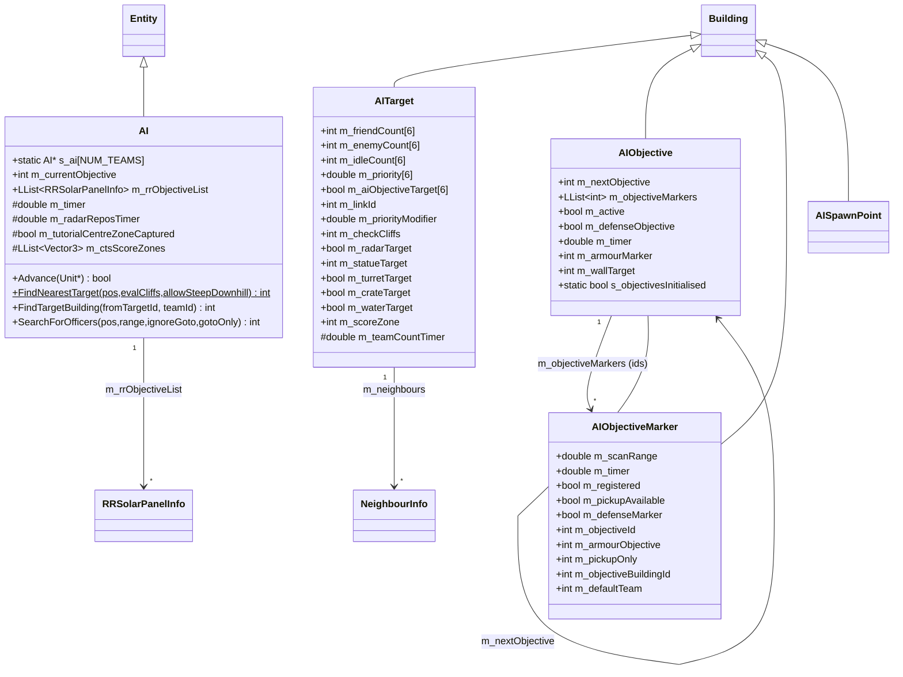
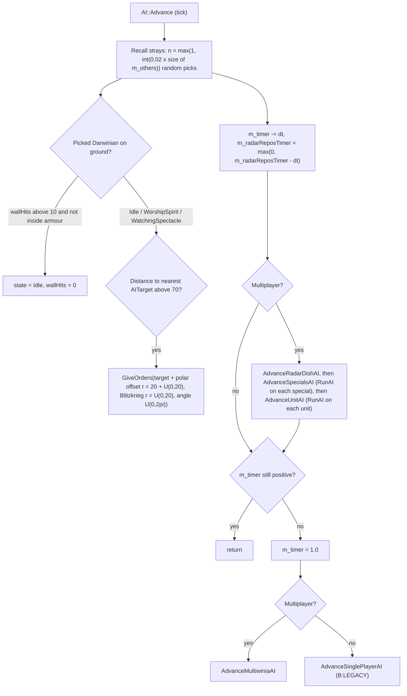
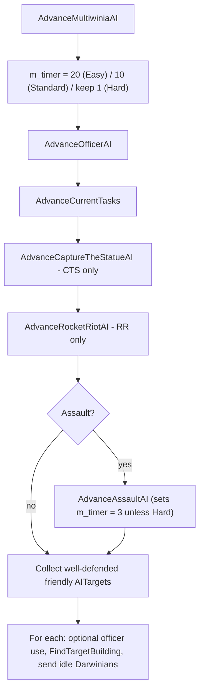
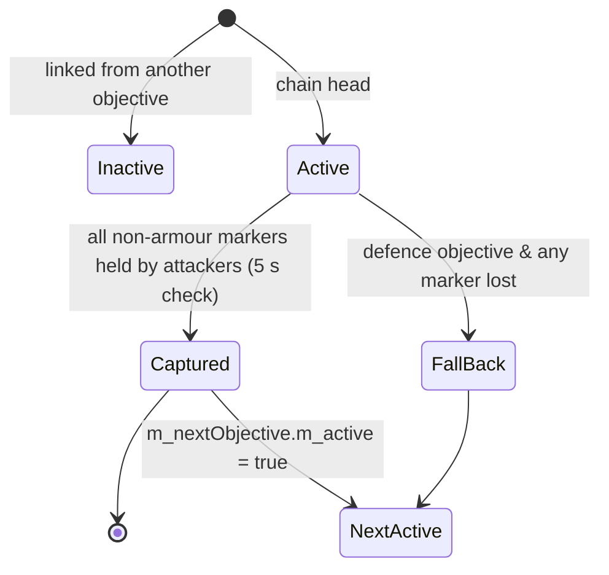

# Routed draft sections for document 07

<!-- from P08_crates_ai -->
## [→ 07_ai] 10. CPU player architecture

### 10.1 Classes and data structures [C] `code/worldobject/ai.h`, `code/worldobject/aiobjective.h`



| Type | Fields (all enumerated) | Notes |
|---|---|---|
| `struct RRSolarPanelInfo` | `Vector3 m_pos; int m_numPanels; int m_objectiveId; float m_range` | RocketRiot objective cache, one per own-team AIObjectiveMarker [C] |
| `struct NeighbourInfo` | `int m_neighbourId` (AITarget building id); `int m_laserFenceId` (fence crossed by the link, −1 none) | [C] |
| `AI` | see diagram; `m_currentObjective` init −1, `m_timer` init per difficulty (§14), `m_radarReposTimer = syncfrand(10)` | Entity type `TypeAI`; ctor does `Entity::s_entityPopulation--` (does not count toward population); `ChangeHealth` returns false (immortal); `Begin` sets `s_ai[team] = this`; `Render` draws only in editor [C] |
| `AITarget` | see diagram; ctor: counts 0, `m_linkId −1`, `m_priorityModifier 0`, `m_checkCliffs 1`, `m_statueTarget −1`, `m_scoreZone −1`, flags false, `m_teamCountTimer = syncfrand(2)`; shape `aitarget.shp` | `AITARGET_LINKRANGE = 600.0` (`#define`) [C] |
| `AIObjective` | ctor: `m_nextObjective −1`, `m_active true`, `m_timer 5.0`, `m_armourMarker −1`, `m_defenseObjective false`, `m_wallTarget −1` (written by `Wall::Advance` for a Wall whose `m_objectiveLink` names this objective; never read) | [C] |
| `AIObjectiveMarker` | ctor: `m_scanRange 100`, `m_objectiveId −1`, `m_registered false`, `m_armourObjective 0`, `m_objectiveBuildingId −1`, `m_pickupAvailable false`, `m_pickupOnly 0`, `m_defenseMarker false`, `m_timer = syncfrand(1)` | [C] |
| `AISpawnPoint` | `m_timer, m_online, m_numSpawned, m_populationLock, m_entityType, m_count(20), m_period(60), m_activatorId, m_spawnLimit(−1), m_routeId` | **[B:LEGACY]** — `TypeAISpawnPoint` is in `BuildingIsBlocked`; Darwinia-era (blueprint store/console activators). Appendix. |

### 10.2 Instantiation and where it runs
- `Location::InitialiseTeam(team)`: in Multiwinia mode, if the team type is `TeamTypeCPU`, spawn **one** `Entity::TypeAI` at (−100, 0, −100) for that team [C] `code/location.cpp:Location::InitialiseTeam`. Called for every non-unused team in `Location::InitTeams`, and later when a team is (re)initialised mid-game (`Multiwinia::InitialiseTeam`).
- The monster (4) and Futurewinian (5) teams are set up as `TeamTypeCPU` by `Location::InitMonsterTeam/InitFuturewinianTeam` in `Location::Init` (multiplayer), which runs **after** `InitTeams()` has set `m_teamsInitialised = true` [C line order in `Location::Init`]; `Multiwinia::InitialiseTeam` then calls `Location::InitialiseTeam`, so these neutral-hostile teams also get an AI entity that drives their Darwinians (e.g. Darwinians converted to the monster team) [I: assumes `g_app->m_location` is already assigned during `Init`]. StartingPowerups are skipped for them; `AdvanceOfficerAI` skips Futurewinian teams only [C].
- There is a single difficulty for all CPU teams: `Multiwinia::m_aiType ∈ {AITypeEasy=0, AITypeStandard=1, AITypeHard=2}` (default Standard; lobby drop-down options `dialog_easy_difficulty`, `multiwinia_menu_normal`, `multiwinia_menu_hard`; synced as `GAMEOPTION_AIMODE`; forced to Standard outside tutorials by `App` and by tutorial 2) [C] `code/multiwinia.h`, `code/UI/GameMenuWindow.cpp`, `code/network/clienttoserver.cpp`, `code/app.cpp`.
- **Simulation-resident and lockstep**: the AI is an ordinary entity in `Team::m_others`, advanced once per tick inside `Team::Advance(slice)` (each `m_others` entry is in exactly one of the 10 slices) on **every peer**; all its randomness is `syncrand/syncfrand/syncsfrand`; it issues orders by direct calls (`Darwinian::GiveOrders`, `Officer::SetOrders/SetWaypoint`, `TaskManager::RunTask/TargetTask/TerminateTask`, `Armour::AISetConversionPoint`, `RadarDish::Aim`) — **no network messages** [C] `code/team.cpp:Team::Advance`, `code/taskmanager.cpp:TaskManager::TargetTask`. Docs describe an AI "running locally" on a client — see discrepancies.
- AI has **perfect information**: it reads every building, every AITarget's per-team counts and the entity grid for any team [C]. No resource cheats were found: `m_aiType` is not referenced by spawn points, population or damage code (grep of `m_aiType` across `code/`) [C].

<!-- from P08_crates_ai -->
## [→ 07_ai] 11. AITarget node graph (the AI's map)

### 11.1 Placement
- **Level file** (designer-placed; 1112 AITargets across the 57 shipped `mp_*.txt` levels [C count]): `AITarget <id> <x> <z> <team> <rx> <rz> <isGlobal> [<linkId> [<priorityModifier> [<checkCliffs>]]]` [C] `AITarget::Read/Write`; e.g. `AITarget 56 602.17 1461.32 255 1.00 0.00 0 -1 0.00 0`. `Initialise` copies link/modifier/checkCliffs; `m_waterTarget = (pos.y ≤ 0)`.
- **Runtime-created** AITargets (unique building ids from `GlobalWorld::GenerateBuildingId`) [C]:

| Creator | Position | Flags | Lifetime | Ref |
|---|---|---|---|---|
| Crate (on landing) | ground under crate | `m_priorityModifier 0.5`, `m_crateTarget` | until captured/expired | `Crate::AdvanceOnGround` |
| RadarDish (while `m_signal > 0`) | dish entrance | `m_radarTarget`; `m_linkId` = receiver dish's AITarget when known | destroyed when signal drops | `code/worldobject/radardish.cpp:RadarDish::AdvanceAITarget` |
| Statue (CTS) | statue; re-positioned when statue moves > `m_carryRadius × 1.5` | `m_priorityModifier 1.0`, `m_statueTarget = statue id` | statue life | `code/worldobject/statue.cpp` |
| GunTurret | turret | `m_turretTarget` | turret life | `code/worldobject/gunturret.cpp` |
| FuelStation (RocketRiot) | station, while rocket is loading and `SafeToLaunch` | `m_priorityModifier 1.0` | until not loading | `code/worldobject/rocket.cpp:FuelStation::Advance` |
| WallBuster (Assault) | follows the buster | — | buster life | `code/worldobject/wallbuster.cpp` |
| CloneLab | exit | — | [B:LEGACY] | `code/worldobject/clonelab.cpp` |

### 11.2 Links — `AITarget::RecalculateNeighbours`, `Location::RecalculateAITargets` [C]
- For every other non-destroyed AITarget B: link A→B if (`|A−B| ≤ 600` or `A.m_linkId == B.id`) and (`Location::IsWalkable(A, B, checkCliffs, false, &fenceId)` or both are radar targets or either is a water target). `checkCliffs = A.m_checkCliffs && B.m_checkCliffs`, forced false for the manual link. The crossed laser fence id is stored.
- Score zone tagging (same pass): if A lies within a `MultiwiniaZone`'s radius and the zone is neutral (team 255): CTS → `m_scoreZone` = that zone (statue spawn zone); KOTH → the KOTH score zone.
- Culling pass (`Location::RecalculateAITargets`): for A (skipping turret targets) and each neighbour C (skipping the manual link and turret targets): remove A→C if some other neighbour B of A has a link B→C and `dist(A,C) > 0.8 × (dist(A,B) + dist(B,C))`.
- Recalculated: at `Location::Init`, when an AITarget or Wall building is removed, and by every runtime creator above on create/move/destroy.

### 11.3 Counting and ownership — `AITarget::Advance` every 2.0 s (random initial phase)
Order per evaluation: `RecalculatePriority()` (using the previous counts), then `RecountTeams()`, then `RecalculateOwnership()` [C].
- `GetRange()`: single-player 100; multiplayer 200, or the score zone's `m_size` if tagged.
- `RecountTeams`: over all entities within range (any type, any team): in Multiwinia, `friendCount[t]++` if entity team == t, `enemyCount[t]++` if not `IsFriend(entityTeam, t)`; idle count per entity team for Darwinians in `StateIdle`, `StateWorshipSpirit`, `StateWatchingSpectacle`; also sets each Darwinian's `m_closestAITarget` to this target if nearer than its current one.
- `RecalculateOwnership`: owner = team with the strictly highest `friendCount` (> 0), else 255.
- `IsImportant(&id)`: true if any building within 100 wu has `m_ports.Size() > 0`, or is a Crate, RadarDish, TrunkPort (RocketRiot only) or MultiwiniaZone (not in CTS); returns that building's id.
- `NeedsDefending(team)`: false unless owned by `team`; true if tagged with a score zone (non-CTS); else true if any neighbour is owned by a non-friendly, non-neutral team with `enemyCount[owner] > 30` while no officer of the team is within 300 wu.

### 11.4 Priority formulas — `AITarget::RecalculatePriority` [C]
Skipped entirely on **Easy unless Assault** (so Easy priorities stay at their last value, initially 0). Tutorial-2 special case for building id 92. Dispatch: Assault & Blitzkrieg → `Assault`; CTS → `CTS`; RocketRiot → `RocketRiot`; otherwise (Domination, KOTH, TankBattle) → `Standard`. Per team t, targets with `m_aiObjectiveTarget[t]` set are skipped (their priority is driven by AIObjectiveMarkers or Blitzkrieg zones).

**Standard** (per t):
```
imp = IsImportant(&b)
grab = !Multiplayer || (b && b.team != t && b.type != TrunkPort)
if grab:                         p = 0.95
elif !IsFriend(owner, t):        p = 0.8;  if friendCount[t] > 0.5·enemyCount[t]: p = 1.0     # enemy- OR neutral-owned
                                 # (IsFriend(255, t) is false, so unimportant neutral targets score 0.8/1.0)
else:  # owned by t (or a co-op ally)
       if enemyCount[t] > 0.5·friendCount[t]: p = 1.0                                         # under attack
       else: p = mean(neighbour p[t] over neighbours not blocked by an enabled hostile fence) / 2
             # NB: divides by num without a zero check → NaN when no usable neighbours
if radarTarget: p += 0.35
p += 0.01 · |neighbours| + m_priorityModifier;  p = min(p, 1.0)
if MP and KOTH and scoreZone: if zone.team != t or zone.totalCount − zone.teamCount[t] > 10: p = 0.95
```
(Fence rule: a neighbour counts if no fence, fence owned by t, or fence disabled.)

**CTS**: `p = mean(max(0, neighbour p[t]))` (only if ≥1 usable neighbour, else previous value kept); halved if owner is friend; `+ m_priorityModifier`; if important and neutral → 0.95; if statue target and (statue team ≠ t, or `numLifters < maxLifters`, or `enemyCount[t] > 10`) → 1.0; clamp ≤ 1.0.

**Assault (also Blitzkrieg)**: `p = 0`; `sum` over usable neighbours with `p[t] > 0`; if any, `p = sum / (num + 1)` (diffusion with decay); radar target without a radar neighbour `+0.35`; `+ m_priorityModifier`; crate targets get `p = 0` when t's AI is on its final objective (`nextObjective == −1`). No clamp.

**RocketRiot**: as Standard's "grab" test (neutral/enemy-owned important building, not trunk port); additionally an own TrunkPort while the own rocket is `StateLoading` → grab; else `mod = 0.1`. Non-grab: `p = sum(neighbour p) / (num + 1)`, halved if friend-owned. `+0.35` radar, `+ m_priorityModifier + mod`, clamp ≤ 1.0. (No neighbour-count bonus.)

**Blitzkrieg zones** (`MultiwiniaZone` Blitzkrieg advance, each recount): the AITarget nearest the zone gets, for every team i, `p = 1.0` on Easy, else `GetBlitzkriegPriority(zone, i)`; `m_aiObjectiveTarget[i] = (p > 0)` [C] `code/worldobject/multiwiniazone.cpp`. `GetBlitzkriegPriority` by team i's Blitzkrieg score state: SAFE (10005) → 1.0 if zone not owned by i; ENEMYOCCUPIED/UNDERATTACK/UNOCCUPIED (10001–10003) → 1.0 if the zone is a base zone owned by a non-eliminated team; UNDERTHREAT (10004) → 1.0 if the zone links to i's base and is not owned by i; finally 0 for i's own non-base zones [C].

**AIObjectiveMarker overrides** (Assault, RocketRiot; §13) set `p = 1.0`/`0.0` and `m_aiObjectiveTarget` on the AITarget nearest the marker.

<!-- from P08_crates_ai -->
## [→ 07_ai] 12. Decision loop

### 12.1 `AI::Advance` (every tick) [C]


### 12.2 `AI::AdvanceMultiwiniaAI` (main cycle) [C]

"Well-defended" set: friendly AITargets (owner `IsFriend` with AI team) where `(idle > limit && noAttack) || !IsImportant()`; `limit = 10` (the neighbour loop also sets 10 — no-op), ×3 (= 30) for an Assault attacker on a radar target; `noAttack = enemy < 0.33 × friend`, and on Standard/Hard outside Assault `noAttack = false` whenever `enemy > 0` ("never send Darwinians away if enemies present").

For each well-defended target T:
1. If an own SpawnPoint lies within 200 of T and T is that spawn point's nearest AITarget: if there is **no Goto-officer** within 200 → `useOfficer = true`, else **skip T** (an officer already streams from it).
2. `dest = FindTargetBuilding(T)`; if −1 skip. `sendChance = clamp(1.5 × dest.enemy[t] / T.idle[t], 0.6, 1.0)`; Assault: attacker → 1.1 (all), and 0.0 if any own Armour within 100 of T is `StateUnloading`; if dest is not important → 1.1.
3. Candidates = own entities within 150 of T.
4. `useOfficer`: `RunTask(TypeOfficer)`, then for the first Idle Darwinian candidate: `TargetTask(officerTask, d.pos)` (promotes it); the new officer (`m_mostRecentEntity`) gets `m_noFormations = true`, `SetOrders(dest + polar(20+U(0,20)))` (radar target → the radar/bridge position) and `SetWaypoint(spawnPoint.pos + spawnPoint.front × 60)` → a **Goto officer** that redirects spawn output.
5. Else send: on Standard/Hard, if T is in a score zone, stop once `T.friend[t] − sent < keep` where `keep = 10` if dest is important and neutral, else 50. Each candidate Darwinian with `syncfrand(1) < sendChance`, in Idle/Worship/Watching, not in a formation, on ground, and whose `m_closestAITarget == T` → `GiveOrders(dest + polar(20+U(0,20), U(0,2π)))` (radar target → dish/bridge position).

### 12.3 `AI::FindTargetBuilding(from, team)` [C]
```
random = MP ? (Easy || tutorial ? true : Standard ? syncfrand(1) < 0.5 : false) : syncfrand(1) < 0.25
if Assault or RocketRiot: random = false;   if Prologue: random = false
if random:
   pick neighbour index syncrand()%n; retry (≤100, else -1) while: (tutorial filters) | neighbour is water target |
       link crosses an enemy-owned fence (fence team != AI team); if both from and pick are radar targets return from
   return pick (in MP always accepted; SP only if its priority > 0)
else:
   best = from.priority[team]; id = -1
   for each neighbour N (skip water):
      if N.p > best and (no fence | fence friendly | fence disabled): best = N.p; id = N; turret = N.m_turretTarget
          (radar→radar returns from)
      collect hostile, non-neutral turret targets into turretList
      if N.m_statueTarget != -1: id = N            # statue always wins (last one)
   if turret and |turretList| > 1: up to 1000 tries pick a random turret target within 200 of the chosen one
       whose link is passable → id                  # spread attacks over several turrets
return id   (-1 = stay)
```
`AI::FindNearestTarget(pos, evalCliffs=true, allowSteepDownhill=false)`: nearest AITarget (any team) for which `IsWalkable(pos, target, …)` holds; −1 if none (linear scan of all buildings) [C].

### 12.4 Officer creation — `AI::AdvanceOfficerAI` (each main cycle) [C]
Skipped in RocketRiot, Assault, Blitzkrieg, for Futurewinian teams and in tutorials. `limit = 70` (CTS 150). For each friendly AITarget: if `NeedsDefending(team)` and `friendCount ≥ limit` (CTS: `idleCount`) and no non-Goto officer within 300 → `RunTask(TypeOfficer)` (consumes one of 6 task slots), take the first Officer task, promote the first own Darwinian within 100 that is not `StateBeingSacraficed`, `StateCapturedByAnt`, `StateInsideArmour`, `StateOperatingPort` (`TargetTask` → `Task::TargetOfficer`).

### 12.5 Using crate rewards — `AI::AdvanceCurrentTasks` (each main cycle) [C]
For each task with `m_state != StateRunning` and `m_startTimer ≤ 0`:

| Task type | AI handler | Target choice |
|---|---|---|
| Squad | `RunSquad` | AITarget (in a valid area) with most enemies; then the valid task area whose centre is nearest it; random point in that area (`syncsfrand(radius)` per axis) until `IsValidTargetArea` (unbounded loop) |
| Armour | `RunArmour` | random valid area (`syncrand % n`), random point ±radius/2, `PushFromObstructions`, retried until valid |
| Harvester | `RunHarvester` | random valid area centre, else random points until valid |
| Engineer | `RunEngineer` | same as Harvester |
| AirStrike (incl. Napalm) | `RunAirStrike` | if any hostile non-neutral GunTurret exists → a random one; else the valid AITarget (not monster-owned) with most enemies; skipped if none (pos == 0) |
| Nuke | `RunNuke` | valid AITarget (not monster-owned) with most enemies |
| GunTurret / Rocket / Flame | `RunGunTurret` | Assault attacker → **terminate** the task; Blitzkrieg → `RunGunTurretBlitzkrieg`; RocketRiot & not Easy → `RunGunTurretRocketRiot`; else: over own AITargets in valid area, the neighbour with most enemies (hostile) or, if a neighbour is neutral, the own target itself (code stores the *own* id for the neutral case); then centroid of own healthy on-ground Darwinians within 150 of it, `PushFromTurrets` (≥ 60 from any turret, steps of 10) and `PushFromObstructions` |
| — Blitzkrieg | `RunGunTurretBlitzkrieg` | if < `turretLimit` (1 Easy, 2 otherwise) turrets inside the own base zone: point on the zone rim at a random angle (≥ 50 from an existing turret, retried); else rim of a random other owned zone |
| — RocketRiot | `RunGunTurretRocketRiot` | if < 2 own turrets within 300 of own rocket: point 75–125 from the rocket at angle U(0, π/2); else centroid of own Darwinians within 150 of a random owned AITarget ± `syncsfrand(200)` |
| Infection (Spam) | `RunSpam` | enemy AITarget with no AI-owned neighbour and most enemies; else (bug) the AI's own id → `GetBuilding` of an entity id [I: likely NULL → crash]. Reachable only via forced reward |
| MagicalForest | `RunForest` | only if the team has a Harvester: midpoint between an own AITarget and its first own neighbour |
| Plague | `RunPlague` | like RunSpam but stores array *index* (bug: later used as building id). Unreachable (Plague never becomes a task) |
| AntsNest | `RunAntNest` | random enemy-owned (non-neutral, non-monster) SpawnPoint in a valid area |
| DarkForest | `RunDarkForest` | same as AntNest |
| EggSpawn | `RunEggs` | random enemy AITarget (valid area), offset 150 in a random XZ direction |
| MeteorShower | `RunMeteor` | first enemy AITarget (valid area) with < 30 friends and > 50 enemies within 420 |
| Tank | `RunTank` | [B:LEGACY] Tank task is never granted in FULL |
| Booster / Subversion / HotFeet / Rage | `RunPowerup()` | first AITarget with `friend > 30` and `enemy > friend`; centroid of own entities within 100 (or zone size) — note sum over Darwinians ÷ count of all friends; then **every** idle Darwinian-powerup task is targeted there at once |

`HasDarwinianPowerup()` exists but is unused [C grep].

### 12.6 Radar dishes — `AI::AdvanceRadarDishAI` (every tick, acts every 10 s) [C]
Disabled by level option `noradarcontrol`. Own dishes with ≤ 20 own entities in transit are usable. For each usable dish d: among all other dishes r whose front faces d (`dot(norm(r.pos − d.pos), r.front) < 0`), visible dish-to-dish (`Location::IsVisible`), and `d.ValidReceiverDish(r)` → choose max priority (r's AITarget priority for the AI team, else that of the AITarget nearest r); `d.Aim(r.dishPos)` if not already connected. Tutorial-2 whitelist of dish ids {7, 9, 10, 12, 13, 15} and filters.

### 12.7 Specials and units (`RunAI`, every tick, own timers) [C]
| Entity | Period | Behaviour | Ref |
|---|---|---|---|
| Officer (Goto) | 10 s | re-aim to `FindTargetBuilding(nearest target)` if order point moved > 60 (radar → entrance) | `code/worldobject/officer.cpp:Officer::RunAI` |
| Officer (formation) | 1 s | ensure formation; if > 10 enemies within 270 (`DARWINIAN_SEARCHRANGE_THREATS × 3`) halt and face their centroid; at nearest important target: move onto it (> 20) and face the hostile neighbour if `NeedsDefending`, else face first neighbour; when not defending and `FormationFull()` → waypoint to nearest walkable enemy-owned or neutral-important AITarget (bug: array index passed to `GetBuilding`) | same |
| Engineer, Harvester | 1 s | if Idle: waypoint to the nearest Spirit | `Engineer::RunAI`, `Harvester::RunAI` |
| InsertionSquad | 1 s retarget, fire every tick | enemies within 500: first (by increasing distance) with ≥ 20 enemies within 75 → waypoint at 0.8 × max grenade range short of it; else neighbour of nearest AITarget with highest priority that is walkable (else the nearest target). Each tick: if enemies within max range, `Attack(centroid ± syncsfrand(30), secondary = syncrand()%5 == 0)` | `code/worldobject/insertion_squad.cpp:InsertionSquad::RunAI` |
| Armour | 1 s (Easy 20 / Std 10; Assault: Easy 10 / Std 5) | per mode: Standard — park at nearest own SpawnPoint front+100; with > 50 passengers drive behind nearest enemy SpawnPoint (−front×100); after unloading 50 % return / 50 % pick an enemy SpawnPoint > 200 away and **self-destruct** (`ChangeHealth(−1000)`) within 10 wu. Assault — pickup at AIObjectiveMarkers with `m_pickupAvailable`/armour flag (> 25 own nearby) or own TrunkPort front+75; with > 20 passengers drop at the objective's armour marker or a random hostile marker; if objectives exist but this one has no armour marker → mobile bomb at nearest enemy turret/spawn point. Blitzkrieg — load at own TrunkPort (> 20 friends within 200); with > 20 passengers & no approaching Darwinians pick a hostile zone linked to an owned zone (enemy base zones of non-eliminated teams first; when under threat Easy always / Std 50 % defend base links); Easy drops at zone centre, others via `GetBlitzkriegDropPoint` (turret rush). RocketRiot — while own rocket loading, ferry idle Darwinians (> 10 idle at an AITarget > 400 from rocket) to the rocket; else load at TrunkPort/near-rocket target/own SpawnPoint (> 20 friends), drop at threatening enemy rocket (fuel ≥ 75 and > own), uncontrolled panels, out-numbered panels (enemies > 1.3 × friends, most panels) or the weakest own panel group; non-Easy adds a 100 wu random ring offset. Re-plots route every 1 s if blocked. | `code/worldobject/armour.cpp:Armour::RunAI` and `Run*AI` |
| WallBuster (Assault attacker) | 1 s | when waypoint invalid: route to the nearest Wall within 500 of any current-objective marker | `code/worldobject/wallbuster.cpp:WallBuster::RunAI` (called from `AdvanceAssaultAI`) |
| Tank | per tick | [B:LEGACY]/TankBattle [B:DEBUG] | `code/worldobject/tank.cpp:Tank::RunAI` |

<!-- from P08_crates_ai -->
## [→ 07_ai] 13. Per-mode strategies

| Mode | Priority model | Mode-specific AI | Officers | Turret placement |
|---|---|---|---|---|
| Domination (`GameTypeSkirmish`) | Standard | — | yes (limit 70) | standard |
| King of the Hill | Standard + KOTH zone override (0.95 until zone held with ≤ 10 others) | — | yes | standard |
| Capture the Statue | CTS (statue targets 1.0) | `AdvanceCaptureTheStatueAI`: unstick carried statues (carriers within 50 move 20 wu away from colliding carryables' centroid); `FindTargetBuilding` always prefers statue targets | yes (limit 150 idle) | standard |
| Assault | Assault diffusion + AIObjectives | `AdvanceAssaultAI` objective chain; WallBuster routing; attacker sends everyone (sendChance 1.1); defenders' markers hold | **no** | attacker terminates turret tasks; defender standard |
| Rocket Riot | RocketRiot + AIObjectiveMarker (RR) overrides | `AdvanceRocketRiotAI` panel list; armour logistics | **no** | rocket defence (not Easy) |
| Blitzkrieg | Assault diffusion seeded by zone priorities | zone priorities via `MultiwiniaZone`; armour zone assault | **no** | base-zone rim |
| TankBattle | Standard | `Tank::RunTankBattleAI` | — | [B:DEBUG] (mode compiled out in FULL) |

### 13.1 Assault objectives — `AIObjective`, `AIObjectiveMarker`, `AI::AdvanceAssaultAI` [C]
Level syntax: `AIObjective <id> <x> <z> <team> <rx> <rz> <isGlobal> <nextObjectiveId>`; `AIObjectiveMarker <id> <x> <z> <team> <rx> <rz> <isGlobal> <scanRange> <objectiveId> [<armourObjective> [<pickupOnly>]]` [C] `Read/Write`. Present in all 9 `mp_assault_*` and all 7 `mp_rocketriot_*` levels [C grep].

- `AIObjective::InitialiseObjectives` (first objective Advance; flag reset in `Location::Init` and `Location::Empty`): every objective that is some objective's `m_nextObjective` is set inactive (so chain heads start active); objectives with an armour marker go into `Armour::s_armourObjectives`; an objective owned by a defending team becomes a defence objective and propagates `m_defenseObjective` to its next.
- `AIObjective::Advance` every 5.0 s: **Standard** — if every registered marker with `m_armourObjective == 0` is owned by a non-neutral attacking team → deactivate, activate next, and set `m_pickupAvailable` on its armour markers with `m_pickupOnly != −1`. **Defensive** — if any marker is owned by a non-neutral non-defending team → deactivate and activate next (fall back).
- `AIObjectiveMarker::Advance` (waits for `s_objectivesInitialised` in Assault): first run registers with its objective (armour marker if `armourObjective == 1 && pickupOnly != 1`), inherits defence flag, stores its level team as `m_defaultTeam` and becomes neutral, and binds to a building within 20 wu (excluding markers, AITargets, walls, laser fences, static shapes) as `m_objectiveBuildingId`. Then every 2.0 s:
  - **Standard** (objective active): if bound building exists (solar panel with 0 ports unbinds) → marker team = building team; else `scanRange == 0` → `m_defaultTeam`; else count non-monster/non-Futurewinian entities within scanRange: winner starts as team 0 and is replaced by team i if `count[i] > 4 × count[winner]` while `count[winner] < 10`; set team (255 if none). Then, for each **attacking** team i with an AI on this objective: nearest AITarget gets `p[i] = 1.0`, `aiObjectiveTarget[i] = true` if the marker is not friendly to i and not an armour marker; if marker `m_pickupAvailable` → same; else flag cleared.
  - **Defensive**: winner = first defending team once cumulative defender count ≥ 15 or the bound building is defender-owned, else majority by 2× rule; for each **defending** team on this objective: nearest AITarget `p = 1.0` when the marker is friendly.
  - **RocketRiot**: if the marker's team's rocket is not `StateLoading` and the nearest AITarget is not owned by that team → `p = 1.0`, else `p = 0.0`; flag set either way.
- `AI::AdvanceAssaultAI` (each main cycle; sets `m_timer = 3.0` unless Hard): when `m_currentObjective == −1`, collect active objectives owned by the AI team (and allied ones). If several and the AI is **defending**, wait until enemies are within 450 of any marker of one of them and commit to it; else choose `syncrand() % n`. All other own active objectives are deactivated. With none of its own, adopt a random allied one. Each cycle: if the current objective became inactive → follow `m_nextObjective`; attackers run `WallBuster::RunAI` on every own WallBuster.



<!-- from P08_crates_ai -->
## [→ 07_ai] 14. Difficulty levels — exact differences [C unless noted]

| Parameter | Easy | Standard ("Normal") | Hard | Ref |
|---|---|---|---|---|
| Initial AI timer | `syncfrand(20)` | `syncfrand(10)` | `syncfrand(1)` | `AI::AI` |
| Main cycle period | 20 s | 10 s | 1 s | `AI::AdvanceMultiwiniaAI`, `AI::Advance` |
| Main cycle period in Assault | 3 s | 3 s | 1 s | `AI::AdvanceAssaultAI` |
| Neighbour choice in `FindTargetBuilding` | always random | random 50 % | best priority | `AI::FindTargetBuilding` (Assault/RR: best priority for all) |
| AITarget priority recalculation | off (except Assault) | on | on | `AITarget::RecalculatePriority` |
| Hold targets while any enemy is present | no | yes (not Assault) | yes (not Assault) | `AdvanceMultiwiniaAI` |
| Keep garrison in occupied score zone | no | yes (10/50) | yes | `AdvanceMultiwiniaAI` |
| Blitzkrieg zone priorities | 1.0 for all zones | `GetBlitzkriegPriority` | same | `code/worldobject/multiwiniazone.cpp` |
| Blitzkrieg base turret count | 1 | 2 | 2 | `RunGunTurretBlitzkrieg` |
| RocketRiot turret logic | generic | rocket defence | rocket defence | `RunGunTurret` |
| Armour AI period (Std/Blitz/RR) | 20 s | 10 s | 1 s | `Armour::Run*AI` |
| Armour AI period (Assault) | 10 s | 5 s | 1 s | `Armour::RunAssaultAI` |
| Blitz armour defends base when under threat | always | 50 % | never | `Armour::RunBlitzkriegAI` |
| Blitz armour drop point | zone centre | turret rush | turret rush | `Armour::GetBlitzkriegDropPoint` |
| RR armour drop offset | exact | 100 wu ring | 100 wu ring | `Armour::RRFindDropoffPoint`, `RunRocketRiotAI` |
| Tutorial | forced random movement | — | — | `FindTargetBuilding` |
Everything else (stray recall, officer creation thresholds, crate-task use, radar dishes, squads, engineers, harvesters) is difficulty-independent. A computed-but-unused `random` local in `Armour::RunBlitzkriegAI` would have been difficulty-dependent [C].

<!-- from P08_crates_ai -->
## [→ 07_ai] 15. Cheats / advantages
- No economic, population, damage or vision cheats (no `m_aiType`/`TeamTypeCPU` checks in spawn, combat or crate code; the only CPU-specific branches are naming ("CPU"/"(LEFT)" prefixes in `Team::GetTeamName`), task-selection side effects for human players in `Task::SwitchTo`, and `AntHill` activity requiring a CPU owner) [C] grep.
- Informational advantages: omniscient counts and positions; instant, unlimited-rate orders to any number of Darwinians; officers created without UI; task targets chosen anywhere `IsValidTargetArea` allows [C].
- Armour self-destruct at enemy spawn points ("bit of a cheat" comment) is available to the AI only [C] `Armour::RunStandardAI`/`RunMobileBombAI`.
