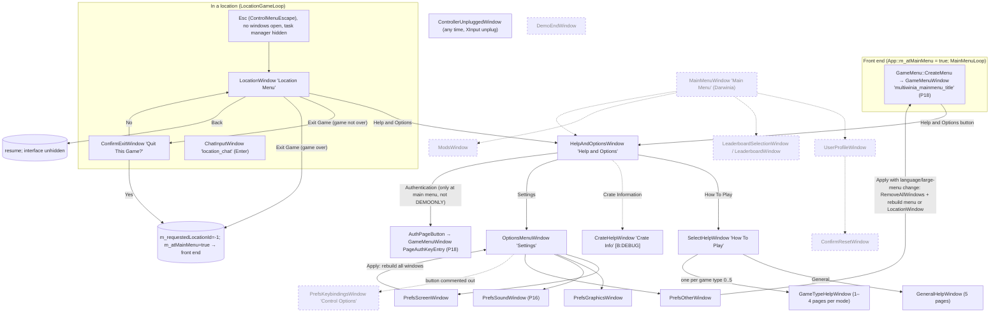
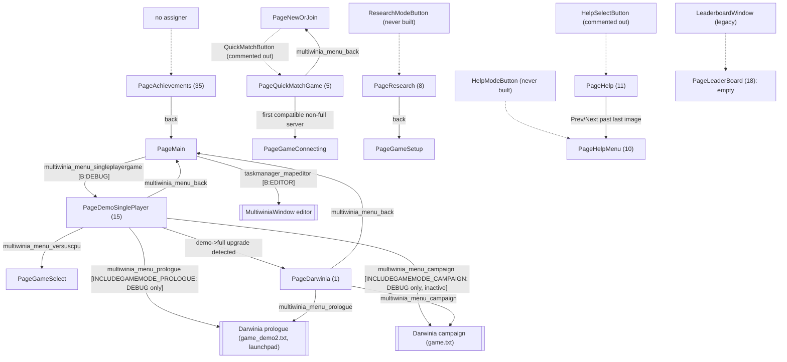
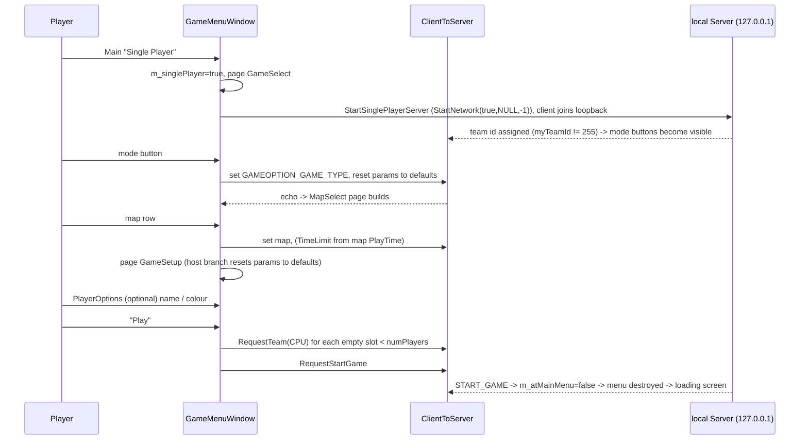
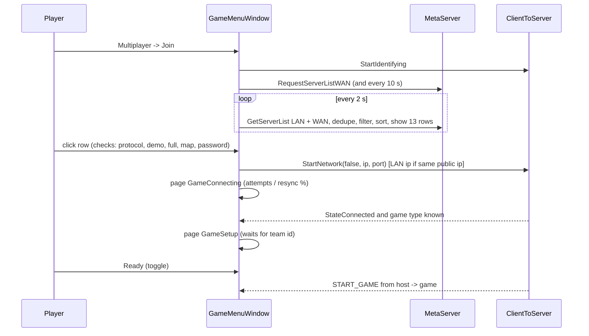
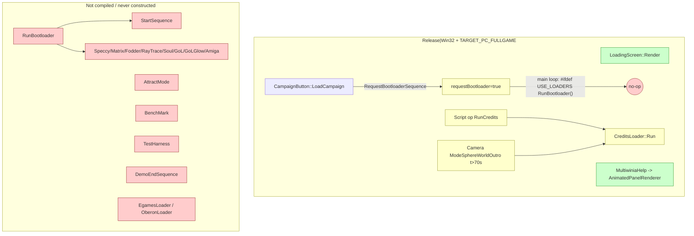
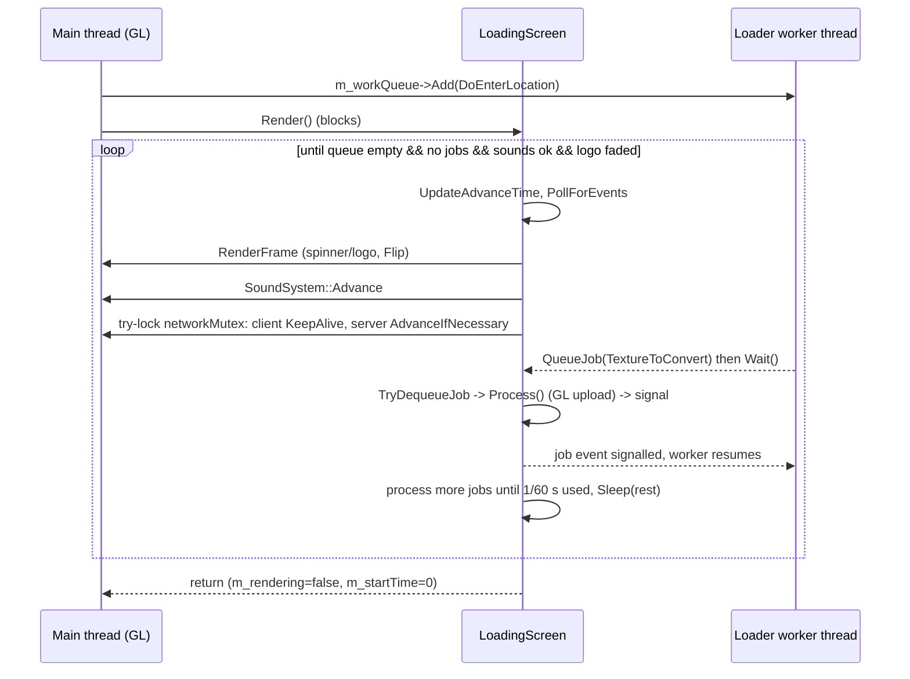
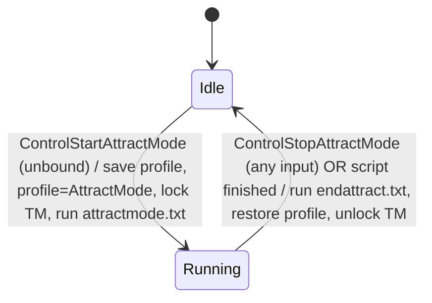

# Routed draft sections for document 09

<!-- from P02_game_modes -->
## [→ 09_meta_systems] 7. Achievements, statistics and the Rocket Riot status panel

### 7.1 Achievement ids and unlock conditions [C] `code/app.h` (enum), call sites as cited

| Id | Enum (`App::DarwiniaAchievement*`) | Code comment | Exact unlock condition in code | Where |
|---|---|---|---|---|
| 0 | `Dominator` | domination achievement | Domination, non-co-op, local team is the last non-eliminated team (win by elimination; not by time-out) | `Multiwinia::AdvanceSkirmish` |
| 1 | `Hoarder` | CTS achievement | CTS normal time-out win by local team with `highScore > 2 × secondHighest` and `highScore > 3` | `AdvanceCaptureStatue` |
| 2 | `HailToTheKing` | KOTH achievement | KOTH time-out win by local team with `highest > 1.5 × secondHighest` | `AdvanceKingOfTheHill` |
| 3 | `UncladSkies` | rocket riot achievement | local rocket wins with `m_damage <= 0.01` and no other used team's rocket has fuel > 50 | `AdvanceRocketRiot` |
| 4 | `AggravatedAssault` | Assault achievement | Assault game end, local team defending, and every objective (bomb + linked stations) was owned by a defending team on every tick since start (`m_defendedAll`) | `AdvanceAssault` |
| 5 | `MasterPlayer` | beat someone who already has Master Player | local team wins a non-co-op game in which another non-CPU used team's `m_achievementMask & 0x01`; sets `AchievementTracker::m_isMasterPlayer = true` (then broadcast as the viral mask) | `Multiwinia::CheckMasterAchievement`, `code/network/clienttoserver.cpp` (mask sent in team request, L~1265; stored L~2404) |
| 6 | `MasterOfMultiwinia` | won on every map | `AddVictoryOnLevel` makes `NumWonLevels() == VALID_ACHIEVEMENT_LEVELS` (49 with Assault compiled, else 41); only level ids 1–49 from `levels/level_enum.txt` count | `code/achievement_tracker.cpp` |
| 7 | `Explorer` | played every map | `AddVisitedLevel` (at grace end) makes `NumVisitedLevels() == 49/41` | `achievement_tracker.cpp` |
| 8 | `Carnage` | "more than 3000 enemy darwinians in a single game" | local `Team::m_teamKills >= 2000` on the tick the game ends | `Multiwinia::Advance` |
| 9 | `BlitzMaster` | blitzkrieg achievement | Blitzkrieg win by local team with `m_startTime <= m_timeRemaining + 300` (practically always true) | `AdvanceBlitkrieg` |
| 10 | `WrongGame` | nuke an ally in 4p co-op | co-op, local team's Nuke explodes within 120 units of a SpawnPoint owned by a friend (includes own spawn points); also message "Wrong Game!" | `code/worldobject/nuke.cpp` (L~196–215) |
| 11 | `Genocide` | "total of 100,000 Darwinians" | `m_totalKills >= 1000000` after `AddToTotalKills` | `AchievementTracker::AddToTotalKills` |
| 12 | `NumAchievements` | | | |

**Platform reality (PC baseline):** `App::GiveAchievement(id)` returns early if any of the first `NumPlayers` slots is CPU (except MasterPlayer, Carnage, Genocide), then calls `EarnedAchievement()` which always returns false — and does nothing else. `App::EarnedAchievement` and `App::CheckMasterAchievement` are stubs. **No achievement is ever recorded or shown in the PC build** [C] `code/app.cpp:App::GiveAchievement`, `EarnedAchievement`. The in-menu Achievements page (`GameMenuWindow::SetupAchievementsPage`) builds only a title, scroll bar and Back button and shows a "Loading achievements" effect forever because `AchievementTracker::m_hasLoaded` is never set true [C] `code/UI/GameMenuWindow.cpp`, `code/achievement_tracker.cpp`. These are Xbox-Live/Steam-era hooks with the platform layer removed [I].

### 7.2 `AchievementTracker` [C] `code/achievement_tracker.{h,cpp}`

| Member | Meaning |
|---|---|
| `HashTable<int> m_levelList`, `std::map<int,std::string> m_levelListReverse` | map file name ↔ id from `data/levels/level_enum.txt` (`<filename> <id>` per line; ids 1–59) |
| `unsigned char m_visited[8]`, `m_won[8]` | 64-bit bitsets indexed by level id |
| `bool m_isMasterPlayer` | viral flag (mask bit `VIRAL_MASTER_ACHIEVEMENT_MASK = 0x01`) |
| `bool m_hasLoaded` | never set true |
| `int m_numOfficialLevels` | set by `SetNumLevels` from `game_menu.cpp` (unused) |
| `int m_totalKills` | starts **-1**; `AddToTotalKills(k)` adds and calls `Save()` |

Methods: `AddVisitedLevel`/`AddVictoryOnLevel` (ignore unknown names and ids > `MAX_LEVEL_ID` = 49; set bit; `Save()`; completion check), `AlreadyWonLevel`, `AlreadyVisitedLevel`, `GetWonLevels`, `GetVisitedLevels`, `NumWonLevels`, `NumVisitedLevels` (popcount over 64 bits), `GetCurrentLevelId`, `GetLevelName`, `GetLevelId`, `SetNumLevels`, `GetViralAchievementMask`, `HasLoaded`, `GetTotalKills`. `Load()` is empty; `Save()` returns immediately in demo and does nothing otherwise; constants `ACHIEVEMENT_RECORD_FILENAME "achievements.txt"` unused. → All tracking is in-memory per session and lost on exit [C].

Statistics recorded at game end: none persisted. `DeclareWinner` sends the score array to the server (ignored), `AddToTotalKills` (in-memory) [C]. Leaderboard button exists but is inactive (`LeaderBoardButton m_inactive = true`) [C] `code/interface/mainmenus.cpp`.

### 7.3 Rocket status panel [B:FULL] `code/rocket_status_panel.{h,cpp}`

Created lazily by `Multiwinia::RenderRocketStatusPanel` each frame in Rocket Riot: `m_teamId = myTeamId`, `m_w = ScreenH × 0.2`, `m_x = ScreenW − m_w − 10`, `m_y = 10`; height `h = 1.5 × m_w` [C]. Members: `float m_x, m_y, m_w; int m_teamId; double m_lastDamage, m_damageTimer, m_previousFuelLevel`. `GetMyRocket()` returns the LobbyTeam's `m_rocketId` building only if it is an EscapeRocket owned by the team; panel not drawn otherwise (spectators, before the rocket is found).

Layers (top to bottom of draw order):
1. Background quad in team colour × 0.2, alpha 200.
2. While fuel < 100%: scrolling `textures/laser.bmp` "refuelling" sheet in team colour, alpha 128 (texture v offset `fuel% × −100 + 0.5`).
3. Fuel column: `textures/laser-long.bmp` gradient black→team colour, alpha 200, from `y + 0.97h` up by `0.95h × fuel%`; soft shadow above it.
4. Overlay bitmap `icons/rocketstatuspanel.bmp`.
5. Damage overlay `icons/rocketcracked.bmp`, additive, alpha = damage/100.
6. If fuel ≥ 100% or passengers > 0: 100 Darwinian sprites (`sprites/darwinian.bmp`) in a 10×10 staggered grid inside the rocket window (x from `0.25w`, width `0.45w`, y from `0.225h`, height `0.55h`, sprite size `0.04h`, slight sinusoidal jitter); the first `passengers` drawn in team colour, the rest dim (×0.3 colour, 20% alpha).
7. Engine flame (`textures/muzzleflash.bmp`, flicker at 30 Hz) in Ready/Countdown/Flight.
8. Caption (first matching rule; title font, word-wrapped, centred at `y + 0.6h`, height `0.05h`):
   1. damage increased within the last 10 real seconds and not exploding → "YOUR ROCKET IS UNDER ATTACK! DAMAGE n%" (red, flashing);
   2. Countdown → `countdown+1` (4× size);
   3. Flight → "LIFTOFF!" (1.5×, flashing);
   4. Exploding → "Your Rocket is on FIRE!" (flashing);
   5. fuel ≥ 100% and passengers < 5 → "Load your rocket with 100 Multiwinians" (flashing);
   6. refuel rate < 0.05 and fuel < 1% → "Capture solar panels to begin refueling rocket" (flashing);
   7. fuel < 100% → "Fuel nn.n%" (75% alpha).
9. 20%-white border.
Note: between 95% and 100% fuel the rocket is already Loading but the caption still shows "Fuel 9x.x%" [C/I].

---

<!-- from P15_network -->
## [→ 09_meta_systems] 15. Lobby, server discovery and matchmaking

### 15.1 Components and endpoints [C] `code/app.cpp:App::InitMetaServer`, `contrib/systemiv/lib/metaserver/metaserver_defines.h`
| Component | Role | Endpoint |
|---|---|---|
| MetaServer (WAN directory, external service, not in this tree) | server registration/listing, key authentication, small data items (MOTD, latest version…) | host `metaserver-mwdev.introversion.co.uk`, UDP port `PORT_METASERVER_LISTEN` = **5113** |
| MatchMaker (same host and port) | tells a socket its public IP:port (STUN-like) and relays hole-punch requests | same as above |
| MetaServer client listener (in game) | receives list results, auth results, data, and LAN broadcasts | local UDP **5009** (`PORT_METASERVER_CLIENT_LISTEN`), falls back to an OS-chosen port (then LAN discovery cannot work) |
| LAN discovery | game servers broadcast REGISTER every 5 s | destination `255.255.255.255:5009`, sent from the metaserver listener socket with `SO_BROADCAST` |
| Game server / client | lockstep traffic | UDP 4000 / 4001 (prefs `NetworkServerPort` / `NetworkClientPort`) |
Startup [C]: `Authentication_LoadKey("<profile>authkey.dev")`, `SetKey`, `RequestStatus(key, METASERVER_GAMETYPE_MULTIWINIA=4)`, `MetaServer_Initialise` (WinSock), `MetaServer_Connect(host, 5009)`, `MatchMaker_LocateService(host, 5113)`. Game type ids: Defcon 2, Multiwinia 4. A Defcon port 5008 constant also exists.

All metaserver traffic is Directory-encoded (§4.2) with node name `NET_METASERVER_MESSAGE` = `"m"` and command field `"c"`; matchmaker node name is `"match"`. [C]

### 15.2 Metaserver/matchmaker message catalogue [C] `metaserver.cpp`, `matchmaker.cpp`, `authentication.cpp`
| Code | Symbol | Direction | Fields | Notes |
|---|---|---|---|---|
| ma | REGISTER | game server → metaserver (WAN, every TTL/3 ± 1.5 s or on change) and → LAN broadcast (every 5 s or on change) | server properties (§15.3) + COMMAND | demo-key servers skip WAN registration when Demo2Limits.AllowDemoServers is false |
| mb | REQUEST_LIST | client → metaserver | client properties: AUTHKEY, GAMENAME, GAMEVERSION, [ORIGINVERSION "dH"] | refused locally if own key fails the simple check |
| mc | LISTRESULT | metaserver → client | one server's properties incl. IP "da", PORT "db" [+ metaserver-added fields, I: PROTOCOLMATCH "dp", DEMORESTRICTED "demo", DEMOSERVER "dz"] | `MetaServer_UpdateServerList(ip, port, WAN, dir)` |
| mg | LISTRESULT_ENVELOPE | metaserver → client | any number of VOID fields, each a serialised LISTRESULT Directory | unpacked recursively |
| md | REQUEST_AUTH | client/server → metaserver | AUTHKEY, AUTHKEYID, GAMENAME, GAMEVERSION, [IP of the joining client] | from the authentication thread |
| me | AUTHRESULT | metaserver → requester | AUTHRESULT "me" int status, AUTHKEY, AUTHKEYID, [HASHTOKEN "ds" int] | sets key status and hash token |
| mf | REQUEST_DATA | both directions | request: DataType, [LANGUAGE "ec"], GAMENAME, GAMEVERSION, AUTHKEY, ORIGINVERSION; reply: DataType + payload fields + optional DataTTL (s; < 0 never expires) | cached per type |
| mh | REQUESTSERVERDETAILS | client → metaserver | client properties + IP, PORT | `MetaServer_RequestServerDetails` — no caller in `code/` |
| mi | UNREGISTER | game server → metaserver (×3) and LAN (×3) | PORT (WAN: advertised port; LAN: the local port value under key PORT) | receiver expects LOCALPORT and an AUTHKEY, neither of which is sent → LAN delisting never matches; entries simply expire [C] |
| aa | REQUEST_IDENTITY ("match") | any listener → matchmaker, every 10 s | UNIQUEID "ae" int, GAMENAME, GAMEVERSION, AUTHKEY | keeps the NAT mapping alive |
| ab | IDENTIFY ("match") | matchmaker → listener | UNIQUEID, YOURIP "af" str, YOURPORT "ag" int | first answer per request id wins |
| ac | REQUEST_CONNECT ("match") | joining client → matchmaker (every 1 s while connecting), relayed to the target server [I] | GAMENAME, GAMEVERSION, AUTHKEY, IP (client public IP), PORT (public port, or local listener port with port forwarding), TARGETIP "ah", TARGETPORT "ai" | server side requires IP and PORT |
| ad | RECEIVED_CONNECT ("match") | game server → client's public ip:port | — | the outbound packet punches the server's NAT; client only logs it. Any other "match" command ⇒ `AppAbort` (remote crash vector) |
| sa…sh | STEAM_* | — | Steam auth | **dead** (files not compiled) |
Field key table for server/client properties: IP da, PORT db, FROMIP dc, FROMPORT dd, LOCALIP de, LOCALPORT df, SERVERNAME dg, GAMENAME dh, GAMEVERSION di, NUMTEAMS dj, NUMDEMOTEAMS dk (unused), MAXTEAMS dl, NUMSPECTATORS dm, MAXSPECTATORS dn, PROTOCOL do (unused), PROTOCOLMATCH dp, AUTHKEY dq, AUTHKEYID dr, HASHTOKEN ds, PASSWORD dt (unused), RECEIVETIME du (unused), GAMEINPROGRESS dv, GAMEMODE dw, SCOREMODE dx (unused), GAMETIME dy (unused), DEMOSERVER dz, DELISTED dA, RANDOM dB, STARTTIME dC, SEARCHRESULT dD (unused), MAPCRC dE, MAPINDEX dF (unused), MASTERPLAYER dG (unused), ORIGINVERSION dH, HASPASSWORD dI, CUSTOMMAPNAME dJ ([B:EDITOR]), DEMORESTRICTED "demo", LANGAME "lan", PLAYERNAME pn / PLAYERSCORE ps / PLAYERALLIANCE pa (unused), NUMHUMANTEAMS ea, MODPATH eb (unused), LANGUAGE ec. [C] `metaserver_defines.h`; "unused" = no reader/writer in compiled code [C grep].
Data types (`DataType` values): Time, MOTD (`code/UI/motdButton.h`, requested with language), DemoLimits (unused), Demo2Limits (§12.5), KeyLimits (unused), LatestVersion (main menu shows "update available" and an update page when ≠ `APP_VERSION`, `code/UI/GameMenuWindow.cpp`), UpdateURL (`code/UI/update_page_buttons.h`), StressServers/StressClients (unused), ServerTTL (string seconds; default 60, minimum 10). Reply fields DataTTL, DataExpired, TimeHours, TimeMinutes, MaxDemoGameSize, MaxDemoPlayers, AllowDemoServers, AllowDemoLanPlay (unused), DMo, DMa. [C]
`MetaServer_RequestData` caching [C]: first call creates an empty entry expiring in 1 s and returns NULL; a request is only sent when an existing entry has expired (so the first network request goes out on a call ≥ 1 s after the first); retry interval 1 s, 60 s after more than 10 failed retries; expired-but-present data is still returned with a `DataExpired` counter.

### 15.3 What a hosting server advertises — `Server::Advertise` (every server tick) [C]
Not advertised when: no map chosen (`m_requestedMap` "null"/empty), `m_noAdvertise` (set at server start; cleared when a non-null map is chosen on a multiplayer host), game type −1, own key fails the simple check, or single player. Otherwise both LAN and WAN registration run.
| Field | Value |
|---|---|
| SERVERNAME | pref `ServerName`, default pref `PlayerName`, default `"NewServer"` |
| GAMENAME / GAMEVERSION | `"Multiwinia"` / `APP_VERSION` (`DARWINIA_VERSION` = `"dev"` in this tree) |
| STARTTIME / RANDOM | server wall-clock start (u64) / `m_random` — the browser's de-duplication key |
| LOCALIP / LOCALPORT | `GetLocalHostIP()` / server listener port |
| NUMTEAMS | `m_teams.NumUsed()` (humans + CPU), uchar |
| MAXTEAMS | requested map's `m_numPlayers` (1 if map not found), uchar |
| NUMHUMANTEAMS | `m_clients.NumUsed()` (connected clients, incl. host), uchar |
| NUMSPECTATORS / MAXSPECTATORS | 0 / 0 |
| GAMEINPROGRESS | `Multiwinia::GameRunning()` (0/1) |
| GAMEMODE | `Multiwinia::m_gameType` (0 Domination/Skirmish, 1 KotH, 2 CtS, 3 Assault, 4 Rocket Riot, 5 Blitzkrieg, 6 Tank Battle) |
| HASPASSWORD | 1 if a password is set (field absent otherwise) |
| MAPCRC | map id/CRC of the requested map |
| AUTHKEY | the host's **full plaintext key** |
| PORT | local port if `NetworkUsePortForwarding`, else the matchmaker-identified public port if known, else absent |
`MetaServer_SetServerProperties` stores a copy and signals both registration threads only when the properties changed (`Directory::operator!=`), so changes propagate immediately while unchanged properties are re-sent at the normal period.

### 15.4 NAT traversal [C] `matchmaker.cpp`, `Server::Advertise`, `ClientToServer::Advance`, `code/UI/GameMenuWindow.cpp`
1. When a host starts WAN advertising it starts identity requests for its game listener; when a player opens the Join Game or Quick Match page the client starts identity requests for its client listener (stopped when leaving those pages unless moving to the connecting page, and on `ClientLeave`).
2. The public IP:port learned through IDENTIFY becomes the server's advertised PORT and the client's "our details".
3. While connecting, the client sends REQUEST_CONNECT via the matchmaker and CLIENT_JOIN directly every second; the server's RECEIVED_CONNECT reply to the client's public address opens the server-side NAT so the next JOIN gets through [I standard UDP hole punch; matchmaker behaviour is server-side and not in the tree].
4. LAN shortcut: when joining, if the client's own public IP equals the server's listed IP, it connects to the server's LOCALIP:LOCALPORT instead (`GameMenuWindow::JoinServer`).
5. `NetworkUsePortForwarding` = 1 bypasses identity for the advertised/declared port.

### 15.5 Authentication keys [C] `authentication.*`, `contrib/systemiv/lib/math/hash.cpp:HashData`
Status codes: −10 UnknownGame, −9 WrongPlatform, −8 KeyDead, −7 VersionNotFound, −6 KeyInactive, −5 VersionRevoked, −4 KeyNotFound, −3 KeyRevoked, −2 KeyBanned, −1 KeyInvalid, 0 Unknown, 1 Accepted (UI phrases `dialog_auth_*`).
- Key format: `AUTHENTICATION_KEYLEN` 32 incl. NUL ⇒ 31 characters (e.g. `XXXXXX-XXXXXX-XXXXXX-XXXXXX-XXX`). In this source release `Authentication_SimpleKeyCheck` only checks the length and `Authentication_GenerateKey` always yields a fixed demo key — the real algorithm was stripped [C].
- Demo key ⇔ in a two-entry blacklist, or metaserver says KeyNotFound, or (not a hash and) starts with `"DEMO"`. Ambrosia keys start with `"AMBR"` (unused).
- Hash for transmission: `"hsh" + 5 × %04x` of SHA-1(`"<key>-<hashToken>"`), token supplied by the metaserver in AUTHRESULT. Remote joiners send the hash + key id; the host's own client and demo keys send the plain key.
- Authentication thread: every 2 s, the first key with status Unknown and < 5 tries: simple-check failure ⇒ that status; demo key ⇒ Accepted locally; else REQUEST_AUTH. Results are cached per key string for the session.
- Server use: §9.4. UI use: key entry/validation and status button (`code/UI/GameMenuWindow.cpp`, `code/UI/AuthStatusButton.h` — P18).

### 15.6 Client-side server list [C] `metaserver.cpp`
- Entries `GameServer {identity "ip:port", updateTime, authResult, receivedWan, receivedLan, Directory *data}` under `s_serverListMutex`.
- Update: matched by identity, or by equal AUTHKEY (unless the entry is demo-restricted — "one key can only run one server at once"); LAN receipt adds `"lan" = true`. LAN identity = broadcast source IP + LOCALPORT.
- Purge on every `GetServerList`: drop entries not refreshed within `s_serverTTL` = **30 s** (`MetaServer_SetServerTTL` has no caller).
- `GetServerList(authRequired, wan, lan, max)`: copies, adds AUTHRESULT, skips WAN entries without PORT.
- `MetaServer_GraduallySortList` (one bubble pass; no caller in `code/`): score 0 open lobby with room, 10/20 otherwise; running 30 − players or 40; game over 50 (spectator terms read the team fields — bug).

### 15.7 Server browser (Join Game page) — data and rules [C] `code/UI/GameMenuWindow.cpp:UpdateServerList/ApplyServerFilters/ApplyBasicServerListSort/JoinServer`, `code/UI/GameServerButton.h`
- List = LAN entries + WAN entries, minus WAN duplicates of LAN entries (same STARTTIME+RANDOM), minus delisted entries; WAN list requested on page entry (and periodically by the page update, P18).
- Filters (menu toggles): invalid game types (only under `HIDE_INVALID_GAMETYPES`, not baseline), game-type filter, hide full (`NUMTEAMS ≥ MAXTEAMS`), hide incompatible (`PROTOCOLMATCH` if present, else `GAMEVERSION == APP_VERSION`), hide demo servers (`DEMOSERVER`), hide missing maps (MAPCRC not installed), hide passworded (tests field `"dy"` — the *game* password key — while servers advertise `HASPASSWORD "dI"`, so this filter never removes anything [C]).
- Sort: compatible & joinable first, then full or demo-restricted, incompatible last.
- Row shows: host name (SERVERNAME), game-mode short caption, map name (from MAPCRC; "unknown map"; "INCOMPATIBLE : <version>"; demo-restricted text), players `NUMTEAMS/MAXTEAMS` (human count `NUMHUMANTEAMS` when running), colour coding for incompatible / LAN / demo-restricted / joinable / full / missing map, password indicator.
- Click: incompatible → error; demo-restricted → "buy now" page; full → error; missing map → error; has password → password page; else `JoinServer`.

### 15.8 Quick match [C] `GameMenuWindow::SetupQuickMatchGamePage`, `UpdateQuickMatchGamePage`
Starts identity discovery; every 1.0 s rebuilds the filtered list; joins the **first** entry that is protocol-compatible and not full (no regard to ping, mode, password or map availability beyond the active filters); requests a fresh WAN list every 10 s. There is no skill/region matchmaking.

### 15.9 Lobby/game-setup synchronisation between host and clients [C]
- Everything is a sequenced command (§5.3–§5.4): game type, map name, parameters, research levels, AI mode, co-op, single-round Assault, basic crates (host UI controls bound through `NetworkValue`), team names/colours (each player's own), ready toggles, chat, spectator conversion, achievements masks, START_GAME.
- Late joiners obtain the lobby by history replay; versions make each option converge.
- The host's "versus CPU"/quick start fills remaining slots with CPU teams before START_GAME (§11). The server enforces only slot counts; host-only rules for options are UI-side [I].
- Game-mode/map availability for demo keys is limited by Demo2Limits (§12.5); in-progress games remain listed (GAMEINPROGRESS) and joinable (§9.7).

<!-- from P16_sound -->
## [→ 09_meta_systems] 09.1 Sound options screen (`PrefsSoundWindow`)

[C] `code/interface/prefs_sound_window.cpp`, `code/UI/soundsliderbutton.h:VolumeControl`, `code/lib/preferences.cpp:PrefsManager::CreateDefaultValues`, `code/sound/soundsystem.cpp:RestartSoundLibraryInternal`. Window name `dialog_soundoptions` (a `GameOptionsWindow`, full screen, not movable, title string `multiwinia_mainmenu_title`). Controls in on-screen order (all labels are language-table keys unless noted):

| # | Control (string id) | Pref key | Values | Default (prefs file generated on first run / code fallback) | Applied | Effect | Build |
|---|---|---|---|---|---|---|---|
| 1 | Drop-down `dialog_soundlibrary` | `SoundLibrary` | option list contains **only** `dialog_directsound` (=1) under `HAVE_DSOUND` (`dialog_softwaresound` (=0) otherwise); Apply writes `"dsound"` (1) or `"software"` (0) | `dsound` / `dsound` | Apply → library restart | Back-end selection (§27.1). `"none"` (hand-edited) disables audio | [B:FULL] |
| 2 | Drop-down (cycle) `dialog_mixfrequency` | `SoundMixFreq` | `dialog_11khz` 11025, `dialog_22khz` 22050, `dialog_44khz` 44100 | 22050 / 22050 (2D waveOut fallback 44100) | Apply → restart | Primary-buffer/mixer output rate; in-house DSP sample rate | [B:FULL] |
| 3 | Slider `volume` (caption hard-coded English **"Master Volume"**) | `SoundMasterVolume` | 0–255 (slider fraction × 255, truncated; track spans 50 %–95 % of the button width) | 255 / 255 | **Immediately** on mouse-down (`SetMasterVolume`, forces all channel volumes to refresh); written + `prefs.Save()` on mouse-up; independent of Apply | Global attenuation `(255−m)×0.32 dB` (§27.11) for all sounds and music | [B:FULL] |
| 4 | Drop-down (cycle) `dialog_numchannels` | `SoundChannels` | `dialog_8channels` 8, `dialog_16channels` 16, `dialog_32channels` 32, `dialog_64channels` 64 (a 48 option is commented out: software mixer needs powers of 2) | 32 / 32 in the sound system, but the window's `ReadValues` fallback is **16** | Apply → restart | Voice count (N−1 effect voices + music) | [B:FULL] |
| 5 | Check box `dialog_swapstereo` | `SoundSwapStereo` | 0/1 | 0 / 0 | Apply (value read every sound tick) | 0 = listener up vector negated (normal orientation for DirectSound's handedness [I]); 1 = not negated → left/right swapped | [B:FULL] |
| 6 | Drop-down `dialog_memoryusage` | `SoundMemoryUsage` | `dialog_high` 1, `dialog_medium` 2, `dialog_low` 3 | 1 / 1 | Apply → `EmptyCache()` and reopen every stream | Limits random choice to the first 100 % / 50 % / 25 % of each sample group (§27.6). The pref is still honoured at runtime in the baseline if hand-edited | UI [B:DEAD] (`USE_SOUND_MEMORY`) |
| 7 | Check box `dialog_hw3dsound` (`HW3DDropDownMenu`; shows `dialog_unavailable` when no HW support) | `SoundHW3D` | 0/1 | 0 / 0 | Apply → restart | Requests `DSBCAPS_LOCHARDWARE` buffers; on init failure: message box "Failed to set requested sound settings" (English literal), pref reset to 0, retry | UI [B:DEAD] (`USE_SOUND_HW3D`); pref read in baseline |
| 8 | Check box `dialog_realtimeeffects` | `SoundDSP` | 0/1 | 0 / 0 | Apply → `PropagateBlueprints()` (on) or `StopAllDSPEffects()` (off) | Enables per-sound DSP chains (§10.7) | UI [B:DEAD] (`USE_SOUND_DSPEFFECTS`); pref read in baseline |
| — | Button `dialog_apply` (`RestartSoundButton`) | — | — | — | — | Greyed (inactive) while every control equals the stored prefs (compares with fallbacks 22050 / 16 / 0 / 0 / 1 and library match where a missing/empty `SoundLibrary` counts as matching either choice). On click: write prefs, `SoundSystem::RestartSoundLibrary()`, cache/DSP handling as above, `prefs.Save()`, `RefreshValues()` | [B:FULL] |
| — | Button `dialog_close`, caption `multiwinia_menu_back` (`MenuCloseButton`) | — | — | — | — | Back | [B:FULL] |

Hidden prefs (no UI) [C]: `SoundBufferSize` (waveOut buffer length in stereo samples for the software path; default line 512 "Must be a power of 2 for Linux", code fallback 2000), `Sound` (SDL only, [B:DEAD]). `SoundLibrary` default on Mac is `software`, and `SoundMixFreq` 44100, `SoundChannels` 16 on slow Macs [B:DEAD].

Library restart semantics [C] `soundsystem.cpp:RestartSoundLibraryInternal`: deletes channel table and both devices, recreates them with the new prefs; live `SoundInstance`s survive but all lose their channels (looping sounds re-queue and restart from the beginning of their sample; one-shots expire after 3 ticks); the music instance keeps its read position and resumes on the new music buffer [I].

`PrefsSoundWindow::Render` returns right after `GameOptionsWindow::Render`; the code after the `return` (audio device name, sound CPU % from the "Advance SoundSystem" profile with red text above 15 %, sample-cache memory "Mb (unused …)") is unreachable [C].

---

<!-- from P17b_menus_options -->
## [→ 09_meta_systems] 1. Inventory and reachability of every window in scope

"Reachable" = there is a call chain from the shipped game loop to `EclRegisterWindow(new X)` in the baseline build. Each entry was traced with `grep "new X"` over `code/`.

| Class (window name string) | File | Opened from | Build / reachability tag |
|---|---|---|---|
| `GameMenu` (not a window; front-end controller) | `code/game_menu.cpp` | `App::Initialise` creates it (`m_gameMenu = new GameMenu()`); `MainMenuLoop` calls `CreateMenu()` | [B:FULL] live [C] `code/app.cpp:App::Initialise`, `code/main.cpp:MainMenuLoop` |
| `GameOptionsWindow` (abstract-ish base) | `mainmenus.cpp` | base class of almost every window below | [B:FULL] |
| `OptionsMenuWindow` ("dialog_options") — "Settings" | `mainmenus.cpp` | `OptionsButton::MouseUp` in `HelpAndOptionsWindow`; also re-created by `SetScreenButton::MouseUp` | [B:FULL] live [C] |
| `PrefsScreenWindow` ("dialog_screenoptions") | `prefs_screen_window.cpp` | `ScreenOptionsButton` in `OptionsMenuWindow`; `SetScreenButton` re-creates it; `DebugMenu` (unreachable) | [B:FULL] live |
| `PrefsGraphicsWindow` ("dialog_graphicsoptions") | `prefs_graphics_window.cpp` | `GraphicsOptionsButton` in `OptionsMenuWindow` | [B:FULL] live |
| `PrefsSoundWindow` ("dialog_soundoptions") | P16 (`prefs_sound_window.cpp`) | `SoundOptionsButton` in `OptionsMenuWindow` | [B:FULL] live — **documented by P16** |
| `PrefsOtherWindow` ("dialog_otheroptions") | `prefs_other_window.cpp` | `OtherOptionsButton` in `OptionsMenuWindow` | [B:FULL] live |
| `PrefsKeybindingsWindow` ("dialog_inputoptions") — "Control Options" | `prefs_keybindings_window.cpp` | `KeybindingsOptionsButton` — its only instantiation in `OptionsMenuWindow::Create` is **commented out** | [B:LEGACY] compiled, unreachable [C] `code/interface/mainmenus.cpp:OptionsMenuWindow::Create` |
| `HelpAndOptionsWindow` ("multiwinia_menu_helpandoptions") | `helpandoptions_windows.cpp` | `HelpAndOptionsButton::MouseUp` — instantiated by `GameMenuWindow::SetupMainPage` (front-end, P18) and by `LocationWindow::Create` (in-game) | [B:FULL] live [C] `code/UI/GameMenuWindow.cpp:GameMenuWindow::SetupMainPage` |
| `SelectHelpWindow` ("multiwinia_menu_selecthelp") — "How To Play" | `helpandoptions_windows.cpp` | `HelpWindowButton` in `HelpAndOptionsWindow` | [B:FULL] live |
| `GeneralHelpWindow` ("multiwinia_help_general") | `helpandoptions_windows.cpp` | `HelpTypeButton` (`m_helpType == -1`) | [B:FULL] live |
| `GameTypeHelpWindow` (name = game-type blueprint name) | `helpandoptions_windows.cpp` | `HelpTypeButton` (`m_helpType = i`) | [B:FULL] live |
| `CrateHelpWindow` ("multiwinia_menu_selecthelp") — "Crate Information" | `helpandoptions_windows.cpp` | `CrateHelpWindowButton`, created only `#ifdef INCLUDE_CRATE_HELP_WINDOW` | [B:DEBUG] (macro set only by `TARGET_DEBUG`) [C] |
| `LocationWindow` ("dialog_locationmenu") — in-game Esc menu | `mainmenus.cpp` | `LocationGameLoop` on `ControlMenuEscape`; re-created by Other/Screen-options apply when not at main menu | [B:FULL] live [C] `code/main.cpp:LocationGameLoop` |
| `ConfirmExitWindow` ("multiwinia_confirmexit") | `mainmenus.cpp` | `ConfirmExitButton` in `LocationWindow` (only while the game is not over) | [B:FULL] live |
| `ChatInputWindow` ("location_chat") | `chatinput_window.cpp` | `LocationInput::Advance` on `ControlLobbyChat` (Enter) when no windows open and not gamepad | [B:FULL] live [C] `code/location_input.cpp:LocationInput::Advance` |
| `ChatInputField` (button) | `chatinput_window.cpp` | inside `ChatInputWindow`, and embedded directly in `GameMenuWindow`'s lobby page (P18) | [B:FULL] live [C] `code/UI/GameMenuWindow.cpp:GameMenuWindow::SetupMultiplayerPage` |
| `ControllerUnpluggedWindow` ("controller_unplugged") | `controllerunplugged_window.cpp` | `HandleCommonConditions` on `ControlControllerUnplugged` (XInput "plug up"), `#ifdef TARGET_MSVC` | [B:FULL] live [C] `code/main.cpp:HandleCommonConditions` |
| `MainMenuWindow` ("dialog_mainmenu") | `mainmenus.cpp` | `GlobalWorldGameLoop` on Esc — but that loop sets `m_atMainMenu = true` and then `break`s on its first iteration | [B:LEGACY] unreachable [C] `code/main.cpp:GlobalWorldGameLoop` |
| `UserProfileWindow` ("dialog_profile") | `userprofile_window.cpp` | `MainMenuUserProfileButton` in `MainMenuWindow` | [B:LEGACY] |
| `NewUserProfileWindow` ("dialog_newprofile") | `userprofile_window.cpp` | `NewProfileWindowButton` — its only instantiation in `UserProfileWindow::Create` is commented out | [B:LEGACY] unreachable |
| `ConfirmResetWindow` ("multiwinia_confirmreset") | `mainmenus.cpp` | `ConfirmResetButton` in `UserProfileWindow` | [B:LEGACY] |
| `LeaderboardSelectionWindow` ("leaderboardselection") | `leaderboards_window.cpp` | `LeaderBoardButton` in `MainMenuWindow` — created with `m_inactive = true`, and `MouseUp` returns when inactive | [B:LEGACY] doubly unreachable |
| `LeaderboardWindow` ("leaderboards") | `leaderboards_window.cpp` | `LeaderBoardTypeButton` in `LeaderboardSelectionWindow` | [B:LEGACY] stub (no data source) |
| `ResetLocationWindow` ("dialog_resetlocation") | `mainmenus.cpp` | `ResetLevelButton` — never instantiated anywhere | [B:LEGACY] unreachable |
| `AboutDarwiniaWindow` ("about_darwinia") | `mainmenus.cpp` | `AboutDarwiniaButton`, only `#ifdef OBERONBUILD` | [B:DEAD] (macro never defined) |
| `ModsWindow` ("dialog_mods"), `NewModWindow` ("dialog_createnewmod") | `mods_window.cpp` | whole `.cpp` body is `#ifdef USE_DARWINIA_MOD_SYSTEM`; `ModsButton` also requires that macro and pref `ModSystemEnabled` | [B:DEAD] |
| `DemoEndWindow` ("DemoEnd") | `demoend_window.cpp` | `ExitLevelButton::MouseUp` only `#ifdef DEMO2` | [B:DEAD] (DEMO2 never defined) — compiled, never instantiated |
| `ReallyQuitWindow` ("Really Quit?") | `reallyquit_window.cpp` | `DebugKeyBindings::ReallyQuitButton` — no caller anywhere | [B:LEGACY] unreachable |
| `SaveOnQuitWindow` ("editor_savesettings") | `save_on_quit_window.cpp` | `SoundSystem::AreBlueprintsModified`, after an unconditional `return false;` and inside `#ifdef SOUND_EDITOR` | [B:DEAD] |
| `ProfileWindow` ("Profiler") — CPU profiler, not a user profile | `profilewindow.cpp` | `DebugKeyBindings::ProfileButton`, called from `CheatWindow` (`CHEATMENU_ENABLED`) and `DebugMenu` (whose F1 hotkey is commented out) | [B:DEBUG] |
| `MultiwiniaOptionsWindow` ("multiwiniaoptions_window") | `multiwiniaoptions_window.cpp` | `LocationEditor` mode `ModeMultiwinia`; whole file `#ifdef LOCATION_EDITOR` | [B:EDITOR] — see §10 |

**Key consequence for the new game:** the only live option screens in the shipped Multiwinia are Settings → {Screen, Graphics, Sound, Other}, reached via *Help and Options* from both the front end and the in-game Esc menu. Profiles, leaderboards, mods, key-rebinding, the Darwinia "main menu", demo-end and about screens are compiled but unreachable or dead.

---

<!-- from P17b_menus_options -->
## [→ 09_meta_systems] 2. Preferences system (storage of every user option)

### 2.1 Storage and lifecycle

| Aspect | Behaviour | Evidence |
|---|---|---|
| Singleton | `PrefsManager *g_prefsManager`, created in `App::App` right after `init.dat` is parsed and before the renderer: `new PrefsManager(App::GetPreferencesPath())`, then `SetPreferenceOverrides()` | [C] `code/app.cpp:App::App` |
| File path (Win32, non-debug, Windows 2000+) | `SHGetFolderPath(CSIDL_LOCAL_APPDATA)` + `\Introversion\Multiwinia\preferences.txt` (directories created on demand) | [C] `code/app.cpp:App::GetProfileDirectory`, `App::GetPreferencesPath` |
| File path (TARGET_DEBUG or pre-2k) | `preferences.txt` in the current directory | [C] same |
| File path (Mac) | `$HOME/Library/Preferences/uk.co.introversion.Multiwinia.txt` | [C] same (platform appendix) |
| Load | `PrefsManager::Load`: read the file as UTF-16 if it is Unicode, else as 8-bit text; every line → `AddLine` | [C] `code/lib/preferences.cpp:PrefsManager::Load` |
| First run | If the file cannot be opened → `CreateDefaultValues()` (built-in defaults, then `data/default_preferences.txt` lines with overwrite enabled) | [C] `PrefsManager::CreateDefaultValues` |
| Corruption check | Only the first line is checked: scanning from the start until the first `' '` or `'='`, any character outside `L'A'..L'z'` marks the file corrupt → `CreateDefaultValues()` + `Save()` immediately | [C] `PrefsManager::Load` |
| Forced value after every load | `SetInt("MultiwiniaControlMethod", 1)` ("Hack by Chris to disable old-style control") | [C] `PrefsManager::Load` |
| Constructor fix-up | If `GetInt("ControlMethod") == -1` (missing or non-int) → `AddLine("ControlMethod = 1")` | [C] `PrefsManager::PrefsManager` |
| Line syntax | `Key = value`. Key = the first run of alphanumerics (`iswalnum`; `_` is **not** allowed) after leading non-alphanumerics. Value starts after any whitespace/`=` | [C] `PrefsItem::PrefsItem(UnicodeString)` |
| Typing rule | Value beginning with `-` or a digit → count `.` characters: 0 → Int (`wtoi`), 1 → Float (`wtof`), ≥2 → String (so `127.0.0.1` is a String). Anything else → String | [C] `PrefsItem::PrefsItem` |
| Comments / blank | A line is "empty" if a `#` appears before any alphanumeric, or it has no alphanumeric at all; empty lines are kept verbatim for re-saving but not parsed | [C] `PrefsManager::IsLineEmpty` |
| Duplicate keys | Normal load: first occurrence wins, later ones logged "Duplicate preference item … Ignoring". With `s_overwrite` (default-file merge): later value replaces earlier | [C] `PrefsManager::AddLine` |
| Typed getters | `GetInt(key, default=-1)`, `GetFloat(key, default=-1.0f)`, `GetString(key, default=NULL)`, `GetUnicodeString(key, default)`. If the key is missing **or the stored type differs** the default is returned (e.g. `RenderWaterDetail = 1.0` is a Float, so `GetInt` returns the caller's default) | [C] `PrefsManager::GetInt` etc. |
| Setters | `SetInt/SetFloat/SetString` update in place (changing the type) or create | [C] |
| Save | Re-emits the originally loaded text line-by-line as a template: comment/blank lines verbatim; each key line replaced by the current item (`%ls = %d`, `%ls = %.2f`, `%ls = %ls`), each item at most once; then appends every item not yet written. Silently does nothing if the file cannot be opened | [C] `PrefsManager::Save`, `SaveItem` |
| Who saves | Every options *Apply*; `PlayerNameString::Set`; `App::SetProfileName`; `Renderer::Initialise` (always, after mode set); `SetWindowed(…, permanent)` | [C] respective symbols |

### 2.2 First-run default set (built-in, before `default_preferences.txt`)

Order and values exactly as `PrefsManager::CreateDefaultValues` emits them in the baseline (`DEMOBUILD` undefined, not Mac/Linux, `HAVE_DSOUND` defined):

| Key | Built-in first-run value | Notes |
|---|---|---|
| ServerAddress | `127.0.0.1` (String) | no live reader |
| BypassNetwork | `0` | no live reader |
| ServerPort | `4000` | no live reader |
| TextLanguage | `unknown` | |
| TextSpeed | `15` | |
| HelpEnabled | `1` (`GetDefaultHelpEnabled`; 0 only under DEMOBUILD) | |
| SoundLibrary | `dsound` (`GetDefaultSoundLibrary`) | P16 |
| SoundMixFreq | `22050` (44100 on Mac) | P16 |
| SoundMasterVolume | `255` | P16 |
| SoundChannels | `32` | P16 |
| SoundHW3D | `0` | P16 |
| SoundSwapStereo | `0` | P16 |
| SoundMemoryUsage | `1` | P16 |
| SoundBufferSize | `512` | P16; note runtime readers default to 2000 |
| SoundDSP | `0` | P16 |
| RenderLandscapeDetail | `1` (`GetDefaultGraphicsDetail`) | |
| RenderWaterDetail | `1` | |
| RenderBuildingDetail | `1` | |
| RenderEntityDetail | `1` | |
| RenderCloudDetail | `1` | |
| RenderPixelShader | `1` (`GetDefaultPixelShader`; Mac may give 0) | |
| DarwinianScaleFactor | `2.00` (Float) | |
| ControlMouseButtons | `3` (1 on Mac) | |
| ControlMethod | `1` | |
| MultiwiniaControlMethod | `1` | |
| BootLoader | `firsttime` | |
| UserProfile | `AccessAllAreas` | |
| ScreenOverscan | `0` | |
| RenderSpecialLighting | `0` | |
| Difficulty | `1` | (`OTHER_DIFFICULTY`) |

Then every line of `data/default_preferences.txt` is added with overwrite (see §4.1), then `Load` forces `MultiwiniaControlMethod = 1`, then `Renderer::Initialise` writes the screen keys and saves (see §3.1). Keys **not** in the first-run set (e.g. `ScreenWidth`, `LargeMenus`, `AutomaticCamera`, `NetworkUsePortForwarding`, `PlayerName`) take the per-call-site default until first written — and those call-site defaults are not always consistent (§4.3).

### 2.3 Related but separate stores (not `preferences.txt`)

| Store | Path | Written by | Evidence |
|---|---|---|---|
| User key bindings | `<profile dir>user_input_preferences.txt` (own `PrefsManager` instance) | `ApplyKeybindingsButton::MouseUp` (legacy window) | [C] `code/lib/input/file_paths.cpp:InputPrefs::GetUserPrefsPath`; `prefs_keybindings_window.cpp` |
| System bindings | `data/input/input_preferences.txt` (MultiwiniaControlMethod=1) or `input_preferences_darwinia.txt` (=0); per-keyboard overrides `data/input/keyboards/<layout>.txt` (`de_DE`, `fr_FR`) | data files (P10) | [C] `InputPrefs::GetSystemPrefsPath`, `code/main.cpp:ReadInputPreferences` |
| Darwinia user profile | `<profile dir>users/<name>/` (global world `game.txt` + mission files) | `App::SaveProfile` — returns false unless full version **and** `IsSinglePlayer()` (Campaign/Prologue) and name not `none`/`AccessAllAreas`/`AttractMode` | [C] `code/app.cpp:App::SaveProfile` → never saves in Multiwinia modes |

---

<!-- from P17b_menus_options -->
## [→ 09_meta_systems] 3. Every user option, per options window

Navigation: *Help and Options* → *Settings* (`OptionsMenuWindow`, title "Settings") lists, in order: **Screen Options**, **Graphics Options**, **Sound Options** (P16), **Other Options**, then **Back** at the bottom [C] `code/interface/mainmenus.cpp:OptionsMenuWindow::Create`. (A fifth button "Control Options" exists in source but is commented out.)

All four live option windows share the pattern: controls edit *copies* held in the window object; an **Apply** button (greyed/inactive while the copy equals the stored prefs) writes the prefs, `Save()`s, and applies; **Back** (`MenuCloseButton`) discards. See §11.4.

### 3.1 Screen Options (`PrefsScreenWindow`) [B:FULL]

Window members initialised in the constructor from prefs [C] `code/interface/prefs_screen_window.cpp:PrefsScreenWindow::PrefsScreenWindow`. Order on screen = `m_buttonOrder` order: Resolution, Windowed, Refresh Rate, Colour Depth, Z Buffer Depth, Apply, Back.

| # | Control (label id → English) | Widget | Pref key | Window default if key missing | Choices / range | What it changes in the engine |
|---|---|---|---|---|---|---|
| 1 | `dialog_resolution` "Resolution" | `ScreenResDropDownMenu` (opens full-screen option list) | `ScreenWidth` + `ScreenHeight` (stored as two ints; window holds `m_resId` index) | `GetResolutionId(ScreenWidth, ScreenHeight)`; **`AppReleaseAssert` if −1** | every distinct W×H reported by `EnumDisplaySettings` with bpp ≥ 15, W ≥ 640, H ≥ 480, in enumeration order; caption `"%d x %d"` | Window/back-buffer size passed to `WindowManagerWin32::CreateWin`; all UI layout is proportional to it (§11.1). Selecting a resolution (including the initial `RegisterInt`, which calls `SelectOption`) repopulates the Refresh list with that mode's rates (`"%d Hz"`) and re-selects `m_refreshRate`; if that rate is not offered the caption falls back to the label and the stored value is kept [C] `ScreenResDropDownMenu::SelectOption`, `DropDownMenu::RegisterInt/SelectOption` |
| 2 | `dialog_windowed` "Windowed" | `GameMenuCheckBox` (int) | `ScreenWindowed` | 0 | 0/1 | Windowed: `WS_POPUPWINDOW` + `WS_CAPTION` + `WS_MINIMIZEBOX` + `WS_MAXIMIZEBOX`, centred on desktop, fails if larger than desktop. Fullscreen: `ChangeDisplaySettings(CDS_FULLSCREEN)` with bpp/W/H/refresh, `WS_POPUP` at 0,0 [C] `code/lib/window_manager_win32.cpp:WindowManagerWin32::CreateWin` |
| 3 | `dialog_refreshrate` "Refresh Rate" (`#ifdef HAVE_REFRESH_RATES`, defined for `TARGET_MSVC` at top of the file) | `FullscreenRequiredMenu` in cycle mode | `ScreenRefresh` | 60 | the selected resolution's refresh list | `dmDisplayFrequency` of the fullscreen mode. Disabled (drawn grey with "(windowed mode)") when Windowed is ticked [C] `FullscreenRequiredMenu::Render/MouseUp` |
| 4 | `dialog_colourdepth` "Colour Depth" | `FullscreenRequiredMenu`, cycle mode | `ScreenColourDepth` | 16 | 16 / 24 / 32 ("16 bit", "24 bit", "32 bit") | `dmBitsPerPel` for fullscreen and the pixel format colour bits (`EnableOpenGL(colourDepth, zDepth)`); disabled when windowed |
| 5 | `dialog_zbufferdepth` "Z Buffer Depth" | `GameMenuDropDown`, cycle mode | `ScreenZDepth` | 24 | 16 / 24 (labels reuse "16 bit"/"24 bit") | depth-buffer bits of the GL pixel format / D3D device |
| — | (not shown) | — | `ScreenOverscan` | 0 (`m_overscan` read, never used) | — | none: `Renderer::Initialise` hard-codes `overscan = 0` and writes it back; the only other reader is inside `#if 0` [C] `code/renderer.cpp:Renderer::Initialise`, `Renderer::RenderMenuTransition` |
| 6 | `dialog_apply` "Apply" | `SetScreenButton` | — | — | inactive when W, H, refresh, windowed, colour, z all equal the stored prefs | see apply flow below |
| 7 | "Back" | `MenuCloseButton` | — | — | — | closes window (no save) |

**Apply flow** [C] `code/interface/prefs_screen_window.cpp:SetScreenButton::MouseUp`, `RestartWindowManagerAndRenderer`, `AdjustWindowPositions`:
1. Write `ScreenWidth`, `ScreenHeight` (from `GetResolution(m_resId)`), `ScreenRefresh`, `ScreenWindowed`, `ScreenColourDepth`, `ScreenZDepth`.
2. `RestartWindowManagerAndRenderer()`: remember old W/H; `hack = !currentlyWindowed && !pref ScreenWindowed` (fullscreen→fullscreen change). `DestroyWin()`, delete renderer. If `hack`: temporarily set prefs to windowed 640×480, create+initialise a throw-away `Renderer`, destroy it, restore prefs (W/H/windowed=0) — forces a real display-mode switch. Then `new Renderer(); Initialise();` `Resource::FlushOpenGlState(); RegenerateOpenGlState();` (all textures/display lists rebuilt), `glClear`. Then `AdjustWindowPositions`: if size changed, `EclInitialise(newW,newH)` and every Eclipse window is moved so its centre keeps the same proportional position (`newCentre = oldCentre × new/old`).
3. `Save()`; re-read the prefs into the window (asserting the resolution id exists); remove **all** windows; if at main menu `GameMenu::DestroyMenu()+CreateMenu()`, else register a new `LocationWindow`; then register a fresh `OptionsMenuWindow` and `PrefsScreenWindow` (so the user lands back on Screen Options at the new resolution).

**What `Renderer::Initialise` does with these keys** [C] `code/renderer.cpp:Renderer::Initialise`:

| Key | Call-site default | Use |
|---|---|---|
| ScreenWidth / ScreenHeight | 0 / 0 → if both 0: `SuggestDefaultRes` = desktop W, H, refresh, colour depth (also written to prefs) | then `GetClosestResolution(&w,&h,&refresh)` |
| ScreenWindowed | 0 | |
| ScreenColourDepth | 32 | |
| ScreenRefresh | 75 | |
| ScreenZDepth | 24 | |
| WaitVerticalRetrace | 1 | passed only to the 3rd/4th fallback `CreateWin` calls; the first two calls pass literal `true` for `_waitVRT`. `WindowManagerWin32::CreateWin` (OpenGL baseline) ignores `_waitVRT` and `_antiAlias` entirely → **no vsync control in the GL build** [C]. Under `USE_DIRECT3D`, `WindowManagerDirectX::CreateWin` stores `_waitVRT` and passes it to `Direct3DInit` [B:D3D] [C] `code/lib/window_manager_directx.cpp:WindowManagerDirectX::CreateWin` |

Fallback chain on `CreateWin` failure: (a) show `MessageDialog` "Failed to set requested screen resolution of …" at (100,100); retry with desktop default res, z=24, waitVRT=0; (b) retry 800×600 windowed, 16-bit colour, z16, 60 Hz; (c) same with z24; (d) `AppReleaseAssert("Failed to set screen mode")`. Afterwards all of W, H, windowed, colour, z, refresh, `WaitVerticalRetrace`, `ScreenOverscan`(=0) are written back and saved.

### 3.2 Graphics Options (`PrefsGraphicsWindow`) [B:FULL]

[C] `code/interface/prefs_graphics_window.cpp:PrefsGraphicsWindow::Create`. Shown controls (in order): Water Detail, Sky Detail, Building Detail, Entity Detail, Apply, Back. All four drop-downs are `GameMenuDropDown` in **cycle mode** (click advances to next option, wrapping) with options `dialog_high`=1 "High", `dialog_medium`=2 "Medium", `dialog_low`=3 "Low". Two further controls exist only as commented-out code: Landscape Detail (options High 1 / Medium 2 / Low 3 / "I need to upgrade" 4) and Pixel Effect (checkbox).

| Control | Pref key (`#define`) | Window default | Range | Engine effect (followed to readers) |
|---|---|---|---|---|
| Water Detail | `RenderWaterDetail` (`GRAPHICS_WATERDETAIL`) | 1 | 1–3 | `Water::Water`: `detail = GetInt("RenderWaterDetail")` (**no default → −1 if missing**). If `detail > 0`: `m_cellSize = detail × max(worldSizeX, worldSizeZ)/100` — i.e. dynamic-water grid cell = 1 %, 2 %, 3 % of the larger world dimension for High/Medium/Low; colour table loaded, triangle strips and wave tables built. `Water::Render`/`Advance`: `RENDER_WATER_DETAIL > 0` → flat water + animated dynamic water; else flat water only [C] `code/water.cpp:Water::Water`, `Water::Render`, `Water::Advance`. Takes effect when `Water` is re-created (Apply does this if a location is loaded). |
| Sky Detail | `RenderCloudDetail` (`GRAPHICS_CLOUDDETAIL`) | 1 | 1–3 | `Clouds::RenderBlobby` (3 textured quads at heights 1200, 1000, 800): detail 1 → all three; 2 → first two; 3 → only the 1000 layer. `Clouds::RenderFlat` (heights 1200 then 1000): detail 1 → both, alpha 0.3; 2 → only the 1200 layer at alpha 0.3; 3 → only the 1200 layer at alpha 0.5 [C] `code/clouds.cpp:Clouds::RenderBlobby`, `Clouds::RenderFlat`. Read every frame (immediate effect). Clouds are drawn both in-game and as the front-end background (`GameMenu::Render`). |
| Building Detail | `RenderBuildingDetail` (`GRAPHICS_BUILDINGDETAIL`) | 1 | 1–3 | Read every frame by 24 render sites; see table 3.2a. |
| Entity Detail | `RenderEntityDetail` (`GRAPHICS_ENTITYDETAIL`) | 1 | 1–3 | Darwinians: `Team::RenderDarwinians` computes `H = 99999.9` (detail ≤1), `1000` (2), `500` (≥3); per Darwinian `highDetail = clamp(1 − d²/H², 0, 1)` with `d` = camera distance; `Darwinian::Render` uses `highDetail > 0` to enable terrain-snapped prediction (also needs d < 1300) and ground shadows (alpha `150 × highDetail`, ×0.3 for monsters, needs d < 2000) and God-Dish shadows [C] `code/team.cpp:Team::RenderDarwinians`, `code/worldobject/darwinian.cpp:Darwinian::Render`. Virii (`Team::RenderVirii`): render detail level 1 by default; entity 1 & d > 1000 → 2; entity 2 & d > 1000 → 3, entity 2 & d > 500 → 2; entity 3 & d > 1000 → 4, > 600 → 3, > 300 → 2. `Virii::Render`: level 1 → ground-snapped position and land-normal; level > 1 → tail shortened by `0.25 × min(level−1, 2)`; level < 4 → glow quads drawn [C] `code/worldobject/virii.cpp:Virii::Render`. (`ViriiUnit::Render` uses a variant with entity 3 → level 4 always.) |
| Apply | — | — | inactive when all six window values equal stored prefs | Writes all six keys (Landscape and PixelShader written back unchanged because their controls are commented out), `Save()`, and if `g_app->m_location`: `m_landscape.Init(levelFile->m_landscape)` and delete/re-create `m_water` [C] `ApplyGraphicsButton::MouseUp`. Docs record an earlier bug "Graphics Options not applying when not in game" (`docs/multiwiniachanges-beta.txt`); in this code, out-of-game apply just stores the prefs — render-time readers pick them up, `Water` reads at construction. |
| Back | — | — | — | close |

Hidden (no UI) graphics keys and their effect:

| Key | Default at readers | Effect |
|---|---|---|
| `RenderLandscapeDetail` | 1 | **None in the baseline**: both readers are commented out and replaced by the constant 1 (`Landscape::Init`: `detailScaleFactor = 1`, cell size ×`(1 + (f−1)×0.5)`; `LandscapeRenderer::Render`: overlay drawn if `landscapeDetail < 4`). The D3D water-reflection pass temporarily sets it to 3 and the restore line is commented out [B:D3D] [C] `code/landscape.cpp:Landscape::Init`, `code/landscape_renderer.cpp:LandscapeRenderer::Render`, `code/water_reflection.cpp:WaterReflectionEffect::PreRenderWaterReflection` |
| `RenderPixelShader` | (no default in `Renderer::RenderFrame` → −1 if missing; first-run value 1) | `Renderer::RenderFrame`: the Darwinia full-screen pixel effect (`PreRenderPixelEffect`/`ApplyPixelEffect`) runs only if `> 0 && !g_app->Multiplayer()`. `App::Multiplayer()` is true for **every** `GameModeMultiwinia` game, so the effect never runs in Multiwinia [B:LEGACY] [C] `code/renderer.cpp:Renderer::RenderFrame`, `code/app.cpp:App::Multiplayer`. Also gates the D3D water reflection: `Water::Render` sets `m_renderWaterEffect = RenderWaterEffect>0 && RenderPixelShader>0`, used only under `USE_DIRECT3D` [B:D3D] |
| `RenderWaterEffect` | 1 | D3D water reflection only [B:D3D] (see above) |
| `RenderTreeDetail` | 1 | `Tree::Generate`: if > 1, leaf alpha ×`1.3^detail`, capped 255 [C] `code/worldobject/tree.cpp:Tree::Generate` |
| `RenderLandscapeMode` | −1 | OpenGL only: −1 → VBO if `GL_ARB_vertex_buffer_object` "perfectly supported", else display lists; explicit value overrides. D3D always VBO [C] `code/landscape_renderer.cpp:LandscapeRenderer::LandscapeRenderer` |
| `RenderSpecialLighting` | (none → −1) | `Location::RenderBuildings`: `== 1` forces `SetupSpecialLights()` (also forced for Rocket Riot, level effect SpecialLighting, Prologue). Cheat keys toggle it under `CHEATMENU_ENABLED` [C] `code/location.cpp:Location::RenderBuildings` |
| `RenderNegative` | 0 | `App::Initialise`: negative renderer, background colour white instead of black [C] `code/app.cpp:App::Initialise` |
| `RenderPosterResolution` | 1 | poster/screenshot tiling multiplier (`PosterMaker`, `Renderer::Render`, `SetupProjMatrixFor3D`) — P12 |
| `ManuallyScaleTextures` | 0 | OpenGL: force power-of-two texture rescale [C] `code/lib/bitmap.cpp:BitmapRGBA::ConvertToTexture` |
| `RenderFog` | 1 | read only under `FOG_LOGGING`/`FOG_PREFERENCE`, neither defined → no effect [C] `code/main.cpp:SetPreferenceOverrides` |

Table 3.2a — `RenderBuildingDetail` readers (all [C], values: 1 High, 2 Medium, 3 Low):

| Reader | Effect by detail |
|---|---|
| `code/worldobject/building.cpp:Building::RenderPorts` | per-port extra render only if `< 3` (no default arg → −1 if missing, which counts as `< 3`) |
| `code/worldobject/constructionyard.cpp:ConstructionYard::RenderAlphas` | max glow blobs 50 / 25 / 10 |
| `code/worldobject/goddish.cpp:GodDish::RenderAlphas` | 50 / 25 / 10 |
| `code/worldobject/portal.cpp:Portal::RenderExplosionBuildup` | 50 / 25 / 10 |
| `code/worldobject/rocket.cpp:EscapeRocket::RenderAlphas` | 50 / 20 / 10 |
| `code/worldobject/rocket.cpp:FuelBuilding::RenderAlphas` | fuel-pipe loops `clamp(4 − detail, 1, 3)` = 3 / 2 / 1 (no default arg) |
| `code/worldobject/pulsebomb.cpp:PulseBomb::RenderAlphas` | 20 / 10 / 2 |
| `code/worldobject/researchitem.cpp:ResearchItem::RenderAlphas` | 20 / 10 / 0 |
| `code/worldobject/spam.cpp:Spam::RenderAlphas` | 20 / 10 / 0 |
| `code/worldobject/spawnpoint.cpp:SpawnPoint::RenderAlphas` | 20 / 10 / 3 |
| `code/worldobject/spawnpoint.cpp:SpawnBuilding::RenderAlphas` | extra branch only at 1 |
| `code/worldobject/crate.cpp:Crate::RenderGlow` | stars 10 / 5 / 2; blobs (default) / 10 / 0 |
| `code/worldobject/laserfence.cpp:LaserFence::RenderAlphas` | extra effect only if `< 3` |
| `code/worldobject/mine.cpp:MineBuilding::RenderAlphas`, `MineBuilding::RenderCart` | track size 1.0 when `> 1`; extra branch at 1; cart extra if `< 3` |
| `code/worldobject/spiritreceiver.cpp` (`ReceiverBuilding::RenderAlphas` ×2, `BeginRenderUnprocessedSpirits`, `RenderUnprocessedSpirit`, `SpiritProcessor::RenderAlphas`, `UnprocessedSpirit::Render`) | textured glow variants only at 1 (spirit receiver is a Darwinia building; blocked in Multiwinia [I] via `BLOCK_OLD_DARWINIA_OBJECTS`) |
| `code/worldobject/tree.cpp:Tree::Advance` | burning-tree fire particles `numFire /= detail` |
| `code/water_reflection.cpp:WaterReflectionEffect::PreRenderWaterReflection` | [B:D3D] forced to 3 during the reflection pass, then restored |

### 3.3 Sound Options — owned by P16 (`prefs_sound_window.cpp`). Keys: `SoundLibrary`, `SoundMixFreq`, `SoundChannels`, `SoundHW3D`, `SoundSwapStereo`, `SoundDSP`, `SoundMemoryUsage`, `SoundMasterVolume`, `SoundBufferSize`. Only the entry point (`SoundOptionsButton` in `OptionsMenuWindow`) is in this partition.

### 3.4 Other Options (`PrefsOtherWindow`) [B:FULL]

[C] `code/interface/prefs_other_window.cpp:PrefsOtherWindow::Create`. Shown controls in order: Help System, Port Forwarding, Server Port, Client Port, Language (not on Mac), Apply, Back.

| Control (id → English) | Widget | Pref key (`#define` in `prefs_other_window.h`) | Window default | Range / choices | Engine effect |
|---|---|---|---|---|---|
| `dialog_helpsystem` "Help System" | `GameMenuCheckBox` | `HelpEnabled` (`OTHER_HELPENABLED`) | 1 | 0/1 | In-game contextual hints in `MultiwiniaHelp::Render` outside the grace period (space-to-deselect, RMB help, shift-to-speed-up, turret/officer hints) [C] `code/multiwiniahelp.cpp:MultiwiniaHelp::Render`; also read (with no remaining effect) in `TaskManagerInterfaceMultiwinia::Advance` and `LocationInput::AdvanceTeamControl` (their bodies are commented out). P19 owns help content. |
| `dialog_useportforwarding` "Port Forwarding" | `GameMenuCheckBox` | `NetworkUsePortForwarding` (`PREFS_NETWORKUSEPORTFORWARDING`) | 0 | 0/1 | Disabled while hosting (`g_app->m_server != NULL`). When 1: the client reports its local listener port instead of the hole-punched port (`ClientToServer::Advance`), and the server advertises its local port to the metaserver (`Server::Advertise`, `NET_METASERVER_PORT`) [C] `code/network/clienttoserver.cpp:ClientToServer::Advance`, `code/network/server.cpp:Server::Advertise` (P15) |
| `dialog_serverport` "Server Port" | `GameMenuInputField` showing an int as a string (`NetworkIntAsString(LocalInt)`, bounds 0 – 65535.1) | `NetworkServerPort` (`PREFS_NETWORKSERVERPORT`) | 4000 | 0–65535 | UDP listen port of the hosted server (`Server::Initialise` → `NetSocketListener(ourPort)`) and default port of manual `ServerN` entries [C] `code/network/server.cpp:Server::Initialise`, `code/UI/GameMenuWindow.cpp:GameMenuWindow::UpdateJoinGamePage`. Disabled while hosting. |
| `dialog_clientport` "Client Port" | as above | `NetworkClientPort` (`PREFS_NETWORKCLIENTPORT`) | 4001 | 0–65535 | Client listener port; if bind fails and port ≠ 0, retried with port 0 (any) [C] `code/network/clienttoserver.cpp:ClientToServer::OpenConnections`. Disabled while hosting. |
| `dialog_language` "Language" (`#ifndef TARGET_OS_MACOSX`) | `GameMenuDropDown` (full-screen list) | `TextLanguage` (`OTHER_LANGUAGE`) | index of the file whose base name equals the pref (case-insensitive), else −1 | one entry per file in `language/` (base name before `.`): `english`, `french`, `german`, `italian`, `japanese`, `korean`, `portuguese`, `russian`, `spanish`. Caption `language_<name>` if that phrase exists (english/french/german/italian/spanish have one), else the raw name | `App::SetLanguage(name, false)`: loads `language/<name>.txt` into a new `LangTable`, `setlocale(LC_CTYPE, name)`, merges `strings_<name>.txt` or `strings_default.txt` if present; then all windows are removed and the menu rebuilt (§ apply) [C] `code/app.cpp:App::SetLanguage` |
| Apply | `ApplyOtherButton` | — | — | inactive when Help, Language, PortForwarding, ServerPort, ClientPort all match stored prefs (note: does **not** compare the hidden keys below) | see apply flow |
| Back | `MenuCloseButton` | — | — | — | close |

Hidden members that Apply also writes (no visible control in the Multiwinia build; values round-trip from what the constructor read) [C] `ApplyOtherButton::MouseUp`, `PrefsOtherWindow::PrefsOtherWindow`:

| Member | Pref key | Constructor read (default) | What Apply writes | Engine effect |
|---|---|---|---|---|
| `m_controlHelpEnabled` | `ControlHelpEnabled` | 1 | same value | Gamepad button-prompt overlays: `ControlHelpSystem::Advance/Render` only run when input mode is gamepad **and** pref ≠ 0; `TaskManagerInterfaceIcons::Render*` draw 360-pad prompts under the same condition [C] `code/control_help.cpp:ControlHelpSystem::Advance`, `code/taskmanager_interface_icons.cpp:TaskManagerInterfaceIcons::RenderTaskManager` |
| `m_difficulty` | `Difficulty` | at top level (`m_locationId == -1`): `GetInt(…,1) − 1`, clamped ≥ 0; else `g_app->m_difficultyLevel` | only at top level: pref = `m_difficulty + 1` and `g_app->m_difficultyLevel = m_difficulty` | Darwinia campaign difficulty; `App::UpdateDifficultyFromPreferences` body is commented out [B:LEGACY] |
| `m_bootLoader` | `BootLoader` | string, default `"random"`: `none`→0, `random`→1, anything else→2 | 0→`"none"`, 1→`"random"`, 2→`"firsttime"` | `RunBootloader` only `#ifdef USE_LOADERS` (off) → no effect [B:DEAD] |
| `m_automaticCamera` | `AutomaticCamera` | 0 | same | `Camera::UpdateEntityTrackingMode`: value 1 = off, 2 = on, anything else = auto (on iff gamepad input mode); `SwitchEntityTracking(on)` (suppressed while free-look control held). `Task::TargetSquad`: if 0 and gamepad → 2; if 2, camera `RequestEntityTrackMode` on the newly spawned squad [C] `code/camera.cpp:Camera::UpdateEntityTrackingMode`, `code/taskmanager.cpp:Task::TargetSquad`. **This is the closest thing to "auto-zoom/auto-camera" in the game.** |
| `m_largeMenus` | `LargeMenus` | 0 | same; `g_app->m_largeMenus = (value == 2)` (Vista media-center branch dead) | "Ten-foot" UI scale for `DarwiniaWindow::GetMenuSize/SetMenuSize`: `scale = 0.96 × screenH / 460` [C] `code/interface/darwinia_window.cpp:DarwiniaWindow::GetMenuSize`. Also applied at start-up in `App::Initialise`. Full-screen `GameOptionsWindow`s are sized from screen fractions, so this only affects the small legacy-style windows. |
| `m_christmas` | `ChristmasEnabled` | 1 | **not written** | none |

**Other Options apply flow** [C] `ApplyOtherButton::MouseUp`: (1) write HelpEnabled, ControlHelpEnabled; (2) Difficulty (top level only); (3) BootLoader string; (4) if a location is loaded: `Landscape::Init` + re-create `Water` (copied from the graphics apply, harmless); (5) if any of PortForwarding/ServerPort/ClientPort changed → write them and `g_app->m_clientToServer->OpenConnections()` (re-binds the client listener); (6) if language changed → `SetString(TextLanguage)`, `App::SetLanguage`, `removeWindows = true`; (7) AutomaticCamera; (8) LargeMenus, `removeWindows |= (largeMenus changed)`; (9) if `removeWindows`: `RemoveAllWindows()` then at main menu `GameMenu::CreateMenu()` else `EclRegisterWindow(new LocationWindow())`; (10) `Save()`.

Edge cases: [C] If `TextLanguage` matches no file, `m_language = −1`; Apply indexes `m_languages[-1]`, which `LList` returns as NULL, then `stricmp(NULL, …)` — undefined behaviour. [I] In practice `App::InitLanguage` always stores a language that loaded successfully, so a match exists. [C] Port changes are applied even when not hosting; the listener is re-opened immediately.

### 3.5 Control Options (`PrefsKeybindingsWindow`) [B:LEGACY — unreachable]

[C] `code/interface/prefs_keybindings_window.cpp:PrefsKeybindingsWindow::Create`. A small centred `DarwiniaWindow` (380 × (125 + 25 × 13) before large-menu scaling). Controls:

| Control | Pref / store | Choices | Effect |
|---|---|---|---|
| `newcontrols_prefsoption` "Control Mode" (`ControlMethodDropDownMenu`) | `ControlMethod` (window reads `GetInt("ControlMethod")` with no default) | 0 `newcontrols_prefs_gestures` "Gesture based", 1 `newcontrols_prefs_icons` "Icon based" | Changing it rebuilds the window with the matching control list. Engine readers: `TaskManagerInterface::CreateTaskManager` — gesture interface only if not gamepad **and** `IsSinglePlayer()` **and** `ControlMethod == 0`; Multiwinia always gets `TaskManagerInterfaceMultiwinia`. `Camera::ChatLogVisible`: method 1 → `ControlIconsChatLog`, 0 → `ControlGesturesChatLog`. `TaskManagerInterface::AdvanceTab`: gestures-switch-unit only if 0 [C] `code/taskmanager_interface.cpp:TaskManagerInterface::CreateTaskManager`, `code/camera.cpp:Camera::ChatLogVisible` |
| One `ChangeKeybindingButton` per control (list below); click toggles "listening"; while listening the caption blinks at 3 Hz (`(int)(g_gameTime×3) & 1`) and the first active input (`getFirstActiveInput(spec, instant)`) becomes the new binding | `user_input_preferences.txt` | any input the InputManager can describe | Apply writes each control's string to the user input prefs file and `replacePrimaryBinding`; if `IconsTaskManagerDisplay` was bound to "…down", `IconsTaskManagerHide` is bound to the same input with "up" |
| Mouse buttons (`#ifdef TARGET_OS_MACOSX`) | `ControlMouseButtons` | 1 / 3 | read by `SendTeamControlsToNetwork` (default 3) |
| `dialog_restoredefaults` "Restore Defaults" | — | — | `g_inputManager->Clear()` + re-parse `InputPrefs::GetSystemPrefsPath()`; re-read ControlMouseButtons |
| `dialog_close` "Close", `dialog_apply` "Apply" | — | — | Apply also: `SetInt(ControlMouseButtons)`, `SetInt(ControlMethod)`, `TaskManagerInterface::CreateTaskManager()`, `Save()` both stores, `LangTable::RebuildTables()` |

Bindable controls (`s_controls`, label id → English; `instant` flag): 0 CameraLeft "Left"; 1 CameraRight "Right"; 2 CameraForwards "Forwards"; 3 CameraBackwards "Backwards"; 4 CameraUp "Up"; 5 CameraDown "Down"; 6 CameraZoom "Zoom"; 7 UnitDeselect "Deselect" (instant); 8 SkipMessage "Skip Message" (instant); 9 GesturesChatLog "Chat Log" (instant); 10 IconsChatLog "Chat Log" (instant); 11 IconsTaskManagerDisplay "Display Task Manager" (instant); 12 IconsTaskManagerEndTask "End Task" (instant). Gesture mode shows indices 0–9; icon mode shows 0–8, 10, 11, 12.

### 3.6 Options requested by the spec that do **not** exist in the code

Verified by grep over `code/` for the option names and for any `g_prefsManager` key containing them [C] (see `P17b_prefs_accesses.csv`):

| Option | Status |
|---|---|
| Multisampling / anti-aliasing | No pref key is read. `CreateWin(..., _antiAlias)` is always passed `true` and `WindowManagerWin32::CreateWin` ignores it. (`PREFS_SCREEN_ANTIALIAS "ScreenAntiAliasing"` exists only in the uncompiled `contrib/systemiv`.) |
| Gamma | No pref, no UI. `Renderer::SetScreenGamma` (D3D gamma ramp, `g = 2 − gamma`, `m_gamma` initial 1.2) exists only under `USE_DIRECT3D` and has **no caller** [C] `code/renderer.cpp:Renderer::SetScreenGamma` |
| Invert mouse / invert Y | No pref, no UI. Inversion is only expressible in the input-binding syntax via `InvertInputDriver` (P10); no binding in `data/input/*.txt` uses it |
| Auto-zoom | No such option; the related setting is `AutomaticCamera` (hidden, §3.4) |
| V-sync | `WaitVerticalRetrace` key exists (default file sets 0) but has no UI and no effect in the OpenGL baseline (§3.1) |
| Game difficulty for Multiwinia AI | Not here: Multiwinia AI difficulty is a per-game lobby option (P18/P02). `Difficulty` pref is Darwinia-only |

---

<!-- from P17b_menus_options -->
## [→ 09_meta_systems] 4. Preference-key register

### 4.1 Every key in `data/default_preferences.txt` (one row per line; generated by `grep -n . data/default_preferences.txt` and traced with `P17b_prefs_scan.py`)

`data/default_preferences.txt` is consulted **only on first run** (or after the corruption reset): `CreateDefaultValues` adds each of its lines with `s_overwrite = true`, so its values replace the built-in first-run values (§2.2). An existing `preferences.txt` is never merged with it [C] `code/lib/preferences.cpp:PrefsManager::CreateDefaultValues`.

| Line | Key = value | Type as parsed | Meaning | Live reader(s) (code that reads it) | Effective? |
|---|---|---|---|---|---|
| 1 | `NetworkServerPort = 4000` | Int | UDP port the hosted server listens on | `code/network/server.cpp:Server::Initialise` (default 4000); `code/interface/prefs_other_window.cpp:PrefsOtherWindow::PrefsOtherWindow` + `ApplyOtherButton`; `code/UI/GameMenuWindow.cpp:GameMenuWindow::UpdateJoinGamePage` (default port for manual `ServerN` lines) | Yes [B:FULL] |
| 2 | `NetworkClientPort = 4001` | Int | UDP port the client listener binds (falls back to 0) | `code/network/clienttoserver.cpp:ClientToServer::OpenConnections` (default 4001); Other Options | Yes |
| 3 | (blank) | — | — | — | — |
| 4 | `ServerAddress = 127.0.0.1` | String (3 dots) | Darwinia-era direct-connect address | **none** in `code/` (only the `AddLine` in `CreateDefaultValues`) [C] grep | No — legacy |
| 5 | `BypassNetwork = 0` | Int | Darwinia-era network bypass flag | **none** [C] | No — legacy |
| 6 | `ServerPort = 4000` | Int | old name of the server port | **none** [C] (superseded by `NetworkServerPort`) | No — legacy |
| 7 | (blank) | — | — | — | — |
| 8 | `#TextLanguage = english` | comment (`#` before first alphanumeric → `IsLineEmpty`) | would force English | — (built-in `TextLanguage = unknown` stays; `App::InitLanguage` then tries `unknown` → OS locale language (`g_systemInfo->m_localeInfo.m_language`) → `english` → first file in `language/`, storing the first that loads) | No (commented) [C] `code/app.cpp:App::InitLanguage`, `App::TrySetLanguage` |
| 9 | (blank) | — | — | — | — |
| 10 | `TextSpeed = 15` | Int | Dr Sepulveda text speed | `code/sepulveda.cpp:Sepulveda::CalculateTextTime`, `CalculatePauseTime` — inside `USE_SEPULVEDA_HELP_TUTORIAL` | No — [B:DEAD] |
| 11 | (blank) | — | — | — | — |
| 12 | `ControlMethod = 1` | Int | 0 = Darwinia gesture control, 1 = icon control | `code/taskmanager_interface.cpp:TaskManagerInterface::CreateTaskManager` (gesture UI only in single-player Darwinia), `TaskManagerInterface::AdvanceTab`, `code/camera.cpp:Camera::ChatLogVisible`; legacy keybindings window | Partly: in Multiwinia only the chat-log binding choice (`IconsChatLog` vs `GesturesChatLog`, both "key l pressed") is affected |
| 13–14 | (blank) | — | — | — | — |
| 15 | `WaitVerticalRetrace = 0` | Int | v-sync request | `code/renderer.cpp:Renderer::Initialise` (default 1; only used in fallback `CreateWin` calls; ignored by the GL Win32 window manager; written back) | No in GL baseline; partly in [B:D3D] |
| 16 | `DarwinianScaleFactor = 2.0` | Float (one dot) | distance-based enlargement of unit sprites | `code/worldobject/darwinian.cpp:Darwinian::Begin` (cached to `m_scaleFactor`, used in `Darwinian::Render`: if > 0 and camera distance d > 100, `size = 3.0 × (1 + k × (d − 100)/1000)`; beyond d = 300 the sprite's up-vector blends to camera-up by `clamp((d−300)/1000,0,1)`), `code/worldobject/officer.cpp:Officer::RenderShape` and `Officer::CalculateBoundingSphere` (`× (1 + k(d−100)/1000)`), `Officer::RenderFlag` (multiplayer: `× (1 + k(d−100)/1500)`), `code/worldobject/multiwiniazone.cpp:MultiwiniaZone::RenderBlitzkrieg` (`× (1 + k(d−100)/1500)`) | Yes — gameplay-readability tuning (no UI). If written as an int (e.g. `= 2`) `GetFloat` returns −1.0 → scaling disabled |
| 17 | `MultiwiniaControlMethod = 1` | Int | 1 = Multiwinia RTS controls (`input_preferences.txt`), 0 = Darwinia-style (`input_preferences_darwinia.txt`, click-on-nothing = move order) | `code/lib/input/file_paths.cpp:InputPrefs::GetSystemPrefsPath`; `code/location_input.cpp:LocationInput::SelectObjectUnderMouse`, `LocationInput::AdvanceTeamControl` (×2) | Fixed at 1: `PrefsManager::Load` forces `SetInt("MultiwiniaControlMethod", 1)` on every load |

### 4.2 Every preference key read or written by compiled code (full register)

"UI" column: where a player can change it in the shipped build. Defaults: **FR** = first-run value (§2.2/§4.1); **site** = per-call default argument (multiple values listed when call sites disagree). Build tag reflects the reader's `#if` state.

| Key | Type | FR default | Site default(s) | UI | Readers → effect | Tag |
|---|---|---|---|---|---|---|
| `AccessAllAreasUnlocked` | Int | — | −1 | — | `UserProfileWindow::Create`: ==1 shows "Access All Areas" button | [B:LEGACY] |
| `AIInfoTeam` | Int | — | 1 | — | `AITarget::Render`: team position whose AI debug info is drawn | debug render |
| `AutomaticCamera` | Int | — | 0 | hidden (round-tripped by Other Options) | §3.4 | [B:FULL] |
| `AVIMotionBlurFactor`, `AVIOptions` | Int | — | 1 | — | `AVIGenerator` (`AVI_GENERATOR` only) | [B:DEBUG] |
| `BootLoader` | String | `firsttime` | `random` (Other Options), `none` (`RunBootloader`) | hidden | `RunBootloader` (`USE_LOADERS`, off); `RunBootloader` would also rewrite it to `random` | [B:DEAD] |
| `BypassNetwork` | Int | 0 | — | — | none | unused |
| `ChristmasEnabled` | Int | — | 1 | — | read into `PrefsOtherWindow::m_christmas`, never used | unused |
| `ControlHelpEnabled` | Int | — | 1 | hidden | §3.4 | [B:FULL] |
| `ControlMethod` | Int | 1 | none (−1), 0 | legacy window | §3.5, §4.1 | [B:FULL]/[B:LEGACY] |
| `ControlMouseButtons` | Int | 3 | 3 | legacy (Mac) | `code/main.cpp:SendTeamControlsToNetwork` (`numMouseButtons`, P10) | [B:FULL] |
| `ControlRemap` | Int | — | none (−1) | — | `LocationInput::SelectObjectUnderMouse`: if `== 0`, cannot select a new object while something is selected; default −1 → feature off | [B:FULL] |
| `DarwinianScaleFactor` | Float | 2.00 → 2.0 | none (−1.0) | — | §4.1 | [B:FULL] |
| `DemoFrameRate` | Int | — | 25 | — | `UpdateAdvanceTime`: fixed timestep `1/DemoFrameRate` when `RecordDemo` is 1 or 2 | [B:FULL] (dev) |
| `Difficulty` | Int | 1 | 1 | hidden | §3.4 (Darwinia) | [B:LEGACY] |
| `FilterShowCustomMaps`, `FilterShowDemos`, `FilterShowFullGames`, `FilterShowIncompatible`, `FilterShowPassworded` | Int | — | 1 | front-end server-browser filters | `GameMenuWindow::GameMenuWindow` reads; `FinishMultiwiniaButton` writes | P18 |
| `HelpEnabled` | Int | 1 | 1 (none in apply-button compare) | Other Options | §3.4 | [B:FULL] |
| `KeyboardLayout` | String | — | Windows keyboard-layout locale name from `data/input/locales.txt` | — | `InputPrefs::GetKeyboardLayout` → selects `input/keyboards/<layout>.txt` (P10) | [B:FULL] |
| `LargeMenus` | Int | — | 0 | hidden | §3.4 | [B:FULL] |
| `ManuallyScaleTextures` | Int | — (FR only on Linux/Mac) | 0 | — | §3.2 hidden table | [B:FULL] GL |
| `Mod`, `ModSystemEnabled` | String / Int | — | `none` / 0 | — | mod system (`USE_DARWINIA_MOD_SYSTEM`) | [B:DEAD] |
| `MultiwiniaControlMethod` | Int | 1 (forced) | 1 | — | §4.1 | [B:FULL] |
| `NetworkClientPort` | Int | 4001 | 4001 | Other Options | §3.4 | [B:FULL] |
| `NetworkServerPort` | Int | 4000 | 4000 | Other Options | §3.4 | [B:FULL] |
| `NetworkUsePortForwarding` | Int | — | 0 | Other Options | §3.4 | [B:FULL] |
| `PlayerName` | String | — | `multiwina_playername_default` phrase ("NewPlayer") in `GameMenuWindow`; `"NewServer"` in `Server::Advertise` | front-end name field (P18) | written by `PlayerNameString::Set` (§5.2) and `ApplyNameButton`; default server name | [B:FULL] |
| `PlayerPreferedColour` | Int | — | −1 | front-end colour picker (P18) | `FancyColourButton` writes; `GameMenuWindow::SetTeamNameAndColour`, `SetupMultiplayerPage` read | [B:FULL] |
| `RecordDemo` | Int | — | none (−1) | — | 1 = record server history to `serverHistory.dat` at `App::ShutdownCurrentGame`; 2 = replay `ServerHistory.dat` at `DoEnterLocation`; both force fixed timestep | [B:FULL] (dev) |
| `RenderAIInfo` | Int | — | 0 | — | AI debug overlays (`AITarget`, `AIObjective`) | debug render |
| `RenderBuildingDetail` | Int | 1 | 1 / none | Graphics Options | §3.2a | [B:FULL] |
| `RenderCloudDetail` | Int | 1 | 1 | Graphics Options | §3.2 | [B:FULL] |
| `RenderEntityDetail` | Int | 1 | 1 | Graphics Options | §3.2 | [B:FULL] |
| `RenderFog` | Int | — | 1 | — | only under undefined macros | [B:DEAD] |
| `RenderLandscapeDetail` | Int | 1 | 1 | commented-out control | none (§3.2) | no effect |
| `RenderLandscapeMode` | Int | — (FR only Linux/Mac: 2) | −1 | — | §3.2 hidden table | [B:FULL] GL |
| `RenderNegative` | Int | — | 0 | — | §3.2 hidden table | [B:FULL] |
| `RenderPixelShader` | Int | 1 | none / 1 | commented-out control | §3.2 hidden table | [B:LEGACY]/[B:D3D] |
| `RenderPosterResolution` | Int | — | 1 | — | poster tiling (P12) | [B:FULL] |
| `RenderSpecialLighting` | Int | 0 | none | — | §3.2 hidden table | [B:FULL] |
| `RenderTreeDetail` | Int | — | 1 | — | §3.2 hidden table | [B:FULL] |
| `RenderWaterDetail` | Int | 1 | **none (−1)** in `Water`; 1 in window | Graphics Options | §3.2 | [B:FULL] |
| `RenderWaterEffect` | Int | — | 1 | — | D3D reflection | [B:D3D] |
| `ScreenColourDepth` | Int | — | 32 (renderer) / 16 (window) | Screen Options | §3.1 | [B:FULL] |
| `ScreenHeight`, `ScreenWidth` | Int | — | 0 → desktop (renderer); none (window, asserts) | Screen Options | §3.1; also forced to 800×600 by `WebsiteButton` and 1024×768 by `UnlockFullGameButton` (P18) when switching to windowed | [B:FULL] |
| `ScreenOverscan` | Int | 0 | 0 | — | always rewritten 0 | no effect |
| `ScreenRefresh` | Int | — | 75 (renderer) / 60 (window) | Screen Options | §3.1 | [B:FULL] |
| `ScreenWindowed` | Int | — | 0 (renderer, window); 1 (`WebsiteButton`, `UnlockFullGameButton` read) | Screen Options | §3.1; `SetWindowed()` helper used by the (unreachable) debug fullscreen toggle | [B:FULL] |
| `ScreenZDepth` | Int | — | 24 | Screen Options | §3.1 | [B:FULL] |
| `Server1` … `Server30` | String | — | — | hand-edited | `GameMenuWindow::UpdateJoinGamePage`: manual server list entries added to the LAN/WAN browser (P18) | [B:FULL] |
| `ServerAddress`, `ServerPort` | — | see §4.1 | — | — | none | unused |
| `ServerName` | String | — | value of `PlayerName` (else `"NewServer"`, else `"Multiwinia"`) | — | `Server::Advertise` advertised server name | [B:FULL] |
| `Sound*` (9 keys) | — | §2.2 | — | Sound Options | P16 | P16 |
| `Sound` | Int | — | 1 | — | SDL sound library only (not compiled) | [B:DEAD] |
| `StartMap` | String | — | none | — | `Initialise` (main.cpp): jump straight into a Darwinia location by name | [B:LEGACY] dev |
| `TestHarness`, `TestbedServerName` | — | — | — | — | `TEST_HARNESS_ENABLED` / `TESTBED_ENABLED` only | [B:DEAD] |
| `TextLanguage` | String | `unknown` | `unknown` (InitLanguage), OS locale (`motdButton`), `english` (help/taskmanager image selection) | Other Options | §3.4; also MOTD request language (`motdButton.h`) and choosing localised control-help images (`MultiwiniaHelp::RenderControlHelp`, `TaskManagerInterfaceMultiwinia::RenderRecentRunTask`) | [B:FULL] |
| `TextLanguageTest` | Int | — | 0 | — | `App::TrySetLanguage`: compare loaded language against English (missing-string report) | [B:FULL] dev |
| `TextSpeed` | Int | 15 | 15 | — | Sepulveda only | [B:DEAD] |
| `UserProfile` | String | `AccessAllAreas` | `none` | — | `App::Initialise` → `SetProfileName`; `App::SetProfileName` writes it (except `AttractMode`) | [B:LEGACY] (profiles unused in Multiwinia) |
| `WaitVerticalRetrace` | Int | 0 (file) | 1 | — | §3.1 | [B:D3D] effective only |
| `XineramaHack` | Int | — | 1 | — | `lib/input_sdl.cpp` (not compiled) | [B:DEAD] |

### 4.3 Inconsistent call-site defaults (a re-implementation should centralise defaults)

| Key | Disagreeing defaults | Consequence |
|---|---|---|
| `ScreenRefresh` | 75 in `Renderer::Initialise`, 60 in `PrefsScreenWindow` | Only matters before the first `Renderer::Initialise` save, which always writes the key |
| `ScreenColourDepth` | 32 vs 16 | as above |
| `RenderWaterDetail` | none (−1) in `Water` vs 1 in the window | If the key is missing or not an int, in-game water is flat-only while the window shows "High" |
| `RenderPixelShader`, `RenderBuildingDetail` (two sites), `HelpEnabled` (apply compare) | no default vs 1 | missing key → −1 |
| `BootLoader` | `random` vs `none` vs FR `firsttime` | no effect (loaders compiled out) |
| `SoundBufferSize` | FR 512 vs readers 2000 | P16 |
| `SoundMixFreq` | FR 22050 vs Win32 library readers 44100 | P16 |

---

<!-- from P17b_menus_options -->
## [→ 09_meta_systems] 5. Screen flow for the screens in this partition

### 5.1 Flow diagram (baseline build; dashed = compiled but unreachable/dead)



Back/Esc behaviour: every full-screen window registers a Back `MenuCloseButton` as `m_backButton`; `DarwiniaWindow::Update` calls it on `ControlMenuClose` (gamepad Back/B) [C] `code/interface/darwinia_window.cpp:DarwiniaWindow::Update`. Keyboard Esc (`ControlMenuEscape`) in `LocationGameLoop` removes **all** windows at once (and unhides the interface) rather than going back one level [C] `code/main.cpp:LocationGameLoop`. Windows stack: each new window is registered on top (often with `m_parent` as the "parent" argument for focus) and closing one reveals the one beneath.

### 5.2 `GameMenu` (`code/game_menu.cpp`) versus `GameMenuWindow` (`code/UI/GameMenuWindow.cpp`, P18)

`GameMenu` is **not a window**. It is a persistent controller object owned by `App` (`g_app->m_gameMenu`, created once in `App::Initialise`) [C] `code/app.cpp:App::Initialise`. `GameMenuWindow` (P18) is the actual front-end Eclipse window named `"multiwinia_mainmenu_title"` with ~38 pages. Responsibilities of `GameMenu`:

| Member / function | Behaviour | Evidence |
|---|---|---|
| `GameMenu()` | zero `m_numDemoMaps[7]`; `CreateMapList()`; `m_clouds = new Clouds(); m_clouds->Advance()` | [C] `GameMenu::GameMenu` |
| `CreateMenu()` | `Renderer::StartFadeIn(0.25)`; `RemoveAllWindows()`; `g_app->m_multiwinia->Reset()`; `EclRegisterWindow(new GameMenuWindow())`; camera `RequestMode(ModeSphereWorldFocus)`, `SetTarget((-900,3000,3970), front (0,0.5,−1))`, `CutToTarget()`, `SetDebugMode(0)`; `g_app->m_gameMode = GameModeNone`; if `g_app->m_multiwiniaTutorial` was set (returning from a tutorial) → `gmw->m_newPage = PageTutorials`; clear the flag; `m_menuCreated = true` | [C] `GameMenu::CreateMenu` |
| `DestroyMenu()` | `m_menuCreated = false`; remove `"multiwinia_mainmenu_title"`; `StartFadeOut()` unless editing | [C] `GameMenu::DestroyMenu` |
| Called from | `MainMenuLoop` creates the menu whenever `!m_menuCreated && IsFadeComplete()`; `MainMenuLoop` exit stops `"MultiwiniaInterface LobbyAmbience"` sounds and destroys it; Other/Screen-options apply and `UnlockFullGameButton` re-create it | [C] `code/main.cpp:MainMenuLoop` |
| `Render()` | Front-end 3D background, called by `Renderer::RenderFrame` when `m_atMainMenu && m_menuCreated` and by the loading screen. `Camera::Advance`; camera pos = origin; FOV 90; look-at eye (0, 600, 0), front (0,0,1) and up (0,1,0) each rotated about Y by −1.899 rad then about Z by −1.079 rad; focus = eye + front×100; `m_clouds->Render(−GetHighResTime())` (sky grid + cloud layers; sky detail applies) | [C] `GameMenu::Render`; `code/renderer.cpp:Renderer::RenderFrame`; `code/loading_screen.cpp:LoadingScreen::RenderFrame` |
| `CreateMapList()` | see §5.3 | |
| `GetNumPlayers()` | `m_maps[gmw->m_gameType][gmw->m_requestedMapId]->m_numPlayers`, −1 if invalid | [C] |
| `GetMapIndex(gameMode, crc)`, `GetMapIndex(gameMode, filename)` (case-insensitive), `GetMap(...)`, `GetMapName(...)` (returns the string id `<file-without-.txt>_name`) | lookup helpers used by P18 buttons, `App`, `Multiwinia`, `Server`, `networkvalue` | [C] |
| Free functions | `GetMapNameId(f)` → `"<f minus 4 chars>_name"`, `GetMapDescriptionId(f)` → `"…_description"` (static buffers); `GameTypeToCaption(t)` → blueprint `GetName()`; `GameTypeToShortCaption(t)` → `"multiwinia_gametypeshort_<blueprint m_name>"` (DOM, KOTH, CTS, ASLT, ROCKET, BLITZ); `GetTimeOption()` → index of the blueprint param named `TimeLimit` for the current (or custom) game type; `RemoveDelistedServers(list)` → delete entries carrying `NET_METASERVER_DELISTED`; `s_pageNames[38]` debug names of the `GameMenuWindow` pages (asserted equal to `NumPages`) | [C] `code/game_menu.cpp:GameTypeToShortCaption`, `code/game_menu.cpp:GetTimeOption`, `code/game_menu.cpp:RemoveDelistedServers`, `code/game_menu.cpp:s_pageNames` |
| `IS_DEMO` | `#define IS_DEMO !g_app->IsFullVersion()` — runtime authentication gate used across P18 | [C] `code/game_menu.h:IS_DEMO` |
| Constants | `SERVERS_ON_SCREEN 13`, `MAX_GAME_TYPES 7`, `GAMETYPE_PROLOGUE 254`, `GAMETYPE_CAMPAIGN 255` | [C] `code/game_menu.h:SERVERS_ON_SCREEN` |
| `PlayerNameString` (a `NetworkUnicodeString`) | max length 16 (constructor default). `Set(x)`: store `x` truncated to 16; persisted name = `x`, or the phrase `multiwina_playername_default` ("NewPlayer") if `x` is empty; `SetString("PlayerName")` + `Save()`; if connected → `ClientToServer::ReliableSetTeamName(name)` | [C] `PlayerNameString::Set` |

Coordination note for P18: `GameMenuWindow` owns pages, page transitions and all lobby logic; `GameMenu` only owns the map catalogue, the background, and creation/destruction of the window. The widget classes in `game_menu.cpp` (§11) are the shared look of both `GameMenuWindow` pages and every `GameOptionsWindow`.

### 5.3 Map catalogue (`GameMenu::CreateMapList`, `GameMenu::AddMap`) [B:FULL]

1. `Resource::ListResources("levels/", "mp_*", false)`; for each name ending in `.txt`, open a `TextReader` and call `AddMap`.
2. `AddMap` creates a `MapData` with `m_fileName`, then reads tokenised lines until `MultiwiniaOptions_EndDefinition`:

| Token | Field |
|---|---|
| `Name` | `m_levelName` = rest of line |
| `GameTypes` | each following token compared (`strcmp`, case-sensitive) with each blueprint's `m_name`; on match the map is appended to `m_maps[j]` and `m_gameTypes[j] = true` |
| `NumPlayers` | `m_numPlayers = atoi(next)` |
| `Author` | rest of line |
| `Description` | rest of line |
| `PlayTime` | `atoi(next)` |
| `Difficulty` | next token (string) |
| `CoopMode` | `m_coop = true` |
| `ForceCoop` | `m_forceCoop = true` |
| `OfficialLevel` | `m_officialMap = true` |

3. `MapData::CalculeMapId()` → `m_mapId = LevelFile::CalculeCRC(filename)` = `FileCRC` of `levels/<file>`; `−1` (unreadable) marks `m_customMap` [C] `code/UI/MapData.cpp:MapData::CalculeMapId`, `code/level_file.cpp:LevelFile::CalculeCRC`.
4. If `IS_DEMO`: for each game type the map supports, `m_numDemoMaps[j]++` when `App::IsMapAvailableInDemo(j, mapId)` (server-supplied `DemoLimitations`) [C] `code/app.cpp:App::IsMapAvailableInDemo`.
5. A map with no recognised game type is discarded (log "Discarded map … because it didn't contain a game type"); otherwise added to `m_allMaps`. Count of `OfficialLevel` maps → `AchievementTracker::SetNumLevels(n)`.
6. Per game type, bubble sort (n passes): ascending `m_numPlayers`, ties by difficulty rank (substring `basic`=1, `inter`=2, `advan`=3, else 0).
7. `#ifdef LOCATION_EDITOR` [B:EDITOR]: also load player maps `*.mwm` from `App::GetMapDirectory()` via `MapFile`.

Quirk [C]: a map whose `GameTypes` line lists one type twice is appended to `m_maps[j]` twice.

### 5.4 Help and Options branch [B:FULL]

All are full-screen `GameOptionsWindow`s laid out with the left box (§11.1). Button order is top-to-bottom; Back is at `leftY + leftH − 2×buttonH`.

| Window | Buttons / content |
|---|---|
| `HelpAndOptionsWindow` | title "Help and Options"; **How To Play** → `SelectHelpWindow`; (**Crate Information** → `CrateHelpWindow`, `INCLUDE_CRATE_HELP_WINDOW` only); **Settings** → `OptionsMenuWindow` (if not already open); **Authentication** (`AuthPageButton`, P18) only `#if !defined MULTIWINIA_DEMOONLY` and only if `g_app->m_atMainMenu`; **Back** |
| `SelectHelpWindow` | title "How To Play"; **General** (`multiwinia_helppage_1`) → `GeneralHelpWindow`; then one button per game blueprint `i = 0 … Size()−2` (the last blueprint, TankBattle, is excluded) captioned with the blueprint name: Domination, King Of The Hill, Capture The Statue, Assault, Rocket Riot, Blitzkrieg; skipped if `!IsGameModePermitted(i)` only under `HIDE_INVALID_GAMETYPES`/`MULTIWINIA_DEMOONLY` → `GameTypeHelpWindow`; **Back** |
| `GeneralHelpWindow` | full-width (`m_renderWholeScreen`); title "General Help"; page `m_page` ∈ 1…`MAX_PAGES`=5: image `mwhelp/general<p>.bmp` (square, side `leftH/3.5`) at left, word-wrapped text `multiwinia_helppage_general<p>` (Mac: `…_mac` variant if present) in `g_editorFont` at `fontSmall`; **Previous**/**Next** (half-width each) change page by ∓1 via `Remove()`+`Create()`; leaving the range 1…5 closes the window; **Back** |
| `GameTypeHelpWindow` | title `multiwinia_help_gametypetitle_<t>` ("How to play Domination" …); image `mwhelp/help_<t>_<p>.bmp` (t 0-based); text `multiwinia_helppage_<t+1>_<p>`; page exists iff the text phrase exists (`LangTable::DoesPhraseExist`) — otherwise the window closes itself. Pages in English data: Domination 1, KOTH 2, CTS 3, Assault 3, Rocket Riot 4, Blitzkrieg 3 [C] `data/language/english.txt` |
| `CrateHelpWindow` [B:DEBUG] | title "Crate Info"; one `CrateButton` per `Crate::NumCrateRewards`, built in reverse order with icon `icons/icon_<crate name>.bmp` (fallback `icons/icon_template.bmp`), caption = `cratename_<n>` + newline + `crate_tooltip_<n>` + optional `crate_hint_message` with `*H` replaced by `crate_hint_<n>`; rows slide in at 750 px/s, clipped to a scroll region with a `ScrollBar` (rows ÷ 4 units) |

`GameTypeHelpWindow::GetLabelPos(gameType, labelId)` returns hard-coded pixel positions for overlay labels on help images (unused by any caller in scope [I] — no call found by grep in `code/`): Assault {0:(175,65),1:(530,125),2:(60,225),3:(350,400)}; Blitzkrieg {0:(170,140),1:(360,345)}; CTS {0:(260,120),1:(320,105),2:(365,295)}; KOTH {0:(385,130),1:(420,200)}; Rocket Riot {0:(200,50),1:(460,50),2:(70,300),3:(455,350)}; Domination {0:(370,100),1:(430,195),2:(160,270)}.

### 5.5 In-game menu (`LocationWindow`, `ConfirmExitWindow`) [B:FULL]

Opened by `LocationGameLoop` on `ControlMenuEscape` once the fade is complete and no script is running, when no Eclipse window is open and the task-manager overlay is hidden; it sets camera `DebugModeAuto` and `m_hideInterface = true` [C] `code/main.cpp:LocationGameLoop`. Note `LocationWindow` does **not** pause a multiplayer game (pause only on lost focus in single-player, `App::GamePaused`).

| Button (id → English) | Action |
|---|---|
| title: `dialog_locationmenu` "Location Menu" | `GameMenuTitleButton` |
| `multiwinia_menu_helpandoptions` "Help and Options" | `HelpAndOptionsButton` → `HelpAndOptionsWindow` |
| `multiwinia_menu_leavegame` "Exit Game" | if `g_app->m_multiwinia->GameOver()` → `ExitLevelButton` immediately; else `ConfirmExitButton` → `ConfirmExitWindow` |
| `multiwinia_menu_back` "Back" (`MainCloseButton`) | if in a location, warp the mouse to screen centre; remove the window; `m_hideInterface = false` |

`ConfirmExitWindow`: title "Quit This Game?"; **Yes** (`ExitLevelButton`), **No** (`MenuCloseButton`, back). `ExitLevelButton::MouseUp`: `RemoveAllWindows()`; `g_app->m_requestedLocationId = −1` (`DEMO2`: show `DemoEndWindow` instead — dead); Vista thumbnail flag (dead); if `m_gameMode != GameModeCampaign` → `m_atMainMenu = true` [C] `code/interface/mainmenus.cpp:ExitLevelButton::MouseUp`. The network/game teardown happens when `LocationGameLoop` sees the request (P01) [I].

### 5.6 Chat input (`ChatInputWindow`, `ChatInputField`) [B:FULL]

| Aspect | Behaviour | Evidence |
|---|---|---|
| Open (in game) | `LocationInput::Advance`: `ControlLobbyChat` (= `key enter down`) while chat not visible, not toggled this update, input mode ≠ gamepad, and **no Eclipse windows open** → register `ChatInputWindow`, set `m_chatToggledThisUpdate`. If the input mode becomes gamepad while open → `CloseChat()` | [C] `code/location_input.cpp:LocationInput::Advance`; `data/input/input_preferences.txt` |
| Open (lobby) | the lobby page of `GameMenuWindow` embeds a `ChatInputField` named `chat_input`; `UpdateMultiplayerPage` starts text edit on `ControlLobbyChat` | [C] `code/UI/GameMenuWindow.cpp:GameMenuWindow::UpdateMultiplayerPage` (P18) |
| Geometry (in game) | font = `0.015 × screenH`; scale = W/1280 (W ≤ 800 → W/1024; W ≤ 640 → 0.75); position x = 10×scale, y = H − 10×scale − 1.5×font; size = (0.25 W, 1.5 × font) | [C] `ChatInputWindow::ChatInputWindow` |
| Field | single `ChatInputField` filling the window, `RegisterString(m_currentChatMessage, 255)` (initial "none", cleared on click); `BeginTextEdit` immediately unless in the lobby | [C] `ChatInputWindow::Create` |
| Render | black 50 % box, 2 px white outline; text height `0.75 × h` in `g_editorFont`; when not editing shows `multiwinia_presstotalk` "Press Enter To Chat" in grey (0.4); right-aligns (scrolls) when text wider than box; caret blinks 0.5 s on / 0.5 s off | [C] `ChatInputField::Render` |
| Auto-close | in game, `Update()` removes the window as soon as it loses Eclipse focus | [C] `ChatInputWindow::Update` |
| Submit (Enter, not in the same update as the toggle) | if text non-empty: unless it contains `//`, a message containing `/rename ` takes characters from index 8, or `/name ` from index 6, as the new name (buffer 16, max 15 chars) — in the lobby → `gmw->m_teamName.Set(name)` + `SetTeamNameAndColour()`, in game → `ClientToServer::ReliableSetTeamName(name)`; otherwise `ClientToServer::SendChatMessage(msg, myClientId)` (letter `NET_DARWINIA_SEND_CHATMESSAGE` with `NET_DARWINIA_UNICODEMESSAGE`, `NET_DARWINIA_CLIENTID`). Then clear the field; in lobby re-begin edit; in game close the window. Set the toggled-this-update flag on the menu window or `LocationInput` | [C] `ChatInputField::Keypress`, `code/network/clienttoserver.cpp:ClientToServer::SendChatMessage` |
| Quirk | the command test uses `StrStr` (substring) but extraction assumes the command is at index 0, so `"hi /name x"` renames to garbage from index 6 [C] | |

Chat *display* (chat log) is P10/P19/P15 territory (`Camera::ChatLogVisible`, `location.cpp` render).

### 5.7 Controller unplugged (`ControllerUnpluggedWindow`) [B:FULL]

`HandleCommonConditions` (every loop) on `ControlControllerUnplugged` (XInput "plug up") while the static flag `controllerPlugged` is true → register the window and clear the flag; on `ControlControllerPlugged` ("plug down") → remove `"controller_unplugged"` and set the flag. While unplugged **and** input mode is gamepad, the app treats the window as unfocused → `m_lostFocusPause = true` (pauses single-player only) [C] `code/main.cpp:HandleCommonConditions`, `code/app.cpp:App::GamePaused`. The window itself: on first `Update` `CreateErrorDialogue("dialog_unplugged_pc")` ("Your control pad has been unplugged. Please plug it back in or press Esc to continue."); removes itself when the dialogue is dismissed (`ControlCloseTaskHelp`: mouse-left/space/enter/esc/pad-A) or on `ControlMenuEscape`; renders only the dialogue box (no title/left box) [C] `code/interface/controllerunplugged_window.cpp:ControllerUnpluggedWindow::Update`.

### 5.8 Demo gating and the demo-end / buy-now window

| Item | Status |
|---|---|
| Runtime gate | `IS_DEMO` = `!IsFullVersion()` (authentication key) [B:DEMO]; in scope it only affects `GameMenu::AddMap` demo-map counting. All demo UI (Buy-me-now page, unlock-full-game button, demo map/mode limits) is in `GameMenuWindow` and `UI/*` (P18) |
| `DemoEndWindow` | [B:DEAD] Darwinia "Demo 2" end screen. 800×600 centred; background `textures/interface_red.bmp` tiled (u 0…8) fading in: `alpha = clamp((now − t0)/fadeIn, 0, 0.9)`; texts `launchpad_buyme_1..5` ("WANT MORE?", "Buy Darwinia online and", "DOWNLOAD THE GAME IMMEDIATELY!", "Just a 30Mb download stands", "between you and the full game.") at (centre+20, y+50, size 70) and size 20 lines at y+150/180/250/280; `BuyOnlineButton` 300×100 at (centre−150, 360) caption "BUY NOW" + URL; `ExitDemoButton` 140×40 at (centre−70, 520) "EXIT DEMO", usable only after 4 s (`ShowExitButton`, alpha ≤ 0.1 before). Buy: optional `SaveProfile(true,true)`, stop & delete sound libraries, delete resources, `OpenWebsite(App::GetBuyNowURL())` = `http://store.introversion.co.uk`, delete window manager, `exit(0)`. Exit: same without the website. Only creator is `ExitLevelButton` under `DEMO2` [C] `code/interface/demoend_window.cpp:DemoEndWindow::Render`, `code/app.cpp:App::GetBuyNowURL` |

### 5.9 Leaderboards [B:LEGACY — Xbox Live Arcade remnant, no data source]

`LeaderBoardButton` ("Leaderboards") appears only in the unreachable `MainMenuWindow` and is created `m_inactive = true`. `LeaderboardLoader` is a stub: `IsNewSearchNeeded()` → false, `ScrollUp/Down()` → false, `DoLeaderboardSearch()` empty, `GetRowsToShow()` → true without filling anything, `m_searchIndexOffset` never initialised; `LeaderboardWindow::Update()` is empty; `GameMenuWindow::SetupLeaderBoardSelectPage/SetupLeaderboardPage` are `return;` [C] `code/interface/leaderboards_window.cpp:LeaderboardLoader::DoLeaderboardSearch`, `code/UI/GameMenuWindow.cpp:GameMenuWindow::SetupLeaderboardPage`. The UI that exists (useful only as a spec of intent):

| Window | Content |
|---|---|
| `LeaderboardSelectionWindow` | title "Leaderboards"; four `LeaderBoardTypeButton`s: **Darwinia** (`LeaderboardTypeSP`=1), **Multiwinia (CPU)** (`TypeCPU`=2), **Multiwinia (ranked)** (`TypeMPRanked`=3), **Multiwinia (standard)** (`TypeMPStandard`=4) (`LeaderboardTypeNone`=0); each opens `LeaderboardWindow(type)` and also asks `GameMenuWindow` to `SetupNewPage(PageLeaderBoard)`; **Back** |
| `LeaderboardWindow(type)` | full width. Board selector `LeaderBoardListButton` cycled with `ControlXBoxMenuCycleUp/Down` (LB/RB) with an alpha-fade/slide caption animation (alpha step ±0.1 every 0.025 s, offset ±1 px per step, cubic offset displacement `offset³ × 0.5`): SP boards = All levels, Garden, Containment, Mine, Generator, Yard, Escort, Pattern Buffer, Biosphere, Receiver, Temple, Prologue; other types = All Games, Domination, King Of The Hill, Rocket Riot, Capture The Statue, Blitzkrieg (no Assault). View selector cycled with `ControlLeaderboardLTrigger/RTrigger`: Friends, My Score, Overall. `ToggleCaptions` would relabel a `"multiwinia_leaderboard_score"` column header to "TrueSkill rank" (half font) when the board caption is "TrueSkill rankings", else "Points" — but neither that header button nor a "TrueSkill rankings" board is ever created, so this is dead logic [C]. "Loading" message; "Showing rows *R to *S of *T total entries" with 0/0/0; weekly toggle (`ControlLeaderboardWeekly` = pad Y) between "Show weekly stats"/"Show all stats"; Back. `GetRankTextBit(rank)` returns English ordinal suffix st/nd/rd/th (11–19 → th) |

Design takeaway: leaderboards were planned (TrueSkill ranked + standard + vs-CPU, weekly/all-time, friends/mine/overall) but there is **no backend**: a case-insensitive grep for "leaderboard" over `code/` and `contrib/systemiv/lib/metaserver` finds only these UI files, `code/lib/input/control_types.inc` (control ids), and the Darwinia single-player level-time stats (`LevelFile::ParseLeaderboardStats`, `LevelFile::m_leaderboardLevelTime`, `GlobalWorld::m_spLevelTimes` updated in `TaskManagerInterfaceIcons`) which no UI displays [C]. Whether the metaserver protocol could carry rankings is [U] (U5).

### 5.10 User profiles [B:LEGACY]

Profiles are a Darwinia mechanism (campaign save directory). In Multiwinia: `App::Initialise` sets the profile from pref `UserProfile` (first-run value `AccessAllAreas`); `App::LoadProfile` with `AccessAllAreas`/`AttractMode` loads `game_unlockall.txt` and makes every global location available and trunk ports online, else loads `m_gameDataFile` (`game.txt`); `App::SaveProfile` refuses unless the game mode is Campaign/Prologue → never saves in Multiwinia [C] `code/app.cpp:App::LoadProfile`, `App::SaveProfile`, `App::SetProfileName`.

| Window | Content |
|---|---|
| `UserProfileWindow` (title "Profile") | lists `users/*` subdirectories of the profile dir but the list/"Load Profile"/"Create New Profile" buttons are commented out. If pref `AccessAllAreasUnlocked == 1`: "Access All Areas" button (`LoadUserProfileButton`; inactive and captioned "Access All Areas (loaded)" when current) — it has **no `MouseUp` override**, so clicking only plays the menu sound. "Reset Profile" (`ConfirmResetButton`, inactive when AAA) → `ConfirmResetWindow` ("Reset This Profile?" No / Yes); **Close** |
| `ResetProfileButton` (Yes) | delete every file in `users/<profile>/` (relative path, not prefixed by the profile directory [C] — differs from `SaveProfile`'s `GetProfileDirectory()` prefix), `LoadProfile()`, `SaveProfile(true,false)`, close the window and `"dialog_mainmenu"` |
| `NewUserProfileWindow` (unreachable) | 300×110; name field (default "NewUser", 256 chars); Cancel / Create → `SetProfileName`, `m_loadingNewProfile = true`, `LoadProfile()`, `SaveProfile(true,true)` |
| `LoadUserProfileButton::SetShortProperties` | caption post-processing: if the caption contains `-`, the number after the last `-` is incremented by 1 (e.g. "Profile-1" → "Profile-2") [C] |

### 5.11 Mods [B:DEAD]

Everything is inside `#ifdef USE_DARWINIA_MOD_SYSTEM` (never defined) and additionally gated by pref `ModSystemEnabled`. `ModsWindow`: 300 × (210 + 30×mods), shows "Current Mod: <name|none>", one "Load Mod: '<name>'" button per subdirectory of `<profile dir>mods/` (`LoadModButton`: `Resource::LoadMod(name)`, `SetProfileName(name)`, `LoadProfile()`), "Unload Mod" (loads "none"), "Create New Mod" → `NewModWindow` (name default "MyNewMod"; Create: `LoadMod`, profile "none", new `GlobalWorld` with every research item at level 2, `SaveGame("game.txt")`, toggle editor), "Toggle Editor (F9)" (`m_requestToggleEditing`), Close [C] `code/interface/mods_window.cpp:ModsWindow::Create`.

### 5.12 Other in-scope windows

| Window | Behaviour | Tag |
|---|---|---|
| `MainMenuWindow` "Main Menu" (Darwinia global-world Esc menu) | buttons: Resume Game (`MainCloseButton`), Profile, (Mods if enabled), Help and Options, Leaderboards (inactive), Achievements (`AchievementsButton`: no `MouseUp` → does nothing), About Darwinia (OBERON) **or** Visit Website (`http://www.multiwinia.co.uk/`, EGAMES: `http://www.savedarwinia.com`) + Multiwinia (→ `MultiwiniaWindow`, P17a), Leave Darwinia (`MenuGameExitButton`: `m_atMainMenu = true`, fade out) | [B:LEGACY] |
| `WebsiteButton` | if fullscreen: switch to windowed 800×600 (destroy window, new renderer, reset event-handler window handle, flush/regenerate GL state, save, `EclInitialise(800,600)`, recentre parent) then `OpenWebsite(url)` | [B:LEGACY] |
| `ResetLocationWindow` "Reset Location" | text `dialog_reset1..5`; Yes → close it and `"dialog_locationmenu"`, `App::ResetLevel(false)` (`DEMO2`: true); No | [B:LEGACY] |
| `AboutDarwiniaWindow` | 350×250; `sprites/darwinian.bmp` icon; `APP_NAME " " DARWINIA_VERSION`, "Produced by Introversion Software", `http://www.introversion.co.uk` | [B:DEAD] |
| `ReallyQuitWindow` "Really Quit?" | 160×90 centred; "Leave Multiwinia" (`GameExitButton`: `m_atMainMenu = true`, fade out) and "No. Player On!" (sic; name "No. Play On!") close | [B:LEGACY] |
| `SaveOnQuitWindow` | 200×100; "! Save changes to sounds.txt?" Yes (`SoundSystem::SaveBlueprints`, quit) / No (quit without save) / Cancel | [B:DEAD] |
| `ProfileWindow` "Profiler" | 570×600 at top-right; per-element table "name: calls x avg = total" (ms), brightness ∝ time/largest (105–255), click to expand/collapse, bar width `sqrt(ms) × 10`; Min/Avg/Max cycling column; "Toggle glFinish" (forces `glFinish` for accurate GPU timing; turned on when the window opens); "Reset History"; frame-time graph with 200/100/50 ms guide lines, 200 most recent frames. Constructor `Profiler::Start()`, destructor `Profiler::Stop()`. Defect: the `sprintf` format `"%*s%-*s:%5d x%4.1 = %4.0"` lacks conversion letters after `%4.1`/`%4.0` so the average/total are not printed as intended [C] | [B:DEBUG] (→ 32_debug) |

---

<!-- from P18_ui_gamemenu -->
## [→ 09_meta_systems] 1. Front-end lifecycle and global structure

### 1.1 Where the front end lives
- The whole Multiwinia front end (title, mode select, map select, lobby, server browser, auth key, buy-now, credits, tutorials entry) is **one full-screen Eclipse window** of class `GameMenuWindow` registered under the window name `"multiwinia_mainmenu_title"` (the name doubles as the phrase id of the title) [C] `code/UI/GameMenuWindow.cpp:GameMenuWindow::GameMenuWindow`. Other code finds it with `EclGetWindow("multiwinia_mainmenu_title")` [C] (e.g. `code/network/clienttoserver.cpp`, `code/game_menu.cpp:GetTimeOption`).
- The window is a state machine over **pages**; each page is built from scratch (all buttons destroyed and re-created) when the page changes (§12.2).
- Two secondary front-end windows are opened *on top of* `GameMenuWindow` by its buttons but are owned by P17b: `HelpAndOptionsWindow` (Help and Options) [C] `code/interface/mainmenus.cpp:HelpAndOptionsButton::MouseUp`, and `MultiwiniaWindow` (map editor, `[B:EDITOR]` only) [C] `code/UI/MultiwiniaEditorButton.h:MouseUp`.

### 1.2 Creation, destruction and return from a game
| Step | Behaviour | Ref |
|---|---|---|
| Main loop | `MainMenuLoop` runs while `g_app->m_atMainMenu`; when `!m_gameMenu->m_menuCreated` and the renderer fade is complete it calls `GameMenu::CreateMenu()` | [C] `code/main.cpp:MainMenuLoop` |
| CreateMenu | fade in 0.25 s, remove all windows, `m_multiwinia->Reset()`, `EclRegisterWindow(new GameMenuWindow())`, camera set to sphere-world focus; `m_gameMode = GameModeNone`; if `g_app->m_multiwiniaTutorial` was set (returning from a tutorial game) the new window's `m_newPage = PageTutorials`; then `m_multiwiniaTutorial = false` | [C] `code/game_menu.cpp:GameMenu::CreateMenu` |
| Constructor | full-screen (0,0,ScreenW,ScreenH), not resizable/movable/closeable; `m_currentPage=-1`, `m_newPage=PageMain`; **auth gate**: reads the key, `Authentication_SimpleKeyCheck(key, METASERVER_GAMETYPE_MULTIWINIA)`; if not `AuthenticationAccepted` → `m_newPage = PageAuthKeyEntry` (a stored value `"authkey not found"` is blanked) — compiled out under `MULTIWINIA_DEMOONLY` | [C] `GameMenuWindow::GameMenuWindow` |
| Constructor (name) | player name from pref `PlayerName` (default token `multiwina_playername_default` → localised default); every `%` replaced by space; stored in `m_teamName` (max 16 chars) | [C] same |
| Constructor (filters) | browser filter booleans loaded from prefs `FilterShowDemos`, `FilterShowIncompatible`, `FilterShowFullGames`, `FilterShowCustomMaps`, `FilterShowPassworded` (all default 1) | [C] same |
| Constructor check | release-asserts `sizeof(s_pageNames)/sizeof(char*) == NumPages` (38) | [C] same |
| First Update | page −1 → `SetupNewPage(m_newPage)` | [C] `GameMenuWindow::Update` |
| Leaving to a game | the server's `NET_DARWINIA_START_GAME` sets `m_atMainMenu=false`, `m_atLobby=false`, `m_gameMode=GameModeMultiwinia`, `m_requestedLocationId=999`; `MainMenuLoop` exits, stops sound `"MultiwiniaInterface LobbyAmbience"`, calls `GameMenu::DestroyMenu()` (removes the window, fade out) | [C] `code/network/clienttoserver.cpp` (START_GAME handler), `code/main.cpp:MainMenuLoop`, `code/game_menu.cpp:GameMenu::DestroyMenu` |
| Returning | the in-game menu's leave button sets `m_requestedLocationId=-1` and `m_atMainMenu=true` (P17b); the main-menu loop then re-creates a **fresh** `GameMenuWindow` at `PageMain` (or `PageTutorials` after a tutorial, or `PageAuthKeyEntry` if the key has become invalid). No lobby state survives except prefs. (The automatic game-over → menu return in `code/location_input.cpp` is compiled only under `TESTBED_ENABLED`.) | [C] `code/interface/mainmenus.cpp` (leave-game button), `code/location_input.cpp` game-over block; [I] fresh object ⇒ no carried state |
| Results/stats | **not part of `GameMenuWindow`**: the end-of-game scoreboard is rendered in-game by the Multiwinia rules/HUD code (P02/P17b). The front end has no results page. | [C] absence of any results page in `GameMenuWindow.h` enum; [I] ownership |

### 1.3 Screen layout (shared by every page)
The screen is divided into a title bar and two content boxes by helper functions in `code/game_menu.cpp` (P17b owns them; reproduced here because every page depends on them) [C] `code/game_menu.cpp:GetPositions/GetPosition_TitleBar/GetPosition_LeftBox/GetPosition_RightBox/GetFontSizes/GetButtonSizes`:

| Quantity | Formula (W=screen width px, H=screen height px) |
|---|---|
| `horizSplit` | 0.26·H |
| `vertSplit` | 0.6·W |
| `gap` | 0.05·vertSplit (=0.03·W) |
| outer edges | left = top = gap; right = W−gap; bottom = H−gap; if W/H > 1.4 (widescreen): left += 0.08·W, right −= 0.08·W |
| Title bar | x=left, y=top, w=right−left, h=horizSplit−0.5·gap−top |
| Left box | x=left, y=horizSplit+0.5·gap, w=vertSplit−0.5·gap−left, h=bottom−y |
| Right box | x=vertSplit+0.5·gap, y=horizSplit+0.5·gap, w=right−x, h=bottom−y |
| Fonts | large=0.095·H, med=0.04·H, small=0.022·H |
| Standard button | w=0.9·leftW, h=1.3·med (=0.052·H), gap=0.1·med (=0.004·H) |

Standard page skeleton used by almost every `Setup*Page` [C] (e.g. `GameMenuWindow::SetupNewOrJoinPage`):
1. `buttonX = leftX + (leftW−buttonW)/2` (buttons centred in the left box).
2. Page title: `GameMenuTitleButton` named `"title"` at (leftX+10, leftY+10, leftW−20, 1.5·buttonH), font = med. Title is rendered upper-cased, shrunk to fit width, over a highlight beam [C] `code/game_menu.cpp:GameMenuTitleButton::Render`.
3. `yPos = leftY + 0.5·buttonH + 1.3·buttonH`; each stacked button is placed at `yPos += buttonH+gap` (i.e. the first button is one full step below that).
4. The back button sits at `leftY + leftH − 2·buttonH`.
5. The right box carries an information panel (image/description/MOTD/chat) that is not in the navigation order.

### 1.4 Persistent background (rendered behind every page)
`GameMenuWindow::Render` [C] draws, in order:
1. **`RenderBigDarwinian()`** (static; also used by other menus, `code/interface/mainmenus.cpp`, `code/game_menu.cpp:GameMenuDropDownWindow::Render`):
   - full-screen additive quad, black at three corners and RGB(1.0,0.5,0.1) at the bottom-left vertex (smooth-shaded glow);
   - a giant sprite (`sprites/darwinian.bmp`, nearest filtering, tint (1,0,0,1)) centred at (0.75·W, 0.7·H), half-size `0.3·W + 5·sin(t)` px (breathing), quad rotated 0.2 rad;
   - if high detail: 10 echo copies, each `size *= 1.02`, centre shifted by (−6,−6) px, tint (1,0.2,0.2) alpha `0.2·(1−i/10)`;
   - a rotating gear (`mwhelp/gear.bmp`), half-size 0.6·W, centred on screen, angle `0.2·t` rad, additive white alpha 0.06, drawn 10 times each rotated a further 0.02 rad (0 times in low detail).
   - Detail switch (only evaluated while `Multiwinia::GameInLobby()`): `smoothFps = smoothFps·(1−k) + fps·k` with `k = g_advanceTime·0.5`; low detail when `smoothFps < 20`, high again when `≥ 60` (hysteresis), initial 60 [C] `GameMenuWindow::RenderBigDarwinian`.
2. Title bar fill box; title: if the localised `multiwinia_mainmenu_title` equals `"MULTIWINIA"` the bitmap `textures/mwtitle.bmp` is drawn (width = title-font text width for that many characters at large size × 1.1, height = width/5.4, top at titleY+0.1·titleH), otherwise the text is drawn with outline. Subtitle `multiwinia_mainmenu_subtitle` at med size one large line below. Logo `icons/mwlogo.bmp` (aspect 277/194, height 0.8·titleH) drawn at the left (x = titleX+0.05·titleW) and mirrored at the right [C] `GameMenuWindow::Render`.
3. Per-page content boxes (`DrawFillBox`, shadowed panel): GameSetup → left+right; JoinGame and Achievements → one box of title-bar width; GameConnecting → left; GameSelect/MapSelect/LeaderBoardSelect/AdvancedOptions/DemoSinglePlayer/BuyMeNow → left+right; Main → left, plus MOTD box (right, height rightH, or 0.75·rightH when the auth box is shown) if a MOTD arrived, plus auth box (rightY+0.8·rightH, height 0.2·rightH) when `ShowAuthBox()`; all others → left only [C].
4. Overlays: JoinGame with an empty list → blinking "requesting list"/"no servers found" caption (§4.9); Achievements → blinking "loading achievements" caption [C] `RenderRequestingEffect`, `RenderLoadingAchievementsEffect` (blink: alpha 1.0 for the first 0.5 s of each second, 0.5 otherwise).
5. Buttons (`EclWindow::Render`); if a drop-down is open (`GameMenuDropDownWindow::s_window`) **only the button owning it** is rendered [C].
6. Lobby ambience: on the first `Update` after the sound system is ready the window triggers interface sound event `LobbyAmbience` [C] `GameMenuWindow::Update`.

---

<!-- from P18_ui_gamemenu -->
## [→ 09_meta_systems] 2. Page enumeration (every slot)

`GameMenuWindow` declares an anonymous enum of pages with **gaps**; the debug-name table `s_pageNames[38]` (`code/game_menu.cpp:s_pageNames`) has one string per slot 0–37 including the gaps (removed Xbox Live Arcade, PDLC and Darwinia+ pages). `NumPages = 38`. Setup dispatch is `GameMenuWindow::SetupNewPage`; per-frame dispatch is `GameMenuWindow::Update` [C].

| Value | Enum | `s_pageNames` | Setup function | Per-frame update | Reachable in `[B:FULL]`? | Entered from |
|---|---|---|---|---|---|---|
| 0 | `PageMain` | "Main" | `SetupMainPage` | `UpdateGameOptions(false)` if `m_quickStart`; `UpdateMainPage` | **Yes** (default) | ctor; Back from NewOrJoin, Credits, Tutorials, Update, Achievements; GameSelect back (SP); EnterAuthkey/PlayDemo/Enter key; network errors |
| 1 | `PageDarwinia` | "Darwinia" | `SetupDarwiniaPage` | — | No — only from `PageDemoSinglePlayer` when demo→full status changes | `Update` demo-upgrade check `[B:DEBUG]` |
| 2 | `PageGameSelect` | "GameSelect" | `SetupGameSelectPage` | `UpdateGameOptions(true)` | **Yes** | Main "Single Player" (`DarwiniaModeButton`); NewOrJoin "Host"; MapSelect Back; lobby Back (host) |
| 3 | `PageNewOrJoin` | "NewOrJoin" | `SetupNewOrJoinPage` | — | **Yes** | Main "Multiplayer"; JoinGame Back; GameSelect Back (MP); GameConnecting Back; lobby Back (client) |
| 4 | `PageJoinGame` | "JoinGame" | `SetupJoinGamePage` | `UpdateJoinGamePage` | **Yes** | NewOrJoin "Join"; Filters Back; Password Back; Error Back; GameConnecting Back |
| 5 | `PageQuickMatchGame` | "QuickMatchGame" | `SetupQuickMatchGamePage` | `UpdateQuickMatchGamePage` | No — its button is commented out ("Removed by Chris. It doesn't work.") | (`QuickMatchButton`, never created) `[B:LEGACY]` |
| 6 | `PageGameSetup` | "GameSetup" | `SetupMultiplayerPage(m_gameType)` | `UpdateMultiplayerPage` then (fall-through) `UpdateGameOptions(true)` | **Yes** (the lobby) | MapSelect level click; GameConnecting on connect; PlayerOptions colour/back; AdvancedOptions back |
| 7 | `PageGameConnecting` | "GameConnecting" | `SetupGameConnectingPage` | `UpdateGameOptions(false)`; `UpdateGameConnectingPage` | **Yes** | `JoinServer` (browser row, password Connect) |
| 8 | `PageResearch` | "Research" | `SetupResearchPage` | — | No (`ResearchModeButton` never created) | `[B:LEGACY]` |
| 9 | `PageMapSelect` | "MapSelect" | `SetupMapSelectPage` | `UpdateGameOptions(true)` → `UpdateMapSelectPage` | **Yes** | GameSelect game-type click; lobby Back (single player) |
| 10 | `PageHelpMenu` | "HelpMenu" | `SetupHelpMenuPage` | — | No (`HelpModeButton` never created; Prev/Next only on PageHelp) | `[B:LEGACY]` |
| 11 | `PageHelp` | "Help" | `SetupHelpPage` | — | No (`HelpSelectButton` creation commented out) | `[B:LEGACY]` |
| 12 | `PageAdvancedOptions` | "AdvancedOptions" | `SetupAdvancedOptionsPage` | `UpdateAdvancedOptionsPage` | **Yes** (host, non-demo key) | lobby "Advanced Options" |
| 13 | *(gap)* | "XBLASelectSessionType" | — | — | No | — `[B:DEAD]` |
| 14 | `PageXBLASignIn` | "XBLASignIn" | *(none — `SetupNewPage` default case release-asserts "Game menu invalid page")* | — | No | — `[B:DEAD]` |
| 15 | `PageDemoSinglePlayer` | "DemoSinglePlayer" | `SetupSPDemoPage` | `UpdatePageSinglePlayer` | No in FULL; yes under `TARGET_DEBUG` (Main "Single Player") | `[B:DEBUG]` |
| 16 | `PageBuyMeNow` | "BuyMeNow" | `SetupBuyMePage` | — | **Yes** `[B:DEMO]` (runtime demo key) | Main "Buy full game"; any demo-restricted mode/map/server; inactive Multiplayer button |
| 17 | `PageLeaderBoardSelect` | "LeaderBoardSelect" | `SetupLeaderBoardSelectPage` (empty `return`) | — | No | — `[B:LEGACY]` |
| 18 | `PageLeaderBoard` | "Leaderboards" | `SetupLeaderboardPage` (empty `return`) | — | No (only `LeaderboardWindow`, itself only reachable from an inactive legacy button) | `code/interface/leaderboards_window.cpp` `[B:LEGACY]` |
| 19 | *(gap)* | "XBLASelectGameType" | — | — | No | `[B:DEAD]` |
| 20 | *(gap)* | "XBLASelectCustomMatchtype" | — | — | No | `[B:DEAD]` |
| 21 | *(gap)* | "Downloaded PDLC" | — | — | No | `[B:DEAD]` |
| 22 | *(gap)* | "PDLC Upsell" | — | — | No | `[B:DEAD]` |
| 23 | `PageAuthKeyEntry` | "AuthKeyEntry" | `SetupAuthKeyPage` | — | **Yes** | ctor (bad/missing key); Help&Options "Authentication key" (`AuthPageButton`) |
| 24 | `PagePlayerOptions` | "PlayerOptions" | `SetupPlayerOptionsPage` | `UpdateGameOptions(true)` | **Yes** | lobby: click own gamer tag |
| 25 | `PageSearchFilters` | "SearcHFilters" (sic) | `SetupFiltersPage` | — | **Yes** | JoinGame "Filters" |
| 26 | *(gap)* | "DarwiniaPlus SP Page" | — | — | No | `[B:DEAD]` |
| 27 | *(gap)* | "DarwiniaPlus MP Page" | — | — | No | `[B:DEAD]` |
| 28 | *(gap)* | "DarwiniaPlus Darwinia Page" | — | — | No | `[B:DEAD]` |
| 29 | *(gap)* | "DarwiniaPlus Darwinia SP Page" | — | — | No | `[B:DEAD]` |
| 30 | *(gap)* | "DarwiniaPlus Darwinia MP Page" | — | — | No | `[B:DEAD]` |
| 31 | `PageUpdateAvailable` | "Updates Available Page" | `SetupUpdatePage` | — | **Yes** (metaserver reports a newer version) | Main "Update available" |
| 32 | `PageCredits` | "Credits Page" | `SetupCreditsPage` | — | **Yes** | Main "Credits" |
| 33 | `PageTutorials` | "Tutorial Page" | `SetupTutorialPage` | `UpdateGameOptions(false)`; `UpdateMainPage` | **Yes** (`INCLUDE_TUTORIAL`) | Main "Tutorial"; `GameMenu::CreateMenu` after a tutorial game |
| 34 | `PageError` | "Error Page" | `SetupErrorPage` | — | **Yes** | `CreateErrorDialogue` (browser row checks, network disconnect reasons) |
| 35 | `PageAchievements` | "Achievements Page" | `SetupAchievementsPage` | `UpdateAchievementsPage` | **No** — no code anywhere assigns `m_newPage = PageAchievements`, and no `AchievementButton` is ever constructed | `[B:LEGACY]` [C] grep of `code/` |
| 36 | `PageEnterPassword` | "Password Entry" | `SetupPageEnterPassword` | — | **Yes** | browser row on a passworded server |
| 37 | `PageWaitForGameToStart` | "Wait for Game to Start" | *(none — `SetupNewPage` only calls `Remove()`, leaving an empty page)* | nothing | **Yes** (host only, after it sends Start) | `UpdateMultiplayerPage` |

Help-page sub-enum (used only by the unreachable `PageHelp`): `HelpPageGeneral=1, HelpPageSkirmish=2, HelpPageKoth=3, HelpPageCts=4, HelpPageRR=5, NumHelpPages=6` [C] `GameMenuWindow.h`.

Counts: **18 live pages** in `[B:FULL]` (values 0, 2, 3, 4, 6, 7, 9, 12, 16, 23, 24, 25, 31, 32, 33, 34, 36, 37), **10 compiled-but-unreachable pages** (1, 5, 8, 10, 11, 14, 15, 17, 18, 35), **10 gap slots** with no enum constant (13, 19, 20, 21, 22, 26, 27, 28, 29, 30); 18+10+10 = 38 = `NumPages` [C] table above.

---

<!-- from P18_ui_gamemenu -->
## [→ 09_meta_systems] 3. Screen-flow diagram

### 3.1 Live flow `[B:FULL]`
Edge labels are the button caption phrase id (or the condition). "Back(prev)" = `BackPageButton(m_currentPage)`: because `m_currentPage` still holds the *previous* page while the new page is being set up, such a button returns to whatever page was showing before (§12.2) [C] `GameMenuWindow::SetupNewPage` (assigns `m_currentPage` last).

```mermaid
flowchart TD
    START(["MainMenuLoop: GameMenu::CreateMenu -> new GameMenuWindow"]) --> AUTHCHK{"auth key passes<br/>SimpleKeyCheck?"}
    AUTHCHK -- no --> AUTH["PageAuthKeyEntry (23)"]
    AUTHCHK -- "yes, returning from a tutorial game" --> TUT["PageTutorials (33)"]
    AUTHCHK -- yes --> MAIN["PageMain (0)"]

    AUTH -- "multiwinia_menu_done (key accepted) / Enter key" --> MAIN
    AUTH -- "multiwinia_menu_play_demo (generate demo key)" --> MAIN
    AUTH -- "multiwinia_menu_paste" --> AUTH

    MAIN -- "multiwinia_menu_singleplayergame" --> GSSP["PageGameSelect (2)<br/>single player: local server 127.0.0.1"]
    MAIN -- "multiwinia_menu_multiplayergame" --> NOJ["PageNewOrJoin (3)"]
    MAIN -- "multiwinia_menu_multiplayergame (inactive: demo w/o MP)" --> BUY["PageBuyMeNow (16)"]
    MAIN -- "multiwinia_menu_tutorial_short" --> TUT
    MAIN -- "multiwinia_menu_helpandoptions" --> HOW[["HelpAndOptionsWindow (P17b)"]]
    HOW -- "multiwinia_auth (AuthPageButton)" --> AUTH
    MAIN -- "multiwinia_update_available (only if newer version)" --> UPD["PageUpdateAvailable (31)"]
    MAIN -- "dialog_credits" --> CRED["PageCredits (32)"]
    MAIN -- "multiwinia_menu_buyfullgame (demo only)" --> BUY
    MAIN -- "multiwinia_menu_quit" --> QUIT(["m_requestQuit = true"])

    TUT -- "multiwinia_menu_tutorial1 / tutorial2" --> QS[["quick-start: server + CPU teams + RequestStartGame"]]
    TUT -- "multiwinia_menu_back" --> MAIN

    NOJ -- "multiwinia_menu_hostgame (HostGamePermitted)" --> GSMP["PageGameSelect (2)<br/>multiplayer: advertised server"]
    NOJ -- "multiwinia_menu_joingame" --> JOIN["PageJoinGame (4) server browser"]
    NOJ -- "multiwinia_menu_back" --> MAIN

    GSSP -- "multiwinia_gametype_* (permitted)" --> MAPSEL["PageMapSelect (9)"]
    GSMP -- "multiwinia_gametype_* (permitted)" --> MAPSEL
    GSSP -- "demo & mode not permitted" --> BUY
    GSMP -- "demo & mode not permitted" --> BUY
    GSSP -- "multiwinia_menu_back (ShutdownCurrentGame)" --> MAIN
    GSMP -- "multiwinia_menu_back (ShutdownCurrentGame)" --> NOJ

    MAPSEL -- "map row (localised map name)" --> LOBBY["PageGameSetup (6) lobby"]
    MAPSEL -- "demo-restricted map" --> BUY
    MAPSEL -- "multiwinia_menu_back" --> GSANY["PageGameSelect (2)"]

    LOBBY -- "multiwinia_menu_advanceoptions (host, full key)" --> ADV["PageAdvancedOptions (12)"]
    ADV -- "multiwinia_menu_back" --> LOBBY
    LOBBY -- "own gamer tag" --> PO["PagePlayerOptions (24)"]
    PO -- "colour row (not taken)" --> LOBBY
    PO -- "multiwinia_menu_back (ApplyNameButton)" --> LOBBY
    LOBBY -- "multiwinia_menu_play (single player)" --> LOAD
    LOBBY -- "multiwinia_menu_ready (MP: toggle ready)" --> LOBBY
    LOBBY -- "host: all human teams ready" --> WAIT["PageWaitForGameToStart (37)"]
    WAIT -- "NET START_GAME" --> LOAD
    LOBBY -- "client: NET START_GAME" --> LOAD
    LOBBY -- "back, single player (FinishSinglePlayerButton)" --> MAPSEL
    LOBBY -- "back, host (FinishMultiwiniaButton)" --> GSANY
    LOBBY -- "back, client (FinishMultiwiniaButton)" --> NOJ

    JOIN -- "server row: compatible, not full, map known, no password" --> CONN["PageGameConnecting (7)"]
    JOIN -- "server row: passworded" --> PASS["PageEnterPassword (36)"]
    JOIN -- "server row: incompatible / full / missing map" --> ERR["PageError (34)"]
    JOIN -- "server row: demo-restricted" --> BUY
    JOIN -- "multiwinia_menu_filters" --> FILT["PageSearchFilters (25)"]
    JOIN -- "multiwinia_menu_back" --> NOJ
    FILT -- "multiwinia_menu_back (SaveFiltersButton)" --> JOIN
    PASS -- "multiwinia_menu_connect (password non-empty)" --> CONN
    PASS -- "multiwinia_menu_back" --> JOIN
    CONN -- "connected and game type received" --> LOBBY
    CONN -- "multiwinia_menu_back" --> JOIN
    CONN -- "network: server full / bad password" --> ERR
    CONN -- "network: kicked / duplicate key / connection error" --> ERR
    ERR -- "multiwinia_menu_back (to stored back page: JoinGame or Main)" --> JOIN
    ERR -- "multiwinia_menu_back" --> MAIN

    BUY -- "launchpad_button_buynow (open store URL)" --> BUY
    BUY -- "Back(prev)" --> MAIN
    UPD -- "multiwinia_menu_autopatch (run autopatch.exe, exit)" --> QUIT
    UPD -- "dialog_visitwebsite" --> UPD
    UPD -- "Back(prev)" --> MAIN
    CRED -- "Back(prev)" --> MAIN

    QS --> LOAD[["loading screen + game (location)"]]
    LOAD --> GAME[["in game; game over -> in-game results (P02/P17b)"]]
    GAME -- "leave game: m_atMainMenu = true" --> START
```



Notes on the diagram [C] unless stated:
- `GSANY` is the same page as `GSSP`/`GSMP`; it is drawn separately only to keep the diagram readable. Single-player vs multiplayer is the boolean `m_singlePlayer` (set by `DarwiniaModeButton`, cleared by `SetupMainPage`/`SetupNewOrJoinPage` because LAN/WAN play is compiled in) [C] `SetupMainPage`, `SetupNewOrJoinPage`, `DarwiniaModeButton.h`.
- `PageBuyMeNow` "Back(prev)" returns to whichever page opened it (Main, GameSelect, MapSelect, JoinGame or Main for the inactive-MP case) — only the Main edge is drawn.
- `PageError` stores its back page in `m_errorBackPage` (default `PageMain`); browser-row errors and "server full"/"bad password" disconnects use `PageJoinGame`; kick/duplicate key/connection errors use `PageMain` [C] `GameServerButton.h:MouseUp`, `code/network/clienttoserver.cpp` (disconnect handler).
- Any other disconnect reason sends the window straight to `PageMain` [C] same handler.

### 3.2 Compiled-but-unreachable / non-baseline flow


---

<!-- from P18_ui_gamemenu -->
## [→ 09_meta_systems] 4. Page-by-page specification (live pages)

Conventions for the button tables: **#** = position in the controller navigation list `m_buttonOrder` (— = not navigable: decorative/info widgets); **Name** = Eclipse button name (unique per page; used for look-ups and for `<name>_description` help text); **Caption** = phrase id passed to `LANGUAGEPHRASE`; geometry uses the §1.3 symbols (`bx` = buttonX, `bw`/`bh` = standard button width/height, `lX/lY/lW/lH`, `rX/rY/rW/rH` = left/right box). Every stacked button advances `y += bh+gap` unless stated. "Base MouseUp" = `GameMenuButton::MouseUp` (plays `MenuSelect`, or `MenuCancel` when `m_transitionDirection == -1`, and starts a 1.0 s menu transition in that direction) [C] `code/game_menu.cpp:GameMenuButton::MouseUp`.

### 4.1 PageMain (0) — title screen
[C] `GameMenuWindow::SetupMainPage`, `UpdateMainPage`. Sets `m_singlePlayer=false` (LAN/WAN compiled in), `m_settingUpCustomGame=false`, `m_localSelectedLevel=-1`, window title `multiwinia_mainmenu_title`.

| # | Class | Name | Caption | Shown when | Action on click |
|---|---|---|---|---|---|
| — | `GameMenuTitleButton` | `title` | `multiwinia_menu_mainmenutitle` | always | — |
| 1 | `TutorialPageButton` | `multiwinia_menu_tutorial_short` | `multiwinia_menu_tutorial_short` | `INCLUDE_TUTORIAL` **and demo key** (tutorial is listed first for demo users) | base MouseUp; → `PageTutorials` |
| 2 | `DarwiniaModeButton` | `multiwinia_menu_singleplayergame` | same | always | base MouseUp; `m_singlePlayer=true`; → `PageGameSelect` (`[B:DEBUG]`: → `PageDemoSinglePlayer`) [C] `DarwiniaModeButton.h` |
| 3 | `NewOrJoinButton` | `multiwinia_menu_multiplayergame` | same | always; `m_inactive = !App::MultiplayerPermitted()` | base MouseUp; inactive → `PageBuyMeNow`, else → `PageNewOrJoin`; (`MULTIPLAYER_DISABLED` builds: inactive click ignored) [C] `NewOrJoinButton.h` |
| 4 | `TutorialPageButton` | `multiwinia_menu_tutorial_short` | same | `INCLUDE_TUTORIAL` **and full key** | → `PageTutorials` |
| 5 | `HelpAndOptionsButton` (P17b) | `helpandoptions` | `multiwinia_menu_helpandoptions` | always | base MouseUp; opens `HelpAndOptionsWindow` as child; `m_doMenuTransition=true` [C] `code/interface/mainmenus.cpp:HelpAndOptionsButton::MouseUp` |
| (6) | `StartTestbedButton` ×2 | both `start_testbed_server` | `start_testbed_server`, `start_testbed_client` | `TESTBED_ENABLED` `[B:DEAD]` | appendix |
| (7) | `MultiwiniaEditorButton` | `editor` | `taskmanager_mapeditor` | `LOCATION_EDITOR` `[B:EDITOR]`; inactive with demo key | inactive → `PageBuyMeNow`; else sound `MenuSelect`, transition, open `MultiwiniaWindow` |
| 8 | `UpdatePageButton` | `multiwinia_update` | `multiwinia_update_available` | metaserver datum `LatestVersion` is present and ≠ `APP_VERSION` | → `PageUpdateAvailable`, base MouseUp |
| 9 | `CreditsButton` | `credits_button` | `dialog_credits` | always | base MouseUp; → `PageCredits` |
| 10 | `BuyNowModeButton` | `multiwinia_menu_buyfullgame` | same | `IS_DEMO` | base MouseUp; → `PageBuyMeNow` |
| 11 | `QuitButton` | `multiwinia_menu_quit` | same | always, at `lY+lH−2bh` | `g_app->m_requestQuit = true` (no sound/transition) |
| — | `MOTDButton` | `multiwinia_motd` | — | right box (rX+0.05rW, rY+0.05rH, 0.9rW, 0.675rH), small font | §10.1 |
| — | `AuthStatusButton` | `multiwinia_authStatus` | — | right box (rX+0.05rW, rY+0.85rH, 0.9rW, 0.18rH), med font; draws only if `ShowAuthBox()` | none (`MouseUp` empty) — §10.3 |

`UpdateMainPage` (also run on `PageTutorials`, and on `PageDemoSinglePlayer` during a tutorial): (a) if `m_singlePlayer` and no local server → `App::StartMultiPlayerServer()`; (b) once per process (function-static flag) polls `MetaServer_RequestData(NET_METASERVER_DATA_LATESTVERSION)`; when it first arrives and differs from `APP_VERSION`, the main page is rebuilt so the Update button appears [C].

### 4.2 PageTutorials (33) `[B:FULL]` (`INCLUDE_TUTORIAL`)
[C] `SetupTutorialPage`, `TutorialButton.h`. On setup also sets `g_app->m_multiwiniaHelp->m_currentTutorialHelp = -1`.

| # | Class | Name | Caption | Condition | Action |
|---|---|---|---|---|---|
| — | `GameMenuTitleButton` | `title` | `multiwinia_menu_tutorial_short` | | |
| 1 | `TutorialButton` (`m_tutorialType = App::MultiwiniaTutorial1`) | `multiwinia_menu_tutorial1` | same | inactive if the map `MAPID_MP_KOTH_2P_1` is not in the KOTH list or not permitted (also always inactive under `TARGET_PC_HARDWARECOMPAT`) | if inactive or `m_quickStart` → ignore; base MouseUp; `m_singlePlayer=true`, `m_quickStart=true`, `g_app->m_multiwiniaTutorial=true`, `g_app->m_multiwiniaTutorialType=type`, `m_lockMenu=true` (freezes navigation) |
| 2 | `TutorialButton` (`MultiwiniaTutorial2`) | `multiwinia_menu_tutorial2` | same | needs `MAPID_MP_KOTH_3P_1` | same |
| 3 | `BackPageButton(PageMain)` | `multiwinia_menu_back` | same | | → Main |

The tutorial launch sequence is in §5.4.

### 4.3 PageNewOrJoin (3) — host or join
[C] `SetupNewOrJoinPage`. Sets `m_xblaSessionType=-1`, `m_singlePlayer=false`, `m_settingUpCustomGame=false`.

| # | Class | Name | Caption | Condition | Action |
|---|---|---|---|---|---|
| — | `GameMenuTitleButton` | `title` | `multiwinia_neworjoin_title` | | |
| 1 | `NewServerButton` | `multiwinia_menu_hostgame` | same | `m_disabled = !App::HostGamePermitted()` | base MouseUp; → `PageGameSelect` (the GameSelect setup starts the advertised server) |
| 2 | `JoinGameButton` | `multiwinia_menu_joingame` | same | always | base MouseUp; → `PageJoinGame` |
| — | (`QuickMatchButton`, `quickmatch`, `multiwinia_menu_quickmatch`) | | | **commented out** "It doesn't work" | `[B:LEGACY]` |
| 3 | `BackPageButton(PageMain)` | `multiwinia_menu_back` | same | | |

### 4.4 PageGameSelect (2) — game-mode select
[C] `SetupGameSelectPage`, `GameTypeButton.h`, `GameTypeImageButton.h`, `GameTypeInfoButton.h`.
- **Server start**: if there is no local server: single player → `App::StartSinglePlayerServer()` (server reachable on 127.0.0.1 only, client joins via loopback); multiplayer → `App::StartMultiPlayerServer()` (listens on the local host IP / listener port). Both reset AI type to `AITypeStandard` unless a tutorial is running [C] `code/app.cpp:StartSinglePlayerServer/StartMultiPlayerServer/StartNetwork`.
- One `GameTypeButton` per entry of `Multiwinia::s_gameBlueprints` (loaded from `data/multiwinia.txt` in file order: Domination 0, KingOfTheHill 1, CaptureTheStatue 2, Assault 3, RocketRiot 4, Blitzkrieg 5, TankBattle 6). Name = caption phrase = `MultiwiniaGameBlueprint::GetName()` = `multiwinia_gametype_<lower-case name>` if that phrase exists, else the raw name.
  - A button whose *name* is literally `"TankBattle"` (i.e. phrase missing — `multiwinia_gametype_tankbattle` is absent from all nine `data/language/*.txt` files) is flagged inactive **before registration and is never registered** → Tank Battle is invisible [C].
  - Every other button is registered and navigable; afterwards, if `!App::IsGameModePermitted(i)` it is marked inactive (visible greyed, skipped by pad navigation).
  - `HIDE_INVALID_GAMETYPES` builds skip non-permitted modes entirely `[B:HWCOMPAT/ASSAULT_STRESSTEST/BETATEST]`.
- Each `GameTypeButton` renders **only after the local client has a team** (`myTeamId != 255`, or spectator) — i.e. the list appears once the just-started local server has accepted the local player [C] `GameTypeButton::Render`. It draws a complexity icon at the right edge (width 0.1·w, height 0.05·w): `icons/menu_basic.bmp` (Domination, KOTH), `icons/menu_intermediate.bmp` (CTS, TankBattle, Assault), `icons/menu_advanced.bmp` (Rocket Riot, Blitzkrieg) from `MultiwiniaGameBlueprint::GetDifficulty` [C] `code/multiwinia.cpp:GetDifficulty`. When it has controller focus it sets `m_highlightedGameType`.
- `GameTypeButton::MouseUp`: demo key and mode not permitted → base MouseUp, → `PageBuyMeNow`; inactive → ignore; if team assigned: → `PageMapSelect`, `m_gameType = type` (network request), `m_uiGameType=-1`, `m_clickGameType=type`, and every parameter of that blueprint reset to its default (network requests) [C].

| # | Class | Name | Caption | Notes |
|---|---|---|---|---|
| — | `GameMenuTitleButton` | `title` | `multiwinia_gameselect_title` | |
| 1–6 | `GameTypeButton` | `multiwinia_gametype_domination`, `_kingofthehill`, `_capturethestatue`, `_assault`, `_rocketriot`, `_blitzkrieg` | same as name | see above |
| 7 | `FinishMultiwiniaButton(page)` | `multiwinia_menu_back` | same | page = `PageMain` if single player else `PageNewOrJoin`; shuts the local game/server down (§4.6.6) |
| — | `GameTypeImageButton` | `gametype` | — | right box (rX+0.1rW, rY+0.1rW, 0.8rW, 0.8rW·2/3): picture `mwhelp/mode_<lower name>.bmp` of the highlighted mode, alpha 0.8, outline alpha 0.5; "Full Game Only" (`dialog_fullonly`) overlay for non-permitted modes on demo |
| — | `GameTypeInfoButton` | `gametypeinfo` | — | below the image (height 0.85rH − imageH), small font; auto-scrolling text `multiwinia_help_<lower name>` (or `multiwinia_help_prologue` / `_campaign`) |

All `mwhelp/mode_*.bmp` textures are pre-loaded at setup "to avoid laggy interface" [C].

### 4.5 PageMapSelect (9) — map list
[C] `SetupMapSelectPage`, `UpdateMapSelectPage`, `LevelSelectButton.h`, `LevelSelectButtonBase.h`, `MapListTitlesButton.h`, `MapImageButton.h`, `MapInfoButton.h`.
- Thumbnails of the current mode are preloaded on the loading-screen worker (`g_loadingScreen->m_workQueue->Add(&PreloadThumbnails)` then `g_loadingScreen->Render()`; the loading screen is shown while caching) [C].
- **Network echo wait**: if `m_clickGameType != -1` and the networked `m_gameType` has not yet changed to it, setup returns with an empty page; `UpdateMapSelectPage` re-runs setup every frame until they match [C].
- Rows: one `LevelSelectButton` per map of the mode (`g_app->m_gameMenu->m_maps[gameType]`, pre-sorted by player count then difficulty basic<intermediate<advanced, P17b `GameMenu::CreateMapList`). Row height 0.7·bh, row step 0.7·(bh+gap), width bw, font small. Button name = map `Name` field or file name; inactive if `!App::IsMapPermitted(mode, crc)`.

| # | Class | Name | Caption | Notes |
|---|---|---|---|---|
| — | `GameMenuTitleButton` | `title` | `multiwinia_gametype_<mode>` | |
| — | `MapListTitlesButton` (`m_screenId=PageMapSelect`) | `Titles` | — | header strip at (bx, lY+10+1.8bh, bw, 0.7bh), black 50%: columns `multiwinia_mapname` / `multiwinia_playtime` / `multiwinia_players` (grey 0.6) |
| (1) | `AnyLevelSelectButton` | `multiwinia_level_any` | same | only when `m_settingUpCustomGame` — never true in this code `[B:LEGACY]` |
| 1..n | `LevelSelectButton` | `<map name or file>` | localised `<file-without-ext>_name` | see row rendering below |
| n+1 | `BackPageButton(PageGameSelect)` | `multiwinia_menu_back` | same | always to GameSelect (all three branches of the code pick the same page) |
| — | `MapImageButton` | `MapThumbnail` | — | right (rX+0.1rW, rY+0.1rW, 0.8rW, 0.6rW) |
| — | `MapInfoButton` | `MapInfo` | — | below thumbnail (height 0.85rH − thumbH), font 1.1·small |

Row rendering [C] `LevelSelectButton::Render`:
- Columns from `LevelSelectButtonBase::GetColumnPositions(x,w)`: name at x+0.025w, time at x+0.65w, players at x+0.83w (coop x+0.93w and difficulty x+1.03w are computed but unused).
- Name: localised `<file>_name` (custom maps: raw level name); colour green (0.65,1,0.4), red (1,0.3,0.3) when focused, dark grey (0.3) when demo-restricted. The currently requested map is drawn "clicked".
- Play time: map `PlayTime` (minutes) or, if 0, the mode's `TimeLimit` default, printed `"0:%02d"` (so 10 → "0:10"); "-" if still 0.
- Players: up to 4 Darwinian icons (`textures/darwinian.bmp`, height 0.9·rowH, spacing 0.55·iconW, rotated −π/8), coloured `Multiwinia::GetColour(i)`; for `ForceCoop` maps colour index = i/2 (3-player: icon 1 uses index 1); grey (75,75,75) when demo-restricted.
- Slide-in: each row appears `1.0·rowY/H` s after creation, sliding from `−0.1·W·(remaining s)` with an additive white flash of alpha = remaining s [C] `LevelSelectButtonBase::RenderMapName`.
- Rollover sound `MenuRollOver` when focus moves onto a row; focusing sets `m_highlightedLevel` (drives the thumbnail and description).

`LevelSelectButton::MouseUp` [C]: start transition (+1); reject invalid indices; sound `MenuSelect`; demo-restricted → `PageBuyMeNow`; (custom-game branch dead); `m_requestedMapId = index` (network), `m_localSelectedLevel = index`; → `PageGameSetup`; if co-op is on and the map is not `CoopMode` → co-op off; if the map is `ForceCoop` → co-op on; if the mode has a `TimeLimit` parameter: set it to the map's `PlayTime` if non-zero, else to the blueprint default. (See §8.4 for why the PlayTime value is immediately overwritten.)

Thumbnail [C] `MapImageButton::Render`: map index = focused row, else requested map; texture `thumbnails/<file-without-ext>.bmp` (lower-cased), drawn only if it exists (the `thumbnails/default.bmp` fallback name is computed but only used if loading an existing file fails); demo-restricted maps get a centred "Full Game Only" (`dialog_fullonly`, font w/10) overlay; white outline. Description [C] `MapInfoButton::Render`: custom maps → the map file's `Description` text; official maps → phrase `<file-without-ext>_description`, auto-scrolling.

### 4.6 PageGameSetup (6) — the lobby (single-player setup, host lobby and client lobby share one page)
[C] `GameMenuWindow::SetupMultiplayerPage`, `UpdateMultiplayerPage`, `PlayGameButton.h`, `GamerTagButton.h`, `KickPlayerButton.h`, `MapSelectModeButton.h`, `AdvancedOptionsModeButton.h`, `FinishMultiwiniaButton.h`.

#### 4.6.1 Preconditions and state on entry
1. `_gameType == -1` → nothing is built.
2. `mapId = m_localSelectedLevel` (or networked `m_requestedMapId` if −1). If `mapId == -1` **or** the local player has no team yet (`myTeamId == 255` and not spectator) → set `m_waitingForTeamID=true`, remember the type, return with an empty page; `UpdateMultiplayerPage` calls setup again once a team id (or spectator flag) arrives [C].
3. Coming from MapSelect with a different `m_uiGameType` → rebuild MapSelect instead. Coming from any page other than Research/AdvancedOptions/PlayerOptions (and not MapSelect): `m_uiGameType = _gameType` and, **on the host**, `m_requestedMapId = 0` [C]; [I] in practice this branch is only reached by the game-type-changed rebuild of the lobby (§12.2), because every normal entry comes from MapSelect, PlayerOptions, AdvancedOptions or (clients) GameConnecting.
4. `g_app->m_atLobby = true`.
5. Returning from PlayerOptions with an empty name → name reset to the localised default.
6. Unless returning from PlayerOptions/AdvancedOptions: colour request initialised — Assault or co-op: remember the old request in `m_previousRequestedColour`, request `-1` (no colour; side chosen later); otherwise request pref `PlayerPreferedColour` if that colour is free, else `Multiwinia::GetNextAvailableColour()` (lowest id 0–7 not used by any non-unused team) [C] + `code/multiwinia.cpp:GetNextAvailableColour`.
7. **Host only, unless returning from Research/AdvancedOptions/PlayerOptions**: every blueprint parameter is reset to its default (`m_params[i] = default`, network requests) [C].

#### 4.6.2 Widgets
Fonts: stacked controls use small; title, Play and Back use med.

| # | Class | Name | Caption | Who sees it | Geometry | Action |
|---|---|---|---|---|---|---|
| — | `GameMenuTitleButton` | `title` | `multiwinia_gametype_<mode>` | all | standard | — |
| 1 (initial focus) | `PlayGameButton` | `Play` | `multiwinia_menu_ready` (MP) / `multiwinia_menu_play` (SP) | all; **not drawn** when demo key and map demo-restricted | (bx, lY+bh+1.8bh, bw, bh) | §4.6.4 |
| 2 | `AdvancedOptionsModeButton` | `Advanced Options` | `multiwinia_menu_advanceoptions` | host only (`g_app->m_server`), not in `SPECTATOR_ONLY` builds | height 0.66bh | demo key → ignored (and the button is created disabled+inactive); else base MouseUp, → `PageAdvancedOptions` |
| 3 | `GameMenuDropDown` | `multiwinia_menu_aimode` | `multiwinia_menu_aimode` | host only | height 0.66bh; no background; cycle mode (left/right cycles values) | options: `dialog_easy_difficulty`=0 (`AITypeEasy`), `multiwinia_menu_normal`=1 (`AITypeStandard`), `multiwinia_menu_hard`=2 (`AITypeHard`); bound to networked `m_aiMode` (`GAMEOPTION_AIMODE`); disabled+inactive with demo key |
| 4.. | `GamertagButton` ×`numPlayers` | `tag0`…`tag<n-1>` | dynamic (§4.6.3) | all | column at (bx, lY+6bh), w=0.45bw, h=0.75bh, row step 1.125bh (1.5×0.75bh) | own row → `PagePlayerOptions` (base MouseUp); other rows no-op |
| (interleaved) | `KickPlayerButton` | `kick1`…`kick<n-1>` (none for slot 0) | — | host in multiplayer only | (bx+1.05·0.45bw, rowY, 0.75bh, 0.75bh) | visible only while that slot is a `TeamTypeRemotePlayer`; click → `Server::KickClient(team.m_clientId)` if not disconnected |
| last | `FinishSinglePlayerButton(PageMapSelect)` (SP) / `FinishMultiwiniaButton(PageGameSelect)` (MP host) / `FinishMultiwiniaButton(PageNewOrJoin)` (MP client) | `multiwinia_menu_back` | same | all | (bx, lY+lH−2bh) | §4.6.6 |
| — | `GameTypeImageButton` | `gametype` | — | all | (lX+lW−0.45bw−(lW−bw)/2, lY+6bh, 0.45bw, 0.3bw) — beside the gamer tags | mode picture |
| — | `MapImageButton` | `MapThumbnail` | — | all | right (rX+0.1rW, rY+0.1rW, 0.8rW, 0.6rW) | thumbnail |
| — | `MapSelectModeButton` | `Map` | (" ") | all | under thumbnail, height 0.66bh, small font | shows the requested map's localised name over a highlight beam; **click does nothing** (`MouseUp` returns immediately — the in-lobby map change is disabled) |
| — | `MapInfoButton` (SP) **or** `GameMenuChatButton` (MP, font 0.8·small) | `chat_button` (both) | — | all | under map name; height = rH − thumbH − 0.5·small − 2(bh+gap) − gap | SP: map description; MP: chat log (§9) |
| — | `ChatInputField` (P17b) | `chat_input` | — | MP only | (rX+0.1rW, rY+0.95rH, 0.8rW, 1.2·small) | bound to `m_currentChatMessage` (§9) |
| (dead) | `CSpectatorButton` ×n | `tag` | `teamtype_2` | `#ifdef TESTBED` (never defined) `[B:DEAD]` | second column +280 px | register as spectator |
| (dead) | `MapDetailsButton` | `MapDetails` | — | commented out | | appendix |

#### 4.6.3 Gamer tag (player slot) rendering [C] `GamertagButton::Render`
Caption, by priority:
1. If the lobby team has a non-empty name: the name; if `m_demoPlayer` prefix with trimmed `teamtype_demo` + space; if `m_ready` the caption becomes `name + " (" + multiwinia_ready + ")"` (the demo prefix is dropped in this case).
2. Else by team type: `TeamTypeLocalPlayer` → `teamtype_0`; `TeamTypeRemotePlayer` → `teamtype_1`; `TeamTypeCPU` → `teamtype_2`; `TeamTypeSpectator` → phrase `Spectator` (not present in any language file, so the literal key "Spectator" is shown — missing ids return the key [C] `code/lib/language_table.cpp:LookupPhrase`); unused → `teamtype_2` in single player, `multiwinia_open_or_cpu` in multiplayer.
3. If the focused button is this slot's kick button and the mouse is over it → `multiwinia_clicktokick`.

Visuals: CPU/unused slots are inactive (not navigable) with colour ×0.25 and border alpha 0.3; colour-less teams (`m_colourId == -1`, e.g. Assault/co-op before choosing) are grey 0.7. Background is a horizontal gradient from the team colour (left) to black (right) — or to 50 % team colour/50 % white when focused. When a slot's team type changes, its colour flashes from white back to the team colour over 1.0 s (linear) — except for the unused→CPU change. Text: white if inactive, red (1,0.3,0.3) if focused, else green (0.6,1,0.4).

#### 4.6.4 Ready / Play and starting the game
- **Single player** (`m_singlePlayer`): `PlayGameButton::MouseUp` — ignore if demo-restricted map, or if `m_localSelectedLevel != m_requestedMapId` (the server has not echoed the map yet), or the map is not permitted; wait for sound-system init; for every slot `i < numPlayers` that is unused request a CPU team (`RequestTeam(TeamTypeCPU, -1)`); `UpdateGameOptions(true)`; `RequestStartGame()` [C].
- **Multiplayer** (host and clients): `PlayGameButton::MouseUp` → `RequestToggleReady(myTeamId)` [C]. The host also has to ready up.
- **Host auto-start** (`UpdateMultiplayerPage`, every frame on the host, MP and SP alike): `notReady` = any slot whose team type is neither unused nor CPU and is not ready; also `notReady` if demo key and map demo-restricted. When everyone is ready and mode/map are valid and permitted: wait for sound init, fill empty slots `< numPlayers` with CPU teams, `UpdateGameOptions(true)`, `RequestStartGame()`, go to `PageWaitForGameToStart` (an empty page, so the request is sent once) [C]. In single player the local team is never "ready", so only the Play button starts the game [I] (follows from the ready test).
- The game actually starts when the server broadcasts `NET_DARWINIA_START_GAME` (§1.2) — P15/P01.

#### 4.6.5 Kick
Host-only kick buttons appear beside slots 1..n−1 while the slot holds a remote human; clicking calls `Server::KickClient`. The kicked client receives a disconnect with reason `Disconnect_KickedByServer` and is sent to `PageError` with `multiwinia_error_kickedbyserver`, back → Main [C] `KickPlayerButton.h`, `code/network/clienttoserver.cpp`.

#### 4.6.6 Leaving the lobby
- `FinishMultiwiniaButton(page)` [C]: on a client (no local server) whose team is **ready** and whose server is not lagging (last server letter < 5.0 s ago) it does not leave immediately: it sets `m_disconnectFromGame=true` and toggles ready off; `UpdateMultiplayerPage` then waits until some used team and the local team are not ready, and finally calls `App::ShutdownCurrentGame()`, clears `m_atLobby`, sets `m_requestedMapId=-1`, goes to **`PageMain`** (not the button's page), clears chat and the password [C]. Otherwise it immediately `ShutdownCurrentGame()` (client leaves; on the host the server object is deleted — [C] `code/app.cpp:ShutdownCurrentGame` deletes `m_server`), `m_atLobby=false`, `m_requestedMapId=-1`, goes to its page (Back sound + reverse transition), clears chat and password.
- `FinishSinglePlayerButton(PageMapSelect)` [C]: locally clears `m_multiwinia->m_coopMode` and `m_basicCratesOnly`, requests team colour −1, sets every lobby team's `m_colourId=-1`, goes back to MapSelect (the local server stays up), clears chat and password.

#### 4.6.7 Who can change what (host vs client)
| Setting | Host | Client | Mechanism |
|---|---|---|---|
| Game mode | GameSelect page (before lobby) | no | `m_gameType` network option |
| Map | MapSelect page (before lobby); not changeable inside the lobby | no | `m_requestedMapId` |
| AI difficulty | lobby drop-down (full key) | no (control not created) | `m_aiMode` |
| Mode parameters, basic crates, co-op, password | Advanced Options page (full key) | no (button not created) | `m_params[]`, `m_basicCrates`, `m_coopMode`, `m_serverPassword` |
| Own name and colour/side | PlayerOptions | PlayerOptions | team-name / team-colour reliable requests |
| Ready | yes (required) | yes | `RequestToggleReady` |
| Kick | yes | no | `Server::KickClient` |
| Start | automatic when all humans ready | no | `RequestStartGame` |
Restriction is enforced in the UI by not creating the controls. [U] Whether the server also rejects option-change requests from non-host clients is not visible in P18 files — resolve in P15 (`code/network/server.cpp` handling of `NET_DARWINIA_SETGAMEOPTION*`).

### 4.7 PageAdvancedOptions (12) — host-only mode parameters
[C] `SetupAdvancedOptionsPage`, `UpdateAdvancedOptionsPage`, `OptionDetailsButton.h`. Control height = 0.65·bh, font small.

| # | Widget | Name | Caption | Created when | Binding |
|---|---|---|---|---|---|
| — | `GameMenuTitleButton` | `title` | `multiwinia_menu_advanceoptions` | always | |
| 1..k | one control per blueprint parameter *i* (type chosen by the parameter's `Change` column, §8.1) | `multiwinia_param_<lower name>` | checkbox: `multiwinia_param_<name>`; drop-down: `LANGUAGEPHRASE(<raw name>)` (see §8.1 note); numeric: translated `multiwinia_param_<name>` | `m_gameType != -1` | `m_params[i]` (network) |
| k+1 | `GameMenuCheckBox` | `multiwinia_param_basiccrates` | same | `INCLUDE_CRATES_ADVANCED` (on in FULL) | `m_basicCrates` (`GAMEOPTION_BASICCRATES`) |
| k+2 | `GameMenuCheckBox` | `multiwinia_menu_coop` | same | map has `CoopMode` and full key | `m_coopMode` (`GAMEOPTION_COOPMODE`) |
| k+3 | `GameMenuInputField` (text) | `multiwinia_menu_serverpassword` | same | host and **not** single player (one blank row gap before it) | `m_serverPassword` (≤16 chars; setting it on the host calls `Server::SetPassword`) [C] `GameMenuWindow.h:ServerPasswordString` |
| last | `BackPageButton(PageGameSetup)` | `multiwinia_menu_back` | same | always | |
| — | `OptionDetailsButton` | `option_details` | — | right box (5 % inset, 90 % size), small font | help text for the focused control: phrase `<focused button name>_description_<gameType>` if it exists, else `<name>_description`; auto-scrolling |

Per-frame rule (`UpdateAdvancedOptionsPage`): the `SuddenDeath` control is inactive whenever the `TimeLimit` option is 0; on every change of that inactive state the control is **forced** to 0 (when becoming inactive) or 1 (when becoming active) — checkbox via `Set`, drop-down via `SelectOption` [C].

### 4.8 PagePlayerOptions (24) — name and colour/side
[C] `SetupPlayerOptionsPage`, `FancyColourButton.h`, `ApplyNameButton.h`, `GameMenuWindow::SetTeamNameAndColour`. Height 0.65·bh, font small (title also small).

| # | Widget | Name | Caption | When | Action |
|---|---|---|---|---|---|
| — | `GameMenuTitleButton` | `title` | `multiwinia_playeroptions` | | |
| 1 | `GameMenuInputField` (text, ≤16 chars) | `multiwinia_player_name` | same | always | `m_teamName` — `PlayerNameString::Set` truncates, stores pref `PlayerName` (empty → default phrase) and sends `ReliableSetTeamName` [C] `code/game_menu.cpp:PlayerNameString::Set` |
| 2–4 | `FancyColourButton(-1)`, `(1)`, `(0)` | `multiwinia_random`, `multiwinia_attackers`, `multiwinia_defenders` | `multiwinia_option_0_7_0` ("Random"), `multiwinia_attackers`, `multiwinia_defenders` | Assault (`ASSAULT_ATTACKER_COLOURID = 1`, `ASSAULT_DEFENDER_COLOURID = 0`) | choose side |
| 2–9 | `FancyColourButton(i)` i = 0..7 | `multiwinia_colour_green, _red, _yellow, _blue, _orange, _cyan, _purple, _pink` (by i) | `multiwinia_colour_green, _red, _yellow, _blue, _orange, _purple, _cyan, _pink` (by i) | all other modes (`MULTIWINIA_NUM_TEAMCOLOURS = 8`) | choose colour |
| last | `ApplyNameButton(prev)` | `multiwinia_menu_back` | same | | saves pref `PlayerName` + prefs file, then Back (to the lobby) |

Colour ids and RGB (`code/multiwinia.cpp:teamColours`, P02): 0 (100,255,100) green, 1 (255,50,50) red, 2 (255,255,50) yellow, 3 (120,180,255) blue, 4 (255,150,0) orange, 5 (150,0,255) purple, 6 (70,200,200) cyan, 7 (255,150,255) pink. The button **names** for ids 5 and 6 are swapped relative to their colours (`GetColourNameChar` lists cyan before purple) while captions are correct (`GetColourName`) [C] `GameMenuWindow.cpp:GetColourNameChar/GetColourName`.

"Taken" rule (`FancyColourButton::MouseUp`/`Render`) [C]:
- Assault: count teams already on that side (in `MouseUp` including the local team; in `Render` excluding it). 3-player map: Defenders (0) taken if ≥1 team on it; Attackers (1) taken if 2 on it. Other maps: taken if `count ≥ numPlayers/2` (integer division). Random (−1) is never taken.
- Co-op on: taken if `!Multiwinia::IsValidCoopColour(id)` — invalid when ≥2 colours are in use and nobody is on this one, or ≥2 teams are already on it [C] `code/multiwinia.cpp:IsValidCoopColour`.
- Otherwise: taken if any team (other than self, in Render) already has that colour id.
- Taken buttons are inactive (grey swatch 0.5, caption in inactive grey); the local team's current colour is drawn "clicked" (red caption).

Click on a free colour: `m_currentRequestedColour = id`; outside Assault/co-op store pref `PlayerPreferedColour`; reverse transition; → `PageGameSetup`. The actual request is sent by `SetTeamNameAndColour()` (called each frame by `UpdateGameOptions(true)` on GameSetup/MapSelect/GameSelect/PlayerOptions): if (team assigned, a colour is requested, it differs from the team's colour, it is taken by someone, not co-op, not Assault) the request falls back to the preferred colour (if free) or the next available; then on GameSetup/PlayerOptions (or while starting a tutorial) `ReliableSetTeamColour(request)` is sent when request ≠ −1 or co-op or Assault; and the team name is sent once if not yet requested [C].
Visual: row background white 0.1 (or (0.75,0.75,1,0.5) when focused/clicked); caption at 0.05w; colour swatch in the right quarter (x = w·3/4, width 0.95·w/4, height 0.8h) with a left-to-right gradient to black; rollover sound `MenuRollOver`.

### 4.9 PageJoinGame (4) — LAN/WAN server browser
[C] `SetupJoinGamePage`, `UpdateJoinGamePage`, `UpdateServerList`, `ApplyServerFilters`, `ApplyBasicServerListSort`, `JoinServer`, `GameServerButton.h`, `ServerTitleInfoButton.h`, `code/game_menu.cpp:RemoveDelistedServers`.

#### 4.9.1 Layout
- Setup calls `ClientToServer::StartIdentifying()` (public-address discovery, P15) and requests the WAN list `MetaServer_RequestServerListWAN(METASERVER_GAMETYPE_MULTIWINIA)`; clears `m_highlightedGameType/m_highlightedLevel`.
- The page uses the **title-bar width** for its box. Row geometry: x = bx, width `m_serverW = 0.9·titleW`, row height = row step = `0.6·bh`, small font; first row at y = lY + 0.5bh + 1.3bh + 0.8bh. At most **13** rows (`SERVERS_ON_SCREEN`, `code/game_menu.h`).
- Column header `ServerTitleInfoButton` "Titles" at (bx, lY+10+1.6bh, 0.9titleW, 0.6bh), black 50 % strip: `multiwinia_join_host` at x+0.05w; `multiwinia_join_type` at +0.25w (cumulative 0.30w); `multiwinia_join_map` at +0.1w (0.40w); `multiwinia_join_players` right-aligned at 0.98w.
- `ScrollBar` "scrollBar" (P17a) at x = lX + titleW − (bh/2 + 10), y = first row, w = bh/2, h = 13 rows; created with numRows 0, window size 10 (rows are 13 — mismatch [C]); `SetNumRows(list size)` on every refresh.
- Bottom row: `BackPageButton(PageNewOrJoin)` "multiwinia_menu_back" (width 0.45·titleW) and `FiltersPageButton` "filters_page" caption `multiwinia_menu_filters` at x + 1.1·(0.45 titleW) → `PageSearchFilters`.
- A right-hand map preview (`MapImageButton`/`MapInfoButton`) is commented out; rows still set `m_highlightedGameType/Level` on hover [C].
- Empty list overlay: blinking `multiwinia_error_requestinglist`, replaced by `multiwinia_error_noserversfound` once a WAN list has been received and processed (`MetaServer_HasReceivedListWAN() && s_gotListFromMetaserver`) [C] `RenderRequestingEffect`.

#### 4.9.2 Refresh timing
| Event | Interval | Ref |
|---|---|---|
| Rebuild list & rows | every **2.0 s**, or after **1.0 s** if the list is empty and a WAN list has arrived | [C] `UpdateJoinGamePage` (function-static timer starts at 0) |
| Re-request WAN list from metaserver | every **10.0 s** (also clears `s_gotListFromMetaserver`) | [C] same |

#### 4.9.3 List pipeline (`UpdateServerList`, then manual entries)
1. LAN list `MetaServer_GetServerList(false,false,true)`, WAN list `MetaServer_GetServerList(false,true,false)` (argument semantics: P15).
2. **De-duplicate**: drop WAN entries whose key (`NET_METASERVER_STARTTIME` u64, `NET_METASERVER_RANDOM` int; ordered lexicographically) matches a LAN entry; append WAN to LAN [C] `RemoveDuplicateWANServers`.
3. Drop entries carrying `NET_METASERVER_DELISTED` [C] `RemoveDelistedServers`.
4. Filters (§4.10) then sort (§4.9.4).
5. **Manual servers**: for i = 0..29, pref `Server<i+1>` = `"<host> <port> <name>"` (sscanf; defaults host `0.0.0.0`, port pref `NetworkServerPort` default 4000, name = whole line) → synthetic entry: name, `NUMTEAMS 0`, `MAXTEAMS 4`, `GAMEINPROGRESS 0`, `GAMEMODE = i mod 6`, IP/LOCALIP = host, PORT/LOCALPORT = port, inserted at the **top** [C]. They carry no version/protocol/map CRC, so the row click path reports "incompatible" [I] (from `IsProtocolMatch` requiring `PROTOCOLMATCH` or `GAMEVERSION`) — manual entries are effectively unjoinable in this build.
6. Row buttons: created/removed so that count = min(list, 13); each `GameServerButton(rowIndex)` is named `server<row><global counter>`, positioned at row y, and inserted into `m_buttonOrder` before the last entry (so rows sit between Back and Filters) [C]. (Removal uses `m_serverButtonOrderStartIndex + row`, which does not match the insertion index — see §Contradictions.)

#### 4.9.4 Sorting [C] `ApplyBasicServerListSort`
Single pass over the filtered list building a new list: protocol-incompatible → appended at the end; full (`NUMTEAMS == MAXTEAMS`) or demo-restricted (`NET_METASERVER_DEMORESTRICTED`) → inserted at index `numGood`; otherwise → inserted at the front and `numGood++`. Resulting order: good servers (reverse of arrival), then full/demo-restricted (reverse of arrival), then incompatible (arrival order). A scored alternative `ApplyBetterSlowerServerListSort` (full = 1, incompatible = 10, stable insertion) exists but is never called `[B:LEGACY]`. There is **no user-selectable sort column**.

#### 4.9.5 Row rendering [C] `GameServerButton::Render`
Row r shows list entry `r + scrollBar.m_currentValue`; rows without an entry are blank and inactive.
- Columns: host name (`NET_METASERVER_SERVERNAME`) at 0.05w; short mode name `multiwinia_gametypeshort_<name>` (DOM/KOTH/CTS/ASLT/ROCKET/BLITZ) at 0.30w; map at 0.40w; `"(%d/%d)"` players at 0.90w; player boxes — `MAXTEAMS` outlined boxes starting 80 px left of the count, each (0.66·(h−8)) × (h−8) px, 2 px apart, filled for occupied slots: full colour for humans, ×0.6 for AI. Human count = `NET_METASERVER_NUMHUMANTEAMS`, except when it is `'?'` or the game is not in progress → equals `NUMTEAMS`.
- Map column text: localised `<file>_name` for a known map (mode + `MAPCRC` found in local list), else `multiwinia_error_unknownmap` (custom-map name only under `LOCATION_EDITOR`); replaced by `authentication_demorestricted` when demo-restricted; replaced by the literal `"INCOMPATIBLE : <version>"` when protocol-incompatible.
- Padlock `icons/locked.bmp` (0.8h square at 0.01w) when `NET_METASERVER_HASPASSWORD`.
- Colours (RGB 0–255):

| State (first match wins) | Text, unfocused | Text, focused | Focus background (α 0.5) |
|---|---|---|---|
| protocol mismatch | (128,0,0) | (77,0,0) | (77,0,0) |
| LAN game (`"lan"` key) | (150,150,255) | (by the rows below) | (by the rows below) |
| demo-restricted | (255,255,102) | (by the rows below) | (by the rows below) |
| not full | (153,255,102) | (255,77,77) | (191,191,255) |
| full, map unknown | (100,100,100) | (100,100,100) | (77,77,77) |
| full | (128,128,128) | (77,77,77) | (77,77,77) |
(The LAN and demo-restricted colours apply only when unfocused; the focused branch tests mismatch → not-full → unknown-map → else [C].)
- Controller scrolling: `SpecialScroll(+1)` on row 0 with ≥13 more entries below advances the scroll bar instead of moving focus; `SpecialScroll(−1)` on the last row (12) scrolls up if possible [C]. (The window calls it on `m_buttons[m_currentButton]`, see §12.4.)

#### 4.9.6 Clicking a row [C] `GameServerButton::MouseUp`, `GameMenuWindow::JoinServer`
Base MouseUp, then the first matching rule:
1. protocol mismatch → `PageError` "multiwinia_error_incompatible", back → JoinGame;
2. `NET_METASERVER_DEMORESTRICTED` → `PageBuyMeNow`;
3. full → `PageError` "multiwinia_error_serverfull", back → JoinGame;
4. map (mode, CRC) not installed → `PageError` "multiwinia_error_missingmap", back → JoinGame;
5. `NET_METASERVER_HASPASSWORD` → remember list index in `m_serverIndex`, → `PageEnterPassword`;
6. else `JoinServer(index)`.

`JoinServer(n)`: `m_bSpectator=false`; copy the entry into `m_joinServer` (used by the Connecting page); target = `NET_METASERVER_IP`/`PORT` (port −1 if absent); if our own public identity is known and equals the server's public IP, use `LOCALIP`/`LOCALPORT` instead (same-LAN case); port −1 → silently do nothing; if a password has been typed copy it to `ClientToServer::m_password`; `App::StartNetwork(false, ip, port)` (client join); → `PageGameConnecting` [C]. (`JoinServerAsSpectator` exists — same but `m_bSpectator=true`, no port check — and is never called `[B:LEGACY]`.)

Leaving the page (`ShutdownJoinGamePage`): `StopIdentifying()` unless the next page is GameConnecting; forget row buttons [C].

### 4.10 PageSearchFilters (25) — browser filters
[C] `SetupFiltersPage`, `ApplyServerFilters` and `ApplyFilter*`, `FinishMultiwiniaButton.h:SaveFiltersButton`. Controls height 0.65·bh, font small.

| # | Widget | Name | Caption | Variable | Persisted pref | Filter effect when **unchecked** / value |
|---|---|---|---|---|---|---|
| — | title | `title` | `multiwinia_menu_filters` | | | |
| 1 | `GameMenuDropDown` (unsorted) | `multiwinia_gametype` | `multiwinia_gametype` | `m_gameTypeFilter` (int) | **not persisted** (resets to −1 with every new window) | ≠ −1: keep only entries with `NET_METASERVER_GAMEMODE == value`. Options: `multiwinia_gametype_any` −1, `_domination` 0, `_kingofthehill` 1, `_capturethestatue` 2, `_assault` 3, `_rocketriot` 4, `_blitzkrieg` 5 |
| 2 | `GameMenuCheckBox` | `check_box` | `multiwinia_menu_showdemogames` | `m_showDemosFilter` | `FilterShowDemos` | remove entries with bool `NET_METASERVER_DEMOSERVER` |
| 3 | `GameMenuCheckBox` | `check_box2` | `multiwinia_menu_showincompatible` | `m_showIncompatibleGamesFilter` | `FilterShowIncompatible` | remove protocol mismatches **and** entries whose map is not installed |
| 4 | `GameMenuCheckBox` | `check_box3` | `multiwinia_menu_showfull` | `m_showFullGamesFilter` | `FilterShowFullGames` | remove `NUMTEAMS ≥ MAXTEAMS` |
| 5 | `GameMenuCheckBox` | `check_box5` | `multiwinia_menu_showpasswords` | `m_showPasswordedFilter` | `FilterShowPassworded` | remove entries containing key `NET_DARWINIA_SERVER_PASSWORD` (`"dy"`) — **does not match** the advertised `NET_METASERVER_HASPASSWORD` (`"dI"`) and collides with `NET_METASERVER_GAMETIME` (`"dy"`, never set) ⇒ removes nothing [I] |
| — | (none) | | | `m_showCustomMapsFilter` | `FilterShowCustomMaps` | no checkbox and no filter function — dead setting [C] |
| 6 | `SaveFiltersButton(prev)` | `multiwinia_menu_back` | same | | writes all 5 prefs + save | back to JoinGame |

Filter order: invalid game types (only `HIDE_INVALID_GAMETYPES`, off) → game type → full → protocol → demos → missing maps → passwords [C].

### 4.11 PageEnterPassword (36)
[C] `SetupPageEnterPassword`, `ConnectButton.h`.

| # | Widget | Name | Caption | Notes |
|---|---|---|---|---|
| — | title | `title` | `multiwinia_enterpassword` | |
| — | `TextButton` (P17b) | `passrequired_text` | `multiwinia_passwordrequired` | small, centred, shadow |
| 1 | `GameMenuInputField` (text, style 2, height 0.65bh) | `multiwinia_enterpassword` | same | bound to `m_serverPassword` (≤16); text edit starts immediately |
| 2 | `ServerConnectButton` | `multiwinia_menu_connect` | same | at lY+lH−3bh; inactive while the password is empty; click → `JoinServer(m_serverIndex)` (no sound) |
| 3 | `BackPageButton(PageJoinGame)` | `multiwinia_menu_back` | same | |
A wrong password comes back from the server as disconnect reason `Disconnect_BadPassword` → `PageError` "multiwinia_error_badpass", back → JoinGame [C] `code/network/clienttoserver.cpp`.

### 4.12 PageGameConnecting (7)
[C] `SetupGameConnectingPage`, `UpdateGameConnectingPage`, `ShutdownGameConnectingPage`, `WaitingButton.h`.
- Title `multiwinia_menu_joining`; `WaitingButton("multiwinia_menu_connecting")` named `connecting` (med font); `FinishMultiwiniaButton(page)` back where page = JoinGame if arriving from JoinGame, otherwise NewOrJoin (e.g. from the password page).
- `WaitingButton` text by `ClientToServer::m_connectionState`: Connecting → `multiwinia_menu_connecting` + 0–3 dots (`(int)(t·2) mod 4`, i.e. one step per 0.5 s), second line (0.6× font) `multiwinia_menu_attempts` with flag `T` replaced by `m_connectionAttempts`; Handshaking/Connected → `multiwinia_menu_connected`, second line `multiwinia_menu_resyncing` with `T` = `100·lastProcessedSequenceId / serverSequenceId` formatted `"%2.0f"`; Disconnected → blank. If `m_joinServer` is set, a details block (0.5× font, rows 0.7× font apart, values at x+200 px): `multiwinia_join_host` name; `multiwinia_join_address` `"<ip>, port <port>"` (actual connection target); `multiwinia_gametype` full mode name; `multiwinia_join_map` map name; `multiwinia_join_players` `"n/max"`. Text drawn twice (outline then fill).
- Transition: when state is Connected **and** the networked `m_gameType != -1` → `PageGameSetup` (which may then wait for a team id, §4.6.1). No timeout in `[B:FULL]` (a 10 s timeout exists only under `TESTBED_ENABLED`).
- Leaving the page stops identification.

### 4.13 PageWaitForGameToStart (37)
Empty page (no buttons; default left fill box) shown on the host between `RequestStartGame()` and the server's start broadcast; prevents the auto-start block from firing twice [C] `UpdateMultiplayerPage`, `SetupNewPage`.

### 4.14 PageError (34)
[C] `CreateErrorDialogue`, `SetupErrorPage`. `CreateErrorDialogue(msg, back=PageMain)` stores the message and back page, sets `m_newPage=PageError`, clears `m_atLobby` and the chat log. Page: title `error`; `TextButton(message)` `error_text` (small, centred) at lY+0.5bh+2bh; `BackPageButton(m_errorBackPage)`; back page then reset to −1.
Error sources and messages (all phrase ids):

| Trigger | Message | Back page | Ref |
|---|---|---|---|
| browser row: protocol mismatch | `multiwinia_error_incompatible` | JoinGame | [C] `GameServerButton::MouseUp` |
| browser row: full | `multiwinia_error_serverfull` | JoinGame | same |
| browser row: map not installed | `multiwinia_error_missingmap` | JoinGame | same |
| disconnect `Disconnect_ServerFull` | `multiwinia_error_serverfull` | JoinGame | [C] `code/network/clienttoserver.cpp` |
| disconnect `Disconnect_DuplicateKey` | `dialog_duplicate_key` | Main | same |
| disconnect `Disconnect_KickedByServer` | `multiwinia_error_kickedbyserver` | Main | same |
| disconnect `Disconnect_BadPassword` | `multiwinia_error_badpass` | JoinGame | same |
| client id received twice | `multiwinia_error_connection` | Main | same |
| joined as spectator when not allowed / server-side removal of our client id | `multiwinia_error_serverfull` | JoinGame / Main | same |
| any other disconnect reason | (no error page) | → Main directly | same |

A second, overlay-style error dialog (`m_showingErrorDialogue`, `RenderErrorDialogue`: centred box W/3 × H/3, `error` title, word-wrapped text, dismissed with `ControlCloseTaskHelp`) is never switched on (assignments commented out) `[B:LEGACY]` [C].

### 4.15 PageAuthKeyEntry (23) — authentication key
[C] `SetupAuthKeyPage`, `AuthInputField.h`, `PasteKeyButton.h`, `EnterAuthKeyButton.h`, `PlayDemoAuthkeyButton.h`, `QuitAuthKeyButton.h`, `GameMenuWindow::PasteFromClipboard/CheckNewAuthKeyStatus`, `contrib/systemiv/lib/metaserver/authentication.h` (`AUTHENTICATION_KEYLEN = 32`).

| # | Widget | Name | Caption | Position | Build |
|---|---|---|---|---|---|
| — | title | `title` | `multiwinia_enterauthkey` | | all |
| — | `AuthInputField` | `auth_input` | — | (bx, lY+0.5bh+1.3bh+bh+gap, bw, bh/2); char cell width = font = bw/31; text editing starts immediately | all |
| 1 | `PasteKeyButton` | `paste` | `multiwinia_menu_paste` (tooltip `multiwinia_menu_paste_tooltip`) | lY+lH−5bh | `TARGET_MSVC` / `TARGET_OS_MACOSX` |
| 2 | `PlayDemoAuthkeyButton` | `multiwinia_menu_play_demo` | same | lY+lH−3bh | all except HWCOMPAT/BETATEST/ASSAULT_STRESSTEST targets |
| 3 | `EnterAuthkeyButton` | `multiwinia_menu_done` | same | lY+lH−2bh | all |
| (4) | `QuitAuthkeyButton` | `multiwinia_menu_quit_auth_key` | `multiwinia_menu_quit` | lY+lH−2bh, right half | HWCOMPAT/BETATEST/ASSAULT_STRESSTEST only `[B:DEAD]` for FULL |
There is no Back button.

Key field behaviour [C] `AuthInputField`:
- Displays 31 character cells (`KEYLEN−1`), upper-case; cell separator lines alpha 100/255, brighter (255) for cells where `i mod 7 ≥ 5` (marks every 6+1 group); a blinking block cursor (on for the first 0.5 s of each second) while editing and length < 32.
- Typing: accepted only while length < 31 (Backspace always); the buffer is upper-cased, stored and **saved on every keystroke** to `<profile dir>authkey`; after a non-backspace key, when the length becomes 6, 13, 20 or 27 a `-` is appended automatically → format `XXXXXX-XXXXXX-XXXXXX-XXXXXX-XXX` (31 chars).
- Enter: `CheckNewAuthKeyStatus()` — local algorithmic check `Authentication_SimpleKeyCheck`; if accepted and not a demo key also asks the metaserver for the real status (`Authentication_RequestStatus`); returns true when locally accepted → `PageMain`.
- Status line once ≥31 chars: phrase `authentication_result` with flag `S` replaced by the status phrase (`dialog_auth_accepted`, `dialog_auth_unknown`, `dialog_auth_key_invalid`, `dialog_auth_key_banned`, `dialog_auth_key_revoked`, `dialog_auth_key_not_found`, `dialog_auth_version_revoked`, `dialog_auth_key_inactive`, `dialog_auth_version_not_found`, `dialog_auth_key_dead`, `dialog_auth_wrong_platform`, `dialog_auth_unknown_game` for statuses 1, 0, −1 … −10) or `dialog_auth_status_demo_user` for demo keys; green, 1.5× font, 6 field-heights below [C] + `authentication.cpp:Authentication_GetStatusStringLanguagePhrase`.
- Mouse click on a field still holding `"authkey not found"` clears it.
- Mac only: Ctrl/Cmd-V pastes.
Buttons: **Paste** reads up to 31 chars of `CF_TEXT` from the Windows clipboard, upper-cases, sets and saves the key to `<profile dir>authkey.dev`, runs `CheckNewAuthKeyStatus()` (stays on page). **Done** (reverse transition) → if locally accepted: `CheckNewAuthKeyStatus()` and → Main. **Play Demo** (reverse transition) generates a demo key `Authentication_GenerateKey(buf, 4, true)`; if it passes the simple check it is set and saved to `<profile dir>authkey.dev` and → Main, otherwise the buffer is cleared.

### 4.16 PageBuyMeNow (16) `[B:DEMO]` — upsell
[C] `SetupBuyMePage`, `UnlockFullGameButton.h`, `ImageButton.cpp`.

| # | Widget | Name | Caption / content | Geometry |
|---|---|---|---|---|
| — | title | `title` | `launchpad_buyme_1` | |
| — | `TextButton` | `info` | `multiwinia_buy_prices` (1.3·small, shadow, centred) | y0 = lY+bh+0.5bh+0.5bh+bh |
| — | `ImageButton("textures/prices.bmp")` (no border) | `image` | price artwork | (bx+0.2bw, y0+3bh, 0.6bw, (40/300)·0.6bw) |
| 1 | `UnlockFullGameButton` | `launchpad_button_buynow` | same (centred, 1.2·med) | (bx+0.2bw, y0+4.5bh, 0.6bw, 2bh); `m_url = App::GetBuyNowURL()` |
| 2 | `BackPageButton(prev)` | `multiwinia_menu_back` | same | lY+lH−2bh |
| — | `ImageButton("textures/multiwinia.bmp")` (border) | `image` | box art | right (rX+0.1rW, rY+0.1rH, 0.8rW, (149/394)·0.8rW) |
| — | `TextButton` | `info` | `multiwinia_buynow` (small, shadow) | below box art, rW × rH |
`UnlockFullGameButton`: vertical gradient white→black (α 0.5), outline, caption, own additive highlight (α 0.2) on hover/click, URL printed at the bottom (font 0.13·h), gamepad "A" icon `icons/button_a.bmp` in gamepad mode. Click: open the URL in the browser; if running full-screen (`ScreenWindowed`=0) switch to windowed 1024×768 (prefs `ScreenWindowed`, `ScreenWidth`, `ScreenHeight`), recreate the GL window/renderer, flush/regenerate GL state, save prefs, re-initialise Eclipse at 1024×768, remove all windows and rebuild the front end from scratch [C].
`BuyNowInfoButton` (five lines `multiwinia_buynow_1`…`_5`) exists but is never placed `[B:LEGACY]`.

### 4.17 PageUpdateAvailable (31)
[C] `SetupUpdatePage`, `update_page_buttons.h`. Title `multiwinia_update_available`; `RunAutoPatcherButton` `multiwinia_menu_autopatch` with **hard-coded caption "Update"** ("FIXME: localize"; macOS uses `RunSparkleButton` with the phrase) — click (Win32): `CreateProcess("autopatch.exe")` and `exit(0)`; `VisitWebsiteButton` `dialog_visitwebsite` — lazily fetches metaserver datum `UpdateURL` while rendering and opens it on click (no-op until fetched); `BackPageButton(prev)`.

### 4.18 PageCredits (32)
[C] `SetupCreditsPage`, `ReadCredits`, `ReadMultiwiniaBetaTesters`, `ScrollingTextButton.h`. Title `dialog_credits`; one `ScrollingTextButton` `credits_box` (small font) at (bx, lY+1.8bh, bw, lH − 1.5bh − 1.3bh − bh − 2gap); text = phrases `multiwinia_credits_1`, `_2`, … concatenated with `" \n"` until the first missing index; a phrase whose text is exactly `*BETATESTERS` is replaced by every line of the resource file `multiwinia_betatesters.txt` (`data/multiwinia_betatesters.txt`). Lines starting with `-` render 1.25× larger without the dash (section headings). Scrolling per §12.6. `BackPageButton(prev)`.

### 4.19 Compiled-but-unreachable pages (behaviour if revived)
| Page | Contents [C] | Why unreachable |
|---|---|---|
| `PageDarwinia` (1) | `PrologueButton("Prologue")` `prologue`/`multiwinia_menu_prologue`; `CampaignButton("Campaign")` `campaign`/`multiwinia_menu_campaign`; `BackPageButton(PageMain)` | only entered from `PageDemoSinglePlayer` `[B:DEBUG]` |
| `PageDemoSinglePlayer` (15) | title `multiwinia_singleplayer_title`; `MultiwiniaVersusCpuButton` `versus`/`multiwinia_menu_versuscpu` (→ GameSelect, transition +1); Prologue (`INCLUDEGAMEMODE_PROLOGUE`); Campaign (`INCLUDEGAMEMODE_CAMPAIGN`, created inactive, navigable only with full key); `FinishMultiwiniaButton(PageMain)`; right: `GameTypeImageButton` + `GameTypeInfoButton` (1.2·small) | `DarwiniaModeButton` targets it only under `TARGET_DEBUG` |
| `PageQuickMatchGame` (5) | title `multiwinia_setup_quick_match`; `WaitingButton("multiwinia_menu_searching")`; Back → NewOrJoin. Update: rebuild list every 1.0 s; join the first entry that is protocol-compatible and not full; WAN re-request every 10 s | button commented out |
| `PageResearch` (8) | one numeric `InputField` per `GlobalResearch` item (range 0–4, step 1) using `GetDefaultPositions`; Back → GameSetup | `ResearchModeButton` never instantiated (Darwinia research) `[B:LEGACY]` |
| `PageHelpMenu` (10) | only `BackPageButton(m_currentPage)` (the per-topic `HelpSelectButton` loop over `multiwinia_helppage_1..5` is commented out) | `HelpModeButton` never instantiated |
| `PageHelp` (11) | `HelpImageButton` 600×400 px centred showing `mwhelp/helppage_<helpPage>_<image>.bmp`; `PrevHelpButton` (caption `multiwinia_menu_back`) / `NextHelpButton` (`dialog_next`) step the image index while the next file exists, else return to HelpMenu | no live entry. Live help is `HelpAndOptionsWindow` → `HelpWindow`/`GameTypeHelpWindow` (P17b/P19) |
| `PageAchievements` (35) | title `multiwinia_menu_achievements`; scroll bar; Back → Main; "loading achievements" overlay until `AchievementTracker::HasLoaded()`; `m_achievementButtons` list never filled | no assigner; the in-game `AchievementsButton` (P17b) has no MouseUp override |
| `PageLeaderBoardSelect` (17), `PageLeaderBoard` (18) | setup functions are empty `return;` | leaderboards unimplemented on PC |
| `PageXBLASignIn` (14) | none (would assert) | Xbox remnant |

`AchievementButton` (if ever created): per-achievement row named `achievement<N>`, slides down into place at 750 px/s after the menu transition completes, scrolls 4 px per scroll-bar step, clipped to the scroll-bar band, draws only a grey (0.4, α 0.5) background — the image/text drawing has been removed; it marks itself disabled+inactive; helper `MakeNumberHumanReadable` formats thousands with commas [C] `AchievementButton.h`.

---

<!-- from P18_ui_gamemenu -->
## [→ 09_meta_systems] 5. Start sequences driven from the front end

### 5.1 Single-player (versus CPU) game

[C] `DarwiniaModeButton.h`, `SetupGameSelectPage`, `GameTypeButton.h`, `LevelSelectButton.h`, `PlayGameButton.h`, `code/network/clienttoserver.cpp` START_GAME.

### 5.2 Hosting a multiplayer game
Main → Multiplayer → Host → GameSelect (`StartMultiPlayerServer`: listens on the local host IP and the listener's port; the server is created with `m_noAdvertise = true` and its later advertising is P15's concern) → mode → map → lobby. The host waits for clients, may change AI/advanced options, presses **Ready**; when every human team is ready the host auto-fills empty slots with CPU teams and requests the start (§4.6.4) [C] `code/app.cpp:StartNetwork`, `UpdateMultiplayerPage`.

### 5.3 Joining a multiplayer game

[C] `SetupJoinGamePage`, `UpdateJoinGamePage`, `GameServerButton::MouseUp`, `JoinServer`, `UpdateGameConnectingPage`, `SetupMultiplayerPage`.

### 5.4 Tutorial launch ("quick start" path)
1. Tutorials page → `TutorialButton`: `m_singlePlayer=true`, `m_quickStart=true`, `g_app->m_multiwiniaTutorial=true`, tutorial type stored, menu input locked [C].
2. Next frames (page Tutorials runs `UpdateGameOptions(false)` then `UpdateMainPage()`): `UpdateMainPage` starts a server via `StartMultiPlayerServer()` (because `m_singlePlayer` and no server) [C].
3. `UpdateGameOptions`: with a server, tutorial flag and not yet started → `SetupTutorial()` (type 1) or `SetupTutorial2()` (type 2): mode = King of the Hill (also set directly on `g_app->m_multiwinia`), AI = Easy, map = index of CRC `MAPID_MP_KOTH_2P_1` (tutorial 1) or `MAPID_MP_KOTH_3P_1` (tutorial 2), requested colour 0, all KOTH params at defaults; tutorial 2 also pre-assigns lobby colours 0,1,2 to teams 0,1,2; `m_startingTutorial=true`; renderer fade-out [C].
4. When the local team id arrives: wait for sound init, send name/colour (`SetTeamNameAndColour` — the "starting tutorial" flag makes it send the colour), request `numPlayers−1` CPU teams, `RequestStartGame()`, `m_quickStart=false` [C] `UpdateGameOptions`.
5. After the tutorial game, `GameMenu::CreateMenu` re-opens the front end on `PageTutorials` [C].

### 5.5 Dead quick-start variants
`QuickStartButton` (KOTH, map index 0, colour 0, defaults, `m_quickStart=true`, fade-out — then step 4 above requests `numPlayers−1` CPU teams; its render is hidden until a team id exists) and `RollingDemoButton` (KOTH, map index 0, colour 0, defaults, fade-out, two CPU teams, immediate start; ignored if `m_quickStart`) are never instantiated — headers not even included [C] `QuickStartButton.h`, `RollingDemoButton.h`. `MultiwiniaModeButton` (→ GameSelect, starts an MP server) and `RequestAIButton` ("Add AI Player" → `RequestTeam(TeamTypeCPU,-1)`) likewise unused `[B:LEGACY]`.

---

<!-- from P18_ui_gamemenu -->
## [→ 09_meta_systems] 6. Lobby state model (what the front end owns)

### 6.1 Networked game options held by `GameMenuWindow`
Assigning to these members sends a request to the (local or remote) server; reading returns the local mirror that the server's echo updates [C] `code/network/networkvalue.cpp:NetworkGameOptionInt::Set/NetworkGameParam::Set/NetworkGameOptionBool::Set/NetworkGameOptionMapId::Set`, `code/network/network_defines.h` (`GAMEOPTION_*`).

| Member | Class | Option id (value) | Mirror | Set by |
|---|---|---|---|---|
| `m_gameType` | `NetworkGameOptionInt` | `GAMEOPTION_GAME_TYPE` (0) | `Multiwinia::m_gameType` | `GameTypeButton`, tutorial setup |
| `m_params[64]` | `NetworkIntArray` of `NetworkGameParam` (`MULTIWINIA_MAXPARAMS = 64`) | `GAMEOPTION_GAME_PARAM` (1) [index] | `Multiwinia::m_params[i]` | GameType click (defaults), map click (TimeLimit), lobby entry on host (defaults), Advanced Options, tutorials |
| `m_researchLevel[]` | `NetworkIntArray` of `NetworkGameResearchLevel` | `GAMEOPTION_GAME_RESEARCH_LEVEL` (2) | `GlobalWorld::m_research->m_researchLevel[i]` | Research page (unreachable) |
| `m_requestedMapId` | `NetworkGameOptionMapId` | `GAMEOPTION_MAPNAME` (3) (map stored by file name, converted to index for the current mode) | `g_app->m_requestedMap` | map click, tutorial, lobby (host reset to 0), Finish (−1) |
| `m_aiMode` | `NetworkGameOptionInt` | `GAMEOPTION_AIMODE` (4) | `Multiwinia::m_aiType` | lobby drop-down, tutorial (Easy) |
| `m_coopMode` | `NetworkGameOptionBool` | `GAMEOPTION_COOPMODE` (5) | `Multiwinia::m_coopMode` | Advanced checkbox; map click (ForceCoop on / non-coop map off) |
| `m_singleAssaultRound` | `NetworkGameOptionBool` | `GAMEOPTION_SINGLEASSAULT` (6) | `Multiwinia::m_assaultSingleRound` | **no UI** in this build |
| `m_basicCrates` | `NetworkGameOptionBool` | `GAMEOPTION_BASICCRATES` (7) | `Multiwinia::m_basicCratesOnly` | Advanced checkbox |
Team status options occupy ids 8 .. 8+NUM_TEAMS−1 (`GAMEOPTION_TEAMSSTATUS_LBOUND/UBOUND`) — not touched by P18.

When the server echoes co-op on, the client clears all team colours and the window's requested colour (remembering the previous one); co-op off restores it [C] `code/network/clienttoserver.cpp` (GAMEOPTION_COOPMODE handler).

### 6.2 Local (non-networked) front-end state
| Member | Meaning | Initial |
|---|---|---|
| `m_currentPage` / `m_newPage` | current / requested page | −1 / `PageMain` (or AuthKeyEntry) |
| `m_singlePlayer` | single-player flow (local server, Play instead of Ready, no chat, no kick) | false |
| `m_quickStart`, `m_startingTutorial` | quick-start in progress / tutorial configured | false |
| `m_localSelectedLevel` | map chosen locally, used to avoid starting before the network echo | −1 |
| `m_uiGameType`, `m_clickGameType` | game type the current page was built for / clicked type awaiting echo | −1 / uninitialised (commented out in ctor; set before use) [C] |
| `m_highlightedLevel`, `m_highlightedGameType` | focused map / mode for preview panels (`GAMETYPE_PROLOGUE`=254, `GAMETYPE_CAMPAIGN`=255 for the Darwinia buttons) | −1 / 0 |
| `m_currentRequestedColour`, `m_previousRequestedColour` | colour/side request | −1 |
| `m_teamName` | `PlayerNameString`, ≤16 chars | pref |
| `m_serverPassword` | `ServerPasswordString`, ≤16 chars | empty |
| `m_waitingForTeamID`, `m_waitingGameType` | lobby build deferred until team id | false, −1 |
| `m_disconnectFromGame` | leaving while ready — waiting for un-ready | false |
| `m_joinServer`, `m_serverIndex`, `m_serverList`, `m_serverButtons` | browser state | NULL / −1 |
| filter booleans, `m_gameTypeFilter` | §4.10 | prefs / −1 |
| `m_authKey[256]` | key edit buffer | loaded key |
| `m_chatMessages`, `m_currentChatMessage`, `m_chatToggledThisUpdate` | §9 | empty |
| `m_errorMessage`, `m_errorBackPage` | §4.14 | — |
| `m_motdFound` | MOTD arrived (draws MOTD box) | false |
| `m_demoUpgradeCheck` | last seen `IS_DEMO` value | false |
Vestigial members with no effect in `[B:FULL]`: `m_xblaSessionType`, `m_xblaSelectSessionTypeNextPage`, `m_xblaSignInNextPage`, `m_xblaOfferSplitscreen`, `m_clickedCampaign`, `m_clickedPrologue`, `m_showingDeviceSelector`, all `m_darwiniaPlus*` and `m_initedDarwiniaSelection`, `m_screenTexture`, `m_teamNameChanged`, `m_helpPage`/`m_currentHelpImage` (only unreachable Help page), `m_settingUpCustomGame`/`m_customGameType`/`m_customMapId` (never set true), `m_bSpectator` (written, never read), `m_reloadPage` (never set true), `m_setupNewPage` (written only), `m_showingErrorDialogue` (never set true), `m_setupAchievementsPage` [C] `GameMenuWindow.h` + grep of `code/`.

---

<!-- from P18_ui_gamemenu -->
## [→ 09_meta_systems] 7. Demo / full-game gating in the front end

### 7.1 Definitions
- **Demo user** ≡ `IS_DEMO` ≡ `!App::IsFullVersion()` ≡ the stored auth key is a *demo key* (`Authentication_IsDemoKey`). Under `MULTIWINIA_DEMOONLY` the game is always demo; under `GIVE_ALL_LEVELS` (not defined) always full [C] `code/game_menu.h`, `code/app.cpp:IsFullVersion`.
- **Demo limitations** are fetched from the metaserver datum `Demo2Limits` (`NET_METASERVER_DATA_DEMO2LIMITS`) on every query; if the datum is absent or incomplete the defaults apply [C] `code/network/clienttoserver.cpp:GetDemoLimitations`, `code/network/demo_limitations.cpp:DemoLimitations::Initialise`:

| Field | Metaserver key | Default |
|---|---|---|
| `m_maxGameSize` | `NET_METASERVER_MAXDEMOGAMESIZE` (int) | 4 |
| `m_maxDemoPlayers` | `NET_METASERVER_MAXDEMOPLAYERS` (int) | 4 |
| `m_allowDemoServers` | `NET_METASERVER_ALLOWDEMOSERVERS` (bool) | true |
| `m_allowedGameModes` (bit mask, bit = game type) | `NET_METASERVER_DEMOMODES` (int) | KOTH (bit 1) | CTS (bit 2) | Rocket Riot (bit 4) = 0x16 |
| `m_allowedMapCRCs` | `NET_METASERVER_DEMOMAPS` (int list) | `MAPID_MP_KOTH_2P_1`, `MAPID_MP_KOTH_4P_1`, `MAPID_MP_CTS_2P_1`, `MAPID_MP_KOTH_3P_1`, `MAPID_MP_ROCKETRIOT_3P_1` |

- Derived predicates [C] `code/app.cpp`: `IsGameModePermitted(m)` = (full or demo mask has m) **and** m compiled in (`INCLUDEGAMEMODE_*`: in FULL Domination, KOTH, CTS, Rocket Riot, Assault, Blitzkrieg; **not** Tank Battle); `IsMapPermitted(m, crc)` = mode permitted and (full, or crc in demo list) (`PERMITTED_MAPS` builds use a fixed list instead); `IsMapAvailableInDemo(m, crc)` = demo mask has m and crc in list; `MultiplayerPermitted()` = full or `maxDemoPlayers > 0`; `HostGamePermitted()` = full or `allowDemoServers`.

### 7.2 Every gate the UI applies
| Where | Gate | Effect | Ref |
|---|---|---|---|
| Startup | key fails local check | forced to `PageAuthKeyEntry` | [C] ctor |
| Main | demo | Tutorial button listed first; "Buy full game" button added | [C] `SetupMainPage` |
| Main | `!MultiplayerPermitted()` | Multiplayer button inactive → click opens BuyMeNow | [C] `NewOrJoinButton.h` |
| Main | auth status | status box shown while demo or not accepted (§10.3) | [C] `ShowAuthBox` |
| NewOrJoin | `!HostGamePermitted()` | Host button disabled | [C] `SetupNewOrJoinPage` |
| GameSelect | mode not permitted | button inactive (greyed); click on demo → BuyMeNow; "Full Game Only" over the mode picture | [C] `GameTypeButton.h`, `GameTypeImageButton.h` |
| MapSelect | map not permitted | row inactive; demo-restricted row greyed (name, time, icons); click → BuyMeNow; "Full Game Only" over thumbnail | [C] `LevelSelectButton.h`, `MapImageButton.h`, `SetupMapSelectPage` |
| Lobby | demo key | Advanced Options and AI drop-down created disabled+inactive; Advanced click ignored | [C] `SetupMultiplayerPage`, `AdvancedOptionsModeButton.h` |
| Lobby | demo + restricted map | Play/Ready button hidden; host never auto-starts | [C] `PlayGameButton.h`, `UpdateMultiplayerPage` |
| Lobby | demo player on a team | gamer tag prefixed `teamtype_demo` | [C] `GamerTagButton.h` |
| Advanced | demo | co-op checkbox not offered | [C] `SetupAdvancedOptionsPage` |
| Browser | `NET_METASERVER_DEMORESTRICTED` on entry | yellow row, map column `authentication_demorestricted`, sorted after good servers, click → BuyMeNow | [C] `GameServerButton.h` |
| Browser filter | "show demo games" off | hides `NET_METASERVER_DEMOSERVER` entries | [C] `ApplyFilterShowDemos` |
| Auth page | "Play Demo" | generates and stores a demo key | [C] `PlayDemoAuthkeyButton.h` |
| Runtime upgrade | `IS_DEMO` changes while on `PageDemoSinglePlayer` | jump to `PageDarwinia` (`[B:DEBUG]` path) | [C] `Update` |
| Campaign | demo | Campaign button ignored / not navigable `[B:DEBUG]` | [C] `CampaignButton.h`, `SetupSPDemoPage` |
| Editor | demo | editor button → BuyMeNow `[B:EDITOR]` | [C] `MultiwiniaEditorButton.h` |

(Demo users can host/join only on demo maps; LAN games hosted by full users are joinable on any map per `docs/multiwinia-changes.txt` v1.2.0 — that rule is implemented server/metaserver-side via the demo-restricted flag, not in P18 [I].)

---

<!-- from P18_ui_gamemenu -->
## [→ 09_meta_systems] 8. Game-setup options as data (per game type)

### 8.1 Source table and widget mapping
Options come from `data/multiwinia.txt` (`GAMETYPE <name>` blocks of `Name Min Max Default Change`, terminated by `END`), parsed into `MultiwiniaGameBlueprint::m_params` (P02 owns semantics) [C] `code/multiwinia.cpp:Multiwinia::LoadBlueprints` (reads `multiwinia-testbed.txt` under `TESTBED_ENABLED`). The **Change** column selects the lobby widget [C] `SetupAdvancedOptionsPage`:

| Change | Widget | Caption | Values |
|---|---|---|---|
| −1 | `GameMenuCheckBox` | `multiwinia_param_<lower name>` | 0/1 |
| 0 | `GameMenuDropDown` (cycle mode) | `LANGUAGEPHRASE(<raw Name>)` — raw names such as `ScoreMode` are not phrase ids, and a missing id makes `LookupPhrase` return the key itself, so the caption reads literally `ScoreMode` / `CrateDropMode` [C] `code/lib/language_table.cpp:LangTable::LookupPhrase` | one entry per integer p in [Min, Max], label phrase `multiwinia_option_<gameType>_<paramIndex>_<p>` |
| > 0 | `GameMenuInputField` (int) with `<` and `>` scroller buttons | translated `multiwinia_param_<lower name>` | clamped to [Min, Max] (`SetBounds`), `<`/`>` step = ±Change |
Help text for each control: `multiwinia_param_<name>_description_<gameType>` if present, else `multiwinia_param_<name>_description` (§4.7).

### 8.2 Parameters by game type (all shown on the host's Advanced Options page in this order)
Index = parameter index *i* within the mode (used by `multiwinia_option_<g>_<i>_<p>` and by `m_params[i]`). Units per the description phrases in `english.txt` (P02 confirms semantics).

**Domination** (game type 0, short `DOM`)
| i | Name | Min | Max | Default | Change → widget | Drop-down labels / notes |
|---|---|---|---|---|---|---|
| 0 | ScoreMode | 0 | 1 | 0 | 0 → drop-down | 0 `multiwinia_option_0_0_0` ("Total Spawn Points"), 1 `_0_0_1` ("Spawn Points per Second") |
| 1 | TimeLimit | 0 | 60 | 10 | 1 → numeric (minutes; 0 = unlimited) | lobby value overridden by map PlayTime on map click (but see §8.4) |
| 2 | Handicap | 0 | 90 | 90 | 10 → numeric (%) | |
| 3 | CrateDropRate | 0 | 300 | 40 | 10 → numeric (seconds, "Crate Drop Period") | |
| 4 | StartingPowerups | 0 | 3 | 0 | 1 → numeric | |
| 5 | RetributionMode | 0 | 1 | 1 | −1 → checkbox | |
| 6 | SuddenDeath | 0 | 1 | 1 | −1 → checkbox | inactive & forced 0 when TimeLimit = 0 |
| 7 | CrateDropMode | 0 | 1 | 1 | 0 → drop-down | 0 `multiwinia_option_0_7_0` ("Random"), 1 `_0_7_1` ("Weighted") |

**King of the Hill** (1, `KOTH`)
| i | Name | Min | Max | Default | Change → widget | Labels / notes |
|---|---|---|---|---|---|---|
| 0 | ScoreMode | 0 | 3 | 0 | 0 → drop-down | `multiwinia_option_1_0_0` ("Zones controlled per second"), `_1_0_1` ("Zone Population per second"), `_1_0_2` ("Final Zone population"), `_1_0_3` ("Total zone control") |
| 1 | TimeLimit | 1 | 60 | 5 | 1 → numeric | min 1 ⇒ SuddenDeath never auto-disabled |
| 2 | Handicap | 0 | 90 | 90 | 10 → numeric | |
| 3 | CrateDropRate | 0 | 300 | 40 | 10 → numeric | |
| 4 | StartingPowerups | 0 | 3 | 0 | 1 → numeric | |
| 5 | RetributionMode | 0 | 1 | 1 | −1 → checkbox | |
| 6 | SuddenDeath | 0 | 1 | 1 | −1 → checkbox | |
| 7 | CrateDropMode | 0 | 1 | 1 | 0 → drop-down | `multiwinia_option_1_7_0` Random, `_1_7_1` Weighted |

**Capture the Statue** (2, `CTS`)
| i | Name | Min | Max | Default | Change → widget | Labels / notes |
|---|---|---|---|---|---|---|
| 0 | TimeLimit | 1 | 60 | 10 | 1 → numeric | |
| 1 | CrateDropRate | 0 | 300 | 40 | 10 → numeric | |
| 2 | RetributionMode | 0 | 1 | 1 | −1 → checkbox | |
| 3 | SuddenDeath | 0 | 1 | 1 | −1 → checkbox | |
| 4 | CrateDropMode | 0 | 1 | 1 | 0 → drop-down | `multiwinia_option_2_4_0` Random, `_2_4_1` Weighted |

**Assault** (3, `ASLT`)
| i | Name | Min | Max | Default | Change → widget |
|---|---|---|---|---|---|
| 0 | Handicap | 0 | 90 | 90 | 10 → numeric |
| 1 | CrateDropRate | 0 | 300 | 40 | 10 → numeric |
(No TimeLimit ⇒ `GetTimeOption()` = −1, map PlayTime ignored; colour page shows Random/Attackers/Defenders; the networked "single assault round" option has no UI.)

**Rocket Riot** (4, `ROCKET`)
| i | Name | Min | Max | Default | Change → widget |
|---|---|---|---|---|---|
| 0 | CrateDropRate | 0 | 300 | 40 | 10 → numeric |
| 1 | ReinforcementTimer | 10 | 300 | 60 | 10 → numeric (seconds between waves) |
| 2 | ReinforcementCount | 1 | 100 | 40 | 1 → numeric (units per wave) |
| 3 | MaxArmour | 1 | 10 | 2 | 1 → numeric |
| 4 | TurretFrequency | 0 | 10 | 7 | 1 → numeric |
| 5 | MaxTurrets | 0 | 5 | 3 | 1 → numeric |

**Blitzkrieg** (5, `BLITZ`)
| i | Name | Min | Max | Default | Change → widget | Notes |
|---|---|---|---|---|---|---|
| 0 | TimeLimit | 0 | 60 | 15 | 1 → numeric | 0 = unlimited |
| 1 | CrateDropRate | 0 | 300 | 40 | 10 → numeric | |
| 2 | ReinforcementTimer | 10 | 300 | 60 | 10 → numeric | |
| 3 | ReinforcementCount | 1 | 100 | 40 | 1 → numeric | |
| 4 | MaxArmour | 1 | 10 | 2 | 1 → numeric | |
| 5 | TurretFrequency | 0 | 10 | 2 | 1 → numeric | |
| 6 | RetributionMode | 0 | 1 | 1 | −1 → checkbox | |
| 7 | SuddenDeath | 0 | 1 | 1 | −1 → checkbox | forced 0/inactive when TimeLimit = 0 |
| 8 | MaxTurrets | 0 | 5 | 2 | 1 → numeric | |
(`english.txt` contains `multiwinia_option_5_6_*`, `_5_7_*` (No/Yes) and `_5_8_*` (Random/Weighted) — stale labels from an older parameter order; no drop-down uses them [C].)

**Tank Battle** (6) — `NumTanks` 3..10, default 3, change 1. Mode compiled out of `[B:FULL]` (`INCLUDEGAMEMODE_TANKBATTLE` off) and its button never registered (§4.4) `[B:DEAD]`.

### 8.3 Lobby-level options outside the blueprint
| Option | Widget / page | Values | Who | Condition |
|---|---|---|---|---|
| AI type | drop-down `multiwinia_menu_aimode` (lobby) | Easy 0 / Standard 1 / Hard 2; server start resets to Standard (except tutorials: Easy) | host | full key |
| Basic crates only | checkbox `multiwinia_param_basiccrates` (Advanced) | 0/1 | host | `INCLUDE_CRATES_ADVANCED` |
| Co-op | checkbox `multiwinia_menu_coop` (Advanced) | 0/1; auto-on for `ForceCoop` maps, auto-off when picking a non-`CoopMode` map | host | map `CoopMode`, full key |
| Server password | text field `multiwinia_menu_serverpassword` (Advanced) | ≤16 chars | host | multiplayer |
| Player name | text field `multiwinia_player_name` (PlayerOptions); chat `/name` or `/rename` | ≤16 chars | each player | |
| Colour / side | PlayerOptions rows | 8 colours or Random/Attackers/Defenders | each player | taken rules §4.8 |
| Map | MapSelect | maps of the mode | host | permitted |

### 8.4 Ordering issue with map PlayTime (design note)
`LevelSelectButton::MouseUp` requests `TimeLimit = map PlayTime`, then the next frame the host's `SetupMultiplayerPage` (entered from MapSelect, which is not in its exclusion list) requests every parameter back to the blueprint default. Requests are applied in order, so the lobby ends with the **default** TimeLimit, while the map row displayed the map's PlayTime [I] (from request ordering in `code/network/networkvalue.cpp:NetworkGameParam::Set`; P02/P15 to confirm the server applies requests in arrival order).

---

<!-- from P18_ui_gamemenu -->
## [→ 09_meta_systems] 9. Lobby chat
[C] `GameMenuWindow::NewChatMessage`, `UpdateMultiplayerPage`, `GameMenuChatButton::Render`, `code/interface/chatinput_window.cpp:ChatInputField::Keypress`, `code/multiwinia.cpp:RemoveTeams`, `code/network/clienttoserver.cpp`.
- Present only in multiplayer lobbies (right box, under the map name). Opening: control `ControlLobbyChat` (when not already editing text) starts editing `chat_input` and clears its buffer. While the chat field is visible, window navigation is suspended (§12.4).
- Sending (ChatInputField, P17b): Enter sends `ClientToServer::SendChatMessage(text, clientId)`; if the text contains `/rename ` or `/name ` (and no `//`) the following up-to-15 characters become the new player name (`m_teamName.Set` + `SetTeamNameAndColour` in the lobby, `ReliableSetTeamName` in game) instead of a message.
- Receiving: `NET_DARWINIA_SEND_CHATMESSAGE` while `m_atMainMenu` → `NewChatMessage(text, clientId)`; the message is put at the **front** of `m_chatMessages` with receive time, sender name and colour copied from the lobby team whose `m_clientId` matches; sound `ChatMessage` (not for joins). Join notifications: when a team-name update arrives with the "show message" flag, `"PLAYERJOIN"` is posted; `Multiwinia::RemoveTeams` in the lobby posts `"PLAYERLEAVE"`.
- Rendering (`GameMenuChatButton`): black box α 200/255 with white α 0.5 outline (height = button h − 1.5·font); messages from newest (bottom) upwards; per message: re-resolve the sender's current team (name/colour), fallback name `"Player"` in grey (150,150,150) when unknown; `PLAYERJOIN` → `multiwinia_player_join`, `PLAYERLEAVE` → `multiwinia_player_leave` (flag `P` = name), else `"<name>: <text>"`; word-wrapped at 1.75·w; drawn in the sender's colour with outline; stops when reaching 5 % from the top. Messages never expire (expiry code commented out); the log is cleared on lobby exit, errors and Finish buttons.
- The "press Enter to talk" hint (`multiwinia_lobbypresstotalk`) is commented out [C].

---

<!-- from P18_ui_gamemenu -->
## [→ 09_meta_systems] 10. Metaserver-driven front-end content

### 10.1 Message of the day (MOTD)
[C] `motdButton.h:MOTDButton::Render`. On the Main page's right box. Each render, until found, requests metaserver datum `MOTD` for language = pref `TextLanguage` (default `App::GetDefaultLanguage()`); when a non-empty value (not `DIRECTORY_SAFESTRING`) arrives it becomes the scrolling text, scrolling starts 5.0 s later, and `m_motdFound=true` makes the window draw the MOTD panel box; polling stops after the first answer (even an empty one). `m_ignoreButtons=true` (scroll timer not reset by focus changes).

### 10.2 Update check
[C] `SetupMainPage`, `UpdateMainPage`, `update_page_buttons.h`. Datum `LatestVersion` compared with `APP_VERSION` (=`DARWINIA_VERSION`, `code/lib/universal_include.h`) by string equality; mismatch ⇒ "Update available" button on Main → `PageUpdateAvailable` (autopatcher / website `UpdateURL`).

### 10.3 Authentication status box
[C] `GameMenuWindow::ShowAuthBox`, `AuthStatusButton.h`. `ShowAuthBox()` is true when (a) the auth status (`Authentication_GetStatus(key)`) or the demo-key flag has changed within the last **2.0 s** (function-static tracking), or (b) status ≠ `AuthenticationAccepted`, or (c) the key is a demo key; always false under `MULTIWINIA_DEMOONLY`. The box shows `dialog_auth_status` (small) and the status phrase (med) — `dialog_auth_status_demo_user` for a demo key whose status ≥ Unknown, otherwise the phrase for the status code (§4.15); Unknown is drawn at α 0.66.

---

<!-- from P18_ui_gamemenu -->
## [→ 09_meta_systems] 11. Map metadata, thumbnails and game-type presentation

### 11.1 `MapData` record
[C] `code/UI/MapData.h`, `code/UI/MapData.cpp`; filled by P17b's `GameMenu::AddMap` from the header of each `levels/mp_*.txt` file (keys `Name`, `GameTypes`, `NumPlayers`, `Author`, `Description`, `PlayTime`, `Difficulty`, `CoopMode`, `ForceCoop`, `OfficialLevel`, ending at `MultiwiniaOptions_EndDefinition`).

| Field | Type | Default | Meaning |
|---|---|---|---|
| `m_fileName` | char* | NULL | level file name (e.g. `mp_koth_2p_1.txt`); basis of phrase ids `<name>_name`, `<name>_description` and thumbnail `thumbnails/<name>.bmp` |
| `m_levelName` | char* | NULL | `Name` line (used as button name; custom-map display name) |
| `m_description` | char* | NULL | `Description` (displayed only for custom maps) |
| `m_author` | char* | NULL | `Author` (not displayed by P18) |
| `m_difficulty` | char* | NULL | `basic` / `intermediate` / `advanced` (sorting; display code commented out) |
| `m_numPlayers` | int | 0 | slot count (lobby rows, CPU fill, player icons) |
| `m_playTime` | int | 0 | suggested minutes (row display, TimeLimit request) |
| `m_coop` | bool | false | co-op allowed |
| `m_forceCoop` | bool | false | co-op forced |
| `m_officialMap` | bool | false | counts toward achievement level total |
| `m_mapId` | int | −1 | CRC-32 identity, `CalculeMapId()` = `LevelFile::CalculeCRC(m_fileName)`; −1 ⇒ `m_customMap = true` |
| `m_customMap` | bool | false | custom (non-CRC) map |
| `m_gameTypes[7]` | bool[`MAX_GAME_TYPES`=7] | all false | modes listed in `GameTypes` |
`MapData::~MapData` frees the five strings. `CalculeMapId` is re-run before every start/permission check in the lobby [C] `UpdateMultiplayerPage`, `PlayGameButton::MouseUp`.

### 11.2 Images and texts used for modes and maps
| Purpose | Asset / phrase pattern | Ref |
|---|---|---|
| mode picture | `mwhelp/mode_<lower blueprint name>.bmp` (`…_prologue`, `…_campaign` for Darwinia buttons) | [C] `GameTypeImageButton.h` |
| mode blurb | `multiwinia_help_<lower name>`, `multiwinia_help_prologue`, `multiwinia_help_campaign` | [C] `GameTypeInfoButton.h` |
| mode name / short name | `multiwinia_gametype_<lower name>` / `multiwinia_gametypeshort_<lower name>` | [C] `code/multiwinia.cpp:MultiwiniaGameBlueprint` ctor, `code/game_menu.cpp:GameTypeToShortCaption` |
| complexity icon | `icons/menu_basic.bmp`, `icons/menu_intermediate.bmp`, `icons/menu_advanced.bmp` | [C] `GameTypeButton.h` |
| map thumbnail | `thumbnails/<file-without-ext>.bmp` (fallback name `thumbnails/default.bmp`) | [C] `MapImageButton.h`, `PreloadThumbnails` |
| map name / description | `<file-without-ext>_name`, `<file-without-ext>_description` | [C] `code/game_menu.cpp:GetMapNameId/GetMapDescriptionId` |
| player icons | `textures/darwinian.bmp` | [C] `LevelSelectButton.h` |
| padlock | `icons/locked.bmp` | [C] `GameServerButton.h` |
| kick icon | `icons/mouse_disabled.bmp`, `shadow_icons/mouse_disabled.bmp` | [C] `KickPlayerButton.h` |
| buy-now art | `textures/prices.bmp`, `textures/multiwinia.bmp` | [C] `SetupBuyMePage` |
| title/logo | `textures/mwtitle.bmp`, `icons/mwlogo.bmp` | [C] `Render` |
| background | `sprites/darwinian.bmp`, `mwhelp/gear.bmp` | [C] `RenderBigDarwinian` |
| gamepad glyphs | `icons/button_a.bmp`, `icons/button_b.bmp` (+ `button_lb`, `button_rb`, shadows, `textures/interface_blur.bmp`, `textures/laser.bmp`, `textures/clouds.bmp` preloaded) | [C] `PreloadTextures`, `UnlockFullGameButton.h`, `code/game_menu.cpp:BackPageButton::Render` |
| (dead) map details | `icons/menu_<n>player.bmp`, difficulty icons, `"%d mins"` | [C] `mapDetailsButton.h` (never instantiated) |
| (dead) help pages | `mwhelp/helppage_<page>_<image>.bmp` | [C] `HelpImageButton.h` |
`GameMenuWindow::PreloadTextures()` (called once at startup by `code/app.cpp`) loads `icons/button_b.bmp`, `icons/button_lb_shadow.bmp`, `icons/button_rb_shadow.bmp`, `icons/button_lb.bmp`, `icons/button_rb.bmp`, `icons/button_a.bmp`, `textures/interface_blur.bmp`, `sprites/darwinian.bmp`, `mwhelp/gear.bmp`, `textures/laser.bmp`, `textures/clouds.bmp` [C].

### 11.3 Front-end audio events (all `SoundSourceBlueprint::TypeMultiwiniaInterface`)
| Event | When | Ref |
|---|---|---|
| `LobbyAmbience` | first update once sounds are ready (stopped when leaving the main-menu loop) | [C] `Update`, `code/main.cpp:MainMenuLoop` |
| `MenuSelect` | forward button press (base MouseUp), level row click, editor button | [C] `code/game_menu.cpp:GameMenuButton::MouseUp`, `LevelSelectButton.h` |
| `MenuCancel` | buttons whose `m_transitionDirection == -1` and that call the base `MouseUp` (Done, Play Demo) play it instead of `MenuSelect` (Paste and the auth status box set −1 but never call the base, so they are silent); every `BackPageButton` (direction left at +1) plays `MenuSelect` via the base call **and then** `MenuCancel`, and re-initialises the transition with direction −1 | [C] same, `BackPageButton::MouseUp` |
| `MenuRollOver` | focus moves to a new button (base render, level rows, colour rows) | [C] `GameMenuButton::Render`, `LevelSelectButton.h`, `FancyColourButton.h` |
| `ChatMessage` | lobby chat received (not joins) | [C] `NewChatMessage` |

---

<!-- from P19_help_tutorial_script -->
## [→ 09_meta_systems] 3. In-game help (`MultiwiniaHelp`, non-tutorial) [B:FULL]

### 3.1 Lifecycle
- Single instance `g_app->m_multiwiniaHelp`, created in `App::App`, deleted in `App::~App`; `Reset()` on location shutdown. [C] `code/app.cpp` (L355, L608, L1131).
- `Advance()` called once per frame in the location loop (after `MarkerSystem::Advance`); returns immediately unless `g_app->Multiplayer()` (i.e. `m_gameMode == GameModeMultiwinia`) and the local team exists. [C] `code/main.cpp` (L578); `MultiwiniaHelp::Advance`.
- `Render()` called from the renderer's 2D overlay pass after `MarkerSystem::Render` and before `ShamanInterface`/`UserInput`/cursor. Skipped when: no location, not multiplayer, `m_hideInterface`, game over, Assault victory timer running, no local team. [C] `code/renderer.cpp` (L646); `MultiwiniaHelp::Render`.
- Input-mode change (keyboard ↔ gamepad) reloads tab icon filenames. [C] `Advance`, `LoadIcons`.

### 3.2 What the player actually sees (live outputs)

| # | Output | When shown | Content (phrase id → English) | Duration / frequency rule | Ref |
|---|---|---|---|---|---|
| H1 | Game-mode **animated panel** | grace period, not tutorial, `m_gracePeriodTimer ≥ GRACE_TIME` (i.e. while waiting for all players to be ready, before the 3.0 s countdown starts) | title = blueprint name phrase upper-cased; caption `multiwinia_animdesc_<blueprint>` (domination: "Capture all Spawn Points to win the game"; kingofthehill: "Occupy key zones to score points every second"; capturethestatue: "Lift heavy statues back to your home base to score points"; assault: "Defend your weapon of mass destruction against waves of incoming attackers"; rocketriot: "Be the first team to refuel and Launch your rocket"; blitzkrieg: "Capture all flags between you and your enemy to knock them out"); animation `data/animations/{domination,koth,cts,assault_defend,rocket,blitz}.anim` | loaded lazily on first grace-period frame (`InitialiseAnimatedPanel`), freed by `Reset`; TankBattle has no panel | [C] `MultiwiniaHelp::InitialiseAnimatedPanel`, `RenderAnimatedPanel`; `code/multiwinia.cpp:Multiwinia::GameInGracePeriod` and grace countdown (L2381–2414); `data/language/english.txt` L2356–2361 |
| H2 | Camera-controls picture | grace period **in a tutorial**, keyboard mode | `mwhelp/control_camera.bmp` / `_french` | whole grace period | §2.2 |
| H3 | "Deselect" hint after a mis-click | post-grace, pref `HelpEnabled` ≠ 0 (default 1), `m_showSpaceDeselectHelp > 0` | `multiwinia_rmbhelp` "Right mouse button to move\npress SPACE to deselect" (`_xbox`, Mac `_mac`) when triggered by an LMB-on-nothing; `multiwinia_deselect` "press SPACE to deselect" (`_xbox`) when triggered by RMB while placing a task | see state machine below | [C] `MultiwiniaHelp::ShowSpaceDeselectHelp`, `Render` |
| H4 | "Hold SHIFT to move faster" | post-grace, `HelpEnabled`, keyboard mode, `m_showShiftToSpeedUpHelp > 0` | `multiwinia_shiftspeedhelp` | set to 3.0 s every frame once the camera-forward key has been held alone (no left/right/back, no speed-up) for > 4.0 s, so it stays up while holding and for 3 s after release; counts down by real frame time | [C] `code/camera.cpp` (L695–707); `MultiwiniaHelp::ShowShiftSpeedupHelp`, `Render` |
| H5 | Deselect-building hint | post-grace, `HelpEnabled`, local team's selected building is a GunTurret or RadarDish | `multiwinia_deselect` / `_xbox`, drawn in the *building position* layout (left of screen) | every frame while selected; box flashes white while camera keys are pressed | [C] `Render` |
| H6 | Terminate-officer hint | post-grace, `HelpEnabled`, entity under the cursor is an Officer with `OrderNone` | `multiwinia_officerterminate` "press c to terminate a unit" / `_xbox` "press b…" | every frame while hovered | [C] `Render` |
| H7 | Toggle-armour-orders hint | post-grace, `HelpEnabled`, an order marker is under the mouse and belongs to an Armour whose `m_conversionOrder == Armour::StateIdle` | `multiwinia_armourtoggle` "Right Click to toggle orders" / `_xbox` | every frame while hovered | [C] `Render` |
| H8 | Tutorial tabs | tutorial only | §2.5 | §2.2 | §2 |

H3 state machine (`m_showSpaceDeselectHelp`, float seconds) [C] `ShowSpaceDeselectHelp`, `Render`:
```
on trigger(immediate, showRMB):
    if v > 0:  v = min(v + 1.0, 3.0)                    # extend while showing
    else:
        v -= 0.75
        if v < -1.0 or immediate: rmbFlag = showRMB; v = 3.0
per rendered frame (HelpEnabled, post-grace):
    if v > 0: draw with alpha = min(1, v); v -= dt
    elif v < 0: v = min(v + 0.33*dt, 0)                 # "suspicion" decays back to 0
```
So a single stray click is tolerated; two stray clicks within ≈1.5 s (−0.75 then −0.75 again before it decays by 0.5) show the hint for 3 s; the RMB-while-placing trigger shows it immediately. [C+I arithmetic]
Triggers [C] `code/location_input.cpp`: (1) LMB on empty ground with pref `MultiwiniaControlMethod == 1` while something is selected and not placing a task, not controlling an insertion squad, not a gamepad move of an officer/armour, and not `ControlUnitSetTarget` → plays `MouseError` (TypeMultiwiniaInterface) and `ShowSpaceDeselectHelp()`; (2) `ControlIssueSpecialOrders` (RMB) while a task is in `StateStarted` (being placed) on keyboard → `MouseError` + `ShowSpaceDeselectHelp(true, false)`.

`RenderHelpMessage(alpha, caption, buildingPosition, oversize)` layout [C]: width 0.35·H (0.55·H if `oversize`, Mac-only RMB case), font height 0.02·H (g_editorFont, outline + fill), box height (lines + 1)·font; centred at x = W/2, y = 0.78·H; building layout: x = 0.1·W, y = H − 1.5·boxH; box black α·0.75, border white α·0.5; additive white α·0.6 fill while any camera direction key is pressed (building layout only).

### 3.3 Help-tab model (`MultiwiniaHelpItem` × 49) — computed but not displayed outside tutorials

`MultiwiniaHelp::Advance` computes, for every enum value, `m_appropriate`, a world anchor and a stacked screen layout, and cycles a highlight every 5.0 s; **but the only renderer for non-tutorial tabs is inside `#ifdef THIS_IS_FUCKING_SHIT_AND_IT_ALWAYS_HAS_BEEN` (never defined), and `RenderCurrentTaskHelp`/`RenderCurrentUnitHelp` call sites are commented out** (`code/taskmanager_interface_multiwinia.cpp` L1721, L1736). The grace-period/objective tabs therefore have no visible effect in any build. [C] `MultiwiniaHelp::Render` (L2317–2385). They are documented as the designed-but-cut "objective cards" feature:

| Enum (value) | Icon (`mwhelp/…bmp`) | Appropriate when | Anchor (nearest to camera) / world size / offset | Title → body (English) | "Accomplished" notification |
|---|---|---|---|---|---|
| `HelpStartHere` (0) | `starthere` | grace period and mode ∉ {RocketRiot, Assault, Blitzkrieg} | own SpawnPoint (any occupancy) / 6 / 0 | YOU → Start Here | — |
| `HelpReinforcements` (1) | `reinforcements` | mode ∈ {RocketRiot, Assault, Blitzkrieg} | own TrunkPort / 6 / 0 | TRUNKPORT → Give Reinforcements | `NotifyReinforcements` (from `Multiwinia` reinforcement arrival) ×3 → accomplished |
| `HelpSpawnPoints` (2) | `spawnpoint` | grace, any spawn points exist, ≥ 1 neutral spawn, not tutorial | SpawnPoint any team with nobody within 100 / 6 / 0 | CAPTURE → Creates Multiwinians | `max(accomplished, SpawnPointsOwned − 1)` each frame |
| `HelpKoth` (3) | `koth` | grace, KOTH, not tutorial | nearest MultiwiniaZone / 10 / 0 | CONTROL → Gives Points | `NotifyCapturedKothZone(n)` → max |
| `HelpLiftStatue` (4) | `liftstatues` | grace, CTS | nearest Statue of team 255 / 10 / 80 | LIFT → Using Multiwinians | `NotifyLiftedStatue` (`code/worldobject/statue.cpp`) |
| `HelpCaptureStatue` (5) | `capturestatues` | grace, CTS | own MultiwiniaZone / 6 / 10 | CAPTURE → Gives Points | `NotifyCapturedStatue` (`multiwiniazone.cpp`) |
| `HelpSolarPanels` (6) | `rocketriot2` | mode RocketRiot | nearest SolarPanel / 9 / 50 | CAPTURE → Refuels Rocket | `NotifyFueledUp` (`rocket.cpp`) |
| `HelpRocketRiot` (7) | `rocketriot1` | mode RocketRiot | own EscapeRocket / 12 / 100 | LOAD → Multiwinians to Launch | `NotifyFueledUp` |
| `HelpSpawnPointsConquer` (8) | `spawnpoint_assault` | grace, Domination (`GameTypeSkirmish`) | SpawnPoint not owned by me with people within 100 / 10 / 0 | CAPTURE → To Win | — |
| `HelpCrates` (9) | `crates` | grace, `Crate::s_crates > 0` | — (no anchor case) | CRATES → Random Powerup | `NotifyCapturedCrate` (`crate.cpp`, own team capture) ++ |
| `HelpDarwinians` (10) | `darwinian` (**file absent** from `data/mwhelp`) | never (hard-coded false) | — | (no strings) | group-select ≥ 1 and promote ≥ 1 |
| `HelpWallBuster` (11) | `wallbuster` | my position is an attacker and the map has a WallBuster | nearest WallBuster (`m_pos`) / 6 / 0 | CARRY → Destroys Walls | — |
| `HelpStationAttack` (12) | `pulsebomb_attack` | Assault and I attack | nearest ControlStation / 6 / 0 | CAPTURE → all to Win | — |
| `HelpStationDefend` (13) | `pulsebomb_defend` | Assault and I defend | nearest ControlStation / 6 / 0 | DEFEND → Hold to Win | — |
| `HelpPulseBombAttack` (14) | `pulsebomb` | Assault and I attack | nearest PulseBomb / 12 / 100 | WIN → Before Detonation | — |
| `HelpPulseBombDefend` (15) | `pulsebomb` | Assault and I defend | nearest PulseBomb / 12 / 100 | DEFEND → Until Detonation | — |
| `HelpBlitzkrieg1` (16) | `blitzkrieg1` | Blitzkrieg | nearest MultiwiniaZone / 10 / 0 | CAPTURE → Gives Points | — |
| `HelpBlitzkrieg2` (17) | `blitzkrieg2` | Blitzkrieg | base zone `MultiwiniaZone::s_blitzkriegBaseZone[t]` of a random other team (`rand()`, non-synced) / 10 / 0 | WIN → Capture Enemy Flag | — |
| 18–48 | — | tutorial tabs (§2.5) | — | — | — |

Anchors are only (re)computed during the grace period when the anchor is still zero. Layout (unused): tab size = min(0.2·H, 200) px, stacked from (W − size − 10, 10) with 10 px gaps; after grace they would shrink to 0.66·size, move at `2·dt` (×3 horizontally) clamped to H/5 per frame, alpha 0.5 when accomplished; highlight link circle radius `10000·worldSize/camDist`. Highlight blink alpha: 0 for 1 s, then alternating 1.0/0.3 every 0.2 s until 2 s, then 1. [C] `MultiwiniaHelp::Advance`, `RenderTabLink`, `CalculateHighlightAlpha`.

Unused helpers compiled in FULL [C]: `RenderControlHelp()` (contextual LMB/RMB/C-key boxes with captions `multiwinia_control_{close,select,grenade,move,formation,order,unload,load,laser,destroy,place,promote}`, `control_help_secondaryfire`, icons `icons/<name>.bmp`) and `RenderBasicControlHelp()` (`mwhelp/basic_select*.bmp`, `mwhelp/basic_promote*.bmp` — files absent) have no callers; `RenderCurrentUnitHelp` (`mwhelp/officercontrol*.bmp`, `mwhelp/darwiniancontrol*.bmp` — absent) and `RenderCurrentTaskHelp` call sites are commented out; `GetHelpType`/`GetResearchType` return −1; `HighlightingDarwinian` has no caller. Control hints actually shown in Multiwinia come from `ControlHelpSystem` (`code/control_help.cpp`, other partition). [C] grep of `code/`.

### 3.4 Help pages in the menus ("Help and Options" → "How To Play") [B:FULL]

Navigation [C] `code/interface/helpandoptions_windows.cpp`, `code/interface/mainmenus.cpp:HelpAndOptionsButton::MouseUp`:
- `HelpAndOptionsButton` (main menu page in `GameMenuWindow`, and the in-game menus in `mainmenus.cpp` L859/L1064) opens `HelpAndOptionsWindow` ("multiwinia_menu_helpandoptions") with buttons: How To Play (`multiwinia_menu_howtoplay`) → `SelectHelpWindow`; Crate help (`multiwinia_menu_cratehelp` → `CrateHelpWindow`, **only** under `INCLUDE_CRATE_HELP_WINDOW` = TARGET_DEBUG → [B:DEBUG]); Settings (`multiwinia_menu_settings` → `OptionsMenuWindow`); Authentication (`multiwinia_auth`, main menu only, not under `MULTIWINIA_DEMOONLY`); Back.
- `SelectHelpWindow`: "General" (`multiwinia_helppage_1`) → `GeneralHelpWindow`; then one button per game blueprint index 0 … `s_gameBlueprints.Size()−2` (i.e. every mode except the last blueprint, TankBattle), labelled with the blueprint name phrase → `GameTypeHelpWindow(i)`. Under `HIDE_INVALID_GAMETYPES`/`MULTIWINIA_DEMOONLY`, non-permitted modes are hidden.
- `GeneralHelpWindow`: pages 1…`MAX_PAGES` (= 5); each page = image `mwhelp/general<p>.bmp` (square, side = leftBoxH/3.5) + text `multiwinia_helppage_general<p>` (Mac: `_mac` variant if present); Previous/Next buttons; going below 1 or above 5 closes the window.
- `GameTypeHelpWindow(gt)`: title `multiwinia_help_gametypetitle_<gt>`; page p shows image `mwhelp/help_<gt>_<p>.bmp` and text `multiwinia_helppage_<gt+1>_<p>`; if that text id does not exist the window closes (so the number of pages is data-driven by the language file). `GetLabelPos` holds per-mode label coordinates but has no caller (dead).
- A second, older help-page implementation inside `GameMenuWindow` (`PageHelpMenu`=10, `PageHelp`=11, images `mwhelp/helppage_<type>_<n>.bmp`) is unreachable: its only entry button `HelpModeButton` is never instantiated and no `helppage_*` image exists. [C] grep `code/UI/*`.

Page → asset map (game-type index from `code/multiwinia.h` enum: 0 Domination/`GameTypeSkirmish`, 1 KingOfTheHill, 2 CaptureTheStatue, 3 Assault, 4 RocketRiot, 5 Blitzkrieg):

| Page | Image | Text phrase | English (first words) |
|---|---|---|---|
| General 1 | `general1.bmp` (150×150) | `multiwinia_helppage_general1` (`_mac`, `_xin`) | "These are Multiwinians. They inhabit Darwinia, and make up your entire army…" |
| General 2 | `general2.bmp` | `multiwinia_helppage_general2` (`_xin`) | "Multiwinians can be promoted to Officers using the Right Mouse button…" |
| General 3 | `general3.bmp` (150×149) | `multiwinia_helppage_general3` | "Multiwinians are created at Spawn Points…" |
| General 4 | `general4.bmp` | `multiwinia_helppage_general4` | "When they get close enough, enemy Multiwinians will automatically attack…" |
| General 5 | `general5.bmp` | `multiwinia_helppage_general5` (`_xin`) | "Crates containing a random powerup will fall from the sky…" |
| Domination 1 | `help_0_1.bmp` | `multiwinia_helppage_1_1` | "In Domination, the goal is to capture as many Spawn Points as you can…" |
| KOTH 1 | `help_1_1.bmp` | `multiwinia_helppage_2_1` | "In King of the Hill, your goal is to control as many of the Hill-Zones…" |
| KOTH 2 | `help_1_2.bmp` | `multiwinia_helppage_2_2` | "In order to capture a Hill-Zone, simply move your Multiwinians inside of it…" |
| CTS 1 | `help_2_1.bmp` | `multiwinia_helppage_3_1` | "In Capture the Statue, you score points by lifting the giant statues…" |
| CTS 2 | `help_2_2.bmp` | `multiwinia_helppage_3_2` (`_xin`) | "To lift a statue and carry it away, you need to move a large number…" |
| CTS 3 | `help_2_3.bmp` | `multiwinia_helppage_3_3` | "If there are enemy Multiwinians already at the statue…" |
| Assault 1 | `help_3_1.bmp` | `multiwinia_helppage_4_1` | "In Assault, players are divided into 2 groups - Attackers and Defenders…" |
| Assault 2 | `help_3_2.bmp` | `multiwinia_helppage_4_2` | "On each Assault map, there is a WMD belonging to the Defending team…" |
| Assault 3 | `help_3_3.bmp` | `multiwinia_helppage_4_3` | "Some Assault maps have large mobile explosives called Wall Busters…" |
| Rocket Riot 1 | `help_4_1.bmp` | `multiwinia_helppage_5_1` | "Rocket Riot has 3 objectives…" |
| Rocket Riot 2 | `help_4_2.bmp` | `multiwinia_helppage_5_2` | "Solar Panels are captured in the same way as Spawn Points…" |
| Rocket Riot 3 | `help_4_3.bmp` | `multiwinia_helppage_5_3` | "Once your Rocket's fuel level reaches 95, you can begin loading…" |
| Rocket Riot 4 | `help_4_4.bmp` | `multiwinia_helppage_5_4` | "Defending your Rocket is a very important task - once your Fuel level reaches 70…" |
| Blitzkrieg 1 | `help_5_1.bmp` | `multiwinia_helppage_6_1` | "In Blitzkrieg, the goal is to eliminate enemy teams by capturing their flags…" |
| Blitzkrieg 2 | `help_5_2.bmp` | `multiwinia_helppage_6_2` | "The first flag that you capture is your home flag…" |
| Blitzkrieg 3 | `help_5_3.bmp` | `multiwinia_helppage_6_3` | "If you eliminate all the other teams on the map, you will win the game…" |

Text pages from [C] `data/language/english.txt` L2514–2586 (the `_xin` variants are chosen by the language table in gamepad mode [I: suffix resolution lives in `code/lib/language_table.cpp`, other partition]).

### 3.5 Complete `data/mwhelp/` usage map (51 files, all 24-bit/32-bit BMP)

| File | Size (px, bpp) | Consumer | Status |
|---|---|---|---|
| `360_controller.bmp` | 600×389, 32 | none in code; excluded from PC data build (`tools/multiwinia_exclusions.txt` L41); converted DXT3 only for Xbox (`tools/build_multiwinia_data.bat`) | unused on PC [B:DEAD] |
| `background.bmp` | 200×200, 24 | none | orphan (shipped, unused) |
| `blitzkrieg1.bmp`, `blitzkrieg2.bmp` | 200×200, 24 | `MultiwiniaHelp::LoadIcons` (tabs 16, 17) | loaded name only; never rendered (§3.3) |
| `capturestatues.bmp`, `liftstatues.bmp` | 200×200, 24 | tabs 5, 4 | never rendered |
| `control_camera.bmp`, `control_camera_french.bmp` | 512×128, 32 (alpha) | `MultiwiniaHelp::RenderGracePeriodHelp` (tutorial grace period) | **live** |
| `crates.bmp` | 200×200, 24 | tab 9 | never rendered |
| `gear.bmp` | 426×406, 24 | `GameMenuWindow::PreloadTextures`; `GameMenuWindow::RenderBigDarwinian` ("gear effect" behind the menu mascot) | **live** |
| `general1.bmp` … `general5.bmp` | 150×150 (general3 150×149), 24 | `GeneralHelpWindow` pages 1–5 | **live** |
| `help_0_1.bmp` … `help_5_3.bmp` (16 files: 0_1; 1_1–1_2; 2_1–2_3; 3_1–3_3; 4_1–4_4; 5_1–5_3) | 150×150, 24 | `GameTypeHelpWindow` (see §3.4) | **live** |
| `koth.bmp` | 200×200, 24 | tab 3 | never rendered |
| `mode_assault.bmp`, `mode_blitzkrieg.bmp`, `mode_capturethestatue.bmp`, `mode_domination.bmp`, `mode_kingofthehill.bmp`, `mode_rocketriot.bmp`, `mode_tankbattle.bmp` | 300×200, 24 | `GameTypeImageButton::Render` (`mwhelp/mode_<lower(blueprint m_name)>`), preloaded in `GameMenuWindow::SetupGameSelectPage`/`SetupSPDemoPage` | **live** (tankbattle only if that mode is offered — it is compiled out in FULL) |
| `mode_campaign.bmp`, `mode_prologue.bmp` | 400×300, 24 | `GameTypeImageButton` for `GAMETYPE_CAMPAIGN`/`GAMETYPE_PROLOGUE` | [B:DEBUG] (those menu entries only under `INCLUDEGAMEMODE_PROLOGUE/_CAMPAIGN`) |
| `pulsebomb.bmp`, `pulsebomb_attack.bmp`, `pulsebomb_defend.bmp` | 200×200, 24 | tabs 14/15, 12, 13 | never rendered |
| `reinforcements.bmp` | 200×200, 24 | tab 1 | never rendered |
| `rocketriot1.bmp`, `rocketriot2.bmp` | 200×200, 24 | tabs 7, 6 | never rendered |
| `spawnpoint.bmp`, `spawnpoint_assault.bmp` | 200×200, 24 | tabs 2, 8 | never rendered |
| `starthere.bmp` | 200×200, 24 | tab 0 | never rendered |
| `wallbuster.bmp` | 200×200, 24 | tab 11 | never rendered |

Referenced by code but **absent** from `data/mwhelp/`: `darwinian.bmp` (tab 10), `officercontrol[_xbox].bmp`, `darwiniancontrol[_xbox].bmp`, `basic_select[_xbox].bmp`, `basic_promote[_xbox].bmp`, `helppage_<n>_<m>.bmp` — all on dead paths. [C] directory listing vs `code/multiwiniahelp.cpp`, `code/UI/*Help*Button.h`.
There are **no `.txt` files** in `data/mwhelp/`; all help text lives in `data/language/*.txt`. [C]


---

<!-- from P19_help_tutorial_script -->
## [→ 09_meta_systems] 6. Darwinia context-sensitive help (`HelpSystem`) [B:DEAD]

Whole of `code/helpsystem.{h,cpp}` inside `#ifdef USE_SEPULVEDA_HELP_TUTORIAL`; constructed in `App::App` only under it; its `Advance` (`code/main.cpp` L557–559), `Render` (`code/renderer.cpp` L621–623) and `PlayerDoneAction` hooks (e.g. `code/location_input.cpp` ~L800) are all wrapped. It also disables itself in multiplayer and while a `Tutorial` exists. [C]

Algorithm [C] `HelpSystem::Advance`:
- `m_helpEnabled` = pref `HelpEnabled` (default 1); forced false in multiplayer or when `g_app->m_tutorial` exists. Clears `"HelpSystem"` highlights whenever Sepulveda is silent.
- If disabled: `ControlSepulvedaHelp` (key `h`, `data/input/input_preferences.txt` L255) with an interactive camera → `RunDefaultHelp()`.
- If enabled (in a location): the quiet timer `m_actionHelpTimer` resets to −1 while Sepulveda talks or the player fires a squad; starts when quiet. Pressing H: ShutUp, force the timer to `now − 90 − 10`, mark help requested. When quiet for > `HELPSYSTEM_ACTIONHELP_INTERVAL` (**90 s**) and input mode is keyboard: give the first (priority order) action help with `!m_actionDone && IsActionAvailable()`; restart timer. If not firing, silent and camera interactive: `RunHighlightedBuildingHelp()`. If H was pressed and nothing was given: `RunDefaultHelp()`.
- `Render`: blinking `help_pressh` at top centre (keyboard mode only).

Action helps (priority order = enum order; `IsActionAvailable` / `GiveActionHelp` / `PlayerDoneAction`) [C] anonymous-namespace classes in `code/helpsystem.cpp`:

| Enum | Available when | Says | On PlayerDoneAction |
|---|---|---|---|
| CameraMovement | always | `help_camera_movement` | done |
| CameraHeight | always | `help_camera_height` | done |
| TaskBasics | always | `help_taskmanager_1` | ShutUp, `help_taskmanager_2`, done |
| TaskShutdown | task capacity full | `help_taskmanager_3` (marks done) | done |
| SquadSummon | capacity free and Squad research | `help_squad_summon_1` + gesture `squad.txt` | ShutUp, `help_squad_summon_2`, done |
| SquadUse | a squad selected | `help_squad_use` | done |
| SquadThrowGrenade | Grenade research and squad selected | `help_squad_grenade` | done |
| SquadDeselect | squad selected | `help_deselect` (marks done) | done |
| TaskReselect | tasks exist and nothing selected | `help_taskmanager_4` (marks done) | done |
| EngineerSummon | capacity free, Engineer research, and (spirits exist or an un-owned ControlTower exists) | `help_engineer_summon` + gesture `engineer.txt` | ShutUp, `help_engineer_use`, done |
| EngineerDeselect | engineer selected | `help_deselect` (marks done) | done |
| OfficerCreate | capacity free, Officer research, team 0 has a Darwinian | `help_officer_create` + gesture `officer.txt` | ShutUp, `help_officer_use`, done |
| UseArmour | never (base) | — | `help_armour_use`, done |
| ShowObjectives | always | `help_showobjectives` | done |
| CameraZoom | always | `help_camera_zoom` (marks done) | done |
| CameraMoveFast | always | `help_camera_movefast` (marks done) | done |
| ShowChatLog | always | `help_showchatlog` (marks done) | done |
| UseRadarDish | (building help) | highlight + `help_radardish_1` | ShutUp, `help_radardish_2` |
| UseGunTurret | (building help) | highlight + `help_gunturret_1` | ShutUp, `help_gunturret_2` |
| ResearchUpgrade | never (base) | — | `research_explanation_1..4`, done |

Building help (`m_buildingHelp` by building type; for the camera's `GetBestBuildingInView()`): RadarDish and GunTurret (shared objects above), and a generic `SeenBuildingHelp` (highlight + `help_<TypeName>`) for Incubator, TrunkPort, Refinery, Mine, AntHill, ControlTower, ResearchItem. If the building is not the player's and a ControlTower links to it, both are highlighted and `help_building_reprogram` is said instead. A ControlTower already owned by team 2 gets no help. [C] `HelpSystem::HelpSystem`, `RunHighlightedBuildingHelp`.

`RunDefaultHelp()` (on H): speaks per current selection — squad: `help_squad_use`, `help_deselect`, plus `help_squad_grenade` / `help_squad_setgrenade` / `help_squad_setrocket` / `help_squad_setairstrike` depending on research and current weapon; engineer: `help_engineer_use`, `help_deselect`; officer: `help_officer_use`, (`help_officer_toggle` if officer research level > 2), `help_deselect`; armour: `help_armour_use`, `help_deselect`; selected radar → `help_radardish_2`; gun turret → `help_gunturret_2`; highlighted building help; task being placed: officer `help_officer_create_2`, squad `help_squad_summon_2`, engineer `help_engineer_summon_2`, armour `help_armour_summon`; otherwise by task usage: 0 tasks → `help_taskmanager_1`, `help_taskmanager_2` (queued twice, de-duplicated by `Say`), `help_showobjectives`; full → `task_manager_full`, `help_taskmanager_4`; else `help_taskmanager_4`, `help_taskmanager_2`, `help_showobjectives`. [C]


---

<!-- from P20_sequences_loaders_bench -->
## [→ 09_meta_systems] 0. Build reality and reachability of every P20 feature

Every file in scope is listed in `targets/vs2005/Darwinia.vcproj` for all four configurations [C] (`manifest.csv` `vcproj_build=all`), but most of the *content* is removed by preprocessor gates or has no live call site. "Compiled" below means "the function bodies survive the preprocessor in `Release|Win32` + `TARGET_PC_FULLGAME`".

| Feature | Body compiled in [B:FULL]? | Gate(s) | Live call path in [B:FULL]? | Tag |
|---|---|---|---|---|
| `LoadingScreen` (spinner + logo + job pump) | yes | none | yes — startup, every level load, map-select thumbnail preload | **[B:FULL]** |
| `AnimatedPanel` + `AnimatedPanelRenderer` (game-mode "how to play" panel) | yes | none | yes — `MultiwiniaHelp` during the grace period | **[B:FULL]** |
| `Loader` base class (`SetupFor2D`, `FlipBuffers`, `AdvanceSound`, factory) | yes | enum members / factory cases for the 8 mini-programs under `USE_LOADERS` | only via `CreditsLoader` paths below | [B:LEGACY] |
| `CreditsLoader` ("darwinians carry the credits letters") | yes (no gate in file; `GenerateEGamesList` under `EGAMESBUILD`, one line under `OBERONBUILD`) | — | only `Script::RunCommand_RunCredits` (script op `RunCredits`, used by **no** file in `data/scripts`) and `Camera::AdvanceSphereWorldOutroMode` after 70 s (Darwinia `GameOver` ending, `data/scripts/gameover.txt`) — Darwinia campaign only | [B:LEGACY] |
| `SpeccyLoader`, `MatrixLoader`, `FodderLoader`, `RayTraceLoader`, `SoulLoader`, `GameOfLifeLoader` (+Glow), `AmigaLoader` | **no** — each `.h` and `.cpp` is wrapped in `#ifdef USE_LOADERS` | `USE_LOADERS` commented out in `code/lib/universal_include.h` (`//#define USE_LOADERS`) | no | [B:DEAD] |
| `Sierpinski3D` (used only by `AmigaLoader`) | yes (`code/3d_sierpinski_gasket.cpp` has no gate) | — | no caller outside `amiga_loader.cpp` | [B:DEAD] by call graph |
| `EgamesLoader` (AVI intro) | no — `#ifdef EGAMESBUILD` (defined nowhere) | `EGAMESBUILD` | no call site even if defined (header only included by `main.cpp`) | [B:DEAD] |
| `OberonLoader` (distributor splash) | no — body `#ifdef OBERONBUILD` (defined nowhere); class declaration in header is unguarded | `OBERONBUILD` | no call site even if defined | [B:DEAD] |
| `RunBootloader()` (boot-loader dispatcher + first-time intro) | no — `#ifdef USE_LOADERS` | `USE_LOADERS` | the main loop's call is also inside `#ifdef USE_LOADERS` | [B:DEAD] |
| `RequestBootloaderSequence()` / `IsFirsttimeSequencing()` | yes | — | `CampaignButton::LoadCampaign` sets the request; nothing consumes it (see §1.6 side effect) | [B:LEGACY] |
| `StartSequence` (90 s first-time intro) | yes (no gate) | — | its only constructor call is inside `RunBootloader` (`USE_LOADERS`) → never instantiated; `Renderer::Render`'s `if(g_app->m_startSequence)` hook is compiled but always false | [B:LEGACY] (compiled, unreachable) |
| `DemoEndSequence` (prologue end screen) | no — `#ifdef USE_SEPULVEDA_HELP_TUTORIAL` (defined nowhere) | `USE_SEPULVEDA_HELP_TUTORIAL` | `Script::RunCommand_ShowDemoEndSequence` compiles to an empty function | [B:DEAD] |
| `AttractMode` | yes (no gate in `attract.cpp`) | object only constructed under `#ifdef ATTRACTMODE_ENABLED` (defined nowhere); both `Advance` call sites gated too | no (`g_app->m_attractMode` stays `NULL`) | [B:DEAD] (feature); profile-name special cases in `App` are compiled → [B:LEGACY] |
| `BenchMark` | no — whole `.cpp` under `#ifdef BENCHMARK_AND_FTP`; only commented-out `//#define BENCHMARK_AND_FTP` inside the `TARGET_BETATEST_GROUP` block | `BENCHMARK_AND_FTP` | no (all 5 call sites in `app.cpp`/`main.cpp` gated) | [B:DEAD] |
| `TestHarness` | no — `#ifdef TEST_HARNESS_ENABLED` (defined nowhere) | `TEST_HARNESS_ENABLED` | no; `Script::IsRunningScript` still tests `g_app->m_testHarness` (always `NULL`) | [B:DEAD] |

Evidence: [C] `code/lib/universal_include.h` (macro block "PICK ONE OF THESE TARGETS" and `TARGET_BETATEST_GROUP` block); [C] `code/main.cpp:RunBootloader`, `code/main.cpp:RunTheGame`; [C] `code/app.cpp:App::App`; [C] per-file guards listed. `OpenMP` (used by `RayTraceLoader`) is explicitly `false` in `ReleaseDirect3D` and unset (default off) elsewhere [C] `targets/vs2005/Darwinia.vcproj`.

**Design consequence for the new game.** In the shipped Multiwinia PC build the only player-visible features from this partition are (a) the **loading screen** and (b) the **animated game-mode panels**. Everything else is Darwinia-era or dev tooling. The loaders, intro, credits, attract mode, benchmark and test harness are nevertheless specified below (precisely enough to re-implement) because they are design capabilities in the codebase; each section carries its tag.



<!-- from P20_sequences_loaders_bench -->
## [→ 09_meta_systems] 1. Loading screen (`LoadingScreen`) [B:FULL]

### 1.1 Role
A blocking, main-thread "please wait" loop that (1) keeps the window alive and animated while a **background worker thread** performs a load, (2) executes on the main thread the OpenGL work the worker cannot do itself (texture upload/delete, display-list creation, VBO binding) and (3) keeps sound and networking ticking. It shows **no progress bar or percentage** — only an animated spinner and, on first start-up, a publisher logo [C] `code/loading_screen.cpp:LoadingScreen::RenderFrame`.

Single global instance `g_loadingScreen`, created in `code/main.cpp:Initialise` **before** `App` is constructed [C].

### 1.2 Data members [C] `code/loading_screen.h:LoadingScreen`

| Member | Type | Initial | Meaning |
|---|---|---|---|
| `m_rendering` | bool | **uninitialised** (ctor does not set it) [C] | true while `Render()` loop is executing; read by `IsRendering()` |
| `m_texId` | int | -1 | GL texture of the spinner sprite; set by `Resource` once resources are loaded (`code/lib/resource.cpp` L~954: `g_loadingScreen->m_texId = GetTexture("sprites/darwinian.bmp")`) or lazily by `RenderFrame` |
| `m_initialLoad` | bool | true | true only for the very first load (start-up); cleared in `code/main.cpp:RunTheGame` after `Initialise` |
| `m_platformLogoShown` | bool | false | Mac only (platform logo) |
| `m_startTime` | double | 0.0 | time of first rendered frame of the current `Render()`; reset to 0 on exit |
| `m_workQueue` | `WorkQueue*` | new | the background loader thread + its FIFO of `Runnable`s |
| `m_lock` | `NetMutex` | — | protects `m_jobs` |
| `m_jobs` | `LList<Job*>` | empty | FIFO of main-thread jobs queued by worker threads |
| `m_startFadeOutTime` | double | 0.0 | when the logo fade-out began |
| `m_fadeOutLogo` | bool | false | keeps the loop alive until the logo has faded out (initial load only) |

### 1.3 Threading model (loading **is** on a background thread)

- `WorkQueue` constructor starts one OS thread (`NetStartThread(WorkQueue::RunThread)`). The thread calls `StandardiseCPUPrecision()` (per-thread FPU mode — see 22) then loops: wait on `m_event`; pop-front-run-delete each `Runnable`; signal `m_doneJob`; exit on `m_quit` [C] `code/lib/work_queue.cpp:WorkQueue::Run`.
- The first item queued by `LoadingScreen::LoadingScreen` is `SetWorkingThreadProcessor`, which calls `SetThreadAffinityMask(thread, 0x01|0x04|0x10|0x40)` (= logical CPUs 0, 2, 4, 6) under `WIN32` [C].
- Work put on the loader thread (all [C]):

| Producer | Runnable queued | When |
|---|---|---|
| `App::App` | `App::Initialise` | start-up (then `g_loadingScreen->Render()` blocks the main thread) — `code/app.cpp:App::App` |
| `code/main.cpp:EnterLocation` | `DoEnterLocation` (start network/task manager, load level) | every level load |
| `GameMenuWindow::SetupMapSelectPage` | `GameMenuWindow::PreloadThumbnails` | entering the map-select page |
| `CampaignButton::MouseUp` / `PrologueButton::MouseUp` | `LoadCampaign` / `LoadPrologue` | Darwinia modes [B:LEGACY] |

- Sounds are **not** loaded on this thread on PC: after the initial `Render()` returns, `App::App` queues `SetWorkingThreadProcessor` + `App::LoadSounds` on a *second* `WorkQueue` (`App::m_soundsWorkQueue`), because "unrar not thread safe" (two archive reads must not overlap) [C] `code/app.cpp:App::App` (comment). On Mac both run on the loader queue before `Render()`.
- **Main-thread jobs.** A worker that needs GL creates a stack `Job` subclass, calls `g_loadingScreen->QueueJob(&job)` and blocks in `job.Wait()` (a `NetEvent`) until the main thread has run `Job::Process()` (= `Run()` + signal) [C] `code/lib/runnable.cpp:Job::Process`. Producers: `BitmapRGBA::ConvertToTextureAsync` (`TextureToConvert`), `Resource::DeleteTextureAsync` (`DeleteTextureByName`), `Resource::CreateDisplayListAsync` and two further resource jobs (`code/lib/resource.cpp` L~766/830/848), `LandscapeRenderer` VBO binding (`RunnableJob` over `LandscapeRenderer::DoBindBuffers`). Each producer first checks `NetGetCurrentThreadId() == g_app->m_mainThreadId` and runs synchronously if already on the main thread [C].
- Jobs queued while no loading screen is up are drained by `g_loadingScreen->RunJobs()` once per frame in the location game loop [C] `code/main.cpp` (L~496, "Clear out any display lists wanting to be created").
- While `IsRendering()` is true: `Resource::GetTextureWithFlags` takes `Resource::m_mutex` around texture-map lookups [C] `code/lib/resource.cpp`; `SoundSystem::NotReadyForGameSoundsYet()` returns true (all `TriggerEntityEvent/TriggerOtherEvent/...` calls are dropped) [C] `code/sound/soundsystem.cpp`.
- `RenderFrame` holds `g_openGLMutex` for the whole frame [C].



### 1.4 `Render()` loop — exact behaviour [C] `code/loading_screen.cpp:LoadingScreen::Render`

1. `m_rendering = true`; `m_fadeOutLogo = m_initialLoad`; `m_startFadeOutTime = 0`.
2. Loop **while** any of: worker queue not empty; `m_jobs` not empty; `g_app->m_requireSoundsLoaded && !g_app->m_soundsLoaded`; `m_fadeOutLogo`; [B:D3D] `GeneratingMipmaps()`.
   - `UpdateAdvanceTime()` (global frame clock, capped 0.25 s — see 01).
   - `g_inputManager->PollForEvents()` only (input is **not** `Advance`d, so no control events fire during loading).
   - If `g_app`, `m_resource`, `m_renderer` exist: `RenderFrame()`; `SoundSystem::Advance()` if initialised; if `g_app->m_networkMutex.TryLock()` succeeds: `m_clientToServer->KeepAlive()` and `m_server->AdvanceIfNecessary(now)` (so a hosting server keeps ticking and clients don't time out during a level load), unlock.
   - Run one main-thread job; then keep running jobs until `frameStart + 1/60 s`; `Sleep(remaining ms)` if time remains → loading screen frame-rate cap **60 Hz**.
3. `m_rendering = false`; `m_startTime = 0`.

`m_requireSoundsLoaded` is set true when the player leaves `MainMenuLoop` [C] `code/main.cpp:MainMenuLoop` — hence the first level load waits for the background sound load to finish; the main menu itself does not.

### 1.5 What a frame shows [C] `code/loading_screen.cpp:LoadingScreen::RenderFrame`

If `m_texId == -1`: try `Resource::DoesTextureExist("sprites/darwinian.bmp")` → `GetTexture`; draw nothing, no `Flip` (screen keeps last frame).

Otherwise:
1. `m_startTime` := now on first such frame. Clear colour (0,0,0,0) + depth.
2. **Menu backdrop**: if `!m_initialLoad && !g_app->m_loadingLocation && g_app->m_atMainMenu && renderer fade complete` → render `GameMenu` and `UserInput` (e.g. during thumbnail preload the menu stays visible under the spinner).
3. `g_editorFont.BeginText2D()` (2D pixel projection), blend on, cull off.
4. **Publisher logo (initial load only)**. PC constants: `platformLogoDuration = 0`, `ivLogoStartTime = 0`, `ivLogoFadeInDuration = 1.0 s`. `alpha = min(elapsed, 1)`; when the worker queue is empty and no jobs remain, the fade-out starts: `alpha = 1 − (now − m_startFadeOutTime)` (1 s), and when `alpha ≤ 0` → `m_fadeOutLogo = false` (lets the loop end). Logo texture `textures/ivlogo.bmp` (600×600 source), drawn centred, size `500·(ScreenH/1024)` square, colour (1,1,1,alpha) [C] `RenderIVLogo`.
   - **Rating notice** (`WAN_PLAY_ENABLED && !TARGET_OS_MACOSX` → [B:FULL]): if language phrase `esrb_warning` exists, draw it centred at (ScreenW/2, 0.95·ScreenH), font size `0.02·ScreenH`, `g_editorFont`, colour (1,1,1, alpha−0.5) (i.e. at most 50 % opacity) [C].
5. **Spinner** (always on PC): sprite `sprites/darwinian.bmp`, 100×100 px, centre at (ScreenW−100, ScreenH−100), colour (0.2, 0.8, 0.2, 1), rotation `fmod(t·90°, 360°)` about its centre (90°/s; a commented alternative stepped 18° at 5 Hz) [C] `RenderSpinningDarwinian`. Restores cull on, blend off.
6. `EndText2D`, `g_windowManager->Flip()`.

[B:DEAD] Mac-only: 5 s platform logo (`RenderPlatformLogo`, 1 s fade in / 1 s fade out) shown before the publisher logo; spinner hidden during it.

### 1.6 Side effect: `RequestBootloaderSequence` in [B:FULL] [C]
`CampaignButton::LoadCampaign` calls `RequestBootloaderSequence()` which sets `requestBootloader = true` **and** `g_RenderingFirstTimeBL = true`. Only `RunBootloader` (compiled out) resets `g_RenderingFirstTimeBL`; the main loop clears `requestBootloader` but not the other flag. `Renderer::Render` skips `RenderFadeOut()` while `IsFirsttimeSequencing()` is true → after a Campaign launch in a FULL build, screen fade-outs are never drawn again for the session [C] `code/main.cpp`, `code/renderer.cpp:Renderer::Render` (L~671). Reachability of the Campaign button in FULL is decided by P18 (`PageDarwinia`); flagged here as a latent bug — do not replicate.

### 1.7 Re-implementation notes
- Keep: background loading thread; main-thread job queue for GPU work with a per-frame time budget; network keep-alive and server ticking during loads; first-run publisher splash with fade; minimal spinner; menu-backdrop variant for small loads.
- Change (recommended): add real progress reporting (the original has none); initialise `m_rendering`; replace fixed affinity masks with the OS scheduler; DX12 permits multi-threaded resource creation (copy queue), removing most of the job marshalling.

<!-- from P20_sequences_loaders_bench -->
## [→ 09_meta_systems] 2. Animated game-mode panels (`AnimatedPanel`, `AnimatedPanelRenderer`) [B:FULL]

### 2.1 What they are
A small keyframed 2D "cartoon" (sprites moving, rotating, fading) shown in a framed box at the bottom-centre of the screen **during the pre-game grace period** of a Multiwinia match, with the game-mode name as title and a one-line rule summary as caption — a "how this mode works" explainer. One `.anim` file per game mode in `data/animations/` [C] `code/multiwiniahelp.cpp:MultiwiniaHelp::InitialiseAnimatedPanel`. The `.anim` text grammar is owned by another agent; the in-memory model, interpolation and playback are specified here.

### 2.2 Selection, lifetime and trigger [C]

| Game type (`Multiwinia::m_gameType`) | File |
|---|---|
| `GameTypeSkirmish` (Domination) | `animations/domination.anim` |
| `GameTypeKingOfTheHill` | `animations/koth.anim` |
| `GameTypeCaptureTheStatue` | `animations/cts.anim` |
| `GameTypeAssault` | `animations/assault_defend.anim` |
| `GameTypeRocketRiot` | `animations/rocket.anim` |
| `GameTypeBlitzkreig` | `animations/blitz.anim` |
| `GameTypeTankBattle` (compiled out) | none → no panel |

- Created lazily in `MultiwiniaHelp::Advance` (which returns early unless `g_app->Multiplayer()`) when `m_animatedPanel == NULL && Multiwinia::GameInGracePeriod()` (`m_gracePeriodTimer > 0`). If the file cannot be opened, no panel [C].
- Deleted only by `MultiwiniaHelp::Reset()` (called from `App::ShutdownCurrentGame`) — so it is created once per match [C].
- Rendered from `MultiwiniaHelp::Render` (2D matrices) only while `GameInGracePeriod()` **and** `g_app->m_multiwiniaTutorial == NULL` **and** `m_gracePeriodTimer >= GRACE_TIME` [C] `code/multiwiniahelp.cpp:MultiwiniaHelp::Render`. Since `Multiwinia::AdvanceGracePeriod` holds the timer at exactly `GRACE_TIME` (3.0 s) until every team is ready and only then counts down in 0.1 steps [C] `code/multiwinia.cpp`, the panel is visible **while waiting for all players to be ready**, and disappears as soon as the 3-2-1 countdown starts. Also suppressed by `MultiwiniaHelp::Render`'s early-outs: no location, not multiplayer, `m_hideInterface`, game over, Assault with `m_victoryTimer > 0`, no local team.

### 2.3 Layout [C] `MultiwiniaHelp::InitialiseAnimatedPanel`
`scale = ScreenH / 1300`. `screenW = m_width·scale`, `screenH = m_height·scale`, `screenX = ScreenW/2 − screenW/2`, `screenY = ScreenH − m_height·1.15·scale`. `borderSize = 5`, `titleH = 25`, `captionH = 15` (pixels, not scaled). Panel design sizes from the files: domination 800×250 (loop 0–15.01 s), koth 800×250 (0–15.66 s), cts 924×250 (0–20.01 s), assault_defend 900×250 (0–12.02 s), rocket 1000×250 (0–30.01 s), blitz 900×250 (0–24.01 s) [C] `data/animations/*.anim` headers.

| File | Objects | Keyframes | Images used (`data/animations/`) |
|---|---|---|---|
| assault_defend.anim | 14 | 135 | cloudyglow, darwinian, darwinian_ouch4, muzzleflash, trunkport, turretbarrel, turretbase, wmd |
| blitz.anim | 28 | 180 | cloudyglow, darwinian, darwinian_ouch4, flag, flag_down, flag_locked, flag_up, fuelpumper, laser, muzzleflash, trunkport |
| cts.anim | 23 | 111 | cloudyglow, darwinian, darwinian_ouch4, laser, muzzleflash, plusone, spawnpoint, statue, zone-back, zone-front |
| domination.anim | 28 | 169 | cloudyglow, darwinian, darwinian_ouch4, laser, muzzleflash, spawnpoint |
| koth.anim | 17 | 108 | cloudyglow, darwinian, darwinian_ouch4, laser, muzzleflash, plusone, spawnpoint, zone-back, zone-front |
| rocket.anim | 21 | 173 | armour, cloudyglow, darwinian, fuelpump, fuelpumper, island, laser, muzzleflash, rocket, solarpanel, trunkport, water |

(Counts from a grep of `BEGIN Object` / `BEGIN Keyframe` / `IMAGENAME`; [C] data.)

### 2.4 Data model [C] `code/animatedpanel.h`

`AnimatedPanel`: `m_objects` (LList of objects), `m_width`=600, `m_height`=300, `m_start`=0, `m_stop`=30 (defaults, overridden by file), `m_time`=0 (current playback time, s).

`AnimatedPanelObject`: `m_keyframes` (LList, **unsorted** — order as read).

`AnimatedPanelKeyframe` fields and defaults:

| Field | Type | Default | Interpolated? |
|---|---|---|---|
| `m_timeIndex` | float s | 0 | key |
| `m_imageName` | char[256] | `"darwinian.bmp"` | no (step: left keyframe's value) |
| `m_x`, `m_y` | float, panel design units | 100, 100 | eased (ramp) |
| `m_colour` | int enum | `ColourNone` | no |
| `m_scale` | float (× image pixel size) | 0.3 | eased (ramp) |
| `m_angle` | float degrees | 0 | linear |
| `m_flipHoriz` | int bool | 0 | no |
| `m_alpha` | int 0–255 | 255 | linear (integer truncation on assignment) |

Colour enum: `ColourNone`=0 (white 255,255,255), `ColourFriendly`=1 (local team's `Team::m_colour`), `ColourEnemy`=2 (colour of the first team index `i` in `0..NUM_TEAMS-1` that is not `TeamTypeUnused` and not a friend (`Location::IsFriend`) of `g_app->m_globalWorld->m_myTeamId`; white if none), `ColourInvisible`=3 (RGBA 255,255,255,0 — alpha forced 0, keyframe alpha ignored) [C] `code/animatedpanel_renderer.cpp:AnimatedPanelRenderer::RenderObjects`.

Editing API present but unused by the game (no editor in this tree calls it) [I from grep]: `NewObject`, `DeleteObject`, `NewKeyframe(obj, t)` (samples current properties at t and appends), `GetKeyframe(obj, t, maxDiff)` (first keyframe within ±maxDiff), `DeleteKeyframe` (removes from list **without deleting** — leak), `Write(TextFileWriter*)` (serialiser — the inverse of `Read`).

### 2.5 Interpolation [C] `code/animatedpanel.cpp:AnimatedPanel::CalculateObjectProperties`
For object `o` at time `t`:
1. `left` = keyframe with greatest `timeIndex ≤ t`; `right` = keyframe with smallest `timeIndex ≥ t` (linear scan; ties → first found).
2. None → object not drawn. Only `left` → hold `left` (object persists after its last key). Only `right` → **not drawn** (object does not exist before its first key). `left == right` or `|right.t − left.t| < 0.01` → `left`.
3. Else `lin = (t − left.t)/(right.t − left.t)`; `ramp = CalculateRampUpAndDown(left.t, right.t − left.t, t)` where, with `f = (t − start)/duration`: `f > 1` → 1; `f < 0.5` → `2f²`; else `1 − 2(1−f)²` (quadratic ease-in-out).
4. Result = copy of `left`, then `x, y, scale` lerped with `ramp`; `angle, alpha` lerped with `lin`.

### 2.6 Playback and rendering [C] `code/animatedpanel_renderer.cpp`
- Clock: on first `RenderObjects`, `m_time = 0`, `m_animTimer = now`. Each call: `m_time += now − m_animTimer`; if `m_time > m_stop` → `m_time = m_start` (loop; overshoot discarded); `m_animTimer = now`. Real time, not game time (unaffected by pause/speed) [C].
- `RenderBackground(alpha=0.9)`: filled black quad (alpha 0.9) over the outer rectangle `[screenX − border, screenY − titleH − border] … [screenX + screenW + border, screenY + screenH + border + captionH]`; outer line loop white alpha 0.45 on the same rectangle; inner line loop white alpha 0.225 on `[screenX, screenY − titleH] … [screenX + screenW, screenY + screenH + captionH]`.
- `RenderObjects`: scissor (`Renderer::Clip`) to `(screenX+1, screenY−titleH+1, screenW−1, screenH+titleH+captionH−1)`; `scale = screenW / m_width`; for each object (list order = draw order, later on top) with a valid sample: image `animations/<imageName>` (bitmap needed for its pixel size; texture via `Resource::GetTexture`, mip-mapped, linear, clamp); `w = imgW·kf.scale·scale`, `h = imgH·kf.scale·scale`; centre at `(screenX + kf.x·scale, screenY + kf.y·scale)`; rotated by `kf.angle` degrees about the centre (`RotateAroundZ` on corners); horizontal flip by texture u 1→0; colour from §2.4 with `a = kf.alpha` (unless invisible). Blending is whatever `MultiwiniaHelp::Render` set (`SRC_ALPHA, ONE_MINUS_SRC_ALPHA`) [I].
- `RenderTitle(title)`: `g_titleFont`, size 30, centred at `(screenX + screenW/2, screenY − titleH + 10)`; two passes: outline pass colour (1,1,1,0) with `SetRenderOutline(true)`, then fill (1,1,1,1). Title = `LANGUAGEPHRASE(blueprint->GetName())` upper-cased.
- `RenderCaption(caption)`: `g_editorFont`, size 18; `WordWrapText(caption, screenW, 18/1.7)`; lines centred at x = `screenX + screenW/2`, bottom line at `y = screenY + screenH + captionH − 12`, earlier lines 18 px above each; outline + fill passes. Caption key `multiwinia_animdesc_<blueprint m_name>` (language lookup is case-insensitive: `HashTable::HashFunc` masks the case bit and compares with `stricmp` [C] `contrib/systemiv/lib/tosser/hash_table.cpp`), 6 keys in `english.txt` (domination, kingofthehill, capturethestatue, assault, rocketriot, blitzkrieg).
- `BeginRender()` / `EndRender()` are declared but **not defined** anywhere and never called [C grep].

<!-- from P20_sequences_loaders_bench -->
## [→ 09_meta_systems] 3. Boot-loader framework (`Loader`, `RunBootloader`) — [B:LEGACY] base / [B:DEAD] dispatcher

### 3.1 Concept
"Boot loaders" are short, self-contained full-screen demo-scene/retro mini-programs that Darwinia played *instead of* a plain loading screen when entering the campaign. Each owns its own blocking render loop, takes over the GL state, plays one music event and returns when finished, skipped or the app is quitting. They do **not** load anything themselves — they are cosmetic.

### 3.2 Dispatcher `RunBootloader()` [B:DEAD] (`#ifdef USE_LOADERS`) [C] `code/main.cpp:RunBootloader`
Called from the top of the main loop in `RunTheGame` when `requestBootloader` is set (by `RequestBootloaderSequence`, i.e. `CampaignButton::LoadCampaign`):
1. `g_loadingScreen->Render()` (finish any pending load first).
2. `name = prefs "BootLoader"` (lookup default `"none"`; but `PrefsManager::CreateDefaultValues` writes `BootLoader = firsttime` in non-`DEMOBUILD` builds, so a fresh install would get the intro [C] `code/lib/preferences.cpp`; Other-Options apply writes `none`/`random`/`firsttime` — owned by P17b).
3. `name == "firsttime"` (case-insensitive) → construct `StartSequence`, loop `{ UpdateAdvanceTime(); if (StartSequence::Advance()) break; }`, delete it; camera `SetTarget((1000,500,1000), (0,−0.5,−1))` + `CutToTarget()`; set prefs `BootLoader = "random"` and save (the intro plays once).
4. Else `idx = Loader::GetLoaderIndex(name)`; if `idx != −1`: `CreateLoader(idx)->Run()`, delete.
5. `g_RenderingFirstTimeBL = false`.

### 3.3 Loader registry [C] `code/loaders/loader.cpp`

| Index (USE_LOADERS on) | Enum | Name (`GetLoaderName`) | Class | Random weight (`GetRandomLoaderIndex`) |
|---|---|---|---|---|
| 0 | `TypeSpeccyLoader` | `Spectrum` | `SpeccyLoader` | 0 |
| 1 | `TypeMatrixLoader` | `Matrix` | `MatrixLoader` | 10 |
| 2 | `TypeFodderLoader` | `Fodder` | `FodderLoader` | 0 |
| 3 | `TypeRayTraceLoader` | `Raytrace` | `RayTraceLoader` | 10 |
| 4 | `TypeSoulLoader` | `Soul` | `SoulLoader` | 10 |
| 5 | `TypeGameOfLifeLoader` | `GameOfLife` | `GameOfLifeLoader(false)` | 0 |
| 6 | `TypeGameOfLifeLoaderGlow` | `GameOfLife_Glow` | `GameOfLifeLoader(true)` | 10 |
| 7 | `TypeAmigaLoader` | `Amiga` | `AmigaLoader` | 0 |
| 8 | `TypeCreditsLoader` | `Credits` | `CreditsLoader` | 0 (not assigned in the `USE_LOADERS` branch → memset 0) |
| 9 | `NumLoaders` | — | — | — |

In [B:FULL] (`USE_LOADERS` off) the enum collapses to `TypeCreditsLoader = 0`, `NumLoaders = 1`, the name table to `{"Credits"}`, and the random table to `{Credits: 10}` [C].

- `GetLoaderIndex(name)`: `"random"` → `GetRandomLoaderIndex()`; else case-insensitive match against the name table; no match → −1 (so `"none"` → −1 → nothing plays).
- `GetRandomLoaderIndex()`: **reseeds the application RNG** `AppSeedRandom(time(NULL))` (side effect on every later `AppRandom/frand/sfrand` user), then weighted pick `AppRandom() % total` over cumulative weights → with `USE_LOADERS`: Matrix, Raytrace, Soul, GameOfLife_Glow each 25 %; Spectrum, Fodder, GameOfLife, Amiga, Credits only by explicit name [C].
- `CreateLoader(type)`: whole body inside `#ifndef DEMOBUILD` (demo builds return NULL → caller would crash on `->Run()` [C]); unknown type → `AppReleaseAssert`.
- "TODO: These strings should be encrypted" comment on the name table [C].

### 3.4 Shared helpers [C] `code/loaders/loader.cpp`
- `SetupFor2D(screenW)`: `screenH = screenW · (ScreenH/ScreenW)` (aspect-preserving virtual canvas, e.g. 800×600 at 4:3, 800×450 at 16:9); identity modelview; `gluOrtho2D(0, screenW, screenH, 0)` (y down); disable cull, depth test, lighting; returns `screenH`.
- `FlipBuffers()` (virtual): `PollForEvents`, `InputManager::Advance`, `glFinish`, `Flip`, clear colour (0,0,0,1) + depth, `Sleep(1)`.
- `AdvanceSound()`: `g_advanceTime = now − g_gameTime; g_gameTime = now` (keeps the global clock moving); if sound initialised: `SoundSystem::Advance()` + `SoundLibrary2d::TopupBuffer()`.
- Common loop contract (every loader): `while (!controlEvent(ControlSkipMessage))`, break on `g_app->m_requestQuit`; music started with `TriggerOtherEvent(NULL, "<Event>", SoundSourceBlueprint::TypeMusic)` and stopped with `StopAllSounds(WorldObjectId(), "Music <Event>")`.
- **Skip control** `SkipMessage` = `key enter down`, `key esc down`, `XInput start/a/b/y down` (edge-triggered) [C] `data/input/input_preferences.txt` L32–37. The edge stays latched until the next `InputManager::Advance()` (in `FlipBuffers`), which matters for multi-phase loaders (§3.6) [I].
- Other loader controls [C] `data/input/input_preferences.txt` L254–278: `LoaderHelp = key h pressed` (held); `GOLLoaderSpeedup = key p pressed`; `GOLLoaderSlowdown = key o pressed`; `GOLLoaderReset = key g down`; `RTLoaderReflectivenessIncrease = key p pressed`; `…Decrease = key o pressed`; `RTLoaderPixelWaveIncrease = key l pressed`; `…Decrease = key k pressed`; `RTLoaderMotionBlurIncrease = key m pressed`; `RTLoaderMotionBlurDecrease` **commented out** (unbound); `RTLoaderPixelBlurIncrease = key i down`; `…Decrease = key u down`; `RTLoaderBrightnessIncrease = key b pressed`; `…Decrease = key v pressed`; `RTLoaderResolutionIncrease = key x down`; `…Decrease = key c down`; `RTLoaderCameraMode1/2/3 = key 1/2/3 pressed`; `RTLoaderLMB = mouse left pressed` **and** `mouse right pressed`; `RTLoaderRMB` unbound.

### 3.5 Music events used by loaders [C] `data/sounds.txt` (Music section) — samples are third-party/IP (see IP register)

| Event | Sample | Loop | Volume | Attack / Release |
|---|---|---|---|---|
| `LoaderSpeccy` | `speccyloader` | no | 9.00 | — |
| `LoaderMatrix` | `matrix` | no | 9.03 | release 7.55 |
| `LoaderFodder` | `fodder` | no | 9.03 | — |
| `LoaderRaytrace` | `dma_sc-visitors_from_dreams` | yes | 9.00 | release 10.06 |
| `LoaderSoul` | `tresk_-weeklies-_schroeders-failure` | yes | 10.00 | release 10.06 |
| `LoaderGameOfLife` | `twoataris` | no | 9.00 | release 10.26 |
| `LoaderAmiga` | `pang` | no | 9.00 | release 10.06 |
| `Credits` | `trash80_-_pain-fade-down` | no | 10.00 | attack 2.71, release 10.06 |
| `StartSequence` | `dma_sc-visitors_from_dreams` | no | 9.00 | release 10.06 |

`LoaderAmiga` is absent from the sound-editor event list `SoundSystem::GetEventNames` (TypeMusic) but is bound in `sounds.txt` [C] `code/sound/soundsystem.cpp`.

### 3.6 Spectrum tape loader (`SpeccyLoader`) [B:DEAD] [C] `code/loaders/speccy_loader.cpp`
Imitates a ZX Spectrum loading from cassette: striped border, grey "paper", a program-name banner and a loading-screen picture appearing line by line in Spectrum video-memory order.

- Virtual screen 320×256 (`gluOrtho2D(0,320,256,0)`); inner paper rectangle (32,32)–(288,224) = 256×192, colour (200,200,200).
- Phases (each a loop that also exits on skip/quit), in order, with durations measured from phase entry; the first three phases draw **no** banner, all later ones draw it: Silence 1.5 s → Header 4.8 s → Data 0.07 s → (banner from here) Silence 1.1 s → Header 2.0 s → Data 1.85 s → Silence 1.01 s → Header 5.05 s → Data 0.07 s → Silence 0.99 s → Header 1.9 s → Screen. Pre-screen total 20.34 s.
- **Silence**: whole 320×256 filled with one colour of {red (255,0,0), cyan (0,255,255)}; per frame 1/200 chance (`AppRandom()%200==0`) to swap.
- **Header** (pilot tone): per scanline y∈[0,256) draw a 1-px full-width line in the current colour; stripe switches start at `y = AppRandom()%4` and recur every **7** lines; at a switch line a random `x = AppRandom()%1000` is chosen, the line is drawn in the old colour, and the segment [x,320) in the new colour (x ≥ 320 → invisible). Colours red/cyan.
- **Data**: same algorithm, colours yellow (255,255,0)/blue (0,0,255), stripe spacing `2 + AppRandom()%4` (2–5 lines).
- **Text** banner: texture `textures/program_darwinia.bmp` (256×256, nearest filtering) drawn at (33,40)–(289,296), colour black, blended — it shows a "Program: <title>" line in Spectrum font [I from file name; bitmap not inspected].
- **Screen**: data-mode border + paper + banner, plus the picture `textures/speccy_screen.bmp` (256×256 texture, nearest) revealed line by line: `m_nextLine` (0..192) advances by one when `now > timeToAdvance`, starting `timeToAdvance = entry + 0.192 s`, then `+= 0.194 s` (at most one line per frame). For each revealed index `y < m_nextLine`, the destination row is `row = ((y & 0x38) >> 3) + ((y & 0x07) << 3) + (y & 0xC0)` (Spectrum display-file interleave: thirds of 64 lines, then pixel-row-within-character, then character row), drawn as a 1-px quad at screen y = 32+row, x 32–288, texture v from `(256−row)/256` to `+1/256`. Returns as soon as `m_nextLine == 192` (≈ 37.2 s; the final full frame is never flipped) [C].
- Total ≈ 57.6 s. Music `LoaderSpeccy` (a recorded tape-loading sound; LOOPTYPE 0).
- Skip: each phase exits on the skip edge; because the edge stays latched until the next `FlipBuffers`, all following phases also exit immediately → one press skips the whole loader [I].
- Members `m_monoBmp[256*192]`, `m_currentPixel` ("used by the sound callback"), `m_startJ`, `StartFrame/EndFrame` declared; `m_monoBmp`/`m_currentPixel`/`EndFrame` unused [C] — remnants of a planned procedurally generated tape sound.

### 3.7 Matrix rain (`MatrixLoader`) [B:DEAD] [C] `code/loaders/matrix_loader.cpp`
- Grid 40 columns × 30 rows (`m_positions[40][30]`, brightness 0..1); drawn as 20×20 px cells on the 800-wide virtual canvas (cell (i,j) at x = 800·i/40, y = 600·j/30 — y uses a fixed 600, not the aspect-derived height), each cell textured with `sprites/darwinian.bmp`, colour (0.4, 1.0, 0.4, alpha), blending on.
- Logo mask `s_highlights[30·40]` (static, row-major j·40+i): rows 10–17 contain the product name in 8-row block letters (IP — replace), all other rows 0.
- Simulation tick every `MATRIXLOADER_UPDATEPERIOD = 0.02 s` (50 Hz, `#define`):
  1. For each column with probability ½ (`AppRandom()%2==0`): shift down `pos[i][j] = pos[i][j−1]` for j = 29..1; while shifting, if the moved value is exactly 1.0 (a head) and the mask cell is non-zero, `mask *= 2`, capped at 100 (so a cell needs 7 head passes to reach full: 1→2→…→64→100); new top `pos[i][0] = pos[i][1] − 0.05` (trail fades 0.05 per step), set to 0.5 if `pos[i][1]` was a head, clamped ≥ 0.
  2. Spawning by elapsed time `t`: t < 1 s → head in column 20 if `pos[20][0] == 0`; 1 ≤ t < 15 → one head at a random column (`AppRandom()%40`) per tick; 15 ≤ t ≤ 20 → none; first tick with t > 20 → "fall away": every cell outside rows 10–18 := 0, rows 10–18 := `mask/100 · (j−10)/8`, all masks := 0 (static — a second run in the same process has no logo), `fallAway = true`; afterwards the columns keep shifting so the logo drips away; t > 23 s → **return** (without `StopAllSounds`; the non-looping music runs out by itself) [C].
- Render alpha per cell: `a = pos`; if mask > 0: `a = max(mask/100, a) · (0.2 + 0.8·|sin(now + i·j)|)`; clamp [0,1].
- Duration 23 s. Music `LoaderMatrix`.

### 3.8 "Not endorsed by" disclaimer (`FodderLoader`) [B:DEAD] [C] `code/loaders/fodder_loader.cpp`
Homage to an Amiga war game: three centred text lines (keys `bootloader_fodder_1..3`) at (400, 215/265/320) on the 800-wide canvas, `g_gameFont` size 35, white with alpha `clamp((now − start)/5, 0, 1)` (5 s fade-in) while a song plays. Ends when the music instance finishes (`SoundSystem::m_music == NULL` after an `AdvanceSound`) or on skip. If sound is not initialised, `m_music` never becomes non-NULL and the loader ends after one frame [I].

### 3.9 Real-time ray tracer (`RayTraceLoader`) [B:DEAD] [C] `code/loaders/raytrace_loader.cpp`
A CPU ray tracer of chrome-like spheres over a scrolling checkerboard, with interactive controls; runs until skipped (no time limit).

**Scene**
| Item | Value |
|---|---|
| Objects | 6 spheres (`RAYTRACELOADER_MAXOBJECTS` = 10 capacity) |
| Sphere 0 | radius 10, colour (200,130,100) |
| Spheres 1–5 | radius 5; even index (2,4) colour (100,200,130), odd (1,3,5) (200,200,130) |
| Floor | plane y = −40, normal +Y |
| Light | direction `normalise(1,0,1)` (directional) |
| Camera | pos (0,0,−100), front (0,0,1), up (0,1,0), mode 1 (controllable) |
| Defaults | resolution 2, reflectiveness 1.0, pixelWave 0, motionBlur 0.1, pixelBlur 2.0, brightness 1.2 |

**Ray generation** (`SetupMatrices` + `CastAllRays`): render target `W = 160·res`, `H = 120·res` (res ∈ [1, `RAYTRACELOADER_MAXRES` = 5]); buffer `RGBAColour m_buffer[800][600]` cleared each frame. Horizontal FOV 90°, vertical `vfov = 90° · ScreenH/ScreenW`. `left = front` rotated about `up` by −45°, `right` by +45°, `top = front` rotated about `camRight = up × front` by −vfov/2, `bottom` by +vfov/2. Pixel (x,y): `dir = normalise( (left + (right−left)·x/W) + (top + (bottom−top)·y/H) )`.

**CastRay(origin, dir, depth, intensity)** — initial depth `RAYTRACELOADER_RENDERDEPTH` = 2, intensity `brightness / pixelBlur`; returns when `depth < 0` (so up to 3 surface hits):
1. Nearest sphere by squared distance; sphere test: `l = C − O`, `tca = l·d`, reject if `tca < 0`; `d² = l·l − tca²`, reject if `d² > r²`; `t = tca − √(r² − d²)`; `P = O + d·t`, `N = (P − C)/r`.
2. Hit: `k = clamp(−N·L, 0, 1) · intensity`; `buffer[x][y] += colour·k` (saturating `AddWithClamp`), with `colour.a = 255·reflectiveness`; reflect `R = 2(N·(−d))N + d`; recurse `CastRay(P, R, depth−1, intensity)` (no attenuation). Refraction code (index 1.4, `CalculateSphereRefraction`) exists but is commented out.
3. Miss: intersect floor (`t = −(O·n + d0)/(dir·n)`, `d0 = −(−40)`; `t < 0` → nothing). Checker: `xi = (int)P.x`, `zi = (int)(P.z + now·100)` (scrolls 100 units/s toward the camera, using absolute high-res time); white iff `(xi XOR zi) & 32` (32-unit squares). White adds `(200,200,200,200) · min(100000/|P|², 1) · intensity` (falloff by distance from the world origin); dark squares add nothing; floor not reflective.

**Animation** (`AdvanceObjects`, `t = now − start`, `T = now` absolute):
- Static axis `a1` starts (0,0,1); each frame rotated about Y by 0.75·dt and about X by 0.75·dt (rad).
- Sphere 0: `z = max(700 − 150·√t, 0)` (arrives at t ≈ 21.8 s); after t > 60: `z = −2·(t − 60)` (drifts toward/past the camera); `y = −7 + 10·sin(T/6)`; x = 0.
- Satellites: `v = (0,1,0)` rotated about `a1·(T+20)·0.1`; for i = 1..5: `pos_i = pos_0 + v·(10 + 5i)`; then `v` rotated about `a1·π/5` and about Z by `(T+20)·0.05`.
- Camera mode 2 (orbit): pos rotated about Y by 0.3·dt, `y = 10 + 10·sin(0.8T)`, `|pos| = 100 + 40·sin(0.5T)`, `front = −pos/|pos|`, `up = front × (worldUp × front)`.

**Controls** (`AdvanceControls`, dt = frame time): reflectiveness ±dt clamp [0,1]; pixelWave +dt / −dt (≥ 0); motionBlur ±0.1·dt clamp [0,1] (decrease unbound); pixelBlur ±1 per key edge (≥ 1); brightness ±0.1·dt (unclamped); resolution ±1 per edge clamp [1,5]; camera modes 0 fixed / 1 free / 2 orbit. Mode 1: `CameraForwards/Backwards/Left/Right/Up/Down` (W/S/A/D/Q/E per the help text; actual keys are the game's camera bindings, P10 [I]) move 20 units/s along front/right/up; `RTLoaderRMB` held → yaw `0.1·dX·dt`, pitch `−0.1·dY·dt` (unbound in shipped prefs). `RTLoaderLMB` held (either mouse button) → light rotated about its local up by `0.01·dX` rad.

**Compositing** (2D ortho `0..W × H..0`, stretched to the window):
1. Background quad-strip gradient with alpha `1 − motionBlur` (`SRC_ALPHA, ONE_MINUS_SRC_ALPHA`): top (0,0,0.1), middle (0,0,0), bottom (0,0.1,0.1). Because GL never clears the colour buffer here, the previous frame shows through → motion trail. Bug: the middle-left vertex uses `y = W/2` instead of `H/2` [C]. Under [B:D3D] the colour buffer is cleared every frame (comment: "our d3d present discards old backbuffer"), so no trails.
2. Rays: for each row `y < H−1` a quad strip across x with vertex colours `buffer[x][y]` at `(x+dx, y+dy)` and `buffer[x][y+1]` at `(x+dx, y+pixelBlur+dy)`, alpha forced 255, additive (`SRC_ALPHA, ONE`), smooth shading. `pixelWave > 0`: `dx = sin(5T + 0.1y)·wave`, `dy = sin(5T + 0.1x)·wave`.
3. Overlay: while `LoaderHelp` held → help page (`bootloader_raytrace_10..23` with live values; the motion-blur line passes no argument to its `%2.2f` — undefined output [C]); otherwise the message: from t = 30 s fade-in `alpha = (t−30)·0.1`, from t > 60 fade-out `1 − (t−60)·0.1`; drawn at x = 160 (+0.5·sin 2T), y = 20 (+0.5·sin 3T), font 9: 32 "=" rule, `APP_NAME` at size 36, rule, `bootloader_raytrace_1..4` (line pitch 9), gap 45, `_5.._8`, gap 36, `_9`; two passes (shadow, then (0.8,0.8,1.0,alpha)). x = 160 is only centred at resolution 2.
- Frame loop calls `Flip`, `InputManager::Advance`, `PollForEvents`, `AdvanceSound`, `Sleep(1)`; an FPS counter is computed but its display is commented out. `#pragma omp parallel for` over columns — OpenMP is not enabled in any configuration [C].

### 3.10 Floating souls (`SoulLoader`) [B:DEAD] [C] `code/loaders/soul_loader.cpp`
Green "souls" rise through black fog while ten words fade in and out in 3D; runs until skipped.

- Projection `gluPerspective(20°, W/H, 1, 10000)`, camera at origin looking −Z, up +Y; additive blending (`SRC_ALPHA, ONE`), no depth test, no texture; linear fog start 50, end 1500, colour black. Colour buffer cleared every frame.
- Spawner: every 0.6 s a spirit at `(sfrand(200), −170, −frand(1000))` (x ∈ (−100, 100], z ∈ [−1000, 0]; note `sfrand(r)` returns `(0.5 − U)·r`, i.e. ±r/2 [C] `contrib/systemiv/lib/math/random_number.cpp:sfrand`). Removed when y > 200.
- Spirit motion (`SoulLoaderSpirit::Advance`): `life += dt`; `offset += dt` (initial `frand(10)`); each of `xRate, yRate, zRate` (initial `frand(2)`) `+= frand(1)` then clamp [0,2] (drifts to 2); `vel = (sin(offset)·xRate, 3 + frand(3), sin(offset)·zRate)`; `pos += vel·dt` (rise 3–6 units/s → ≈ 80 s lifetime).
- Spirit render: two camera-facing diamonds (vertices `pos ± up·s`, `pos ± right·s`), inner s = 1 alpha 255, outer s = 3 alpha 150, colour (100,200,100); both alphas × `life/10` during the first 10 s.
- Messages (`RenderMessage`, all state **static**, set up once per process): 10 entries, text `bootloader_soul_<i>`.

| i | start time (s after loader start) | duration | base size | size growth | position |
|---|---|---|---|---|---|
| 0–7 | `T_i = T_{i−1} + 5·(1 + sfrand(0.4))` with `T_{−1} = 10` (gaps 4–6 s; ≈ 15, 20, …, 50) | 30 | 3 | 0.7 | follows a private spirit spawned at `(sfrand(150), −170, −700)` that only advances while the message is visible |
| 8 | `T_7 + 30` (≈ 80) | 30 | 5 | 0.15 | (0, 0, −300) fixed |
| 9 | `T_8 + 10` (≈ 90) | 20 | 2 | 0.3 | (0, −5, −300) fixed |

  Visible for `start ≤ t ≤ start+duration`; `fd = 0.2·duration`; alpha ramps 0→1 over `[start, start+fd]`, 1 until `start + 4fd`, then 1→0 to the end; size = `base·(1 + growth·(t−start)/duration)`. Each message drawn 4× per frame with `g_gameFont.DrawText3DCentre`: pass 0 alpha×0.75, passes 1–3 alpha×0.3, each offset by `(sin(T+j), cos(T/2+j), sin(T/3+2j))·size·0.06` (shimmer).
- Music `LoaderSoul` (looping).

### 3.11 Game of Life (`GameOfLifeLoader`, plain and "Glow") [B:DEAD] [C] `code/loaders/gameoflife_loader.cpp`
Conway-style life with ageing and "spirit" afterglow, drawn with creature sprites, slowly zooming out.

| Constant (`#define`) | Value |
|---|---|
| `CELLSIZE` | 20 (virtual px) |
| `MAXAGE` | 50 generations (live cell dies of old age) |
| `MAXSPAWNAGE` | 30 (only live cells younger than this count as neighbours) |
| `MAXSPIRITAGE` | 20 (dead-cell afterglow lifetime) |

- Grid `Nx = 128`, `Ny = int(128·ScreenH/ScreenW)` (96 at 4:3); states `Empty 0`, `Alive 1`, `Dead 2` (spirit); per-cell `age`.
- Init: 20 % alive (`syncrand() % 10 < 2` — uses the **network-synchronised** RNG, an unintended side effect [C]).
- Rule per cell (neighbours = 8-neighbourhood, no wrap, out-of-range ignored; `n` = neighbours that are Alive **and** age < 30):
  - not Alive and `n == 3` → Alive, age 0 (birth);
  - Alive and `2 ≤ n ≤ 3` and age < 50 → Alive, age+1;
  - Alive otherwise → Dead, age 0;
  - Dead and age < 20 → Dead, age+1;
  - otherwise → Empty (age left stale).
- Generation scheduling: a generation takes `m_speed` seconds; each frame computes only the rows `[ceil(Ny·f_prev), Ny·f_now)` where `f = clamp(elapsed/m_speed, 0, 1)`, writing next states into `m_cellsTemp` but **ages in place** (so later rows may see already-advanced neighbour ages — re-implementations may double-buffer ages); at `f ≥ 1` commit (`cells = temp; temp = 0`), reset the period. Bookkeeping: `m_numFound` = count of young-alive neighbour incidences in the generation; at commit, if 0 and `m_allDead < 0` → `m_allDead = now`; if > 0 → `m_totalAge++` ("colony age in years").
- Zoom/speed each frame: `zoom = 0.08 + t²/500` (t = seconds since Run); `m_speed = max(0.1/(5·zoom), 0.1)` (0.25 s per generation at start, 0.1 s from t ≈ 7.7 s). View width `ScreenW·zoom`, height `ScreenH·zoom`, capped at the board width 2560 (height scaled by aspect); centred ortho (`gluOrtho2D(−w/2, w/2, h/2, −h/2)`), additive blend. Because the formula overwrites `m_speed` every frame, the speed-up/slow-down keys (×1.1 / ×0.9 per frame) have **no effect** [C].
- Cell (x,y) top-left at `(20x − 1280, 20y − 10·Ny)`.
  - Alive: `sprites/darwinian.bmp` 20×20, colour (0.4,1,0.4, `1 − age/50`). Glow variant adds `textures/glow.bmp` over 5×5 cells (−2…+3 cells) with alpha `min(a·zoom, 1)·zoom`.
  - Dead (spirit): two untextured diamonds centred in the cell, half-sizes 6.6 and 2.178, alpha `(1 − age/20)·0.1` (Glow: first divided by `zoom·10`); Glow adds `glow.bmp` over 3×3 cells (−1…+2) alpha `min((1 − age/20)·zoom·0.03, 1)`.
- All dead: overlay fades in over 5 s (`alpha = (now − m_allDead)·0.2`): "`bootloader_life_17` <totalAge>" and `bootloader_life_18`, centred at x = 0, y = `h/3 + w/100` and `h/3 + 2w/100`, size `w/100`.
- `GOLLoaderReset` (G): commit, clear, re-randomise, `totalAge = 0` (does not clear `m_allDead`). `LoaderHelp` held: help page (`bootloader_life`, `_1.._16b`; `_16b` hidden under `OBERONBUILD`).
- [B:D3D] `glTraceEnable(true/false)` brackets ctor and `Run` (debug tracing in the GL→D3D layer).
- Music `LoaderGameOfLife`. Runs until skipped.

### 3.12 Amiga demo (`AmigaLoader`) [B:DEAD] [C] `code/loaders/amiga_loader.cpp`, `code/3d_sierpinski_gasket.cpp`
A 1990s "cracktro": starfield, bouncing two-part logo, sine-wave scroller and a spinning 3D Sierpinski pyramid of points.

- Virtual 2D canvas 320×256 (`SetupFor2d`); 3D pass `gluPerspective(80°, 1.33, 1, 1000)`.
- **Stars**: 4000 points, `x = frand(1024)`, `y = frand(768)`, speed `−(frand(200)+20)` px/s (leftwards), grey level `frand(128)+127`; `x` wraps by +1024 when < 0; point size 2, blending off. Because the canvas is 320×256 but stars live in 1024×768, only ≈ 10 % are on screen [C] (quirk).
- **Pyramid** (`Sierpinski3D(10000)`): chaos game over 5 vertices — apex (0,0,20) and base (±20,±20,−20) — starting at the apex; each point = midpoint of the previous point and a random vertex (`AppRandom()%5`). Rendered from t ≥ 10 s: modelview translate (0,0,−100), rotate 90° about −X, rotate `50·phase` degrees about axis `(phase/50, 0, 1)`; `glScalef(s)`; points size 3, additive, colour `(0.4a, 0.7a, a, 128)` with `a = 128·s` as unsigned byte (overflows above s ≈ 2 [C]). Scale: t ∈ [10,11): `2(t−10)`; t ∈ [11,12): `osc·f + 2·(1−f)`, `f = t−11`; afterwards `osc = sin(4t) + 1.25` (0.25…2.25). Spin: `phase` starts 20, `rate` starts 0; each frame `phase += rate·dt`, then `rate −= 2.1·dt` if `phase > 0` else `+= 2.1·dt` (bang-bang pendulum about 0, amplitude 20).
- **Logo**: texture `textures/dmacrew.bmp` (256×256), two sub-images drawn with `GL_REPLACE` (texture colours, blended): part 1 130×50 px from u 0–0.61, v 0.765–1.0; part 2 170×37 px from u 0–0.83, v 0.59–0.76. With `p = 4t`, `o = (40·sin 0.6p, 40·sin(0.4p+2))`: part 1 at `(80 + 30 sin p, 120 + 40 sin(p+1)) + o`; part 2 at `(80 + 40 sin(p+1.5), 120 + 50 sin(p+3.5)) + o`.
- **Scroller**: text `bootloader_amiga` (wraps modulo length), `g_editorFont` in a 1024×768 ortho; speed 450 px/s; pitch 32 px; glyph height 55 with a 63-px shadow glyph in (32,64,64) behind; 34 glyphs per screen; glyph x from the sub-pixel scroll offset; `phase = 0.01x + scrollPhase` (`scrollPhase += 10·dt`); `y = 40 + 20·sin(phase)`; colour `c = 100·sin(4·phase) + 101` → RGB `(255−c, 255−c, c+20)`.
- Fade to black over 15 s starting at 72 s (`alpha = (now − (start+72))/15`); ends at 89 s. Music `LoaderAmiga`.

### 3.13 Distributor loaders (`EgamesLoader`, `OberonLoader`) [B:DEAD]
Full algorithms (AVI-on-a-tilted-screen intro with creature crowd; two-logo cross-fade splash) are in the Appendix — compiled out (`EGAMESBUILD`, `OBERONBUILD` defined nowhere) and without a call site even when enabled [C] `code/loaders/egames_loader.cpp`, `code/loaders/oberon_loader.cpp`, `code/main.cpp` (includes only).

<!-- from P20_sequences_loaders_bench -->
## [→ 09_meta_systems] 4. Credits roll (`CreditsLoader`) — [B:LEGACY]

**Reachability.** Darwinia-campaign only: script op `RunCredits` (`code/script.cpp:Script::RunCommand_RunCredits`; no shipped script uses it [C grep `data/scripts`]) and the Darwinia ending camera `Camera::AdvanceSphereWorldOutroMode` once its running time exceeds 70 s (entered via script op `GameOver` in `data/scripts/gameover.txt`) — after the credits the camera returns to `ModeSphereWorld` at pos (0,0,100) [C] `code/camera.cpp`. **Multiwinia's own credits** are a static scrolling text page in the front-end menu (`GameMenuWindow::SetupCreditsPage`, `ReadCredits` concatenating `multiwinia_credits_<n>` phrases and the beta-tester list) — owned by P18 [C] `code/UI/GameMenuWindow.cpp`.

### 4.1 Concept
On a black 800-wide virtual canvas, little creature sprites walk on from the screen edges, pick up words or single letters and carry them into place to spell each credits page; when a page is complete they carry the pieces off again (or re-use identical pieces for the next page). Credit text itself is IP and is **not** reproduced here — only its structure (keys, layout).

### 4.2 Objects [C] `code/loaders/credits_loader.h`
- `CreditsItem`: `m_string` (UnicodeString — one word or one character), `m_pos`, `m_targetPos` (centre), `m_size` (font size), `m_used` (true while assigned to the page being built).
- `CreditsDarwinian` (carrier): `m_pos`, `m_targetPos`, `m_itemId`, `m_state ∈ {StateWalkingToItem, StateCarryingItem, StateLeaving}`.
- Global `g_creditsLoader` (set in ctor; carriers reach the item list through it).

### 4.3 Page construction `CreateNextScene()` (called whenever **no carriers remain**)
1. `DeleteUnusedStrings`: delete every item with `!m_used` that is off-screen.
2. Emit the page (table below) through:
   - `GenerateWordsCentre(x, y, size, text)` → split at spaces, one item per word, laid out left→right starting at `x − width(text)/2` (word advance = width(word + 1 char)); a 256-wchar copy buffer limits text length.
   - `GenerateCharsCentre(x, y, size, text)` → one item per non-space character, advance = width(1 char) per character (spaces advance too).
   - Each emission goes through `AddString(x, y, size, s)`: re-use the first existing item with an identical string (case-sensitive `StrCmp(_, true)`) that is `!m_used` — it keeps its current position; else create one at `GenerateOffscreenPosition(1000 + AppRandom()%200)`. Then `m_used = true`, `targetPos = (x + width(s)/2, y)`. A carrier is created for each emitted item: starting at the item's position if the item is off-screen, else at `GenerateOffscreenPosition(200 + AppRandom()%100)`; state `WalkingToItem`.
3. `RemoveUnusedStrings`: every item still `!m_used` gets `targetPos = GenerateOffscreenPosition(150)` and a fresh carrier starting at `GenerateOffscreenPosition(40 + AppRandom()%50)` → carried away.
4. `++m_sceneIndex`.

`GenerateOffscreenPosition(d)`: pick an edge with `AppRandom()%4`: 0 → (−d, rand%600); 1 → (rand%800, −d); 2 → (800+d, rand%600); 3 → (rand%800, 600+d). `IsOffscreen(p)`: x < 0, y < 0, x > 800 or y > 600 (fixed 800×600 bounds even on wide screens [C]).

### 4.4 Page layout (keys `bootloader_credits_<n>`; "W" = per-word, "C" = per-character; all centred at x = 400)
| Scene | Items (mode y size key) |
|---|---|
| 0 | W 150 30 `_1`; C 250 40 `_2`; C 300 40 `_3` |
| 1 | W 150 30 `_4`; C 200 50 `_5`; C 300 40 `_6`; C 350 40 `_7`; C 400 40 `_8`; C 450 40 `_9` |
| 2 | W 150 30 `_41`; C 200 40 `_42`; C 250 40 `_43`; C 300 40 `_44` |
| 3 | W 150 30 `_10`; C 250 40 `_11`; C 300 40 `_12` |
| 4 | W 150 30 `_13`; C 250 50 `_14`; [`OBERONBUILD` only: W 400 30 `_15`] |
| 5 | W 150 30 `_16`; C 200 40 `_17`; C 270 40 `_18`; W 400 30 `_19`; C 450 40 `_20` |
| 6 | W 150 30 `_21`; C 250 50 `_22`; W 300 30 `_23`; C 400 50 `_24`; W 450 30 `_25` |
| 7 | W 150 30 `_26`; C 200 40 `_27`; C 250 40 `_28`; W 400 30 `_29`; C 450 40 `_30` |
| 8 | W 150 30 `_31`; C 250 40 `_32` |
| 9 | [`EGAMESBUILD`: `GenerateEGamesList`] else W 150 30 `_33`; C 200 40 `_34`; W 350 30 `_35`; C 400 40 `_36` |
| 10 | W 50 30 `_37`; then beta-tester list |
| 11 | C 200 60 `_38`; W 300 20 `_39`; W 330 20 `_40` |
| 12 | (empty page — everything is carried off) |
| 13 | finished → `Run` exits |

Pattern [I from layout]: per-word size-30 lines are role headings, per-character size-40/50 lines are names. 44 `bootloader_credits_*` keys exist in `english.txt` [C].

- **Beta-tester page** (`GenerateBetaTesterList`): read `data/betatesters.txt` (38 non-empty lines [C]); each line with `strlen > 1` is a name. Two columns at x = 200 and 600; `y0 = 75`; `perCol = int(N/2) − 1`; `gap = (800·ScreenH/ScreenW − 115)/perCol`; `textSize = gap·2/3`; for i: `y += gap`, `GenerateWordsCentre(x, y, textSize, name_i)`; when `i == perCol` → `x += 400`, `y = 75`. (N ≤ 3 → division by zero [C].) Names are real people → IP/personal data, never reuse.
- [B:DEAD] `GenerateEGamesList` (`EGAMESBUILD`): `egames.txt` lines "`<size> <text>`", y from 30, `y += 1.3·size` per line, `+20` for blank lines (file absent from `data/` [C]).

### 4.5 Carrier state machine [C] `CreditsDarwinian::Advance`, `AdvanceToTargetPos`

```mermaid
stateDiagram-v2
    [*] --> WalkingToItem
    WalkingToItem --> Leaving: item deleted (target = offscreen 30)
    WalkingToItem --> CarryingItem: reached item.pos + (0, size/2)
    CarryingItem --> Leaving: item deleted (offscreen 30)
    CarryingItem --> [*]: reached item.targetPos + (0,size/2) AND carrier off-screen (removal trip)
    CarryingItem --> Leaving: reached target on-screen (target = offscreen 100); item.m_used=false
    Leaving --> [*]: reached target
```


While carrying, `item.pos = carrier.pos − (0, size/2)` (item rides just above the carrier). On delivery `item.m_used = false` (so it is available for re-use or removal by the next page).

`AdvanceToTargetPos(dt)` — speed **150 px/s**, two-phase "horizontal then vertical" walk: `v = target − pos` with `v.y *= 0.3`; if `|v| > 10` move `150·dt` along `v̂`, return false; else move `150·dt·|v|/10` along `v̂` and return false if `|v| > 2`. Then the same with `v.x *= 0.3` for the vertical phase; arrived when that distance ≤ 2.

### 4.6 Rendering and timing [C] `CreditsLoader::Render`, `FlipBuffers(alpha)`, `Run`
- Carriers: `sprites/darwinian.bmp` 30×30 centred, colour (100,255,100). Items: `g_gameFont.DrawText2DCentre(pos, size)` twice — outline pass colour (1,1,1,0), fill pass (1,1,1,1). (A faint "ghost at target" draw is commented out.)
- `FlipBuffers(alpha)`: poll/advance input, `glFinish`, `Flip`, clear **depth only**, then a full-canvas black quad with `alpha = min((t − start)/7, 1)` → frames smear during the first 7 s and become fully cleared afterwards [I: relies on blending enabled and the back buffer being preserved].
- `Run`: start music `Credits`; `SetupFor2D(800)`; loop until skip/quit or `CreateNextScene()` returns true (after scene 12 completes); stops `"Music Cutscene3"` at the end — a name mismatch with the started `Credits` event (both use the same sample), so the credits music is not explicitly stopped [C] (it is non-looping).
- Total length is emergent (carrier walking time); no fixed timings.

<!-- from P20_sequences_loaders_bench -->
## [→ 09_meta_systems] 5. Attract mode (`AttractMode`) — [B:DEAD] (feature gate `ATTRACTMODE_ENABLED` defined nowhere)

### 5.1 Trigger conditions [C] `code/attract.cpp:AttractMode::Advance`, `data/input/input_preferences.txt` L280–287
- Would be advanced once per frame in the global-world loop (`code/main.cpp`, `#ifdef ATTRACTMODE_ENABLED`, unconditional `Advance`) and, while running, in the location loop (only `if (m_running)` → there it can only stop) [C].
- Start: `controlEvent(ControlStartAttractMode)` when not running. Both shipped bindings are **commented out**: `#StartAttractMode = key f1 down` and `#StartAttractMode = idle reaches 60` (i.e. 60 s of no input — the intended trigger; code comment "change to a timer for user idleness"). So even with the gate on, attract mode could not start with shipped prefs [C].
- Stop: `controlEvent(ControlStopAttractMode)` — bindings `idle no longer` (any input), `key space down`, `key enter down`, `key esc down`, `XInput start down`, `XInput b down` — **or** the attract script has finished (`!Script::IsRunningScript()`).

### 5.2 What it plays
`StartAttractMode()`:
1. Remember the current profile name; `App::SaveProfile(true, true)`; `App::SetProfileName("AttractMode")` (this name is special-cased: not written to prefs `UserProfile` [C] `code/app.cpp:App::SetProfileName`; `LoadProfile` loads `game_unlockall.txt` with every trunk port online and every location available [C] `App::LoadProfile`; `SaveProfile` refuses to save [C] `App::SaveProfile`).
2. `TaskManagerInterface::m_lockTaskManager = true` (player cannot use the task manager).
3. If `LoadProfile()` succeeds → `Script::RunScript("attractmode.txt")`, `m_running = true`.
4. Remove all Eclipse windows.

`data/scripts/attractmode.txt` [C] (Darwinia campaign levels — IP names):
| Step | Commands |
|---|---|
| Setup | `SetMission mine mission_mine_attract.txt`; `SetMission pattern_buffer mission_pattern_buffer_attract.txt`; `SetMission biosphere mission_biosphere_attract.txt` |
| Location 1 | `EnterLocation mine`; `CamMove attract1 10`, `WaitCam`, `CamMove attract2 10`, `WaitCam`, `CamMove attract3 10`, `WaitCam`, `CamMove attract4 10`, `WaitCam`, `CamMove attract5 10`, `Wait 7`; `ExitLocation` |
| Location 2 | `EnterLocation pattern_buffer`; `CamMove attract1 20`, `WaitCam`, `attract2..attract6` at 10 s each with `WaitCam` between (last followed by `Wait 7`); `ExitLocation` |
| Location 3 | `EnterLocation biosphere`; `attract1..attract6` at 10 s each with `WaitCam`, final `Wait 7`; `ExitLocation` |
| End | `CamReset`, `CamReset`, `ExitLocation` |

(`CamMove <mount> <seconds>` flies the camera to a named camera mount defined in the map; mounts `attract1..6` live in the three `mission_*_attract.txt` files — grammar owned by P19/X agents.) Approximate run time (the last `CamMove` of each location is cut short by `Wait 7` instead of `WaitCam`): mine 4×10+7 = 47 s, pattern_buffer 20+4×10+7 = 67 s, biosphere 5×10+7 = 57 s → ≈ 171 s plus level-load time [I].

`EndAttractMode()`: `Script::m_waitForCamera = false`; `RunScript("endattract.txt")` (2 lines: `CamReset`, `ExitLocation`); restore the saved profile name and `LoadProfile()`; unlock the task manager; `m_running = false`, profile name buffer := `"none"`.



### 5.3 Notes for the new game
Attract mode = "idle → cinematic fly-through of scripted camera mounts over live levels with an unlocked throw-away profile; any input returns to the menu". Worth re-implementing for kiosk/demo builds; the original never shipped it.

<!-- from P20_sequences_loaders_bench -->
## [→ 09_meta_systems] 10. Constants table (all P20 tunables)

Kind: `#define` = preprocessor; `literal` = inline constant in code; `static` = function-static; `data` = from `data/`; `pref` = preferences.

| Subsystem | Constant | Value | Unit | Kind | Ref |
|---|---|---|---|---|---|
| LoadingScreen | frame budget | 1/60 | s | literal | `code/loading_screen.cpp:LoadingScreen::Render` |
| LoadingScreen | worker affinity mask | 0x01\|0x04\|0x10\|0x40 | CPUs 0,2,4,6 | literal | `SetWorkingThreadProcessor` (both files) |
| LoadingScreen | logo fade-in / fade-out | 1.0 / 1.0 | s | literal | `RenderFrame` |
| LoadingScreen | logo size | 500·ScreenH/1024 | px | literal | `RenderIVLogo` |
| LoadingScreen | ESRB text y, size, alpha | 0.95·H, 0.02·H, logoAlpha−0.5 | — | literal | `RenderIVLogo` |
| LoadingScreen | spinner size, centre | 100×100, (W−100, H−100) | px | literal | `RenderSpinningDarwinian` |
| LoadingScreen | spinner colour, rate | (0.2,0.8,0.2,1), 90 | °/s | literal | same |
| LoadingScreen | Mac platform-logo duration | 5.0 | s | literal [B:DEAD] | `RenderFrame` |
| AnimatedPanel | defaults width/height/start/stop | 600/300/0/30 | units, s | literal | `AnimatedPanel::AnimatedPanel` |
| AnimatedPanel | keyframe defaults x,y,scale,angle,alpha,image | 100,100,0.3,0,255,`darwinian.bmp` | — | literal | `AnimatedPanelKeyframe::AnimatedPanelKeyframe` |
| AnimatedPanel | coincident-key threshold | 0.01 | s | literal | `CalculateObjectProperties` |
| AnimatedPanel | placement scale | ScreenH/1300 | — | literal | `MultiwiniaHelp::InitialiseAnimatedPanel` |
| AnimatedPanel | bottom offset | 1.15·height·scale | px | literal | same |
| AnimatedPanel | border/title/caption heights | 5 / 25 / 15 | px | literal | same |
| AnimatedPanel | background alpha | 0.9 (lines 0.45, 0.225) | — | literal | `MultiwiniaHelp::RenderAnimatedPanel`, `RenderBackground` |
| AnimatedPanel | title font / caption font | 30 (`g_titleFont`) / 18 (`g_editorFont`, wrap 18/1.7) | px | literal | `RenderTitle`, `RenderCaption` |
| AnimatedPanel | visibility | grace timer ≥ `GRACE_TIME` (3.0 s) | s | `#define` | `code/lib/universal_include.h` |
| Loader | random weights (USE_LOADERS) | Matrix 10, Raytrace 10, Soul 10, GoL-Glow 10, others 0 | — | literal | `Loader::GetRandomLoaderIndex` |
| Loader | random weight (FULL) | Credits 10 | — | literal | same |
| Loader | virtual canvas width | 800 | px | literal | `SetupFor2D(800)` callers |
| Speccy | phase durations | 1.5, 4.8, 0.07, 1.1, 2.0, 1.85, 1.01, 5.05, 0.07, 0.99, 1.9 | s | literal | `SpeccyLoader::Run` |
| Speccy | first line delay / per-line | 0.192 / 0.194 | s | literal | `SpeccyLoader::Screen` |
| Speccy | lines | 192 | — | literal | same |
| Speccy | header stripe pitch / data pitch | 7 / 2–5 | lines | literal | `Header`, `Data` |
| Speccy | silence swap chance | 1/200 | per frame | literal | `Silence` |
| Speccy | canvas / paper | 320×256 / (32,32)–(288,224) | px | literal | `StartFrame`, all modes |
| Matrix | update period | 0.02 | s | `#define MATRIXLOADER_UPDATEPERIOD` | `matrix_loader.h` |
| Matrix | grid | 40×30, 20×20 px cells | — | literal | `MatrixLoader` |
| Matrix | trail decay / post-head value | 0.05 / 0.5 | per step | literal | `Run` |
| Matrix | mask cap | 100 (×2 per head) | — | literal | `Run` |
| Matrix | phase times | 1, 15, 20, 23 | s | literal | `Run` |
| Fodder | fade-in | 5 | s | literal | `FodderLoader::Run` |
| Fodder | text y / size | 215, 265, 320 / 35 | px | literal | same |
| Raytrace | max objects / depth / max res | 10 / 2 / 5 | — | `#define` | `raytrace_loader.h` |
| Raytrace | base resolution | 160×120 × res | px | literal | many |
| Raytrace | refraction coefficient | 1.4 (unused) | — | `#define REFRACTION_COEFFICIENT` | `raytrace_loader.cpp` |
| Raytrace | FOV | 90 (h), 90·H/W (v) | ° | literal | `SetupMatrices` |
| Raytrace | sphere radii | 10, 5×5 | units | literal | ctor |
| Raytrace | floor y / checker size / scroll | −40 / 32 / 100 | units, units/s | literal | ctor, `GetFloorColour` |
| Raytrace | floor falloff | min(100000/\|P\|², 1) | — | literal | `CastRay` |
| Raytrace | defaults res, refl, wave, mblur, pblur, bright | 2, 1.0, 0, 0.1, 2.0, 1.2 | — | literal | ctor |
| Raytrace | approach | z = max(700 − 150√t, 0); after 60 s z = −2(t−60) | units | literal | `AdvanceObjects` |
| Raytrace | axis spin | 0.75 | rad/s (X and Y) | literal | same |
| Raytrace | camera move speed | 20 | units/s | literal | `AdvanceControls` |
| Raytrace | message window | in 30–40 s, out 60–70 s | s | literal | `RenderMessage` |
| Soul | FOV / near / far | 20° / 1 / 10000 | — | literal | ctor |
| Soul | fog start / end | 50 / 1500 | units | literal | ctor |
| Soul | spawn interval | 0.6 | s | literal | `AdvanceAllSpirits` |
| Soul | spawn box / kill height | x ±100, y −170, z −1000..0 / y > 200 | units | literal | same |
| Soul | rise speed | 3–6 | units/s | literal | `SoulLoaderSpirit::Advance` |
| Soul | spirit sizes / alphas | 1 & 3 / 255 & 150, fade-in 10 s | — | literal | `Render` |
| Soul | message schedule | first at 10 + gaps 5·(1±0.2); dur 30/30/20; sizes 3/5/2; growth 0.7/0.15/0.3 | s | static | `RenderMessage` |
| GoL | `CELLSIZE`, `MAXAGE`, `MAXSPAWNAGE`, `MAXSPIRITAGE` | 20, 50, 30, 20 | px / generations | `#define` | `gameoflife_loader.cpp` |
| GoL | grid width / initial density | 128 / 20 % | cells | literal | ctor, `RandomiseCells` |
| GoL | zoom law / speed law | 0.08 + t²/500 / max(0.02/zoom, 0.1) | — / s per gen | literal | `Run` |
| GoL | all-dead fade | 5 | s | literal | `Run` |
| Amiga | stars | 4000; speed 20–220 px/s; grey 127–255 | — | literal | ctor |
| Amiga | pyramid points / vertex size | 10000 / 20 | — / units | literal | ctor, `Sierpinski3D` |
| Amiga | pyramid start / spin accel / initial phase | 10 s / 2.1 / 20 | s / units·s⁻² / — | literal | `RenderFracTri` |
| Amiga | scroller speed / pitch / height | 450 / 32 / 55 (+8 shadow) | px/s, px | literal | `RenderScrollText` |
| Amiga | fade start / fade length / end | 72 / 15 / 89 | s | literal | `Run` |
| Credits | carrier speed | 150 | px/s | literal | `AdvanceToTargetPos` |
| Credits | arrive / slow-down radius | 2 / 10 | px | literal | same |
| Credits | axis weighting | 0.3 | — | literal | same |
| Credits | spawn distances (new item / carrier / removal target / removal carrier / leave / invalid) | 1000+rand%200 / 200+rand%100 / 150 / 40+rand%50 / 100 / 30 | px beyond edge | literal | `AddString`, `GenerateWords/Chars`, `RemoveUnusedStrings`, `CreditsDarwinian::Advance` |
| Credits | screen bounds | 800×600 | px | literal | `IsOffscreen`, `GenerateOffscreenPosition` |
| Credits | carrier sprite | 30×30, (100,255,100) | px | literal | `RenderDarwinian` |
| Credits | clear fade-in | 7 | s | literal | `Run` |
| Credits | beta list | 2 columns at x 200/600, y0 75, text = gap·2/3 | px | literal | `GenerateBetaTesterList` |
| StartSequence | max length | 90 | s | literal | `Advance` |
| StartSequence | typewriter rate | 20 | chars/s | literal | `Render` |
| StartSequence | cursor | 0.7·size × 0.88·size, offset −7.25, blink 0.5 s of each 1 s | px | literal | `Render` |
| StartSequence | fade in / fade to white | 0–3 s / 87–89 s | s | literal | `Render` |
| StartSequence | grid | start 50 s, grow 10 s, height −400, spacing 100, ×1000, colour (0.5,0.5,1,0.5), fog end 5 810 000 | — | literal | `Render` |
| Intro camera | start pos/front/up; targets; speeds | see §6.3 | world units | literal/static | `Camera::AdvanceSphereWorldIntroMode` |
| DemoEnd | white fade | 0.2/s, cap 1.0 (SP) / 0.8 (MP) | — | literal [B:DEAD] | `DemoEndSequence::Render` |
| DemoEnd | ghost spawn | first 20 s, every 3 s | s | literal [B:DEAD] | same |
| Attract | idle start (commented) | 60 | s | data | `data/input/input_preferences.txt` |
| Benchmark | sample period | 1.0 | s | literal [B:DEAD] | `BenchMark::Advance` |
| Benchmark | FTP timeout | 60 | s | literal [B:DEAD] | `BenchMark::Upload` |
| TestHarness | indent step / buffer | 3 / 255 | chars | literal [B:DEAD] | `testharness.cpp` |
| Prefs | `BootLoader` | `none` / `random` / `firsttime` / loader name | — | pref | `RunBootloader`, `prefs_other_window.cpp` |
| Prefs | `TestHarness` | 1 enables | — | pref [B:DEAD] | `RunTheGame` |
