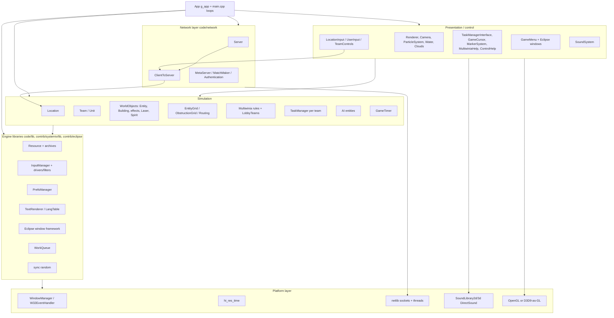
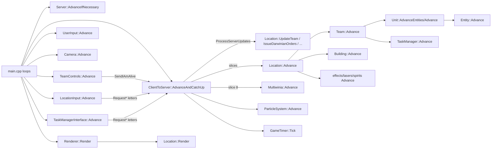
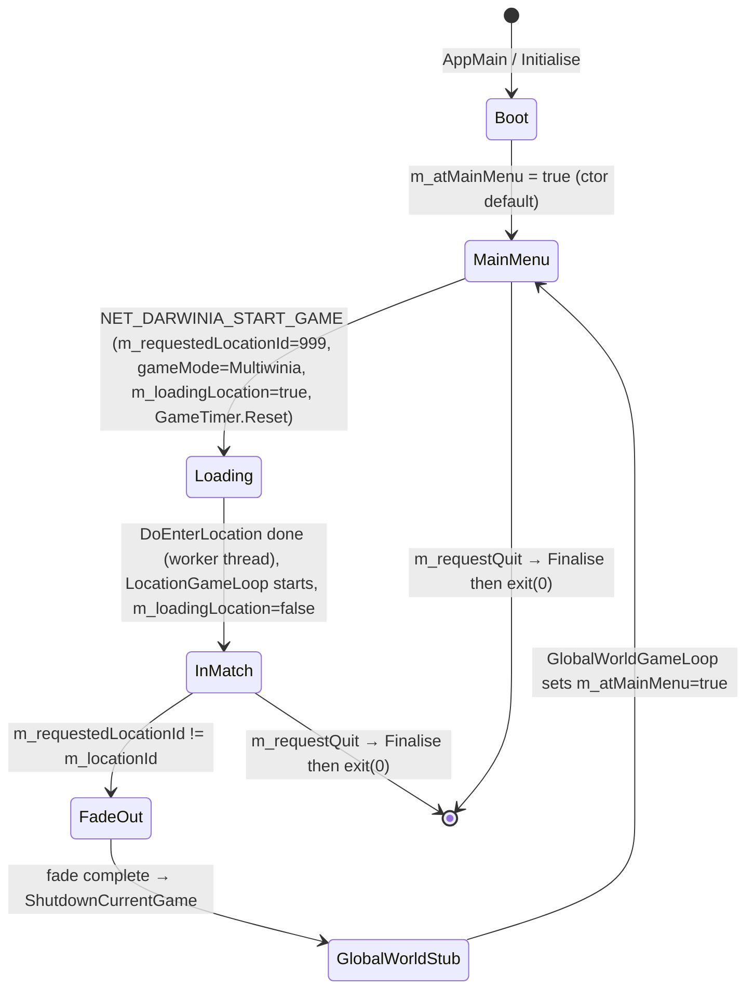
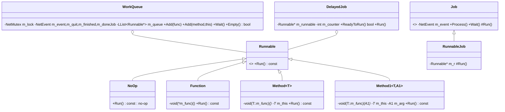

# Routed draft sections for document 20

<!-- from P01_app_core -->
## [→ 20_architecture] 1. The `App` class — the root object

`App` (`code/app.h:App`) is a plain aggregate: one global instance `g_app` owns (raw pointers) every long-lived subsystem. It has no virtuals and no lifecycle state machine of its own; the "state machine" of the program is the set of flags `m_atMainMenu`, `m_requestedLocationId`/`m_locationId`, `m_editing`, `m_requestToggleEditing`, `m_requestQuit`, `m_loadingLocation` consulted by `RunTheGame` (`code/main.cpp:RunTheGame`) — see §2.

### 1.1 Subsystem pointer members (every member, in declaration order)

| Member | Type | Created in | Deleted in | Lifetime | Build | Notes |
|---|---|---|---|---|---|---|
| `m_userInput` | `UserInput*` | `App::Initialise` | `~App` | process | FULL | mouse 3-D picking + debug keys, §5 [C] `code/app.cpp:App::Initialise` |
| `m_resource` | `Resource*` | `App::App` (first, after NetLib) | `~App` (second-to-last) | process | FULL | archive/texture/shape cache; `ParseArchive("init.dat")` immediately |
| `m_soundSystem` | `SoundSystem*` | `App::Initialise` | `~App` | process | FULL | initialised lazily by `App::CheckSounds` |
| `m_particleSystem` | `ParticleSystem*` | `App::Initialise` | `~App` | process | FULL | emptied in `ShutdownCurrentGame` |
| `m_langTable` | `LangTable*` | `App::SetLanguage` (via `InitLanguage`) | `~App`; the replaced table is deleted by a `DelayedJob(…, 5)` — counter = number of `HandleDelayedJobs` polls (≈ frames) while at the head of the queue, so it runs on the 6th poll [C] `code/lib/runnable.cpp:DelayedJob::ReadyToRun` | process | FULL | |
| `m_aviGenerator` | `AVIGenerator*` | never in this partition (init NULL) | – | – | `AVI_GENERATOR` only ([B:DEBUG]) | [C] ctor init list |
| `m_globalWorld` | `GlobalWorld*` | `App::Initialise` | `~App`; re-created by `LoadProfile`/`ResetLevel(true)` | process | FULL (Multiwinia uses it only as id/team/research holder) | `m_myTeamId` lives here |
| `m_location` | `Location*` | `DoEnterLocation` (loading thread) | `App::ShutdownCurrentGame` | one match | FULL | §3 |
| `m_locationId` | `int` | `DoEnterLocation` = `m_requestedLocationId` | `ShutdownCurrentGame` → -1 | | FULL | Multiwinia uses magic id **999** |
| `m_camera` | `Camera*` | `App::Initialise` | `~App` | process | FULL | |
| `m_server` | `Server*` | `App::StartNetwork(true,…)` | `ShutdownCurrentGame` (`delete m_server`) | one hosted session | FULL | NULL on pure clients |
| `m_clientToServer` | `ClientToServer*` | `App::Initialise` | `~App` | process | FULL | `OpenConnections()` straight after creation |
| `m_networkMutex` | `NetMutex` | member | – | process | FULL | locked in `StartSinglePlayerServer` |
| `m_delayedJobListMutex` | `NetMutex` | member | – | process | FULL | guards `m_delayedJobs` |
| `m_originVersion` | `char*` | literal "unknown"; replaced by first line of file `origin` | never freed | process | FULL | sent to metaserver |
| testbed members (`m_eTestBedMode` … `m_iTerminationSequenceID`, 24 fields) | various | | | | `TESTBED_ENABLED` → [B:DEAD] | Appendix |
| `m_netLib` | `NetLib*` | `App::App` (very first) | `~App` (last but one) | process | FULL | `Initialise()` (Winsock) |
| `m_mainThreadId` | `NetThreadId` | ctor = `NetGetCurrentThreadId()` | | process | FULL | |
| `m_renderer` | `Renderer*` | `App::App` | `~App` | process | FULL | `Initialise()` creates the window/GL context |
| `m_locationInput` | `LocationInput*` | `DoEnterLocation` | `ShutdownCurrentGame` | one match | FULL | §5 |
| `m_locationEditor` | `LocationEditor*` | `EnterLocation` when editing | `LocationEditorLoop` end | editor session | [B:EDITOR] | |
| `m_helpSystem`, `m_tutorial`, `m_sepulveda`, `m_demoEndSequence` | | | | | `USE_SEPULVEDA_HELP_TUTORIAL` → [B:DEAD] | |
| `m_effectProcessor` | `EffectProcessor*` | `App::Initialise` under `SOUND_EDITOR` | `~App` | | [B:DEBUG] | NULL in FULL |
| `m_taskManagerInterface` | `TaskManagerInterface*` | `TaskManagerInterface::CreateTaskManager()` (static, assigns g_app member) — called in `App::Initialise`, `DoEnterLocation` and on input-mode switch | `~App` | recreated per match / input mode | FULL | `CreateTaskManager` deletes the previous instance, then creates `TaskManagerInterfaceGestures` (single-player, pref `ControlMethod`==0, not gamepad), `TaskManagerInterfaceMultiwinia` (Multiplayer) or `TaskManagerInterfaceIcons` [C] `code/taskmanager_interface.cpp:TaskManagerInterface::CreateTaskManager`. At boot `m_gameMode` is None so the Icons variant is built first |
| `m_gesture` | `Gesture*` | `App::Initialise` (`new Gesture("gestures.txt")`) | `~App` | process | FULL | |
| `m_script` | `Script*` | `App::Initialise` | `~App` | process | FULL | |
| `m_testHarness` | `TestHarness*` | `RunTheGame` under `TEST_HARNESS_ENABLED` | – | | [B:DEAD] | |
| `m_gameCursor` | `GameCursor*` | `App::Initialise` (first object created there) | `~App` | process | FULL | |
| `m_startSequence` | `StartSequence*` | `RunBootloader` (`USE_LOADERS`) | same | | [B:DEAD] (USE_LOADERS off) | |
| `m_attractMode` | `AttractMode*` | `App::Initialise` under `ATTRACTMODE_ENABLED` | `~App` | | [B:DEAD] | NULL in FULL |
| `m_controlHelpSystem` | `ControlHelpSystem*` | `App::Initialise` | `~App` | process | FULL | `Shutdown()` when leaving a location |
| `m_gameMenu` | `GameMenu*` | `App::Initialise` | `~App` (first deleted) | process | FULL | `CreateMenu`/`DestroyMenu` around `MainMenuLoop`; owns `m_maps[gameType]` |
| `m_multiwinia` | `Multiwinia*` | `App::Initialise` | `~App` | process | FULL | owns `m_teams[NUM_TEAMS]` (`LobbyTeam`), game rules; `Reset()` per match |
| `m_shamanInterface` | `ShamanInterface*` | `App::Initialise` | `~App` | process | FULL (Darwinia-era UI, still advanced each frame) | |
| `m_markerSystem` | `MarkerSystem*` | `App::Initialise` | `~App` | process | FULL | `ClearAllMarkers()` per match |
| `m_multiwiniaHelp` | `MultiwiniaHelp*` | `App::Initialise` | `~App` | process | FULL | `Reset()` per match |
| `m_benchMark` | `BenchMark*` | `App::Initialise` | `~App` | | `BENCHMARK_AND_FTP` → [B:DEAD] | |
| `m_achievementTracker` | `AchievementTracker*` | `App::Initialise` | `~App` (last) | process | FULL | `Load()` polled in `MainMenuLoop` |
| `m_soundsWorkQueue` (private) | `WorkQueue*` | ctor init list (`new WorkQueue`) — spawns a thread | `~App` | process | FULL | loads `sounds.dat`,`sounds2.dat` |
| `m_delayedJobs` (private) | `LList<DelayedJob*>` | | | process | FULL | one job run per `HandleCommonConditions` |
| `m_oldLangTable` (private) | `LangTable*` | `SetLanguage` | `DeleteOldLangTable` (DelayedJob, counter 5 polls) | | FULL | |
| `m_thumbnailScreenshot`, `m_saveThumbnail` | | | | | `TARGET_OS_VISTA` → [B:DEAD] | |

### 1.2 Scalar/state members

| Member | Type | Initial | Meaning [C] `code/app.h:App` / `code/app.cpp:App::App` |
|---|---|---|---|
| `m_negativeRenderer` | bool | false; then pref `RenderNegative` | inverted colour rendering; sets `m_backgroundColour` white (255,255,255,255) else black (0,0,0,0) |
| `m_difficultyLevel` | int | 0 | `UpdateDifficultyFromPreferences` hard-codes 0 (pref read commented out); `Location::Init` overwrites from/to `LevelFile::m_levelDifficulty` |
| `m_largeMenus` | bool | false | true iff pref `OTHER_LARGEMENUS` == 2 |
| `m_usingFontCopies` | bool | false | CJK languages alias game/editor font to title font |
| `m_steamInited` | bool | false | never read or written anywhere else in `code/` [C] grep — dead flag |
| `m_userRequestsPause` | bool | false | toggled by network `NET_DARWINIA_PAUSE`; reset in `ShutdownCurrentGame` |
| `m_lostFocusPause` | bool | false | = !window-has-focus (or controller unplugged in gamepad mode), recomputed every `HandleCommonConditions` |
| `m_editing` | bool | false | editor mode ([B:EDITOR] paths only) |
| `m_requestedLocationId` | int | -1 | -1 = global world / none; 999 = Multiwinia match (`ClientToServer` on `NET_DARWINIA_START_GAME`) |
| `m_requestToggleEditing` | bool | false | |
| `m_requestQuit` | bool | false | `HandleCommonConditions` → `Finalise(); exit(0)` |
| `m_userProfileName[256]` | char | pref `UserProfile` ("none") | special names `AccessAllAreas`, `AttractMode` |
| `m_requestedMission[256]`, `m_requestedMap[256]` | char | "null" | map filename set by `GAMEOPTION_MAPNAME` network option |
| `m_levelReset` | bool | false | suppresses one mission save |
| `m_gameDataFile[256]` | char | "game.txt" | Darwinia campaign save |
| `m_backgroundColour` | RGBAColour | see above | |
| anonymous enum | `MultiwiniaTutorial1=0`, `MultiwiniaTutorial2=1` | | `m_multiwiniaTutorialType` |
| `m_atMainMenu` | bool | **true** | front-end menu visible |
| `m_atLobby` | bool | false | lobby page; cleared on game start |
| `m_gameMode` | int | `GameModeNone` | enum `GameModeNone=0, GameModePrologue=1, GameModeCampaign=2, GameModeMultiwinia=3, NumGameModes=4` |
| `m_loadingLocation` | bool | false | true from start-game message until `LocationGameLoop` starts; blocks sim processing |
| `m_spectator` | bool | false (true under `SPECTATOR_ONLY`) | |
| `m_multiwiniaTutorial` | bool | false | tutorial match; suppresses `m_aiType` reset |
| `m_multiwiniaTutorialType` | int | `MultiwiniaTutorial1` | |
| `m_hideInterface` | bool | false | `ControlToggleInterface` toggles |
| `m_soundsLoaded` | bool | false | set by sound work-queue thread |
| `m_requireSoundsLoaded` | bool | false | set at end of `MainMenuLoop`; loading screen waits for sounds |
| `m_doMenuTransition` | bool | false | (used by menu code, P18) |
| `m_checkedForPDLC` | bool | false | `DoCheckForPDLC` is declared but **no definition exists** [C] grep; dead declaration |
| achievements enum | `DarwiniaAchievementDominator=0, Hoarder=1, HailToTheKing=2, UncladSkies=3, AggravatedAssault=4, MasterPlayer=5, MasterOfMultiwinia=6, Explorer=7, Carnage=8, BlitzMaster=9, WrongGame=10, Genocide=11, NumAchievements=12` | | see 09_meta; `EarnedAchievement` always returns false and `GiveAchievement` does nothing beyond the CPU check → achievements are a no-op in App [C] |

### 1.3 `App` methods (public API, one line each)

| Method | Semantics [C] `code/app.cpp` |
|---|---|
| `App()` | sets `g_app=this`; NetLib init; pins thread affinity to mask `0x02\|0x08\|0x20\|0x80` (odd-numbered CPUs 1,3,5,7) [B:FULL Win32]; `Resource` + `init.dat`; `PrefsManager(GetPreferencesPath())`; `SetPreferenceOverrides()`; `Renderer::Initialise` + `SetOpenGLState`; queries `GL_MAX_TEXTURE_SIZE` → `BitmapRGBA::SetMaxTextureSize`; queues `App::Initialise` on the loading-screen work queue; renders the loading screen (blocks until queue drained); then queues `SetWorkingThreadProcessor` (affinity mask `0x01\|0x04\|0x10\|0x40`) and `App::LoadSounds` on `m_soundsWorkQueue` |
| `Initialise()` (private, runs on loading thread) | see §1.4 |
| `SetProfileName(name)` | copy; unless "AttractMode", writes pref `UserProfile` and saves prefs |
| `LoadProfile()` | recreates `m_globalWorld`; profile `AccessAllAreas`/`AttractMode` loads `game_unlockall.txt` and sets every trunk port online / every location available [B:LEGACY] |
| `SaveProfile(global, local)` | only if full version, `IsSinglePlayer()` and real profile: writes `users/<profile>/` game file and/or mission file → **no-op in Multiwinia** (IsSinglePlayer false) [C] |
| `ResetLevel(global)` | deletes saved mission file (+game file) and resets globalworld [B:LEGACY] |
| `HandleDelayedJobs()` | `TryLock`; runs head job if `ReadyToRun()`; removes it (≤1 job per call) |
| `AddDelayedJob(job)` | locked append |
| `StartNetwork(server, ip, port)` | if !editing: if server → `delete m_server; new Server; Initialise(); m_noAdvertise=true`; port ≠ -1 → real local IP and listener port, else ip "127.0.0.1"; then `m_clientToServer->ClientJoin(ip, port)` |
| `StartSinglePlayerServer()` | `m_aiType = AITypeStandard` unless tutorial; `g_gameTimer.Reset()`; lock `m_networkMutex`; `StartNetwork(true, NULL, -1)` → loopback server; returns true |
| `StartMultiPlayerServer()` | `m_aiType = AITypeStandard` unless tutorial; `StartNetwork(true, NULL, NULL)` (port 0 ≠ -1 → real IP + listener port); returns 0 (S_OK) |
| `ShutdownCurrentGame()` | ordered teardown, §1.6 |
| `GetFirstAvailableLanguage()` | first file in `language/` minus extension, else "unknown" |
| `GetDefaultLanguage()` | `g_systemInfo->m_localeInfo.m_language` |
| `InitLanguage()` | tries in order: pref `TextLanguage` (not on macOS), OS locale, "english", first available; asserts one succeeds |
| `TrySetLanguage(lang)` | if `language/<lang>.txt` exists: save pref `TextLanguage`, `SetLanguage(lang, pref TextLanguageTest)` |
| `SetLanguage(lang, test)` | builds `LangTable("language/<lang>.txt")`, optional `TestAgainstEnglish`; `setlocale(LC_CTYPE, lang)`; merges `strings_<lang>.txt` or `strings_default.txt` if present; first call initialises fonts `speccy` (game), `editor`, `square` (title), spacing factors editor 0.91, title 1.03; for `chinese-trad`,`chinese-simp`,`korean`,`japanese`: horizontal scale 1.0 and game+editor font := title font; else scale 0.6 for all three; `RebuildTables()` if input manager exists; old table deleted by `DelayedJob(m,5)` (6th poll, ≈ frames) |
| `InitMetaServer()` | loads `<profile>authkey.dev`; `Authentication_SetKey`; `Authentication_RequestStatus(key, METASERVER_GAMETYPE_MULTIWINIA)`; `MetaServer_Initialise`; `MetaServer_Connect("metaserver-mwdev.introversion.co.uk", PORT_METASERVER_CLIENT_LISTEN)`; `MatchMaker_LocateService(same host, PORT_METASERVER_LISTEN)` |
| `Multiplayer()` | `m_gameMode == GameModeMultiwinia` |
| `IsSinglePlayer()` | `m_gameMode ∈ {Campaign, Prologue}` (so a Multiwinia skirmish vs CPU is **not** "single player") |
| `UseProfileDirectory(b)` (static) | toggles profile-dir use (`--NoProfile`) |
| `GetProfileDirectory()` (static) | Win32 non-debug & ≥ Win2k: `%LOCALAPPDATA%\Introversion\Multiwinia\` (created); else "" |
| `GetPreferencesPath()` (static) | `<profile>preferences.txt` (macOS: `~/Library/Preferences/uk.co.introversion.<APP_NAME>.txt`) |
| `GetScreenshotDirectory()` (static) | `<profile>screenshots/` |
| `GetMapDirectory()` (static) | `<profile>maps/` (user maps, `.mwm`) |
| `UpdateDifficultyFromPreferences()` | `m_difficultyLevel = 0` |
| `ToggleGamePaused()` | allowed only if **no** `LobbyTeam` is `TeamTypeRemotePlayer`, not in grace period, not game over → `m_clientToServer->RequestPause()`; returns allowed |
| `GamePaused()` | `m_location && (g_gameTimer.IsPaused() \|\| m_clientToServer->m_outOfSyncClients.Size()>0 \|\| (m_lostFocusPause && IsSinglePlayer()))` |
| `EarnedAchievement(id)` | returns false (stub) |
| `CheckMasterAchievement()` | empty stub |
| `GiveAchievement(id)` | for ids other than MasterPlayer/Carnage/Genocide: return if any of the level's first `m_numPlayers` teams is CPU; then `EarnedAchievement` (no effect) |
| `IsFullVersion()` | `!Authentication_IsDemoKey(key)` (false under `MULTIWINIA_DEMOONLY`, true under `GIVE_ALL_LEVELS`) |
| `MultiplayerPermitted()` | full → true; else `DemoLimitations.m_maxDemoPlayers > 0` (false under `MULTIPLAYER_DISABLED`) |
| `HostGamePermitted()` | full → true; else `m_allowDemoServers > 0` |
| `IsMapAvailableInDemo(mode,map)` | demo limits permit both |
| `IsGameModePermitted(mode)` | demo limits (if not full) AND mode compiled in (`INCLUDEGAMEMODE_*`) |
| `IsMapPermitted(mode,map)` | mode permitted && map permitted |
| `IsMapPermitted(mapId)` | `PERMITTED_MAPS` list (CRC ids) if defined; else demo limits when not full; else true |
| `GetMapID(mode, crc)` | index in `m_gameMenu->m_maps[mode]` whose `m_mapId == crc`, else -1 (also -1 if mode ∉ [0,MAX_GAME_TYPES)) |
| `GetBuyNowURL()` | "http://store.introversion.co.uk" |
| `CheckSounds()` | `SoundSystem::Initialise()` until initialised; then `g_cachedSampleManager.CleanUp()` each call |
| `GetMaxNumberofPlayers()` | `m_numPlayers` of the `MapData` in `m_gameMenu->m_maps[m_gameType]` whose filename == `m_requestedMap`; else 0 |
| `UseChristmasMode()` | false if editing; true only on 24, 25, 26 December local time (`CHRISTMAS_DEMO`: 27 Nov–31 Dec) |
| `LoadSounds()` (private, sound thread) | parse `sounds.dat`, `sounds2.dat`; `m_soundsLoaded=true`; `m_soundSystem->TriggerInitialize()` |
| `DeleteOldLangTable()` (private) | |
| `DoStartServer()`, `DoCheckForPDLC()` (private) | declared, never defined/used [C] |

### 1.4 Process start-up order (exact)

Entry: `WinMain` stores `g_hInstance`, creates `g_windowManager = new WindowManagerWin32()` (D3D build: `WindowManagerDirectX`, `code/lib/window_manager_directx.cpp`) and calls `AppMain(cmdLine)`; on return it returns `WM_QUIT` [C] `code/lib/window_manager_win32.cpp:WinMain`.

1. `AppMain` — `--write-version` writes file `version` with `DARWINIA_VERSION` and returns. Body wrapped in SEH `__try/__except(RecordExceptionInfo(...,"AppMain","0B9432AF",DARWINIA_VERSION))` (`USE_CRASHREPORTING && TARGET_MSVC`). [C] `code/main.cpp:AppMain`
2. `RunTheGame(cmd)` → `Initialise(cmd)` (`code/main.cpp:Initialise`):
   1. `--NoProfile` → `UseProfileDirectory(false)`; create profile dir; debug log path prefix; `DUMP_DEBUG_LOG` → redirect to `debug.txt`.
   2. `StandardiseCPUPrecision()` → `_control87(_PC_53, _MCW_PC)` (x87 53-bit mantissa) **[determinism]**.
   3. `g_systemInfo = new SystemInfo`; `InitialiseHighResTime()`.
   4. `g_eventHandler = new W32EventHandler()`.
   5. `g_loadingScreen = new LoadingScreen()` (spawns its work-queue thread).
   6. `InitialiseInputManager()` — `g_inputManager` with drivers in order: Conjoin, Chord, Invert, Idle, W32 (Win), XInput (only if `LoadLibrary("XINPUT1_3")` succeeds; stored in `g_xInputDriver`), Prefs, Value, Alias. (Driver semantics → P10.)
   7. `g_app = new App()` — the App ctor (§1.3) which, on the **loading-screen thread**, runs `App::Initialise`:
      `m_requestedMission/Map="null"` → read `origin` file → `ParseArchive("language.dat")` → `InitLanguage()` → `ParseArchive` `main.dat`, `patch.dat`, `menusounds.dat`, `branding.dat` → negative-renderer pref → `UpdateDifficultyFromPreferences` → **`new GameCursor` → `new MarkerSystem` → `new MultiwiniaHelp` → `new SoundSystem` → `new ClientToServer`** → `InitMetaServer()` → `m_clientToServer->OpenConnections()` → **`new UserInput` → `new Camera`** → `m_gameDataFile="game.txt"` → (`SOUND_EDITOR`: `new EffectProcessor`) → `SetProfileName(pref UserProfile)` → **`new ParticleSystem` → `new Gesture("gestures.txt")` → `new Script` → `new ShamanInterface`** → (`ATTRACTMODE_ENABLED`: `new AttractMode`) → **`new ControlHelpSystem`** → large-menus pref → **`new AchievementTracker` → `new Multiwinia` → `new GameMenu`** → (`BENCHMARK_AND_FTP`) → (`USE_DARWINIA_MOD_SYSTEM`: mod) → **`new GlobalWorld`** → **`TaskManagerInterface::CreateTaskManager()`** → `GameMenuWindow::PreloadTextures()`.
      Only after that job has finished (the ctor blocks in `g_loadingScreen->Render()`) are `SetWorkingThreadProcessor` and `App::LoadSounds` queued on the separate sound work queue, so the two unrar-based archive loads never overlap ("unrar not thread safe" comment); sound loading then runs concurrently with steps 8–12 below and with the main menu [C] `code/app.cpp:App::App`.
   8. `ReadInputPreferences()` — parse, in order, `InputPrefs::GetSystemPrefsPath()` (from resources, must open), locale prefs (override), user prefs file (Unicode, fallback ANSI; override). [C]
   9. (`TARGET_OS_VISTA`: Vista + parental checks) [B:DEAD].
   10. `g_target = new TargetCursor()`; `EntityBlueprint::Initialise()`; `g_windowManager->HideMousePointer()`.
   11. pref `StartMap` → `m_requestedLocationId = globalWorld->GetLocationId(name)` and copies map/mission (Darwinia dev path) [B:LEGACY].
   12. `m_renderer->SetOpenGLState()`.
3. `g_loadingScreen->m_initialLoad = false`, then the outer loop (§2.1).

### 1.5 Process shutdown order (`Finalise`, `code/main.cpp:Finalise`)

Triggered only by `m_requestQuit` (set by `ControlGameDebugQuit` or UI) inside `HandleCommonConditions` → `Finalise(); exit(0)`.

1. `m_clientToServer->ClientLeave()`.
2. `MetaServer_Disconnect()`.
3. (macOS: drain loading-screen and sound preload queues.)
4. If sound initialised: `g_soundLibrary2d->Stop()`; delete `g_soundLibrary3d`, `g_soundLibrary2d`.
5. `EclShutdown()` (window framework).
6. Fonts: `g_gameFont`/`g_oldGameFont`, `g_editorFont`/`g_oldEditorFont` (whichever is the original), `g_titleFont` `.Shutdown()`.
7. `delete g_windowManager`.
8. `delete g_target`; `delete g_systemInfo`; **`delete g_app`** (→ `~App`, below).
9. `g_cachedSampleManager.EmptyCache()`; `delete g_inputManager`; `delete g_eventHandler`; `Profiler::Stop()`.

`~App` deletion order [C] `code/app.cpp:App::~App`: `m_benchMark`([B:DEAD]) → `m_gameMenu` → `m_multiwinia` → `m_globalWorld` → `m_langTable` → (`m_tutorial` demo) → `m_taskManagerInterface` → `m_shamanInterface` → `m_controlHelpSystem` → (`m_attractMode`) → `m_script` → (`m_sepulveda`) → `m_gesture` → `m_particleSystem` → `m_markerSystem` → (`m_helpSystem`) → `m_multiwiniaHelp` → (`m_effectProcessor`) → `m_camera` → `m_userInput` → `m_clientToServer` → `m_soundSystem` → `m_gameCursor` → `m_renderer` → `g_prefsManager` → `m_soundsWorkQueue` (joins thread) → `m_resource` → `m_netLib` → `m_achievementTracker`. Note: `m_location`, `m_server`, `m_locationInput` are not deleted by `~App` (they are expected to be NULL; a quit from inside a match leaks them) [C]/[I].

### 1.6 Per-match teardown (`App::ShutdownCurrentGame`)

Called at the end of `LocationGameLoop`. Order [C] `code/app.cpp:App::ShutdownCurrentGame`:
`SaveProfile(false,true)` (no-op in Multiwinia) → if pref `RecordDemo`==1 and server: `m_server->SaveHistory("serverHistory.dat")` → `g_explosionManager.Reset()` → `m_globalWorld->TransferSpirits(m_locationId)` → `m_clientToServer->ClientLeave()` → `m_location->Empty()` → `m_particleSystem->Empty()` → `m_markerSystem->ClearAllMarkers()` → `m_multiwiniaHelp->Reset()` → `delete m_location`, `m_locationId=-1` → `delete m_locationInput` → `delete m_server` → `m_multiwinia->Reset()` → `m_globalWorld->m_myTeamId = 255` → `m_globalWorld->EvaluateEvents()` → `m_userRequestsPause=false` → `SaveProfile(true,false)`.

### 1.7 Lifetimes of the world layers

| Object | Created | Destroyed | Notes |
|---|---|---|---|
| `GlobalWorld` | `App::Initialise` | `~App` | Darwinia campaign map; in Multiwinia used for `m_myTeamId`, `m_research` (forced levels in `Location::Init`), `GenerateBuildingId`, `s_nextUniqueBuildingId`, `TransferSpirits`, `EvaluateEvents` [C] |
| `Multiwinia` (+ `LobbyTeam m_teams[6]`) | `App::Initialise` | `~App` | persists across matches; `Reset()` after each. `Team` objects reference `LobbyTeam` fields by C++ reference (§4) |
| `Location` | `DoEnterLocation` (worker thread) | `ShutdownCurrentGame` | exactly one per match; `Location::Init` loads level, builds all sub-objects |
| `LocationInput` | `DoEnterLocation` | `ShutdownCurrentGame` | |
| `Server` | `StartNetwork(true)` (single-player at `DoEnterLocation`; multiplayer host from lobby code) | `ShutdownCurrentGame` | |
| `TaskManagerInterface` | `App::Initialise`, again in `DoEnterLocation`, and on keyboard↔gamepad switch | `~App` | |
| UI windows (Eclipse) | registered ad hoc (`EclRegisterWindow`) | `RemoveAllWindows`, `EclShutdown` | `GameMenu::CreateMenu/DestroyMenu` bracket the front-end |

### 1.8 Global singletons

All defined at file scope; none are reference-counted; access is unsynchronised except where noted.

| Global | Type | Defined in | Owner/creator | Role |
|---|---|---|---|---|
| `g_app` | `App*` | `code/app.cpp` | `Initialise` (`new App`), set inside ctor | root |
| `g_gameTimer` | `GameTimer` (static object) | `code/gametimer.cpp` | static init | network-safe game clock (§2.4) |
| `g_gameTime` | `double` | `code/main.cpp` | `UpdateAdvanceTime` | wall-clock time of last render frame (not sim time) |
| `g_advanceTime` | `double` | `code/main.cpp` | `UpdateAdvanceTime` | real seconds since last frame, clamped ≤ 0.25 |
| `g_lastProcessedSequenceId` | `int` | `code/main.cpp` (=-1) | `ClientToServer` | last server update consumed |
| `g_sliceNum` | `int` | `code/main.cpp` | `ClientToServer::ProcessAllServerLetters` | current slice 0..9, -1 = need next update |
| `g_RenderingFirstTimeBL`, `requestBootloader` | bool | `code/main.cpp` | `RequestBootloaderSequence` | bootloader request (body under `USE_LOADERS` → dead) |
| `g_xInputDriver` | `XInputDriver*` | `code/main.cpp` (`TARGET_MSVC`) | `InitialiseInputManager` | |
| `g_prefsManager` | `PrefsManager*` | `code/lib/preferences.*` | `App::App` | deleted in `~App` |
| `g_inputManager` | `InputManager*` | `code/lib/input/input.*` | `InitialiseInputManager` | |
| `g_inputFilterManager` | `InputFilterManager*` | `code/lib/input/inputfiltermanager.h` | P10 | |
| `g_eventHandler` | `EventHandler*` | `code/lib/input/eventhandler.h` | `Initialise` | Win32 message pump/focus |
| `g_windowManager` | `WindowManager*` | `code/lib/window_manager.h` | `WinMain` creates `WindowManagerWin32` (D3D: `WindowManagerDirectX`) **before** `AppMain` [C] `code/lib/window_manager_win32.cpp:WinMain` | deleted in `Finalise` |
| `g_target` | `TargetCursor*` | `code/lib/targetcursor.h` | `Initialise` | mouse position abstraction |
| `g_systemInfo` | `SystemInfo*` | `code/lib/system_info.h` | `Initialise` | |
| `g_loadingScreen` | `LoadingScreen*` | `code/loading_screen.h` | `Initialise` | owns a `WorkQueue` thread |
| `g_explosionManager` | `ExplosionManager` | `code/explosion.h` | static | reset per match |
| `g_cachedSampleManager`, `g_deletingCachedSampleHandle` | | `code/sound/sample_cache.h` | static | |
| `g_soundLibrary2d`, `g_soundLibrary3d` | `SoundLibrary2d*`, `SoundLibrary3d*` | `code/sound/*` | SoundSystem (P16) | |
| `g_gameFont`, `g_editorFont`, `g_titleFont`, `g_oldGameFont`, `g_oldEditorFont` | `TextRenderer` | `code/lib/text_renderer.h` | `App::SetLanguage` | |
| `g_deformEffect`, `g_waterReflectionEffect` | | `code/deform.h`, `code/water_reflection.h` | renderer (P12) | |
| `g_debugRenderer`, `g_log` | | `code/lib/persisting_debug_render.h`, `code/lib/debug_logging.h` | | |
| `g_colourBlack/White`, `g_upVector`, `g_zeroVector`, `g_identityMatrix34` | const values | lib | | |
| `g_openGLMutex` | `NetMutex` | `code/lib/safegl.cpp` | | guards GL between loading-screen thread and main thread (P12/P13) |
| `g_profiler` | `Profiler*` | `contrib/systemiv/lib/profiler.cpp` (=NULL) | `Profiler::Start()`, called only by the profile window (`code/interface/profilewindow.cpp`) — NULL in normal play | `START_PROFILE/END_PROFILE` no-op when NULL; `Profiler::Stop()` in `Finalise` |
| D3D-only: `g_pd3dDevice`, `g_pd3dDeviceActual`, `g_d3dpp`, `g_currentVertexBuffer`, `g_fixedPipeline`, `g_supportsHwVertexProcessing` | | `code/lib/opengl_directx*` | | [B:D3D] |
| `g_win32InputDriver`, `g_keys[]`, `g_keyDeltas[]`, `g_sdlMouseDriver`, `g_tracingOpenGL`, `g_fogLogging`, `g_fogEnabled` | | lib | | P10/P13 (`g_sdlMouseDriver` macOS only) |

### 1.9 Layered architecture



Module dependency graph (who calls whom per frame; arrows = "calls into"):



---

<!-- from P01_app_core -->
## [→ 20_architecture] 2. Main loops, frame timing and threads

### 2.1 Outer program loop (`code/main.cpp:RunTheGame`)

```
forever:
    if requestBootloader: (RunBootloader only under USE_LOADERS → dead); requestBootloader=false
    if g_app.m_atMainMenu:          MainMenuLoop()
    elif m_requestedLocationId!=-1: EnterLocation()      # Multiwinia match: id 999
    else:                           EnterGlobalWorld()    # Darwinia world [B:LEGACY]; exits at once because it sets m_atMainMenu=true
    g_inputManager.Advance()
```
[C]. `GlobalWorldGameLoop` sets `m_atMainMenu = true` then `break`s at the top of its loop when `m_atMainMenu` — in practice the program alternates **MainMenuLoop ↔ LocationGameLoop** [C] `code/main.cpp:GlobalWorldGameLoop`. After a match, `LocationGameLoop` exits because something set `m_requestedLocationId = -1` (in-game menu / results UI, P17b/P18); the next outer iteration finds `m_atMainMenu == false` and `m_requestedLocationId == -1`, enters `EnterGlobalWorld` → `GlobalWorldGameLoop`, which sets `m_atMainMenu = true` and returns at once — this is the path back to the front end.



### 2.2 `MainMenuLoop` (front end + lobby), per iteration [C]

1. `UpdateAdvanceTime()`
2. `m_renderer->Render()` (renders menus)
3. `m_userInput->Advance()`
4. `m_soundSystem->Advance()` if initialised
5. `HandleCommonConditions()` (§2.6)
6. `m_achievementTracker->Load()` until loaded
7. if `!m_gameMenu->m_menuCreated && renderer fade complete` → `m_gameMenu->CreateMenu()`
8. `m_server->AdvanceIfNecessary(GetHighResTime())` if hosting
9. `m_clientToServer->AdvanceAndCatchUp()`

Exit when `m_atMainMenu` false (set when the `NET_DARWINIA_START_GAME` command is applied — `code/network/clienttoserver.cpp:ClientToServer::ProcessServerUpdates`) or editor toggle. On exit: stop sound "MultiwiniaInterface LobbyAmbience", `m_gameMenu->DestroyMenu()`, `m_requireSoundsLoaded = true`.

### 2.3 Entering a match (`EnterLocation` / `DoEnterLocation`)

Sequence [C] `code/main.cpp:EnterLocation`, `DoEnterLocation`:

1. `m_loadingLocation = true` (already set by the start-game letter; while true `ClientToServer::AdvanceAndCatchUp` only calls `KeepAlive()` and processes no updates).
2. `g_loadingScreen->m_workQueue->Add(&DoEnterLocation)`; `g_loadingScreen->Render()` — main thread draws the loading screen until the work queue is empty (and sounds loaded when `m_requireSoundsLoaded`). `DoEnterLocation` runs on the **loading-screen worker thread**:
   1. if `!Multiplayer()` → `StartSinglePlayerServer()` (campaign path; Multiwinia already started its network in the lobby).
   2. `TaskManagerInterface::CreateTaskManager()`.
   3. `WorldObjectId::ResetUniqueIdSeed()` **[determinism]**.
   4. `m_location = new Location()`; `m_locationInput = new LocationInput()`.
   5. (`PERMITTED_MAPS`: check CRC of `m_requestedMap`.)
   6. `m_location->Init(m_requestedMission, m_requestedMap)` (§3.3).
   7. `GunTurret::SetupTeamShapes()`.
   8. `m_locationId = m_requestedLocationId`.
   9. `m_camera->UpdateEntityTrackingMode()`.
   10. pref `RecordDemo`==2 and server → `m_server->LoadHistory("ServerHistory.dat")` (replay).
   11. Camera bounds = [-200, worldSizeX+200] on both axes (`borderSize = 200.0`); fallback target (maxX,1000,maxX) looking (-1,-0.7,-1); then camera mount `"start"`; cut.
3. Back on main thread: not editing → camera `DebugModeAuto`, `RequestMode(ModeFreeMovement)` → `LocationGameLoop()`.

### 2.4 `GameTimer` — simulation clock (`code/gametimer.cpp`)

Macros (`code/gametimer.h`): `SERVER_ADVANCE_PERIOD` ≡ `g_gameTimer.GetServerAdvancePeriod()`; `g_predictionTime` ≡ `g_gameTimer.GetPredictionTime()`; `GetNetworkTime` ≡ `g_gameTimer.GetGameTime`.

| Field | Init | Meaning |
|---|---|---|
| `m_gameSpeed` | 0.0 | current speed multiplier (1 = normal, 0 = stopped) |
| `m_gameTime` | 0.0 | **sim time** in game-seconds; += `0.1*m_gameSpeed` per processed server update unless paused |
| `m_accurateTime` | 0.0 | smooth speed-scaled real time (UI/cosmetic, not net-safe) |
| `m_lastClientAdvance` | 0.0 | real time (`GetHighResTime`) of the last `Tick()` |
| `m_estimatedServerStartTime` | 0.0 | real time at `Reset()` |
| `m_requestedSpeed` | -1 | target speed (<0 = none) |
| `m_requestedSpeedOfChange` | -1 | blend factor per tick (1 = immediate) |
| `m_requestedSpeedLength` | -1 | duration (s) after which speed reverts to 1.0 (<0 = forever) |
| `m_lastCallToAccurateTime` | 0.0 | |
| `m_lockSpeedChange` | false | when true `RequestSpeedChange` ignored |

| Function | Semantics [C] |
|---|---|
| `Reset()` | `m_estimatedServerStartTime=now`; `m_gameSpeed = Multiplayer()? 0.0 : 1.0`; `m_gameTime=0`; `m_lastClientAdvance=0`; requested speed/rate = -1; unlock. **Does not reset `m_requestedSpeedLength` or `m_accurateTime`** [C] |
| `Tick()` | called once per processed server *update* (`ClientToServer::ProcessAllServerLetters`). `m_lastClientAdvance = now`; if `!g_app->GamePaused()`: `m_gameTime += GetServerAdvancePeriod()`. Then if `m_requestedSpeed ≥ 0`: `m_gameSpeed += (m_requestedSpeed − m_gameSpeed) × m_requestedSpeedOfChange`; if `\|m_gameSpeed − m_requestedSpeed\| < 0.01` snap and clear request. Then if no request pending (or reached) and `m_requestedSpeedLength ≥ 0`: `m_requestedSpeedLength −= 0.1`; when ≤ 0 → length = -1 and request speed 1.0 (rate stays as before). |
| `GetGameSpeed()` / `GetRequestedGameSpeed()` / `GetGameTime()` | accessors |
| `GetAccurateTime()` | `m_accurateTime += (now − m_lastCallToAccurateTime) × m_gameSpeed`; NOT net-safe, NOT thread-safe |
| `GetAccurateTime(futureTime)` | pure projection of the above; thread-safe |
| `GetServerAdvancePeriod()` | `0.1 × m_gameSpeed` — the **sim dt per tick** |
| `GetPredictionTime()` | 0 if `GamePaused()`; else `min(now − m_lastClientAdvance, 1.0) × m_gameSpeed` — render extrapolation time |
| `IsPaused()` | `m_gameSpeed < 0.01` |
| `RequestSpeedChange(speed, rate, length)` | ignored if locked; sets the three request fields |
| `LockSpeedChange()` | lock (used at game over) |
| `DebugRender()` | returns immediately (dead body) |

Speed-change callers (all in sim code, hence deterministic) [C]:

| Caller | Request (speed, rate, length) |
|---|---|
| `Multiwinia` grace period end (`code/multiwinia.cpp`) | (1.0, 1.0, -1) — starts a multiplayer match (Reset leaves speed 0) |
| `Multiwinia` game won (`code/multiwinia.cpp`) | (0.0, 0.2, -1) + `LockSpeedChange()` |
| `NET_DARWINIA_PAUSE` letter (`code/network/clienttoserver.cpp`) | toggle `m_userRequestsPause`; (0.0,0.2,-1) or (1.0,0.2,-1) |
| `Crate::RunSlowDownTime` [`INCLUDE_CRATES_ADVANCED`] | (0.2 + syncfrand(0.2), 0.05, 15.0) |
| `Crate::RunSpeedUpTime` | (1.3 + syncfrand(0.7), 0.05, 15.0) |
| `Meteor` within 200 of target (`code/worldobject/meteor.cpp`) | (0.4, 0.1, 4.0) |

Key design property: **the tick rate is fixed at 10 Hz of real time; game speed scales the dt of each tick** (0.1 s × speed), not the tick frequency. At speed 0 updates keep flowing but `GamePaused()` is true so `Location::Advance` is skipped [C] `code/network/clienttoserver.cpp:ProcessAllServerLetters`.

### 2.5 Tick / slice model

- **Server tick**: `Server::AdvanceIfNecessary(now)` runs `Server::Advance()` when `now > m_nextServerAdvanceTime`, then `m_nextServerAdvanceTime += 0.1` (at most one tick per call; it catches up over successive frames) [C] `code/network/server.cpp:Server::AdvanceIfNecessary`. `Server::Advance` bundles all client letters received since the last tick into one `NET_DARWINIA_UPDATE` letter with sequence id `m_sequenceId++` (P15).
- **Client sim**: each server update is executed as **10 slices** (`NUM_SLICES_PER_FRAME = 10`, `code/globals.h`). Every container that is a `SliceDArray` (`Location::m_buildings`, `m_spirits`, `m_lasers`, `m_effects`, `Team::m_others`, `Unit::m_entities`, `ParticleSystem::m_particles`) advances 1/10th of its slots per slice; each object therefore advances **once per server tick with dt = SERVER_ADVANCE_PERIOD** but the work is spread over frames.
- `ClientToServer::ProcessAllServerLetters(catchUp)` [C]:
  ```
  n = GetNumSlicesToAdvance(catchUp)
  repeat n times:
     if g_sliceNum == -1:
         letter = next in-order server letter (or none → nothing this iteration)
         ProcessServerLetters(letter)  (non-update messages)
         if seqId != -1:
            if not handled: isUpdate = ProcessServerUpdates(letter)   # applies all player commands of this tick
            g_lastProcessedSequenceId = seqId
            if isUpdate: g_sliceNum = 0; g_gameTimer.Tick(); GenerateSyncValue(); SendSyncronisation()
         if m_loadingLocation: return            # start-game letter
     if g_sliceNum != -1:
         if location and !GamePaused(): Location::Advance(g_sliceNum); ParticleSystem::Advance(g_sliceNum)
         if Multiplayer() and g_sliceNum == 8: Multiwinia::Advance()      # NB: runs even when paused
         g_sliceNum = (g_sliceNum < 9) ? g_sliceNum+1 : -1
  ```
  Note the sync checksum is generated **immediately after commands are applied and before slice 0** of the new tick, i.e. it hashes the state at the end of the previous tick plus this tick's command effects (P15/X3).
- `GetNumSlicesToAdvance(catchUp)` [C] `code/network/clienttoserver.cpp`: catch-up → 20; otherwise `pending = (lastValidSeqFromServer − g_lastProcessedSequenceId) × 10 + (g_sliceNum ≠ -1 ? 10 − g_sliceNum : 0)`; `n = int(pending × 0.3)`; clamp to [0, 20]. (A time-based branch for `pending ≤ 10` assigns a shadowed local and has **no effect** — dead code [C].) So the client consumes ~30 % of its backlog per frame, at most 2 ticks' worth of slices per call.
- `AdvanceAndCatchUp()` loops `Advance(); ProcessAllServerLetters(catchUp)` while `catchUp = (g_lastProcessedSequenceId < m_lastValidSequenceIdFromServer − 20) && clientId ≠ -1` and less than **0.3 s** real time has been spent [C].
- **Rendering** uses `g_predictionTime = min(now − lastTick, 1.0) × speed` for extrapolation: each renderable is drawn at `pos + vel × predictionTime`; objects whose slot index is **greater than `SliceDArray::GetLastUpdated()`** (i.e. not yet advanced in the current tick) are drawn with `predictionTime + SERVER_ADVANCE_PERIOD` so both halves of a half-advanced array look consistent [C] `code/team.cpp:Team::RenderOthers`, `code/unit.cpp:Unit::Render`, `code/location.cpp:Location::RenderBuildings`. This is extrapolation (dead reckoning), not interpolation between two stored states.
- Render rate is uncapped (one `Renderer::Render` per loop iteration); `MINIMUM_RENDER_PERIOD = 1.0` is defined but has no user anywhere [C] `code/globals.h` + grep.

### 2.6 `LocationGameLoop` — the in-match frame (`code/main.cpp:LocationGameLoop`)

Setup: `m_loadingLocation=false`; `m_hideInterface=false`; `iAmAServer = (m_server != NULL)`; `nextIAmAliveMessage = lastRenderTime = now`; `renderer->StartFadeIn(0.6)`; sound "EnterLocation" (Ambience).

Per iteration, in exact order [C]:

1. **Exit check**: if not fading and `m_requestedLocationId != m_locationId` → `StartFadeOut()`; when fading and `IsFadeComplete()` → `m_controlHelpSystem->Shutdown()`; break.
2. **Multiwinia camera**: once `GetMyTeam()` exists → camera target mount `"player<N>"` where N = `GetTeamPosition(myTeamId)`; cut.
3. `g_inputManager->PollForEvents()`.
4. `ControlToggleInterface` → toggle `m_hideInterface`.
5. `ControlMenuEscape` (only when fade complete): if script running → (Sepulveda skip, dead); elif any Eclipse window → `RemoveAllWindows()` (also re-centres mouse), `m_hideInterface=false`; elif task-manager visible → hide it; else camera `DebugModeAuto`, open `LocationWindow` (in-game menu), `m_hideInterface=true`. Then `m_userInput->Advance()`.
6. `g_loadingScreen->RunJobs()` (GL jobs queued by worker threads, e.g. display lists).
7. `HandleCommonConditions()` (always returns false): one delayed job; controller-unplugged dialog (`ControlControllerUnplugged` → `ControllerUnpluggedWindow`; `ControlControllerPlugged` removes "controller_unplugged"); `m_lostFocusPause = !focus` (forced unfocused when controller unplugged in gamepad mode); memory log every 60 s; `ControlGameDebugQuit` → `m_requestQuit`; `CheckSounds()`; quit → `Finalise(); exit(0)`.
8. `timeNow = GetHighResTime()`.
9. Host only: `m_server->AdvanceIfNecessary(timeNow)`.
10. If no Eclipse window on screen: `teamControls.Advance()` (accumulates input flags, §5.3).
11. Client part (always, `iAmAClient = true`):
    1. if `timeNow > nextIAmAliveMessage`: `SendTeamControlsToNetwork(teamControls)`; `nextIAmAliveMessage += IAMALIVE_PERIOD (0.1 s)`; if still behind → `timeNow + 0.1`.
    2. `m_clientToServer->AdvanceAndCatchUp()` (sim, §2.5).
    3. if `m_multiwinia->m_resetLevel` → `m_multiwinia->ResetLocation()`; re-arm player camera.
    4. `UpdateAdvanceTime()`; `lastRenderTime = now`; `g_profiler->Advance()`.
    5. `m_userInput->Advance()`.
    6. `SwitchTaskManagerForX360Controller()` (recreate task manager UI on keyboard↔gamepad switch when not visible).
    7. `m_location->m_water->Advance()`.
    8. `g_soundLibrary2d->TopupBuffer()` if sound initialised.
    9. `m_camera->Advance()` only if window has focus.
    10. `m_locationInput->Advance()`.
    11. `m_taskManagerInterface->Advance()`.
    12. `m_script->Advance()`.
    13. `g_explosionManager.Advance()`.
    14. `m_soundSystem->Advance()` if initialised.
    15. `m_controlHelpSystem->Advance()`; `m_shamanInterface->Advance()`; `m_markerSystem->Advance()`; `m_multiwiniaHelp->Advance()`.
    16. `m_globalWorld->EvaluateEvents()` ("DELETEME: debug" comment).
    17. `m_renderer->Render()`.
    18. if `m_renderer->m_fps < 15` → extra `m_soundSystem->Advance()`.

After the loop: stop "Ambience EnterLocation", trigger "ExitLocation", `ShutdownCurrentGame()`.

There is **no sleep/yield** anywhere in the in-match or menu loops of this partition (busy loop) [C]; any throttling must come from inside `Renderer::Render` / buffer flip (vsync) — [U] U1 (P12/P13).

```mermaid
sequenceDiagram
  participant Main as Main thread (LocationGameLoop)
  participant Srv as Server (host only)
  participant C2S as ClientToServer
  participant Loc as Location/Multiwinia
  participant Ren as Renderer
  loop every frame
    Main->>Main: PollForEvents, escape/menu handling, RunJobs, HandleCommonConditions
    Main->>Srv: AdvanceIfNecessary(now) [<=1 tick per 0.1 s]
    Main->>Main: TeamControls.Advance()
    alt now > nextIAmAlive (10 Hz)
      Main->>C2S: SendIAmAlive(myTeamId, teamControls)
    end
    Main->>C2S: AdvanceAndCatchUp()
    loop n slices (0..20)
      C2S->>C2S: if slice==-1: take next update, apply commands, GameTimer.Tick, sync value
      C2S->>Loc: Location.Advance(slice); ParticleSystem.Advance(slice)
      C2S->>Loc: slice 8: Multiwinia.Advance()
    end
    Main->>Main: UpdateAdvanceTime, UserInput, Water, Camera, LocationInput, TaskManagerInterface, Script, Explosions, Sound, help/markers
    Main->>Ren: Render() using g_predictionTime
  end
```

### 2.7 `UpdateAdvanceTime` and real time (`code/main.cpp:UpdateAdvanceTime`)

- Normal: if not paused, `g_advanceTime = now − g_gameTime` clamped to **≤ 0.25 s**; `g_gameTime = now`. When paused, both are left unchanged (so `g_advanceTime` keeps its last value) [C].
- Demo recording (pref `RecordDemo` ∈ {1,2}): `g_advanceTime = 1 / pref DemoFrameRate (default 25)`; `IncrementFakeTime(that)` (the hi-res clock becomes a fake fixed-step clock); `g_gameTime = GetHighResTime()`.
- `g_advanceTime` is used by ~99 call sites for cosmetic per-frame animation (camera, UI, sound, water) — never for sim [I] (by convention; X3 to verify).

### 2.8 Threading model

| Thread | Created by | Runs | Sync with main |
|---|---|---|---|
| Main | OS | all loops, sim (`Location::Advance` via ClientToServer), render, input | – |
| Loading-screen worker | `LoadingScreen` ctor → `WorkQueue` (`NetStartThread`) | `App::Initialise` at boot, `DoEnterLocation` (whole level load incl. `Location::Init`) | main spins in `LoadingScreen::Render` until queue empty; GL calls from worker are queued as `Job`s and run by main via `RunJobs`; `g_openGLMutex` |
| Sound loader | `App::m_soundsWorkQueue` | `SetWorkingThreadProcessor` (affinity 0x55) then `App::LoadSounds` | sets `m_soundsLoaded` (plain bool, no barrier) |
| Sound preload | `SoundSystem::m_PreloadQueue` (`code/sound/soundsystem.cpp`) | sample preloading | P16 |
| Client listener | `ClientToServer::OpenConnections` → `m_listenThread` WorkQueue running `ListenThread` | receives UDP into inbox (mutex `m_inboxMutex`) | P15 |
| Server listener | `Server` → `NetStartThread(ListenThread)` | receives client UDP | P15 |
| MetaServer/auth/matchmaker | `contrib/systemiv/lib/metaserver/*` (`ListenThread`, `ServerRegisterWANThread`, `ServerRegisterLANThread`, `AuthenticationThread`, `RequestIdentityThread`, Steam threads) | | P15 |
| D3D work queue | `code/lib/opengl_directx.cpp` (`s_workQueue`) | [B:D3D] | P13 |

Every `WorkQueue` thread calls `StandardiseCPUPrecision()` first (x87 precision is per-thread) [C] `code/lib/work_queue.cpp:WorkQueue::RunThread`. `Location::Advance` contains `#pragma omp parallel for` over its five sub-advances, but **OpenMP is disabled** in the project (`OpenMP="false"`, `targets/vs2005/Darwinia.vcproj`) so it executes serially in step order 0..4 [C]; a port must keep this serial order (§6).

Thread affinity: main thread mask `0xAA` (CPUs 1,3,5,7); loading/sound worker threads mask `0x55` (CPUs 0,2,4,6) [C] `code/app.cpp:App::App`, `SetWorkingThreadProcessor`.

<!-- from P01_app_core -->
## [→ 20_architecture] 7. Constants table (every numeric constant in this partition)

| Constant | Value | Unit | Kind | Meaning | Ref |
|---|---|---|---|---|---|
| `NUM_TEAMS` | 6 | teams | `#define` | team slots | `code/globals.h` |
| `NUM_SLICES_PER_FRAME` | 10 | slices/tick | `#define` | work split of one tick | `code/globals.h` |
| `IAMALIVE_PERIOD` | 0.1 | s (real) | `#define` | TeamControls send interval | `code/globals.h` |
| `MINIMUM_RENDER_PERIOD` | 1.0 | s | `#define` | "render at least this often" — no user anywhere in `code/` [C] grep | `code/globals.h` |
| `GRAVITY` | 10.0 | units/s² | `#define` | used by entity physics (P03) | `code/globals.h` |
| server tick period | 0.1 | s (real) | literal | `m_nextServerAdvanceTime += 0.1f` | `code/network/server.cpp` |
| `GetServerAdvancePeriod` | 0.1 × speed | game s | literal | sim dt | `code/gametimer.cpp` |
| pause threshold | 0.01 | speed | literal | `IsPaused` and speed snap | `code/gametimer.cpp` |
| speed-length decrement | 0.1 | s per tick | literal | | `code/gametimer.cpp` |
| prediction clamp | 1.0 | s (real) | literal | max extrapolation | `code/gametimer.cpp` |
| catch-up threshold | 20 | ticks behind | literal | enter catch-up | `code/network/clienttoserver.cpp:AdvanceAndCatchUp` |
| catch-up budget | 0.3 | s (real) | literal | max per frame | same |
| slices per call | ≤ 20; 30 % of backlog | slices | literal | `GetNumSlicesToAdvance` | same |
| `g_advanceTime` clamp | 0.25 | s | literal | frame dt cap | `code/main.cpp:UpdateAdvanceTime` |
| `DemoFrameRate` default | 25 | fps | pref | demo recording fixed step | `code/main.cpp` |
| `TARGET_FRAME_RATE_INCREMENT` | 0.25 | – | `#define` | unused | `code/main.cpp` |
| memory log interval | 60 | s | literal | | `code/main.cpp:AdvanceAvailableMemoryCheck` |
| location fade-in | 0.6 | s | literal | | `code/main.cpp:LocationGameLoop` |
| global-world fade-in | 0.25 | s | literal | | `code/main.cpp:GlobalWorldGameLoop` |
| low-fps sound threshold | 15 | fps | literal | extra `SoundSystem::Advance` | `code/main.cpp` |
| `ControlMouseButtons` default | 3 | buttons | pref | read, unused | `code/main.cpp:SendTeamControlsToNetwork` |
| camera border | 200.0 | units | `const` | camera bounds margin | `code/main.cpp:DoEnterLocation` |
| fallback camera | (maxX,1000,maxX) dir (-1,-0.7,-1) | units | literal | | same |
| global-world camera height | 50.0 | | literal | | `code/main.cpp:EnterGlobalWorld` |
| main / worker affinity | 0xAA / 0x55 | CPU mask | literal | | `code/app.cpp` |
| `DelayedJob` counter for lang table | 5 | polls | literal | | `code/app.cpp:SetLanguage` |
| font spacing | editor 0.91, title 1.03 | factor | literal | | `code/app.cpp:SetLanguage` |
| font horiz scale | 0.6 (Latin) / 1.0 (CJK) | factor | literal | | same |
| large menus option | 2 | pref value | literal | `OTHER_LARGEMENUS` | `code/app.cpp:Initialise` |
| Christmas | Dec 24–26 (tm_mon 11) | dates | literal | | `code/app.cpp:UseChristmasMode` |
| no-team id | 255 | id | literal | | everywhere |
| Multiwinia location id | 999 | id | literal | | `code/network/clienttoserver.cpp` |
| monster / future team id | 4 / 5 | team | literal | | `code/location.cpp` |
| monster / future colour | (10,10,10) / (200,200,200); colour ids 8 / 9 | RGB | literal | | `code/location.cpp:InitMonsterTeam/InitFuturewinianTeam` |
| `MULTIWINIA_NUM_TEAMCOLOURS` | 8 | colours | `#define` | | `code/multiwinia.h` |
| `ASSAULT_ATTACKER_COLOURID` / `DEFENDER` | 1 / 0 | colour id | `#define` | | `code/multiwinia.h` |
| entity grid cell | 32.0 × 32.0 | units | literal | | `code/location.cpp:Init` |
| obstruction grid cell | 32.0 (MP) / 64.0 | units | literal | | same |
| container step sizes | lights 1, buildings 10, spirits 100 (initial size 100), lasers 100, effects 100, team others 100, units 5, unit entities 100 | slots | literal | growth step | `Location::Location`, `Team::Team`, `Unit::Unit` |
| forced research (MP) | all 3; Squad 1, Laser 2, Grenade 2, Rocket 2, AirStrike 2, Darwinian 4 | level | literal | | `code/location.cpp:Init` |
| `m_christmasTimer` init / burst threshold | -99.9 / < -90 | s | literal | | `code/location.cpp` |
| snow | 150 initial; 1 per 0.1 s at y 700–1000 | count, s, units | literal | | `AdvanceChristmas` |
| soul rain | 1 per 1.0 s at y 700–1000 | | literal | | `AdvanceSoulRain` |
| dust | vortex every 15–30 s, 1/10 chance; 300 initial; 2 per 0.1 s; size +0–20; vortex capture radius 50; land test height > 1.0; vortex y 0–500 | | literal | | `AdvanceDustWind` |
| lightning | every 0–15 s at y 1200 | | literal | | `AdvanceLightning` |
| crate cap | int(worldSizeX / 500) | crates | literal | | `AdvanceCrates` |
| crate interval | CrateDropRate × U(0.5, 1.5] | s | option × literal | | `AdvanceCrates` |
| crate placement | land height ≥ 20; weighted ±100 around a building; 1000 / 100 tries; separation `CRATE_SCAN_RANGE × 10`; height `CRATE_START_HEIGHT` + 0–200 | units | literal / P08 defines | | `CreateRandomCrate` |
| spawn search | 10 tries; clamp 20 from edge | | literal | | `FindValidSpawnPosition` |
| spirit spawn offset | +1 (up vector) | units | literal | | `SpawnSpirit` |
| `IsVisible` tolerance | 20.0 | units | literal | | |
| `GetWalkingDistance` | step 40; water limit 40; gradient weight 1.5; obstacle sphere 20 | units | literal | | |
| `IsWalkable` | step 20; water limit 40; max gradient 2.4; min normal.y 0.8; wall sphere 13.2; fence sphere 10 | units | literal | | |
| picking | unit sphere ×1.5, unit-entity ×1.5, entity ×1.0, building ×0.75, armour range 0.001 | factor | literal | | `GetUnitId/GetEntityId/GetBuildingId` |
| throw force | sqrt(dist) × 8, capped by research max | | literal | | `ThrowWeapon` |
| muzzle flashes | throw/rocket (20, 3); turret (60, 2) at +dt/2; laser (25 × life, 1.5) | size, life | literal | | |
| turret shell life | research 0/1 → 0.5, 2 → 1.0, 3 → 1.5, 4 → 2.0; MP 0.6 | s | literal | | `FireTurretShell` |
| laser life | research 0..4 → 0.2/0.4/0.6/0.8/1.0; ×2 mind-control | s | literal | | `FireLaser` |
| promote flashes | 5 + rand%5; vel sfrand(5), frand(15), sfrand(5) | | literal | cosmetic | `PromoteDarwinian` |
| `Bang` | damage radius 2 r (full ≤ 1.5 r); building radius 3 r; push y = damage (ground) / −1 (air); cores r·d·0.01 (+0–100 %); debris max(2, r·d·0.01) ≤ 30; shockwave r/20 | | literal | | `Bang` |
| fog | start end/3; end max(4000, X+1000, Z+1000); linear | units | literal | | `SetupFog` |
| lights | Christmas (1.3,1.2,1.2); special dir (0,1,0.5) colour (2.0,1.5,0.75), shininess 10 | | literal | | `SetupLights/SetupSpecialLights` |
| AI link cull | 0.8 | ratio | literal | | `RecalculateAITargets` |
| centre message | 3.0 s; size 40; y 370 @1280 width; last-2 s grow 15·sqrt(2−t) | s, px | literal | | `SetCurrentMessage/RenderCurrentMessage` |
| chat | font 14 × scale; fade 55→60 s; wrap 40 % width; box 25 % width | | literal | | `RenderChatMessages` |
| kill milestones | 500, 1000, 2000, 3000, 4000, 5000 | kills | literal | | `Team::Advance` |
| IssueDarwinianOrders | armour search radius 30; particle colour (255,100,255); 1000 iterations | | literal | | |
| starting power-ups | task start timer 30.0 | s | literal | | `InitialiseTeam` |
| CPU AI entity spawn | (-100, 0, -100) | units | literal | | `InitialiseTeam` |
| `EvolutionFormationSize` default | 90 | (officer formation cap) | literal | | `Team::Team` |
| viriifull texture | 160 × 512; 32 copies; glow 128 | px | literal | | `Team::Initialise` |
| turret select | `m_fireTimer = 0.5`; cursor boost 2.0 | s | literal | | `Team::SelectUnit` |
| render LOD | virii 300/500/600/1000; darwinian 500/1000/99999.9; alpha refs 0.02 / 0.04 / 0.01; near plane ×1.05 (virii), ×1.2 (lasers) | units | literal | | `Team::Render*`, `Location::RenderWeapons` |
| TeamControls camera | acceleration 6 / 256 when ‖δ‖² > 175; target length cap 125 (‖v‖² > 15625) | | literal | | `TeamControls::Advance` |
| TeamControls flag bits | 0x0001 … 0x0400 (11 bits) | | literal | | `TeamControls::GetFlags` |
| formation | 100 jitter values in [0, 1); spacing 4.0; airstrike row 4, ×6 (x,z), ×3 (y) | units | `const`/literal | | `Unit::GetFormationOffset` |
| laser-trooper lead | 1.0 step, trigger 0.2 | units | literal | | `Unit::Advance` |
| route waypoint reach | 10.0 | units | literal | | `Unit::FollowRoute` |
| order throttle | 1.0 | game s | literal | Darwinian orders | `LocationInput::AdvanceTeamControl` |
| selection circle | growth 100 /s (real), max radius 100 | units | literal | | same |
| wall-buster direct route | ≥ 25 % of selection | ratio | literal | | same |
| select sound throttle | 0.5 | s (real) | literal | | `SelectObjectUnderMouse` |
| officer follow radius | 50 (2500 squared) | units | literal | single-player | same |
| mouse fallback spheres | worldSize × 40; 36000 (global world) | units | literal | | `UserInput::RecalcMousePos3d` |

<!-- from P14_platform_lib -->
## [→ 20_architecture] 20.T Threading primitives and thread map

### 20.T.1 Primitive classes [C] `code/lib/runnable.h`, `code/lib/runnable.cpp`, `code/lib/work_queue.h`, `code/lib/work_queue.cpp`



| Primitive | Exact semantics |
|---|---|
| `NetMutex` (Win32) | `CRITICAL_SECTION` (recursive), `TryLock` = `TryEnterCriticalSection`; `m_locked` flag is informational only. `NetLockMutex` = RAII scope lock [C] `contrib/systemiv/lib/netlib/net_mutex_win32.cpp` |
| `NetEvent` (Win32) | **auto-reset**, initially non-signalled (`CreateEvent(NULL,false,false,NULL)`); `Signal` = `SetEvent` (multiple signals coalesce); `Wait(ms)`: negative → `INFINITE`; returns true iff signalled [C] same file |
| `NetStartThread(fn,arg)` | `CreateThread(NULL,0,fn,arg,0,&id)` — fire-and-forget, handle not kept/closed [C] `contrib/systemiv/lib/netlib/net_thread_win32.cpp` |
| `WorkQueue::WorkQueue()` | starts **one dedicated worker thread** (`RunThread`), which first calls `StandardiseCPUPrecision()` (x87 precision is per-thread) then `Run()` [C] |
| `WorkQueue::Add(f)` / `Add(&T::m, this)` | under `m_lock`, appends `new Function` / `new Method<T>` at the tail and signals `m_event` [C] |
| `WorkQueue::Run()` | loop: while queue empty → wait `m_event` (infinite), then if `m_quit.Wait(0)` → signal `m_finished` and return; take item 0 under lock; **run it outside the lock**; remove item 0 under lock; delete it; signal `m_doneJob`. FIFO, strictly serial, one item at a time [C] |
| `WorkQueue::Empty()` | `m_queue.Size()==0` under lock. The running item stays in the queue until it finishes, so "empty" means "idle" [C] |
| `WorkQueue::Wait()` | `while(!Empty()) m_doneJob.Wait(-1)` — blocks until the queue is idle [C] |
| `WorkQueue::~WorkQueue()` | signal `m_quit` and `m_event`, wait `m_finished` (worker drains remaining items first, because it only checks quit when the queue is empty) [C] |
| `Job::Process()` / `Wait()` | `Run()` then signal its event / block on it — a one-shot synchronous hand-off between threads [C] |
| `DelayedJob` | `ReadyToRun()` decrements `m_counter` and returns false while it was > 0; true when 0; destructor deletes the runnable [C] |

Hazards recorded for the new design:
* `NetStartThread` casts a `void(WorkQueue*)` cdecl function to a `DWORD WINAPI(LPVOID)` thread routine (calling-convention mismatch, works only because the routine never returns normally except at shutdown) [C] `code/lib/work_queue.cpp` (`(NetThreadFunc) &WorkQueue::RunThread`); [I] consequence.
* `LList` read accessors mutate a cached cursor (`mutable m_previous`), so even concurrent *reads* of the same list are unsafe [C] `contrib/systemiv/lib/tosser/llist.cpp:GetItem`; the queue is only touched under `m_lock`.
* SystemIV path helpers return a shared static buffer (`s_filePathBuffer`) — not re-entrant [C] `contrib/systemiv/lib/filesys/filesys_utils.cpp:GetDirectoryPart/GetFilenamePart/RemoveExtension`.

### 20.T.2 Threads that exist in the baseline build

| Thread | Created by | Runs | Affinity mask | Evidence |
|---|---|---|---|---|
| **Main thread** | process | input, simulation, rendering, network pump, sound `Advance`, executes queued GL `Job`s while the loading screen renders | `0x02|0x08|0x20|0x80` (CPUs 1,3,5,7) set in `App::App` | [C] `code/app.cpp:App::App` (SetThreadAffinityMask) |
| Loading-screen worker (`g_loadingScreen->m_workQueue`) | `LoadingScreen::LoadingScreen` | `SetWorkingThreadProcessor`, `App::Initialise` (archives, language, subsystem construction, metaserver init), `DoEnterLocation` (level loading), `GameMenuWindow::PreloadThumbnails`; on Mac also `App::LoadSounds` | `0x01|0x04|0x10|0x40` (CPUs 0,2,4,6) | [C] `code/loading_screen.cpp`, `code/app.cpp` L241, `code/main.cpp` L1367, `code/UI/GameMenuWindow.cpp` L4341 |
| Sounds loader (`App::m_soundsWorkQueue`) | `App::App` | `SetWorkingThreadProcessor`, `App::LoadSounds` (parses `sounds.dat`, `sounds2.dat`) — serial because unrar is not thread-safe | 0x55 | [C] `code/app.cpp` L191, L250–L251, L502 |
| Sound preloader (`SoundSystem::m_PreloadQueue`) | `SoundSystem` ctor | `SoundSystem::BackgroundSoundLoad` | inherits | [C] `code/sound/soundsystem.cpp` L388–L389 (P16) |
| Client listener (`ClientToServer::m_listenThread`) | `ClientToServer::OpenConnections` | `ListenThread` (UDP receive) | inherits | [C] `code/network/clienttoserver.cpp` L199–L201 (P15) |
| Server listener | `Server::Initialise` | `ListenThread` via `NetStartThread` | inherits | [C] `code/network/server.cpp` L194 (P15) |
| D3D mip-map worker | `opengl_directx` init | `MipMapTask::GenerateMipmaps` | 0x55 | [C] `code/lib/opengl_directx.cpp` L296–L299, L1338 [B:D3D] |
| Metaserver / authentication threads | SystemIV metaserver | P15 | – | P15 |

Cross-thread GL rule [C] `code/lib/resource.cpp:DeleteTextureAsync/CreateDisplayListAsync`, `code/landscape_renderer.cpp`, `code/loading_screen.cpp:QueueJob/TryDequeueJob/RunJobs`: any GL/D3D call needed by a worker (texture upload/delete, display-list build, VBO bind) is wrapped as a stack-allocated `Job` (`RunnableJob(Method<…>)` or a custom `Job` subclass), pushed with `LoadingScreen::QueueJob` (mutex-protected `LList<Job*>`), and the worker blocks on `Job::Wait()`; the main thread pops and `Process()`es jobs while rendering the loading screen (one job per frame plus as many as fit before the 1/60 s frame deadline) and via `LoadingScreen::RunJobs()` from the main loop [C] `code/loading_screen.cpp` (frame loop), `code/main.cpp` L496. Callers on the main thread run the operation directly (`NetGetCurrentThreadId() == g_app->m_mainThreadId`).

Deferred deletion: when the language changes, the old `LangTable` is kept for 5 main-loop iterations via `DelayedJob(Method<App>(&App::DeleteOldLangTable), 5)` so other threads/frames holding references finish first; `App::HandleDelayedJobs()` (called once per main-loop iteration) only looks at the head job, under `TryLock` [C] `code/app.cpp:SetLanguage/HandleDelayedJobs`, `code/main.cpp` L282.

Network/loader interlock: while the loading screen renders, network keep-alive and server advance run only if `g_app->m_networkMutex.TryLock()` succeeds [C] `code/loading_screen.cpp` (frame loop).

### 20.T.3 Design guidance
Replace with a job system that has (a) a main/render thread affinity tag for GPU work instead of the GL-job hand-off, (b) per-thread FP environment initialisation (or, better, deterministic simulation that does not rely on x87 control words), (c) no thread affinity hard-coding (the masks assume ≤8 logical CPUs and SMT layouts of 2008).

---
