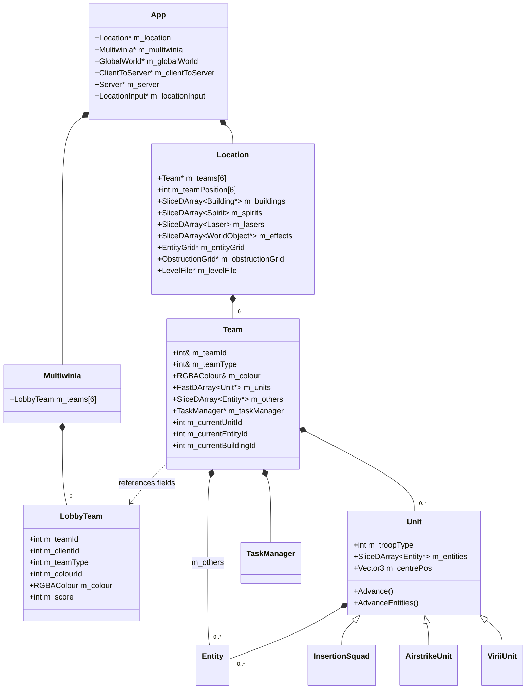
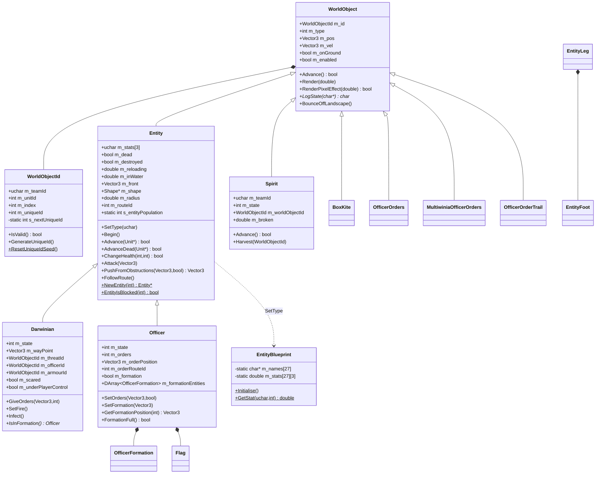
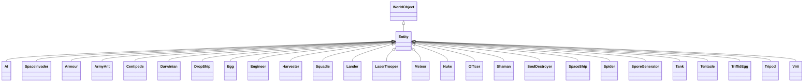

# Routed draft sections for document 21

<!-- from P01_app_core -->
## [→ 21_simulation_and_entity_model] 3. `Location` — the match world

`Location` (`code/location.h:Location`) is the container and service façade for everything simulated in one match. Exactly one exists at a time (`g_app->m_location`), created on the loading thread in `DoEnterLocation` and destroyed in `App::ShutdownCurrentGame` (§1.6). All sim access goes through `g_app->m_location` (a global, not a parameter).

### 3.1 Members (every member)

| Member | Type | Init (`Location::Location`) | Meaning / owner [C] `code/location.h`, `code/location.cpp` |
|---|---|---|---|
| `m_lastSliceProcessed` (prot.) | int | 0 | last slice passed to `Advance`; used by cloud render offset |
| `m_missionComplete` (prot.) | bool | false | Darwinia objective flag [B:LEGACY] |
| `m_coopGroupColourTaken[2][2]` (priv.) | bool | false | per coop group: member-0 / member-1 shade already handed out by `GetGroupColour` |
| `m_showCrateDropMessage` (priv.) | bool | true | show "crate_drop" message only for the first crate |
| `m_landscape` | `Landscape` (by value) | | heightmap/normal map/render (P11) |
| `m_entityGrid` | `EntityGrid*` | NULL; `new EntityGrid(32.0, 32.0)` in Init | spatial hash for entities (cell 32×32 world units) (P03) |
| `m_entityGridCache` | `EntityGridCache*` | NULL; created in Init; deleted in dtor and Empty | neighbour query cache, `Advance()` at slice 7 |
| `m_obstructionGrid` | `ObstructionGrid*` | NULL; `new ObstructionGrid(s,s)`, s = **32.0 in Multiplayer, 64.0 otherwise** | building footprint grid |
| `m_levelFile` | `LevelFile*` | NULL; `LoadLevel` | parsed map+mission (P11) |
| `m_clouds` | `Clouds*` | NULL; Init | sky clouds; advanced at slice 3 |
| `m_water` | `Water*` | NULL; Init | advanced per *frame* by main loop (cosmetic) |
| `m_routingSystem` | `LandRoutingSystem` | | pathfinding for Darwinians/officers (P03) |
| `m_seaRoutingSystem` | `SeaRoutingSystem` | | AI sea routes |
| `m_teams[NUM_TEAMS]` | `Team*[6]` | NULL; `InitTeams` creates **all six** (even unused) | |
| `m_teamPosition[NUM_TEAMS]` | int | -1 | team id → map start position (0..numPlayers-1) |
| `m_christmasTimer` | double | -99.9 | shared timer for snow / dust / lightning spawners (<-90 = first-run burst) |
| `m_spawnSync` | double | 0.0 | soul-rain spawner timer |
| `m_crateTimer` | double | 0.0 | crate drop countdown |
| `m_spawnManiaTimer` | double | 0.0 | crate effect timer, decremented at slice 8 (P08) |
| `m_bitzkreigTimer` | double | 0.0 | crate effect timer, decremented at slice 8 (P08) |
| `m_allowMonsterTeam` | bool | true | gates `GetMonsterTeamId`/`GetFuturewinianTeamId` (→ -1 when false) |
| `m_teamsInitialised` | bool | false | set at end of `InitTeams` |
| `m_messageTimer` | double | 0.0 | **real-time** expiry of the centre-screen message |
| `m_message` | UnicodeString | empty | centre-screen message |
| `m_messageTeam` | int | -1 | colour source (255 = white) |
| `m_messageNoOverwrite` | bool | false | lock until expiry |
| `m_lights` | `FastDArray<Light*>` | step 1 | from level file |
| `m_buildings` | `SliceDArray<Building*>` | step 10, 10 slices | all buildings incl. crates |
| `m_spirits` | `SliceDArray<Spirit>` (by value) | size 100, step 100, 10 slices | |
| `m_lasers` | `SliceDArray<Laser>` (by value) | step 100, 10 slices | |
| `m_effects` | `SliceDArray<WorldObject*>` | step 100, 10 slices | grenades, rockets, shells, fireballs, shockwaves, muzzle flashes, snow, dust balls, lightning, unprocessed spirits, and other `WorldObject` effects |
| `m_chatMessages` | `LList<ChatMessage*>` | | newest first; render-only |
| `m_windDirection` | Vector3 | zero | set by dust-wind spawner |
| `m_coopGroups[NUM_TEAMS]` | int | 0 | 0 = none, 1 / 2 = alliance group |
| `m_groupColourId[2]` | int | -1 | colour id chosen for each coop group |
| `m_burnPatches` | `LList<BurnPatch>` | | scorched terrain patches (pos, radius); adding one rebuilds landscape GL state |
| `m_christmasMode` | bool | false | copied from `ClientToServer::m_christmasMode` at Init |
| `m_sortedBuildingsAlphas` (priv.) | `DepthSortedBuilding*` | NULL | growable scratch buffer (step 128) for alpha depth sort |
| `m_sizeSortedBuildingsAlphas` (priv.) | int | 0 | |
| `s_neighbours` (static) | `std::vector<WorldObjectId>` | | shared scratch result buffer for grid queries |
| `s_neighboursInUse` (static) | bool | false | re-entrancy guard used only by `Bang` |

Structs: `ChatMessage {m_msg, m_clientId, m_recievedTime (real time), m_colour, m_senderName}`; `BurnPatch {m_pos, m_radius}`; `DepthSortedBuilding {m_buildingIndex, m_distance (float, squared distance)}`.

### 3.2 Containers: storage, identity and add/remove rules

All arrays are `FastDArray` derivatives: an entry's index never changes; removal pushes the slot on a **LIFO free list** so the next `PutData` reuses the most recently freed slot [C] `contrib/systemiv/lib/tosser/fast_darray.cpp:FastDArray::RemoveData/PutData`. Iteration is always by ascending index over `Size()` (capacity), skipping invalid slots.

| Container | Element identity (`WorldObjectId(team, unit, index, uniqueId)`) | Added by | Removed when |
|---|---|---|---|
| `Team::m_others` (per team) | (team, -1, slot, unique) | `Location::SpawnEntities` → `Team::NewEntity(type, -1)` → `Entity::NewEntity(type)` | `Entity::Advance(NULL)` returns true → removed from entity grid at old pos, deleted (`Team::Advance`) |
| `Unit::m_entities` (per unit) | (team, unitId, slot, unique) | `SpawnEntities` with `_unitId ≠ -1` → `Unit::NewEntity` | `Entity::Advance(unit)` true → `Unit::RemoveEntity` (grid remove + delete) |
| `Team::m_units` | unit slot | `Team::NewUnit` (InsertionSquad / AirstrikeUnit / ViriiUnit / generic Unit) | `Unit::Advance` true (no live entities) at slice 0 → deleted |
| `m_buildings` | (team, `UNIT_BUILDINGS`=-100, -1, uniqueId) — looked up by **uniqueId by linear scan** | `InitBuildings` (from level file), `CreateRandomCrate`, other systems (P06/P08) | `Building::Advance()` true → removed+deleted; triggers `ObstructionGrid::CalculateAll()` once per slice; `RecalculateAITargets()` if the removed one was an `AITarget` or `Wall` |
| `m_spirits` | (team, `UNIT_SPIRITS`=-101, slot, -1) | `SpawnSpirit` (refused for the monster team → -1) | `Spirit::Advance()` true |
| `m_lasers` | none (value type) | `FireLaser` (`GetPointer()` = allocate slot) | `Laser::Advance()` true |
| `m_effects` | (team or -1, `UNIT_EFFECTS`=-103, slot, generated unique) | `ThrowWeapon`, `FireRocket`, `FireTurretShell`, `LaunchFireball`, `FireLaser` (muzzle flash), `CreateShockwave`, weather spawners, other systems | `WorldObject::Advance()` true → removed+deleted |

`GetEntity(id)` validates `uniqueId` so a stale id to a reused slot returns NULL [C] `code/location.cpp:Location::GetEntity`. `UNIT_LASERS` = -102 is defined but lasers are never looked up by id [C] `code/worldobject/worldobject.h`.

### 3.3 Level loading flow (`Location::Init(mission, map)`)

Exact order [C] `code/location.cpp:Location::Init`:

1. `LoadLevel(mission, map)`: `m_levelFile = new LevelFile(mission, map, ext(map)=="txt")`; if `MissionComplete()` already → mark complete and set `GlobalLocation(m_requestedLocationId)->m_missionCompleted`. (For Multiwinia the objective list is the automatic `NeverTrue` objective so this is false [I] `code/level_file.cpp:LevelFile::GenerateAutomaticObjectives`; otherwise the NULL `GetLocation(999)` would crash.)
2. `AppSeedRandom(1)` — reseeds the **non-synchronised** generator (`AppRandom`, frand/sfrand) [determinism].
3. Reset statics: `GlobalWorld::s_nextUniqueBuildingId=0`; `Crate::s_crates=0`; `Crate::s_spaceShipUsed=false`; `AIObjective::s_objectivesInitialised=false`; `Armour::s_armourObjectives.Empty()`; `Engineer::s_buildingIds/s_researchIds.EmptyAndDelete()`; `SpawnPopulationLock::Reset()`; `SoulDestroyer::s_numSoulDestroyers=0`; `DustBall::s_vortexTimer=0`, `s_vortexPos=0`; delete `Unit::s_offsets`; for each team i: `AI::s_ai[i]=NULL`, `SpawnPoint::s_numSpawnPoints[i]=0`, `GetTeamPosition(i)` (assigns start positions — consumes `syncrand`), `PulseBomb::s_pulseBombs[i]=-1`, `MultiwiniaZone::s_blitzkriegBaseZone[i]=-1`.
4. Christmas: if `m_clientToServer->m_christmasMode` → move flag into `m_christmasMode`.
5. `InitLights()` (copy colour+front of each level light), `InitLandscape()` (`m_landscape.Init(&levelFile->m_landscape)`), `m_water = new Water()`.
6. Team colours/alliances (§4.4): Assault → `SetupAssault()`; else coop → `SetupCoop(i)` for every player position i < numPlayers that is not monster/futurewinian and not yet grouped; else for each CPU team: colour = `Multiwinia::GetCPUColour()` (random unused of colours 0..3; tutorial forces colour = team index).
7. If not editing: `InitBuildings()` → `RecalculateAITargets()` → `m_entityGrid = EntityGrid(32,32)`, `m_entityGridCache`, `m_obstructionGrid(32 or 64)` → `m_clouds` → `m_routingSystem.Initialise()`, `m_seaRoutingSystem.Initialise()`. (Editing: only snap level buildings to terrain height [B:EDITOR].)
8. `InitTeams()`: for i in 0..5: if lobby colour is -1 → `GetNextAvailableColour()`; `m_teams[i] = new Team(lobbyTeam)`; if type ≠ Unused → `InitialiseTeam(i)`; then `m_teamsInitialised = true`.
9. If `numPlayers < 4`: for teams i ≥ numPlayers (excluding 4 and 5) pick a random unused colour `id = (syncrand() % 8) / 2` (i.e. 0..3) until unused, assign `m_colour` only (so "random team colour" effects have a full palette) [C].
10. Difficulty: `levelFile->m_levelDifficulty == -1` → store `g_app->m_difficultyLevel` (0) in it; else copy it into `m_difficultyLevel`.
11. `m_allowMonsterTeam = true`; Multiplayer: `InitMonsterTeam(4)`, `InitFuturewinianTeam(5)`; force `GlobalResearch` levels: every item = 3, then Squad = 1, Laser = 2, Grenade = 2, Rocket = 2, AirStrike = 2, Darwinian = 4 [C].

`InitBuildings()` [C]: for each level-file building: assert no duplicate uniqueId; `Building::CreateBuilding(type)`; `PutData`; remap owner **map position → team id** with `GetTeamFromPosition` (unless 255/-1); `Initialise(template)`; `SetDetail(1)`; track highest id; collect `ControlStation`s and the `PulseBomb`. Assault: link every control station whose id is in `pulseBomb->m_links` via `ControlStation::LinkToPulseBomb`. Finally `GlobalWorld::s_nextUniqueBuildingId = highest+1`.

`InitialiseTeam(teamId)` [C] `code/location.cpp:Location::InitialiseTeam`:
1. `team->Initialise()` (creates `TaskManager(teamId)`; builds `sprites/viriifull.bmp` if absent).
2. Multiwinia only: CPU team → spawn one `Entity::TypeAI` at (-100,0,-100) (the AI brain is an entity, P08). Game option `StartingPowerups` (0 for teams 4 and 5): repeat N times pick `syncrand() % Crate::NumCrateRewards` until not in the exclusion set {Randomiser, CrateMania, Darwinians, Bitzkreig, SpawnMania, Plague, RocketDarwinians, SpaceShip, Spam, Triffids, SpeedUpTime, SlowDownTime, Forest, TheBeast(`INCLUDE_THEBEAST`)} and `Crate::IsValid` → `Crate::CaptureCrate(id, team)`; then every non-Shaman task gets `m_startTimer = 30.0` s. Then for every **SpawnPoint or SolarPanel** owned by the team: one Darwinian per port at the port position, state `StateOperatingPort`, facing port front; SpawnPoint → `EvaluatePorts()`, `RecalculateOwnership()`, `m_activationTimer=0`; SolarPanel → `EvaluatePorts()`, `RecalculateOwnership()`.
3. `position = GetTeamPosition(team)`; for each level-file `InstantUnit` whose `m_teamId == position`: if `m_runAsTask` → map type {Armour→TypeArmour, InsertionSquadie→TypeSquad, Harvester→TypeHarvester, Shaman→TypeShaman, Engineer→TypeEngineer, Tank→TypeTank} research, `RunTask`, `TargetTask` at pos (verification off), task `m_lifeTimer=-1` (permanent); else optional `NewUnit` (+waypoint, route) and `SpawnEntities(pos, team, unit, type, number, 0, spread, -1, route, routeWaypoint)`; waypoint snapped to a Radar Dish centre if inside its radius; single Darwinian with `StateFollowingOrders` → `GiveOrders(target)`; Officer → `SetOrders(target)` if `OrderGoto` else `m_orders = state`; Armour → `SetWayPoint`, `m_state`.
4. Snap every `m_others` entity of every team to terrain height.
5. Local player only: level-file `RunningProgram`s (Engineer with carried spirits; InsertionSquad with weapon type and per-member health) registered as running tasks [B:LEGACY in practice — Darwinia save-game feature].

### 3.4 Simulation update ordering (per slice)

`Location::Advance(slice)` is called by `ClientToServer::ProcessAllServerLetters` once per slice (10 per server tick) unless `GamePaused()` [C]. Order inside one call [C] `code/location.cpp:Location::Advance`:

1. `m_lastSliceProcessed = slice`.
2. Steps 0..4 in order (OpenMP pragma inert):
   0. `AdvanceTeams(slice)` — teams 0..5 in index order, skipping `TeamTypeUnused`; each `Team::Advance(slice)` (§4.2).
   1. `AdvanceWeapons(slice)` — this slice of `m_lasers` (`Laser::Advance`), then this slice of `m_effects` (`WorldObject::Advance`).
   2. `AdvanceBuildings(slice)` — this slice of `m_buildings`; removal side effects (§3.2).
   3. `AdvanceSpirits(slice)` — this slice of `m_spirits`.
   4. `AdvanceClouds(slice)` — `m_clouds->Advance()` only when slice == 3.
3. Darwinia objectives: `!m_missionComplete && MissionComplete()` → `DoMissionCompleteActions()` (task-manager message `MessageObjectivesComplete` for 5 s) [B:LEGACY].
4. slice == 3: level effects — `LevelEffectSnow` → `AdvanceChristmas()`; `LevelEffectSoulRain` → `AdvanceSoulRain()`; `LevelEffectDustStorm` → `AdvanceDustWind()`; `LevelEffectLightning` → `AdvanceLightning()`; and `ChristmasModEnabled()` → `AdvanceChristmas()`.
5. slice == 7: `m_entityGridCache->Advance()`.
6. Multiplayer and slice == 8: `AdvanceCrates()`; `m_spawnManiaTimer -= SERVER_ADVANCE_PERIOD` if > 0; `m_bitzkreigTimer -= …` if > 0.

After `Location::Advance(slice)` returns, `ParticleSystem::Advance(slice)` runs (cosmetic), and at slice 8 `Multiwinia::Advance()` (game rules, scoring, victory) [C] `code/network/clienttoserver.cpp`.

Slice partitioning (`SliceDArray::GetNextSliceBounds`) [C] `code/lib/slice_darray.cpp`: with `n = int(Size() / 10.0f)`, slice 0 covers `[0, n]`, slice k covers `[last+1, last+1+n]`, slice 9 covers `[last+1, Size()-1]`. Bounds are computed from the **current** `Size()` at each call, so objects added to a slot above the cursor during a tick are advanced in the same tick, below the cursor in the next; `GetLastUpdated()` = upper bound of the last processed slice (used by render to pick the extrapolation offset).

Per-tick schedule (which slice does what):

| Slice | Work |
|---|---|
| every slice 0–9 | 1/10 of every team's `m_others` and every unit's `m_entities`; 1/10 of lasers, effects, buildings, spirits, particles |
| 0 | all `Unit::Advance` (centre/radius/velocity update, route following, death); per-team Darwinian-selection stats latched |
| 1 | every team's `TaskManager::Advance()`; team kill-milestone messages |
| 3 | clouds; weather/level effects |
| 7 | entity-grid cache |
| 8 | crates and crate timers (Location), then `Multiwinia::Advance()` |

### 3.5 Weather and ambient spawners (all at slice 3, dt = `SERVER_ADVANCE_PERIOD`)

| Function | Behaviour [C] `code/location.cpp` |
|---|---|
| `AdvanceChristmas` | if `m_christmasTimer < -90`: spawn 150 `Snow` effects at (FRAND(sizeX), syncfrand(1000), FRAND(sizeZ)). Timer −= dt; when ≤ 0: timer = 0.1 s and spawn one `Snow` at y = 700 + syncfrand(300). |
| `AdvanceSoulRain` | `m_spawnSync −= dt`; when ≤ 0: reset to 1.0 s; spawn `UnprocessedSpirit` at (FRAND(sizeX), 700 + syncfrand(300), FRAND(sizeZ)) into `m_effects` **without setting `m_id`** [C] |
| `AdvanceDustWind` | `DustBall::s_vortexTimer −= dt`; when ≤ 0: timer = 15 + syncfrand(15); with probability 1/10 (`syncrand()%10==0`) and no vortex: vortex at random land point (re-roll while height ≤ 1.0), else clear vortex and set `m_windDirection` = normalise(random point − random point). First run (`m_christmasTimer < -90`): 300 `DustBall`s at y = syncfrand(1000), size += syncfrand(20). Then shared timer −= dt; when ≤ 0: two dust balls (timer = 0.1). Vortex active: every Darwinian within 50 of the vortex ground point that is on ground → `StateInVortex`, airborne. |
| `AdvanceLightning` | shared timer −= dt; when ≤ 0: timer = syncfrand(15); one `Lightning` effect at y = 1200 over a random land point (height > 1.0). |

Note `AdvanceChristmas`, `AdvanceDustWind` and `AdvanceLightning` all use the same `m_christmasTimer`; a level with several effects (or Christmas mode + dust) makes them interfere [C].

### 3.6 Crates (`AdvanceCrates`, `CreateRandomCrate`) [`INCLUDE_CRATES_BASIC`]

- Skipped entirely in tutorial 1, and in tutorial 2 until `m_multiwiniaHelp->m_tutorial2AICanSpawn`.
- `maxCrates = int(worldSizeX / 500.0)`; no drop when `Crate::s_crates ≥ maxCrates`.
- `crateTime = GameOption("CrateDropRate")`; 0 or -1 disables. Timer initialised (when exactly 0) and reset after each drop to `crateTime × (1.5 − syncfrand(1.0))` ⇒ uniform in (0.5, 1.5] × crateTime seconds.
- `CreateRandomCrate` with `GameOption("CrateDropMode")`: 0/-1 → random; 1 → **weighted** drop: over live non-monster/non-future teams compute `total`, `high`, `low` scores; `chance = max(high/total, 1 − low/total)`; if `syncfrand(1) > chance` → random, else pick a drop team with weight `total/score` (score 0 → weight `total`) and place within ±100 (`syncsfrand(200)`) of a random building of that team (`CRATE_START_HEIGHT + syncfrand(200)` height), up to 1000 tries. **Bug:** the land check is written `GetValue(pos.x, pos.z > 20.0)` — the comparison is inside the call, so the test becomes "height at (x, z = 0 or 1) is non-zero", i.e. a lookup on the map's z≈0 edge row; any candidate passes when that row has non-zero height [C].
- Random placement: re-roll `(FRAND(sizeX), CRATE_START_HEIGHT + syncfrand(200), FRAND(sizeZ))` while ground height < 20 or `RestrictionZone::IsRestricted`; if crates exist, a candidate within `CRATE_SCAN_RANGE × 10` (horizontal) of any crate is zeroed (forces another roll); give up after 100 tries.
- Creation: id (255, UNIT_BUILDINGS, -1, `GlobalWorld::GenerateBuildingId()`); `Building::CreateBuilding(TypeCrate)`; `Initialise(template)`; `SetDetail(1)`; `MarkerSystem::RegisterMarker_Crate`; first crate shows "crate_drop" message.

### 3.7 Render entry points (`Location::Render(renderWaterAndClouds=true)`)

Called by `Renderer` (P12) — normal pass and `WaterReflectionEffect` (`Render(false)`). Order [C]:

1. (testbed render-off → return [B:DEAD])
2. `RenderClouds()` (if flag) — clouds extrapolated by `predictionTime`, `+ SERVER_ADVANCE_PERIOD` if `m_lastSliceProcessed < 3`.
3. `RenderLandscape()`.
4. `RenderWater()` (if flag; D3D: else disable clip plane 2).
5. `RenderBuildings()` — fog on (linear, start = fogEnd/3, end = max(4000, worldX+1000, worldZ+1000), colour = background), object lighting, special lights if pref `RenderSpecialLighting`==1 or Rocket Riot or level effect `SpecialLighting` or Prologue; each in-view building `Render(t)`.
6. `RenderTeams()` (not editing) — `Team::Render` for all 6 teams (§4.2).
7. `RenderBuildingAlphas()` — non-sorted alphas immediately; buildings with `PerformDepthSort` collected, `qsort` by squared camera distance, drawn far→near.
8. (not editing) `RenderParticles()` (empty), `RenderWeapons()` (effects in frustum or of type PulseWave/SpamInfection/Lightning, additive; lasers as quads with texture `textures/laser.bmp`, near plane ×1.2), `RenderSpirits()` (monster-team spirits subtractive `GL_ONE_MINUS_SRC_COLOR` first, then others additive).
9. `m_routingSystem.Render()` (route highlights).
10. `RenderCurrentMessage()` — centre text, size 40 (shrunk to fit width ×0.95, grows by `sqrt(2−t)×15` in the last 2 s), y = 370 × (screenW/1280), alpha = min(1, remaining×0.5), outline alpha³; team colour or white.

`RenderChatMessages()` is called separately by the renderer when chat is shown [C] `code/renderer.cpp`: newest at bottom, up to half screen height, font 14×scale (scale = W/1280; ≤800 → W/1024; ≤640 → 0.75), box width 25 % of screen; fade from 55 s to 60 s, deleted after 60 s; shows `multiwinia_presstotalk` when any remote human exists.

Every render path uses the extrapolation rule of §2.5 (`t = g_predictionTime`, `+SERVER_ADVANCE_PERIOD` for not-yet-advanced slots).

### 3.8 Victory, scoring and Multiwinia hooks in this partition

- No victory logic lives in `Location`; `Multiwinia::Advance()` (P02) is driven from slice 8. [C]
- `Location::Bang` adds kills to `m_teams[teamId]->m_teamKills` (Darwinian kills only in Multiwinia; all kills in single-player) [C].
- `Team::Advance` slice 1 announces kill milestones 500/1000/2000/3000/4000/5000 for the local team (`multiwinia_kills_N`) [C].
- `Team::Eliminate()` (called by game rules) kills everything and releases trunk ports (§4.2).
- `Location::UpdateTeam` ignores all controls while `GamePaused()` or `GameOver()` in Multiplayer [C].
- `CreateRandomCrate` mode 1 reads `LobbyTeam::m_score` to bias drops towards losing teams [C].

### 3.9 `Location` public API (one line each)

| Function | Semantics [C] `code/location.cpp` |
|---|---|
| `Init(mission, map)` | §3.3 |
| `InitBuildings()` | §3.3 |
| `Empty()` | delete water; `m_landscape.Empty()`; delete lights, buildings, effects; empty spirits/lasers; delete `Unit::s_offsets`; delete all teams; delete level file, entity grid, cache, obstruction grid, clouds; reset AIObjective/Armour/Engineer statics |
| `Advance(slice)` | §3.4 |
| `Render(waterAndClouds)` / `RenderChatMessages()` | §3.7 |
| `InitialiseTeam(teamId)` | §3.3 |
| `GetTeamPosition(teamId)` | non-multiplayer: identity; tutorial: identity (stored); teams 4/5: identity; otherwise lazily assigns a random free position `unused[syncrand() % unused.Size()]` among 0..numPlayers-1; returns -1 if none free |
| `GetTeamFromPosition(pos)` | single-player: identity; else first team i < numPlayers with `m_teamPosition[i]==pos` (forcing assignment); 255 if none |
| `RotatePositions()` | new[i] = old[(i+1) mod numPlayers] for i < numPlayers; others -1 (used by rematch/rotation, P02) |
| `GetBuildingId(rayStart, dir, team, maxDist, *range)` | buildings of `team` or neutral (255) except ControlTower; RadarDish/GunTurret use exact `DoesRayHit` and return immediately (range 0); others ray–sphere at 0.75 × radius; best = smallest **screen-space** distance between building centre and hit point |
| `GetUnitId(rayStart, dir, team, *range)` | ray vs unit sphere (1.5 × radius, alive units) then per-entity sphere (1.5 × radius) by screen distance; returns unit index |
| `GetEntityId(rayStart, dir, team, *range, ignoreDarwinians)` | over `m_others`: Officer → `CalculateBoundingSphere`; Armour → `RayHit` (wins with range 0.001); others sphere (1.0 × radius); screen-distance best |
| `IsWalkable(from, to, evaluateCliffs, permitSteepDownhill, *laserFenceId)` | false if either end ≤ water level 0; step 20 units: >40 units cumulative under water → false; cliffs: gradient > 2.4 → false; normal.y < 0.8 → false (only uphill when `permitSteepDownhill`); a Wall sphere-hit (radius 13.2 = 20×0.66) → false; enabled LaserFence sphere-hit (radius 10) only reports its id |
| `GetWalkingDistance(from, to, checkObstructions)` | step 40 units; ≥40 under water → -1; Wall or enabled LaserFence sphere-hit (radius 20) → -1; distance = Σ segment length × (1 + max(0, 1.5 × gradient)) |
| `IsVisible(from, to)` | landscape ray from `from + 20·dir`; visible if no hit or hit beyond target + 20 |
| `UpdateTeam(teamId, controls)` | applies one team's continuous controls (§5.3) |
| `SpawnSpirit(pos, vel, team, sourceId)` | -1 for monster team; else spirit at pos+up, id (team, UNIT_SPIRITS, slot, -1), `Begin()` |
| `ThrowWeapon(pos, target, type, team, force=0, life=0, explodeOnImpact=false)` | force = `sqrt(dist) × 8` capped at `ThrowableWeapon::GetMaxForce(grenadeResearch)` (team 1 single-player → research 4), override if `_force ≠ 0`; launch dir = normalise(normalise(target−pos) with y := 1); types `EffectThrowableGrenade`, `EffectThrowableAirstrikeMarker`, `EffectThrowableControllerGrenade` (binds current squad task id); plus a `MuzzleFlash(pos, front, 20, 3)`; returns effect slot |
| `FireRocket(pos, target, team, life=-1, fromBuilding=-1, firework=false)` | `Rocket` effect + muzzle flash (20, 3) |
| `FireLaser(pos, vel, team, mindControl=false)` | laser life by Laser research 0..4 → 0.2/0.4/0.6/0.8/1.0 s (×2 for mind-control); muzzle flash (25 × life, 1.5) |
| `FireTurretShell(pos, vel, team, fromBuilding)` | life by Armour research 0/1→0.5, 2→1.0, 3→1.5, 4→2.0; **Multiplayer: 0.6 s and team kept**; single-player team = 255; muzzle flash at pos + vel × dt × 0.5 (60, 2) |
| `LaunchFireball(pos, vel, life=1.0, fromBuilding=-1)` | `Fireball` effect, team -1 |
| `Bang(pos, range, damage, team=-1, fromBuilding=-1)` | explosion: cosmetic particles; damage all entities within 2 × range: `fraction = clamp(2·(2r − d)/r, 0, 1)` (operator-precedence effect: full damage to d ≤ 1.5 r, linear to 0 at 2 r); `ChangeHealth(−damage × fraction, DamageTypeExplosive)`; on success push `normalise((dir.x, onGround? damage : −1, dir.z)) × fraction` added to velocity and airborne, except InsertionSquadie/Officer/Shaman; buildings within 3 × range: `Damage(−damage × (1 − d/3r))`; kills (enemy) counted; shockwave of size range/20; D3D: deform punch; returns kills |
| `CreateShockwave(pos, size, team=255, fromBuilding=-1)` | `Shockwave` effect |
| `RecalculateAITargets()` | every live `AITarget::RecalculateNeighbours()`; then cull link A→C (not manual, not turret targets) if some neighbour B has B→C and `dist(A,C) > 0.8 × (dist(A,B) + dist(B,C))` |
| `MissionComplete()` | all primary objectives evaluate true [B:LEGACY] |
| `AdvanceChristmas/SoulRain/DustWind/Lightning()` | §3.5 |
| `SelectDarwinians(team, pos, radius)` | grid query (team only) within radius; marks Darwinians `m_underPlayerControl` unless state ∈ {OperatingPort, BeingSacraficed, OnFire, InsideArmour}; "Selected" sound for local team; returns `numFound > 0` |
| `IssueDarwinianOrders(team, pos, directRoute)` | §5.5 |
| `PromoteDarwinian(team, index)` | refuse if on fire; spawn Officer at Darwinian pos with its velocity (team = myTeam in single-player); cosmetic flashes (non-synced RNG); Darwinian `m_promoted = true` (the Darwinian presumably removes itself on its next Advance [I], P03); officer marker for local team; returns officer slot |
| `DemoteOfficer(team, index)` | officer `m_demoted = true`; spawn Darwinian at its pos; returns slot |
| `CreateRandomCrate()` | §3.6 |
| `ChristmasModEnabled()` | `m_christmasMode` (comment claims 0/1/2 but it is a bool) |
| `SpawnEntities(pos, team, unit, type, n, vel, spread, range=-1, route=-1, routeWp=-1)` | creates monster/future team on demand; for each: `NewEntity`, `SetType`, position = `FindValidSpawnPosition(pos, spread)`, airborne, vel; front = normalised vel or (1,0,0) — Darwinian random `(SFRAND(1),0,SFRAND(1))`; ids; `m_spawnPoint = pos`; `m_roamRange = range` (or spread if -1); route ids; `Begin()`; add to entity grid; finally `unit->RecalculateOffsets()`; returns last id. Population cap check is commented out [C] |
| `FindValidSpawnPosition(pos, spread)` (prot.) | up to 10 tries: r = syncfrand(spread), θ = syncfrand(2π), (x + r sinθ, z + r cosθ) on map with height > 0; else clamp pos to [20, size−20] |
| `GetSpirit(WorldObjectId)` | linear search by `m_worldObjectId` |
| `IsFriend(t1, t2)` | 255 → false; Multiplayer: coop → same `m_coopGroups`, else t1 == t2; single-player: fixed 6×6 table (rows: Green 0 {0,2}, Red 1 {1}, Player 2 {0,2}, Player 3 {0,3}, 4/5 none) — **not symmetric** (0→3 false, 3→0 true) |
| `GetMyTeam()` / `GetMyTaskManager()` | via `g_app->m_globalWorld->m_myTeamId` (255 → NULL) |
| `GetEntity(ray)` / `GetBuilding(ray)` | first entity/building whose `RayHit`/`DoesRayHit` succeeds (GetBuilding returns `false` cast to NULL) |
| `GetWorldObject(id)` | dispatch on unit id: BUILDINGS → `GetBuilding(unique)`, EFFECTS → `GetEffect`, SPIRITS → `GetSpirit(index)`, else `GetEntity` |
| `GetEntity(id)` / `GetEntitySafe(id, type)` / `GetUnit(id)` / `GetEffect(id)` / `GetBuilding(uniqueId)` / `GetSpirit(index)` | checked lookups (§3.2); `GetBuilding` in editing mode reads the level file |
| `InitMonsterTeam(t)` / `GetMonsterTeamId()` | if unused: `m_monsterTeam`, `Multiwinia::InitialiseTeam(t, TeamTypeCPU, -1)`, colour (10,10,10), colour id 8. Id fixed = **4** (-1 if `!m_allowMonsterTeam`) |
| `InitFuturewinianTeam(t)` / `GetFuturewinianTeamId()` | as above, colour (200,200,200), colour id 9. Id fixed = **5** |
| `SetupFog()`, `SetupLights()`, `SetupSpecialLights()`, `WaterReflect()` (empty body) | GL state, P12. Lights: GL_LIGHT0+i per level light (directional, diffuse=specular=colour, ambient 0); Christmas → colour (1.3,1.2,1.2). Special: single light (0,1,0.5) colour (2.0,1.5,0.75), material spec/diffuse 1, shininess 10 |
| `SetCurrentMessage(msg, team=255, noOverwrite=false)` | ignored while locked; expires 3.0 s real time |
| `FlushOpenGlState()` / `RegenerateOpenGlState()` | delete tree display lists / rebuild landscape+water GL |
| `DumpWorldToSyncLog(file)` | appends `LogState()` of all unit entities, others, effects (except snow), buildings |
| `GetLastProcessedSlice()` / `SetLastProcessedSlice()` | accessors |
| `GetGroupColour(group)` / `SetGroupColourId(group, colour)` | §4.4 |
| `GetNumAttackers()`, `GetCurrentTeamSpread()`, `GetFreeAttackerPosition()`, `GetFreeDefenderPosition()`, `SetupAssault()` | §4.4 |
| `SetupCoop(team)`, `SetCoopTeam(team)`, `SetCoopTeam(team, group)`, `SetSoloTeam(team, group)` | §4.4 |
| `IsAttacking(team)` / `IsDefending(team)` | `m_levelFile->m_attacking[GetTeamPosition(team)]` (255 → not attacking/not defending) |
| `NewChatMessage(msg, fromClientId)` | push front; sender name/colour cached from the team with that client id; sound "ChatMessage" |
| `AddBurnPatch(pos, radius)` | append and rebuild landscape GL |
| `ViablePosition(pos)` | true if walkable (`IsWalkable(pos, aiTarget, false, true)`) to any AITarget |

<!-- from P01_app_core -->
## [→ 21_simulation_and_entity_model] 4. Teams, ownership and units

### 4.1 Team model overview

- There are always `NUM_TEAMS = 6` team slots (`code/globals.h`; comment: "If increased, location.cpp's IsFriend method must also be updated"). Slots 0..3 are player positions, **slot 4 is the monster ("virus") team and slot 5 the "Futurewinian" team** when `m_allowMonsterTeam` [C] `code/location.cpp:GetMonsterTeamId/GetFuturewinianTeamId`.
- Two objects per slot: the persistent **`LobbyTeam`** (in `Multiwinia::m_teams[6]`, survives the lobby→match→results cycle) and the per-match **`Team`** (in `Location::m_teams[6]`). `Team` binds `m_teamId`, `m_clientId`, `m_teamType`, `m_colour` as **C++ references** to the `LobbyTeam` fields, so writes through either object are shared [C] `code/team.h:Team`.
- Team id 255 = "no team / neutral" everywhere (buildings, `m_myTeamId` when not in a match).
- Ownership: an entity's team is `m_id.GetTeamId()` and is fixed by which team container holds it; buildings carry a team id that can change (`Building::SetTeamId`, e.g. captured spawn points, trunk ports released by `Eliminate`).



Team types (`code/team.h` enum):

| Value | Name | Meaning |
|---|---|---|
| -1 | `TeamTypeUnused` | empty slot; skipped by Advance/GetEntity |
| 0 | `TeamTypeLocalPlayer` | the human on this client (sets `GlobalWorld::m_myTeamId`, `Multiwinia::InitialiseTeam`) |
| 1 | `TeamTypeRemotePlayer` | human on another client (presence disables pause) |
| 2 | `TeamTypeCPU` | AI-controlled (an `Entity::TypeAI` is spawned for it); also monster and future teams |
| 3 | `TeamTypeSpectator` | spectator slot |

### 4.2 `LobbyTeam` and `Team` fields

`LobbyTeam` [C] `code/team.h:LobbyTeam`, ctor `code/team.cpp`:

| Field | Init | Meaning |
|---|---|---|
| `m_teamId` | -1 | slot |
| `m_clientId` | -1 | owning network client, set by `Multiwinia::InitialiseTeam(team, type, clientId)`; monster/future teams: -1 [C]; which client id a CPU team receives is decided by the caller [U] (P02/P15) |
| `m_teamType` | Unused | |
| `m_colourId` | -1 | index into `Multiwinia` colour tables (0..7 players, 8 monster, 9 future) |
| `m_colour` | – | RGBA actually used for rendering |
| `m_coopGroupPosition` | 0 | 1 or 2 = which member of a coop pair (picks shade table) |
| `m_score`, `m_prevScore` | 0 | game-mode score (P02) |
| `m_rocketId` | -1 | Rocket Riot rocket building |
| `m_disconnected` | true | |
| `m_ready` | false | lobby ready flag |
| `m_demoPlayer` | false | demo-key player (name prefix `teamtype_demo`) |
| `m_teamName` | empty | player name |
| `m_accurateCPUTakeOverTime` | -1.0 | time at which a CPU takes over a dropped player (P02/P15) |
| `m_achievementMask` | 0 | |
| `m_iframe`, `m_syncDifferences` | NULL/empty | sync-error forensics (`SyncDiff::Render` drawn per team) |

`Team` [C] `code/team.h:Team`, `code/team.cpp:Team::Team`:

| Field | Init | Meaning |
|---|---|---|
| `m_teamId`, `m_clientId`, `m_teamType`, `m_colour` | refs to LobbyTeam | |
| `m_colourID` | uninitialised, unused [C] | |
| `m_lobbyTeam` | ptr | back-pointer |
| `m_units` | `FastDArray<Unit*>` step 5 | squads/units |
| `m_others` | `SliceDArray<Entity*>` step 100, 10 slices | all free entities (Darwinians, officers, armour, engineers, AI, …) |
| `m_specials` | `LList<WorldObjectId>` | officers and tanks (quick lookup; used by Shaman summon) |
| `m_taskManager` | NULL → `new TaskManager(teamId)` in `Initialise` | per-team task slots (P09) |
| `m_ready` | false | in-match ready (grace period) |
| `m_currentUnitId`, `m_currentEntityId`, `m_currentBuildingId` | -1 | **current selection; only changed by network commands** ("Do not set these directly") |
| `m_currentMousePos` | – | last mouse position received in this team's TeamControls |
| `m_monsterTeam`, `m_futurewinianTeam` | false | special teams |
| `m_numDarwiniansSelected`, `m_selectedDarwinianCentre` | 0 | latched at slice 0 from the previous tick's accumulation |
| `m_newNumDarwiniansSelected`, `m_newSelectedDarwinianCentre` | 0 | accumulators during the tick |
| `m_selectionCircleCentre`, `m_selectionCircleRadius` | zero, 0.0 | **client-local** selection-circle UI state (written by LocationInput for the local team only) |
| `m_lastOrdersSet` | 0.0 | client-local throttle timestamp (game time) |
| `m_teamKills`, `m_oldKills` | 0 | kill counter and milestone tracker |
| `m_blockUnitChange` | false | when true `SelectUnit` is ignored |
| `m_evolutions[NumEvolutions]` | `EvolutionFormationSize` = **90**, `EvolutionRockets` = 0 | per-team upgrades (formation size cap for officers, P03/P08) |

`Team` methods [C] `code/team.cpp`:

| Method | Semantics |
|---|---|
| `Initialise()` | create `TaskManager`; build texture `sprites/viriifull.bmp` (160×512): 32 shrinking copies of `sprites/virii.bmp` (size 32 − i/2) stacked, plus `textures/glow.bmp` 128×128 at x=32 |
| `SetTeamType(t)` | |
| `SelectUnit(unit, entity, building)` | ignored if `m_blockUnitChange`; set the three ids; local team: cursor arrows boost ×2.0; selecting an Officer clears the current task (`SelectTask(-1)`); "Selected" sound (local); if any Darwinians were selected, clear `m_underPlayerControl` on all of this team's Darwinians and zero both counters; sound `TaskManagerDeselectTask` (all -1) or `TaskManagerSelectTask`; local team + GunTurret → camera turret-aim mode; GunTurret → `m_fireTimer = 0.5` |
| `RegisterSpecial(id)` / `UnRegisterSpecial(id)` | maintain `m_specials` |
| `RayHitEntity(start, end)` | first hit among units then others |
| `GetMyUnit()` / `GetMyEntity()` | resolve current selection (NULL if invalid) |
| `NewUnit(type, n, *unitId, pos)` | slot = `m_units.GetNextFree()`; class by type: `InsertionSquadie` → `InsertionSquad`, `SpaceInvader` → `AirstrikeUnit`, `Virii` → `ViriiUnit`, else `Unit`; `PutData(unit, slot)`; `unit->Begin()` |
| `NewEntity(type, unitId, *index)` | unit -1 → `Entity::NewEntity(type)` into `m_others`; else delegate to the unit |
| `GetTeamName()` | lobby name (CPU prefix `teamtype_2`, or `teamtype_left` after game over; demo prefix `teamtype_demo`); unnamed: monster `multiwinia_team_virus`, future `multiwinia_team_future`, else by colour id 0..7 `multiwinia_team_{green,red,yellow,blue,orange,purple,cyan,pink}` (+ CPU prefix); other → "BAD TEAM NAME" |
| `NumEntities(type)` | count in units + others (type 255 = all) |
| `Advance(slice)` | see below |
| `Render()` | units in view (`Unit::Render`), `RenderOthers`, `RenderVirii`, `RenderDarwinians`, `RenderSyncErrors` |
| `RenderVirii(t)` | one GL_QUADS batch of all in-view Virii with texture viriifull; additive (monster team: `GL_ONE_MINUS_SRC_COLOR`); LOD by pref `RenderEntityDetail` (1: >1000→2; 2: >1000→3, >500→2; 3: >1000→4, >600→3, >300→2); near plane ×1.05 |
| `RenderDarwinians(t)` | sprite `sprites/darwinian.bmp`, alpha test 0.04; `highDetail = clamp(1 − d²/D², 0, 1)` with D = 99999.9 (detail ≤1), 1000 (2), 500 (≥3) |
| `RenderOthers(t)` | all other in-view entity types |
| `RenderSyncErrors()` | `SyncDiff::Render` for each recorded diff (hidden with interface) |
| `GetTeamType(t)` (static) | returns heap string `"teamtype_<t>"` (leaks) |
| `IsFuturewinianTeam()` | level option `LevelOptionFuturewinianTeam` == this team's position, or `m_futurewinianTeam` |
| `Eliminate()` | `ChangeHealth(−2 × StatHealth)` on every unit entity and other; `StopAllTasks()`; every TrunkPort owned by the team → team 255 |

`Team::Advance(slice)` (only when type > Unused) [C]:
1. slice 1: `m_taskManager->Advance()`; kill-milestone message if `m_teamKills` crossed 500/1000/2000/3000/4000/5000 (local team; else-if chain so one milestone per tick); `m_oldKills = m_teamKills`.
2. every slice: for each valid unit (index order) `Unit::AdvanceEntities(slice)`.
3. slice 0: for each valid unit `Unit::Advance(unitIndex)`; dead → remove & delete.
4. slice 0: latch `m_numDarwiniansSelected = m_new…`, `m_selectedDarwinianCentre = m_newCentre / count` (**division by zero when 0** → NaN/Inf centre, only used for UI route preview), reset accumulators.
5. this slice of `m_others`: for each enabled entity: `amIdead = Advance(NULL)`; count selected live Darwinians; dead → grid remove at old pos + delete; disabled → grid remove; else grid update old→new pos.

### 4.3 `Unit` — groups of entities in formation

A `Unit` (`code/unit.h:Unit`) is a team-owned container of same-type entities moving as a group (`m_troopType`). Live in Multiwinia via subclasses `InsertionSquad` (squad crate/task), `AirstrikeUnit` (`TypeSpaceInvader`), `ViriiUnit`; the base `Unit` is used for `LaserTroop` and level instant units with `m_inAUnit` [C] `code/team.cpp:Team::NewUnit`.

| Field | Meaning |
|---|---|
| `m_wayPoint` (prot.) | formation anchor |
| `m_aiTimer` (prot.) | 0.0, for subclasses |
| `m_routeId`, `m_routeWayPointId` | level route following (-1 none) |
| `m_teamId`, `m_unitId`, `m_troopType` | identity |
| `m_entities` | `SliceDArray<Entity*>` 10 slices, step 100, pre-sized to `numEntities` |
| `m_centrePos`, `m_vel`, `m_radius` | group centroid, velocity, bounding radius |
| `m_targetDir` | (1,0,0) initially; set towards the mouse on move |
| `m_attackAccumulator` | fire-rate regulator |
| `s_offsets` (static) | 100 random formation jitters, lazily generated with `syncfrand`; reset in `Location::Init/Empty` |
| `m_accumulatedCentre`, `m_accumulatedRadiusSquared`, `m_numAccumulated` (prot.) | filled by entities each tick through `UpdateEntityPosition` |
| enum | `FormationRectangle=0`, `FormationAirstrike=1`, `NumFormations=2` |

| Method | Semantics [C] `code/unit.cpp` |
|---|---|
| ctor / dtor | dtor clears the team's `m_currentUnitId` if it pointed here; deletes entities |
| `Begin()` | virtual, empty |
| `NewEntity(*index)` / `AddEntity(e)` / `RemoveEntity(index, x, z)` | slot management; remove also removes from entity grid using the last registered pos |
| `AdvanceEntities(slice)` | this slice of members: enabled → `Advance(this)`; dead → `RemoveEntity`; else grid update |
| `Advance(unitIndex)` (slice 0 only) | `m_centrePos = accumulated / n`; `m_vel = (centre − old) / SERVER_ADVANCE_PERIOD`; `m_radius = sqrt(maxR²)`; no used slots → radius 0, return true (unit dies); reset accumulators; follow route if any; LaserTroop: for each trooper within 0.2 (`leadDistance/5`, lead 1.0) of its `m_targetPos`, step its target 1.0 towards `m_unitTargetPos`, snap to ground, push from obstructions. **Note: dividing by `SERVER_ADVANCE_PERIOD` is a division by zero when game speed is 0** — avoided because `Location::Advance` is not called while paused [I] |
| `Attack(pos, withGrenade)` | grenade: nearest live member throws `EffectThrowableGrenade` at pos; then all enabled, live, not-reloading members are candidates; `timeToWait = StatRate(type) / NumEntities()`; `m_attackAccumulator += SERVER_ADVANCE_PERIOD / timeToWait`; while ≥ 1 pick a random candidate (`syncfrand(count)` truncated) and `Attack(pos)` |
| `UpdateEntityPosition(pos, r)` | accumulate centroid; max of `(\|pos − centre\| + r)²` |
| `GetWayPoint()` / `SetWayPoint(pos)` (virtual) | |
| `GetFormationOffset(formation, index)` | index -1 → 0. Spacing `spacedOut = 4.0`; jitter `s_offsets[index % 100]` ∈ [0, 1). Rectangle: `rowLen = int(sqrt(NumEntities()))`; x = (index % rowLen − rowLen/2) × 4 + j; z = (index / rowLen − rowLen/2) × 4 + j; returns **(z, 0, x)** (axes swapped). Airstrike: rowLen 4; x = (i%4 − 2) × 24 + j; y = (i/4 − 2) × 12 + j; z = (i/4 − 2) × 24 + j; returns (x, −y, z). (`rowLen` 0 when the unit is empty → integer division by zero [I].) |
| `GetOffset(formation, index)` | formation offset (the "obstruction-aware" comment is not implemented: it returns `(m_wayPoint + off) − m_wayPoint`) |
| `RecalculateOffsets()` | live members get consecutive `m_formationIndex` 0..n-1, dead -1; LaserTroop: each trooper's `m_unitTargetPos = PushFromObstructions(m_wayPoint + GetFormationOffset(Rectangle, slot))` |
| `IsSelectable()` | false (subclasses override) |
| `FollowRoute()` | waypoint = route[m_routeWayPointId] (start 0); advance when within 10.0 unless the waypoint is a building; route end → clear |
| `RayHit(start, dir)` | first member hit |
| `DirectControl(teamControls)`, `RunAI(ai)` | virtual, empty |
| `IsInView()` / `Render(t)` | frustum sphere test; members extrapolated (§2.5) |

### 4.4 Colour, position and alliance assignment on level load

Colour tables [C] `code/multiwinia.cpp` (`teamColours`, `groupColours1`, `groupColours2`), `MULTIWINIA_NUM_TEAMCOLOURS = 8`:

| Id | teamColours (RGB) | Name key | groupColours1 (member 1) | groupColours2 (member 2) |
|---|---|---|---|---|
| 0 | 100,255,100 | green | 0,150,20 | 90,200,100 |
| 1 | 255,50,50 | red | 150,0,20 | 255,80,80 |
| 2 | 255,255,50 | yellow | 150,150,20 | 200,200,90 |
| 3 | 120,180,255 | blue | 20,0,150 | 90,90,200 |
| 4 | 255,150,0 | orange | 150,90,0 | 200,150,60 |
| 5 | 150,0,255 | purple | 180,120,255 | 100,60,180 |
| 6 | 70,200,200 | cyan | 0,140,140 | 110,210,210 |
| 7 | 255,150,255 | pink | 255,90,255 | 255,190,255 |
| 8 | 10,10,10 | monster | 10,10,10 | 10,10,10 |
| 9 | 200,200,200 | future | 200,200,200 | 200,200,20 |

Rules:
- **Free-for-all**: `Multiwinia::InitialiseTeam` sets `colourId = teamId` when not coop and not Assault [C] `code/multiwinia.cpp:Multiwinia::InitialiseTeam`; human choices come through `NET_DARWINIA_REQUEST_COLOUR` (P15/P18). CPU teams re-roll at `Location::Init`: `GetCPUColour()` = random colour in 0..3 not used by any team (colour ids < 4 only) — tutorial: colour = team index. Failsafe in `InitTeams`: any team still -1 gets the first colour used by nobody (`GetNextAvailableColour`, scanning 0..7).
- **Start positions**: `GetTeamPosition` assigns each team a random free map position (`syncrand`) on first query; `InitBuildings` converts level-file building owners (stored as positions) to team ids; instant units are matched by position; the camera mount `"player<position>"` is used for the opening camera.
- **Assault** (`SetupAssault`) [C]: clear positions; `totalAttackers = #positions with m_attacking`; for each player i: if no colour: if attackers full → defender colour (`ASSAULT_DEFENDER_COLOURID = 0`, green), elif defenders full → attacker (`ASSAULT_ATTACKER_COLOURID = 1`, red), else `syncrand() % 2`; position = random free defender/attacker position; colour = teamColours[id]; coop Assault additionally: group = 1 if position ∈ `m_coopGroup1Positions` else 2, group colour id, shade by whether the side already had a member.
- **Coop (2v2)** (`SetupCoop`) [C]: determine the team's group from `m_coopGroup1Positions`/`m_coopGroup2Positions`; if that group is full (2, or 1 for a solo group) move the team to the other group's first free position; un-assign any other team that held the same position and re-roll it; then: solo group → `SetSoloTeam` (keep chosen colour or random unused 0..3, position = group's first position); no predefined groups → `SetCoopTeam(team)` (pair teams that picked the same colour; else pair with a team that picked none; else pair with any unpaired team and give a random free colour `(syncrand()%8)/2`); predefined group → `SetCoopTeam(team, group)` (partner gets the other position of the group, shared colour id, shade 1/2). Finally, for the local team, `ReliableSetTeamColour(colourId)` is sent.
- **Shades**: `GetGroupColour(group)` returns member-0 shade the first time and member-1 shade afterwards (`m_coopGroupColourTaken`), white if the group has no colour.
- **Alliance** = `Location::IsFriend`: in Multiwinia, coop → same group; otherwise only the same team. The monster (4) and future (5) teams are therefore enemies of everyone (outside coop where all groups default 0 → **teams 4 and 5 have group 0 and would be "friends" with each other** [C]).
- Unused team slots on maps with < 4 players get a random unused colour 0..3 so random-colour effects look varied (§3.3 step 9).

### 4.5 `TeamControls` — the continuous per-team input packet

`TeamControls` (`code/team.h`) captures the continuously-sampled control state that is sent 10×/s in `NET_DARWINIA_ALIVE` letters and applied to the owning team by `Location::UpdateTeam` on every client [C].

| Field | Bit (`GetFlags`) | Sampled from (`TeamControls::Advance`, `code/team.cpp`) |
|---|---|---|
| `m_unitMove` | 0x0001 | `ControlUnitSetTarget` && !secondaryFireTarget && canSetMove (false when gamepad + squad selected) |
| `m_directUnitMove` | 0x0002 | `ControlUnitMove` (left stick) produced a vector |
| `m_primaryFireTarget` | 0x0004 | `ControlUnitPrimaryFireTarget` && !camera look-around |
| `m_secondaryFireTarget` | 0x0008 | `ControlUnitSecondaryFireTarget` |
| `m_targetDirected` | 0x0010 | `ControlTargetMoveSecondary` or right stick (`ControlUnitTargetDirected`) |
| `m_secondaryFireDirected` | 0x0020 | `ControlUnitSecondaryFireDirected` |
| `m_cameraEntityTracking` | 0x0040 | camera in `ModeEntityTrack` |
| `m_unitSecondaryMode` | 0x0080 | `ControlIssueSpecialOrders` |
| `m_endSetTarget` | 0x0100 | `ControlUnitEndSetTarget` |
| `m_consoleController` | 0x0200 | input mode == gamepad |
| `m_leftButtonPressed` | 0x0400 | `ControlLeftButtonPressed` |
| `m_mousePos` | – | `UserInput::GetMousePos3d()` (landscape hit), possibly snapped (§5.3) |
| `m_directUnitMoveDx/Dy` (short) | – | stick vector rotated into world: `right = camera control vector`, `front = up × −right`; waypoint = right·(−x) + front·(−y); stores (x, z) |
| `m_directUnitTargetDx/Dy` (short) | – | right-stick target vector; also steers `camera->m_wantedTargetVector` (acceleration 6, or 256 if ‖delta‖² > 175, clamped to length 125 when ‖v‖² > 15625); with a tracked squad point-man the target becomes `pointMan.pos + camera.m_targetVector` |

Flags are ORed over all frames between sends and cleared after each send (`Clear()` = memset). Wire format (`Pack`/`Unpack`): `uint16 flags`; if directUnitMove: `int16 dx, int16 dy`; if targetDirected or secondaryFireDirected: `int16 tdx, int16 tdy`; then `Vector3 m_mousePos` (`WriteNetworkValue`, P15) [C] `code/team.cpp:TeamControls::Pack`.

<!-- from P03_entity_core -->
## [→ 21_simulation_and_entity_model] Object identity: WorldObjectId

### Fields [C] `code/worldobject/worldobject.h:WorldObjectId`
| Field | Type | Default (invalid) | Meaning |
|---|---|---|---|
| `m_teamId` | `unsigned char` | 255 | Owning team slot (0..`NUM_TEAMS`-1). 255 = no team. |
| `m_unitId` | `int` | -1 | Unit index within the team's `m_units` array, **or** -1 = team's loose `m_others` array, **or** one of the pseudo-unit codes below. |
| `m_index` | `int` | -1 | Slot index inside the container selected by (team, unit). |
| `m_uniqueId` | `int` | -1 | Monotonic serial; disambiguates re-used slots (generation counter). For buildings it is the building's level-file id. |

Pseudo unit ids (`#define`) [C] `worldobject.h`:
| Macro | Value | Container resolved by `Location::GetWorldObject` |
|---|---|---|
| `UNIT_BUILDINGS` | -100 | `Location::GetBuilding(uniqueId)` (linear scan of `m_buildings` comparing `m_id.GetUniqueId()`) |
| `UNIT_SPIRITS` | -101 | `Location::GetSpirit(index)` (`m_spirits` FastDArray slot) — spirits are created with uniqueId = -1, so only the slot is checked |
| `UNIT_LASERS` | -102 | (defined; lasers are not resolved through `GetWorldObject`) [I] |
| `UNIT_EFFECTS` | -103 | `Location::GetEffect(id)`: `m_effects[index]` then uniqueId must match |
| anything else | ≥ -1 | `Location::GetEntity(id)` |

[C] `code/location.cpp:Location::GetWorldObject, GetEffect, GetSpirit(int), GetBuilding(int)`.

### Validity and comparison
- `IsValid()` ⇔ `teamId != 255 || unitId != -1 || index != -1` (uniqueId is ignored) [C] `worldobject.h:WorldObjectId::IsValid`.
- `==` / `!=` compare **all four** fields [C] `worldobject.cpp:operator==`.
- `Set()` debug-asserts `teamId < 256`, `unitId < 65536`, `index < 65536` (`ID_MAXTEAMS/ID_MAXUNITS/ID_MAXTROOPS`) [C] `worldobject.cpp:WorldObjectId::Set`.
- Handles are *weak*: holding a `WorldObjectId` never keeps an object alive; every dereference re-resolves and returns NULL when the slot is empty or its occupant's uniqueId differs (stale handle) [C] `location.cpp:Location::GetEntity`.

### Allocation
1. `Entity::NewEntity(type)` constructs the concrete class and calls `m_id.GenerateUniqueId()` → `++s_nextUniqueId; m_uniqueId = s_nextUniqueId` (first id is 1) [C] `entity.cpp:Entity::NewEntity`, `worldobject.cpp:GenerateUniqueId`.
2. `Team::NewEntity(type, unitId, &index)` puts it in `team->m_others` (unitId -1) or `unit->m_entities` (via `Unit::NewEntity`), returning the slot index (first free slot of a `SliceDArray`) [C] `code/team.cpp:Team::NewEntity`, `code/unit.cpp:Unit::NewEntity`.
3. `Location::SpawnEntities` then sets `teamId/unitId/index` on the id [C] `location.cpp:Location::SpawnEntities`.
4. `WorldObjectId::ResetUniqueIdSeed()` sets the counter back to 0 at every location load, so ids are deterministic per match provided creation order is identical on all peers [C] `code/main.cpp` (call before `new Location()`), `worldobject.cpp:ResetUniqueIdSeed`.
- Non-entity world objects (effects, lasers) and buildings set their ids by other routes (effects call `GenerateUniqueId` themselves; buildings use the level-file id) [I] from `GetEffect`/`GetBuilding` resolution rules; see P06/P04.
- `s_nextUniqueId` is a plain `static int` — shared by *all* objects that call `GenerateUniqueId` [C].

### Resolution — `Location::GetEntity(id)` [C] `location.cpp:Location::GetEntity`
```
if teamId >= NUM_TEAMS or team unused → NULL
if team.m_units.ValidIndex(unitId) and unit.m_entities.ValidIndex(index)
      and entity.uniqueId == id.uniqueId → entity
if unitId == -1 and team.m_others.ValidIndex(index) and uniqueId matches → entity
else NULL
```
`Location::GetEntitySafe(id, type)` additionally checks `m_type == type` [C].

<!-- from P03_entity_core -->
## [→ 21_simulation_and_entity_model] WorldObject base class

[C] `code/worldobject/worldobject.h:WorldObject`, `worldobject.cpp`.

| Member | Type | Default | Meaning |
|---|---|---|---|
| `m_id` | `WorldObjectId` | invalid | identity (above) |
| `m_type` | `int` | 0 | type enum of the concrete family (Entity::Type*, Building::Type*, or WorldObject::Effect* when unit = `UNIT_EFFECTS`) |
| `m_pos` | `Vector3` (double) | — | world position |
| `m_vel` | `Vector3` | — | velocity, world units/s |
| `m_onGround` | `bool` | false | true when standing on terrain (set by AdvanceInAir landing) |
| `m_enabled` | `bool` | true | disabled objects are skipped by Advance loops |

| Virtual | Default behaviour | Contract |
|---|---|---|
| `~WorldObject()` | — | virtual dtor |
| `bool Advance()` | returns false | parameterless form used by effects/lasers/spirits; **true = remove me** [I] (consistent with Entity) |
| `void Render(double time)` | nothing | `time` = prediction time since last tick |
| `bool RenderPixelEffect(double predictionTime)` | false | "return true if you did anything" |
| `char *LogState(char *msg)` | static buffer `"WOBJ Type[%d] Id[%d] pos[x,y,z], vel[sum]"` with `HashDouble` values | sync-log fingerprint (X3) |
| non-virtual `BounceOffLandscape()` | see below | |

`WorldObject::Effect*` enum (applies when `m_id.unitId == UNIT_EFFECTS`) [C] `worldobject.h`:
| Value | Name |
|---|---|
| 0 | TypeInvalid |
| 1 | EffectThrowableGrenade |
| 2 | EffectThrowableAirstrikeMarker |
| 3 | EffectThrowableAirstrikeBomb |
| 4 | EffectThrowableControllerGrenade |
| 5 | EffectGunTurretTarget |
| 6 | EffectGunTurretShell |
| 7 | EffectSpamInfection |
| 8 | EffectBoxKite |
| 9 | EffectSnow |
| 10 | EffectRocket |
| 11 | EffectShockwave |
| 12 | EffectMuzzleFlash |
| 13 | EffectOfficerOrders |
| 14 | EffectOfficerOrderTrail |
| 15 | EffectZombie |
| 16 | EffectRandomiser |
| 17 | EffectDustBall |
| 18 | EffectLightning |
| 19 | EffectPulseWave |
| 20 | EffectFlameGrenade |
| 21 | EffectTurretEmptyShell |
| 22 | EffectFireball |

`BounceOffLandscape()` [C] `worldobject.cpp:WorldObject::BounceOffLandscape`: intended to place the object at the midpoint between last and current position, but `lastPos = m_pos` (the `- m_vel*g_advanceTime` term is commented out), so the impact point is simply the current position snapped to terrain height. Then reflects velocity about the terrain normal `n`: `v' = 2(n·(−v))n − (−v)` and scales by `COEF_OF_RESTITUTION = 0.85` (`#define`).

`Light` (same header) is a render helper, not a world object: `m_colour[4]` default (1.3,1.3,1.3,0), `m_front[4]` (w=0 → directional); `SetFront`, `SetColour`, `Normalise` [C].

<!-- from P03_entity_core -->
## [→ 21_simulation_and_entity_model] Entity base class

[C] `code/worldobject/entity.h:Entity`, `code/worldobject/entity.cpp`.

### Members
| Member | Type | Default (ctor) | Meaning |
|---|---|---|---|
| `m_formationIndex` | int | -1 | offset within its Unit's formation (not the array index) |
| `m_buildingId` | int | -1 | building that created it (Darwinian re-declares its own `m_buildingId`, shadowing this one) |
| `m_spawnPoint` | Vector3 | — | where it was created; also re-targeted by `FollowRoute` to current waypoint |
| `m_roamRange` | double | 0 | how far it may roam from `m_spawnPoint` (`SpawnEntities`: `_range`, or `_spread` if `_range == -1`) |
| `m_stats[NumStats]` | **unsigned char**[3] | 0 | Health, Speed, Rate — byte-sized! (see stats section) |
| `m_dead` | bool | false | dying/fading (still in containers) |
| `m_justFired` | bool | false | set by Attack (used by renderers/AI) |
| `m_reloading` | double | 0 → `syncfrand(Rate)` in `SetType` | seconds until can fire |
| `m_inWater` | double | -1 | -1 = not in water, else seconds in water |
| `m_destroyed` | bool | false | "removed entirely — bail out": `Advance` returns true immediately |
| `m_front` | Vector3 | — | facing (unit vector) |
| `m_angVel` | Vector3 | — | angular velocity (subclass use) |
| `m_shape` | Shape* | NULL | 3D model, NULL ⇒ sprite-rendered |
| `m_centrePos` | Vector3 | — | shape centre (computed in `Begin`) |
| `m_radius` | double | 0 | shape bounding radius; 0 ⇒ sprite. Used for entity-grid registration |
| `m_renderDamaged` | bool | false | cosmetic flicker flag |
| `m_routeId` | int | -1 | route being followed (see routing) |
| `m_routeWayPointId` | int | -1 | current waypoint index |
| `m_routeTriggerDistance` | double | 10.0 | distance at which a route waypoint counts as reached |
| `m_aiTimer` | double | 0 | subclass AI timer |
| `static s_entityPopulation` | int | 0 | ++ in ctor, -- in dtor (count of live Entity objects of every type) |
| `static s_neighbours` | `std::vector<WorldObjectId>` (protected) | — | shared scratch buffer for grid queries (non-reentrant) |

### Enums [C] `entity.h`
`Stat*`: `StatHealth=0`, `StatSpeed=1`, `StatRate=2`, `NumStats=3`.

`DamageType*`:
| Value | Name | Notes |
|---|---|---|
| 0 | DamageTypeUnresistable | default; "used for just killing entities outright" |
| 1 | DamageTypeLaser | |
| 2 | DamageTypeExplosive | |
| 3 | DamageTypeTurretShell | |
| 4 | DamageTypeFire | |
| 5 | NumDamageTypes | |

### Complete Entity type enum, class and blocking
`Blocked` = `Entity::EntityIsBlocked(type)` returns true under `BLOCK_OLD_DARWINIA_OBJECTS` (on in FULL) [C] `entity.cpp:Entity::EntityIsBlocked`. Blocking is enforced **only** when a level file's `InstantUnits` block is parsed (blocked types are skipped) [C] `code/level_file.cpp:LevelFile::ParseInstantUnits`, and in the editor-only `code/interface/instant_unit_window.cpp` [B:EDITOR]. Blocked types can still be created at runtime by code (e.g. Officer via promotion, Nuke/Meteor/SpaceShip via crates — see P04/P08) — "blocked" ≠ "absent".

| # | Enum | `GetTypeName` string | Class (`NewEntity`) | Header | Blocked | stats.txt row name |
|---|---|---|---|---|---|---|
| 0 | TypeInvalid | "InvalidType" | — (assert) | — | **yes** | Invalid |
| 1 | TypeLaserTroop | "LaserTroop" | `LaserTrooper` | lasertrooper.h | **yes** | LaserTroop |
| 2 | TypeEngineer | "Engineer" | `Engineer` | engineer.h | no | Engineer |
| 3 | TypeVirii | "Virii" | `Virii` | virii.h | no | Virii |
| 4 | TypeInsertionSquadie | "Squadie" | `Squadie` | insertion_squad.h | no | InsertionSquadie |
| 5 | TypeEgg | "Egg" | `Egg` | egg.h | **yes** | Egg |
| 6 | TypeSporeGenerator | "SporeGenerator" | `SporeGenerator` | sporegenerator.h | no | SporeGenerator |
| 7 | TypeLander | "Lander" | `Lander` | lander.h | **yes** | Lander |
| 8 | TypeTripod | "Tripod" | `Tripod` | tripod.h | **yes** | Tripod |
| 9 | TypeCentipede | "Centipede" | `Centipede` | centipede.h | no | Centipede |
| 10 | TypeSpaceInvader | "SpaceInvader" | `SpaceInvader` | airstrike.h | **yes** | SpaceInvader |
| 11 | TypeSpider | "Spider" | `Spider` | spider.h | no | Spider |
| 12 | TypeDarwinian | "Darwinian" | `Darwinian` | darwinian.h | no | Darwinian |
| 13 | TypeOfficer | "Officer" | `Officer` | officer.h | **yes** (level placement only) | Officer |
| 14 | TypeArmyAnt | "ArmyAnt" | `ArmyAnt` | armyant.h | **yes** | ArmyAnt |
| 15 | TypeArmour | "Armour" | `Armour` | armour.h | no | Armour |
| 16 | TypeSoulDestroyer | "SoulDestroyer" | `SoulDestroyer` | souldestroyer.h | no | SoulDestroyer |
| 17 | TypeTriffidEgg | "TriffidEgg" | `TriffidEgg` | triffid.h | **yes** | TriffidEgg |
| 18 | TypeAI | "AI" | `AI` | ai.h | **yes** | AI |
| 19 | TypeShaman | "Shaman" | `Shaman` | shaman.h | **yes** | Shaman |
| 20 | TypeHarvester | "Harvester" | `Harvester` | harvester.h | no | Harvester |
| 21 | TypeNuke | "Nuke" | `Nuke` | nuke.h | **yes** | Nuke |
| 22 | TypeTentacle | "Tentacle" | `Tentacle` | tentacle.h | **yes** | Tentacle |
| 23 | TypeMeteor | "Meteor" | `Meteor` | meteor.h | **yes** | Meteor |
| 24 | TypeTank | "Tank" | `Tank` | tank.h | no | Tank |
| 25 | TypeSpaceShip | "SpaceShip" | `SpaceShip` | spaceship.h | **yes** | SpaceShip |
| 26 | TypeDropShip | "DropShip" | `DropShip` | dropship.h | **yes** | DropShip |
| 27 | NumEntityTypes | — | — | — | — | — |

`GetTypeId(name)` is a case-insensitive linear search over `GetTypeName` (so level files must say "Squadie", not "InsertionSquadie") [C] `entity.cpp:Entity::GetTypeId`. `GetTypeNameTranslated` looks up language phrase `entityname_<TypeName>`, falling back to the raw name [C].

### Stats loading — `EntityBlueprint` and `data/stats.txt`
Parser [C] `entity.cpp:EntityBlueprint::Initialise` (called from `code/main.cpp` at startup and from `code/lib/resource.cpp` on mod change):
- Opens `stats.txt` via the resource system's TextReader; `ReadLine` skips `#` comments/blank lines (TextReader behaviour, X1a/X1b).
- **Rows are positional**: row *k* is assigned to entity type *k*; the first token (name) is stored in `m_names[k]` but never used for lookup. Columns 2–4 → `m_stats[k][Health/Speed/Rate]` via `iv_atof`. Asserts if > `NumEntityTypes` rows.
- `EntityBlueprint::GetStat(type, stat)`: for `StatSpeed` and `type != TypeSpaceInvader` returns `stat × (1 + m_difficultyLevel/10)`; otherwise the raw value [C] `entity.cpp:EntityBlueprint::GetStat`. In Multiwinia `App::m_difficultyLevel` is forced to 0 (`m_difficultyLevel = 0;//g_prefsManager->GetInt(...)`) [C] `code/app.cpp` (≈L632), unless a level file carries a stored difficulty (`Location::Init` copies `m_levelFile->m_levelDifficulty` into it when ≠ -1) [C] `code/location.cpp:Location::Init`. [I] In practice the multiplier is 1.0.
- `Entity::SetType(type)`: `m_type = type`; `m_stats[i] = GetStat(type,i)` (double → **unsigned char** conversion, i.e. truncation); `m_reloading = syncfrand(m_stats[StatRate])` (random initial reload phase, synced) [C] `entity.cpp:Entity::SetType`.

`data/stats.txt` [C] (columns: HLTH = health, SPED = speed "m/s", RATE = "secs to reload"):
| Row | Name in file | HLTH | SPED | RATE | Effective `unsigned char` value / notes |
|---|---|---|---|---|---|
| 0 | Invalid | 0 | 0 | 0 | |
| 1 | LaserTroop | 20 | 15 | 1 | |
| 2 | Engineer | 255 | 28 | 0 | |
| 3 | Virii | 10 | 32 | 0 | |
| 4 | InsertionSquadie | 75 | 30 | 0.5 | Rate 0.5 → **0** after byte truncation [I] (subclass must use own reload constant — P04) |
| 5 | Egg | 10 | 0 | 0 | |
| 6 | SporeGenerator | 200 | 20 | 10 | |
| 7 | Lander | 255 | 40 | 1 | |
| 8 | Tripod | 155 | 20 | 1 | |
| 9 | Centipede | 255 | 80 | 1 | |
| 10 | SpaceInvader | 10 | 40 | 1 | speed not difficulty-scaled |
| 11 | Spider | 200 | 50 | 1 | |
| 12 | Darwinian | 50 | 20 | 3 | |
| 13 | Officer | 255 | 30 | 3 | |
| 14 | ArmyAnt | 20 | 25 | 0 | |
| 15 | Armour | 200 | 60 | 5 | |
| 16 | SoulDestroyer | 255 | 150 | 1 | |
| 17 | TriffidEgg | 50 | 100 | 1 | |
| 18 | AI | 255 | 255 | 255 | |
| 19 | Shaman | 200 | 25 | 2 | |
| 20 | Harvester | 255 | 28 | 0 | |
| 21 | Nuke | 255 | 100 | 0 | |
| 22 | Tentacle | 255 | 100 | 0 | |
| 23 | Meteor | 255 | **350** | 0 | 350 > 255: double→uchar out of range (UB); MSVC x86 [I] yields 350 mod 256 = 94 |
| 24 | Tank | 150 | 50 | 2 | |
| 25 | SpaceShip | 255 | **500** | 0 | 500 → [I] 244 under MSVC; subclasses may ignore `m_stats[StatSpeed]` (P05) |
| 26 | DropShip | 255 | 255 | 0 | |

Design note for the new game: use wider stat types; the byte storage silently clamps health to 255 (see `ChangeHealth`) and truncates fractional reload rates.

### Virtual interface and contracts
| Method | Base behaviour [C] `entity.cpp` | Contract |
|---|---|---|
| `Begin()` | triggers sound `"Create"`; if `m_shape`, computes `m_centrePos = shape->CalculateCentre(identity)` and `m_radius = CalculateRadius` | called once by `SpawnEntities` after id/pos assigned, before grid insertion. Subclasses must call `SetShape` here, not in the ctor (team colouring needs `m_id.teamId`) |
| `bool Advance(Unit*)` | see sequence below | return **true = "I am dead, remove and delete me"**; false = keep. `Unit::AdvanceEntities` / `Team::Advance` then call `RemoveEntity` (grid remove + delete) or `EntityGrid::UpdateObject(oldPos→newPos)` [C] `code/unit.cpp:Unit::AdvanceEntities`, `code/team.cpp:Team::Advance` |
| `bool AdvanceDead(Unit*)` | health decays by `40*SERVER_ADVANCE_PERIOD` per tick on ground, `20*…` in air (int truncation of a double: 40×0.1=4, 20×0.1=2 per tick); when ≤0 sets 0 and returns true | the death fade: health is reused as fade alpha (ChangeHealth sets it to 100 on death) |
| `void AdvanceInAir(Unit*)` | `vel += (0,−15,0)·dt`; `pos += vel·dt`; `PushFromObstructions(m_pos)` (**result discarded** — no effect except RNG/side effects); if alive and `pos.y ≤ ground+0.1` → `m_onGround=true`, `vel=0`, `pos.y=ground+0.1+0.1`; if `pos.y ≤ 0` (sea level) → `m_inWater = 0` (if <0), `vel=0` | gravity 15 units/s² |
| `void AdvanceInWater(Unit*)` | `m_inWater += dt`; if `> 10.0` s → `ChangeHealth(−500)` (drown). If in a unit, steer to unit waypoint + `FormationRectangle` offset at `speed×0.3`; then **`m_vel.SetLength(5.0)` unconditionally**; `pos += vel·dt`; `pos.y = −sin(inWater×3) − 4` (bobbing); if ground height under it > 0 → `m_inWater = −1` (out) | |
| `void RunAI(AI*)` | nothing | legacy AI hook |
| `bool ChangeHealth(int amount, int damageType)` | if not dead: amount<0 → sound `"LoseHealth"`; if `health+amount ≤ 0` → `health=100`, `m_dead=true`, sound `"Die"`, `Location::SpawnSpirit(m_pos, m_vel*0.5, teamId, m_id)`; else clamp to 255; always returns true. `damageType` ignored in base | spirit release on death (Location suppresses spirits for the monster team) |
| `void Attack(Vector3 pos)` | only if `m_reloading == 0.0`: target += (`syncsfrand(15)`, 0, `syncsfrand(15)`) (±7.5); from = pos + (0,3,0); `Location::FireLaser(from, (to−from).SetLength(150), teamId)`; `m_reloading = Rate`; `m_justFired = true`; sound `"Attack"` | generic laser attack (speed 150 u/s) |
| `bool IsInView()` | true | renderer culling hook |
| `void SetWaypoint(Vector3)` | nothing | used by `FollowRoute` |
| `Vector3 PushFromObstructions(pos, killem=true)` | see Collision | |
| `Vector3 PushFromCliffs(pos, oldPos)` | if slope `(pos.y−old.y)/horizDist > 1.0` spiral-search: `d` from 0 to 50 step 0.2, angle `= d·2π`, offset `(cos·d, 0, sin·d)`, take first point with slope < 1.0 | gradient limit 45° |
| `Vector3 PushFromEachOther(pos)` | queries entity grid radius 2.0; for every other id: `result += normalise(pos−other) × 0.1/\|pos−other\|`; result.y = terrain height. Not called by base Advance (commented out) | separation steering |
| `int EnterTeleports(int requiredId=-1)` | for each building in obstruction cell under `m_pos` (optionally only id = requiredId): RadarDish — `ReadyToSend()`, distance to entrance < 15, `m_front·entranceFront < 0`; Bridge — `GetEntrance()` ok, distance to *bridge pos* < 25, ReadyToSend, facing test. On success `EnterTeleport(m_id)`, sound `"EnterTeleport"`, returns building id; else -1 | RadarDish/Bridge are P06/P07 |
| `void DirectControl(TeamControls const&)` | nothing | direct-control hook |
| `bool IsSelectable()` | false | |
| `void ListSoundEvents(LList<char*>*)` | "Create", "Attack", "LoseHealth", "EnterTeleport", "ExitTeleport", "Die", "Selected" | sound-editor event list |
| `bool RayHit(start, dir)` | shape ray test with `Matrix34(m_front, up, m_pos)`; sprite ⇒ ray–sphere radius 5.0 | picking |
| `Vector3 GetCameraFocusPoint()` | `m_pos + m_vel` | camera tracking |
| `void FollowRoute()` | see Routing | |
| `char *LogState(msg)` | `"ENT Type[name] Id[uid] pos[...], vel[sum] front[sum]"` (HashDouble) | sync log |
| `void SetShape(name, colourAll=false)` | SP: filename = name; MP: `"<name>_<colourId>_<coopGroupPosition>"`; `Resource::GetShape(filename)`; if missing → `SetupTeamShape` | |
| `void Render(double)` | nothing | |

Static helpers: `BeginRenderShadow / RenderShadow(pos,size) / EndRenderShadow` (blob shadow: `textures/glow.bmp`, blend `SRC_ALPHA, ONE_MINUS_SRC_COLOR`, colour (0.6,0.6,0.6,0), quad of half-size `size` draped at terrain+0.9 (min 1.0), skipped if all four corners are above the caster; near plane pushed ×1.05 during shadow pass) [C] `entity.cpp:Entity::RenderShadow`.

### Base `Entity::Advance(Unit*)` sequence [C] `entity.cpp:Entity::Advance`
1. `!m_enabled` → return false (frozen). `m_destroyed` → return true.
2. If `m_dead`: `AdvanceDead()`; if it returns true → return true (removed). (Falls through otherwise — continues to step 3.)
3. `m_reloading -= dt`, clamp at 0.
4. Cosmetic: `healthFraction = health / blueprintHealth`; `timeIndex = g_gameTime + uniqueId×10`; `m_renderDamaged = frand(0.75)×(1−|sin(timeIndex)|×0.8) > healthFraction` — uses **unsynced** `frand` but only feeds rendering.
5. If `m_inWater != −1` → `AdvanceInWater(_unit)`.
6. Clamp `m_pos.x,z` into [0, worldSize].
7. If in a unit and alive → `unit->UpdateEntityPosition(m_pos, m_radius)` (unit centre/radius accumulation).
8. If `m_routeId != −1` → `FollowRoute()`.
9. return false.
Subclasses (Darwinian, Officer, …) override `Advance` entirely and call `Entity::Advance` at the end [C] (see Darwinian).

### Team-colour shape conversion [C] `entity.cpp:SetupTeamShape, ConvertShapeColoursToTeam, ConvertFragmentColours`
- `SetupTeamShape(name, convertAll)`: single-player or team 255 → shared, unmodified shape (`GetShape`, else `GetShapeCopy`+`AddShape`). Multiplayer → cache key `"<name>_<r>_<g>_<b>_<a>"` of the team colour; on miss copy shape, recolour, register under that key.
- `ConvertShapeColoursToTeam(shape, teamId, convertAll)`: team 255 → no-op. Team colour `team->m_colour`; if the team's lobby `m_colourId == 0` **and** the shape is `data/shapes/darwinian.shp` the colour is halved (×0.5). Applies to root fragment and its *direct* children only (not grandchildren), then `BuildDisplayList()`.
- `ConvertFragmentColours(frag, col, convertAll)`: for each material colour: "mostly red" test `r > 2g && r > 2b` (or `convertAll`) ⇒ convert: if `convertAll` new = team colour, else new = teamColour × ratio where `ratio = (r+g+b)_orig / (r+g+b)_team` (luminance-preserving tint); then ×0.7 ("3D models appear brighter than 2D"). Non-red colours copied unchanged. **Asset convention: team-coloured regions are authored in red.**

### Collision / obstacle push — `Entity::PushFromObstructions(pos, killem)` [C] `entity.cpp`
1. If `m_onGround`, `result.y = terrain height`.
2. Water push: if `result.y ≤ 1.0`, pick `pushAngle = syncsfrand(1.0)` and spiral outward: `d = 0..50 step 1.0`, angle `= d·pushAngle·π`, offset `(cos·d, 0, sin·d)`; first sample with height > 1.0 becomes the result.
3. Building push: for every building id stored in the obstruction-grid cell containing `result` (`ObstructionGrid::GetBuildings(x,z)`):
   - hit if (`m_shape` && `building->DoesShapeHit(m_shape, Matrix34(front, up, result))`) or ((no shape or Officer) && `DoesSphereHit(result, 1.0)`); else hit if `DoesRayHit(oldPos = m_pos − m_vel·dt, m_front, |m_pos − oldPos|)` (tunnelling check).
   - If hit and the building is an enabled `LaserFence` and `killem` and the fence team is not a friend → `ChangeHealth(−9999)` + `LaserFence::Electrocute(m_pos)`.
   - Otherwise push: `pushForce = (building.pos − result)` flattened, length 4.0; `while DoesSphereHit(result, 2.0): result -= pushForce` (moves directly away from building centre in 4-unit steps; unbounded loop).
4. Returns result (y is not re-snapped after building push).
Darwinian overrides this (see Darwinian section).

<!-- from P03_entity_core -->
## [→ 21_simulation_and_entity_model] Spatial partitioning

Three independent structures live on `Location` and are created in `Location::Init` (not in editing mode) [C] `code/location.cpp:Location::Init`:
| Structure | Construction | Cell size | Content |
|---|---|---|---|
| `m_entityGrid` | `new EntityGrid(32.0, 32.0)` | 32 × 32 world units | entity ids, bucketed **per team** |
| `m_entityGridCache` | `new EntityGridCache()` | — | memo of recent `GetEnemies` queries |
| `m_obstructionGrid` | `new ObstructionGrid(s, s)` | `s` = 64.0 single-player, **32.0 multiplayer** | building ids per cell |

### EntityGrid [C] `code/entity_grid.h`, `code/entity_grid.cpp`
**Layout.** `m_cells[NUM_TEAMS]` (NUM_TEAMS = 6, `code/globals.h`), each a row-major array of `numCellsX × numCellsZ` `EntityGridCell`, where `numCellsX = int(worldSizeX/32)+1` (same for Z). Cell index = `int(world × 1/cellSize)` (truncation; no bounds clamp in `GetCell(world)` — callers pass clamped/valid positions; debug assert otherwise).

**EntityGridCell** = growable slot array: `m_objectIds[]` (WorldObjectId), `m_usageLists[]` (intrusive free list; `END_OF_LIST = -100000`), `m_arraySize`, `m_numSlotsFree`, `m_firstFree`. Starts empty (`INITIAL_OBJECT_ID_ARRAY_SIZE = 0`); on full, capacity doubles (0→2→4→8…), new half chained into the free list. `AddObjectId` pops the free-list head. `RemoveObjectId` linear-scans and invalidates **every** matching slot (pushing each on the free list); returns whether any was found. Capacity never shrinks.

**Insertion / removal footprint.** `AddObject(id, x, z, radius)` / `RemoveObject(...)`:
- team 255 → ignored (never stored).
- `radius == 0` → single cell at (x,z).
- `radius > 0` → every cell overlapping the square `[x − r/2, x + r/2] × [z − r/2, z + r/2]` (note **r/2**, i.e. half the radius), clamped to the grid.
- Remove failures call `LogEntityGridError` → `AppDebugAssert(false)` (debug only; `DEBUG_ENTITY_GRID` is commented out).

**Update.** `UpdateObject(id, oldX, oldZ, newX, newZ, radius)`: if the cell changed **or radius > 0** → Remove at old + Add at new (shaped entities are re-inserted every tick). Called by `Unit::AdvanceEntities` and `Team::Advance` after every `Advance()` that returns false, using the position captured *before* Advance [C] `code/unit.cpp:Unit::AdvanceEntities`, `code/team.cpp:Team::Advance`. Invariant: **an entity must not change `m_radius` between updates**, and code that teleports an entity outside Advance must update the grid itself.

**Query API** (all take world x,z and a range; team filtering via a `bool include[NUM_TEAMS]` mask):
| Method | Team mask | Range test | Notes |
|---|---|---|---|
| `GetNeighbours(out, x, z, r, &n, include[])` | given | circular, `dx²+dz² < r²` against the entity's **current** `m_pos` | scans cells covering `[x±r]×[z±r]`, teams 0..5 in order; de-duplicates ids (O(n²) linear check, because shaped entities sit in several cells); ids whose `GetEntity` is NULL are skipped (+debug assert). Output order = cell x-major, then z, then team, then slot order — **deterministic** given identical insertion history. `out` grows via `EnsureMaxNeighbours` (+100 or +requested). |
| `GetNeighbours(out, x, z, r, &n)` | all teams | as above | |
| `GetEnemies(out, x, z, r, &n, myTeam)` | `!IsFriend(t, myTeam)` | as above | Team 255 is never a friend (so "enemy" mask includes every team ≠ friends) |
| `GetFriends(out, x, z, r, &n, myTeam)` | `IsFriend(t, myTeam)` | as above | |
| `GetBestEnemy(x, z, minR, maxR, myTeam)` | enemies | nearest with `minR² ≤ d² < maxR²`, skipping `TypeAI` ("never a target") and `m_dead` | ties → first found; returns invalid id if none. Uses the grid's own `m_neighbours` scratch |
| `GetNumNeighbours(x, z, r, include[])` | given | **none** — counts every distinct id in the covered cells (square, cell-granular) | "fast" approximation |
| `GetNumEnemies / GetNumFriends` | enemies / friends | none (as above) | |
| `AreNeighboursPresent(x, z, r[, include])` | given / all | none; returns true if any covered cell has `m_arraySize > 0` — i.e. **capacity**, so a cell that ever held an entity of that team keeps reporting true | "very fast", over-approximate |
| `AreEnemiesPresent / AreFriendsPresent` | enemies / friends | as above | |
| `Render()` | — | debug: per team per non-empty cell a translucent quad at y = 100 + 30·team and the count | `DEBUG_RENDER` |

`Location::IsFriend(a, b)` (the friend/enemy definition used by the grid) [C] `code/location.cpp:Location::IsFriend`: false if either is 255; in multiplayer: co-op mode → same `m_coopGroups[]` entry, else `a == b`; single-player uses a fixed 6×6 table (Darwinia legacy, [B:LEGACY]).

### EntityGridCache [C] `code/entity_grid_cache.h`, `code/entity_grid_cache.cpp`
Memo for `GetEnemies` only. Elements (`EntityGridCacheElement`): `float m_timeIndex, m_worldX, m_worldZ, m_rangeSqd, m_halfRangeSqd; unsigned char m_teamId; int m_numFound; std::vector<WorldObjectId> m_ids` (positions are stored as **float**). Container `FastDArray`, initial size 20, step 20.
- `GetEnemies(x, z, r, &n, team)`: `FindCacheHit` returns the cached element of the **same team** whose centre is nearest and within **half its own range** (`d² < (r_cached/2)²`); the *requested* range is ignored on a hit. On miss: query `EntityGrid::GetEnemies`, store `(x, z, r², (r/2)², team, n, gameTime)`.
- `Advance()`: called from `Location::Advance` on slice 7 only (`if( _slice == 7 ) m_entityGridCache->Advance()`) [C] `location.cpp`; deletes elements older than `ENTITYGRIDCACHE_MAXAGE = 1.0` s (game time).
- Consequence: results can be up to ~1 s stale and may contain ids of entities that died since; callers must re-resolve and re-check range. The only caller is `Darwinian::SearchForThreats` [C] (grep: `code/worldobject/darwinian.cpp`).
- `Render()` (commented out at call site): fading team-coloured circle per element.

### ObstructionGrid [C] `code/obstruction_grid.h`, `code/obstruction_grid.cpp`
**Stores** a `SurfaceMap2D<ObstructionGridCell>` over the world (`ceil(worldSize/cellSize)` cells per axis, origin 0,0); each cell holds `LList<int> m_buildings` = building unique ids whose geometry overlaps the cell. Out-of-range reads/writes go to the map's single shared "outside" cell (`Array2D::GetPointer` returns `&m_outsideValue`) [C] `code/lib/2d_array.cpp`.

**Population** — `CalculateAll()` (run in the constructor, and whenever any building is removed during `Location::AdvanceBuildings` — "TODO: This is WAY too slow" — and explicitly by `tree.cpp`, `crate.cpp` ×4, `engineer.cpp`, `armour.cpp`) [C] grep `m_obstructionGrid->CalculateAll`: clear all cells, then for every building `CalculateBuildingArea(id)`:
1. Building cell `(cx, cz)` from `building->m_centrePos`; `range = ceil(m_radius / cellSize)`; loop x ∈ [cx−range, cx+range], z ∈ [cz−range, cz+range] (clamped low to 0, high to the row/column count *inclusive*).
2. For each cell, test `building->DoesSphereHit(cellCentre(y = terrain height), cellSize/2)`; if hit, append id (no duplicate check here).
3. Laser fences with a link (`GetBuildingLink() != −1`): sample the segment fence→linked fence at `numCells = |link − fence| + 1` points (≈ one sample per world unit) and add the fence id to each sample's cell (with duplicate check, `AddBuildingToCell`). A "diagonal skip" guard was meant to also add the 4-neighbours when consecutive samples are not adjacent; because `oldCellX/oldCellY` are re-declared inside the loop body (shadowing) they stay −1, so the guard is true for almost every sample (false only when cellX or cellY is 0) ⇒ in practice **every sampled cell's 4-neighbours are added too** (the fence line is dilated by one cell). The fence is added regardless of whether it is currently enabled (`IsEnabled()` checks happen at query time).

**Queries.** `GetBuildings(x, z)` → the list in the cell `floor(x/cell), floor(z/cell)` (nearest, no interpolation). Users: `Entity::PushFromObstructions`, `Entity::EnterTeleports`, `Darwinian`, `Officer`, `Location::IsWalkable/GetWalkingDistance`, `ai.cpp`, `armour.cpp`, `crate.cpp`, `engineer.cpp`, `gunturret.cpp`, `insertion_squad.cpp`, `laserfence.cpp`, `lightning.cpp`, `shaman.cpp`, `spirit.cpp`, `tree.cpp`, `wallbuster.cpp`, `weapons.cpp` [C] grep. Precise collision is always delegated to the building (`DoesSphereHit`, `DoesShapeHit`, `DoesRayHit`; P06).

`Render()`: debug quads at y = 150 with alpha = numBuildings/3.

### Walkability primitives used by routing (owned by `Location`, P01) [C] `code/location.cpp:Location::IsWalkable, GetWalkingDistance`
`IsWalkable(from, to, evaluateCliffs=false, permitSteepDownhill=false, *laserFenceId=NULL)`:
- false if `from.y ≤ 0` or `to.y ≤ 0` (water level 0).
- Step 20 units along the segment (`numSteps = int(dist/20)`, sample i at `from + i·diff`, i = 0..numSteps−1, y = terrain height).
- Accumulate `distanceUnderWater += 20` per sample with `y ≤ 0`; ≥ 40 ⇒ false (i.e. two wet samples).
- If `evaluateCliffs`: `gradient = (y − oldPosition.y)/20`, **where `oldPosition` is never advanced from `from`** (quirk: compares height above the *start*, so the test is "no sample more than 48 units above the start"); `gradient > 2.4` ⇒ false; if `!permitSteepDownhill || gradient > 0`: terrain normal `.y < 0.8` ⇒ false.
- Obstruction cell of each sample: Wall with `DoesSphereHit(pos, 20×0.66)` ⇒ false; enabled LaserFence with `DoesSphereHit(pos, 10)` ⇒ only reports `*laserFenceId` (does **not** block).
`GetWalkingDistance(from, to, checkObstructions=true)`: steps of 40; ≥ 40 units underwater ⇒ −1; (if checkObstructions) Wall or enabled LaserFence `DoesSphereHit(pos, 20)` ⇒ −1; cost per step = `|Δ3D| × (1 + max(0, gradient×1.5))` (uphill penalty only).

<!-- from P03_entity_core -->
## [→ 21_simulation_and_entity_model] Routing system (pathfinding)

[C] `code/routing_system.h`, `code/routing_system.cpp`.

### Data model
| Class | Members | Notes |
|---|---|---|
| `RoutingSystem` (abstract) | `DArray<RouteNode*> m_nodes`, `DArray<Route*> m_routes`, `bool m_walkableRoute` | `virtual Initialise() = 0` |
| `LandRoutingSystem` | — | `Location::m_routingSystem` — Darwinians, officers, statues, wall-busters, armour orders preview |
| `SeaRoutingSystem` | — | `Location::m_seaRoutingSystem` — Armour (`armour.cpp`) only; not rendered ("only ai use this") |
| `RouteNode` | `WayPoint m_waypoint`, `LList<RoutingTableEntry*> m_routeTable`, `bool m_checkCliffs` (default true) | one per `AITarget` building |
| `RoutingTableEntry` | `int m_targetNode`, `int m_nextNode`, `double m_totalDistance` | distance-vector entry: "to reach target, go to next first; total remaining distance" |
| `WayPoint` | `int m_type` ∈ {`Type3DPos`=0, `TypeGroundPos`=1, `TypeBuilding`=2}, `Vector3 m_pos`, `int m_buildingId` (-1) | `GetPos()`: TypeBuilding → the Teleport's (RadarDish/Bridge) entrance position; TypeGroundPos → raw pos (terrain snapping code commented out); else pos |
| `Route` | `int m_id`, `LList<WayPoint*> m_wayPoints`, `int m_status`, `double m_alpha` (0) | `ROUTE_OK = 1`, `ROUTEID_FAILURE = −1` (#define) |

`Route` methods: `AddWayPoint(pos)` (Type3DPos, appended), `AddWayPoint(buildingId)` (TypeBuilding), `GetWayPoint(i)`, `GetIdOfNearestWayPoint(pos)` (3D squared distance), `GetIdOfNearestEdge(pos, *dist)` (2D point–segment distance, returns index of the segment's first waypoint; `*dist` is **not written**), `GetWalkingDistance()` (sum of `Location::GetWalkingDistance` per leg; any leg < 0 returns that negative value), `GetEndPoint()`, `Render()`.

### Graph construction — `LandRoutingSystem::Initialise()` (called once from `Location::Init`, after buildings)
1. One `RouteNode` per `Building::TypeAITarget` in `m_buildings` order; node `m_checkCliffs = AITarget::m_checkCliffs`, position = target pos.
2. Edges: for every ordered pair (i, j) (including i == j) with straight distance < **600** and `IsWalkable(pi, pj, evaluateCliffs = checkCliffs_i && checkCliffs_j)` → `node_i.AddRoute(target=j, next=j, cost = GetWalkingDistance(pi, pj, checkObstructions=false))`. Both predicates are memoised in symmetric `MatrixCache`s (`WalkableRSCache`, `WalkableDistanceRSCache`) — note the symmetric cache means (i,j) and (j,i) share one walkability answer even though `IsWalkable` is direction-dependent.
3. Propagation (distance-vector / Bellman-Ford): repeat N = node-count times: for every node i, for each entry e of i (first hop h = e.m_nextNode), for each entry k of node h: `i.AddRoute(k.target, h, walk(i,h) + k.total)`. `AddRoute` keeps an existing entry if its total ≤ new total, otherwise replaces it. Result: every node knows, for each reachable target, the next hop on the shortest (cost-weighted) path.
`SeaRoutingSystem::Initialise()`: same, but all nodes `m_checkCliffs = false`, edge test `distance < 600 && Armour::IsRouteClear(pi, pj)` (P04), edge cost = straight 3D distance; logs nodes whose table size ≠ node count.

### Path query — `RoutingSystem::GenerateRoute(from, to, directRoute=false, permitClimbing=true, noRounding=false)` → route id (index into `m_routes`)
1. **Single-player returns −1** (no routing; Darwinia legacy uses level-file routes).
2. Route starts with waypoint `from`.
3. `targetNode = GetNearestNode(to, requireWalkable=true)`, `startNode = GetNearestNode(from, true)`; fall back to `requireWalkable=false`. `GetNearestNode`: linear scan for minimum 3D distance; with `requireWalkable` a candidate must satisfy `IsWalkable(pos, node, evaluateCliffs=true, permitSteepDownhill=false, &fence)` **and** no enabled laser fence on the way (`fence == −1`).
4. `complexRoutePossible = both nodes found && !directRoute`. If so, test a 3-lane corridor: `IsWalkable(from,to)`, and the same segment offset ±40 units perpendicular (`(from−to) × up`, length 40), all with `evaluateCliffs=true, permitSteepDownhill=permitClimbing`; also `straightLineWalkDistance = GetWalkingDistance(from, to)`.
5. If not straight-line walkable and complex possible: append start node position, then follow `GetRouteId(targetNode)` next hops, appending each node position, until the next hop is the target; bail out on a missing table entry; if the route reaches 100 waypoints → "Error in route planning!", reset to `[from]`.
6. Append `to`.
7. **Corner smoothing** (if > 2 waypoints and `!noRounding`): for each interior waypoint i with predecessor `fromPos` (already-smoothed) and successor `toPos`: `numSteps = int(|mid − fromPos| / 50)`; walk j = numSteps−1 down to 0, candidate `fromPos + (mid − fromPos)·j/numSteps`; accept the candidate while the 3-lane corridor candidate→toPos is walkable (`evaluateCliffs=true, permitSteepDownhill=true`), stop at the first failure; waypoint i := last accepted candidate (pulls the corner back towards the previous point, cutting corners).
8. **Merge** consecutive waypoints closer than 50 units with `IsWalkable(p1,p2,true)` into their midpoint.
9. Snap every waypoint's y to the terrain.
10. **Direct-route override**: `climbing = !straightLineWalkable && straightLineWalkDistance > 0`; if `straightLineWalkDistance ≥ 0` and (`!climbing || permitClimbing`) and `straightLineWalkDistance ≤ route.GetWalkingDistance()` → replace the route with `[from, to]`.
11. `m_routes.PutData(route)` (first free slot) → id. A > 10 ms "Performance warning" is logged (timing only, no effect).
`DeleteRoute(id)` frees the slot. **Routes generated by simulation code are never deleted** (only `LocationInput`'s preview route and Armour sea routes are) [C] grep `DeleteRoute` ⇒ `m_routes` grows for the whole match [I] (memory only; render fades them by `m_alpha`).

### Following a route
- `Entity::FollowRoute()` [C] `entity.cpp`: route = `m_levelFile->GetRoute(m_routeId)`, **overridden in multiplayer by `m_routingSystem.GetRoute(m_routeId)`**; missing route → `m_routeId = −1`. `m_routeWayPointId == −1` → 0. Current waypoint → `SetWaypoint(pos)` and `m_spawnPoint = pos`. If the waypoint is not `TypeBuilding` and within `m_routeTriggerDistance` (10.0) → advance; past the end → `m_routeId = m_routeWayPointId = −1`. TypeBuilding waypoints are never "reached": the entity enters the teleport and a new entity continues the route on the far side.
- Darwinian/Officer have their own `FollowRoute` (see their sections).
- Callers of `GenerateRoute` (land): `Location` group-order code (`location.cpp` ≈L3679, ≈L3936), `LocationInput` previews (`location_input.cpp`, client-only), `Officer` (orders), `Statue` (`statue.cpp`), `WallBuster` (`wallbuster.cpp`); sea: `Armour` [C] grep.
- `HighlightRoute(id, team)`: spawns two `Particle::TypeMuzzleFlash` particles (size 75 and 60, velocity up×10) every 10 units along the route, team colour + (100,100,100,100) in MP, (255,100,255) otherwise. `SetRouteIntensity(id, a)`: `m_alpha = max(m_alpha, a)`. `Render()`: for every route whose end is inside the landscape, `m_alpha -= g_advanceTime × 0.25` (fades over 4 s), draws dotted sprite trail (`textures/particle.bmp`, spot size = camDist/100, pulsing alpha `0.5+0.5·sin(t·10 + i·0.7)` using **wall-clock** `GetHighResTime`); colour = my team colour if `m_walkableRoute` else black (alpha 100), +50 grey. `m_walkableRoute` is true when the local player's selected entity is Armour/Engineer/Harvester (can cross water) or every leg is `IsWalkable`. **Render state only.**

### Determinism notes (routing)
- `GenerateRoute` uses no RNG; results depend only on terrain, buildings and node tables — deterministic across peers [I].
- Route **ids are peer-local**: `LocationInput` (client UI, not lockstepped) allocates and deletes preview routes in the same `m_routes` array the simulation uses, so the slot index a simulated entity receives can differ per peer. Safe only because ids are never transmitted or compared across peers [I]. A new design should keep UI previews in a separate container.

<!-- from P03_entity_core -->
## [→ 21_simulation_and_entity_model] Class hierarchy of `code/worldobject` (every class)

Generated by `_work/scripts/P03_classdiag.py` + `P03_classdiag_split.py` from every `class X [: public Y]` declaration in `code/worldobject/*.h` (85 headers, all compiled) [C]; raw list in `_work/drafts/P03_worldobject_classes.csv`. **159 classes**: 142 derive from a base, 17 are standalone helpers. `Unit` (base of `AirstrikeUnit`, `InsertionSquad`, `ViriiUnit`) is declared in `code/unit.h` (P01). No `code/worldobject` class uses non-public or multiple inheritance, and no class outside `code/worldobject` derives from `WorldObject`, `Entity` or `Building` [C] grep. Blocked/legacy status of Entity subclasses: see the Entity type table; Building blocking is P06's (`Building::BuildingIsBlocked`).

### Core types with members (P03 scope)


#### WorldObject direct children (effects, weapons, spirits), Unit subclasses, and standalone helper classes — 50 classes

```mermaid
classDiagram
    Unit <|-- AirstrikeUnit
    WorldObject <|-- Building
    WorldObject <|-- BoxKite
    WorldObject <|-- DustBall
    WorldObject <|-- Entity
    WorldObject <|-- GunTurretTarget
    Unit <|-- InsertionSquad
    WorldObject <|-- Lightning
    WorldObject <|-- OfficerOrders
    WorldObject <|-- MultiwiniaOfficerOrders
    WorldObject <|-- OfficerOrderTrail
    WorldObject <|-- Randomiser
    WorldObject <|-- Snow
    WorldObject <|-- Zombie
    WorldObject <|-- SpamInfection
    WorldObject <|-- Spirit
    WorldObject <|-- UnprocessedSpirit
    Unit <|-- ViriiUnit
    WorldObject <|-- ThrowableWeapon
    ThrowableWeapon <|-- Grenade
    ThrowableWeapon <|-- AirStrikeMarker
    ThrowableWeapon <|-- ControllerGrenade
    WorldObject <|-- Rocket
    WorldObject <|-- Laser
    WorldObject <|-- TurretShell
    WorldObject <|-- Shockwave
    WorldObject <|-- MuzzleFlash
    WorldObject <|-- Missile
    WorldObject <|-- Fireball
    WorldObject <|-- PulseWave
    WorldObject <|-- LandMine
    Grenade <|-- FlameGrenade
    WorldObject <|-- TurretEmptyShell
    class BuildingPort
    class EntityBlueprint
    class EntityFoot
    class EntityLeg
    class Flag
    class HistoricWayPoint
    class MineCart
    class OfficerFormation
    class SpawnBuildingSpirit
    class SpawnBuildingLink
    class SpiderParameters
    class SpiritStore
    class TripodNavData
    class ViriiHistory
    class WorldObjectId
    class WorldObject
    class Light
```


#### Entity subclasses (WorldObject → Entity → …) — 26 classes


#### Building subclasses (WorldObject → Building → …) — 83 classes

```mermaid
classDiagram
    WorldObject <|-- Building
    Building <|-- AITarget
    Building <|-- AISpawnPoint
    Building <|-- AIObjective
    Building <|-- AIObjectiveMarker
    Building <|-- AntHill
    Building <|-- BlueprintBuilding
    BlueprintBuilding <|-- BlueprintStore
    BlueprintBuilding <|-- BlueprintConsole
    BlueprintBuilding <|-- BlueprintRelay
    Teleport <|-- Bridge
    Building <|-- CarryableBuilding
    Building <|-- Cave
    Building <|-- ChessBase
    CarryableBuilding <|-- ChessPiece
    Incubator <|-- CloneLab
    Building <|-- ConstructionYard
    Building <|-- DisplayScreen
    Building <|-- ControlStation
    Building <|-- ControlTower
    Building <|-- Crate
    Building <|-- EruptionMarker
    Building <|-- Factory
    Building <|-- FeedingTube
    Building <|-- PowerBuilding
    PowerBuilding <|-- Generator
    PowerBuilding <|-- Pylon
    PowerBuilding <|-- PylonStart
    PowerBuilding <|-- PylonEnd
    PowerBuilding <|-- SolarPanel
    PowerBuilding <|-- PowerSplitter
    Building <|-- DynamicBase
    DynamicBase <|-- DynamicHub
    DynamicBase <|-- DynamicNode
    Building <|-- GodDish
    Building <|-- GunTurret
    Building <|-- Incubator
    Building <|-- JumpPad
    Building <|-- LaserFence
    Building <|-- Library
    Building <|-- MineBuilding
    MineBuilding <|-- TrackLink
    MineBuilding <|-- TrackJunction
    MineBuilding <|-- TrackStart
    MineBuilding <|-- TrackEnd
    MineBuilding <|-- Refinery
    MineBuilding <|-- Mine
    Building <|-- MultiwiniaZone
    Building <|-- Portal
    Building <|-- Powerstation
    Building <|-- PulseBomb
    Teleport <|-- RadarDish
    Building <|-- ResearchItem
    Building <|-- RestrictionZone
    Building <|-- FuelBuilding
    FuelBuilding <|-- FuelGenerator
    FuelBuilding <|-- FuelPipe
    FuelBuilding <|-- FuelStation
    FuelBuilding <|-- EscapeRocket
    Building <|-- SafeArea
    Building <|-- ScriptTrigger
    Building <|-- SmokeMarker
    Building <|-- Spam
    Building <|-- SpawnBuilding
    SpawnBuilding <|-- SpawnLink
    SpawnBuilding <|-- MasterSpawnPoint
    SpawnBuilding <|-- SpawnPoint
    Building <|-- SpawnPopulationLock
    Building <|-- ReceiverBuilding
    ReceiverBuilding <|-- SpiritProcessor
    ReceiverBuilding <|-- ReceiverLink
    ReceiverBuilding <|-- ReceiverSpiritSpawner
    ReceiverBuilding <|-- SpiritReceiver
    Building <|-- StaticShape
    CarryableBuilding <|-- Statue
    Building <|-- FenceSwitch
    Building <|-- Teleport
    Building <|-- Tree
    Building <|-- Triffid
    Building <|-- TrunkPort
    Building <|-- UpgradePort
    Building <|-- PrimaryUpgradePort
    Building <|-- Wall
    CarryableBuilding <|-- WallBuster
```


<!-- from P14_platform_lib -->
## [→ 21_simulation_and_entity_model] 21.C Core containers and their ordering semantics

All are header templates; bodies live in the `.cpp` files that the headers `#include` [C] `contrib/systemiv/lib/tosser/*.h`, `code/lib/*.h`.

| Container | Storage | Insert | Remove | Iteration order | Notes |
|---|---|---|---|---|---|
| `LList<T>` | doubly linked list + cached cursor (`m_previous`, `m_previousIndex`) | `PutData`=`PutDataAtEnd`, `PutDataAtStart`, `PutDataAtIndex` (O(n)) | `RemoveData(i)` | index order 0…n−1 (insertion order unless inserted at index) | `GetData(i)` walks from first/last/cursor, whichever is nearest; sequential access O(1) amortised; **const reads mutate the cursor** (not thread-safe); `GetData` on invalid index returns `(T)0` |
| `DArray<T>` | array + `shadow` used-flags | `PutData(x)` takes the **lowest free index** (linear scan), else grows; `PutData(x, i)` grows until i fits | `RemoveData(i)` clears the flag (no compaction; indices stable) | slot index order 0…Size()−1 skipping unused (`ValidIndex`) | grow step default 1 (`SetStepDouble` → doubling); `Size()` = capacity, `NumUsed()` counts flags; all accessors bounds-check with **release asserts** |
| `FastDArray<T>` : DArray | + free list | `PutData(x)`/`GetNextFree()` pop the **head of the free list** = most recently freed slot (LIFO); on growth new slots are linked in ascending order | `RemoveData(i)` pushes i on the free-list head | slot order | `PutData(x,i)`/`MarkUsed` rebuild the free list (ascending) |
| `SliceDArray<T>` : FastDArray | + slice bookkeeping | as FastDArray | as FastDArray | slot order; `GetNextSliceBounds(slice, &lo, &hi)` splits `[0, Size()−1]` (capacity, including empty slots) into `totalNumSlices` inclusive ranges: slice 0 `lo=0`, slice k `lo = previous hi + 1`, `hi = lo + int(Size()/(float)N)`, last slice `hi = Size()−1` | Used for `Location::m_buildings`, `m_spirits`, `m_lasers`, `m_effects`, `Team::m_others`, `Unit::m_entities`, `ParticleSystem::m_particles` (spread updates over per-frame slices) [C] `code/location.h`, `code/team.h`, `code/unit.h`, `code/particle_system.h`. Constructor declared `(newstepsize, totalNumSlices)` but defined `(totalNumSlices, newstepsize)` — the first argument is the slice count |
| `BoundedArray<T>` | fixed array | – | – | index | release-assert bounds check |
| `PresizedArray<T,N>` | `T m_data[N]` | – | – | index | debug-only bounds assert (`AppDebugAssert`) |
| `BTree<T>` | unbalanced binary search tree keyed by `char*` id, `stricmp` (case-insensitive) | `PutData` (equal keys go **left**, duplicates allowed) | `RemoveData` (replaces node with left child and appends right subtree; leaks nodes) | `ConvertToDArray`/`ConvertIndexToDArray` produce **pre-order** (node, left, right) — *not* sorted; depends on insertion order | `GetData` returns `0` if absent; used by language tables, archive maps (`Resource::m_resourceFiles`) |
| `HashTable<T>` | open addressing, linear probing, `char*` keys, `stricmp` | `PutData` grows (×2) when `slotsFree*2 <= size` before inserting (load ≤ 50%); **inserting an existing key aborts** (`AppAbort("Error with HashTable")`) | `RemoveData` marks + full rehash | slot order (hash-dependent) | hash: 16-bit sum over char pairs `(c0 & 0xDF) + ~(c1 & 0xDF)` (+ last odd char), masked by `size−1`; initial size 4; max size 65536 (release assert) |
| `SortingHashTable<T>` : HashTable | + `short` linked list in alphabetical (`stricmp`) order | O(n) ordered insert | buggy when removing the first element (walk runs off the list) | `StartOrderedWalk()`/`GetNextOrderedIndex()` alphabetical | used by the profiler |
| `Array2D<T>` | row-major `T[cols*rows]` (`unsigned short` dims) | `PutData(x,y)` ignores out-of-range | – | – | out-of-range `GetData` returns `m_outsideValue` |
| `SurfaceMap2D<T>` : Array2D | + world transform (`m_x0,m_y0`, cell sizes) | – | – | – | `GetValue(x,y)`: bilinear interpolation in double of the 4 neighbours after `(x−x0)/cell`; integer parts converted to `unsigned short` (negative coordinates wrap [I]); **indices ≥ size wrap to 0** (edge samples blend with column/row 0); `GetValueNearest`/`GetPointerNearest` use `floor(x/cell)` **without subtracting x0** (only correct for x0=y0=0); `GetHighestValue` iterates x up to `numRows` (bug for non-square maps). Used for the landscape height map (`double`), normal map, water depth, obstruction grid [C] `code/landscape.cpp`, `code/water.cpp`, `code/obstruction_grid.h` — determinism-critical (P11) |
| `auto_vector<T>` | `std::vector<T*>` owning pointers (Reliable Software, 2003) | `push_back(auto_ptr)`, `insert` | `erase` deletes | vector order | input system lists (`code/lib/input/*`) |
| `Directory` | DArrays of data and subdirs | `CreateData` (replace by name) | `RemoveData` | slot order | §29.D |

Determinism notes: `DArray::PutData` (lowest free slot) and `FastDArray::PutData` (LIFO free slot) give **different slot assignment for the same operation sequence**; a re-implementation must replicate the exact policy of whichever container a system used, or (better) adopt a single documented policy for all simulation containers and accept that old replays/sync logs are not comparable [I].

---
