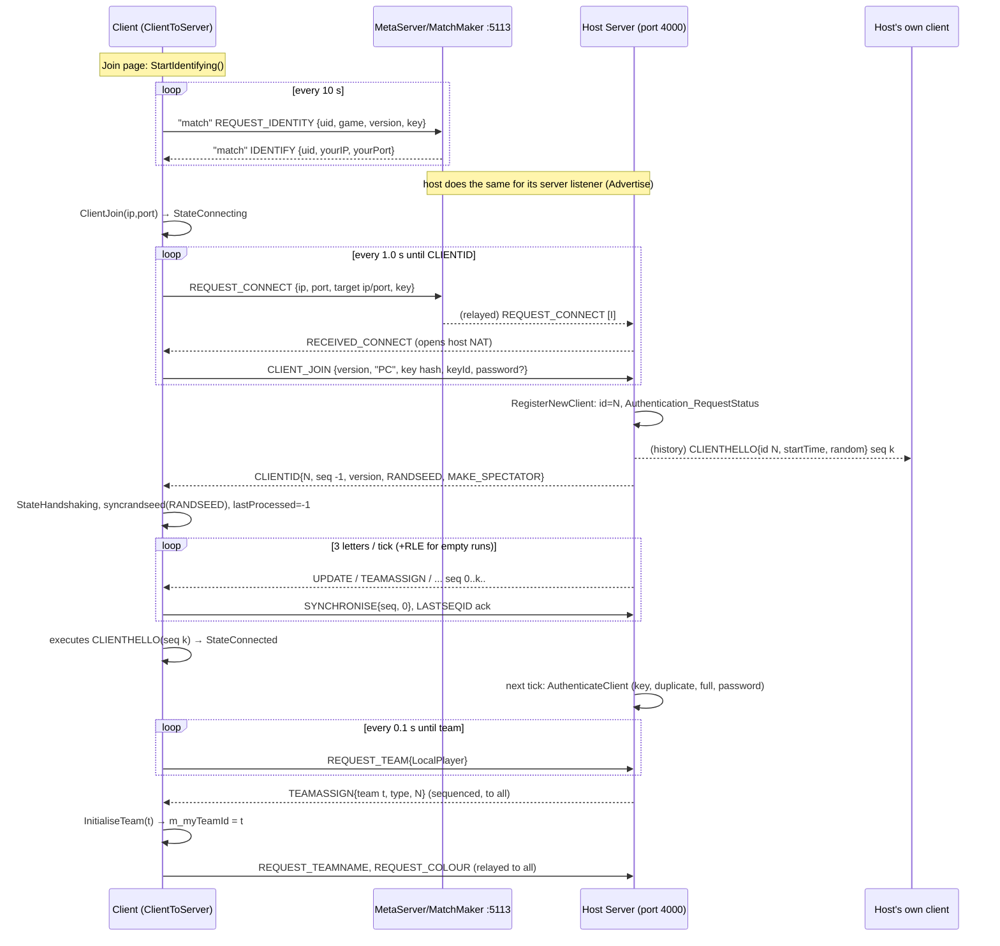

# Routed draft sections for document 22

<!-- from P01_app_core -->
## [→ 22_determinism_and_networking] 6. Determinism notes for X3 (from this partition)

Lockstep model: every client runs the full simulation from the same ordered command stream; only commands and `TeamControls` travel on the wire; a per-tick sync value is compared (P15). Items below are what this partition contributes; each is tagged with its risk.

| # | Item | Evidence | Assessment |
|---|---|---|---|
| D1 | x87 precision forced to 53-bit mantissa on the main thread and on every `WorkQueue` thread (`_control87(_PC_53, _MCW_PC)`) | `code/main.cpp:StandardiseCPUPrecision`, `code/lib/work_queue.cpp:WorkQueue::RunThread` | [C] required because the level is loaded on the loading thread (`Location::Init` consumes `syncrand`, builds spawn positions) |
| D2 | Fixed sim step: one server tick per 0.1 s **real** time; dt = `0.1 × gameSpeed`; `m_gameTime` is an accumulated double (`+= dt`) | `code/network/server.cpp:Server::AdvanceIfNecessary`, `code/gametimer.cpp:GameTimer::Tick` | [C] deterministic as long as `m_gameSpeed` evolves identically (it is changed only inside `Tick` from requests issued by sim/network code) |
| D3 | Game-speed blending is an exponential approach evaluated per tick (`speed += (target − speed) × rate`, snap within 0.01) and a duration counter decremented by 0.1 per tick | `GameTimer::Tick` | [C] deterministic; a port must keep the exact per-tick formula (not frame-based) |
| D4 | `App::GamePaused()` gates both `GameTimer::Tick`'s time accumulation and `Location::Advance`; it includes `ClientToServer::m_outOfSyncClients.Size() > 0` and (single-player only) window focus | `code/app.cpp:App::GamePaused` | [I] risk: if `m_outOfSyncClients` is not updated at the same sequence id on every client, clients stop simulating at different ticks (only after a desync is already detected) — P15 to confirm |
| D5 | `Multiwinia::Advance()` runs at slice 8 **even when paused** (outside the `!GamePaused()` check) | `code/network/clienttoserver.cpp:ProcessAllServerLetters` | [C] must be preserved (it drives the grace-period countdown and the un-pause) |
| D6 | Commands of tick N are applied **before** slice 0 of tick N, and the sync value is generated right after applying them | same | [C] |
| D7 | Strict serial update order: teams 0→5 (units' entities, then units at slice 0, then others), lasers, effects, buildings, spirits, clouds; then weather (slice 3), grid cache (7), crates (8); OpenMP pragma inert (`OpenMP="false"`) | `code/location.cpp:Location::Advance`, `targets/vs2005/Darwinia.vcproj` | [C] a parallel port must reproduce this order or make the steps order-independent |
| D8 | Slice partitioning uses array **capacity** and `int(Size()/10.0f)` (float division); slot reuse is LIFO | `code/lib/slice_darray.cpp`, `contrib/systemiv/lib/tosser/fast_darray.cpp` | [C] creation/deletion order fully determines which slot (and thus which slice and which tick) a new object is advanced in |
| D9 | Sync RNG = MT19937 (`_syncrand`) seeded once at client join (`NET_DARWINIA_RANDSEED`); **not reseeded at `Location::Init`** — the stream continues from whatever the lobby/previous matches consumed | `code/network/clienttoserver.cpp` (`syncrandseed`), `contrib/systemiv/lib/math/random_number.cpp` | [I] risk: any sync-RNG use outside lockstep (lobby UI, render) desynchronises the next match; X3 should grep all `syncrand` callers for non-sim contexts |
| D10 | `Location::Init` reseeds the **non-synced** LCG (`AppSeedRandom(1)`, MSVC constants 214013/2531011) | `code/location.cpp:Location::Init` | [C] non-synced RNG must only feed cosmetics; in this partition it does (`Bang` particle counts/velocities via `frand/sfrand`; promote/demote flashes via `AppRandom`) |
| D11 | `FRAND(x)`/`SFRAND(x)` are **synced** wrappers whose evaluation order inside `Vector3(...)` constructors is forced left-to-right | `code/lib/vector3.h`, `code/lib/vector3.cpp:FromRand` | [C] weather and crate placement use them; note the call order in the spawners is y first (`posY = syncfrand(...)` on its own line), then x, then z; a port must keep argument evaluation order explicit |
| D12 | `WorldObjectId::ResetUniqueIdSeed()` at match load; `GlobalWorld::s_nextUniqueBuildingId` reset then set to max level id + 1 | `code/main.cpp:DoEnterLocation`, `code/location.cpp:Init/InitBuildings` | [C] |
| D13 | Start positions, CPU colours, coop pairing, Assault sides and starting power-ups consume `syncrand` during `Location::Init` (loading thread), in team-index order (`GetTeamPosition(i)` is called for all 6 slots in step 3) | `code/location.cpp:Init/GetTeamPosition/SetupCoop/SetupAssault/InitialiseTeam` | [C] all clients must load with identical `LobbyTeam` state (colour ids, types) at the same RNG position |
| D14 | `Unit::s_offsets` (formation jitter) is generated lazily on first `GetFormationOffset` call from sim code with 100 `syncfrand` calls; reset at Init/Empty | `code/unit.cpp:Unit::GetFormationOffset` | [C] deterministic; a port should generate it eagerly at a fixed point to avoid hidden RNG consumption |
| D15 | Local-only routes (preview lines) are allocated in the **same** `m_routingSystem` free-list that sim orders use; the preview route of the previous frame is still allocated while the sim runs `IssueDarwinianOrders → GenerateRoute` | `code/location_input.cpp:AdvanceTeamControl` (`m_routeId`), `code/location.cpp:IssueDarwinianOrders`, `code/routing_system.cpp` (`m_routes.PutData`) | [I] risk: route **ids** given to Darwinians can differ between clients; harmless only if route ids are never hashed/compared across clients (P03/X3) |
| D16 | `FenceSwitch::Switch()` is executed directly from local input, not via the network | `code/location_input.cpp:SelectObjectUnderMouse` | [C] desync hazard if fence switches exist in Multiwinia maps (X4) |
| D17 | Single-player armour deployment mutates sim state locally | `code/location_input.cpp:AdvanceTeamControl` (`m_awaitingDeployment`, `SetOrders`) | [B:LEGACY] no MP effect |
| D18 | `Location::UpdateTeam` uses a function-static `unitMoved` shared by all teams | `code/location.cpp:UpdateTeam` | [C] affects only the local cursor marker |
| D19 | Divisions by zero in sim paths: `IssueDarwinianOrders` centre when no Darwinian is controlled (NaN route start); `Unit::GetFormationOffset` rowLen 0; `IsWalkable` numSteps 0 (diff = inf, loop skipped → true) | `code/location.cpp`, `code/unit.cpp` | [I] deterministic under IEEE but fragile; a port should guard them |
| D20 | `CreateRandomCrate` weighted mode with all scores 0 computes NaNs and falls back to random after consuming extra `syncfrand`s | `code/location.cpp:CreateRandomCrate` | [C] deterministic; keep RNG call count identical if bit-compatibility matters |
| D21 | `Location::Bang` damage falloff `(_range*2.0 - d) / _range*2.0` (precedence) | `code/location.cpp:Bang` | [C] gameplay constant, reproduce exactly |
| D22 | Real-time leaks into sim? `SetCurrentMessage` (real time, UI only); `Team::m_lastOrdersSet` (game time, local UI throttle); `GetNumSlicesToAdvance`/`AdvanceAndCatchUp` (real time, only decides *how many* slices run per frame) | various | [C] none affect sim results |
| D23 | Render extrapolation reads sim state but never writes it (`g_predictionTime`) | `code/team.cpp`, `code/unit.cpp`, `code/location.cpp` render functions | [C] |
| D24 | All `iv_*` math wrappers truncate the low nibble (global) | build_matrix §3 | see 22 |

<!-- from P03_entity_core -->
## [→ 22_determinism_and_networking] Determinism notes for X3 (P03 files)

### Synchronised RNG call sites (consume the shared Mersenne-Twister stream) [C]
Ranges: `syncfrand(x)` ∈ [0,x), `syncsfrand(x)` ∈ [−x/2, x/2), `syncrand()` 32-bit, `FRAND/SFRAND` = synced wrappers.
| File:function | Calls (per invocation) | When |
|---|---|---|
| `entity.cpp:Entity::SetType` | `syncfrand(Rate)` | every spawn — **twice for Darwinians** (ctor `SetType` + `SpawnEntities → SetType`) |
| `entity.cpp:Entity::Attack` | `syncsfrand(15)` ×2 | each shot |
| `entity.cpp:Entity::PushFromObstructions` | `syncsfrand(1)` | when `y ≤ 1` |
| `location.cpp:Location::SpawnEntities / FindValidSpawnPosition` (P01, context) | `syncfrand(spread)`, `syncfrand(2π)` per try (≤10); Darwinian front `SFRAND(1)` ×2 | spawn |
| `darwinian.cpp:Darwinian::Darwinian` | `syncfrand(5)`, `syncfrand(60)` | ctor |
| `Darwinian::Advance` | `syncfrand(1)` | every re-target (1–2 s) |
| `Darwinian::AdvanceIdle` | `syncfrand(60)`, `syncfrand(40)`, `syncfrand(2π)` | dead path in MP |
| `AdvanceWatchingSpectacle` | `syncfrand(min/2)` | too close to rocket |
| `AdvanceApproachingCarriableBuilding` | `syncfrand(2π)` | waypoint far |
| `AdvanceInsideArmour` | `SFRAND(1)` ×2, `syncfrand(20)` (armour destroyed); `syncsfrand(π/2)`, `syncfrand(10)` (unload) | events |
| `AdvanceCombat` | `syncsfrand(π/2)` (every tick, movement), `syncfrand(20)` (approach), `syncrand()` (fire roll, non-formation), `syncsfrand(60)` ×2 (rage), `syncfrand(8)` (grenade timer), `syncfrand(4)` ×2 (insane rocket) | every combat tick |
| `AdvanceUnderControl` | `syncfrand(0.5)`, `syncfrand(numControlled)`, `syncfrand(2π)` | 0.5–1 s |
| `AdvanceFollowingOrders` | `syncfrand(10)`, `syncfrand(2π)` | teleport wiggle |
| `AdvanceFollowingShaman` / `AdvanceFollowingOfficer` | `syncfrand(r)`, `syncfrand(2π)` | 5 s re-target / arrival |
| `AdvanceAttackingBuilding` | `syncfrand(50)` | every tick |
| `SearchForRandomPosition` | `syncfrand(1)`, then `syncsfrand(2π)` (70 %) | idle |
| `SearchForCrates` | `syncfrand(2·35/3)`, `syncfrand(2π)`, `syncfrand(35/3)` | found crate |
| `SearchForFlags` | `SFRAND(20)` ×2 | found zone |
| `SearchForArmour` / `SearchForOfficers` / `SearchForPorts` (×2) / `SearchForCarryableBuilding` | `syncrand()` | candidates exist |
| `SearchForOfficers`, `GiveOrders`, `FollowRoute`, `SearchForShamans` | `syncfrand(r)`, `syncfrand(2π)` | |
| `SearchForSpirits` | `syncrand()` | SP only |
| `SearchForThreats` | `syncrand()` (ant-nest 1/500) | every search past the tree check |
| `BeginVictoryDance` | `syncfrand(5)` (team 0 only), `syncfrand(15)` | Idle re-target |
| `AdvanceToTargetPosition` | `syncrand()` | infected, every tick |
| `Darwinian::PushFromObstructions` | `syncsfrand(1)` | `y ≤ 1` |
| `AdvanceOnFire` | `SFRAND(100)` ×2, `syncfrand(10)` | every burning tick |
| `AdvanceSacraficing` | `syncsfrand(1)`, `syncfrand(20)` | legacy |
| `AdvanceBeingAbducted` | `syncfrand(1)` (cosmetic spark!) | every abducted tick |
| `AdvanceInfection` | `syncfrand(5)`, `syncrand()` per neighbour, `syncrand()`, `syncfrand(10)` | every 5–10 s |
| `Sacrafice`, `Infect` | `syncfrand(2.5)`, `syncfrand(10)` | events |
| `FireSubversion` | `syncsfrand(15)` ×2 | each shot |
| `BoxKite::BoxKite / Advance` | `syncsfrand(1)`; `syncfrand(2)` (released), `syncfrand(0.5)` **every tick (cosmetic brightness)** | SP |
| `officer.cpp:Officer::ChangeHealth` | `SFRAND(40)` ×2 per shield spirit | |
| `Officer::SearchForRandomPosition` | `syncsfrand(2π)` | (no caller found in this file) |
| `Officer::Advance` | `syncfrand(1)` | SP Goto, every tick |
| `Officer::RunAI` | `syncfrand(20)`, `syncfrand(2π)` | AI re-order |
| `spirit.cpp:Spirit::Begin` | `syncfrand(10)`, `syncfrand(2)` ×3 | spawn |
| `Spirit::Advance` | `syncsfrand(1)` ×3 every tick (+ `syncfrand(0.5)` Birth, `syncfrand(10)` Birth-high, `syncsfrand(60)` Birth→Floating, `syncfrand(2)` Death) | **every spirit, every tick** |
| `Spirit::BreakSpirit` | `FRAND(5)` ×3 ×5 (cosmetic particles) | once |
`routing_system.cpp`, `entity_grid*.cpp`, `obstruction_grid.cpp`, `worldobject.cpp`, `entity_leg.cpp`: **no RNG** [C].

### Unsynchronised RNG (cosmetic; must never influence sim) [C]
`frand`/`sfrand`/`AppRandom`/`rand()`: `Entity::Advance` (`m_renderDamaged`), Darwinian particles (`TakeControl`, `LoseControl`, `AdvanceOnFire`, `AdvanceSacraficing`, `AdvanceHotFeet`, `AdvanceInfection` (`rand()`), `AdvanceOpeningCrate`, `SetBooster`, `GiveHotFeet`, `GiveMindControl`, `GiveRage`), "OnFire" sound rolls, `SearchForThreats` attack-horn roll `frand(200)`, `Officer::RenderShape` flicker, `Location::PromoteDarwinian/DemoteOfficer` flashes (P01). All verified to affect only particles, sounds or render flags.

### Wall-clock / local state leaking into simulation (desync hazards)
1. **`g_gameTime` is wall-clock** (`g_gameTime = GetHighResTime()` every frame, `code/main.cpp`; comment in `code/main.h`). `Darwinian::AdvanceWatchingSpectacle` derives `m_front` from it (GodDish always; EscapeRocket on arrival). `m_front` is sim state (turn blending in `AdvanceToTargetPosition`, shape transforms, `LogState`). Rocket Riot launches put Darwinians into this state ⇒ **[I] probable desync source** after a rocket launch (if the match continues). Fix: use game time.
2. `EntityLeg` swing timing on `g_gameTime` (Tripod, legacy only).
3. `GetCrateOffset` uses `g_gameTime` — particles only (safe).
4. `Officer::SetOrders` writes `m_lastOrdersSet` only on the local team's peer (read only in SP code) — safe in MP but fragile.
5. Route ids are peer-local (UI previews share `m_routes`) — safe while ids are never compared across peers.
6. Render mutating state: `Darwinian::Render` decrements `m_colourTimer`, clears `m_shadowBuildingId`; positions BoxKites — render-only consumers today.
7. `SearchForThreats` function-static `lastAttackHorn` (shared across all Darwinians and matches) — sound only.

### Float / ordering issues
- `EntityGridCache` stores positions/ranges as **float** and answers queries within half the cached range regardless of the requested range; `Advance` ages entries on slice 7 only. Deterministic given identical inputs, but the coarse reuse affects behaviour.
- Formation volley uses `fmodf(float(gameTime×10 + idx), size/4)` — single-precision, compiler/FPU-mode sensitive.
- `m_threatRange` exponential relaxation, spirit hover random walk, slope factors — double precision accumulations; depend on `iv_*` math wrappers (low-nibble truncation, X3).
- Byte stats: `m_stats` are `unsigned char`; speed multipliers (`×2`, `×1.5`, `×0.75`, `/2`) truncate; out-of-range blueprint values (350, 500) are UB.
- Entity-grid neighbour order = cell x-major → z → team 0..5 → slot order (free-list reuse); "nearest" selections use strict `<` so the first-found wins ties ⇒ order matters and is history-dependent but deterministic.
- `WorldObjectId::s_nextUniqueId` is global and also consumed by effects (BoxKite, Zombie, OfficerOrders, MultiwiniaOfficerOrders every 2 s, OfficerOrderTrail every 0.2 s per active order effect); unique ids feed gameplay (`uid % 20` worship range, `uid % 10` fence clearance, abduction blend, render variation) ⇒ every peer must create exactly the same effects in the same order.
- Advance slicing: `NUM_SLICES_PER_FRAME = 10` (`code/globals.h`); each 0.1 s server tick is processed as 10 slices and every sliced container (`SliceDArray`/`FastDArray` via `GetNextSliceBounds`) advances one tenth of its slots per slice, so every entity/spirit is advanced exactly once per server tick (P01 owns the scheduler, `Location::Advance`) [C]. Entities in earlier slices therefore see later-slice entities' previous-tick state — ordering is by slot index.
- `Location::Advance` wraps the five per-slice sub-advances (teams, weapons, buildings, spirits, clouds) in `#pragma omp parallel for schedule(dynamic)`; OpenMP is not enabled in any configuration (`ReleaseDirect3D` sets `OpenMP="false"`, the others use the compiler default, off) [C/I] `targets/vs2005/Darwinia.vcproj`. If it were enabled, the shared static scratch buffers (`Entity::s_neighbours`, `spirit.cpp` `s_neighbours`, `EntityGrid::m_neighbours`), the global sync RNG and `s_nextUniqueId` would race — the new engine must keep simulation single-threaded or give each job its own RNG/scratch.

<!-- from P05_entities_creatures -->
## [→ 22_determinism_and_networking] X3 — random-number and clock usage in this partition

Rule: everything in `Advance` must use the synced generator (`syncrand`/`syncfrand`/`syncsfrand`, or `FRAND`/`SFRAND` wrappers which resolve to it) or network time (`GetNetworkTime`, `SERVER_ADVANCE_PERIOD`); unsynced `frand`/`sfrand`/`AppRandom`/`GetHighResTime`/`g_gameTime` must only feed rendering or cosmetic particles. [C] `contrib/systemiv/lib/math/random_number.h`.

| Site | Generator | Affects simulation? | Assessment | Ref |
|---|---|---|---|---|
| `ArmyAnt::Advance` leg-shape choice | `syncrand()%3` every tick per ant | no (cosmetic) | deterministic but burns 1+ synced draw per ant per tick; a re-implementation must replicate it to stay draw-compatible, or move it to an unsynced RNG (new design) | [C] |
| `ArmyAnt::AdvanceToTargetPosition` heading jitter | `syncsfrand(0.2)` per tick | yes | correct | [C] |
| `Meteor::Advance` fire particle size | `syncsfrand(60)` ×5 per tick | no | cosmetic draw on the synced stream; positions via unsynced `sfrand` | [C] |
| `Meteor::Advance` slow-motion | `g_gameTimer.RequestSpeedChange` from sim | yes (global game speed) | deterministic (triggered by sim state) | [C] |
| `Triffid::Advance` burning particles | `syncsfrand(100×size)` size; `sfrand`/`frand` positions/debris | no | cosmetic on mixed streams | [C] |
| `Snow::Advance`, `Zombie::Advance` wobble | `syncsfrand(1)` ×3 + `syncfrand(20)` per object per tick | no gameplay effect | heavy synced-stream consumption by pure decoration; `snow.cpp` `#undef TRACK_SYNC_RAND` hides it from desync logs | [C] `code/worldobject/snow.cpp`, `souldestroyer.cpp:Zombie::Advance` |
| `Location::AdvanceChristmas/AdvanceDustWind/AdvanceLightning` spawn | `syncfrand`, `FRAND` (synced) | DustBall vortex and Lightning strikes: yes | correct; note the shared `m_christmasTimer` couples maps that enable more than one effect | [C] `code/location.cpp` |
| `Lightning::Advance` strike roll | `syncfrand(1) < 0.01`; particles `sfrand/frand` | yes (sets fire) | correct | [C] |
| `SpamInfection` hit particles | `AppRandom()%5`, `sfrand`, `frand` | no | cosmetic only | [C] `SpamInfection::AdvanceAttackingEntity` |
| `SoulDestroyer` eaten-soul list | `GetHighResTime`, `AppRandom` slot, ctor `sfrand` offsets | no (render list) | safe; list pruned inside `Render` | [C] `SoulDestroyer::Attack`, `SoulDestroyer::Render` |
| `SpaceShip::AdvanceEngines`, `Lightning`, `Spider`, `Tentacle` particles | `frand`/`sfrand` | no | cosmetic | [C] |
| `Darwinian::AdvanceBeingAbducted` spark | `syncfrand(1) < 0.5` | no | cosmetic on synced stream | [C] `code/worldobject/darwinian.cpp` |
| `m_renderDamaged` flags (`Entity::Advance`, `AntHill::Advance`, `Triffid::Advance`, `Centipede::Advance`) | `frand(0.75)` in Advance | no (render flag) | safe as long as nothing in sim reads it | [C] |
| `Spam::Spam` facing; `Spam::Render` rotation | `frand`; render mutates `m_front/m_up` used by `Advance` | yes | **desync bug** (legacy only) | [C] |
| `Tripod::Advance*` | `g_gameTime`, `g_advanceTime` | yes | **desync bug** (legacy only) | [C] |
| `Virii::FindNearbyEgg` pick | `int(syncfrand(n))` | yes | correct | [C] |
| Iteration order | searches iterate `m_spirits`, `m_buildings`, entity-grid neighbour lists in container order; first/nearest wins | yes | re-implementation must preserve deterministic container ordering | [I] |
| Physics constants applied per tick, not per second | TriffidEgg gravity `9.8 × force`/tick; Spider pounce gravity 40/tick; ArmyAnt/AntHill counters in ticks (`m_antInsideCheck` 30); Lightning 1%/tick; SpaceShip/DropShip `dt²` integration | yes | behaviour changes with game speed (slow/fast-time crates alter `SERVER_ADVANCE_PERIOD` but these terms do not scale) | [C] per-class refs |
| Float→byte stat conversion | `m_stats` is `unsigned char`; SpaceShip speed 500 | yes | implementation-defined; a new engine should store stats as floats | [C] `code/worldobject/entity.cpp:Entity::SetType`; [I] MSVC wrap |

<!-- from P06_buildings_core -->
## [→ 22_determinism_and_sync] Determinism notes for X3 (this partition)

1. **RNG streams.** All gameplay randomness in these files uses the synced Mersenne-Twister (`syncrand/syncfrand/syncsfrand` and the upper-case `FRAND/SFRAND` wrappers, which are synced). Unsynced RNG (`sfrand`, `frand`, `AppRandom`, CRT `rand`) appears only in cosmetic paths: ControlTower reprogram sparks (`sfrand`, inside `Advance`), Incubator spawn flashes (`AppRandom`, `sfrand`, `frand`, inside `SpawnEntity`), Portal fire particles (`rand`, `frand`, in `RenderAlphas`), TurretShell building-hit particles (`sfrand/frand`, weapons). Any port must keep cosmetic randomness on a separate stream. [C].
2. **Synced RNG spent on visuals** (must stay lock-step on every peer or be moved to a cosmetic stream in a re-design): GunTurret shell-casing ejection (`SFRAND(0.5)`×3 + `syncfrand(20)` per shot) and overheat smoke (`syncfrand` per particle), SolarPanel's per-tick `syncfrand(20)` (gameplay, but drawn every tick even when unmanned), RadarDish beam-loss kick. [C].
3. **RNG consumed at construction**: `SpawnPoint` ctor draws 2 (`m_evaluateTimer`, `m_spawnTimer`), `SpawnPopulationLock` ctor 1, `UnprocessedSpirit` ctor 4, `GunTurret::Initialise` 3 (`SearchForRandomPos`). Level-file *templates* are constructed too (`CreateBuilding(char*)`), so level parsing order and content must be identical on all peers. [C] ctors; `LevelFile::ParseBuildings`.
4. **Order-dependent decisions**: port occupant = first matching Darwinian in entity-grid order; ownership ties resolve to the lowest team index (SpawnPoint, GunTurret, SolarPanel); `Darwinian::SearchForPorts` consumes a `syncrand()` that is then overridden by the nearest-building loop; SpawnPopulationLock association = first lock in building-list order; RadarDish receiver = nearest by float distance; buildings advance in slice/index order after teams and weapons of the same slice. Re-implementations must reproduce iteration orders exactly or redesign the rules to be order-free. [C].
5. **Float time accumulation**: timers are decremented by dt = 0.1 (not exactly representable), e.g. a 10.0-s pause takes 101 ticks, a 0.2-s burst interval exactly 2 ticks, rocket reload 1.5 s → 15 ticks, subversion reload 0.5 s → **6** ticks, mortar 4.0 s → 40 ticks, activation 30.0 s → 300 ticks (computed by repeated subtraction of 0.1 in IEEE double). A new engine should use integer tick counters with the same tick counts if bit-compatibility matters. [C]+[I] (computed).
6. **Math library**: gameplay uses `iv_sin/iv_cos/iv_acos/iv_sqrt` (low-nibble-truncated wrappers, see build_matrix §3) — turret aim angle (`iv_acos`, fire cone 0.3 rad), radar yaw speed (`iv_sqrt`), carryable heave (`iv_sin(networkTime)`), turret target wobble. RadarDish also uses single-precision `fabsf/signf` in `Advance` (precision loss but deterministic for one binary). `GunTurret::Render` uses `acosf` (render only). [C].
7. **Time bases mixed in simulation**: `GetNetworkTime()` (carryable recount/heave, SpawnPopulationLock overpopulation sampling, turret wobble, Generator) and `g_gameTimer.GetGameTime()` (turret keep-firing window, overheat). [U] whether both are the same synced clock — resolve in the game-timer document.
8. **Static state surviving between matches**: `MasterSpawnPoint::s_masterSpawnPointId`; `SpawnPoint::s_numSpawnPoints[6]` (team 5 slot not reset in `Location::Init`); `Teleport::m_teleportMap` (pruned only when units vanish); `ReceiverBuilding::GetSpiritProcessor` cached id; ControlTower render statics. Reset all per-match state explicitly in a re-implementation. [C].
9. **Shared scratch buffer**: `Building::s_neighbours` is one static vector used by every building's grid queries; the `#pragma omp parallel for` in `Location::Advance` is inert because OpenMP is disabled (`OpenMP="false"` in ReleaseDirect3D, unset in the other configs) — enabling it would race on this buffer and on RNG. [C] `location.cpp:Location::Advance`, `targets/vs2005/Darwinia.vcproj`.
10. **Sync logging**: `Building::LogState` (hash of pos/vel/front/centre/radius) is written before/after each building advance under `TRACK_SYNC_RAND` ([B:DEBUG] only). [C] `Location::AdvanceBuildings`.
11. **Spawn-link pointer sharing** (multi-path graphs) would double-advance a spirit deterministically; shipped graphs are trees. [C]/[I].

<!-- from P07_buildings_misc -->
## [→ 22_determinism_and_networking] Determinism notes (X3) for this partition

| Object | Synced RNG draws (order within the object's Advance) | Unsynced/visual-only | Hazards |
|---|---|---|---|
| Tree | spirit drop: `syncrand()` test → `syncfrand(h)` (x) → `syncfrand(2π)` (yaw) → `syncfrand(6)` until valid team; spawn timer `syncfrand(5)`; `CreateAnotherTree`: `syncfrand(H)` → (`syncsfrand(π/4)` or `syncfrand(2π)`) → `syncfrand(99999)` seed → `syncsfrand(0.2)` height; evil: `syncfrand(10)` every tick, Zombie `syncsfrand(1)`, `syncfrand(25)`; corruption `syncfrand(5)` | geometry LCG (re-seeded per pass), fire particles `frand`, leaf drop CRT `rand()` | sim hit volume derived from render-list generation; `RenderAlphas` regenerates lists (same values); `volatile` ordering in offspring height; `SetDetail` must be 1 |
| LaserFence | `syncfrand(10)` in `Initialise`, `syncfrand(4)` per spark | spark particles | `RenderAlphas` may reset the link id (render-path write) |
| EruptionMarker | `syncrand()` every idle tick, `syncfrand(4)` | particles | consumes synced RNG although purely cosmetic |
| SmokeMarker | none | particles every tick (`sfrand`, `frand`) | accidental collision sphere (see section) is deterministic |
| Randomiser | `syncfrand(2.5)`, `syncrand()` per converted Darwinian | render particles (`rand()`) | – |
| Wall / StaticShape / RestrictionZone | none | – | – |
| CloneLab | none in own code (Incubator: P06) | – | – |

General: `frand/sfrand` = global LCG `AppRandom` (MSVC-`rand` clone, 15-bit), **not** network-synced; `syncfrand/syncsfrand/syncrand` = MT19937 global stream; `FRAND(x)`/`SFRAND(x)` used inside a `Vector3` constructor map to the **synced** generator with left-to-right ordering [C] `code/lib/vector3.h`, `code/lib/vector3.cpp:FromRand`, `contrib/systemiv/lib/math/random_number.cpp`. Note `sfrand(r)` returns [−r/2, r/2] (not ±r as its header comment claims) and `syncsfrand(r)` returns [−r/2, r/2) [C].

<!-- from P08_crates_ai -->
## [→ 22_determinism_and_networking] 17. Determinism notes (for X3)
- **Simulation-side, deterministic**: crate spawning, falling, capture, reward choice and every effect; AITarget counting/priorities; AI decisions; AIObjective state. All randomness uses the shared MT19937 stream (`syncrand`, `syncfrand`, `syncsfrand`, `FRAND`/`SFRAND` wrappers that fix argument evaluation order in `Vector3` constructors; `GenerateTrees` explicitly sequences eight `syncrand()` calls for the same reason) [C].
- Rejection-sampling loops consume a **variable number** of RNG draws (`CaptureCrate`, StartingPowerups, `RunNuke` sea search, `RunSpaceShip` land search, `RunEggs` spawn type, `FindTargetBuilding` retries, `RunSquad/RunArmour/RunHarvester/RunEngineer` valid-point loops, `RunGunTurretBlitzkrieg` spacing loop, `RRFindDropoffPoint` walkable ring). Deterministic as long as all inputs are identical, but any divergence amplifies [I]. Several are **unbounded** (possible hang): `CaptureCrate` if no valid type exists, `RunNuke` on a map without sea, `RunSpaceShip` with no land ≥ 10, AI target-area loops if an area has no valid point [C code, I risk].
- `syncfrand(1.0) < 0.9` is evaluated only when `m_rewardId == −1` (short-circuit) — a forced reward changes the RNG stream length [C].
- Iteration order: AI scans `m_buildings` by index and uses "first found"/strict `>` comparisons; building index allocation must be identical on all peers [I].
- Non-synced state touched only by presentation: crate `m_front/m_up` (rotated in `Render`; iframes deliberately send zero vectors for crates), `m_bubbleTimer` (decremented per render frame), `m_percentCapturedSmooth` (marker render), `TaskManager::m_mostRecentTaskIdTimer` (`GetHighResTime`), marker list, messages [C]. A re-implementation must keep these out of the hashed/synced state.
- `Location::m_showCrateDropMessage`, `MultiwiniaHelp::NotifyCapturedCrate` and message text depend on `m_myTeamId` but do not affect simulation [C].
- Game-speed crates change `SERVER_ADVANCE_PERIOD` (0.1 × speed): all timers in this partition are in game-seconds and scale; the capture-rate cap (0.05/tick) does not scale, so capture time in ticks is speed-independent at ≥ 50 Darwinians [C formula].
- Float hazards: `0/0` in `RecalculatePriorityStandard` (no usable neighbours) and in weighted crate drops with total score 0 produce NaN that then flows through comparisons; the outcome is deterministic only if all peers share IEEE behaviour [I]. `iv_sin/iv_cos` (low-nibble truncation) are used in sim paths; `sinf/cosf` only in render [C].
- The AI runs on every peer (lockstep); CPU teams produce no network input [C/I — see §10.2].

<!-- from P10_input_camera -->
## [→ 22_determinism_and_networking] Determinism notes (input & camera, for X3)

1. **Input and camera are local and non-deterministic by design.** All drivers sample wall-clock state (`GetHighResTime`, Win32 message timing, XInput polling) once per *render* frame; the camera integrates with `g_advanceTime` (wall clock, ≤ 0.25 s) or its own `GetHighResTime` deltas, and camera shake uses the unsynchronised `sfrand` [C] `code/camera.cpp`, `contrib/systemiv/lib/math/random_number.h`. Nothing in `code/lib/input` or `code/camera.cpp` calls `syncrand`/`syncfrand`.
2. Input reaches the simulation only through `TeamControls` (P01/P15): `TeamControls::Advance` reads `controlEvent`s and camera-derived values (e.g. `UnitMove` stick rotated by `Camera::GetControlVector()`, `m_cameraEntityTracking = camera.IsInMode(ModeEntityTrack)`, `m_primaryFireTarget` masked by `camera.m_camLookAround`) and the result is sent to the server [C] `code/team.cpp`. Converting camera-relative directions into world-space deltas *before* networking is correct and must be preserved.
3. **Desync hazard (confirmed in code)**: `InsertionSquad::DirectControl`, which runs inside the simulation on *every* peer for the *networked* `TeamControls` of whichever team is being processed, reads the **local** `g_app->m_camera->m_camLookAround` in its early-out (`if (!controls.m_cameraEntityTracking && !g_app->m_camera->m_camLookAround) return;`) and then may call `SetWayPoint` [C] `code/worldobject/insertion_squad.cpp:InsertionSquad::DirectControl`, called from `code/location.cpp` (TeamControls application; the surrounding comment itself warns that local input state is invalid there). A peer holding F2/R3 (look-around) therefore executes squad way-point logic that other peers skip. The same function writes cosmetic camera fields (`m_targetVector`, `m_wantedTargetVector`). New design: simulation code must never read camera or input-manager state; only networked command data.
4. XInput "repeat" timers and Idle accumulators are mutated during queries/advance with wall-clock time — fine for local UI, unsuitable for anything simulated.
5. Camera-distance LOD (`team.cpp` render paths, `darwinian.cpp`, `weapons.cpp`, `sound_instance.cpp`, `gamecursor.cpp`, …) reads `Camera::GetPos()`; these appear to be render/sound paths [I] (not audited here — determinism agent should confirm none of them feed simulation, e.g. `code/worldobject/darwinian.cpp` L4123, `officer.cpp` L289/401/434, `mine.cpp` L140, `spawnpoint.cpp` L231, `location.cpp` L2108).
6. Frame-rate dependence (cosmetic only): free-movement smoothing `4·dt` unclamped (overshoot when dt > 0.25 is impossible for `g_advanceTime` but possible for the free-move local timer, clamp 1.0 s), squad zoom int truncation (§3.6), first-person damping per frame.

<!-- from P13_gfx_backend_math -->
## [→ 22_determinism_and_networking] Math library and floating-point determinism

All math types in `code/lib` are live in every build [B:FULL][B:D3D]. **The simulation's geometric types are `double`**, not `float` (`Vector2`, `Vector3`, `Matrix33`, `Matrix34`, `Plane` all store `double`) [C]; `float` is used for rendering colours (`RGBAColour` scale factors), GL/D3D calls and many entity fields declared elsewhere. `FLOAT_NUMERICS` is defined globally; the fixed-point alternatives `USE_FIXED` / `FIXED64_NUMERICS` are never defined [C] `code/lib/universal_include.h` (build_matrix §4).

### Numeric environment [C unless marked]

| Item | Baseline `Release|Win32` | `ReleaseDirect3D` | Ref |
|---|---|---|---|
| Compiler FP model | `FloatingPointModel` not set ⇒ VS2005 default `/fp:precise` [I: VS default] | `FloatingPointModel="2"` ⇒ **`/fp:fast`** | `targets/vs2005/Darwinia.vcproj` (config blocks) |
| Instruction set | no `/arch:SSE2` ⇒ x87 code generation [I: VS2005 x86 default] | same | same |
| x87 precision control | `StandardiseCPUPrecision()` = `_control87(_PC_53, _MCW_PC)` (53-bit mantissa) called at the start of `AppMain` and at the start of every `WorkQueue` thread ("FPU precision flags are maintained on a per-thread basis") | same, **but** `IDirect3D9::CreateDevice` is called without `D3DCREATE_FPU_PRESERVE`; D3D9 then sets the calling thread's x87 control word to single precision [I: documented D3D9 behaviour], i.e. the main (simulation) thread runs at 24-bit precision after `Direct3DInit` and after every device recreation | `code/main.cpp:StandardiseCPUPrecision`, `code/lib/work_queue.cpp:WorkQueue::RunThread`, `code/lib/opengl_directx.cpp:Direct3DInit` |
| Mac precision | inline-asm `fldcw` variant for i386 [B:DEAD] | — | `code/main.cpp` |

Consequence [I]: a GL client and a D3D client would not stay bit-identical in lockstep; the D3D build is not a safe multiplayer peer for the baseline (in addition to the build-viability doubt in 24).

### `iv_*` wrappers and `iv_trunc_low_nibble` [C]

`code/lib/universal_include.h` (C++ only) defines:

| Macro | Expansion |
|---|---|
| `iv_sin(x)` | `iv_trunc_low_nibble(sin(double(x)))` |
| `iv_cos(x)` | `iv_trunc_low_nibble(cos(double(x)))` |
| `iv_tan(x)` | `iv_trunc_low_nibble(tan(double(x)))` |
| `iv_sqrt(x)` | `iv_trunc_low_nibble(sqrt(double(x)))` |
| `iv_pow(x,y)` | `iv_trunc_low_nibble(pow(double(x), double(y)))` |
| `iv_exp(x)` | `iv_trunc_low_nibble(exp(double(x)))` |
| `iv_log(x)` | `iv_trunc_low_nibble(log(double(x)))` |
| `iv_asin(x)` | `iv_trunc_low_nibble(asin(double(x)))` |
| `iv_acos(x)` | `iv_trunc_low_nibble(acos(double(x)))` |
| `iv_atan(x)` | `iv_trunc_low_nibble(atan(double(x)))` |
| `iv_abs(x)` (inline function) | `x >= 0.0 ? x : -x` (no truncation) |

(There is no `iv_atan2`, `iv_floor`, `iv_fmod`.) Related helpers in `contrib/systemiv/lib/math/math_stubs.cpp` (compiled; owned by P14): `iv_atof(s) = iv_trunc_low_nibble(atof(s))`, `iv_wtof(ws)` = `swscanf("%lf")` then `iv_trunc_low_nibble` (0 on failure), `iv_wtoi(ws)` = `swscanf("%d")` (0 on failure). `NetworkFloat::FromUnicodeString` and `NetworkDouble::FromUnicodeString` also pass parsed values through `iv_trunc_low_nibble` [C] `code/network/networkvalue.cpp`.

**Exact implementation** (non-Xbox):

> **Verbatim excerpt** — `contrib/systemiv/lib/math/math_stubs.cpp:iv_trunc_low_nibble` (Introversion licence, ≤15 lines)
```cpp
double iv_trunc_low_nibble(double x)
{
	volatile float f = (float)x;
	return f;
}
```

Semantics and purpose:
- It converts the double result to IEEE-754 **single precision** and back. Despite the name it neither truncates nor touches a "nibble": it discards the low **29** bits of the 53-bit significand, rounding with the current FPU rounding mode (default round-to-nearest-even) [C code; I for rounding-mode semantics of the C conversion]. Result precision ≈ 7.2 significant decimal digits; values outside float range become ±inf, tiny values flush through float denormals.
- `volatile` forces a real 32-bit memory store, defeating x87's habit of keeping 80-bit (or 53-bit) values in registers, so the rounding really happens [I].
- Purpose [I]: CRT transcendental functions (`sin`, `cos`, `pow`, `exp`, `log`, `asin`, `acos`, `atan`, `tan`) are not correctly rounded and differ in the last ulps across CRTs (MSVC vs Apple/GCC libm, x87 `fsin` vs software paths, CPU vendors). Rounding to float collapses those tiny differences to the same float in the vast majority of cases, giving cross-platform lockstep agreement (the code is credited to Ambrosia's Mac port, "Copyright 2007 Ambrosia Software"). It is **not a guarantee**: if two platforms' double results straddle a float rounding boundary, they still round to different floats (probability roughly k·2⁻²⁹ per call when the results differ by k double-ulps) [I]. `sqrt` is IEEE correctly rounded already, so `iv_sqrt` gains nothing for determinism but still loses precision.
- Call-site counts in `code/` (grep, approximate): `iv_sin` 295, `iv_cos` 159, `iv_abs` 84, `iv_sqrt` 69, `iv_pow` 19, `iv_acos` 7, `iv_asin` 5, `iv_exp` 3, `iv_log` 3, `iv_atan` 2, `iv_tan` 1. Raw CRT calls remain: `sinf` 52, `cosf` 23, `fabs` 27, `fabsf` 15, `fmod` 13, `floor` 13, `ceil` 12, `pow` 12, `sqrtf` 10, `sqrt` 6, `sin` 6, `atan2` 6 (including `Matrix33/34::DecomposeToYDR`), `asin` 2, `atan` 2, `cos` 2, `exp` 2, `acos` 1, `acosf` 1, `log` 1. A sample of the sim-file uses (`darwinian.cpp`, `crate.cpp`, `aiobjective.cpp`) are render-time animation terms driven by `g_gameTime`; `fmod` is exactly specified by IEEE (deterministic); `code/location.cpp:L4158` mixes `iv_pow` with raw `pow` [C sample]. Full audit belongs to 22 (P15).

### Deterministic RNG ordering inside `Vector3` [C] `code/lib/vector3.h`

C++ leaves argument evaluation order unspecified, so `Vector3(syncfrand(a), syncfrand(b), syncfrand(c))` could consume the synced RNG in different orders on different compilers. The code therefore provides marker types and a templated constructor:

- `FRAND(x)` → `RandomFloat(x)` (or `RandomFloat(x, __FILE__, __LINE__)` under `TRACK_SYNC_RAND`); `SFRAND(x)` → `SymmetricRandomFloat(x[, file, line])`. The marker only stores the range — no RNG call yet.
- `template<X,Y,Z> Vector3(X,Y,Z)` and `template<X,Y,Z> Set(X,Y,Z)` assign `x = FromRand(_x); y = FromRand(_y); z = FromRand(_z);` **in that order**.
- `FromRand(double d) = d`; `FromRand(RandomFloat r) = _syncfrand(r.v)` ∈ [0, v); `FromRand(SymmetricRandomFloat s) = _syncsfrand(s.v) = (_syncfrand(1) − 0.5)·v` ∈ [−v/2, v/2) [C] `code/lib/vector3.cpp`, `contrib/systemiv/lib/math/random_number.cpp`. Under `TRACK_SYNC_RAND`: `DebugSyncFrand(file, line, 0, v)` / `DebugSyncFrand(file, line, −v/2, v/2)` (logged).
- Non-template `(double,double,double)` constructor is chosen for plain doubles; integer literal arguments go through the template with `FromRand(double)`.

`code/lib/math_utils.cpp` also contains its own copy of MT19937 (`static mt[624]`, `init_genrand`, `unsigned long syncrand()` with default seed 5489). Every caller of `syncrand` includes `lib/math/random_number.h`, whose macro maps `syncrand` → `_syncrand` (or `DebugSyncRand`), so this copy is **unreferenced dead code** [I: grep shows no call site without the header]. The live synced RNG is `contrib/systemiv/lib/math/random_number.cpp` (P14/P15).

### `Vector3` — every member [C] `code/lib/vector3.h`, `code/lib/vector3.cpp`

| Member | Semantics |
|---|---|
| `double x, y, z` | components (world: y up) |
| `Vector3()` | (0,0,0) |
| `Vector3(double,double,double)` | direct |
| `Vector3(Vector2 const&)` | (v.x, 0, v.y) — 2D "y" maps to world z |
| `template Vector3(X,Y,Z)`, `template Set(X,Y,Z)` | ordered `FromRand` (above) |
| `Zero()`, `Set(double,double,double)` | — |
| `operator^(b)` | cross product (y·b.z − z·b.y, z·b.x − x·b.z, x·b.y − y·b.x) |
| `operator*(b)` | dot product |
| unary `-`, `+`, `-` | component-wise |
| `operator*(double)`, global `operator*(double, Vector3)` | scale |
| `operator/(double)`, `operator/=(double)` | multiply by `1.0/b` (one reciprocal, three multiplies — not bit-identical to three divisions) |
| `operator=`, `*=`, `+=`, `-=` | component-wise; return `const&` |
| `Normalise()` | `volatile double lenSqrd = x²+y²+z²` ("volatile for sync"); if `lenSqrd > 1e-10`: multiply by `1.0/iv_sqrt(lenSqrd)`; else **set to (0,0,1)**; returns `*this` |
| `SetLength(len)` | `mag = Mag()`; if `NearlyEquals(mag,0)`: `x = len` (y,z untouched); else scale by `len/mag` |
| `operator==`, `operator!=` | all components within `NearlyEquals` (|Δ| < 1e-6 absolute; header comment "Uses FLT_EPSILON" is wrong) |
| `RotateAroundX/Y/Z(angle)` | `FastRotateAround((1,0,0)/(0,1,0)/(0,0,1), angle)` |
| `FastRotateAround(n, angle)` | Rodrigues with unit n: `a = n·(v·n)`, `n1 = v − a`, `n2 = n × n1`, `v' = a + cos·n1 + sin·n2` (`iv_sin/iv_cos`); positive angle = counter-clockwise looking down −n (right-hand rule about n) [I] |
| `RotateAround(axis)` | angle = |axis| (skip if |axis|² < 1e-8); `FastRotateAround(axis/angle, angle)` |
| `Mag()` | `iv_sqrt(x²+y²+z²)` |
| `MagSquared()` | x²+y²+z² |
| `HorizontalAndNormalise()` | y = 0; scale x,z by `1/iv_sqrt(x²+z²)` — **no zero guard** (inf/NaN for vertical vectors) |
| `GetData()`, `GetDataConst()` | `&x` (double[3], used for `glVertex3dv`-style calls) |
| globals `g_upVector` (0,1,0), `g_zeroVector` (0,0,0) | `const` |

### `Vector2` [C] `code/lib/vector2.*`

`double x, y`; ctors `()`→(0,0), `(Vector3)`→(v.x, v.z), `(x,y)`; `Zero`, `Set`; `operator^` = 2D cross scalar `x·b.y − y·b.x`; `operator*` dot; unary −, +, −, `*(double)`, `/(double)` (reciprocal), global `double*Vector2`; `operator=(Vector2)` and `operator=(Vector3)` (takes x,z; both return `void`); `*=`, `/=` (reciprocal), `+=`, `-=` (return `void`); `==`/`!=` via `fabsf(x−b.x) < FLT_EPSILON && fabsf(y−b.y) < FLT_EPSILON` (**float** `fabsf` on a double difference, FLT_EPSILON ≈ 1.19e-7); `Normalise()` (if `lenSqrd > 0` scale by `1/iv_sqrt`, else (0,1)); `SetLength(len)` (no zero guard); `Mag()` (`iv_sqrt`), `MagSquared()`, `GetData()`.

### `Matrix33` [C] `code/lib/matrix33.*`

Rows `Vector3 r, u, f` = the object's right, up and forward axes expressed in parent/world coordinates. `static double m_openGLFormat[16]` (shared scratch → not thread-safe).

| Member | Semantics |
|---|---|
| `Matrix33()` | members default-constructed ⇒ all zero |
| `Matrix33(int)` | identity |
| copy ctor / `operator=` | `memcpy` |
| `Matrix33(r,u,f)`, `Matrix33(9 doubles)` | direct |
| `Matrix33(yaw, dive, roll)` | identity, then `RotateAroundZ(roll)`, `RotateAroundX(dive)`, `RotateAroundY(yaw)` |
| `OrientRU(r,u)` | `r=normalise(r)`; `f=normalise(r×u)`; `u=f×r` |
| `OrientRF(r,f)` | `r=normalise(r)`; `u=normalise(f×r)`; `f=r×u` |
| `OrientUF(u,f)` | `u=normalise(u)`; `r=normalise(u×f)`; `f=r×u` |
| `OrientUR(u,r)` | `u=normalise(u)`; `f=normalise(r×u)`; `r=u×f` |
| `OrientFR(f,r)` | `f=normalise(f)`; `u=normalise(f×r)`; `r=u×f` |
| `OrientFU(f,u)` | `f=normalise(f)`; `r=normalise(u×f)`; `u=f×r` |
| `RotateAroundX(θ)` (world X) | for each b∈{r,u,f}: `b.y' = b.y·c + b.z·s`, `b.z' = −b.y·s + b.z·c` |
| `RotateAroundY(θ)` | `b.z' = b.z·c + b.x·s`, `b.x' = −b.z·s + b.x·c` |
| `RotateAroundZ(θ)` | `b.x' = b.x·c + b.y·s`, `b.y' = −b.x·s + b.y·c` |
| `RotateAroundR(θ)` (local) | `u' = u·c + f·s`, `f' = −u·s + f·c` |
| `RotateAroundU(θ)` | `f' = f·c + r·s`, `r' = −f·s + r·c` |
| `RotateAroundF(θ)` | `r' = r·c + u·s`, `u' = −r·s + u·c` |
| `RotateAround(axisVec)` | angle = |axis|; no-op if |axis|² < (1e-5)²; `FastRotateAround(axis/|axis|, |axis|)` |
| `RotateAround(n, θ)` | normalises n, then Rodrigues on r, u, f |
| `FastRotateAround(n, θ)` | Rodrigues on r, u, f (n assumed unit) |
| `Transpose()` | swaps off-diagonal terms |
| `Invert()` | adjugate / determinant (`det = a1·r.x + a2·u.x + a3·f.x`); no singularity check |
| `DecomposeToYDR(&y,&d,&r)` | `yaw = −atan2(f.x, f.z)`; `dive = atan2(f.y, u.y)` (comment: avoids `asin(f.y)` precision problems); rotate a copy by `−yaw` about Y and `−dive` about X; `roll = −atan2(r.y, r.x)` — **raw `atan2`** |
| `DecomposeToYDR()` → Vector3 | returns `(yaw, dive, roll)` in (x,y,z) — the inline comment claims "x = dive, y = yaw" (contradiction in code) |
| `SetToIdentity()` | zero then r.x=u.y=f.z=1 |
| `Normalise()` | `f=normalise(f)`; `r=normalise(u×f)`; `u=f×r` |
| `InverseMultiplyVector(v)` | `v.x·r + v.y·u + v.z·f` (local → world) |
| global `Matrix33 * Vector3` and `Vector3 * Matrix33` | **both** `(r·v, u·v, f·v)` (world → local) |
| `operator*`, `operator*=` | `(A·B).r = A.r.x·B.r + A.r.y·B.u + A.r.z·B.f` (likewise u,f) — "A expressed in B's parent": apply A, then B |
| `ConvertToOpenGLFormat(pos*)` | column-major GL array `[r 0 u 0 f 0 pos|0 1]` in the static buffer |
| `OutputToDebugStream()` | broken format string `"%4.1 "` (prints nothing useful) |

### `Matrix34` [C] `code/lib/matrix34.*`

`Vector3 r, u, f, pos`; `static double m_openGLFormat[16]`; global `const Matrix34 g_identityMatrix34(0)`.

| Member | Semantics |
|---|---|
| ctors | `()` zeros; `(int)` identity; copy = `memcpy`; `(Matrix33, pos)`; `(f, u, pos)`: `r = normalise(u × f)`, `u = normalise(f × r)`, **f kept as given (not normalised)**; `(yaw, dive, roll)` as Matrix33 (pos = 0) |
| `Orient*`, `RotateAround*`, `FastRotateAround`, `DecomposeToYDR`, `SetToIdentity`, `Normalise` | identical formulas to Matrix33 (pos untouched) |
| `Transpose()` | `pos = (*this)·(−pos)` (forward transform incl. +pos) then transposes the 3×3 — **not** a rigid inverse (correct would be `pos' = −Rᵀ·pos`); no callers [C grep] |
| `IsNormalised()` | |r|²,|u|²,|f|² ∈ [0.999, 1.001] and |r·u|, |r·f|, |f·u| ≤ 0.001 (via `fabsf`) |
| `InverseMultiplyVector(s)` | `v = s − pos`, returns `v.x·r + v.y·u + v.z·f` — i.e. the **forward** rotation of (s−pos), not the inverse; only referenced from commented-out code in `code/lib/shape.cpp` |
| global `Matrix34 * Vector3` and `Vector3 * Matrix34` | **both** `v.x·r + v.y·u + v.z·f + pos` (local → world) — note the opposite convention to `Matrix33 * Vector3` |
| `operator*=`/`operator*` | rotation as Matrix33; `pos' = pos.x·o.r + pos.y·o.u + pos.z·o.f + o.pos` (child-in-parent composition: apply this, then `o`) |
| `operator==` | `Vector3::operator==` (1e-6) on r, u, f, pos |
| `ConvertToOpenGLFormat()` | `[r 0 u 0 f 0 pos 1]` (column-major model matrix for `glMultMatrixd`) |
| `GetOr()` | `Matrix33(r,u,f)` |
| `WriteToDebugStream()`, `Test()` | debug (broken `"%5.2 "` format) |

### `Plane` [C] `code/lib/plane.*`

`Vector3 m_normal; double m_distFromOrigin`, plane equation `n·p + d = 0` as returned by `GetCartesianDefinition(&a,&b,&c,&d)` (= n.x, n.y, n.z, d).
- `Plane(a, b, c)`: `n = normalise((a−b) × (a−c))`, `d = −n·a` (consistent with the equation).
- `Plane(n, point)`: `d = +n·point` — **opposite sign** (inconsistent); no callers in `code/` [C grep].
- `Plane(n, d)`: direct.

### `math_utils` [C] `code/lib/math_utils.*`

| Symbol | Kind | Semantics / constants |
|---|---|---|
| `M_PI` | `#define` | `3.1415926535897932384626` (redefined after `#undef`) |
| `sign(a)` / `signf(a)` | macro | `a<0 ? −1 : 1` / `a<0.0 ? −1.0 : 1.0` (sign(0) = +1) |
| `Round(a)` | macro | `(int)(a)` — C truncation toward zero (deterministic; the x87 `fistp` variant and its "depends on rounding mode" warning are commented out) |
| `clamp(a, low, high)` | statement macro | `if (a>high) a=high; else if (a<low) a=low;` (unsafe inside unbraced if/else) |
| `NearlyEquals(a,b)` | macro | `fabs(a−b) < 1e-6` |
| `ASSERT_FLOAT_IS_SANE(x)` | macro | `AppDebugAssert(x + 1.0 != x)` — catches ±inf and |x| ≥ 2⁵³; **NaN passes** |
| `ASSERT_VECTOR3_IS_SANE(v)` | macro | above on x, y, z |
| `Log2(x)` | fn | `iv_log(x) · (1/iv_log(2))`, reciprocal cached in a function-static |
| `RampUpAndDown(start, dur, now)` | fn | `now > start+dur → 1.0001`; `t=(now−start)/dur`; `t<0.5 → 2t²`; else `1 − 2(1−t)²` (ease-in/out; used by camera MoveToTarget) |
| `RequirePowerOfTwoTextures()` / `RequireSquareTextures()` | fn | see 24 extension section |
| `nearestPowerOfTwo(x)` | fn | smallest power of two ≥ x (x=0→1); x > 2³¹ → 2³¹ |
| `syncrand()` (+ static `init_genrand`) | fn | duplicate MT19937, unreferenced (above) |
| `GetPlaneMatrix(t1,t2,t3,&m)` | fn | `f = normalise(t1−t2)`, `r = t2−t3`, `u = normalise(f×r)`, `r = f×u`, `pos = t1` |
| `ProjectPointOntoPlane(p, m, &out)` | fn | `d = (p−m.pos)·m.u`; `out = p − m.u·d`; returns signed d |
| `ConvertWorldSpaceIntoPlaneSpace(p, m, &v2)` | fn | `(Δ·m.r, Δ·m.f)` with `Δ = p − m.pos` |
| `ConvertPlaneSpaceIntoWorldSpace(v2, m, &p)` | fn | `m.pos + m.f·v2.y + m.r·v2.x` |
| `CalcTriArea(t1,t2,t3)` | fn | `0.5·|shoelace|` computed with **`fabsf`** (float rounding) |
| `IsPointInTriangle(p,t1,t2,t3)` | fn | sub-triangle area sum ≤ `area·1.0001` (early exit after each sub-area) |
| `PointSegDist2D(p,l0,l1,&nearest)` | fn | projection parameter clamped to the segment; returns distance |
| `SegRayIntersection2D(s0,s1,r0,dir,&hit)` | fn | comp.graphics FAQ 1.03: segment parameter r ∈ [0,1] and ray parameter s ≥ 0; hit = r0 + dir·s; parallel ⇒ division by zero ⇒ NaN ⇒ false |
| `RayRayDist(a,aDir,b,bDir,&pA,&pB)` | fn | `c = aDir×bDir`; plane A through a ⊃ aDir,c; plane B through b ⊃ bDir,c; `pA = line A ∩ planeB`, `pB = line B ∩ planeA`; returns |pA−pB|. Parallel lines leave outputs untouched (zero if caller passed none) |
| `RaySegDist(p,dir,s0,s1,&pRay,&pSeg)` | fn | `RayRayDist` then segment parameter t from the first of x, y, z with `segDir > 0.0001` (positive only; else z — may divide by zero); returns dist if 0<t<1 else `dist·100000` |
| `RayTriIntersection(o,dir,v0,v1,v2,len=1e10,&hit)` | fn | Möller–Trumbore; `|det| < 1e-7` → false; barycentrics u (result.y), v (result.z) bounded; **t (result.x) not checked ≥ 0**; rejects if `|(t,u,v)|² > len²` (compares the (t,u,v) vector, not t); hit = o + dir·t |
| `RayPlaneIntersection(p,dir,plane,&hit)` | fn | returns 0 = parallel/no hit, 1 = line in plane, 2 = hit (writes `hit`, must be non-NULL); thresholds `|denominator| < 1e-7`, `|numerator| < 1e-7` |
| `RaySphereIntersection(o,dir,c,r,len=1e10,&pos,&normal)` | fn | geometric test, dir assumed unit; false if `tca<0`, `d²>r²`, `t<0` (origin inside) or `t>len`; normal needs `pos` non-NULL |
| `SphereSphereIntersection(c1,r1,c2,r2)` | fn | `|c1−c2|² ≤ (r1+r2)²` |
| `SphereTriangleIntersection(c,r,t1,t2,t3)` | fn | plane matrix; signed distance > r → false (only the positive side is rejected); inside-triangle test in plane space else nearest edge point; final `|c − nearest|² ≤ r²` |
| `TriTriIntersection(...)` | decl | defined in `code/lib/tri_tri.cpp`, which is excluded from the build; no callers [C grep] |

### `invert_matrix` [C] `code/lib/invert_matrix.*`

`InvertMatrix(double *in, double *out, int rows, int cols)` copies a row-major `rows×cols` array into a private heap `Matrix` class (1-based indexing, debug bounds asserts), calls `inv(A, Ainv)` — Gaussian elimination with **scaled partial pivoting** (row scale = max |a_ij|, pivot = max |a_ik|/scale), forward elimination storing multipliers, determinant sign tracking, back-substitution against the identity — and copies the result back. No singularity check (zero pivots ⇒ inf/NaN). Only caller: `code/gesture.cpp` (common covariance matrix of size `GESTURE_MAX_FEATURES+1 = 14`) — P09.

### `RGBAColour` [C] `code/lib/rgb_colour.*`

`unsigned char r, g, b, a` (memory order RGBA, matching `GL_RGBA`; `GetData()` returns `&r`). Default ctor leaves bytes **uninitialised**; `RGBAColour(r,g,b,a=255)`; `RGBAColour(int)` / `Set(int)`: r = bits 31–24, g = 23–16, b = 15–8, a = 7–0. `operator+`, `-`, `+=`, `-=`: byte arithmetic **wrapping modulo 256**; `operator*`/`/`/`*=`/`/=` (float): `(unsigned char)(c·k)` truncation, no clamping (values > 255 are undefined behaviour in C++); `|=` bitwise OR; `operator=` copies the 4 bytes through an `int*` type-pun ("only this one is inlined… 1% fps"); `==`, `!=`. `AddWithClamp(b)`: `c += int(b.c · b.a/255)` for r,g,b, clamped to [0,255], alpha unchanged. `MultiplyWithClamp(k)`: each of r,g,b,a = `c·k < 255 ? (uchar)(c·k) : 255`. Globals `g_colourBlack = (0,0,0,255)`, `g_colourWhite = (255,255,255,255)`.

### `code/globals.h` constants (determinism-relevant, owned by P01) [C]

| `#define` | Value | Unit / meaning |
|---|---|---|
| `NUM_TEAMS` | 6 | team slots ("If increased, location.cpp's IsFriend … must be updated") |
| `NUM_SLICES_PER_FRAME` | 10 | heavy physics split into 10 slices per frame |
| `IAMALIVE_PERIOD` | 0.1 | seconds between client IAmAlive messages |
| `MINIMUM_RENDER_PERIOD` | 1.0 | seconds — render at least this often |
| `GRAVITY` | 10.0 | world units / s² |

### Determinism risk register (this partition)

| # | Risk | Evidence | Severity for a lockstep re-implementation |
|---|---|---|---|
| R1 | x87 code + per-thread precision control; any thread/library that changes the control word (D3D9 without `FPU_PRESERVE`, some audio/driver DLLs) silently changes results | `StandardiseCPUPrecision`, `Direct3DInit` | High |
| R2 | `/fp:fast` in `ReleaseDirect3D` vs `/fp:precise` in baseline | vcproj | High (cross-build) |
| R3 | CRT transcendental last-ulp differences only *mostly* hidden by `iv_trunc_low_nibble` | `math_stubs.cpp` | Medium |
| R4 | Raw `atan2` (`DecomposeToYDR`), raw `pow`/`sinf`/`cosf` in a few sim-adjacent sites | grep counts | Medium (needs audit, P15) |
| R5 | Reciprocal-multiply division (`Vector3::operator/`), `volatile` placement and float-rounding helpers (`fabsf` in `Vector2::Compare`, `CalcTriArea`, `Matrix34::IsNormalised`) are part of the de-facto numeric spec | vector/matrix code | Low–Medium (must be replicated exactly for replay compatibility; irrelevant for a new game) |
| R6 | Order of synced-RNG consumption must be fixed (`FRAND`/`SFRAND` templated ctor) | `vector3.h` | High if violated |
| R7 | Unguarded degenerate cases produce NaN that `ASSERT_FLOAT_IS_SANE` cannot catch (`HorizontalAndNormalise`, `Vector2::SetLength`, `SegRayIntersection2D`, `Matrix33::Invert`, `InvertMatrix`) | math code | Medium (NaN propagates deterministically on the same platform but differs across platforms in sign/payload handling) |
| R8 | Static scratch buffers (`Matrix33/34::m_openGLFormat`) shared across threads | headers | Low (render only) |

---

<!-- from P14_platform_lib -->
## [→ 22_determinism_and_networking] 22.R Random numbers, float discipline and hashing helpers

### 22.R.1 Two generators [C] `contrib/systemiv/lib/math/random_number.{h,cpp}`

| Property | Non-synced "App" RNG | Synced RNG |
|---|---|---|
| API | `AppSeedRandom(unsigned)`, `AppRandom()`, `frand(range=1)`, `sfrand(range=1)` | `syncrandseed(unsigned long seed=0)`, `getsyncrandseed()`, `syncrand()`, `syncfrand(x)`, `syncsfrand(x)` (macros → `_syncrand`, `_syncfrand`, `_syncsfrand`; or `Debug*` under `TRACK_SYNC_RAND`) |
| Algorithm | Microsoft CRT LCG: `holdrand = holdrand*214013 + 2531011` (32-bit signed `long`, wraps), result `(holdrand >> 16) & 0x7FFF` | **MT19937** (Matsumoto–Nishimura 2002 init), N=624, M=397, `MATRIX_A 0x9908B0DF`, `UPPER_MASK 0x80000000`, `LOWER_MASK 0x7FFFFFFF`, tempering `y^=y>>11; y^=(y<<7)&0x9D2C5680; y^=(y<<15)&0xEFC60000; y^=y>>18` |
| State | `static long holdrand = 1` (global, shared by all callers and threads) | `static unsigned long mt[624]`, `mti` (initial 625 = unseeded), `mag01[2]`, `s_randseed` |
| Seeding | `AppSeedRandom(s)`: `holdrand = s`. Call sites reseed for cosmetic reproducibility, e.g. `AppSeedRandom(1)` in `code/location.cpp`, `code/global_internet.cpp`; per-tree `m_seed` in `code/worldobject/tree.cpp`; `landscape_renderer.cpp` reseeds from coordinates | `syncrandseed(s)`: if `s == 0xFFFFFFFF` use 5489; `mt[0]=s`, `mt[i] = 1812433253*(mt[i-1] ^ (mt[i-1]>>30)) + i` (32-bit) for i=1…623; resets the call counter. Unseeded first use calls `syncrandseed()` → **seed 0** (not 5489). Game seed: the server computes `GenSyncRandSeed(startTime, random)` = first word of SHA-1(random, startTime) (`code/network/server.cpp`) and clients call `syncrandseed(letter NET_DARWINIA_RANDSEED)` on join (`code/network/clienttoserver.cpp`) — P15 |
| Integer range | `AppRandom` ∈ [0, 32767] **inclusive** (header comment says `< APP_RAND_MAX`) | `syncrand()` ∈ [0, 2³²−1] (`unsigned long` = 32 bits on Win32) |
| Real ranges | `frand(r) = r × AppRandom()/32767` ∈ **[0, r]** inclusive; `sfrand(r) = (0.5 − AppRandom()/32767) × r` ∈ **[−r/2, +r/2]** (header claims (−r, r)) | `syncfrand(r) = syncrand()×r / 4294967296.0` ∈ [0, r); `syncsfrand(r) = (syncfrand(1.0) − 0.5)×r` ∈ [−r/2, r/2) |
| Return type | `double` (callers usually store into `float`) | `double` |

Statistics helpers (they consume the **synced** stream): `RandomNormalNumber(mean, range)` = sum of 12 `syncfrand(1.0)` (Irwin–Hall ≈ N(6,1)), `s = (sum − 6)×(range/3) + mean`, clamped to `[mean−range, mean+range]`; `RandomApplyVariance(num, v) = num × (1 + RandomNormalNumber(0, v))` [C].

Usage volume in live code (for X3): 553 `syncrand/syncfrand/syncsfrand` call sites in 58 files; 479 `frand/sfrand/AppRandom` sites; CRT `rand()` appears only in UI/test code (`code/UI/GameMenuWindow.cpp`, `code/multiwiniahelp.cpp`) [C grep counts over `code/`]. Rule: every random draw that affects simulation must use the synced generator; the App generator is cosmetic and **must never be called from simulation code**, because its call count differs per peer (rendering-dependent) [I: design rule implied by the header comment "These must only be called in deterministic net-safe code"].

### 22.R.2 Sync-rand forensic log (`TRACK_SYNC_RAND`, [B:DEBUG] only)
`syncrand()` → `DebugSyncRand(__FILE__, __LINE__)`; `syncfrand(x)` → `DebugSyncFrand(file,line,0,x)`; `syncsfrand(x)` → `DebugSyncFrand(file,line,−x/2,x/2)` = `min + syncrand()×range/2³²` (numerically not bit-identical to the release formula `(r/2³² − 0.5)×x`, so DEBUG and release peers cannot be mixed [I]). Each call logs `"%8d | <HashDouble(value)> | <file basename> line %d"` into an `LList<char*>` capped at 100000 entries (oldest dropped); `syncrandseed` logs `"SyncRandSeed called"`; `DumpSyncRandLog(filename)` writes `SyncRandSeed <seed> (as signed int: <seed>)` + entries with Unix line endings; `FlushSyncRandLog()` empties (called when a client connects, `code/network/clienttoserver.cpp` L415); `SyncRandLog(fmt,…)`/`SyncRandLogText` are also used by location/network code to annotate the stream [C]. In release builds all logging functions compile to no-ops.

### 22.R.3 Float determinism helpers [C] `contrib/systemiv/lib/math/math_stubs.cpp`, `code/lib/universal_include.h`
* `iv_trunc_low_nibble(double x)`: `volatile float f = (float)x; return f;` — rounds every transcendental/sqrt result to IEEE single precision so that last-bit differences between CRT implementations (or x87 vs SSE paths) are usually masked. Applied by the `iv_sin…iv_atan` macros and by `iv_atof(str)`, `iv_wtof(wstr)` (via `swscanf %lf`); `iv_wtoi` = `swscanf %d` else 0. `code/network/networkvalue.cpp` also truncates values with it (P15).
* x87 precision control: `StandardiseCPUPrecision()` sets 53-bit mantissa (`_control87(_PC_53,_MCW_PC)`) on the main thread and on every `WorkQueue` thread [C] `code/main.cpp`, `code/lib/work_queue.cpp:RunThread`. Network/listen threads started with `NetStartThread` do not call it (they are not supposed to simulate) [C].
* Build differences: GL baseline `/fp:precise`, D3D `/fp:fast` (§31.1.3); the D3D9 device is created without `D3DCREATE_FPU_PRESERVE` (`code/lib/opengl_directx.cpp` CreateDevice flags), and Direct3D 9 then switches the creating thread's x87 unit to 24-bit precision [I: documented D3D9 behaviour], overriding `_PC_53`. Hence `[B:D3D]` and `[B:FULL]` peers can desynchronise; the design must use one build per match (the lobby only checks `APP_VERSION` = "dev" for both) [I].
* `HashDouble(v, buf)`: 16 lowercase hex nibbles of the IEEE-754 double **least-significant nibble first** (byte-reversed text); `HashVector3` = `(h,h,h)`; `HashMatrix34` = `((r),(u),(f),(pos))`. Used to print exact values into sync logs [C] `contrib/systemiv/lib/debug_utils.cpp`, `code/worldobject/tree.cpp`.

### 22.R.4 Container iteration orders that matter for determinism
See §21.C (slot reuse in `DArray`/`FastDArray`/`SliceDArray`, BTree pre-order, HashTable slot order). All are deterministic functions of the operation sequence (no pointer-value hashing, no wall-clock), so identical inputs give identical orders on all peers [I: no address- or time-dependent ordering in the implementations].

---

<!-- from P15_network -->
## [→ 22_determinism_and_networking] 1. Network model at a glance

| Question | Answer | Evidence |
|---|---|---|
| Topology | **Star, client/server over UDP.** One process hosts a `Server`; every participant (including the host) runs a `ClientToServer`. Clients never talk to each other. | [C] `code/app.cpp:App::StartNetwork`, `code/network/server.cpp:Server::Initialise`, `code/network/clienttoserver.cpp:ClientToServer::ClientJoin` |
| Is the host also a client? | **Yes.** `App::StartNetwork(true,…)` creates `m_server` and then calls `m_clientToServer->ClientJoin()` on the same process. Host-client ↔ server traffic bypasses sockets: the host client hands letters straight to `Server::ReceiveLetter` (tagged with the host's LAN IP + client listen port), and the server hands letters for `m_receiverId == m_clientToServer->m_clientId` straight to `ClientToServer::ReceiveLetter`. The host client nevertheless goes through exactly the same sequencing/ack pipeline as remote clients. | [C] `code/network/clienttoserver.cpp:ClientToServer::AdvanceSender` (`if( g_app->m_server ) g_app->m_server->ReceiveLetter(…)`), `code/network/server.cpp:Server::AdvanceSender` |
| Dedicated server? | **No.** No headless mode exists; the server is always embedded in a game client. | [C] only construction site of `Server` is `App::StartNetwork` (`code/app.cpp`) |
| Single player | Uses the identical pipeline: `App::StartSinglePlayerServer` → `StartNetwork(true, NULL, -1)` → server IP `"127.0.0.1"`, server port **-1**. `ClientToServer::GetServerPort() == -1` is the game-wide "single player" flag (no advertising, rejects other joiners, no kicking on auth failure). | [C] `code/app.cpp:App::StartSinglePlayerServer`, `App::StartNetwork`; `code/network/server.cpp:Server::RegisterNewTeam`, `Server::Advertise`, `Server::AuthenticateClients` |
| Multiplayer host | `App::StartMultiPlayerServer` → `StartNetwork(true, NULL, NULL)`; port `NULL`(=0) ≠ -1 so the host client joins its own LAN IP (`GetLocalHostIP`) at the server listener's port. | [C] `code/app.cpp:App::StartMultiPlayerServer`, `App::StartNetwork` |
| Lockstep vs state sync | **Deterministic lockstep with a server-sequenced command stream ("relay lockstep").** The server never simulates authoritatively and never sends world state. Every 0.1 s it packages all client commands received since the previous tick into one *UPDATE letter* with a monotonically increasing sequence id, appends it to an unbounded history, and sends it to every client. Each client executes the letters strictly in sequence-id order; one UPDATE letter = one simulation frame of 0.1 s × game speed, split into 10 slices. Only a 1-byte checksum per frame flows back for desync detection. | [C] `code/network/server.cpp:Server::Advance`, `Server::SendLetter`; `code/network/clienttoserver.cpp:ClientToServer::ProcessAllServerLetters`, `ClientToServer::GetNextLetter` |
| Input delay | Not a fixed number of frames. Input becomes effective at the start of the first UPDATE frame generated after the server receives it: delay = (time to next server tick, 0–100 ms) + one-way latency to server + one-way latency back + client-side buffering (see §2.4). The local host experiences zero network latency but the same tick quantisation and buffering. | [C] pipeline; [I] composition of delays |
| Lobby | The lobby runs **inside the same lockstep channel**: game options, team assignments, names, colours, chat, ready flags and the START_GAME command are all sequenced commands in the history. A late joiner reconstructs lobby state by replaying the full history from sequence id 0. | [C] `code/network/clienttoserver.cpp:ClientToServer::ProcessServerUpdates` (SETGAMEOPTION*, START_GAME, REQUEST_TEAMNAME…); `code/UI/WaitingButton.h` (connect progress = `g_lastProcessedSequenceId / m_serverSequenceId`) |
| Transport reliability | Custom over UDP: sequence ids + cumulative acks (every client letter carries `LASTSEQID` = highest contiguous id received) + server-side resend window of 3 letters per tick + one piggy-backed copy of the oldest unacknowledged letter + run-length encoding of empty frames. Client→server messages are **not** acknowledged or resent (they are re-sent at the application level where it matters: ALIVE 10 Hz, team requests, joins). | [C] `code/network/server.cpp:Server::UpdateClients`; `code/network/clienttoserver.cpp:ClientToServer::ReceiveLetter` |

### 1.1 Peer roles

| Role | Object | Count | Responsibilities |
|---|---|---|---|
| Server | `Server` (`g_app->m_server`) | 0 or 1 per process | Accept/authenticate clients, assign client ids and team slots, sequence and broadcast commands, keep full history, resend lost letters, compare sync bytes, relay IFrame files, advertise to metaserver/LAN, kick |
| Client | `ClientToServer` (`g_app->m_clientToServer`) | exactly 1 per process (created at app start) | Connect/handshake, send commands, receive/order letters, execute simulation slices, generate sync bytes, display desync/lag |
| Per-client server record | `ServerToClient` | one per connected (and per disconnected) client | IP/port, socket session, auth key/key id, password, client id, spectator flag, last known/sent seq id, caught-up flag, last-message time, sync byte array, saved last ALIVE/SELECTUNIT/REQUEST_COLOUR, FTP manager |
| Team slot (server side) | `ServerTeam {m_clientId, m_teamType}` in `Server::m_teams` (DArray, index = team id 0..5) | ≤ `NUM_TEAMS` = 6 | Which client owns which team; a client may own several (e.g. host owns its own + all CPU teams) |

[C] `code/network/server.h`, `code/network/servertoclient.h`, `code/globals.h:NUM_TEAMS`. This two-level client/team split is exactly what `docs/integrating virtual players into network system.txt` proposed ("DArray of Teams … DArray of Clients") [C].

---

<!-- from P15_network -->
## [→ 22_determinism_and_networking] 2. Timing model

### 2.1 Server tick
- `Server::Initialise`: `m_nextServerAdvanceTime = GetHighResTime() + 0.1`. [C]
- `Server::AdvanceIfNecessary(now)`: if `now > m_nextServerAdvanceTime` → `Advance()` once, then `m_nextServerAdvanceTime += 0.1`. At most **one** tick per call; if the main loop stalls, ticks are produced back-to-back on subsequent calls until the schedule catches up (no tick skipping). `Server::SkipToTime` exists to jump the schedule ("waking from sleep") but has no caller. [C] `code/network/server.cpp:Server::AdvanceIfNecessary`, `Server::SkipToTime`
- Callers: every main loop — `code/main.cpp:LocationGameLoop`, `GlobalWorldGameLoop` and `MainMenuLoop` (front end/lobby), and the loading screen loop under `m_networkMutex.TryLock()` (`code/loading_screen.cpp:LoadingScreen::Render`). So the server ticks at **10 Hz real time** regardless of game speed or pause. [C]

### 2.2 Client frame and slices
- One UPDATE letter ⇒ one *frame*. On taking a letter (`g_sliceNum == -1`) the client applies its commands (`ProcessServerUpdates`), sets `g_lastProcessedSequenceId = seqId`, `g_sliceNum = 0`, calls `g_gameTimer.Tick()`, then `GenerateSyncValue()` + `SendSyncronisation()`. Subsequent slice steps call `Location::Advance(g_sliceNum)` and `ParticleSystem::Advance(g_sliceNum)` (skipped while `App::GamePaused()`), and **at slice 8** `Multiwinia::Advance()` (always, even when paused, if `App::Multiplayer()`); after slice 9 `g_sliceNum = -1`. `NUM_SLICES_PER_FRAME = 10` (`code/globals.h`). [C] `code/network/clienttoserver.cpp:ClientToServer::ProcessAllServerLetters`
- Non-UPDATE sequenced letters (CLIENTHELLO, CLIENTGOODBYE, TEAMASSIGN, NETSYNCERROR, …) consume a sequence id but do **not** start a frame, tick the timer, or produce a sync byte. Unsequenced letters (`SEQID == -1`) are processed as soon as they reach the inbox head. [C] same function.
- `GameTimer::Tick` adds `GetServerAdvancePeriod() = 0.1 × m_gameSpeed` to `m_gameTime` (network time) unless paused, and moves `m_gameSpeed` toward a requested speed by `diff × speedOfChange` per tick (snap when within 0.01). `GameTimer::Reset` sets speed **0** in multiplayer (game starts frozen until the grace countdown finishes), 1 otherwise. [C] `code/gametimer.cpp:GameTimer::Tick`, `GameTimer::Reset`

### 2.3 Slices per render frame (client pacing controller)
`ClientToServer::GetNumSlicesToAdvance(catchUp)` [C]:
```
if catchUp: return 20
pending = (m_lastValidSequenceIdFromServer - g_lastProcessedSequenceId) * 10
if g_sliceNum != -1: pending += 10 - g_sliceNum
n = floor(pending * 0.3)
// (a branch for pending <= 10 computes a time-based value into a shadowed local and has no effect)
return clamp(n, 0, 20)
```
`ClientToServer::AdvanceAndCatchUp` [C]:
```
if loadingLocation: KeepAlive(); return
start = now
loop:
   catchUp = g_lastProcessedSequenceId < m_lastValidSequenceIdFromServer - 20  and  m_clientId != -1
   Advance()                       // connection logic, FTP, send outbox
   ProcessAllServerLetters(catchUp)
   if loadingLocation: return      // a START_GAME was just processed
while catchUp and (now - start) <= 0.3 s
```
So a client more than 20 frames behind runs 20 slices (2 frames) per iteration for up to 0.3 s per render frame; otherwise it drains 30 % of its pending slices per render frame, at most 20.

### 2.4 Effective buffering / input latency [I]
Derived from §2.3: the server injects 100 slices/s; at render rate R fps the client consumes ⌊0.3·P⌋ slices per frame, so the steady-state backlog is P ≈ 100/(0.3·R) slices: ≈ 5.6 slices (56 ms) at 60 fps, ≈ 11 slices (110 ms) at 30 fps; and because ⌊0.3·P⌋ = 0 for P ≤ 3, a backlog of up to 3 slices is never drained until the next letter arrives. Total command latency ≈ U(0,100 ms) tick wait + RTT + backlog. A replacement design should use an explicit, fixed input-delay/jitter buffer instead.

### 2.5 Estimated latency (stats only)
`GetEstimatedServerSeqId = max( floor((now - g_gameTimer.m_estimatedServerStartTime)/0.1), m_serverSequenceId )`; `m_estimatedServerStartTime` = min over received letters of `now - seqId×0.1`. `GetEstimatedLatency = max(0, est - g_lastProcessedSequenceId) × 0.1` s. Used only by the network stats window (and the benchmark report, which is compiled out: `code/benchmark.cpp` is wholly inside `#ifdef BENCHMARK_AND_FTP` [B:DEAD]). `m_latency` (PING round trip) is computed from relayed PING commands, but `SendPing` has no caller. [C] `code/network/clienttoserver.cpp:GetEstimatedServerSeqId`, `GetEstimatedLatency`, `ReceiveLetter`; `code/interface/network_window.cpp`; `code/benchmark.cpp`

---

<!-- from P15_network -->
## [→ 22_determinism_and_networking] 3. Transport layer — NetLib (contrib/systemiv/lib/netlib)

NetLib is "a very thin portable UDP network library" [C] `contrib/systemiv/lib/netlib/net_lib.h`.

| Class / function | Behaviour | Ref |
|---|---|---|
| `NetLib::Initialise` | `WSAStartup(2.2)`; fails if 2.2 unavailable. Called once from `MetaServer_Initialise`. | [C] `net_lib.cpp:NetLib::Initialise`, `metaserver.cpp:MetaServer_Initialise` |
| `NetSocketListener(port, name, iface="")` | Owns one UDP socket. `Bind()`: `socket(AF_INET, SOCK_DGRAM, IPPROTO_UDP)`, bind to `INADDR_ANY:port` (or resolved interface via `getaddrinfo`), up to 6 attempts with sleep `attempts×100 ms` while the address is in use; port 0 ⇒ OS-assigned, read back with `getsockname`. Mutex-guarded, idempotent. | [C] `net_socket_listener.cpp:NetSocketListener::Bind` |
| `NetSocketListener::StartListening(cb)` | **Blocking loop** on the calling thread: `recvfrom` into a fresh `NetUdpPacket` (buffer `MAX_PACKET_SIZE` = **1500** bytes); on success calls `cb(packet)` (callee owns/deletes it); errors (`length <= 0`) are logged (except `WSAEINTR`, `WSAECONNRESET` = ICMP port unreachable) and the packet is reused. Runs until `StopListening` (sets flag, `shutdown`+`closesocket`, `Sleep(250)`). | [C] `NetSocketListener::StartListening`, `StopListening` |
| `NetSocketListener::EnableBroadcast` | `setsockopt(SO_BROADCAST)` | [C] |
| `NetSocketSession(listener, host, port)` | A *send endpoint* that reuses the listener's bound socket (so replies come back to the same port — essential for NAT hole punching). Resolves `host` with `getaddrinfo` (AF_INET). `WriteData` = one `sendto` (no fragmentation, no retry). | [C] `net_socket_session.cpp` |
| `NetSocket` | A separately-created "connected" UDP socket with a select-based write loop (timeout 10 000 ms, poll 100 ms). Only used by `GetLocalHostIP` to discover the default-route local address by `connect("80.175.29.66", 5000)` + `getsockname` (no packet sent); fallback `gethostbyname(gethostname())`, then `"127.0.0.1"`. | [C] `net_socket.cpp`, `net_lib.cpp:GetLocalHostIP` |
| `NetUdpPacket` | `{int m_length; sockaddr_in m_clientAddress; char m_data[1500];}`; `GetPort()` = `ntohs(sin_port)`. | [C] `net_udp_packet.h/.cpp` |
| `NetMutex` | Win32 `CRITICAL_SECTION` (recursive); `NetLockMutex` RAII guard; `NetEvent` (auto-reset Win32 event, `Wait(ms)`, -1 = infinite); `NetSemaphore`. | [C] `net_mutex.h`, `net_mutex_win32.cpp` |
| `NetStartThread(fn, arg)` | `CreateThread`, never joined. | [C] `net_thread_win32.cpp` |
| `GetLocalHost`, `StrToIpAddress`, `IpAddressToStr` | host-name resolution helpers; `IpToString` (`code/network/generic.cpp`) is the game-side equivalent. | [C] |

Hazard [I]: Windows `recvfrom` with a 1500-byte buffer fails with `WSAEMSGSIZE` for larger datagrams, which `StartListening` treats as an error and drops. Any letter whose serialised size exceeds 1500 bytes (e.g. a busy UPDATE plus its piggy-backed PREVUPDATE copy) can therefore never be delivered, and the same letter is resent forever → that client stalls. The server only logs "Largest datagram sent". The new design must enforce an MTU budget or fragment.

---

<!-- from P15_network -->
## [→ 22_determinism_and_networking] 4. Encoding

### 4.1 Primitive wire encoding — `contrib/systemiv/lib/network_stream*`
All multi-byte values are written as their in-memory bytes; on big-endian hosts they are byte-reversed, so **the wire format is little-endian**. [C] `contrib/systemiv/lib/network_stream_inlines.cpp:ReadNetworkValue/WriteNetworkValue` (`#ifndef __BIG_ENDIAN__`).

| Primitive | Encoding | Bytes | Ref |
|---|---|---|---|
| `int`, `unsigned` | LE 32-bit | 4 | [C] `WriteNetworkValue<T>` |
| `float` | IEEE-754 binary32 LE | 4 | [C] |
| `double` | IEEE-754 binary64 LE | 8 | [C] |
| `unsigned long long` | LE 64-bit | 8 | [C] |
| `short` / `unsigned short` | LE 16-bit | 2 | [C] (used by `TeamControls::Pack`) |
| `char`, `bool` | 1 byte (bool written as 0/1) | 1 | [C] |
| `Vector3` | x, y, z as **double** | 24 | [C] `network_stream.cpp:WriteNetworkValue(Vector3)`; `code/lib/vector3.h` and `contrib/systemiv/lib/math/vector3.h` both declare `double x, y, z` under the same include guard `VECTOR3_H` |
| Packed int | value 0..254 → 1 byte; otherwise byte `0xFF` + 4-byte int (so −1 = 5 bytes) | 1 or 5 | [C] `network_stream.cpp:WritePackedInt` |
| Dynamic string | packed-int length (−1 = NULL) + raw bytes, no terminator; on read a length < 0 (≠ −1) or > max ⇒ substitute safe string | 1/5 + n | [C] `WriteDynamicString`, `ReadDynamicString` |
| Unicode string | packed-int length in UTF-16 code units (−1 = NULL) + 2 bytes per unit (Win32 `wchar_t`); Linux/Mac convert to/from UTF-16LE | 1/5 + 2n | [C] `WriteUnicodeString`, `ReadUnicodeString` |
| Void (blob) | 4-byte int length + bytes | 4 + n | [C] `WriteVoidData` |
| Number array | packed-int count + each element via `WriteNetworkValue` | 1/5 + 4n for ints | [C] `WriteNumbersData` |

### 4.2 Message container — `Directory` (tosser; read from `contrib/systemiv/lib/tosser/directory.cpp`, outside this partition)
Every network message in the game, the metaserver protocol and the matchmaker is a `Directory`: a named node with a list of typed named fields and a list of child Directories. Wire layout [C] `Directory::Write`, `DirectoryData::Write`:

```
Directory     := '<' DynString(name) PackedInt(numFields) Field* PackedInt(numSubdirs) Directory* '>'
Field         := DynString(fieldName) u8(type) Value(type)
Value(1 INT)      := i32
Value(2 FLOAT)    := f32
Value(3 CHAR)     := u8          (unsigned char fields are stored as CHAR)
Value(4 STRING)   := DynString
Value(5 BOOL)     := u8 (0/1)
Value(6 VOID)     := i32 length, bytes
Value(7 FIXED)    := 8 bytes     (only with USE_FIXED — dead in baseline)
Value(8 INTS)     := PackedInt count, i32*
Value(9 ULLONG)   := u64
Value(10 UNICODE) := UnicodeString
```
Limits on read: ≤ 1024 fields per node (`DIRECTORY_MAXDIRSIZE`; the subdirectory count check mistakenly re-tests the field count), strings ≤ 10240 chars (`DIRECTORY_MAXSTRINGLENGTH`). Start/end markers `'<'`/`'>'` must match or the whole datagram is rejected ("bogus letter"). `CreateData` replaces an existing field of the same name. Missing-field reads return safe values: int −1, float −1.0, char `'?'` (63), string `"[SAFESTRING]"`, bool false, ullong `0xFFFF…`. [C] `contrib/systemiv/lib/tosser/directory.h` (`DIRECTORY_SAFE*`), `directory.cpp:Directory::Read`.

Consequence used by the server filter (§7): `GetDataUChar(NET_DARWINIA_TEAMID)` on a message without a TEAMID field returns 63, not 255. [C]

Field names are deliberately 1–4 character codes ("optimised network symbols"); an uncompiled alternative header `code/network/network_defines_debug.h` maps them to readable names ("much higher bandwidth usage") [C]. `TRACK_SYNC_RAND` builds contain a decoder table `DecodeCmd` (`code/network/clienttoserver.cpp`) that lists every code → name pair [C] [B:DEBUG].

### 4.3 Size budget of common messages [I computed from §4.1/§4.2]
| Message | Size (bytes, excl. 28-byte IP+UDP header; code accounts `UDP_HEADER_SIZE` = 32) |
|---|---|
| Node overhead ('<', name "ba", counts, '>') | 7 |
| COMMAND field (e.g. "cd") | 7 |
| char field | 5; int field 8; Vector3 blob field 32 |
| Client ALIVE letter | 61 (flags + mouse only) … 69 (with both direct vectors) |
| Client SYNCHRONISE letter | 35 |
| UPDATE header as stored in history (COMMAND + SEQID) | 22; as sent (+LASTSEQID) 30 |
| ALIVE as relayed inside UPDATE (FROMIP/FROMPORT/LASTSEQID stripped) | 53–61 |
| 4-player in-game UPDATE with only ALIVEs | 30 + 4×53 = 242; with piggy-backed PREVUPDATE copy ≈ 476 |
| RLE "N empty updates" letter | 38 |
⇒ ≈ 5 KB/s per client downstream and ≈ 1 KB/s upstream in a quiet 4-player game.

### 4.4 `NetworkValue` family — UI ↔ network option binding (`code/network/networkvalue.*`)
Despite the name these classes are not a wire encoding; they adapt lobby UI input fields (`InputField::Type` order: Nowt, Char, Bool, Int, Float, String, UnicodeString) to network requests. [C] `code/network/networkvalue.h`.

| Class | Get() reads | Set() does | Ref |
|---|---|---|---|
| `NetworkValue` (abstract) | — | `ToLatinString`/`FromLatinString` via Unicode; abstract `To/FromUnicodeString` | [C] |
| `BoundedNetworkValue` | — | optional `[min,max]` clamp `Bound()` (the constructor initialises `m_max` with itself — uninitialised value) | [C] `networkvalue.cpp:BoundedNetworkValue` |
| `NetworkInt`, `NetworkBool`, `NetworkChar` | `%d` text | parse `%d` | [C] |
| `NetworkFloat`, `NetworkDouble` | `%.2f` text | parse `%lf`, then `iv_trunc_low_nibble` (determinism truncation, see 22) | [C] `NetworkFloat::FromUnicodeString` |
| `NetworkString`, `NetworkUnicodeString`, `LocalString` (bounded copy), `LocalUnicodeString`, `LocalType<…>` (`LocalInt/Float/Double/Char/Bool/IntAsBool`), `NetworkIntAsBool`, `NetworkIntAsString` | local variable | local variable (no network) | [C] |
| `NetworkGameOptionInt(option, int&)` | bound int | `RequestSetGameOptionInt(option, Bound(v))` | [C] |
| `NetworkGameOptionBool(option, bool&)` | bound bool | `RequestSetGameOptionInt(option, Bound(v))` | [C] |
| `NetworkGameOptionString(option, const char*&)` | bound string | `RequestSetGameOptionString(option, v)` | [C] |
| `NetworkGameOptionMapId` | index of `g_app->m_requestedMap` in `m_gameMenu->m_maps[gameType]` (case-insensitive file name match), −1 if none | `RequestSetGameOptionString(GAMEOPTION_MAPNAME, maps[v]->m_fileName)` | [C] `GetMapId`, `SetMapId` |
| `NetworkGameParam(index)` | `m_multiwinia->m_params[index]` | `RequestSetGameOptionArrayElementInt(GAMEOPTION_GAME_PARAM, index, v)` | [C] |
| `NetworkGameResearchLevel(index)` | `m_globalWorld->m_research->m_researchLevel[index]` | `RequestSetGameOptionArrayElementInt(GAMEOPTION_GAME_RESEARCH_LEVEL, index, v)` | [C] |
| `NetworkIntArray(size, factory)` | array of the above | — | [C] |

Lobby bindings instantiated by `GameMenuWindow`: `m_gameType`(GAMEOPTION_GAME_TYPE), `m_requestedMapId`(map), `m_aiMode`(GAMEOPTION_AIMODE), `m_coopMode`(GAMEOPTION_COOPMODE, bool), `m_singleAssaultRound`(GAMEOPTION_SINGLEASSAULT, bool), `m_basicCrates`(GAMEOPTION_BASICCRATES, bool), `m_params[64]`, `m_researchLevel[NumResearchItems]`. [C] `code/UI/GameMenuWindow.h`, `code/UI/GameMenuWindow.cpp:GameMenuWindow::GameMenuWindow`

<!-- from P15_network -->
## [→ 22_determinism_and_networking] 5. Message catalogue — common fields and identifiers

All game messages: Directory name `NET_DARWINIA_MESSAGE` = `"ba"`, command field `NET_DARWINIA_COMMAND` = `"bb"` (string). [C] `code/network/network_defines.h`. The server adds `FROMIP "ga"` (string) and `FROMPORT "gb"` (int) to every received letter (`Server::ReceiveLetter`) and strips them, together with `LASTSEQID`, before relaying (`ServerToClientLetter::AddUpdate`). [C] `code/network/server.cpp`.

### 5.1 Data-field codes (complete list from `code/network/network_defines.h`)
| Code | Symbol | Wire type as used | Meaning |
|---|---|---|---|
| da | TEAMTYPE | int | requested/assigned team type (`TeamTypeUnused=-1, LocalPlayer=0, RemotePlayer=1, CPU=2, Spectator=3`, `code/team.h`) |
| db | DESIREDTEAMID | int | always −1; server ignores (code commented out) |
| dc | LASTPROCESSEDSEQID | int | seq id the sync byte refers to |
| dd | SYNCVALUE | char | 1-byte sync value |
| de | TEAMID | char (int in TEAMASSIGN) | team slot 0..5, 255 = none |
| df | POSITION | void (24-byte Vector3) | world position |
| dg | ALIVE_DATA | void | packed `TeamControls` (§5.4) |
| dl | UNITID | int | |
| dm | ENTITYID | int | entity index (or unique id for SHAMANSUMMON) |
| dn | BUILDINGID | int | building unique id |
| do | ENTITYTYPE | char | shaman summon type |
| dp | RADIUS | float | selection radius |
| dq | PROGRAM | char | task-manager program/task id; 255 = "entity" in TERMINATE |
| dr | RANDSEED | int | sync RNG seed |
| ds | TEAMNAME | unicode | |
| dt | COLOURID | int | colour 0..7, −1 = none |
| dw | UNICODEMESSAGE | unicode | chat text |
| dx | ENCRYPTION_PADDING_CTS | — | **unused** |
| dy | SERVER_PASSWORD | unicode | join password |
| dz | CHRISTMASMODE | (used as a *command* code) | |
| ea | DISCONNECT | int (reason) / also a command code | |
| ed | CLIENTID | int (char in chat/spectator msgs) | |
| ei | SYNCERRORID | string | `"YYYY-MM-DD H.MM.S <seq>"` local time |
| ej | SYNCERRORSEQID | int | |
| el | VERSION | string | `APP_VERSION` |
| em | SYSTEMTYPE | string | `APP_SYSTEM` = `"PC"` |
| en | PREVUPDATE | (subdirectory name) | piggy-backed earlier letter |
| eo | NUMEMPTYUPDATES | int | run-length of empty frames |
| ep | SEQID | int | sequence id; −1 = unsequenced/direct |
| eq | LASTSEQID | int | client→server: highest contiguous id received (ack); server→client: server's next seq id at send time |
| er | XUID | — | **unused** (Xbox Live) |
| et | CLIENTISDEMO | bool | client uses a demo key |
| eu | ENCRYPTION_PADDING_STC | — | **unused** |
| ev | SERVER_FULL | (command code) | handled by client, never sent |
| ew | MAKE_SPECTATOR | int | 0/1 in CLIENTID reply |
| ey | SET_PLAYERACHIEVEMENTS | (command code) | |
| ez | PLAYERACHIEVEMENTS | char | "viral achievement" bit mask |
| fa | FILESEND | (command code) | FTP block/ack |
| fb | FILENAME | string | |
| fc | FILESIZE | int | |
| fd | BLOCKNUMBER | int (data) / ints (ack list) | |
| fe | BLOCKDATA | void (≤ 1024 bytes) | |
| ga | FROMIP | string | added by server on receipt |
| gb | FROMPORT | int | added by server on receipt |
| gc | FROMPLAYER | — | **unused** |
| he | GAMEOPTION_NAME | int | option id (§5.3) |
| hf | GAMEOPTION_INDEX | int | array index (or element count for ARRAYINT) |
| hg | GAMEOPTION_VALUE | int / string / ints | |
| hi | GAMEOPTION_VERSION | int | per-option version counter |
| hj | GAMEOPTION_PDLC_BITMASK | — | **unused** (downloadable content, console remnant) |
| hk | JOIN_VIA_INVITE | — | **unused** |
| c3 | TEAM_SCORES | ints[6] (also the command code) | |
| cob | DIRECTROUTE | char (bool in armour orders) | |
| cod | FORCEONLYMOVE | char | |
| coe | SECONDARYFUNCTION | char | |
| (metaserver) dq AUTHKEY, dr AUTHKEYID, di GAMEVERSION, dB RANDOM, dC STARTTIME | see §15 | | also embedded in game messages |

Preference names defined here: `NetworkClientPort` (default 4001), `NetworkServerPort` (default 4000), `NetworkUsePortForwarding` (default 0), `NetworkTrackSynchronisation` (unused in code). [C] `code/network/network_defines.h`, `ClientToServer::OpenConnections`, `Server::Initialise`.

### 5.2 Team controls payload (`ALIVE_DATA`) — `code/team.cpp:TeamControls::Pack` (outside partition, read for layout)
| Offset | Field | Bytes | Present when |
|---|---|---|---|
| 0 | flags (u16): 0x0001 unitMove, 0x0002 directUnitMove, 0x0004 primaryFireTarget, 0x0008 secondaryFireTarget, 0x0010 targetDirected, 0x0020 secondaryFireDirected, 0x0040 cameraEntityTracking, 0x0080 unitSecondaryMode, 0x0100 endSetTarget, 0x0200 consoleController, 0x0400 leftButtonPressed | 2 | always |
| 2 | directUnitMoveDx, Dy (i16 each) | 4 | flag 0x0002 |
| +0 | directUnitTargetDx, Dy (i16 each) | 4 | flag 0x0010 or 0x0020 |
| +0 | mousePos (Vector3, 3×double) | 24 | always |
[C] `code/team.cpp:TeamControls::GetFlags`, `Pack`, `Unpack`. Sent every `IAMALIVE_PERIOD` = 0.1 s from `code/main.cpp:SendTeamControlsToNetwork` while in a location (flags cleared when a window/task manager/chat log is open). Applied on every client by `Location::UpdateTeam(teamId, controls)` (P03/P09).

### 5.3 Lobby game-option ids (`GAMEOPTION_*`, `code/network/network_defines.h`)
| Id | Symbol | Message used | Client effect on receipt (`ProcessServerUpdates`) |
|---|---|---|---|
| 0 | GAME_TYPE | SETGAMEOPTIONINT | if 0 ≤ v < `Multiwinia::NumGameTypes` (7): zero all 64 params and all research levels, `SetGameResearch(zeros)`, `SetGameOptions(v, zeros)` |
| 1 | GAME_PARAM | SETGAMEOPTIONARRAYELEMENTINT (index 0..63) | if `ValidGameOption(index)`: `SetGameOption(index, v)` |
| 2 | GAME_RESEARCH_LEVEL | SETGAMEOPTIONARRAYELEMENTINT (index < `GlobalResearch::NumResearchItems`) | `m_researchLevel[index] = v` |
| 3 | MAPNAME | SETGAMEOPTIONSTRING | `strcpy(g_app->m_requestedMap, v)`; on the host: `m_server->m_noAdvertise = (singlePlayer or map "null"/empty)` |
| 4 | AIMODE | SETGAMEOPTIONINT | if 0 ≤ v ≤ `NumAITypes` (3; note off-by-one allows 3): `m_aiType = v` (`AITypeEasy=0, Standard=1, Hard=2`) |
| 5 | COOPMODE | SETGAMEOPTIONINT | `m_coopMode = v`; when enabled clears every team colour to −1 and the local requested colour; restores the menu's previously requested colour when disabled |
| 6 | SINGLEASSAULT | SETGAMEOPTIONINT | `m_assaultSingleRound = v` |
| 7 | BASICCRATES | SETGAMEOPTIONINT | `m_basicCratesOnly = v` |
| 8..13 | TEAMSSTATUS_LBOUND..UBOUND (8 + NUM_TEAMS−1) | SETGAMEOPTIONINT | `m_teamsStatus[id-8] = v` (no sender found in baseline) |
| 14 | NUMGAMEOPTIONS | — | array size |
Versioning [C] `ClientToServer::RequestSetGameOption*`, `GameOptionVersion`, `SetGameOptionVersion`: every option (and every array element of options 1 and 2, arrays of 64) carries a version; a request is sent with `localVersion+1`; a receiver applies an update only if `version > localVersion`, then stores the version. Because all clients apply the same sequenced stream, conflicting simultaneous edits resolve deterministically (the first one in the stream wins; later ones with an equal version are discarded). Versions reset to 0 on handshake (`ResetGameOptionVersions` on CLIENTID). `SETGAMEOPTIONARRAYINT` ignores versions and has no caller ("TODO: Delete this method").

### 5.4 Client → server commands (every value of `COMMAND` a client can send)
"Relay" = copied into the next UPDATE letter and executed by **every** client in sequence (the deterministic command stream). "Server" = consumed by the server. Field types per §4.2. All letters also carry `LASTSEQID` (ack). Sender functions are in `code/network/clienttoserver.cpp`; server handling in `code/network/server.cpp:Server::Advance`; client execution in `ClientToServer::ProcessServerUpdates`. [C] for every row unless marked.

| # | Code | Symbol | Fields | Sender (call site) | Handling | Effect when executed by each client |
|---|---|---|---|---|---|---|
| 1 | ca | CLIENT_JOIN | GAMEVERSION `di` str, SYSTEMTYPE `em` str, AUTHKEY `dq` str (full key if the sender hosts the server or is a demo key, else `hsh…` hash), AUTHKEYID `dr` int (hash case only), SERVER_PASSWORD `dy` unicode (if set), [B:EDITOR] REQUESTMAP | `ClientToServer::Advance` every 1.0 s while `StateConnecting` | Server: unknown ip:port → `RegisterNewClient` + `SendClientId`; known → ignored; from a *disconnected* ip:port → treated as a brand-new client (old record removed). No version check server-side. | — |
| 2 | cb | CLIENT_LEAVE | — | `ClientLeave` (sent ×3, flushed immediately) | Server: `RemoveClient(id, Disconnect_ClientLeave)` | — |
| 3 | cba | REQUEST_SPECTATOR | TEAMID char, CLIENTID char | `RequestToRegisterAsSpectator` (lobby `CSpectatorButton`, `code/UI/CSpectatorButton.h`) | Server: removes the first `ServerTeam` owned by that client (not deleted), rejects in single player (`RemoveClient(ServerFull)` and **returns from `Advance`**, so that tick emits no UPDATE), then makes the *host's local client* send ASSIGN_SPECTATOR (row 40) | — |
| 4 | cc | REQUEST_TEAM | TEAMTYPE int, DESIREDTEAMID int (−1) | `ClientToServer::Advance` every 0.1 s while connected with `m_myTeamId == 255` and not spectator (type LocalPlayer); lobby/quick-start code for CPU teams | Server: `RegisterNewTeam` (§9.3) → TEAMASSIGN | — |
| 5 | cca | TOGGLE_READY | TEAMID | `RequestToggleReady` (in-game grace period key `ControlToggleReady`, `code/location_input.cpp`; `PlayGameButton`, `FinishMultiwiniaButton`) | Relay | at main menu: lobby team `m_ready ^= 1`; in game: `Team::m_ready ^= 1` |
| 6 | ccb | SET_TEAM_READY | TEAMID | `RequestSetTeamReady` ([B:DEBUG] testbed only) | Relay | `Team::m_ready = true` |
| 7 | cd | ALIVE | TEAMID, ALIVE_DATA void | `SendIAmAlive` every 0.1 s in a location | Relay, **only the latest per client per tick** | `Location::UpdateTeam(teamId, TeamControls)` |
| 8 | ce | SELECTUNIT | TEAMID, UNITID int, ENTITYID int, BUILDINGID int | `RequestSelectUnit` | Relay, latest-only per client per tick | `Team::SelectUnit(unit, entity, building)`; `TaskManager::SelectTask(WorldObjectId(team, unit, entity, -1))` |
| 9 | cf | AIMBUILDING | TEAMID, BUILDINGID int, POSITION | `RequestAimBuilding` (`code/location_input.cpp`) | Relay | if building exists, belongs to team and is a RadarDish: `RadarDish::Aim(pos)` |
| 10 | cg | TOGGLELASERFENCE | BUILDINGID | `RequestToggleFence` (no TEAMID: passes the filter because a missing char reads as 63) | Relay | if LaserFence: `Toggle()` |
| 11 | ch | RUNPROGRAM | TEAMID, PROGRAM char | `RequestRunProgram` | Relay | `TaskManager::RunTask(program)` |
| 12 | ci | TARGETPROGRAM | TEAMID, PROGRAM, POSITION | `RequestTargetProgram` | Relay | `TaskManager::TargetTask(program, pos)` |
| 13 | cj | SELECTPROGRAM | TEAMID, PROGRAM | `RequestSelectProgram` | Relay | `TaskManager::SelectTask(program)` |
| 14 | ck | TERMINATE | TEAMID, PROGRAM (255 ⇒ entity), ENTITYID (−1 for programs) | `RequestTerminateProgram`, `RequestTerminateEntity` | Relay | program ≠ 255: `TerminateTask(program)`; else `team->m_others[entityId]->ChangeHealth(-999)` |
| 15 | cl | SHAMANSUMMON | TEAMID, ENTITYID (shaman unique id), ENTITYTYPE char | `RequestShamanSummon` (`code/shaman_interface.cpp`) | Relay | find shaman in `team->m_specials` by unique id → `Shaman::SummonEntity(type)` |
| 16 | cm | SELECTDGS | TEAMID, RADIUS float, POSITION | `RequestSelectDarwinians` | Relay | `Location::SelectDarwinians(team, pos, radius)` |
| 17 | cn | ORDERDGS | TEAMID, DIRECTROUTE char, POSITION | `RequestIssueDarwinanOrders` | Relay | `Location::IssueDarwinianOrders(team, pos, directRoute)` |
| 18 | co | PROMOTE | TEAMID, ENTITYID | `RequestPromoteDarwinian` | Relay | if `m_others[id]` is an Officer: `DemoteOfficer`, `SelectUnit(-1,-1,-1)`; else `PromoteDarwinian` and select the new officer |
| 19 | coa | ORDERGOTO | TEAMID, DIRECTROUTE, FORCEONLYMOVE char, POSITION | `RequestOfficerOrders`; `RequestArmourOrders` (DIRECTROUTE written as **bool**, read back with `GetDataChar` ⇒ `'?'` ⇒ true) | Relay | current entity Officer: forceOnlyMove ? `SetWaypoint(pos)` : `SetOrders(pos, directRoute)`; Armour: forceOnlyMove ? `SetWayPoint(pos)` : `SetOrders(pos)`, plus an orders marker if the team is a friend of the local team |
| 20 | coc | TOGGLEENTITY | TEAMID, ENTITYID, SECONDARYFUNCTION char | `RequestToggleEntity` | Relay | Armour: secondary ? `ToggleConversionAction()` : `ToggleLoading()`; Officer: if in formation or `OrderGoto` → `CancelOrders()`, else `SetOrders(pos+front)` **and the executing client sends a new SELECTUNIT** (a command generated during simulation — every client does it, so N extra SELECTUNITs, all identical) |
| 21 | cp | PAUSE | — | `App::ToggleGamePaused` (only if no RemotePlayer team, not in grace period, not game over) | Relay | toggle `m_userRequestsPause`; `RequestSpeedChange(0 or 1, 0.2, -1)` |
| 22 | cq | SYNCHRONISE | LASTPROCESSEDSEQID int, SYNCVALUE char | after every executed UPDATE frame; `KeepAlive` once per second while loading | Server: `HandleSyncMessage` (§8) | — |
| 23 | cr | PING | TEAMID | `SendPing` (**no caller**) | Relay | sender: `m_latency = now - m_pingSentTime` |
| 24 | cs | START_GAME | — | `RequestStartGame` (host lobby / quick start) | Relay, **only the first START_GAME per server lifetime** (`SecondMessage`, flag reset only in `Server::Initialise`) | `m_loadingLocation = true`, `m_requestedLocationId = 999`, `m_gameMode = GameModeMultiwinia`, `m_requestedMission = "null"`, `g_gameTimer.Reset()`, leave main menu/lobby; processing stops until the level is loaded |
| 25 | cx | NEXTWEAPON | TEAMID | `RequestNextWeapon` | Relay | Officer: `SetNextMode()`; Armour: `SetDirectOrders()` |
| 26 | cy | PREVWEAPON | TEAMID | `RequestPreviousWeapon` | Relay | Officer: `SetPreviousMode()`; Armour: `SetDirectOrders()` |
| 27 | cya | FOLLOW | TEAMID | `RequestOfficerFollow` | Relay | Officer: `SetFollowMode()` |
| 28 | cyb | NONE | TEAMID | `RequestOfficerNone` | Relay | Officer: `CancelOrders()` |
| 29 | cz | REQUEST_TEAMNAME | TEAMNAME unicode, TEAMID | `ClientToServer::Advance` at most once per second while the lobby name differs from `m_requestedTeamDetails.m_name` | Relay | set lobby team name; if it was empty and at main menu, post chat "PLAYERJOIN" |
| 30 | czz | REQUEST_COLOUR | COLOURID int, TEAMID | `ClientToServer::Advance` every 0.1 s while colour differs (blocked in co-op/Assault unless at main menu with no location) | Relay, latest-only per client per tick | if `colourId < MULTIWINIA_NUM_TEAMCOLOURS` (8): `Multiwinia::SetTeamColour` |
| 31 | cczz | SEND_CHATMESSAGE | UNICODEMESSAGE, CLIENTID char (sender's client id) | `SendChatMessage` (`code/interface/chatinput_window.cpp`) | Relay | lobby `GameMenuWindow::NewChatMessage` or in-game `Location::NewChatMessage` |
| 32 | c3 | TEAM_SCORES | TEAM_SCORES ints[6], TEAMID (winner) | `SendTeamScores` (`Multiwinia` game-over, `code/multiwinia.cpp` ~L4217) | Relay | **ignored** ("Ignore this") |
| 33 | ey | SET_PLAYERACHIEVEMENTS | PLAYERACHIEVEMENTS char mask, TEAMID | `ClientToServer::Advance` every 60 s once a team is held | Relay | `m_teams[team].m_achievementMask = mask` |
| 34 | ha | SETGAMEOPTIONINT | VERSION, NAME, VALUE int | `NetworkGameOptionInt/Bool::Set` | Relay | §5.3 |
| 35 | hb | SETGAMEOPTIONARRAYELEMENTINT | VERSION, NAME, INDEX, VALUE | `NetworkGameParam/ResearchLevel::Set` | Relay | §5.3 |
| 36 | hc | SETGAMEOPTIONARRAYINT | VERSION, NAME, INDEX(=count), VALUE ints | **no caller** | Relay | replace params / research arrays wholesale |
| 37 | hd | SETGAMEOPTIONSTRING | VERSION, NAME, VALUE string | `NetworkGameOptionString/MapId::Set` | Relay | §5.3 |
| 38 | dz | CHRISTMASMODE | — | `ClientToServer::Advance` when `App::UseChristmasMode()` and at main menu | Relay | at main menu: `m_christmasMode = true` |
| 39 | fa | FILESEND | FTP fields (§12.4) | `FTPManager::MakeSendLetters` | Server: per-client `FTPManager` | — |
| 40 | es | ASSIGN_SPECTATOR | TEAMID char, CLIENTID char | sent by the **host's** client on behalf of the server (row 3) | Relay | `Multiwinia::RemoveTeams(clientId)`; if `m_myTeamId == teamId`: `g_app->m_spectator = true`, `m_myTeamId = 255` |

Server relay filter [C] `Server::Advance`: a non-server command is relayed only if the sender is a registered client **and** `GetDataUChar(TEAMID) != 255`. Commands without a TEAMID read 63 and pass; a client whose own team id is 255 cannot inject team commands. There is **no ownership check** — any client may send commands for any team id, and any client may send game-option changes (the UI only offers them to the host) [I from absence of checks]. A new design must validate sender ↔ team ownership and host-only options on the server.

Defined but never sent in baseline: `ct` MAPNAME, `cu` GAMETYPE, `cv` GAMEPARAMS, `cw` RESEARCHLEVEL (Darwinia-era; superseded by SETGAMEOPTION*), `cr` PING (no caller), `hc` (no caller), `ccb` (testbed only). [C] grep of all call sites.

### 5.5 Server → client letters (`ServerToClientLetter`, every COMMAND the server emits)
`ServerToClientLetter {int m_receiverId=-1; bool m_clientDisconnected=false; Directory *m_data;}`; `SERVERTOCLIENTLETTER_BYTESTREAMSIZE 1024` is defined but unused. [C] `code/network/servertoclientletter.h`.
Two delivery classes [C] `code/network/server.cpp`:
- **Sequenced** (`Server::SendLetter`): gets `SEQID = m_sequenceId++`, appended to `m_history`, delivered to every client by `UpdateClients` (each client gets a private copy with `m_receiverId` set), i.e. part of the lockstep stream and replayed to late joiners.
- **Direct** (`SEQID = -1`, put straight into `m_outbox` for one receiver): not in history, no ordering, processed by the client as soon as it is at the head of its inbox.
`Server::AdvanceSender` stamps `LASTSEQID = m_sequenceId` on every outgoing copy.

| # | Code | Symbol | Class | Fields | Produced by | Client handling (`ProcessServerLetters` unless noted) |
|---|---|---|---|---|---|---|
| 1 | ek | UPDATE | Sequenced | SEQID; subdirectories = relayed commands (each named "ba"), in arrival order, then per client (array order) its latest ALIVE, SELECTUNIT, REQUEST_COLOUR | `Server::Advance` every tick (also when empty) | `ProcessServerUpdates` executes each subdirectory; starts a frame (§2.2) |
| 1a | ek + en | UPDATE with PREVUPDATE | copy of #1 | as #1 plus one subdirectory named `en` = full copy of an older history letter | `UpdateClients` | `ReceiveLetter` detaches `en`, renames it "ba" and feeds it through `ReceiveLetter` first (duplicate filter discards it if already held) |
| 1b | ek + eo | UPDATE run-length | Direct-ish (carries a real SEQID, not stored in history) | SEQID = first id, NUMEMPTYUPDATES = N, no subdirectories | `UpdateClients` when > 5 consecutive empty UPDATEs are pending and the client spoke within 5 s | counts as frames s…s+N−1: on execution, if N > 1 a copy with SEQID+1, N−1 is pushed to the inbox head |
| 2 | eb | CLIENTHELLO | Sequenced | CLIENTID, STARTTIME `dC` u64 (`time(NULL)` at server init), RANDOM `dB` int, CLIENTISDEMO bool (if demo key) | `RegisterNewClient` | if CLIENTID == mine: `StateConnected`; store server start time and random (used for sync-log file names and server identity) |
| 3 | ec | CLIENTGOODBYE | Sequenced | CLIENTID, DISCONNECT reason | `RemoveClient` | `Multiwinia::RemoveTeams(clientId)` (lobby: free slot; in game: convert to CPU, §11); if mine, clear spectator flag; `SetSyncState(clientId, true)` |
| 4 | ed | CLIENTID | Direct, placed at the **front** of the outbox | CLIENTID, SEQID −1, VERSION str, RANDSEED int, MAKE_SPECTATOR int (only when the map's max players ≠ 0: 1 if `m_clients.NumUsed() > maxPlayers`) | `SendClientId` (reply to JOIN) | if I already have an id: `ClientLeave` + error "multiwinia_error_connection". Else store id; if MAKE_SPECTATOR = 1: `ClientLeave` + "multiwinia_error_serverfull"; else `StateHandshaking`, `g_lastProcessedSequenceId = -1`, store server version, `syncrandseed(RANDSEED)`, `Multiwinia::Reset()`, reset option versions |
| 5 | ef | TEAMASSIGN | Sequenced | TEAMID int, TEAMTYPE int, CLIENTID int, CLIENTISDEMO (if `m_clients[clientId]` uses a demo key — indexes the array by client id) | `RegisterNewTeam` | non-CPU, non-spectator teams of other clients become `TeamTypeRemotePlayer`; `Multiwinia::InitialiseTeam(team, type, clientId)` (sets `m_myTeamId` for LocalPlayer; initialises the in-world team if the game is already running); demo flag |
| 6 | eg | NETSYNCERROR | Sequenced | CLIENTID (**array index** of the desynced client, not its id), SYNCERRORID string, SYNCERRORSEQID int | `HandleSyncMessage` → `NotifyNetSyncError` | §8.4 |
| 7 | eh | NETSYNCFIXED | Sequenced | CLIENTID | `NotifyNetSyncFixed` — **call commented out** ("If we have a sync error, we want to stay with it") | `SetSyncState(id, true)` |
| 8 | ea | DISCONNECT | Direct | DISCONNECT reason, SEQID −1 | `RemoveClient` (reason ≠ ClientLeave); `HandleDisconnectedClient` (re-sent whenever a removed ip:port keeps talking) | inserted at inbox head and `m_lastValidSequenceIdFromServer++` ("hack" so the pacing controller lets it be processed); `ClientLeave()` then dialogue by reason (§9.6) |
| 9 | ex | SPECTATORASSIGN | Sequenced | CLIENTID | `RegisterSpectator` — only called under `TESTBED_ENABLED` [B:DEBUG] | `RemoveTeams(clientId)`; if mine `m_bSpectator = true` |
| 10 | fa | FILESEND | Direct | FTP block or ack (§12.4) | per-client `FTPManager` in `UpdateClients` | `ProcessFTPLetter` |
| 11 | ev | SERVER_FULL | — | CLIENTID | **never produced** | if mine: `ClientLeave` + "multiwinia_error_serverfull" |

Disconnect reasons (`code/network/server.h` anonymous enum; log strings from `Server::RemoveClient`) [C]:
| Value | Symbol | Log text | Produced when |
|---|---|---|---|
| 0 | Disconnect_ClientLeave | "client left" | CLIENT_LEAVE received |
| 1 | Disconnect_ClientDrop | "client dropped" | no message for > 20.0 s |
| 2 | Disconnect_ClientNeedsPDLC | "client needed pdlc" | never (console DLC remnant) |
| 3 | Disconnect_ServerFull | "server full" | teams full / single-player server / spectator request in single player |
| 4 | Disconnect_InvalidKey | "invalid key" | basic key check failed (auth −1, also default) |
| 5 | Disconnect_DuplicateKey | "duplicate key" | another connected client uses the same key or its hash (auth −2) |
| 6 | Disconnect_BadPassword | "bad password" | password mismatch (auth −4) |
| 7 | Disconnect_DemoFull | "demo full" | auth −6 — never assigned |
| 8 | Disconnect_KeyAuthFailed | "key authentication failed" | metaserver status < 0 (auth −3) |
| 9 | Disconnect_KickedByServer | "kicked by server" | host pressed kick (`code/UI/KickPlayerButton.h` → `Server::KickClient`) |

<!-- from P15_network -->
## [→ 22_determinism_and_networking] 6. Server: sequencing of client commands into frames

### 6.1 `Server::Advance()` — one tick (every 0.1 s) [C] `code/network/server.cpp:Server::Advance`
```
letter = new UPDATE {COMMAND="ek"}
while (msg = inbox.pop_front()):              // inbox filled by listener thread, FIFO
    if msg.name != "ba" or no string COMMAND: discard
    cmd, ack = msg.COMMAND, msg.LASTSEQID
    clientId = lookup(msg.FROMIP, msg.FROMPORT)            // -1 if unknown
    if ip:port is in disconnectedClients and cmd != JOIN:  HandleDisconnectedClient  // re-send DISCONNECT
    elif cmd == JOIN:          if clientId == -1: forget disconnected record; RegisterNewClient; SendClientId
    elif cmd == LEAVE:         if known: RemoveClient(id, ClientLeave)
    elif cmd == REQUEST_TEAM:  if known: RegisterNewTeam(id, TEAMTYPE, DESIREDTEAMID)
    elif cmd == REQUEST_SPECTATOR: (see 5.4 row 3)   // may 'return' early
    elif cmd == SYNCHRONISE:   if known: HandleSyncMessage
    elif cmd == FILESEND:      if known: client.ftp.ReceiveLetter(msg)
    else:
        if known and GetDataUChar(TEAMID) != 255:
            if cmd == ALIVE:        client.lastAlive      = msg  (replace)
            elif cmd == SELECTUNIT: client.lastSelectUnit = msg  (replace)
            elif cmd == REQUEST_COLOUR: client.lastTeamColour = msg (replace)
            elif cmd == START_GAME and already relayed one: drop
            else letter.addSubdir(copy(msg) minus FROMIP/FROMPORT/LASTSEQID)
    if known (still registered): client.lastMessageReceived = now; client.lastKnownSeq = max(client.lastKnownSeq, ack)
for client in clients (array order): append lastAlive, lastSelectUnit, lastTeamColour (then clear them)
SendLetter(letter)          // SEQID = m_sequenceId++; history.append
UpdateClients()             // §6.2
AuthenticateClients()       // §9.4
AdvanceSender()             // serialise and send outbox (main thread)
if !m_noAdvertise: Advertise()   // §15.2
```
Properties [C]: (1) command order inside a frame = server arrival order, except the three "latest-only" kinds which come last in client order; (2) every tick produces exactly one UPDATE, even if empty; (3) the history (`m_history`, LList) is **never trimmed** — 10 letters/s for the whole server lifetime (lobby + match), and `ServerToClient::m_sync` grows the same way [C]; (4) `Server::ReceiveLetter` routes Directories named `"match"` to the matchmaker instead of the inbox.

### 6.2 `Server::UpdateClients()` — per-client resend/ack window [C]
For each registered client `c` (`H = m_history.Size()`, threshold `T = 10`):
```
if (not _DEBUG) and now - c.lastMessageReceived > 20.0: RemoveClient(c, ClientDrop); continue
c.lastSent = max(c.lastSent, c.lastKnown)
from = c.lastSent + 1 ;  to = min(H, from + 3)
if c.lastKnown < H - T:           c.caughtUp = false
elif c.lastKnown > H - T/2 - 1:   c.caughtUp = true          // i.e. > H - 6
if !c.caughtUp:
    if c.lastKnown < c.lastSent - T: from = c.lastKnown + 1   // rewind
    to = from + 3
n = number of consecutive empty UPDATE letters in history starting at 'from'
if n > 5 and now - c.lastMessageReceived < 5.0:
    queue {UPDATE, NUMEMPTYUPDATES=n, SEQID=from}; c.lastSent = from + n - 1
else for l in [from, to) if history[l] exists:
    copy = history[l] (+receiver c)
    p = c.lastKnown + (l - from) + 1 ;  if !c.caughtUp: p -= 9
    if p < l and history[p] exists: attach copy of history[p] renamed "en"
    queue copy ; c.lastSent = l
FTP: queue c.ftp.MakeSendLetters()
IFrame relay: if c.syncErrorSeq != -1 and c.ftp has completed file "IFrame <c.id> <seq>": SendFile to every other client's FTP manager
```
Net effect: steady state sends 1 new letter per tick with a copy of the oldest unacknowledged letter; a lagging client receives 3 letters per tick (30/s, so it gains 20 frames/s on the 10/s production); long idle (lobby) stretches collapse into one RLE letter.

### 6.3 `Server::AdvanceSender()` [C]
Locks `m_outboxMutex`; for each queued letter: stamp `LASTSEQID`; if receiver = local client id → `ClientToServer::ReceiveLetter` directly; else look up the receiver among connected, then disconnected clients, `Directory::Write` and `NetSocketSession::WriteData` (one `sendto`), count `size + 32` in `m_sendRate`; delete.
Note [C]: before the host client knows its own id (`m_clientId == -1`), its CLIENTID reply is sent through the real socket to its own LAN IP:client port and arrives via its listener thread.

<!-- from P15_network -->
## [→ 22_determinism_and_networking] 7. Client: receive, order, execute

### 7.1 Connection states [C] `code/network/clienttoserver.h` enum
| State | Entered by | Behaviour |
|---|---|---|
| StateDisconnected (0) | construction; `ClientLeave` | inbox flushed every Advance, `g_sliceNum = -1`; all received game letters discarded |
| StateConnecting (1) | `ClientJoin(ip, port)` (resets seq ids, creates `NetSocketSession` unless hosting) | every 1.0 s: matchmaker REQUEST_CONNECT (if own public identity known) + CLIENT_JOIN; attempts counted (shown in UI); unlimited in baseline (`CTOS_MAX_CONNECTION_ATTEMPTS` = 50 enforced only under `TESTBED_ENABLED`) |
| StateHandshaking (2) | CLIENTID received | replaying history; only messages, no team yet |
| StateConnected (3) | own CLIENTHELLO executed (reached in the replayed stream) | periodic RequestTeam / name / colour / achievements / Christmas |

### 7.2 `ClientToServer::ReceiveLetter` (listener thread, or main thread for host) [C]
```
count bytes; [B:DEBUG] drop if ControlDebugDropPacket
if name == "match": MatchMaker_ReceiveMessage; return
if state == Disconnected: drop
require name "ba" and int SEQID else drop
if has subdir "en": detach, rename "ba", ReceiveLetter(it)   (recursion)
m_serverSequenceId = max(m_serverSequenceId, LASTSEQID)
if SEQID == -1: inbox.push_front; if COMMAND == DISCONNECT: m_lastValidSequenceIdFromServer++ ; return
if SEQID <= m_lastValidSequenceIdFromServer: drop (duplicate)
estimatedServerStartTime = min(it, now - SEQID*0.1)
sorted insert by SEQID from the back; equal SEQID ⇒ drop
recompute m_lastValidSequenceIdFromServer = highest contiguous SEQID in inbox (an RLE letter counts as SEQID..SEQID+N-1)
```
### 7.3 `GetNextLetter` [C]
Returns the inbox head only if: (`m_clientId == -1` ⇒ only `SEQID == -1`); `SEQID == g_lastProcessedSequenceId + 1` or `-1`. Stale heads (`SEQID ≤ last processed`) are deleted; future heads wait.
### 7.4 Outgoing [C] `ClientToServer::AdvanceSender`
Only when `state > Disconnected`. Stamps `LASTSEQID = m_lastValidSequenceIdFromServer`. Host: hand to `Server::ReceiveLetter(letter, GetOurIP_String(), GetLocalPort())`. Remote: `Directory::Write` into a 16 384-byte buffer, single `sendto`. A compile-time switch `NETWORKQUALITY_TESTING` (commented out) routes writes through `NetworkQuality(200 ms, 0.25 loss, 8000 B/s)` (§12.3).

<!-- from P15_network -->
## [→ 22_determinism_and_networking] 8. Sync checking and desync handling

### 8.1 What is hashed — two build variants of `IFrame::Generate` [C] `code/network/iframe.cpp`
| Build | Sync value per frame | IFrame payload |
|---|---|---|
| **Baseline FULLGAME** (neither `TARGET_DEBUG` nor `TARGET_BETATEST_GROUP`) | `m_hashValue = (unsigned char)(255 * syncfrand(1))` — i.e. the next number of the synchronised Mersenne-Twister stream scaled to 0..254. Detects only divergence of the **count/order of sync-RNG draws**, not world-state divergence. In the lobby (no location) Generate returns early and the value stays 0. | none (`m_data = NULL`, `m_length = 0`, `m_sequenceId = 0`) |
| [B:DEBUG] / beta-test groups | low 8 bits of word 0 of SHA-1 over the serialised world snapshot below | full snapshot (≤ 50 kept) |

Both variants consume exactly one sync-RNG draw per frame on every client (`syncfrand(1)` vs `syncfrand(255)` inside the snapshot), so the RNG stream stays aligned between builds of the same kind [C]. The sync RNG is MT19937 (`contrib/systemiv/lib/math/random_number.cpp:syncrandseed/_syncrand`), seeded exactly once per connection from CLIENTID.RANDSEED (`ClientToServer::ProcessServerLetters`) — the only `syncrandseed` call in `code/` [C].

Seed generation [C] `code/network/server.cpp:MakeRandom`, `GenSyncRandSeed`: `m_random = GetCurrentThreadId() XOR (low 32 bits of the bit pattern of the double GetHighResTime())`; `m_syncRandSeed = (int) SHA1( LE32(m_random) ‖ LE64(bits(m_startTime)) )[word 0]` (`contrib/systemiv/lib/hash.h:Hash`). `m_random` and the wall-clock start time are also published (CLIENTHELLO, metaserver STARTTIME/RANDOM) and used as the server's identity key in the browser (`code/UI/GameMenuWindow.cpp:ServerKey`).

### 8.2 IFrame snapshot layout ([B:DEBUG]/beta only; all values via §4.1) [C] `IFrame::Generate`, `ReadIFrameData`
| # | Field | Type / bytes |
|---|---|---|
| 1 | `g_lastProcessedSequenceId` | int 4 |
| 2 | `GetNetworkTime()` | double 8 |
| 3 | tag `"Teams"` | 5 ASCII bytes |
| 4 | for t = 0..5: `teamUsed` (= teamType ≠ Unused) | bool 1 |
| 4a | if used: `unitsSize` | int 4 |
| 4b | per unit slot: `valid` bool 1; if valid: `centrePos` Vector3 24, `entitiesSize` int 4, per entity slot: `valid` bool 1; if valid: `pos`, `vel`, `front` (3×24) + `uniqueId` int 4 | |
| 4c | `othersSize` int 4; per slot: `valid` bool 1; if valid: `pos`, `vel`, `front` (72) + `uniqueId` 4 | |
| 5 | tag `"Lasers"` (6), `size` int, per slot: valid bool; if valid `pos`, `vel` (48) | |
| 6 | tag `"Effects"` (7), `size` int, per slot: valid bool; if valid `pos`, `vel` (48) | |
| 7 | tag `"Buildings"` (9), `size` int, per slot: valid bool; if valid `pos`, `vel` (48), `radius` double 8, `uniqueId` int 4, `front`, `up`, `centrePos` (72; three zero vectors for crates) | |
| 8 | tag `"RandValue"` (9), `syncfrand(255)` | double 8 |
Hash: SHA-1 (unrar's `hash_process`, run on a copy because it scribbles the buffer); `m_hashValue = word0 & 0xFF`; `m_sequenceId = g_lastProcessedSequenceId` (also overwrites the id read from received frames — harmless quirk). History: `ClientToServer::AddIFrame` keeps the newest **50**.

### 8.3 Exchange and detection [C] `ClientToServer::GenerateSyncValue`, `SendSyncronisation`; `Server::HandleSyncMessage`
- Every client sends SYNCHRONISE {LASTPROCESSEDSEQID, SYNCVALUE} once per executed UPDATE frame (10 Hz in game, also 10 Hz in the lobby with value 0) plus a keep-alive copy once per second while loading.
- Server: reject if the seq id is not in history; store `client.m_sync[seq] = value`. Count clients that have a value for `seq` (`numResults`) and whether all equal the incoming value.
- When `numResults == m_clients.NumUsed()` and values differ: for every client A not already flagged, count clients B ≠ A (unflagged, or flagged at a later seq) whose value equals A's; if none → `A.m_syncErrorSeqId = seq` and broadcast NETSYNCERROR(A's **array index**, seq). In a 2-client game both are flagged (cannot tell who is wrong); in ≥ 3 clients only the odd ones out.
- When all agree and some client is flagged at ≤ seq: the "fixed" notification is commented out — **a desync is permanent**.

### 8.4 Client reaction [C] `ClientToServer::ProcessServerLetters` (NETSYNCERROR), `App::GamePaused`, `Renderer` (`code/renderer.cpp`), `Multiwinia::SaveIFrame`
1. `SetSyncState(id, false)` → id appended to `m_outOfSyncClients`.
2. On the first notification only: `SendIFrame(seq)` (FTP upload "IFrame <myClientId> <seq>" + keep own copy via `Multiwinia::SaveIFrame`), `m_syncErrorSeqId = seq`, write `<profile>syncerror-<YYYY-MM-DD--HH-MM-SS of server start>-client<id>-team<team>.txt` via `Location::DumpWorldToSyncLog` ([B:DEBUG] plus the sync-rand call log).
3. **The simulation freezes for everyone who received it**: `App::GamePaused()` is true while `m_outOfSyncClients` is non-empty, so `Location::Advance`/particles stop and game time stops; the server keeps sequencing; a red centred "multiwinia_error_syncerror" banner is drawn.
4. Each `ClientToServer::Advance` while desynced: retrieve completed "IFrame <otherClient> <seq>" files → `SaveIFrame` → for local vs remote frames with different hashes compute `IFrame::CalculateDiff` (index-aligned diff of units/entities/others/lasers/effects/buildings; descriptions "Local only", "Remote only", "[POS][VEL][FRONT][UP][CENTRE][RADIUS]", "[CENTREPOS]", "[n ENTITY DIFFS]", "Network Time Different", "Sync Rand Different") → `DumpSyncDiffs` to `syncdiff-…txt` and `Team::RenderSyncErrors` draws each `SyncDiff` (arrow from 500 units above down to the object, size 20, two text lines size 5).
5. The server relays each uploaded IFrame file to all other clients' FTP managers (§6.2).
6. Recovery: none. When a client leaves, CLIENTGOODBYE calls `SetSyncState(id, true)`; if the list empties, the remaining players resume. Because NETSYNCERROR carries the server's array index while GOODBYE carries the client id, this only matches when no earlier client left [I].

In the baseline build steps 2 (upload) and 4 are inert: no snapshot exists and `SendIFrame` matches frames by `SequenceId()`, which stays 0 [C]. A replacement should hash real state (or a cheap rolling state checksum), keep it per frame, and support resync/rejoin.

`SyncDiff` record [C] `code/network/syncdiff.h`: `{WorldObjectId m_id; Vector3 m_pos; char *m_name; char *m_description; RGBAColour m_colour;}`; `Print` format `syncdiff: id: (team: T, unit: U, index: I, uniqueId: N) (x, y, z)  - name - description`.

<!-- from P15_network -->
## [→ 22_determinism_and_networking] 9. Session lifecycle: join, team, leave, timeouts, rejoin, spectators

### 9.1 Join and handshake [C] `ClientToServer::ClientJoin/Advance/ProcessServerLetters`, `Server::RegisterNewClient/SendClientId`
1. `ClientJoin(ip, port)`: state Connecting, seq ids −1, send socket bound to the client listener (port 4001 or OS-chosen).
2. Every 1.0 s: matchmaker REQUEST_CONNECT (if the client's public identity is known, §15.4) and CLIENT_JOIN.
3. Server on first JOIN from an ip:port: new `ServerToClient` (next client id, counting from 0 per server lifetime), copy auth key/key id/password, `Authentication_RequestStatus(key, 4, keyId, ip)` (asynchronous metaserver check), sequenced CLIENTHELLO broadcast, then direct CLIENTID (front of outbox).
4. Client on CLIENTID: Handshaking, `g_lastProcessedSequenceId = -1`, seed sync RNG, `Multiwinia::Reset()`, reset option versions, then executes the **entire history from seq 0** (lobby options, existing teams, chat, and — if the match already started — START_GAME and every frame since). The connecting page shows `100 × lastProcessed / serverSeq` % (`code/UI/WaitingButton.h`).
5. When the replay reaches its own CLIENTHELLO: Connected. From then every 0.1 s while `m_myTeamId == 255` (and not spectator): REQUEST_TEAM(LocalPlayer). The in-code comment says "once a second" but the gate is the 0.1 s timer [C].
6. Next server tick: `AuthenticateClient` (§9.4) may kick the newcomer.

### 9.2 Lobby identity upkeep [C] `ClientToServer::Advance`
While Connected with a team: REQUEST_TEAMNAME at most 1/s while the lobby name differs from `ReliableSetTeamName` value; REQUEST_COLOUR every 0.1 s while the colour differs from `ReliableSetTeamColour` (not in co-op or Assault unless at the main menu with no location); SET_PLAYERACHIEVEMENTS every 60 s; CHRISTMASMODE once when `App::UseChristmasMode()` at the main menu. Every Advance also refreshes metaserver client properties (key, game name, version, origin version).

### 9.3 Team assignment — `Server::RegisterNewTeam(client, type, desired)` [C]
`maxPlayers = App::GetMaxNumberofPlayers()` = `m_numPlayers` of the currently requested map in the current game type, or 0 if none (`code/app.cpp`).
```
if client is spectator: ignore
LocalPlayer:  ignore if client already owns a LocalPlayer team
              single-player server and any Local/Remote team exists → RemoveClient(ServerFull)
              maxPlayers != 0 and teams >= maxPlayers                 → RemoveClient(ServerFull)
CPU:          ignore if teams >= maxPlayers   (so CPU requests are ignored while no map is chosen)
other types:  ignore if client owns any team; single-player or full → RemoveClient(ServerFull)
teamId = first free slot in m_teams (0..5); broadcast TEAMASSIGN(teamId, type, client, [demo])
```
On receipt every client: `Multiwinia::InitialiseTeam` (remote humans → RemotePlayer). `docs/integrating virtual players…` design realised: one client may hold several teams.

### 9.4 Server-side admission checks — `AuthenticateClients` every tick [C] `code/network/server.cpp`
| Step | Condition | `m_basicAuthCheck` | Kick reason |
|---|---|---|---|
| once (`m_basicAuthCheck == 0`) | `Authentication_SimpleKeyCheck(key) < 0` (hash keys "hsh…" always pass; otherwise length must be 31) | −1 | InvalidKey |
| once | another client has the same key string, or another client's plain key hashed with the current hash token equals this key (skipped under `TESTBED_ENABLED`/`TARGET_DEBUG`) | −2 | DuplicateKey |
| once | `maxPlayers != 0 && teams != 0 && teams >= maxPlayers` | −5 | ServerFull |
| once | server password non-empty and client password differs (exact UnicodeString compare) | −4 | BadPassword |
| once | otherwise | 1 | — |
| **every tick** | `Authentication_GetStatus(key) < 0` (metaserver verdict, §15.5) | −3 | KeyAuthFailed |
| every tick | `m_basicAuthCheck < 0` and not single-player | — | `RemoveClient(reason)` (`AUTHENTICATION_LEVEL == 1`) |
Unknown status (metaserver unreachable) never kicks. A key revoked mid-game kicks the player mid-game.

### 9.5 Leaving, timeouts, lag [C]
- Graceful: `ClientLeave()` sends CLIENT_LEAVE ×3, flushes immediately under `g_app->m_networkMutex`, sleeps 100 ms, then resets everything (`g_lastProcessedSequenceId = -2`, `m_myTeamId = 255`, `m_requestedMap = "null"`, FTP reset, stop identity requests). Called from `App::ShutdownCurrentGame`, DISCONNECT handling and error paths.
- Server drop timeout: **20.0 s** without any message (`Server::UpdateClients`, only `#ifndef _DEBUG`; a `TESTBED` 60 s variant uses a macro that is never defined).
- `RemoveClient`: sequenced CLIENTGOODBYE to all; direct DISCONNECT to the victim unless it left voluntarily; immediate send; move record to `m_disconnectedClients` (kept for the server's lifetime) with the reason; in the lobby delete all `ServerTeam`s owned by that client; in game the slot stays reserved on the server.
- Client has no timeout of its own: after **5.0 s** without a server letter it draws "multiwinia_error_lostconnection" (lobby or location, not single player) (`code/renderer.cpp`), and the post-game "finish" button treats > 5 s as lagged (`code/UI/FinishMultiwiniaButton.h`).
- Packets from a removed ip:port (other than JOIN) get the DISCONNECT re-sent (`HandleDisconnectedClient`).

### 9.6 Client reaction to DISCONNECT [C] `ProcessServerLetters`
`ClientLeave()` then, if the main menu window exists: ServerFull → dialogue "multiwinia_error_serverfull", back to Join page; DuplicateKey → "dialog_duplicate_key", main page; KickedByServer → "multiwinia_error_kickedbyserver", main page; BadPassword → "multiwinia_error_badpass", Join page; any other reason → main page without dialogue.

### 9.7 Reconnect and late join
- No session resumption [C]: a JOIN from a previously removed ip:port deletes the old record and registers a **new** client id; the player replays the whole history and must obtain a new team (the old in-game team was turned into a CPU team, §11).
- Joining a match in progress is not refused anywhere (server never checks `GameRunning()`; the browser shows in-progress games and only blocks full/incompatible/missing-map/demo-restricted ones) [C]. A late joiner replays from seq 0; network catch-up is bounded at +20 frames/s (§6.2), so joining a 20-minute match (12 000 frames) would need ≈ 10 minutes of replay [I computed]. If a slot is free, its LocalPlayer team is created mid-game (`Multiwinia::InitialiseTeam` → `Location::InitialiseTeam` when teams are already initialised) [C]; otherwise the server-full rules kick it.
- Spectators: joining a server whose client count exceeds the map's player count yields CLIENTID.MAKE_SPECTATOR = 1, which the client treats as "server full" and leaves [C]. In the lobby a seated player can convert to spectator (REQUEST_SPECTATOR → ASSIGN_SPECTATOR, `g_app->m_spectator = true`, team removed) [C]. Advertised spectator counts are always 0/0 [C]. `JoinServerAsSpectator` only sets a menu flag and joins normally [C].
- Kick: host-only `KickPlayerButton` → `Server::KickClient(clientId)` → `RemoveClient(KickedByServer)` [C].
- Password: host sets it via `Server::SetPassword` (`code/UI/GameMenuWindow.h`), joiner types it on the password page; sent in clear text in CLIENT_JOIN [C].

<!-- from P15_network -->
## [→ 22_determinism_and_networking] 10. Pause and game speed
- `App::ToggleGamePaused` allows a pause only when no team is `TeamTypeRemotePlayer` (i.e. effectively vs-CPU/single-player), not in the grace period and not game over; it sends PAUSE [C] `code/app.cpp`.
- Every client executing PAUSE toggles `m_userRequestsPause` and requests speed 0 (or 1) with rate 0.2 per frame: speed after n frames = 0.8ⁿ (stop) or 1 − 0.8ⁿ (resume); snapped when within 0.01, i.e. **21 frames ≈ 2.1 s** of slow-down/speed-up [C] `GameTimer::Tick`; [I] arithmetic.
- `App::GamePaused()` = location exists and (`GameTimer::IsPaused()` (speed < 0.01) or any out-of-sync client or (lost focus and single player)) [C]. While paused the server keeps producing frames; clients consume them (sequence ids advance) but skip `Location::Advance`.
- Other deterministic speed changes come from the simulation (crate effects, meteor slow-mo; P04/P08) and the grace countdown: `Multiwinia::AdvanceGracePeriod` decrements `GRACE_TIME` (3.0 s) by 0.1 per frame while every Local/Remote/Spectator team is ready, then requests speed 1.0 immediately (`code/multiwinia.cpp`) [C].

<!-- from P15_network -->
## [→ 22_determinism_and_networking] 11. Virtual (CPU) players in the network model
- A CPU player is a **team slot** of `TeamTypeCPU` owned by the client that requested it (the host's client in practice: quick start requests `numPlayers − 1` CPU teams then START_GAME, `code/UI/GameMenuWindow.cpp:UpdateGameOptions`) [C].
- The AI is not a network participant: when a CPU team is initialised in the world, every client spawns one `Entity::TypeAI` for it at (−100, 0, −100) [C] `code/location.cpp:Location::InitialiseTeam`; that entity is simulated **identically on every client** as part of the lockstep simulation and sends no commands over the network [I: it is advanced by `Location::Advance` like any entity and no `ClientToServer::Request*` call is made on behalf of CPU teams; AI internals in P08].
- When a human leaves mid-game, every client executing CLIENTGOODBYE converts that team to CPU, spawns an `Entity::TypeAI` at (−100, 0, −100) for it, records `m_accurateCPUTakeOverTime`, and shows "multiwinia_player_left" — deterministic because GOODBYE is sequenced [C] `code/multiwinia.cpp:Multiwinia::RemoveTeams`. In the lobby the slot is freed instead.
- Server checks: CPU requests are ignored once `teams >= maxPlayers`; CPU teams count toward "server full" for humans (browser `NUMTEAMS` includes CPU teams) [C].

<!-- from P15_network -->
## [→ 22_determinism_and_networking] 12. Bandwidth, network quality, file transfer, demo limits, replay

### 12.1 `BandwidthCounter` (`code/network/bandwidth.*`) [C]
Fields `m_since` (s), `m_count` (bytes), `m_rate` (bytes/s). `Count(n)`: if `now − m_since > 5.0` then `m_rate = m_count / (now − m_since)`, reset count, `m_since = now`; then `m_count += n`. `operator float` / `Rate()` return the last 5-second average (bytes/s). Note the rate only updates when `Count` is called. Instances: `Server::m_sendRate` (payload + 32 per datagram), `Server::m_receiveRate` (payload), `ClientToServer::m_sendRate` (payload per Advance, no header), `ClientToServer::m_receiveRate` (payload + 32). Consumers: network stats window (and the [B:DEAD] benchmark report, `code/benchmark.cpp` under `BENCHMARK_AND_FTP`). There is **no bandwidth limiting or adaptation** anywhere — only measurement [C].

### 12.2 Network stats window [B:FULL] (`NETWORK_STATS_ENABLED`; `code/interface/network_window.cpp`, toggled by `ControlToggleNetworkStats` in `code/user_input.cpp`)
Shows: server seq id and send/receive KB/s; per client id, IP:port, last acked seq id, player name, status caption, "out of sync"; a strip of upcoming inbox sequence ids ("Ideal is 0 or 1 filled, no gaps", via `IsSequenceIdInQueue`); client last processed / server known / estimated server seq ids, estimated latency, client seq id and send/receive KB/s [C].

### 12.3 `NetworkQuality` (`code/network/network_quality.*`) — a link *simulator*, not a measurement [C]
Constructed as `NetworkQuality(latencyMs, packetLossProbability, bandwidthBytesPerSec)`. `Write(socket, data, len)`: calls `Advance()`; reports `len` written; if bytes queued in the last second exceed the budget the packet is silently dropped; otherwise with probability `1 − loss` (test `AppRandom() % 1000 > loss×1000`) the packet is queued with a timestamp and counted. `Advance()`: forget packets older than 1 s from the bandwidth window; send every queued packet whose age ≥ latency. Only used when `NETWORKQUALITY_TESTING` is defined in `clienttoserver.cpp` (commented out) with `(200 ms, 0.25, 8000 B/s)` → **dead in baseline**. Network "quality" shown to players is only the 5 s lag banner (§9.5).

### 12.4 FTP manager (`code/network/ftp_manager.*`) — reliable blob transfer over the letter channel [C]
Purpose in baseline: transfer **IFrame sync snapshots** between client and server after a desync (file name `"IFrame <clientId> <seqId>"`). It does not transfer maps, demos or benchmark results (the benchmark upload in `code/benchmark.cpp` uses an external `ncftpput` to `ftp.introversion.co.uk` and is compiled out — `BENCHMARK_AND_FTP` [B:DEAD]). One `FTPManager("CLIENT")` per client; one `FTPManager("SERVER:<id>")` per `ServerToClient`, created lazily.
- `FTP` (outgoing or incoming file): name, data, size, `numBlocks = ceil(size/1024)` (`FTP_BLOCK_SIZE` 1024), per-block `{sendTime=-1, done=false, timedOut=true}`.
- Data letter: {COMMAND "fa", SEQID −1, FILENAME, FILESIZE int, BLOCKNUMBER int, BLOCKDATA void}. Ack letter: {COMMAND "fa", SEQID −1, FILENAME, BLOCKNUMBER ints[≤256]}. A letter is data iff it has BLOCKDATA.
- Sender (`MakeSendLetters`, called each client Advance / server tick): per file, blocks unacked for > 3 × RTT become "timed out", each such block shrinks `m_windowSize` by 1 (min 1) and frees a window slot; then sends not-done & timed-out blocks while `windowUsed < windowSize`. Initial window 10, initial RTT 0.1 s.
- Receiver: copy block if size matches; mark ack-to-send ×3 (`NUM_ACKS_TO_SEND`); a file is retrievable (`Retrieve`) once complete, after which duplicates are discarded via `m_finished`.
- Ack emission (`MakeSendLettersAck`): `m_lastAckTime` is set to *now* before the timing test, so non-urgent re-acks never pass the "one RTT since last ack" test; in practice, whenever a newly received block is pending, the loop emits ack letters back-to-back until every pending counter (3) is exhausted (3 identical ack letters), and an ack set is deleted on the first call where it had nothing left.
- On ack: block done; if it had not timed out: `windowUsed−−`, `windowSize++`; RTT ← 0.9·RTT + 0.1·max(sample); completed outgoing files are removed.
- `Reset` (on `ClientLeave`) cancels everything; `Lock/Unlock` mutex exists but is not used by callers.

### 12.5 Demo limitations (`code/network/demo_limitations.*`) [C]
Filled from metaserver data type `"Demo2Limits"` (`ClientToServer::GetDemoLimitations` → `MetaServer_RequestData`), else defaults:
| Field (metaserver key) | Default | Used by |
|---|---|---|
| `m_maxGameSize` ("MaxDemoGameSize", int) | 4 | (no reader in baseline) |
| `m_maxDemoPlayers` ("MaxDemoPlayers", int) | 4 | `App::MultiplayerPermitted` (demo may play online iff > 0) |
| `m_allowDemoServers` ("AllowDemoServers", bool) | true | `App::HostGamePermitted`; WAN registration thread refuses to register a demo-key server when false |
| `m_allowedGameModes` ("DMo", int bit mask by `Multiwinia::GameType`) | (1<<1)\|(1<<2)\|(1<<4) = 22 = KingOfTheHill, CaptureTheStatue, RocketRiot | `App::IsGameModePermitted` (demo only) |
| `m_allowedMapCRCs` ("DMa", ints) | `0xfa61f648` MP_KOTH_2P_1, `0x88897d17` MP_KOTH_4P_1, `0x00486fb0` MP_CTS_2P_1, `0xc5dbe61e` MP_KOTH_3P_1, `0x847aae73` MP_ROCKETRIOT_3P_1 | `App::IsMapPermitted` (demo only, unless `PERMITTED_MAPS`) |
All five keys must be present with the right types or the defaults are used. Demo = runtime `IS_DEMO` gate [B:DEMO runtime] (`!App::IsFullVersion()` = own key is a demo key).

### 12.6 Record / replay of the command stream [C]
Preference `RecordDemo`: 1 ⇒ `Server::SaveHistory("serverHistory.dat")` on game shutdown (`code/app.cpp:App::ShutdownCurrentGame`; also `code/main.cpp:LocationEditorLoop` [B:EDITOR]); 2 ⇒ `Server::LoadHistory("ServerHistory.dat")` after a location loads (`code/main.cpp:DoEnterLocation`). File = int count + `Directory::Write` of every history letter. Because the lockstep stream fully determines the game, replaying the history replays the match (subject to identical code/data and sync seed). [I] the loaded history is then streamed to the local client by the normal `UpdateClients` path; `m_sequenceId` is set to `lastSeq + 1` (the comparison `seqId > m_sequenceId` makes it skip the update when equal — quirk).

### 12.7 Unused helpers in scope [C]
`code/network/listener.*` (`Listener`, `EventListener`, `ListenerList` observer classes) — no users. `code/network/bytestream.h` and `contrib/systemiv/lib/netlib/bytestream.h` (raw pointer READ_/WRITE_ macros) — no users. `code/network/generic.*` `IpToString(in_addr, char*)` — used by both listen callbacks.

<!-- from P15_network -->
## [→ 22_determinism_and_networking] 13. Threads and locking

| Thread | Created by | Loop | Shared data touched | Lock |
|---|---|---|---|---|
| Main (game) thread | process | menus/lobby/location loops call `Server::AdvanceIfNecessary` then `ClientToServer::AdvanceAndCatchUp`; all simulation, all sends (`AdvanceSender` of both sides), server sequencing, sync checks, advertising property updates | everything | `m_inboxMutex`/`m_outboxMutex` around queue ops |
| Loading-screen pump | runs on the main thread while a `WorkQueue` worker loads the level [I: `LoadingScreen::Render` loops until its work queue is empty] | renders, `ClientToServer::KeepAlive` (SYNCHRONISE 1/s) and `Server::AdvanceIfNecessary` | client/server | `g_app->m_networkMutex.TryLock()` (skips if busy) |
| Server listener | `Server::Initialise` → `NetStartThread(ListenThread)` | blocking `recvfrom` on server port (pref `NetworkServerPort`, default 4000); parse Directory; `Server::ReceiveLetter` | `Server::m_inbox`, matchmaker listener table, `m_receiveRate` (unlocked) | `m_inboxMutex`; `s_listenersMutex` |
| Client listener | `ClientToServer::OpenConnections` → `WorkQueue::Add(ListenThread)` (once at app start) | blocking `recvfrom` on client port (pref `NetworkClientPort`, default 4001, else OS-chosen); `ClientToServer::ReceiveLetter` (sorted insert) | `m_inbox`, `m_lastValidSequenceIdFromServer`, `m_serverSequenceId` (written unlocked), `g_gameTimer.m_estimatedServerStartTime` (unlocked) | `m_inboxMutex` for the inbox only |
| MetaServer listener | `MetaServer_Connect` | blocking `recvfrom` on port 5009 (else OS-chosen); `ReceiveDirectory` | server list, data cache, auth results | `s_serverListMutex`, `s_metaServerDataMutex`, `s_authResultsMutex` |
| WAN registration | `MetaServer_StartRegisteringOverWAN` | send REGISTER, wait `TTL/3 + sfrand(3.0)` s or until properties change | `s_serverProperties` | `s_serverPropertiesMutex`; `s_wanRegisterEvent` |
| LAN registration | `MetaServer_StartRegisteringOverLAN` | broadcast REGISTER, wait 5 s or until change | `s_serverProperties`, `s_socketToLAN` | `s_serverPropertiesMutex`, `s_socketToLANMutex`; `s_lanRegisterEvent` |
| Authentication | first `Authentication_RequestStatus` | every 2 s: next Unknown key (< 5 tries) | `s_authResults` | `s_authResultsMutex` |
| Matchmaker identity (one per identified listener) | `MatchMaker_StartRequestingIdentity` | every 10 s send REQUEST_IDENTITY from that listener's socket | `MatchMakerListener` record | `s_listenersMutex` (the thread later deletes its record without the lock) |
`g_app->m_networkMutex` additionally guards `App::StartSinglePlayerServer` and the forced flush in `ClientLeave` [C] `code/app.cpp`, `code/network/clienttoserver.cpp`.
Docs-vs-code: `docs/NetworkThreads.txt` describes dedicated send threads that suspend when queues are empty; the code sends synchronously from the main thread [C].

<!-- from P15_network -->
## [→ 22_determinism_and_networking] 14. Sequence diagrams

### 14.1 Connect and join (remote client, WAN)


### 14.2 Game start
```mermaid
sequenceDiagram
    participant HU as Host UI
    participant S as Server
    participant A as Every client (incl. host)
    HU->>S: SETGAMEOPTION* (type, map, params...) via host client
    S-->>A: UPDATE{SETGAMEOPTION*} (versioned, applied in order)
    HU->>S: [quick start] REQUEST_TEAM{CPU} × (numPlayers-1)
    S-->>A: TEAMASSIGN{CPU} ...
    HU->>S: START_GAME
    S-->>A: UPDATE seq n {START_GAME}
    A->>A: m_loadingLocation=true, gameMode=Multiwinia, GameTimer.Reset (speed 0)
    Note over A: level loads on worker thread; loading screen keeps<br/>KeepAlive (SYNCHRONISE 1/s) and host server ticking
    S-->>A: UPDATE n+1, n+2, ... (buffered in inbox)
    A->>A: load done → Location::InitialiseTeam (CPU → spawn AI entity)<br/>catch up 20 slices/iteration, ≤0.3 s per frame
    A->>S: TOGGLE_READY{team} (key during grace period)
    S-->>A: UPDATE{TOGGLE_READY}
    A->>A: when all human/spectator teams ready: grace 3.0 s countdown (0.1/frame)<br/>then RequestSpeedChange(1.0) → simulation runs
```

### 14.3 One frame of input flow
```mermaid
sequenceDiagram
    participant P as Player client P
    participant S as Server
    participant Q as Other client Q
    P->>P: TeamControls.Advance (input) / UI click → Request*()
    P->>S: ALIVE{team, packed controls} (every 0.1 s) + commands, LASTSEQID ack
    Q->>S: ALIVE{...}, LASTSEQID ack
    Note over S: tick (every 0.1 s real time)
    S->>S: drain inbox → commands in arrival order,<br/>latest ALIVE/SELECTUNIT/COLOUR per client appended
    S->>S: SendLetter → seq k into history
    S-->>P: UPDATE k (+ copy of oldest un-acked letter)
    S-->>Q: UPDATE k (+ copy of oldest un-acked letter)
    P->>P: inbox sorted; when k = lastProcessed+1 and g_sliceNum == -1:<br/>execute commands, GameTimer.Tick, sync byte
    P->>S: SYNCHRONISE{k, sync}
    P->>P: slices 0..9 of Location::Advance spread over render frames<br/>(slice 8: Multiwinia::Advance)
    Q->>Q: identical execution of UPDATE k
    Q->>S: SYNCHRONISE{k, sync}
```

### 14.4 Desync detection
```mermaid
sequenceDiagram
    participant A as Client A
    participant B as Client B
    participant C as Client C
    participant S as Server
    A->>S: SYNCHRONISE{k, 0x5A}
    B->>S: SYNCHRONISE{k, 0x5A}
    C->>S: SYNCHRONISE{k, 0x13}
    S->>S: all 3 responses for k, not all equal → C matches nobody
    S->>S: C.m_syncErrorSeqId = k
    S-->>A: NETSYNCERROR{index(C), "date time k", k} (sequenced)
    S-->>B: NETSYNCERROR{...}
    S-->>C: NETSYNCERROR{...}
    A->>A: outOfSync += C → GamePaused() (freeze), red banner,<br/>first time: dump syncerror-*.txt, SendIFrame(k)
    C->>S: FTP "IFrame idC k" blocks ([B:DEBUG]/beta snapshot)
    S-->>A: FTP relay of C's IFrame (and B's, A's to others)
    A->>A: SaveIFrame → CalculateDiff → syncdiff-*.txt, 3-D markers
    Note over A,C: no NETSYNCFIXED in baseline; game stays frozen until<br/>the desynced client leaves (CLIENTGOODBYE → SetSyncState(true))
```

<!-- from P15_network -->
## [→ 22_determinism_and_networking] 15b. Determinism observations from the network layer
- Inputs are transmitted bit-exactly (positions as raw doubles, controls as raw shorts/flags), so every client executes identical inputs; no quantisation step exists that could differ between machines [C] §4.1, §5.2.
- Lobby floating-point options typed into the UI are truncated with `iv_trunc_low_nibble` on parse (`NetworkFloat/NetworkDouble::FromUnicodeString`) before being sent [C].
- The only sync-RNG seeding is at handshake; the RNG then runs through lobby and match. Any `syncrand` use outside sequenced execution (UI, rendering, sound) would desync — enforce this by API separation in the new engine [C seeding; I risk].
- Command handlers read some local, non-simulation state: `TOGGLE_READY` and `CHRISTMASMODE` branch on `g_app->m_atMainMenu`; `REQUEST_TEAMNAME`/`SEND_CHATMESSAGE` post to UI chat windows; `ORDERGOTO` adds a marker only for friends of the local team; the `COOPMODE` handler dereferences the main-menu window without a null check [C `ProcessServerUpdates`]. These are presentation side effects, but a replacement should separate "simulation effects" (deterministic) from "local presentation effects".
- `TOGGLEENTITY` on an officer makes **every** client issue a new SELECTUNIT command from inside the simulation step, i.e. N identical commands appear in a later frame [C]. New design: never emit network commands from simulation code.
- Time: simulation must use `GetNetworkTime()` (= `GameTimer::m_gameTime`, advanced only by `Tick`) and `SERVER_ADVANCE_PERIOD`; `GetHighResTime()` appears in network code only for transport timing [C].

<!-- from P15_network -->
## [→ 22_determinism_and_networking] 16. Constants

| Constant | Value | Kind | Ref |
|---|---|---|---|
| Server tick / frame period | 0.1 s real time (10 Hz) | literal `0.1f` | [C] `Server::AdvanceIfNecessary`, `Server::Initialise` |
| Game time per frame | 0.1 × game speed s | `GameTimer::GetServerAdvancePeriod` | [C] `code/gametimer.cpp` |
| Slices per frame | 10 (`NUM_SLICES_PER_FRAME`) | #define | [C] `code/globals.h` |
| Multiwinia::Advance slice | 8 | literal | [C] `ProcessAllServerLetters` |
| ALIVE period | 0.1 s (`IAMALIVE_PERIOD`) | #define | [C] `code/globals.h`, `code/main.cpp` |
| Slice pacing gain / cap | 0.3 × pending, max 20 per render frame | literal | [C] `GetNumSlicesToAdvance` |
| Catch-up trigger / per-iteration slices / time budget | > 20 frames behind / 20 / 0.3 s | literal | [C] `AdvanceAndCatchUp` |
| Server resend window | 3 letters per client per tick | literal | [C] `UpdateClients` |
| Fallen-behind threshold | 10 letters (caught-up again at > H−6); rewind −9 for piggy-back | literal | [C] `UpdateClients` |
| RLE trigger | > 5 consecutive empty UPDATEs and client heard within 5.0 s | literal | [C] `UpdateClients` |
| Server client timeout | 20.0 s (`#ifndef _DEBUG`) | literal | [C] `UpdateClients` |
| Client lag banner | 5.0 s since last server letter | literal | [C] `code/renderer.cpp` |
| Connect retry | 1.0 s | literal | [C] `ClientToServer::Advance` |
| Team request / colour retry | 0.1 s | literal | [C] |
| Team name retry | 1.0 s | literal | [C] |
| Achievement mask resend | 60.0 s | literal | [C] |
| Keep-alive while loading | 1.0 s | literal | [C] `KeepAlive` |
| Leave burst | 3 × CLIENT_LEAVE then 100 ms sleep | literal | [C] `ClientLeave` |
| Max connection attempts | 50 (`CTOS_MAX_CONNECTION_ATTEMPTS`), TESTBED only | #define | [C] `clienttoserver.h` |
| IFrame history | 50 | literal | [C] `AddIFrame` |
| Max UDP payload received | 1500 bytes (`MAX_PACKET_SIZE`) | #define | [C] `net_lib.h` |
| Client send buffer | 16 384 bytes | literal | [C] `ClientToServer::AdvanceSender` |
| Accounted UDP/IP header | 32 bytes (`UDP_HEADER_SIZE`) | #define | [C] `server.h`, `metaserver.cpp` |
| Bandwidth averaging interval | 5.0 s | literal | [C] `BandwidthCounter::Count` |
| FTP block / initial window / initial RTT / timeout / acks / ack list | 1024 B / 10 / 0.1 s / 3×RTT / 3 / 256 | #define/literal | [C] `ftp_manager.cpp` |
| Network-quality test profile | 200 ms, 25 % loss, 8000 B/s (dead) | literal | [C] `clienttoserver.cpp` |
| Default ports | server 4000, client 4001, metaserver 5113, metaserver client/LAN 5009, Defcon metaserver 5008 | prefs default / #define | [C] |
| LAN register period | 5 s (`PERIOD_SERVER_REGISTER_LAN`) | #define | [C] |
| WAN register period | ServerTTL/3 + U(−1.5, +1.5) s; ServerTTL default 60, min 10 | computed | [C] `ServerRegisterWANThread`, `MetaServer_GetServerTTL` |
| Auth retry period / max tries per key | 2 s (`PERIOD_AUTHENTICATION_RETRY`) / 5 | #define/literal | [C] |
| Matchmaker identity period | 10 s (`PERIOD_MATCHMAKER_REQUESTID`) | #define | [C] |
| `PERIOD_MATCHMAKER_REQUESTCONNECTION` | 3 s — **unused** (client retries every 1 s) | #define | [C] |
| Local server-list TTL | 30 s (`s_serverTTL`) | static | [C] |
| Data request retry | 1 s; 60 s after > 10 retries | literal | [C] `MetaServer_RequestData` |
| Bind retries | 6 attempts, sleep n×100 ms | literal | [C] `NetSocketListener::Bind` |
| `NetSocket` timeout / poll | 10 000 ms / 100 ms | literal | [C] |
| Listener stop delay | 250 ms | literal | [C] |
| Quick match list refresh / WAN request | 1.0 s / 10.0 s | literal | [C] `UpdateQuickMatchGamePage` |
| Grace countdown | `GRACE_TIME` 3.0 s (20.0 s under `TESTBED_ENABLED`) | #define | [C] `code/lib/universal_include.h`, `code/multiwinia.cpp` |
| Pause ramp | 0.2 of remaining difference per frame | literal | [C] `ProcessServerUpdates` (PAUSE) |
| Max teams | 6 (`NUM_TEAMS`) | #define | [C] |
| Team colours | 8 (`MULTIWINIA_NUM_TEAMCOLOURS`) | #define | [C] |
| Game params | 64 (`MULTIWINIA_MAXPARAMS`) | #define | [C] |
| Key length | 31 chars (`AUTHENTICATION_KEYLEN` 32) | #define | [C] |
