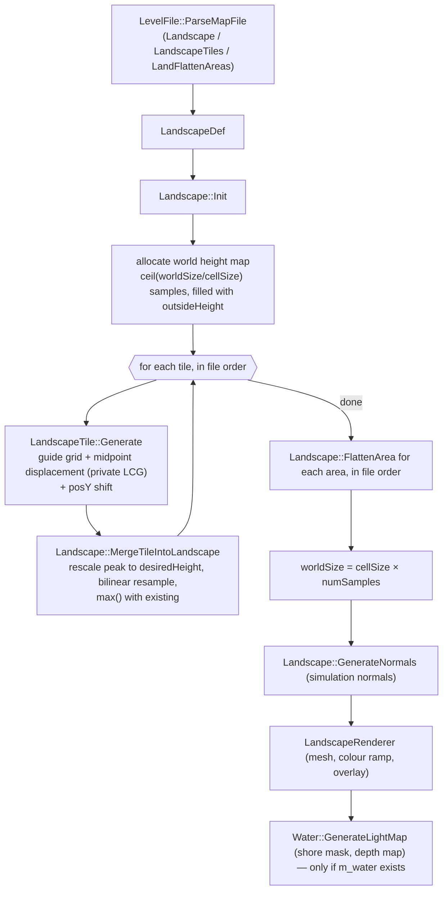

# Routed draft sections for document 23

<!-- from P11_terrain_world -->
## [→ 23_terrain_and_landscape] 23.1 Pipeline overview

The terrain is a single regular height-field (`SurfaceMap2D<double>`) built **once per level load** from the `Landscape_StartDefinition`, `LandscapeTiles_StartDefinition` and `LandFlattenAreas_StartDefinition` blocks of the map file. It is never modified by gameplay afterwards [C] (no `m_heightMap->PutData/AddToData/SetAll` outside `code/landscape.cpp`; grep over `code/`). Everything is driven by the level file plus integer seeds; generation uses a **private per-tile LCG**, not the synchronised RNG and not the global `AppRandom` [C] `code/landscape.cpp:LandscapeTile::LandscapeAppRandom`.



Call order inside a level load [C] `code/location.cpp:Location::Init`: `LoadLevel` (parse) → `AppSeedRandom(1)` → `InitLights` → `InitLandscape` (= `Landscape::Init`) → `new Water()` → … → `InitBuildings` (buildings are dropped onto the surface with `m_heightMap->GetValue`). At `Landscape::Init` time `m_water` is still NULL, so the water mask is generated by the `Water` constructor, not by `Landscape::Init` [C] `code/landscape.cpp:Landscape::Init`, `code/water.cpp:Water::Water`.

<!-- from P11_terrain_world -->
## [→ 23_terrain_and_landscape] 23.2 Numeric primitives the pipeline depends on (must be replicated bit-for-bit)

| Primitive | Exact behaviour | Evidence |
|---|---|---|
| `iv_atof(s)` | `atof(s)` then rounded to IEEE single (`volatile float`), returned as double | [C] `contrib/systemiv/lib/math/math_stubs.cpp:iv_atof`, `iv_trunc_low_nibble` |
| `iv_pow/iv_exp/iv_log/iv_sqrt/iv_sin/…` | CRT double function, result rounded to float, returned as double | [C] `code/lib/universal_include.h` (macros), `math_stubs.cpp:iv_trunc_low_nibble` |
| `Log2(x)` | `iv_log(x) * (1.0 / iv_log(2.0))` (second factor computed once, in double) | [C] `code/lib/math_utils.cpp:Log2` |
| `LandscapeTile::GetPowerOfTwo(x)` | `(int)ceil(Log2(x))`. Verified equal to exact `⌈log2 x⌉` for every x in 1..69999 under float-rounded logs (incl. exact powers of two) | [C] `code/landscape.cpp:GetPowerOfTwo`; [I] `scripts/P11_log2check.py` (0 mismatches; assumes a correctly-rounded CRT `log`) |
| `Array2D<T>::GetData(x,y)` | indices are `unsigned short`; any index ≥ size (incl. negative ints wrapped mod 2¹⁶) returns the array's **outside value** | [C] `code/lib/2d_array.cpp:GetData` |
| `Array2D<T>::PutData/AddToData` | silently ignore out-of-range indices | [C] `code/lib/2d_array.cpp` |
| `SurfaceMap2D(w,h,x0,y0,cx,cy,out)` | `numColumns = ceil(w/cx)`, `numRows = ceil(h/cy)` (then truncated to `unsigned short`); `inv = 1.0/cell` | [C] `code/lib/2d_surface_map.cpp:SurfaceMap2D` |
| `SurfaceMap2D::GetValue(x,y)` | `fx=(x−x0)·invX`; `x1=(unsigned short)fx`; `x2=(unsigned short)(x1+1)`; `fx-=floor(fx)`; then **if `x1≥cols` → 0; if `x2≥cols` → 0** (same for y); bilinear `v11(1−fx)(1−fy)+v12(1−fx)fy+v21 fx(1−fy)+v22 fx fy` where `v12=(x1,y2)`, `v21=(x2,y1)`. Consequences: (a) samples beyond the far edge wrap to column/row 0, not to the outside value; (b) the last cell interpolates towards column/row 0; (c) slightly negative coordinates (−1<fx<0) use `x1=0` and weight `fx+1` | [C] `code/lib/2d_surface_map.cpp:GetValue`; [I] double→`unsigned short` of values ≤ −1 is MSVC-specific (truncate to int, keep low 16 bits → ≥ cols → 0) |
| `GetMapIndexX(r)` | `(int)((r − x0)·invX)` (truncation toward zero) | [C] `2d_surface_map.cpp:GetMapIndexX` |
| `GetRealX(i)` | `i·cellSizeX + x0` | [C] |
| `GetHighestValue()` | starts at `GetData(0,0)`; scans `y<numRows`, `x<numRows` (uses rows for both — only correct for square maps, which tiles always are) | [C] `2d_surface_map.cpp:GetHighestValue` |
| `Vector3::Normalise` | `len²` held `volatile`; if `len² > 1e-10` scale by `1/iv_sqrt(len²)`, else set to (0,0,1) | [C] `code/lib/vector3.h:Normalise` |
| `Vector3 ^` | cross product `(y·bz−z·by, z·bx−x·bz, x·by−y·bx)` | [C] `code/lib/vector3.h:operator^` |
| Text tokeniser | separators `" \t\n\r:,"`; `#` starts a comment to end of line; optional "redshirt2" line-cipher prefix | [C] `contrib/systemiv/lib/filesys/text_stream_readers.cpp:CleanLine`, `GetNextToken` (X1a owns the formal grammar) |

<!-- from P11_terrain_world -->
## [→ 23_terrain_and_landscape] 23.3 Landscape definition data (every field)

### 23.3.1 `Landscape_StartDefinition … Landscape_EndDefinition` → `LandscapeDef` + `LevelFile` strings

Parsed by [C] `code/level_file.cpp:LevelFile::ParseLandscapeData`: each line is `key value`; keys compared case-insensitively; unknown keys ignored; the block ends at a line whose first token is `landscape_endDefinition` (any case). Note: this parser does not skip empty lines before `GetNextToken` [C] — a blank/comment-only line inside the block yields a NULL token passed to `stricmp` (crash-prone). No shipped file has one [C] (awk scan of `data/levels/*.txt`).

| Key | Field | Type / parse | Default | Units / meaning |
|---|---|---|---|---|
| `cellSize` | `LandscapeDef::m_cellSize` | double via `iv_atof` (float precision) | 12.0 | world units between height samples (both axes). Shipped range 9.0 – 27.08 |
| `worldSizeX` | `m_worldSizeX` | int (`atoi`) | 2000 | requested extent in world units along X. Actual extent = `cellSize × ceil(worldSizeX/cellSize)` (§23.8) |
| `worldSizeZ` | `m_worldSizeZ` | int | 2000 | same for Z. All shipped maps are square |
| `outsideHeight` | `m_outsideHeight` | double via `iv_atof` | −10 | height of everything not covered by a tile (sea floor); also the base level of every tile. Shipped: −6.93 … −30.0 |
| `maxHeight` | `m_maxHeight` | float via `atof` (double precision then stored as float) | 0.0 | **colour-ramp only**: if > 0 it replaces the real peak height as the normaliser of the colour ramp (§23.11). "isn't required for any other calculations" [C] `code/landscape.cpp:Landscape::Init` comment + usage grep. Shipped: 0.00 or absent except `mp_cts_3p_3.txt` (200.00) |
| `landColourFile` | `LevelFile::m_landscapeColourFilename` | string (`strcpy`, 512) | `landscape_default.bmp` | colour ramp, loaded as `terrain/<name>` |
| `wavesColourFile` | `m_wavesColourFilename` | string | `waves_default.bmp` | water wave colour table, `terrain/<name>` |
| `waterColourFile` | `m_waterColourFilename` | string | `water_default.bmp` | flat-water texture, `terrain/<name>` |

[C] defaults: `code/level_file.h:LandscapeDef::LandscapeDef`, `code/level_file.cpp:LevelFile::LevelFile`. Christmas mode (`Location::ChristmasModEnabled`, set from `ClientToServer::m_christmasMode`) overrides the three files with `landscape_icecaps.bmp`, `waves_earth.bmp`, `water_icecaps.bmp` [C] `code/landscape_renderer.cpp:LandscapeRenderer::LandscapeRenderer`, `code/water.cpp:Water::Water`, `Water::RenderFlatWater`.

### 23.3.2 `LandscapeTiles_StartDefinition … LandscapeTiles_EndDefinition` → `LandscapeTile`

One tile per non-empty line, appended in file order (order matters: §23.6). Parsed by [C] `code/level_file.cpp:LevelFile::ParseLandscapeTiles`; positional tokens:

| # | Header label | Field | Parse | Default (ctor) | Meaning / units |
|---|---|---|---|---|---|
| 1 | `x` | `m_posX` | int | – | world X of the tile's low corner (world units) |
| 2 | `y` | `m_posY` | `iv_atof` | – | height offset added to every tile sample after generation (world units, before rescale — see §23.6) |
| 3 | `z` | `m_posZ` | int | – | world Z of the tile's low corner |
| 4 | `size` | `m_size` | int | 256 | edge length of the (square) tile footprint in world units. Shipped 104 – 4484 |
| 5 | `frac dim` | `m_fractalDimension` | `iv_atof` | 1.2 | roughness exponent: noise amplitude ∝ (10·L)^fd where L is the current half-step in "256-unit" space (§23.4). Shipped 0.57 – 7.88 |
| 6 | `height scale` | `m_heightScale` | `iv_atof` | 1.0 | linear noise gain; 0 ⇒ no noise (guide grid only). Shipped 0.0 – 10.0 |
| 7 | `desired height` | `m_desiredHeight` | `iv_atof` | 200 | the tile's highest sample is rescaled to this world height (§23.6). Shipped 21 – 961 |
| 8 | `gen method` | `m_generationMethod` | int | 1 | 0 = average of 4 parents; 1 = average of a random opposite pair; 2 = copy one random parent (§23.4). Shipped counts: method 1 ×449, 2 ×72, 0 ×39 |
| 9 | `seed` | `m_randomSeed` | int | 1 | seed of the tile's private LCG |
| 10 | `lowland smooth` | `m_lowlandSmoothingFactor` | `iv_atof` | 1.0 | exponent on |height| in the noise envelope: higher ⇒ flatter lowlands relative to peaks. Shipped 0.0 – 3.0 |
| 11 | `guideGrid` (power) | `m_guideGridPower` | int → `GuideGridSetPower` | 0 | log₂ of guide-grid resolution + 1: resolution r = 2^p − 1 points per side. Shipped p ∈ {0,1,2,3,4,5} (counts 158/34/214/35/98/21) |
| 12 | (guide string) | `m_guideGrid` | only read if p > 0; `GuideGridFromString` | NULL | r×r bytes encoded as 2r² letters (§23.5) |

Generated (not in file): `m_heightMap` (n×n `SurfaceMap2D<double>`), `m_compensatedHeightScale`, `m_holdrand` (LCG state), `m_outsideHeight` (copied from the landscape before generation) [C] `code/landscape.h:LandscapeTile`, `code/landscape.cpp:Landscape::GenerateHeightMap`.

### 23.3.3 `LandFlattenAreas_StartDefinition … _EndDefinition` → `LandscapeFlattenArea`

[C] `code/level_file.cpp:ParseLandFlattenAreas`, `code/level_file.h:LandscapeFlattenArea`. Tokens: `x y z size [type threshold]`.

| # | Field | Parse | Default | Meaning |
|---|---|---|---|---|
| 1–3 | `m_centre.x/y/z` | `iv_atof` | – | centre (x,z) of the square; `y` = target height / amount (meaning depends on type) |
| 4 | `m_size` | `iv_atof` | 40.0 | **half**-width of the axis-aligned square (world units) |
| 5 | `m_flattenType` | int, optional | 0 (Absolute) if absent | enum below |
| 6 | `m_heightThreshold` | `iv_atof`, read only when 5 is present | 40.0 | threshold used by types 2, 3, 4 |

`FlattenType` enum [C]: 0 `FlattenTypeAbsolute`, 1 `FlattenTypeAdd`, 2 `FlattenTypeSubtract`, 3 `FlattenTypeSmooth`, 4 `FlattenTypeSubtract2`. Shipped usage: type 0 ×25, 1 ×1, 2 ×5, 3 ×27, 4 ×3 (`scripts/P11_levelstats.py`).

<!-- from P11_terrain_world -->
## [→ 23_terrain_and_landscape] 23.4 Tile generation — exact algorithm (`LandscapeTile::Generate`)

All arithmetic in double unless stated; "f32()" means round to IEEE single. [C] `code/landscape.cpp:LandscapeTile::Generate`, `GenerateMidpoints`, `GenerateSquareMidpoint`, `GenerateDiamondMidpoint`, `GenerateNoise`, `LandscapeAppSeedRandom`, `LandscapeAppRandom`, `Landscapesfrand`.

**Private RNG** (identical constants to MSVC `rand()` but separate state, `long m_holdrand`):
```
seed(s):   state = s                              (32-bit)
next():    state = state*214013 + 2531011 (mod 2^32); return (state >> 16) & 0x7FFF   // 0..32767
sfrand(R): (0.5 - next()/32767.0) * R            // uniform in [-R/2, +R/2]
```
The result bits 16–30 are identical whether `long` is 32 or 64 bit, so a `uint32` state reproduces it [I] (low-order bits of a product depend only on low-order bits of the operands). The tile's state is seeded with `m_randomSeed` immediately before the iteration loop and is not shared with anything else [C].

**Step 1 — allocate.** `reqWorldCells = (int)(m_size / cellSize)` (double division, truncation); `k = GetPowerOfTwo(reqWorldCells − 1)`; `n = iv_pow(2,k) + 1` (exact). The tile map is n×n samples with cell size 1.0 and origin 0 (re-used if already n×n) [C]. Edge case: `reqWorldCells == 1` ⇒ `log(0)` ⇒ undefined [I]; not present in shipped data (min size/cell ≈ 104/12 = 8).

**Step 2 — initialise.** All n² samples = `m_outsideHeight` (= the landscape's outsideHeight, copied in by `GenerateHeightMap`).

**Step 3 — guide grid.** If p > 0: `r = 2^p − 1`, `scale = (n−1)/(r+1)` (integer division = 2^(k−p)); for z in 0..r−1, x in 0..r−1: `sample((x+1)·scale, (z+1)·scale) = guide[x,z]` (raw byte 0–255 used as a height). Requires k ≥ p; if k < p, scale = 0 and every guide value lands on sample (0,0) [I]. The tile border (row/column 0 and n−1) is never a guide point.

**Step 4 — compensated noise gain.**
```
fracDimModifier   = 30.7   * f32(exp(-6.5 * fd))
smoothingModifier = 15.353 * f32(exp(-3.1 * ls))
comp = heightScale; comp *= fracDimModifier; comp *= smoothingModifier
```

**Step 5 — midpoint displacement.**
```
iterations = GetPowerOfTwo(n) - p            // = k + 1 - p  (since n = 2^k + 1)
step       = (n - 1) >> p                    // = 2^(k-p)
seed(m_randomSeed)
repeat iterations times:
    for x = 0; x < n-1; x += step:           // x OUTER loop
        for z = 0; z < n-1; z += step:       // z INNER loop
            h = step >> 1; mx = x + h; mz = z + h
            Square(mx, mz, h)                # centre of the square
            if z != 0: Diamond(mx, z, h)     # midpoint of the low-z edge
            if x != 0: Diamond(x, mz, h)     # midpoint of the low-x edge
    step >>= 1
```
The last pass runs with step = 1, h = 0: every call reads the point itself, adds `sfrand(0)·… = 0`, but still **consumes RNG draws** (irrelevant to the output because nothing uses the tile RNG afterwards) [C]. Edge midpoints on x = 0, z = 0 are skipped explicitly, and the far edges (x = n−1, z = n−1) are never visited, so **the whole tile border stays at outsideHeight** until Step 6 [C].

`Square(x,z,h)` parents = the 4 corners `A(x−h,z−h) B(x−h,z+h) C(x+h,z−h) D(x+h,z+h)`; `Diamond(x,z,h)` parents = `W(x−h,z) E(x+h,z) N(x,z+h) S(x,z−h)`. Base value by `m_generationMethod`:

| Method | Square base | Diamond base | RNG draws per call |
|---|---|---|---|
| 0 | (A+B+C+D)·0.25 | (W+E+(x,z−h)+(x,z+h))·0.25 | 1 (noise) |
| 1 | if `next()&1`: (A+D)·0.5 else (B+C)·0.5 | if `next()&1`: (W+E)·0.5 else (N+S)·0.5 | 2 (choice, then noise) |
| 2 | `r = next() & 0xFFFF`: r<0x3FFF → A; r<0x7FFF → B; r<0xBFFF → C; else D | same thresholds → W, E, N(x,z+h), S(x,z−h) | 2 |

Because `next()` ≤ 0x7FFF, method 2 picks A/W for r ∈ [0,16382], B/E for r ∈ [16383,32766], C/N only for r = 32767, and **never D/S** [C]+[I] (arithmetic consequence).

Then `sample(x,z) = base + Noise(h, base)` where
> **Verbatim excerpt** — `code/landscape.cpp:LandscapeTile::GenerateNoise` (Introversion licence, ≤15 lines)
```cpp
double length = 256.0 * _halfSize / m_heightMap->GetNumColumns();
double val = Landscapesfrand(iv_pow(length * 10.0, m_fractalDimension));
val *= m_compensatedHeightScale;
val *= 0.1 + (double)iv_pow(fabsf(_height), m_lowlandSmoothingFactor) * 0.15;
return val;
```
i.e. `Noise(h, base) = sfrand(f32((2560·h/n)^fd)) · comp · (0.1 + 0.15·f32(|f32(base)|^ls))`. `fabsf` makes the base value single precision first. The amplitude grows with |height|, so lowlands (near outsideHeight≈−10…−30 the magnitude is still non-zero) are rougher when `ls` is small and the envelope is dominated by the 0.1 floor when |base|^ls is small [I].

**Step 6 — height shift.** Every sample (border included) += `m_posY` [C].

<!-- from P11_terrain_world -->
## [→ 23_terrain_and_landscape] 23.5 Guide-grid encoding

[C] `code/landscape.cpp:GuideGridSetPower`, `GuideGridFromString`, `GuideGridToString`.

- Resolution `r = (1 << p) − 1`; p = 0 ⇒ no grid (pointer NULL). `GuideGridSetPower` only reallocates when p changes; new grids are zero-filled.
- String = r² cells, **row-major with z outer, x inner** (cell (x,z) at character offset 2·(z·r + x)).
- Each cell = two letters `hi lo` with `value = 16·(hi − 'A') + (lo − 'A')`; legal letters `A`–`P`; value range 0–255. No validation: a short string reads past its end [C]; other letters give out-of-range values that are truncated into the `unsigned char` [I].
- Lengths in shipped data: p=1 → 2 chars, p=2 → 18, p=3 → 98, p=4 → 450, p=5 → 1922 [C] (survey).
- Writer emits the inverse (`'A' + v/16`, `'A' + v%16`) after the power, separated by three spaces [C] `LevelFile::WriteLandscapeTiles`.
- Semantics: the decoded byte is an absolute height in tile space (before the posY shift and before the desiredHeight rescale of §23.6). Guide point (x,z) is pinned at tile sample ((x+1)·2^(k−p), (z+1)·2^(k−p)); the fractal then refines between them because the first iteration's step equals that spacing.

<!-- from P11_terrain_world -->
## [→ 23_terrain_and_landscape] 23.6 Height-map composition across tiles (`Landscape::GenerateHeightMap`, `MergeTileIntoLandscape`)

[C] `code/landscape.cpp:Landscape::GenerateHeightMap`, `Landscape::MergeTileIntoLandscape`.

```
world.SetAll(outsideHeight)
for tile in tiles (file order):
    tile.outsideHeight = outsideHeight
    tile.Generate(def)                                     # §23.4
    posXi = (unsigned short)(posX / cellSize + 0.5)        # round-half-up to a world sample index
    posZi = (unsigned short)(posZ / cellSize + 0.5)
    numCells = (int)(size / cellSize)                      # world samples covered per side
    heightRange  = tile.Highest() - outsideHeight + 0.001
    heightFactor = (desiredHeight - outsideHeight) / heightRange
    # re-map tile sample space to world space:
    tile.x0 = posX; tile.y0 = posZ; tile.cell = size / n  (NB: / n, not / (n-1)); tile.inv = 1/tile.cell
    for z in 0..numCells-1, x in 0..numCells-1:           # unsigned short counters
        wx = (x + posXi) * cellSize ; wz = (z + posZi) * cellSize
        h1 = (tile.GetValue(wx, wz) - outsideHeight) * heightFactor + outsideHeight
        if h1 > world.GetData(x+posXi, z+posZi): world.PutData(x+posXi, z+posZi, h1)   # max-composite
```
Properties [C]/[I]:
- Each tile's **peak is linearly rescaled to `desiredHeight`** relative to the sea-floor level `outsideHeight` (a sample equal to outsideHeight stays there). The posY shift therefore changes the shape only through `Highest()`: raising posY raises the border (to `outsideHeight + posY·heightFactor`) and lowers the relative relief [I].
- Composition is a **per-sample maximum**; later tiles cannot dig into earlier ones (only flatten areas can lower terrain).
- Because the tile cell is `size/n` (not `size/(n−1)`) the tile's last sample sits at `size·(n−1)/n` and world samples near the far edge interpolate towards the tile's column/row 0 via the wrap rule of `GetValue` — both are the tile border at the same height, so this is invisible unless posY ≠ 0 [I].
- World samples whose index exceeds the world grid are silently dropped (`PutData`), so tiles may hang off the map edge [C].
- No smoothing pass is applied between tiles; the only "smoothing" is the bilinear resampling and flatten type 3 [C] (`GenerateHeightMap` has no other step).

After flatten areas: `m_worldSizeX = cellSize × numColumns`, `m_worldSizeZ = cellSize × numRows` [C].

<!-- from P11_terrain_world -->
## [→ 23_terrain_and_landscape] 23.7 Flatten areas (`Landscape::FlattenArea`)

[C] `code/landscape.cpp:Landscape::FlattenArea`. Region: world sample indices `x ∈ [x1, x2)`, `z ∈ [z1, z2)` with `x1 = GetMapIndexX(cx − size) + 1`, `x2 = GetMapIndexX(cx + size) + 1` (same for z) — an **axis-aligned square** of half-width `size`, hard-edged (no falloff, no blending). Indices are not clamped: reads outside the grid return outsideHeight, writes are dropped. Loop order z outer, x inner; updates are in place (Gauss–Seidel), so the smooth type sees already-updated x−1 and z−1 neighbours. Per sample `cur = h(x,z)`, `t = centre.y`, `T = heightThreshold`:

| Type | New value |
|---|---|
| 0 Absolute | `t` |
| 1 Add | `t + cur` |
| 2 Subtract | `cur > T ? cur − t : cur` |
| 4 Subtract2 | `cur < T ? cur − t : cur` |
| 3 Smooth (runs **2 passes**) | if `cur > T`: `v = cur·(t/cur)` (≈ t) `+ h(x−1,z) + h(x+1,z) + h(x,z+1) + h(x,z−1)`; `v /= 6.0`; else `v = t`. Then `v = min(v, cur)`. (Divisor 6 for 5 terms: the result is pulled down as well as smoothed; points at or below T are clamped to ≤ t.) |

Flatten areas are applied after all tiles, in file order [C] `GenerateHeightMap`.

<!-- from P11_terrain_world -->
## [→ 23_terrain_and_landscape] 23.8 Cell size, world size, outside height, sea level

| Quantity | Rule | Evidence |
|---|---|---|
| Sample spacing | `cellSize` (both axes). `Landscape::Init` multiplies it by `1 + (detailScaleFactor−1)·0.5` with `detailScaleFactor` hard-coded to 1 (the `RenderLandscapeDetail` preference read is commented out) ⇒ no effect | [C] `code/landscape.cpp:Landscape::Init` |
| Grid size | `cols = ceil(worldSizeX / cellSize)`, `rows = ceil(worldSizeZ / cellSize)` (uint16) | [C] `SurfaceMap2D` ctor |
| World extent | `cellSize × cols` by `cellSize × rows`, origin (0,0). E.g. `mp_koth_2P_1`: 2700 / f32(15.76) → 172 samples → 2710.72 units | [C]; [I] values from `P11_terrain_ref.py` |
| `GetWorldSizeX/Z` | the extent above; `1e6` if no height map | [C] `Landscape::GetWorldSizeX` |
| `IsInLandscape(p)` | `0 ≤ x < sizeX && 0 ≤ z < sizeZ` | [C] |
| Outside the grid | height = outsideHeight via `GetData`; but `GetValue` wraps to column/row 0 (§23.2) | [C] |
| Sea level | **y = 0** everywhere: the renderer culls quads with all heights ≤ 0 (§24.1), the water mask treats `height > 0` as land (§23.13), water mesh rests at y=0, `Water::IsVertNeeded` rejects land > 4.0 | [C] `landscape_renderer.cpp`, `water.cpp` |
| Camera bounds | `[−200, worldSizeX + 200]` on both axes (uses X for both) | [C] `code/main.cpp:DoEnterLocation` (cross-ref P10) |
| Fog distance | `fogEnd = max(4000, sizeX+1000, sizeZ+1000)`, `fogStart = fogEnd/3` | [C] `code/location.cpp:Location::SetupFog` (§24.6) |

<!-- from P11_terrain_world -->
## [→ 23_terrain_and_landscape] 23.9 Normal generation for simulation (`Landscape::GenerateNormals`)

`m_normalMap` is a `SurfaceMap2D<Vector3>` with the same grid as the height map (outside value = up vector) and is read by gameplay (e.g. `code/location.cpp` bounce physics, `code/worldobject/centipede.cpp`, `code/worldobject/nuke.cpp`, `code/particle_system.cpp`) through `GetValue` (bilinear) [C] grep. Algorithm [C] `code/landscape.cpp:Landscape::GenerateNormals`:
```
for z in rows, x in cols:
    hN = h(x, z-1); hW = h(x+1, z); hE = h(x-1, z); hS = h(x, z+1)       # out-of-grid -> outsideHeight
    if hN == hW and hE == hS and hN == hE: n = (0,1,0); continue        # centre NOT compared
    c  = h(x,z)
    vN = (0, c-hN,  cy);  vW = (-cx, c-hW, 0);  vS = (0, c-hS, -cy);  vE = (cx, c-hE, 0)
    n  = normalise( normalise(vW ^ vN) + normalise(vE ^ vS) )
```
(The "W"/"E" labels are swapped relative to +x but the result is a correct up-facing normal leaning downhill [I] by expansion of the cross products.) An isolated spike or pit whose four neighbours are equal gets the up vector [C].

The **render** normals are separate (per-triangle, §24.1).

<!-- from P11_terrain_world -->
## [→ 23_terrain_and_landscape] 23.10 Landscape queries

[C] `code/landscape.cpp`:

| Function | Behaviour |
|---|---|
| `RayHit(start, dir, *hit)` | normalises dir. If the start cell is inside (`0≤x0<cols`, `0≤z0≤rows` — note `≤`), calls `UnsafeRayHit`. Otherwise intersects the 2-D ray with the two grid edges facing it (choice by quadrant of dir.xz) using `SegRayIntersection2D`; returns false if neither is hit; else starts `UnsafeRayHit` from the entry point (entry y computed from the x-distance only: `λ = (ix − start.x)/dir.x`). Comment warns it may report hits behind the start. |
| `UnsafeRayHit` | grid walk: at each cell test `RayHitCell`; step to the neighbour in z if the ray crosses the cell's far z-edge segment, else step in x; stop when leaving the grid. 4 quadrant variants; a ray with dir.x == 0 or dir.z == 0 falls into the last (SE) branch [I]. |
| `RayHitCell(x0,z0)` | two triangles per cell: (c00, c01, c10) then (c01, c10, c11) via `RayTriIntersection(…, 1e10)` — the same diagonal as the render mesh. |
| `SphereHit(c, r)` | asserts 0 < r < 200; scans samples in the bounding box (indices clamped to [0, size]); returns distance to the nearest **sample point** if ≤ r else −1. |
| `DeleteTile(id)` | editor: removes tile from the level's `LandscapeDef` and re-runs `Init` [B:EDITOR] (`code/interface/landscape_window.cpp`). |
| `RenderHitNormals` | debug line drawing of normals ×20, colour (255,90,90); no caller [C] grep → dead. |

<!-- from P11_terrain_world -->
## [→ 23_terrain_and_landscape] 23.11 Colour-ramp application (`data/terrain/landscape_*.bmp`)

Ramp bitmaps are 64×64, 24-bit, uncompressed BMP [C] (`scripts/P11_bmpinfo.py`, all 23 files). `BitmapRGBA` stores file rows in file order, so **row y = 0 is the bottom row of the picture as viewed** (positive-height BMPs are stored bottom-up) and alpha = 255 [C] `code/lib/bitmap.cpp:LoadBmp`, `Read24BitLine`. Loaded through `Resource::GetBitmap("terrain/<landColourFile>")` [C] `code/landscape_renderer.cpp:LandscapeRenderer::LandscapeRenderer`.

Colour is assigned **per render triangle** (flat shaded, §24.1) [C] `code/landscape_renderer.cpp:BuildColourArray`, `GetLandscapeColour`:
```
for each strip triangle T_j = (v_j, v_j+1, v_j+2):           # j = 0 .. numVerts-3
    centre   = (v_j + v_j+1 + v_j+2) * 0.33333                 # render positions (y<0.3 already clamped to -10)
    gradient = normal(T_j).y                                   # 1 = flat, 0 = vertical
    u = f32(pow(1 - gradient, 0.4))
    v = 1 - centre.y / highest            # highest = max height-map sample, or maxHeight if > 0
    AppSeedRandom( (uint)centre.x | ((uint)centre.z + AppRandom()) )    # C precedence: x | (z + r)
    hNoise = max(centre.y, 0)
    v += sfrand(0.45 / (hNoise + 2.0))    # global AppRandom; sfrand(R) is uniform in [-R/2, R/2]
    px = clamp((int)(u * 64), 0, 63);  py = clamp((int)(v * 64), 0, 63)
    colour = ramp[px, py]                 # py = 0 = bottom row of the image
    if negativeRenderer: colour.a = 0
    for each burn patch P:                # Location::m_burnPatches
        d = |centre - P.pos| (3-D)
        if d < 1.5 * P.r:
            ratio = d <= P.r/2 ? 0 : min(1, (d - P.r/2) / P.r)
            colour = colour*ratio + (20,20,20)*(1-ratio)
    store colour on v_j+2 (the provoking vertex)
```
Reading of the ramp: **x axis = slope** (left column = flat, right column = vertical; the 0.4 exponent expands gentle slopes), **y axis = height** (bottom row of the image = the highest terrain, top row = sea level), with a small vertical jitter whose amplitude decays with height (±0.1125 rows-fraction at h=0, ±0.0022 at h=100) [C]+[I]. The first two vertices of the strip get magenta (255,0,255) but are never provoking [C].

RNG discipline: `Location::Init` calls `AppSeedRandom(1)` just before `InitLights`/`InitLandscape` [C] `code/location.cpp:Location::Init`, so the chained reseeding is reproducible run-to-run unless another thread draws from the global `AppRandom` concurrently (level load runs inside `DoEnterLocation` on the loading-screen work queue) [I] `code/main.cpp:EnterLocation`. The colours are presentation-only; they never feed the simulation [C] (only `m_verts[].m_col`).

Burn patches are added by `Location::AddBurnPatch`, which rebuilds the whole renderer (`Landscape::BuildOpenGlState`) [C]; the only caller is `code/worldobject/portal.cpp` (a Darwinia object) → [B:LEGACY] [I].

Shipped ramp files and usage (map files referencing each): `landscape_default` (15), `icecaps` (11), `earth` (9), `mine` (8), `launchpad` (6), `dark` (5), `desert` (4), `firetop` (3), `jailbreak` (2), `stronghold` (2), `marble` (1), `shrine` (1), `silver` (1), `trippy` (1); **unreferenced by any level or code**: `beach`, `containment`, `field`, `icecaps_peaked`, `marble2`, `mine2`, `ridges`, `volcanic`, `volcanicplain` (only reachable through the editor's file picker, filter `landscape_*`, [B:EDITOR] `code/interface/landscape_window.cpp`) [C] grep.

<!-- from P11_terrain_world -->
## [→ 23_terrain_and_landscape] 23.12 Validation of this specification

`scripts/P11_terrain_ref.py` implements §23.2–23.8 exactly as written above (no access to the original binary). `scripts/P11_terrain_check.py` regenerates every shipped `map_*`/`mp_*` file and samples the result at every `Buildings_StartDefinition` position: **0 of 793 Trees, 0 of 321 SpawnPoints, 0 of 178 MultiwiniaZones, 0 of 156 TrunkPorts, 0 of 252 SolarPanels, 0 of 208 GunTurrets, 0 of 121 ControlTowers, 0 of 108 RadarDishes** land at or below sea level, whereas object types that are designed to stand in the sea (FuelGenerator 60/60, AIObjective 77/95, PylonEnd 65/92, SpawnPointMaster 20/37, LaserFence 79/756) do [I]. A transposed axis, a wrong tile origin or a wrong rescale would put many land-only buildings under water, so this is strong (but indirect) evidence that the reconstruction reproduces the shipped terrain. Exact bit-equality with the original executable is **[U]** (needs a height dump from a running build).

<!-- from P11_terrain_world -->
## [→ 23_terrain_and_landscape] 23.13 Water level, coastline mask, water depth and waves

There is no per-level water level: the sea plane is y = 0 [C] (§23.8). The coastline is derived from the height map by `Water::GenerateLightMap` (named "lightmap", it is a **shore mask**, not lighting) [C] `code/water.cpp:Water::GenerateLightMap`:

1. `MASK_SIZE = 128`; the mask covers the water plane `[−sizeX/2, 1.5·sizeX) × [−sizeZ/2, 1.5·sizeZ)` (twice the land extent); `sf = 2·size/128` per pixel; only pixels 32..95 (the land rectangle) are evaluated: `land(x,z) = 1` if `heightMap.GetValue(x·sfX − sizeX/2, z·sfZ − sizeZ/2) > 0`, else 0.
2. Separable 11-tap blur, scatter form (`AddToData`, out-of-range dropped), kernel `{0.2,0.3,0.4,0.5,0.8,1.0,0.8,0.5,0.4,0.3,0.2} / 5.4` (sums to 1.0); horizontal then vertical; zero pixels (`NearlyEquals(v,0)`) skipped.
3. `grey = min(255, blurred × 855)` → 128×128 `BitmapRGBA` written **vertically flipped** (`PutPixel(x, 127−z)`), registered as resource bitmap `"water_lightmap"` (old bitmap/texture deleted first).
4. Water depth map: `SurfaceMap2D<float>(2·sizeX, 2·sizeZ, origin (−sizeX/2, −sizeZ/2), cell = 2·sizeX/128 for both axes, outside = 1.0)`; `depth(x, z) = 1 − grey(x, 127−z)/255` (un-flipped). 1.0 = open sea, 0.0 = on/next to land. The integer truncation of `grey` happens when the float is stored into the 8-bit pixel [C].
5. Flat-water tile mask: `Array2D<bool>(cols/4, rows/4)` (32×32); a tile is **false** (not drawn) iff all 16 depth samples of its 4×4 block are ≥ 1.0; stored flipped (`rows/4 − 1 − z`) to match the north-to-south order used when rendering [C].

`Water::IsVertNeeded(x,z)` (dynamic mesh): false if land height (bilinear) > 4.0, false if depth (bilinear) > 0.999, else true [C]. The commented-out `RenderWaterDetail == 1` shortcut means detail does not change this rule [C].

Waves (per-vertex, render-only, driven by `g_gameTimer.GetAccurateTime()` seconds — §24.2) [C] `Water::UpdateDynamicWater`:
```
waveX[i] = 7 * (1.2*sin(0.01*x + 0.65*t) + 0.9*sin(0.03*x + 1.5*t)),  x = i * waterCell
waveZ[i] = 7 * (0.9*sin(0.02*z + 0.75*t) + 0.65*sin(0.03*z + 1.85*t)), z = i * waterCell
vertex.y = (waveX[ix] + waveZ[iz]) * depth(vertex)       # waves vanish at the shore (depth→0)
```
(`x`,`z` are measured from the water-plane origin `(−sizeX/2, −sizeZ/2)`, not world 0; table sizes `int(2·size/waterCell + 2)`.) Coastline whitening: per-vertex `shoreNoise = (s + sfrand(s)·0.25) · 250` with `s = 1 − depth` (global `AppRandom`, drawn once at build).

<!-- from P11_terrain_world -->
## [→ 23_terrain_and_landscape] 23.14 Landscape lightmap — docs vs code

`docs/landscape lightmap.txt` describes `Landscape::GenerateLightMap/ApplyLightmap/DeleteLightMap` (ray-cast shadows from a point light at (700,200,100), 255/50 shade values, optional 5×5 filter, `ConvertToTexture`). **None of these exist in the code**; only the orphan `#define LIGHTMAP_SCALEFACTOR 1` remains in `code/landscape.h` [C] grep for `m_lightMap|ApplyLightmap`. Terrain shading is purely GL vertex lighting with the level lights (§24.1); the only "lightmap" in the build is the water shore mask of §23.13 (`LIGHTMAP_TEXTURE_NAME "water_lightmap"`) [C] `code/water.cpp`. Logged under discrepancies.

<!-- from P11_terrain_world -->
## [→ 23_terrain_and_landscape] 23.15 Lifecycle and re-generation

| Event | Effect | Evidence |
|---|---|---|
| Level load | `Location::Init` → `Landscape::Init(def)` full pipeline; then `new Water()`; buildings get `m_pos.y = heightMap.GetValue(x,z)` | [C] `code/location.cpp:Location::Init`, `InitLandscape` |
| Graphics options "apply" (`PrefsGraphicsWindow`) or Other options "apply" (`PrefsOtherWindow`) **while a location is loaded** | `m_landscape.Init(def)` (full regeneration, new renderer) + water deleted and rebuilt | [C] `code/interface/prefs_graphics_window.cpp`, `code/interface/prefs_other_window.cpp` |
| `Resource::RegenerateOpenGlState` (screen-mode change, cheat window) | `Landscape::BuildOpenGlState` (renderer rebuilt; height map untouched) + `Water::BuildOpenGlState` (D3D buffers only) | [C] `code/location.cpp:Location::RegenerateOpenGlState` |
| Burn patch | renderer rebuilt with new colours | [C] `Location::AddBurnPatch` |
| Editor tile edits | `Landscape::Init`, `DeleteTile` [B:EDITOR] | [C] `code/interface/landscape_window.cpp` |
| Level unload | `Location::Empty` deletes water; `Landscape::~Landscape` → `Empty` deletes renderer, height and normal maps | [C] |

Mid-game regeneration is deterministic from `LandscapeDef` (no runtime inputs), so simulation-visible heights do not change [I]; but it re-runs `GetLandscapeColour`'s chained `AppSeedRandom`, changing only colours [I].

<!-- from P11_terrain_world -->
## [→ 23_terrain_and_landscape] 23.16 Shipped terrain parameter survey (Multiwinia `mp_*` maps)

Source `scripts/P11_levelstats.py` (X4 owns the full catalogue). All `mp_*` maps are square; `worldSize` 2000–7000; `cellSize` 9.0–27.08; `outsideHeight` −6.93 … −30.0 (−10.00 in 40 of the 57 `mp_*` maps); 1–25 tiles per map; 0–6 flatten areas; exactly 2 lights in every file (all 69 landscape-bearing `mp_*` + `map_*` files). Representative rows:

| File | worldSize | cellSize | outsideHeight | tiles | flatten | landColour | waves | water |
|---|---|---|---|---|---|---|---|---|
| mp_koth_2P_1 | 2700 | 15.76 | −15.39 | 3 | 0 | landscape_launchpad | waves_launchpad | water_launchpad |
| mp_assault_4P_2 | 7000 | 26.00 | −10.00 | 19 | 5 | landscape_icecaps | waves_earth | water_icecaps |
| mp_cts_2p_4 | 2000 | 9.00 | −10.00 | 3 | 0 | landscape_earth | waves_default | water_default |
| mp_rocketriot_2p_3 | 3756 | 27.08 | −26.13 | 15 | 0 | landscape_mine | waves_generator | water_default |
| mp_blitzkrieg_4P_2 | 4000 | 20.00 | −10.00 | 25 | 0 | landscape_icecaps | waves_earth | water_icecaps |
| mp_cts_3p_3 | 2570 | 12.00 | −10.00 | 5 | 0 | landscape_trippy (maxHeight 200) | waves_dull | water_icecaps |

---
