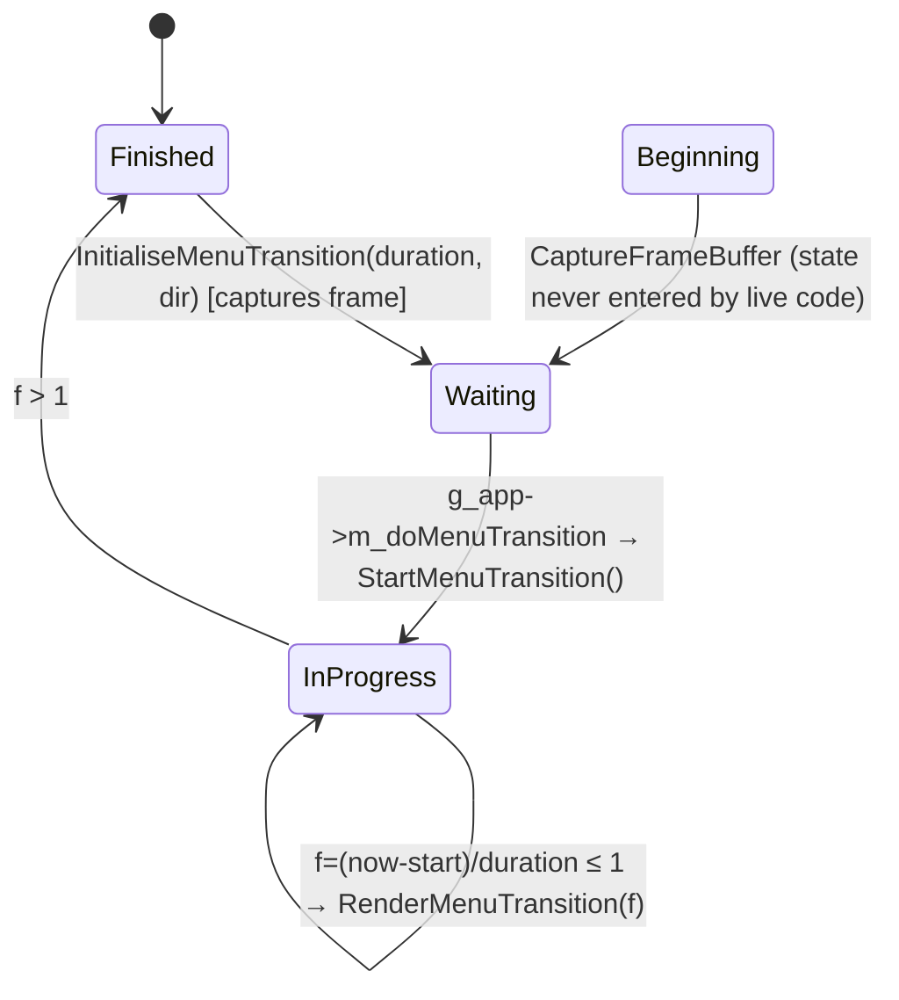
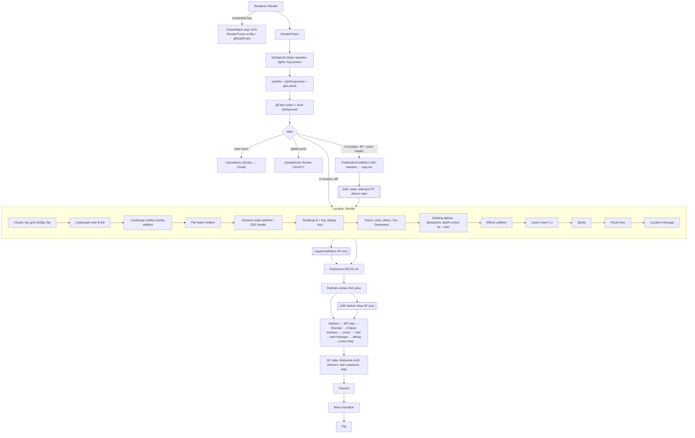
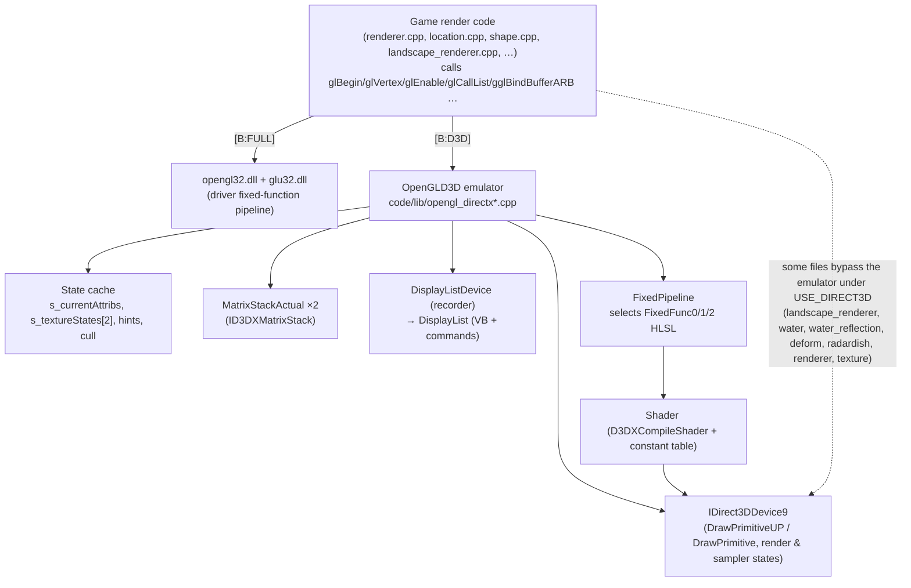
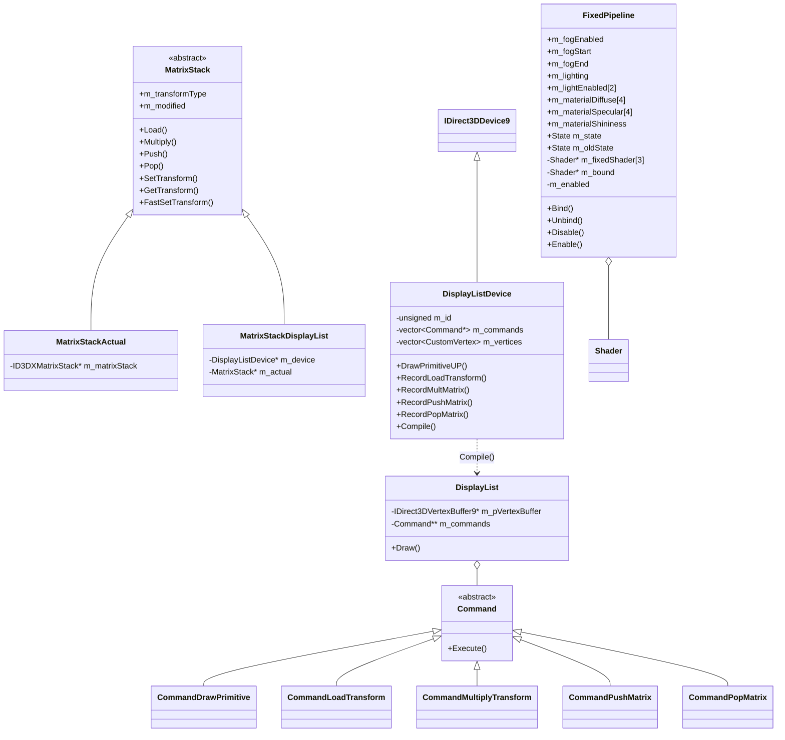
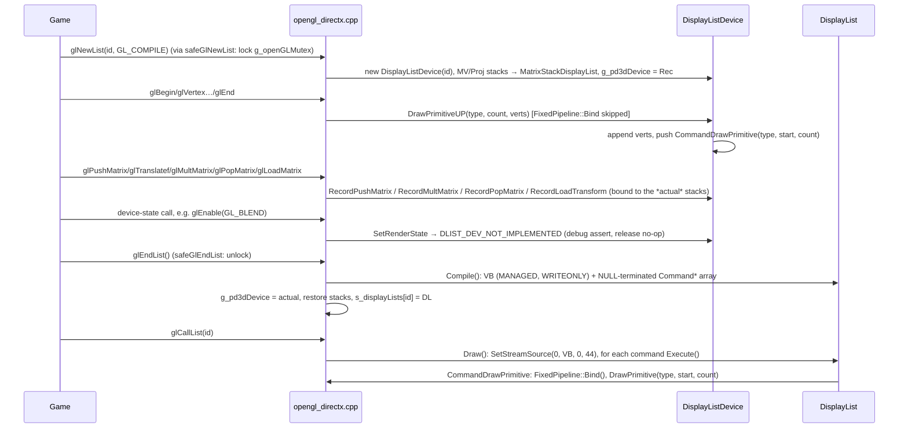

# Routed draft sections for document 24

<!-- from P07_buildings_misc -->
## [→ 24_rendering] World-object render passes in this partition

The complete tree-geometry generator (pseudocode, RNG, derived counts, hit-volume derivation) is specified in this draft under *Tree → Procedural generation algorithm (exact)* and must be carried into 24 verbatim-in-meaning; the per-state colour rules are under *Tree → Rendering*. Summary of GL state per live object [C] (functions cited in each class section):

| Object | Opaque pass (`Render`) | Alpha pass (`RenderAlphas`) | Textures | Blend | Depth write | Cull | Notes |
|---|---|---|---|---|---|---|---|
| Tree | nothing | 2 display lists (branches, leaves) of `GL_QUADS`, crossed-plane quads per segment, scaled by actual height; up to 2 passes while corrupting; fire glow billboards | `textures/tree.bmp` (alpha, trilinear); `textures/starburst.bmp` for fire glow | additive `SRC_ALPHA,ONE` normally; `SRC_ALPHA,ONE_MINUS_SRC_ALPHA` when evil / burning / corrupt-shadow | off | off | depth-sorted at crown centre; display lists regenerated lazily after `FlushOpenGlState`; fire glow drawn with depth test **off**; D3D bakes colour into lists |
| LaserFence | `laserfence.shp` scaled, `GL_NORMALIZE` | curtain quad between posts (skirt h/3 below ground), additive overlay quad, smoothed top edge line | unit0 `laserfence.bmp` (COMBINE REPLACE), unit1 `laserfence2.bmp` (COMBINE MODULATE), overlay `laserfence2.bmp` | alpha (curtain), additive (overlay) | off | off | multitexture pass skipped when `RenderBuildingDetail ≥ 3`; UV scrolling with game time; team / grey / pulsing-solar colour at alpha 150 |
| Wall | `wall.shp` | – | shape's own | – | – | – | destruction via shape-shatter explosion (`g_explosionManager.AddExplosion(shape, mat, 3.0)`) |
| StaticShape | named `.shp` scaled, `GL_NORMALIZE` (or debug sphere r=40) | – | shape's own | – | – | – | shapes cached and shared |
| CloneLab | `clonelab.shp` (Building default) | port status billboards (6-unit) | `starburst.bmp` | additive | off | off | grey empty / occupant team colour |
| RestrictionZone, EruptionMarker | – | editor-only spheres (`LOCATION_EDITOR`) | – | – | – | – | invisible in game; EruptionMarker visuals are `TypeVolcano` particles |
| SmokeMarker | – | base `Building::RenderAlphas` (no lights/ports → nothing) | – | – | – | – | visuals are `TypeMissileTrail` particles spawned in `Advance` |
| Randomiser | `TypeMuzzleFlash` particles spawned from `Render` | – | particle system | – | – | – | random team colours (unsynced `rand()`) |

Shared idioms: camera-facing billboards built from `Camera::GetRight/GetUp`; ownership "lights" (`Building::RenderLights`) blink by `(lastValidSequenceIdFromServer % 10)/2 == teamId`; `RenderBuildingDetail` (1–3) scales particle/blob counts and drops multitexture effects.

<!-- from P09_control_taskmanager -->
## [→ 24_rendering] 4R. Task-manager / cursor overlay render states (summary)

All drawing is immediate-mode OpenGL (emulated by the D3D9 layer under `USE_DIRECT3D`), no shaders [C]. Render order inside a frame: … `MarkerSystem::Render` → `MultiwiniaHelp::Render` → `ShamanInterface::Render` → `UserInput::Render` → `GameCursor::Render` (3D world-space highlights) → `GameCursor::RenderBasicCursorAlwaysOnTop` (2D icon, enter marker, crosshair/pointer) → chat → `Camera::Render` → `TaskManagerInterface::Render` (target-area particles, then 2D bar/pop-ups/messages) → debug renderer [C] `code/renderer.cpp`.

| Pass | Space / projection | Blend (src, dst) | Depth | Texture (filter) | Ref |
|---|---|---|---|---|---|
| Cursor shadow | 2D screen px (or world quad) | SRC_ALPHA, ONE_MINUS_SRC_COLOR with colour (1,1,1,0) | write off | `shadow_<cursor>` = cursor BMP blurred r=10 | `MouseCursor::Render` |
| Cursor main | same | SRC_ALPHA, ONE (additive) or SRC_ALPHA, ONE_MINUS_SRC_ALPHA (`m_additive=false`: turret crosshair) | write off | cursor BMP | same |
| Highlight rings | 3D, near plane ×1.03 | SRC_ALPHA, ONE_MINUS_SRC_ALPHA | write off | none | `RenderUnitHighlightEffect` |
| Glow / area cylinder | 3D | alpha blend, smooth shading, top alpha 0 | write off (highlight) | none | `RenderCyliner` |
| Ghost turret/anthill | 3D model at cursor | ONE, SRC_COLOR | write off | model textures | `RenderSelectedTaskIcon` |
| Formation dots | 3D billboards | alpha blend | – | `textures/particle.bmp` | `RenderFormation` |
| Task bar shadow | 2D ortho 600-high | alpha blend | write off | `icons/marker_shadow.bmp` (alpha) | `RenderRunningTasks` |
| Task bar colour disc / icon | same | additive | write off | `icons/marker_colour.bmp` (alpha), `icons/icon_*.bmp` | same |
| Compass | same | shadow alpha-blend, arrow additive | – | `icons/compass_shadow.bmp`, `icons/compass.bmp` (no mipmap) | `RenderCompass` |
| Pop-up box | same | alpha blend; gradient with smooth shading; crate icon additive, clipped to the box via `Renderer::Clip` ([I] scissor) | – | `icons/icon_crate.bmp` | `RenderRecentRunTask` |
| Text | same | fonts' own (outline pass with colour alpha 0, then fill) | – | `g_titleFont`, `g_gameFont`, `g_editorFont` | `RenderMessages`, `RenderCurrentCrateHelp` |
| Gesture trail [B:LEGACY] | full-screen quad | additive ×2 (nearest then linear) | – | dynamic 64×64 RGBA, blurred 1.4 | §3.9 |

Notes: [I] icon BMPs carry no alpha (24-bit BMP; `TEXTURE_EXTENSION` = "bmp"; only `marker_*` and `compass_shadow` are loaded with `GetTextureWithAlpha`), so black reads as transparent through additive blending, and "shadow" passes darken via ONE_MINUS_SRC_COLOR [C for the blend modes]; a new renderer must either keep additive icon art or author RGBA art. UI coordinates are resolution-independent via the 600-unit-high orthographic canvas (`gluOrtho2D(0, 600·aspect, 600, 0)`), cursors are in physical pixels (sizes in px, e.g. 35 px pointer regardless of resolution) [C].

<!-- from P10_input_camera -->
## [→ 24_rendering] Camera projection, view and frustum

All [B:FULL] (identical under [B:D3D], where the GL calls are emulated).

| Parameter | Value | Ref |
|---|---|---|
| Projection | `gluPerspective(fovY = camera.m_fov degrees, aspect = screenW/screenH, near, far)` — FOV is **vertical**; horizontal FOV follows aspect | [C] `code/renderer.cpp:Renderer::SetupProjMatrixFor3D` |
| FOV clamp | `clamp(m_fov, 1, 180)` (macro modifies in place) before every projection set-up by the camera | [C] `code/camera.cpp:Camera::SetupProjectionMatrix`; `code/lib/math_utils.h:clamp` |
| Default FOV | 60° (free movement); 15° while zooming (60/4); 50° turret aim; 100° sphere world; 70° intro/outro; 90° set by main menu renderer | §3.4; [C] `code/game_menu.cpp` |
| Near / far in a location | **5 / 15 000** world units, re-set every frame in `RenderFrame` | [C] `code/renderer.cpp:Renderer::RenderFrame` |
| Near / far outside a location (global world / menu) | 50 / 10 000 000 | same |
| Initial near / far | 5 / 150 000 (constructor) | [C] `code/renderer.cpp:Renderer::Renderer` |
| Poster tiling | when `m_renderingPoster == PosterMakerTiling`: `scale = fov/78`, `left = −scale·near`, `top = −(H/W)·scale·near`, split into `RenderPosterResolution`² tiles, `glFrustum` per tile | [C] `code/renderer.cpp:Renderer::SetupProjMatrixFor3D` |
| View matrix | `gluLookAt(pos, pos + front·|pos|, up·|pos|)` (vectors scaled by distance from origin, presumably for precision) | [C] `code/camera.cpp:Camera::SetupModelviewMatrix` |
| 2D overlay | `gluOrtho2D(viewport)` with identity modelview | [C] `code/renderer.cpp:Renderer::SetupMatricesFor2D` |

**Depth-bias by near-plane nudging** [C] (pattern used by other renderers via `Camera::SetupProjectionMatrix(near·k, far)` then restoring `near`): lasers ×1.2 (`code/location.cpp`), team "others" (Darwinians, virii) ×1.05 (`code/team.cpp`), entities ×1.05 (`code/worldobject/entity.cpp`, `virii.cpp`), spirit receivers ×1.1, mines ×1.1, rockets ×1.2, portals ×1.5, Sepulveda ×1.5 (`code/sepulveda.cpp`, [B:DEAD]). [I] Increasing the near plane shrinks window depth for the same eye distance (depth ≈ 1 − near/d for far ≫ near), so these passes win depth tests against coplanar terrain — a substitute for `glPolygonOffset`.

**Frustum tests** (CPU-side culling helpers) [C] `code/camera.cpp`:
- `SetupProjectionMatrix` also computes `m_cosFov = cos(fovY)` and the **diagonal half-angle** `m_maxFovRadians`: with screen half sizes `W/2`, `H/2` in pixels, `dtc = (H/2)/sin(fovY/2)` (distance to top-centre), `dc = √(dtc² + (W/2)²)` (distance to a corner), `ddHalf = √(W²+H²)/2`, `m_maxFovRadians = 2·asin(ddHalf/dc)`.
- `PosInViewFrustum(p)`: `dot(norm(p − pos), front) ≥ cos(fovY) − 0.2` (a cone test on the cosine with tolerance 0.2; note it uses the full vertical FOV angle, not the half-angle, so it is generous).
- `SphereInViewFrustum(c, r)`: true if camera inside sphere; else `acos(dot(norm(c − pos), front)) − asin(r/|c − pos|) ≤ m_maxFovRadians/2` (cone around the screen diagonal).
- No plane-based frustum and no far-plane rejection in these helpers.

**Picking**: `GetClickRay` / `Get2DScreenPos` (§3.10) read back the live GL matrices; callers must have the 3D matrices set (the camera's advancers push/pop around their own use).

**Water reflection**: the reflection pass mirrors the camera with `WaterReflect()` (y → −y on pos/front/up) and calls it again to restore [C] `code/water_reflection.cpp` (P11/P12).

<!-- from P11_terrain_world -->
## [→ 24_rendering] 24.1 Landscape renderer (`LandscapeRenderer`) [B:FULL]

### Vertex format and mesh construction
`LandVertex` = `FloatVector3 m_pos` (offset 0), `FloatVector3 m_norm` (12), `RGBAColour m_col` (24, 4×u8 RGBA; packed as `D3DCOLOR` ARGB under [B:D3D]), `TextureUV m_uv` (28, 2×float) → stride 36 bytes [C] `code/landscape_renderer.h`, `code/landscape_renderer.cpp:m_posOffset…m_uvOffset`.

**One single triangle strip for the whole map**, built row by row with degenerate joins, culling quads that are fully under water [C] `BuildVertArrayAndTriStrip`:
```
highest = maxHeight > 0 ? maxHeight : heightMap.Highest()
degen = 0
for z in 0 .. rows-1:                    # NB: last row pairs z with z+1 = rows (outside value)
    for x in 0 .. cols-1:
        if any of h(x-1,z), h(x-1,z+1), h(x,z), h(x,z+1), h(x+1,z), h(x+1,z+1) > 0:
            v1 = (x*cs, h(x,z), z*cs);  v2 = (x*cs, h(x,z+1), (z+1)*cs)
            if v1.y < 0.3: v1.y = -10.0;  if v2.y < 0.3: v2.y = -10.0      # sink near-sea vertices
            if degen == 1: emit v1, v1                                     # restart after a gap
            degen = 2; emit v1, v2
        elif degen == 2:
            emit v2, v2 (last v2) ; degen = 1                              # close the run
```
- Vertices below 0.3 are pushed to −10 so the coastline is a crisp cliff into the water and never z-fights the sea plane [I].
- No explicit join is inserted at the end of a row: if a row both ends and the next row starts above water, a long wrap-around triangle connects them [I] (shipped maps have water borders so this does not occur in practice).
- `m_numTriangles = numVerts − 2`. No LOD and no chunking: the whole visible land is one draw call per pass [C]. The commented `RenderLandscapeDetail` preference is ignored (hard-coded 1) [C] `Render`, `Landscape::Init`.

**Render normals (per triangle, flat shading)** [C] `BuildNormArray`: verts 0 and 1 get (0,1,0); for j = 0, 2, 4, … < numVerts−2 with `a,b,c,d = v_j..v_j+3`: `n(T_j) = normalise((c−b) × (a−b))` stored on v_j+2, `n(T_j+1) = normalise((d−b) × (c−b))` stored on v_j+3. Each vertex k ≥ 2 thus carries the normal (and colour, §23.11) of triangle (k−2, k−1, k); with `glShadeModel(GL_FLAT)` (global state, `code/renderer.cpp:Renderer::SetOpenGLState`) OpenGL uses the **last** vertex of each strip triangle, which is exactly that vertex. Degenerate triangles normalise a zero vector → (0,0,1) [C] `Vector3::Normalise`.

**UVs** [C] `BuildUVArray`: `u = x / cellSize`, `v = z / cellSize` → one texture repeat per height-map cell.

**[B:D3D] differences** [C] `BuildOpenGlState`: all normals negated; with `USE_DIRECT3D_TRILIST` (always on under D3D) the strip is expanded to a triangle list (3 verts per strip triangle including degenerates, winding fixed with `i%2`, all three carrying the provoking vertex's normal/colour) because D3D9 flat shading uses the first vertex.

### Storage / draw path selection
| Mode (enum value) | When | Draw |
|---|---|---|
| `RenderModeVertexArray` (0) | preference `RenderLandscapeMode = 0` | client-side arrays from `m_verts` |
| `RenderModeDisplayList` (1) | preference 1, or auto-fallback | two display lists `"LandscapeMain"`, `"LandscapeOverlay"` compiled via `Resource::CreateDisplayListAsync` from `RenderMainSlow` / `RenderOverlaySlow` |
| `RenderModeVertexBufferObject` (2) | default: preference absent/−1 ⇒ VBO if `IsOGLExtensionPerfectlySupported("GL_ARB_vertex_buffer_object")`, else display list; also falls back if `gglBindBufferARB` is NULL. Always under [B:D3D] | one static VBO (`GL_STATIC_DRAW_ARB`, uploads `m_verts.Size()` = **capacity** elements, i.e. includes unused tail [C]); if built off the main thread the upload is queued to the loading screen (`g_loadingScreen->QueueJob`) and waited for |
| `RenderModeVertexBufferDirect3D` (3) | never assigned | – |
[C] `LandscapeRenderer::LandscapeRenderer`, `BuildOpenGlState`, `DoBindBuffers`. Linux/Mac default preferences write `RenderLandscapeMode = 2` [C] `code/lib/preferences.cpp:CreateDefaultValues` (platform appendix).

### Passes and render state (per frame, `LandscapeRenderer::Render`)
Preceded by `Location::SetupFog()` + `glEnable(GL_FOG)`; followed by `glDisable(GL_FOG)` [C]. Both passes draw the identical strip.

| State | Pass 1 "Main" (`RenderMainSlow`) | Pass 2 "Overlay" (`RenderOverlaySlow`) |
|---|---|---|
| Purpose | solid flat-shaded, vertex-lit terrain coloured by the ramp | additive glowing wireframe grid (texture `textures/triangleOutline.bmp`, a 128×128 8-bit image showing a 2×2 block of squares, three with a diagonal — ASCII preview via `scripts/P11_bmpascii.py`) |
| Fog | ON, linear, colour = background, start = end/3, end = max(4000, size+1000) | ON (same) |
| Lighting | ON, `GL_LIGHT0`, `GL_LIGHT1` (the first two level lights; §24.6) | ON, LIGHT0, LIGHT1 |
| Material | specular (0,0,0,0), ambient+diffuse (1,1,1,0), shininess 100 | specular (0.5,0.5,0.5,1), ambient+diffuse (1.2,1.2,1.2,0), shininess 40 |
| Colour material | ON (`GL_FRONT_AND_BACK`, `GL_AMBIENT_AND_DIFFUSE` — global) | ON |
| Texture | OFF | `GL_TEXTURE_2D` ON; `GetTexture(name, mipmaps=true, masked=false)`; MAG `LINEAR`, MIN `LINEAR_MIPMAP_LINEAR`, wrap S/T `REPEAT`; env `MODULATE` (global) |
| Blend | OFF (global default); negative renderer: ON `(SRC_ALPHA, ONE_MINUS_SRC_COLOR)` (left enabled) | ON `(SRC_ALPHA, ONE)` additive; negative renderer `(SRC_ALPHA, ONE_MINUS_SRC_COLOR)` |
| Depth test / func | ON / `LEQUAL` (global) — lets pass 2 pass at equal depth | ON / LEQUAL |
| Depth write | ON | **OFF** |
| Cull | ON, front = CCW (global); strip faces up | ON |
| Shade model | FLAT (global) | FLAT |
| Arrays | vertex, normal, colour | vertex, normal, colour, texcoord |
| Exit state | colour material OFF, lighting OFF, LIGHT0/1 OFF, VBO unbound | colour material, blend, texture, lighting, LIGHT0/1 OFF; depth write ON; blend func `(SRC_ALPHA, ONE_MINUS_SRC_ALPHA)`; wrap `CLAMP` |
[C] `code/landscape_renderer.cpp:RenderMainSlow`, `RenderOverlaySlow`, `Render`; global defaults [C] `code/renderer.cpp:Renderer::SetOpenGLState`.
Overlay specular uses the level lights' colour as `GL_SPECULAR` (set by `Location::SetupLights`) so grid lines catch highlights [I]. Under [B:D3D] each draw calls `g_fixedPipeline->Bind()` (FixedFunc shaders, P13) and uses a dedicated vertex declaration (POSITION f3, NORMAL f3, COLOR d3dcolor, TEXCOORD0 f2) [C].

<!-- from P11_terrain_world -->
## [→ 24_rendering] 24.2 Water renderer (`Water`) [B:FULL]

The sea is a plane twice the land size, from (−sizeX/2, −sizeZ/2) to (1.5·sizeX, 1.5·sizeZ), drawn as two layers: an **under-water flat textured layer** at y = −9 near land, and a **dynamic wave mesh** at y ≈ 0 that only exists near the coast [C] `code/water.h` header comment, `code/water.cpp`.

### Construction (`Water::Water`)
1. `GenerateLightMap()` — shore mask, depth map, flat-tile mask (§23.13).
2. If `RenderWaterDetail` (preference; UI values 1 = high, 2 = medium, 3 = low; default 1 via `GetDefaultGraphicsDetail`) > 0 [C] `code/interface/prefs_graphics_window.cpp`, `code/lib/preferences.cpp`:
   - `waterCell = detail × max(sizeX, sizeZ) / 100` (detail 1 ⇒ 200 cells across the 2× plane).
   - Colour table = row **y = 1** (second row from the bottom of the image) of `terrain/<wavesColourFile>` (400×10, 24-bit [C] bmpinfo): `numColours = width = 400`, alpha forced to 255 (0 in negative-renderer mode).
   - `BuildTriangleStrips()`: same single-strip/degenerate-join scheme as the landscape over the grid `xb ∈ [0, int(2·sizeX/waterCell))`, `zb` likewise, vertex pair at (fx, 0, fz) / (fx, 0, fz+cell) where `fx = −sizeX/2 + xb·cell`; a column is emitted if any of the 6 points (fx−cell…fx+cell, fz / fz+cell) `IsVertNeeded`. Then per vertex: `depth` (bilinear from the depth map), `shoreNoise = (s + sfrand(s)·0.25)·250`, `s = 1 − depth`. The depth map is freed afterwards.
   - Wave tables sized `int(2·size/waterCell + 2)`.
   - `UpdateDynamicWater()` once.
3. If detail ≤ 0 only the flat layer exists.

### Per-frame update (`Water::Advance` → `UpdateDynamicWater`)
Called once per **rendered** frame from the client loop (`code/main.cpp:LocationGameLoop`, `g_app->m_location->m_water->Advance()`), not from the simulation [C]. Time = `g_gameTimer.GetAccurateTime()` [C]. Wave tables as §23.13. For each vertex pair (v1 at j, v2 at j+1, j stepping by 2):
```
ix = int((v1.x + sizeX/2)/cell + 0.1);  iz = int((v1.z + sizeZ/2)/cell + 0.1)
v1.y = (waveX[ix] + waveZ[iz])   * depth[j]
b1   = (prevH1 + prevH2 + v1.y) * 4.0 * (1 - depth[j])   + shoreNoise[j];   prevH1 = v1.y
v2.y = (waveX[ix] + waveZ[iz+1]) * depth[j+1]
b2   = (prevH2 + prevH1 + v2.y) * 4.0 * (1 - depth[j+1]) + shoreNoise[j+1]; prevH2 = v2.y
v1.col = table[clamp(Round(0.7*b2 + 0.3*b1), 0, 399)]
v2.col = table[clamp(Round(0.7*b1 + 0.3*b2), 0, 399)]          # cross-mix to soften flat-shading sawtooth
v1.n = (-(waveX[ix+1]-waveX[ix-1])*depth[j],   v1.y, -(waveZ[iz+1]-waveZ[iz])*depth[j])     # unnormalised
v2.n = (-(waveX[ix+1]-waveX[ix-1])*depth[j+1], v2.y, -(waveZ[iz+2]-waveZ[iz+1])*depth[j+1])
degenerate-join fix-ups keep duplicated join vertices at equal heights (isIdentical on x,z)
```
`prevH1/prevH2` reset to 0 per strip (there is one strip). Brightness therefore = local wave slope proxy × "shoreness" + per-vertex shore whitening; deep water (depth ≈ 1) is dark, coast is bright [C]+[I]. Normals are only consumed by the D3D shader (§24.3); the GL path draws no normal array [C]. `waveX[ix−1]` is read out of bounds when `ix == 0` [I] (only if the very first water column is needed; not in practice). 4 constants: `waveBrightnessScale = 4.0`, `shoreBrighteningFactor = 250.0`, `shoreNoiseFactor = 0.25`, `scaleFactor = 7.0` [C] file-scope consts.

Mac builds throttle the update to every other call and ≤ 15 Hz (`TARGET_OS_MACOSX`) — platform appendix [C].

### Passes and render state (`Water::Render`, called from `Location::RenderWater`)
`m_renderWaterEffect = RenderWaterEffect(1) > 0 && RenderPixelShader(1) > 0` (used by D3D only). If `m_editing`: editor grid quads (below). Then if detail > 0: flat layer + dynamic layer (dynamic skipped under D3D without hardware vertex processing), else flat layer only. Ends with `Location::SetupFog()` (which disables fog) [C].

| State | Flat layer (`RenderFlatWater` → `RenderFlatWaterTiles`) | Dynamic layer (`RenderDynamicWater`) |
|---|---|---|
| Geometry | immediate-mode `GL_QUADS` on a 32×32 tile grid over the 2× plane at **y = −9.0**, skipping tiles flagged "all very deep"; positions run north (z = 1.5·sizeZ) → south (−0.5·sizeZ), east (x = −0.5·sizeX) → west (1.5·sizeX) | the strip from construction, `glDrawArrays(GL_TRIANGLE_STRIP)` from client memory (pos + colour arrays, stride = sizeof(WaterVertex) = 28) |
| Texture unit 0 | `terrain/<waterColourFile>` (128×128 8-bit; `GetTexture(mip=true, masked=true)`), MAG LINEAR, MIN LINEAR_MIPMAP_LINEAR, wrap REPEAT, env MODULATE (a `GL_COMBINE_RGB_EXT=REPLACE` parameter is also set but inert under MODULATE); UVs span 30 repeats across the plane and scroll by `t/30` in both axes (`timeFactor = GetAccurateTime()/30`) | none |
| Texture unit 1 | `"water_lightmap"` (shore mask, default flags), MAG LINEAR, MIN LINEAR_MIPMAP_LINEAR, env `GL_COMBINE_EXT` with `COMBINE_RGB = MODULATE` (default sources: texture × previous); UV 0→1 over the plane (v = 0 at north) | none |
| Vertex colour | (255,255,255,255); negative renderer (255,255,255,0) | per-vertex from the waves table |
| Blend | OFF; negative renderer ON `(SRC_ALPHA, ONE_MINUS_SRC_COLOR)` | ON `(SRC_ALPHA, ONE)` additive |
| Depth write | **OFF** | ON (left as is) |
| Depth test | ON (global) | ON |
| Cull | **OFF** | ON |
| Fog | ON (current Location fog params) | ON |
| Lighting | OFF | OFF |
| Exit | unit 1 texture OFF; unit 0 texture OFF, wrap CLAMP, env MODULATE; cull ON; blend OFF, func `(SRC_ALPHA, ONE_MINUS_SRC_ALPHA)`; fog OFF; depth write ON | fog OFF; blend func reset; blend OFF |
[C] `code/water.cpp:RenderFlatWater`, `RenderFlatWaterTiles`, `RenderDynamicWater`, `Render`.

Visual result: deep sea is not drawn at all (background colour + fog show through); near islands the textured, shore-masked under-layer glows; on top the additive wave mesh brightens toward the coast and with wave slope [I].

**Editor water** [B:EDITOR] (`g_app->m_editing`): two `GL_QUADS` over the land rectangle at y = −10 — textured with `triangleOutline.bmp` (100 repeats, colour (250,250,250,100), blend ON) then untextured (alpha 30) [C] `Water::Render`.

**[B:D3D] differences** [C]: per-vertex D3D colours; strip → list conversion that detects join triangles by perimeter > 20 units; 10 rotating dynamic vertex buffers (`NumVertexBuffers = 10`, `D3DUSAGE_DYNAMIC|WRITEONLY`, `D3DPOOL_DEFAULT`) guarded by a mutex, filled in `UpdateDynamicWater` and consumed in `RenderDynamicWater`; an `UpdateWaterThread` (120 Hz) exists but is **never started** (`m_updateWaterThread` is never assigned) [C]. D3D device calls: `RenderFlatWater` first resets the vertex declaration to `s_pCustomVertexDecl` ("somebody changes it and not returns back"); `RenderDynamicWater` saves the current declaration, sets its own (POSITION f3 @0, COLOR d3dcolor @12, NORMAL f3 @16), `SetStreamSource(0, buffer, 0, 28)`, `g_fixedPipeline->Bind()` when drawing to the real device, `DrawPrimitive(D3DPT_TRIANGLELIST, 0, n/3)`, `SetStreamSource(0, NULL, 0, 0)` (so the update can lock the buffer), restores the declaration; `WaterReflectionEffect::Start/Stop` bracket the draw when `m_renderWaterEffect` [C]. The D3D branch of the constructor dereferences the bitmap pointer with `.` (`bmp.GetPixel`) where `bmp` is `const BitmapRGBA *` — this is ill-formed C++, so `water.cpp` cannot compile with `USE_DIRECT3D` at this commit [C] `code/water.cpp:Water::Water` (L119); therefore the `ReleaseDirect3D` configuration does not build as checked in [I].

<!-- from P11_terrain_world -->
## [→ 24_rendering] 24.3 Water reflection (`WaterReflectionEffect`) [B:D3D] only

The entire file is inside `#ifdef USE_DIRECT3D` [C] `code/water_reflection.{h,cpp}`. Created by `OpenGLD3D` device init (`code/lib/opengl_directx.cpp`, `WaterReflectionEffect::Create`) only if the device supports hardware vertex processing; needs a render-target texture of **half screen resolution** (back-buffer format) and shader `shaders/water-meshwaves.vs` + `water-meshwaves.ps3` (if pixel-shader profile ≥ ps_3) else `water-meshwaves.ps` [C].

Pre-pass `PreRenderWaterReflection` (called from `Renderer::RenderFrame` **only when `RenderPixelShader > 0 && !g_app->Multiplayer()`**, i.e. never in a Multiwinia match because `Multiplayer()` ≡ `m_gameMode == GameModeMultiwinia`) [C] `code/renderer.cpp:RenderFrame`, `code/app.cpp:App::Multiplayer`:
1. Save RT 0, bind the reflection texture, viewport = texture size, clear colour (0.3,0.3,0.3,0) + depth, restore clear colour (0,0,0,0).
2. Mirror: `Camera::WaterReflect()`, `Location::WaterReflect()` (a no-op loop — light mirroring is commented out), `SetupLights`, `SetupMatricesFor3D`, `UpdateTotalMatrix`.
3. User clip plane `GL_CLIP_PLANE2 = (0,1,0,0)` (planes 0/1 are used by the radar) ON; `Location::Render(false)` (no clouds, no water; spirit receivers skip themselves while `IsPrerendering()`); clip plane OFF.
4. Un-mirror, restore matrices/lights, cull ON, restore RT and viewport.

Water pass (`Start`/`Stop` around the dynamic water draw when `m_renderWaterEffect`): `g_fixedPipeline->Disable()`, bind shader; uniforms `time = ((GetTickCount() % 10000000)/1000, 0.001·1024/ScreenW)`, `worldViewProjMatrix = Renderer::GetTotalMatrix()`, sampler `water` = reflection texture with MAG/MIN LINEAR, MIP NONE. Shaders [C] `data/shaders/water-meshwaves.vs/.ps/.ps3`:
- VS: `oPos = iPos·WVP`; `oReflCoord = (iPos + (iNorm,0))·WVP` (the unnormalised wave normal displaces the lookup); `oPosWorld = iPos`; colour passthrough.
- PS (ps_2): `uv = 0.5·((1,1) − refl.xy/refl.w)`; `uv.y += 0.004` (seam fix); `out = 0.7·colour + 0.7·(colour.r+colour.g+colour.b)·tex(water, uv)`; `out.a = 0.7`.
- PS (ps_3): as ps_2 plus small ripples `uv += time.y·sin((0.2·posWorld.yy + posWorld.xz)·0.25 + 4·time.x) / (|ddx(posWorld.x)| + |ddx(posWorld.z)|)`.
In a Multiwinia match under D3D the water shader would therefore sample a reflection texture that was never rendered [I] (moot given the compile error of §24.2).

<!-- from P11_terrain_world -->
## [→ 24_rendering] 24.4 Clouds and sky (`Clouds`) [B:FULL]

Live in two places [C]: in-game (`Location::RenderClouds`, first thing drawn by `Location::Render(true)`) and as the **main-menu backdrop** (`code/game_menu.cpp:GameMenu::Render` creates its own `Clouds`, camera at (0,600,0), FOV 90, looking along (0,0,1) rotated by −1.899 rad about Y and −1.079 rad about Z, and renders with prediction time `−GetHighResTime()`, so the menu clouds drift with wall-clock time).

State: `m_offset` (starts 0), `m_vel` (ctor (0.04,0,0); every `Advance` sets it to **(0.03, 0, −0.01)** then `m_offset += m_vel × SERVER_ADVANCE_PERIOD`) [C] `Clouds::Advance`. In-game `Advance` runs once per server tick from the simulation slice loop (`Location::AdvanceClouds`, slice 3) [C] `code/location.cpp`; render offset = `m_offset + m_vel × predictionTime` (`g_predictionTime`, plus one server period if slice < 3) [C] `Location::RenderClouds`. Clouds are cosmetic (not part of any sync check) [I].

Order inside `Clouds::Render`: `RenderSky` → `RenderBlobby` → `RenderFlat` → optional `RenderFace` [C].

`RenderQuad` = textured horizontal quad subdivided 4×4 (to avoid Radeon fog artefacts) [C].

| Layer | Geometry | Texture / sampling | Colour (RGBA) | UV (offset `o`) | Notes |
|---|---|---|---|---|---|
| Sky grid (`RenderSky`) | `GL_QUADS` lines at y = 1200, every 80 units over [−4000, 6000]² (`r = 2`), each line 16 units wide (±8), both directions (125 + 125 quads) | `textures/laser.bmp` (128×32 8-bit) default flags | (0.5,0.5,1.0,0.3) | (0,0)…(1,1) across the line | fog black, start 2000, end 4000 |
| Blobby layer 1 | quad [−8000, 9000]² (`r = 8`) at y = 1200 | `textures/clouds.bmp` (16×16 24-bit), `GetTexture(…, mip=false)`, MAG LINEAR, MIN NEAREST, REPEAT | (0.7,0.7,0.9,0.6) | z: o.z…o.z+9, x: o.x…o.x+9 | only if `RenderCloudDetail` ∈ {1,2} |
| Blobby layer 2 | y = 1000 | same | same | o.x/2 … o.x/2+4.5 both axes | always |
| Blobby layer 3 | y = 800 | same | same | x/z swapped: o.x…o.x+1.8, o.z…o.z+1.8 | only if detail = 1 |
| Flat layer 1 | quad [−8000, 9000]² at y = 1200 | `textures/clouds.bmp` default flags, MAG/MIN NEAREST, REPEAT | (0.7,0.7,0.9,0.3); detail 3 → alpha 0.5 | o.z…o.z+9, o.x…o.x+9 | always |
| Flat layer 2 | y = 1000 | same | same | o.x/2…o.x/2+4.5 | only if detail = 1 |
| Dr S face (`RenderFace`) | quad 1600×1600 at y = 800 centred on (sizeX/2, sizeX/2) | `sepulveda/sepulveda{1..5}.bmp` (256×256 8-bit), cross-faded | white; alpha = min(t−5, 1) from 5 s after the trigger; from 28 s alpha = min(t−28, 1) (ramps up again — almost certainly an intended fade-out, [I]); face removed at 30 s. Blend is **not** enabled by this function (its `glEnable(GL_BLEND)` is commented out and `RenderFlat` has just disabled it), so the face draws opaque with blend func (SRC_ALPHA, ONE) set but inactive; depth write OFF; fog off (if a location exists) | random zoom (p=1/6 per pick: `frand(0.1)`) and x-offset (p=1/6: `sfrand(0.1)`), smoothed by `g_advanceTime·4`; new picture every 0.4 s when alpha > 0.9: index 5 with p=0.1 ("mouth open"), else index 4 with p=0.1 ("eyes shut"), else 1 + AppRandom()%3; previous picture cross-faded at 0.75× alpha | **[B:DEBUG]**: triggered only by `Clouds::ShowDrSFace` from `code/interface/cheat_window.cpp` (`CHEATMENU_ENABLED`); uses the global non-synced `frand/AppRandom` |

Common state for sky/blobby/flat [C]: blend ON `(SRC_ALPHA, ONE)` additive; depth write OFF; depth test **OFF** for blobby and flat (sky grid leaves the depth test ON); fog ON with colour black (0,0,0,0) and the per-layer start/end (2000/4000 sky, 2000/5000 clouds); lighting OFF; line width 1.0 set but unused. Exit: `Location::SetupFog()` if a location exists (re-establishes level fog parameters and disables fog), depth test ON, depth write ON, blend OFF, func `(SRC_ALPHA, ONE_MINUS_SRC_ALPHA)`, texture OFF, wrap CLAMP. `RenderCloudDetail` UI values 1 = high, 2 = medium, 3 = low (default 1) [C] `prefs_graphics_window.cpp`.

<!-- from P11_terrain_world -->
## [→ 24_rendering] 24.5 Global internet and sphere world renderers [B:LEGACY]

`GlobalWorld::Render` → `GlobalInternet::Render` + `SphereWorld::Render` is reachable only from `Renderer::RenderFrame` when `m_locationId == −1` outside the main menu, i.e. in `GlobalWorldGameLoop`, which in this build sets `m_atMainMenu = true` and breaks out of its loop immediately; the editor variant (`GlobalWorldEditorLoop`) returns immediately (`if( true )`) [C] `code/main.cpp:GlobalWorldGameLoop`, `GlobalWorldEditorLoop`, `code/renderer.cpp:RenderFrame`. The Multiwinia main menu draws only clouds (§24.4) [C] `GameMenu::Render`. Nevertheless the **data is built at start-up** because `App` constructs `GlobalWorld` [C] `code/app.cpp` ("Inits 10"): `GlobalInternet` seeds the global RNG with `AppSeedRandom(1)` and generates its tree; `SphereWorld` loads `globalworld_outer/middle/inner.shp`.

GlobalInternet generation [C] `code/global_internet.cpp:GenerateInternet`: recursive tree from centre (−797, 1949, −1135) with `size = GLOBALINTERNET_ITERATIONS = 7`; a node of size s spawns s children at offset `(sfrand(d), sfrand(d), sfrand(d))` (drawn in z, y, x order) with `d = 2·s⁴` and child size s−1; link width = parent size. Node count N(s) = 1 + s·N(s−1) ⇒ 13700, plus one node at the origin linked to the node nearest the origin ⇒ 13701 nodes (`MAXNODES`), 13700 links (`MAXLINKS`). Leaves = nodes with exactly one link.
Render (scaled ×1000, fog linear 0…5 810 000, black; blend `(SRC_ALPHA, ONE)`; depth write OFF; cull OFF; texture ON): links as camera-independent ribbons facing the origin (`textures/laserfence2.bmp`, colour (0.25,0.25,0.5,0.8), width = link size), nodes as 20×20 quads facing the origin (`textures/glow.bmp`, (0.8,0.8,1.0,0.6)); both compiled once into display lists `"GlobalInternetLinks"`/`"GlobalInternetNodes"` (`USE_DISPLAY_LISTS` defined in this file). Packets: each frame with p = 11 % a random leaf bursts for 4 s, emitting packets that travel 1 link-length per second and hop to a random other link at each node; drawn as 60×60 camera billboards (`textures/starburst.bmp`, (0.25,0.25,0.5,0.8)) [C] `RenderPackets`, `TriggerPacket`.
SphereWorld (Darwinia's island-selection globe, scale ×120): `RenderWorldShape` (3 nested shapes, lit by `GlobalWorld::SetupLights`: one directional light (0,1,0), colour (2.0,1.5,0.75), material spec 0.5/shininess 10), `RenderIslands` (starburst stacks, 5 or 10 redraws, location names via `g_gameFont`), `RenderTrunkLinks` (ribbons width 400 between trunk-port-linked locations, (0.4,0.3,1.0, 1.0 online / 0.4 offline)), `RenderSpirits` (spirits travelling along location→centre lines, receiver location reversed), `RenderHeaven` (50 glow sprites); skips the first 10 frames [C] `code/global_world.cpp:SphereWorld::*`. `GlobalWorld::SetupFog`: linear 0…19000, grey 0.1 [C].

<!-- from P11_terrain_world -->
## [→ 24_rendering] 24.6 Lights and fog used by these passes

| Item | Rule | Evidence |
|---|---|---|
| Level lights | `Lights_StartDefinition` lines `fx fy fz r g b`; front normalised, w = 0 (directional); colour[3] = 0. If the mission file already defined lights, map-file lights are ignored | [C] `code/level_file.cpp:ParseLights` |
| GL binding | `Location::SetupLights`: LIGHT1 first set black (pos (0,0,−1,0)); then light i → `GL_LIGHT0+i` with POSITION = normalised front, DIFFUSE = SPECULAR = colour (values > 1 allowed, e.g. (2.0,1.0,0.4)), AMBIENT black; Christmas mode forces colour (1.3,1.2,1.2); lights left disabled. Global light-model ambient = 0 | [C] `code/location.cpp:SetupLights`, `code/renderer.cpp:SetOpenGLState` |
| Landscape | enables LIGHT0 and LIGHT1 only → only the first two level lights shade terrain (every shipped map has exactly 2) | [C] `landscape_renderer.cpp`; survey |
| Water, clouds | unlit | [C] |
| Location fog | `GL_LINEAR`, density 1, colour = `g_app->m_backgroundColour`/255 with alpha 0, start = end/3, end = max(4000, sizeX+1000, sizeZ+1000), hint DONT_CARE; `SetupFog` leaves fog **disabled** — each pass enables it | [C] `Location::SetupFog` |
| Default `Light` | colour (1.3,1.3,1.3,0), front (0,0,1) | [C] `code/worldobject/worldobject.cpp:Light::Light` |

<!-- from P11_terrain_world -->
## [→ 24_rendering] 24.7 Pass list contributed by this partition (frame order inside `Location::Render(true)`)

| # | Pass | Function | Blend | Depth test / write | Cull | Fog | Lighting | Textures |
|---|---|---|---|---|---|---|---|---|
| 1 | Sky grid | `Clouds::RenderSky` | ON (SRC_ALPHA, ONE) | ON / OFF | ON | ON black 2000–4000 | OFF | laser.bmp |
| 2 | Blobby clouds (1–3 layers) | `Clouds::RenderBlobby` | ON (SRC_ALPHA, ONE) | OFF / OFF | ON | ON black 2000–5000 | OFF | clouds.bmp (no mip, MAG linear) |
| 3 | Flat clouds (1–2 layers) | `Clouds::RenderFlat` | ON (SRC_ALPHA, ONE) | OFF / OFF | ON | ON black 2000–5000 | OFF | clouds.bmp (nearest) |
| 3b | Dr S face [B:DEBUG] | `Clouds::RenderFace` | OFF (func SRC_ALPHA, ONE set but blend disabled) | ON / OFF | ON | OFF in-game (after `SetupFog`) | OFF | sepulveda*.bmp |
| 4 | Landscape main | `LandscapeRenderer::RenderMainSlow` | OFF | ON LEQUAL / ON | ON | ON level fog | ON L0+L1, colour material | – |
| 5 | Landscape overlay | `LandscapeRenderer::RenderOverlaySlow` | ON (SRC_ALPHA, ONE) | ON / OFF | ON | ON | ON L0+L1 | triangleOutline (mip, repeat) |
| 6 | Flat (under-)water | `Water::RenderFlatWater` | OFF | ON / OFF | OFF | ON | OFF | unit0 water_*.bmp (repeat, scrolling), unit1 water_lightmap (combine modulate) |
| 7 | Dynamic water | `Water::RenderDynamicWater` | ON (SRC_ALPHA, ONE) | ON / ON | ON | ON | OFF | – ([B:D3D]: water-meshwaves shader) |
(Then buildings, teams, alphas, particles, weapons, spirits — other partitions.) Negative-renderer mode (`g_app->m_negativeRenderer`) switches passes 4–6 to `(SRC_ALPHA, ONE_MINUS_SRC_COLOR)` with zero alpha [C]. Main-menu frame: only passes 1–3 (via `GameMenu::Render`) [C].

---

<!-- from P12_render_core -->
## [→ 24_rendering] Deform effect (screen-space distortion) [B:D3D]

Entire file is inside `#ifdef USE_DIRECT3D` [C] `code/deform.h`, `code/deform.cpp`. **Not present in the baseline OpenGL build.**

### Lifecycle
- `g_deformEffect = DeformEffect::Create()` in `CreateD3dPoolDefaultResources()`; deleted in `ReleaseD3DPoolDefaultResources()` (before device reset) [C] `code/lib/opengl_directx.cpp`. `Create` returns NULL if any of the 3 shaders or 2 render targets fail.
- Resources: `m_screenTexture` = render target at screen size, back-buffer format; `m_deformTexture` = render target at **half** screen size, `D3DFMT_A8R8G8B8`; shaders `deform.vs` + `deformFullscreen.ps` / `deformSphere.ps` / `deformDiamond.ps` [C] `DeformEffect::DeformEffect`.
- Per frame (only when `RenderPixelShader > 0` and **not** multiplayer, see pass table): `Start()` before `Location::Render`; `Stop()` after particles. With `STRETCH_RECT` defined (it is), `Start()` is a no-op; `Stop()` copies the back buffer into `m_screenTexture` with `StretchRect` (comment: makes FSAA possible) [C] `DeformEffect::Start`, `Stop`.

### Triggers (who adds deformations) [C]
| Caller | Call | Params | Build |
|---|---|---|---|
| `Location::Bang` (`code/location.cpp` ~L4652, right after `CreateShockwave`) | `AddPunch(pos, range)` | `m_range` forced to 1, `extraDepth` 1, type `DT_PUNCH`; only if `isVisible` (always true — the ray test is commented out) | D3D |
| `SoulDestroyer::Advance` | `AddTearingPath(hist[n-1], hist[n-2], 0.4)` every advance | | D3D |
| `Spider::AdvancePouncing` | `AddTearingPath(oldPos, newPos, 0.25)` | | D3D |
| `Centipede` segment advance | `AddTearing(...,0.3)` | **commented out** | dead |
| `EntityLeg` | `AddTearingSpider(...)` | **commented out** (and the method doesn't exist) | dead |
| Spirits (`Location::m_spirits`, state ≠ `StateAttached`) | drawn every frame as diamond deformers | width 0.32, depth 0.12, redux 1.3 | D3D |

`AddTearingPath(p1,p2,s)`: `n = (int)|p2-p1|` points (one per world unit), `strength *= 0.8`, each point `AddTearing(p2 + (p1-p2)*(i/n), strength)`. `AddTearing`: `range = strength`, `extraDepth = 3`, type `DT_TEAR`. Birth time = `GetTickCount()` (ms, wall clock) [C].

### Deform types
| Type | Table texture (`deformParams`) | Lifetime | width | depth | colour.r (shader "time") | redux |
|---|---|---|---|---|---|---|
| `DT_PUNCH` (0) | `textures/deform36c.bmp` | 1 s | 10 | `0.03*(1-a)^2` (a = age/maxage) | `sqrt(max(a,0.03))` | 0.8 |
| `DT_TEAR` (1) | `textures/deform3.bmp` | 1 s | `10*(maxage-(maxage-age)^2/maxage)` (ease-out 0→10) | `0.15*(1-a)` | `max(a,0.03)` | 0.6 |
| Spirit diamond | `textures/deform1c.bmp` | per frame | 0.32 | 0.12 | `(GetTickCount()%1000)/1000` | 1.3 |
Effective sprite depth passed = `range*extraDepth*depth` [C] `DeformEffect::Stop`.

### Stop() algorithm
1. Depth write/test off, cull off. StretchRect back buffer → `m_screenTexture`.
2. Set render target = `m_deformTexture`, viewport = half-res, clear colour, blend `ONE, ONE` (additive accumulation of displacement vectors).
3. Sort non-attached spirits by squared camera distance, **far-to-near** (`CompareSoulDistance` returns +1 when s1 < s2), render each with `deformDiamond.ps`, sampler `deformSampler` = `deform1c.bmp`.
4. For type in {PUNCH, TEAR}: bind `deformSphere.ps` with that type's table; iterate deformations newest-first; drop expired; render sprite.
5. Blend back to default, disabled. `g_pd3dDevice->Resolve(D3DRESOLVE_RENDERTARGET0, …)` into `m_deformTexture`. [I] `IDirect3DDevice9` on PC has no `Resolve` method and `D3DRESOLVE_RENDERTARGET0` is an Xbox 360 constant: this line would not compile against the PC D3D9 SDK, suggesting the D3D configuration of this tree does not build as-is (or a shim header exists that was not found — grep of `code/` found none) — see Contradictions.
6. Viewport full screen, clear colour, draw one full-screen quad with `deformFullscreen.ps` (samplers: `deformSampler`=`m_deformTexture`, `screenSampler`=`m_screenTexture`). Re-enable cull/depth.
   - [I] The render target is never explicitly reset to `m_oldRenderTarget` after step 2; on PC this would draw the final composite into the deform texture. Unresolved; documented as-is.

`RenderSprite(shader, posWorld, width, depth, redux)` [C]: project `posWorld` with `gluProject` into a unit viewport (0..1); if in front (`z<1`), project a point 1 world unit sideways (perpendicular to look dir in XZ) to get the on-screen size per world unit; `size = min(0.4, 10*|Δ|·(aspect,1))` (default 0.001 if off-screen by more than 1 screen); vertex attributes: `TEXCOORD0 = (sx, 1-sy)` (centre), `TEXCOORD1 = (1/(size*width), size*width*depth*4)` (invSize, height), `COLOR.r = time`; quad corners at clip-space `centre*2-1 ± (size*width, size*width*aspect)*redux`; depth==0 → full-screen quad (−1..1).

Sampler states: deformSampler LINEAR/LINEAR/no mip, U WRAP (time axis), V CLAMP (distance axis); screenSampler LINEAR/LINEAR/no mip, CLAMP/CLAMP. Uniform `aspect = ScreenW/ScreenH` [C] `DeformEffect::RenderSpritesBegin`.

<!-- from P12_render_core -->
## [→ 24_rendering] Shaders (`data/shaders/`) — all [B:D3D]

HLSL, compiled at runtime with `D3DXCompileShader` using entry points `vs_main` / `ps_main` and the **device's best profile** (`D3DXGetVertexShaderProfile`/`D3DXGetPixelShaderProfile`); `#include` resolved through the resource system under `shaders/` (`MyD3DXInclude`) [C] `code/lib/shader.cpp:Shader::Shader`. `Shader::Create` returns NULL and **raises `AppReleaseAssert`** ("Shader create error") on failure [C] `Shader::Create`. Constants are set through the D3DX constant table by name on both VS and PS tables. Only loaded in the D3D build; the baseline OpenGL build uses no programmable shaders at all [C] (all of `shader.cpp`, `FixedPipeline.cpp`, `deform.cpp`, `water_reflection.cpp` are `#ifdef USE_DIRECT3D`).

| File | Stage | Inputs | Outputs | Uniforms/constants | Effect | Bound by |
|---|---|---|---|---|---|---|
| `globals.h` | include | – | – | `#define DEFORM_PRECISION 10` (higher = less banding but max displacement 1/10 screen) | shared | deform*.ps |
| `deform.vs` | VS | POSITION (clip-space xy), TEXCOORD0 = centre (u,v), TEXCOORD1 = (invSize, height), COLOR.x = time | POSITION = input; COLOR = (centre.x, centre.y, invSize, height); TEXCOORD0.xy = screen UV `(0.5(1+x)+0.0003, 0.5(1-y)+0.0003)` (offset vs Radeon X300 interference), TEXCOORD0.z = time | none | passes per-sprite params via colour interpolator | `DeformEffect` (all 3) |
| `deformSphere.ps` | PS | TEXCOORD0 (uv,time), COLOR (centre, invSize, height) | float4(dx,dy,−dx,−dy) | `sampler deformSampler`, `float aspect` | radial displacement: `dir = uv-centre; dist = |dir·(aspect,1)|; delta = tex(deform,(time, dist*invSize)).x * height/dist * dir * 10`. Signed vector split into positive (xy) and negative (zw) channels so additive blending of unsigned RT works | `DeformEffect::Stop` (punch, tear) |
| `deformDiamond.ps` | PS | same | same; `clip(-1)` where delta==0 | `deformSampler`, `aspect`, unused `noiseSampler` | diamond (L1) distance metric `|dx|*aspect+|dy|`, lookup at `(time, 1-dist*invSize)`, **inward** (negated) displacement | spirits |
| `deformFullscreen.ps` | PS | TEXCOORD0 | colour | `screenSampler`, `deformSampler` | `screen(uv + (d.xy - d.zw)/10)` — pure refraction ("transparent"); commented alternatives: rainbow, darken, darken+brighten | full-screen composite |
| `water-meshwaves.vs` | VS | POSITION, NORMAL, COLOR | TEXCOORD1 = world pos, POSITION = pos·WVP, TEXCOORD0 = (pos+normal)·WVP (reflection coords), COLOR | `float4x4 worldViewProjMatrix` (set to `Renderer::GetTotalMatrix()`), shared `matCameraView` c0, `matCameraViewIT` c4 (unused) | projects water verts; perturbs reflection lookup by vertex normal | `WaterReflectionEffect::Start` (`code/water_reflection.cpp`) |
| `water-meshwaves.ps` | PS (ps_2) | TEXCOORD0, COLOR | COLOR | `sampler water` | `uv = 0.5*(1 - refl.xy/refl.w); uv.y += 0.004` (seam fix); `out = 0.7*col + 0.7*(r+g+b)*tex(water,uv); a = 0.7` | used when ps_3 unavailable |
| `water-meshwaves.ps3` | PS (≥ps_3) | + TEXCOORD1 world pos | COLOR | `water`, `float2 time` (x = seconds `(GetTickCount()%10000000)/1000`, y = small-wave amplitude `0.001*1024/ScreenW`) | adds screen-space ripple `uv += time.y * sin((0.2*pos.yy + pos.xz)*0.25 + time.x*4) / (|ddx(pos.x)|+|ddx(pos.z)|)` | chosen when `D3DXGetPixelShaderProfile` returns `ps_3+` |
| `FixedFunc0.vs` + `FixedFunc0Maps.ps` | VS/PS | POSITION, NORMAL, COLOR | POSITION, TEXCOORD0 = colour | `matProj`, `matWorldView`, `matWorldViewIT`, `bSpecular`, `fogRange(x=end, y=end-start)`, `numLights`, `lights[2]{vDir,vDiffuse,vSpecular}` | untextured fixed-function emulation: up to 2 directional lights (diffuse `N·L`, Blinn specular power 16 if bSpecular), alpha forced 1 when lit; **fog = colour × saturate((end − z)/(end−start)) — fades to black, not to fog colour** | `FixedPipeline::Bind` (P13) |
| `FixedFunc1.vs` + `FixedFunc1Maps.ps` | VS/PS | POSITION, COLOR, TEXCOORD0 | colour × tex(map0) | `matProj`, `matWorldView`, `fogRange` (no lighting) | 1 texture stage | `FixedPipeline::Bind` |
| `FixedFunc2.vs` + `FixedFunc2Maps.ps` | VS/PS | + TEXCOORD1 | colour × tex(map0) × tex(map1) | as above + unused `fogColour` | 2 texture stages modulate | `FixedPipeline::Bind` |

FixedPipeline selection: `shader = FixedFunc[tex0 ? (tex1 ? 2 : 1) : 0]` from `glIsEnabled(GL_TEXTURE_2D)` on units 0/1; lights counted only if `m_lighting && m_lightEnabled[0]` (+1 if light 1); fog range `(end, end-start)` or `(100000, 1000)` when fog off; textured shaders ignore lighting [C] `code/lib/FixedPipeline.cpp:FixedPipeline::Bind`. [I] Textured+lit geometry (explosion debris, lit textured shapes) therefore renders **unlit** under D3D.

<!-- from P12_render_core -->
## [→ 24_rendering] 24.1 Renderer object, initialisation and per-frame skeleton

### Renderer singleton [C] `code/renderer.h:Renderer`, `code/renderer.cpp:Renderer::Renderer`
| Member | Initial value | Meaning |
|---|---|---|
| `m_fps` | 60 | frames counted in the last wall-clock second (`FPSMeterAdvance`) |
| `m_displayFPS` | true, **forced false under `TARGET_PC_FULLGAME`** | FPS / entity-count overlay |
| `m_renderDebug` | false | unused flag in this partition |
| `m_displayInputMode` | false | "InputMode: keyboard/gamepad" debug box |
| `m_renderingPoster` | `PosterMakerInactive` | poster/screenshot state (enum `PosterMakerInactive, PosterMakerTiling, PosterMakerPixelEffect`) |
| `m_lastFrameBufferTexture` | -1 | GL texture holding the captured frame for menu transitions |
| `m_renderDarwinLogo` | -1.0 | start time (s) of the 10 s "research associates" logo overlay; <0 = off |
| `m_gamma` | 1.2 | only used by `SetScreenGamma` [B:D3D]; **never called** (grep) → unused |
| `m_nearPlane`, `m_farPlane` | 5.0, 150000.0 | overwritten every frame (see below) |
| `m_screenW/H` | prefs | back-buffer size in pixels |
| `m_texCoordW/H` | 0 | UV extent of captured frame inside a power-of-two texture |
| `m_tileIndex` | 0 | current poster tile |
| `m_totalMatrix[16]` | – | modelview×projection cache (double) for `Get2DScreenPos` |
| `m_fadedness`, `m_fadeRate`, `m_fadeDelay` | 0,0,0 | full-screen black fade (1 = black) |
| `m_pixelEffectTexId` | `glGenTextures` in `BuildOpenGlState` | pixel-effect grab texture |
| `m_pixelEffectGrid[16][16]` | – | per-cell nearest depth (1e9 = unused) |
| `m_pixelSize` | 256 | pixel-effect off-screen render size (px, square) |
| `m_menuTransition*` | Finished | menu slide transition state machine |

### Initialise [C] `Renderer::Initialise`
1. Read prefs: `ScreenWidth` (0), `ScreenHeight` (0), `ScreenWindowed` (0), `ScreenColourDepth` (32), `ScreenRefresh` (75), `ScreenZDepth` (24), `WaitVerticalRetrace` (1). `ScreenOverscan` is hard-coded to 0 (pref read commented out).
2. If width and height are both 0 → `WindowManager::SuggestDefaultRes` and save them.
3. `GetClosestResolution`, then `CreateWin(w,h,windowed,colourDepth,refresh,zDepth, waitVRT=true(literal), antiAlias/flag true, "Multiwinia")`. Note the first attempt passes literal `true` for the vsync argument, not the pref [C].
4. Fallback chain on failure: show a `MessageDialog` "Failed to set requested screen resolution…", retry with suggested default res, zDepth 24, vsync 0 → retry `800×600 windowed, 16-bit colour, 16-bit Z, 60 Hz` → retry with 24-bit Z → `AppReleaseAssert("Failed to set screen mode")`.
5. Write back all screen prefs, `ScreenOverscan=0`, `Save()`. `InitialiseOGLExtensions()` (P13) and `BuildOpenGlState()` (allocates the pixel-effect texture name).
App start then calls `SetOpenGLState()` and `BitmapRGBA::SetMaxTextureSize(GL_MAX_TEXTURE_SIZE)` [C] `code/app.cpp:App::App` (~L221-231).

### Baseline GL state (`Renderer::SetOpenGLState`, called at the start of every `RenderFrame`) [C]
| Group | State |
|---|---|
| Geometry | cull **on**, front face CCW, polygon mode FILL/FILL, **shade model FLAT**, normalize off |
| Colour | colour material off, `glColorMaterial(FRONT_AND_BACK, AMBIENT_AND_DIFFUSE)` |
| Lighting | lighting off; LIGHT0–7 off; `Location::SetupLights()` (or `GlobalWorld::SetupLights`); global ambient (0,0,0,0) |
| Blend | blend off, func `SRC_ALPHA, ONE_MINUS_SRC_ALPHA`; alpha test off, func `GREATER 0.01` |
| Fog | `Location::SetupFog()` (linear, density 1, start = fogEnd/3, end = max(4000, worldSizeX+1000, worldSizeZ+1000), colour = background colour, alpha 0) then fog **off** |
| AA | line smooth off, point smooth off |
| Texture | texture2D off; wrap S/T `GL_CLAMP` (on the currently bound texture); env MODULATE, env colour 0 |
| Framebuffer | depth test on, depth mask on, depth func LEQUAL, scissor off |
| Hints | fog hint DONT_CARE, polygon smooth hint DONT_CARE |
`CheckOpenGLState` asserts this baseline when `OPENGL_DEBUG_ASSERTS` is defined (not in any target) [C] `code/renderer.h`.

### Lighting model [C] `code/location.cpp:Location::SetupLights`, `SetupSpecialLights`, `code/renderer.cpp:Renderer::SetObjectLighting`
- Level-defined directional lights `Location::m_lights` (from the level file, P-agent for level files): light *i* → `GL_LIGHT0+i`, position `(normalised front, w=0)` (directional), diffuse = specular = `m_colour[0..3]`, ambient black. LIGHT1 is first zeroed (direction (0,0,-1), black). Christmas mode (`Location::ChristmasModEnabled`) overrides colour to (1.3,1.2,1.2).
- Only LIGHT0 and LIGHT1 are ever enabled (`SetObjectLighting`, landscape) → **max 2 effective lights**; FixedPipeline also supports only 2 [C].
- `SetObjectLighting`: material specular 0, diffuse 1, ambient 0, shininess 127; enable lighting + LIGHT0 + LIGHT1.
- Special lighting (`SetupSpecialLights`): one light from `normalise(0,1,0.5)`, diffuse=specular `(2.0,1.5,0.75)`, material specular 1, shininess 10. Enabled in `RenderBuildings` when pref `RenderSpecialLighting==1`, **or game type is Rocket Riot**, or the level has `LevelEffectSpecialLighting`, or Prologue.
- [I] Lights are specified (in `SetOpenGLState`) before `SetupMatricesFor3D`, so their direction is transformed by whatever modelview was current (the previous frame's camera matrix restored by `EndText2D`); with a slowly moving camera this is visually indistinguishable. A new engine should specify world-space light directions explicitly.
- No shadows of any kind exist in this partition or the passes it calls [C] (no stencil, no shadow maps; `glStencilMask` commented out).

### Matrices, viewport, aspect [C] `Renderer::SetupProjMatrixFor3D`, `SetupMatricesFor3D`, `SetupMatricesFor2D`, `code/camera.cpp:Camera::SetupModelviewMatrix`, `Camera::SetupProjectionMatrix`
- Per frame: if `m_locationId == -1` (main menu / global world) near=50, far=10 000 000; else near=5, far=15 000 (world units) [C] `RenderFrame`.
- Projection: `gluPerspective(camera FOV (vertical, degrees, clamped 1..180), screenW/screenH, near, far)`. Poster tiling uses `glFrustum` on a sub-rectangle: `scale = fov/78`, `left = -scale*near`, `top = -(H/W)*scale*near`, tile size `2|left|/N × 2|top|/N`, tile `(x,y) = (idx % N, idx / N)`.
- Modelview: `gluLookAt(pos, pos + front*|pos|, up*|pos|)`.
- Depth-bias trick: lasers re-set the projection with **near × 1.2** and Virii with **near × 1.05** (same far) so they win depth ties against terrain; restored afterwards [C] `Location::RenderWeapons`, `code/team.cpp:Team::RenderVirii`.
- 2D: `SetupMatricesFor2D` = identity modelview, `gluOrtho2D(vx, vx+vw, vy+vh, vy)` (y down, pixel units). Text uses its own ortho offset by −0.325 px for texel alignment [C] `TextRenderer::BeginText2D`.
- Aspect: always derived from window size; no letter-boxing, no fixed virtual resolution in the 3D path. UI code scales by `ScreenW/1280` (e.g. `Location::RenderCurrentMessage`, `RenderChatMessages`) [C].
- `Renderer::Clip(x,y,w,h)` projects two points with `Camera::Get2DScreenPos` and enables `GL_SCISSOR_TEST`; `EndClip` disables it [C].
- `Get2DScreenPos` multiplies by the cached `m_totalMatrix` (row-vector convention), divides by w, maps to `[0,W]×[0,H]`, z = w; returns early (output untouched) when w ≤ 0 [C].

### Frame entry `Renderer::Render` [C]
- If `ControlCreateScreenShot` fires and no Eclipse windows are open → poster path: `N = pref RenderPosterResolution (default 1)`; if N>1 set `PosterMakerTiling`; for N×N tiles: `RenderFrame(false)` (no flip), `PosterMaker::AddFrame()` (glReadPixels RGB), `Flip`; then `SavePoster()`. Else `RenderFrame()`.
- Profiler `RenderStarted/RenderEnded` bracket. `TARGET_OS_VISTA` thumbnail save [B:DEAD].

### Fade, pause, logo, transitions [C]
- **Fade** (`RenderFadeOut`, drawn every frame unless `IsFirsttimeSequencing()`): its own static wall-clock timer, dt clamped to 0.05 s; `m_fadeDelay` counts down first; then `m_fadedness += m_fadeRate*dt`, clamped 0..1 (rate cleared at the limits). `StartFadeOut`: rate +1/s, no delay. `StartFadeIn(delay)`: fadedness 1, rate −1/s. Draws a black quad with alpha `fadedness*255` (blend default, depth test/write off). `IsFadeComplete` ⇔ rate ≈ 0.
- **Paused banner** (`RenderPaused`): only if no Eclipse windows and (`gameMode != Multiwinia` and window unfocused) or `m_userRequestsPause`; "PAUSED" (literal English, not localised) centred at (W/2, 0.4H), size 80, outline pass (colour (1,1,1,0)) then white.
- **Darwin logo** (`m_renderDarwinLogo ≥ 0`): `icons/darwin_research_associates.bmp`, square h=0.7H at y=0.05H, alpha ramps 0→1 over 3 s, holds to 8 s, ramps down to 10 s; drawn as 9 offset copies (±4 px) with `SRC_ALPHA, ONE_MINUS_SRC_COLOR` (dark halo) then one additive copy; caption `launchpad_logo_1` at 0.8H size H/9. Triggered only by the script command `Script::RunCommand_ShowDarwinLogo` (`code/script.cpp`) [C]; [I] Darwinia-campaign scripts → [B:LEGACY].
- **Private-demo logo** (`RenderLogo`) only under `PROMOTIONAL_BUILD` (never defined) [B:DEAD]; `RenderFlatTexture` commented out [B:DEAD].
- **Menu transition** (state machine, `AdvanceMenuTransition` runs just before every `Flip`):

  `CaptureFrameBuffer`: one GL texture (NEAREST, CLAMP), `glCopyTexImage2D(GL_RGB)` of the back buffer at screen size, or at `nearestPowerOfTwo(W)×nearestPowerOfTwo(H)` when `RequirePowerOfTwoTextures()`; `m_texCoordW/H = min(1, W/pow2(W))`. `RenderMenuTransition(f)`: `fraction = f*1.2*3`; the quad shrinks inward by `0.2*fraction*dir` of W/H on each side and slides left by `W*fraction^6*dir`; alpha `max(0, 1-0.2*fraction)`; a 20 px black→transparent gradient strip is drawn at the right edge; texture sampled LINEAR; V coordinates flipped under D3D (`d3dOneMinus`) [C].

<!-- from P12_render_core -->
## [→ 24_rendering] 24.2 Frame composition — ordered pass table

Scope of the table: one frame of `Renderer::RenderFrame` while **in a Multiwinia match** in the baseline build; branches for other states are listed after. "Default" = baseline state of §24.1; a cell lists only what the pass changes. "Restores" = the pass returns the listed state to default before exiting. Owner column names the partition that specifies the drawn content in detail.

| # | Pass | Function ref | What is drawn | Blend | Depth test / write | Cull | Alpha test | Fog | Lighting | Texture / env / filter / wrap | Other (shade, poly, line, matrices) | Owner |
|---|---|---|---|---|---|---|---|---|---|---|---|---|
| 0 | State reset | `Renderer::SetOpenGLState` | – | sets default | on / on, LEQUAL | on (CCW) | off (GREATER 0.01) | configured, off | lights configured, off | off, MODULATE, CLAMP | FLAT, FILL | P12 |
| 1 | Camera | `Renderer::RenderFrame` → `FPSMeterAdvance`, `SetupMatricesFor3D` | – | – | – | – | – | – | – | – | perspective (fov, W/H, 5, 15000), lookAt | P12 |
| 2 | Clear | `RenderFrame` | colour+depth clear to `g_app->m_backgroundColour` (no location: (0.05,0,0.05,0.1)) | – | – | – | – | – | – | – | – | P12 |
| 3a | Sky grid | `Location::Render` → `RenderClouds` → `Clouds::RenderSky` | grid of thin textured quads at sky height | `SRC_ALPHA, ONE` additive | on / **off** | on (disable commented out) | off | **on**, start 2000, end 4000, colour per clouds | off | `textures/laser.bmp` | colour (0.5,0.5,1.0,0.3) | P11 |
| 3b | Blobby clouds | `Clouds::RenderBlobby` | 1–3 large quads (by `RenderCloudDetail`) | additive | **off / off** | default | off | on 2000–5000 | off | `textures/clouds.bmp` no-mip, MAG LINEAR, MIN NEAREST, REPEAT | colour (0.7,0.7,0.9,0.6); restores fog via `SetupFog` | P11 |
| 3c | Flat clouds | `Clouds::RenderFlat` | 1–2 scrolling quads | additive | off / off | default | off | on 2000–5000 | off | `clouds.bmp` NEAREST/NEAREST, REPEAT | colour (0.7,0.7,0.9,0.3) (0.5 at detail 3) | P11 |
| 3d | Cloud face | `Clouds::RenderFace` | timed face image in the clouds (5–30 s after trigger) | P11 | | | | | | | | P11 |
| 4a | Landscape main | `RenderLandscape` → `LandscapeRenderer::Render` → `RenderMainSlow` or display list | terrain triangle strips (vertex/normal/colour arrays or VBO) | off (negative mode: `SRC_ALPHA, ONE_MINUS_SRC_COLOR`) | on / on | on | off | **on** (`SetupFog`) | **on**, LIGHT0+1, COLOR_MATERIAL, material spec 0, amb+diff 1, shininess 100 | off | FLAT shading → faceted terrain | P11 |
| 4b | Landscape overlay | `LandscapeRenderer::RenderOverlaySlow` | same mesh again with triangle-outline texture → glowing wire grid | `SRC_ALPHA, ONE` (negative: ONE_MINUS_SRC_COLOR) | on / **off** | on | off | on | on, material spec 0.5, amb+diff 1.2, shininess 40 | `textures/triangleOutline.bmp` mip, LINEAR/LINEAR_MIPMAP_LINEAR, **REPEAT** | restores CLAMP, fog off at end of landscape | P11 |
| 5a | Flat water | `RenderWater` → `Water::Render` → `RenderFlatWater` | big flat water tiles | off (negative: ONE_MINUS_SRC_COLOR) | on / **off** | **off** | off | on | off | unit0 water texture REPEAT MODULATE; unit1 landscape lightmap `COMBINE_EXT/MODULATE` | multitexture | P11 |
| 5b | Dynamic water | `Water::RenderDynamicWater` (if `RenderWaterDetail > 0`; under D3D only if HW vertex processing) | wave mesh strips with vertex colours | `SRC_ALPHA, ONE` | on / on | on | off | on | off | none in GL; [B:D3D] `water-meshwaves` shader samples the reflection RT | `SetupFog` re-applied | P11 / P12 (shader) |
| 6 | Buildings (solid) | `Location::RenderBuildings` → `Building::Render` → `Shape::Render` | every in-view building's .shp mesh; subclasses add their own extras | off | on / on | on | off | **on** | `SetObjectLighting` (LIGHT0+1, diffuse 1, spec 0, shininess 127) or `SetupSpecialLights`; [B:D3D] FixedPipeline specular true | off (subclasses may bind) | `GL_COLOR_MATERIAL` on inside `Shape::Render`; push/mult/pop modelview per shape; display lists | P12 (shape) + worldobject agents |
| 7a | Units | `RenderTeams` → `Team::Render` (×6 teams) → `Unit::Render` | every in-view `Team::m_units` entry (unit = group of entities, e.g. insertion squads) | on (default func) | on / on | default | **on, GREATER 0.02** | off | per-entity | **on**, MAG LINEAR, MIN LINEAR_MIPMAP_LINEAR (no bind) | – | worldobject agents |
| 7b | Other entities | `Team::RenderOthers` → `Entity::Render` | every entity in `Team::m_others` whose type is neither `TypeDarwinian` nor `TypeVirii` (entity types enumerated by the entity agents) | per entity | | | | | | | | worldobject agents |
| 7c | Virii | `Team::RenderVirii` | tail-sprite strips per Virii, LOD 1–4 by `RenderEntityDetail` and distance | additive; **monster team: `SRC_ALPHA, ONE_MINUS_SRC_COLOR`** | on / **off** | **off** | default | off | off | `sprites/viriifull.bmp` LINEAR/LINEAR_MIPMAP_LINEAR | projection near×1.05 | worldobject |
| 7d | Darwinians | `Team::RenderDarwinians` | camera-facing sprites, `highDetail = clamp(1 - d²/D², 0, 1)` with D = 99999.9 / 1000 / 500 for detail ≤1 / 2 / ≥3 | on (default func) | on / on | **off** | **on, GREATER 0.04** | off | off | `sprites/darwinian.bmp` LINEAR/LINEAR_MIPMAP_LINEAR | – | worldobject |
| 7e | Sync-error markers | `Team::RenderSyncErrors` → `SyncDiff::Render` | desync debug markers | | | | | | | | | P-network |
| 8 | Building alphas | `Location::RenderBuildingAlphas` → `Building::RenderAlphas` | non-sorted first (default: `RenderLights` + `RenderPorts`), then buildings whose `PerformDepthSort` is true, **far-to-near** by squared distance | per building; lights/ports: additive | ports/lights: on / **off** | off for lights/ports | off | **on** for the whole pass | off | lights/ports: `textures/starburst.bmp` mip | `RenderLights`: 10 nested camera-facing quads of half-size `6*i/10`, team colour, shown only when `(lastValidSequenceId % 10)/2 == teamId` (team-staggered blink) | P12 (sort) + worldobject |
| 9 | Particles (location) | `Location::RenderParticles` | **empty function** | | | | | | | | | – |
| 10a | Effects | `Location::RenderWeapons` (part 1) | all `Location::m_effects` objects — types `EffectThrowableGrenade, EffectThrowableAirstrikeMarker, EffectThrowableAirstrikeBomb, EffectThrowableControllerGrenade, EffectGunTurretTarget, EffectGunTurretShell, EffectSpamInfection, EffectBoxKite, EffectSnow, EffectRocket, EffectShockwave, EffectMuzzleFlash, EffectOfficerOrders, EffectOfficerOrderTrail, EffectZombie, EffectRandomiser, EffectDustBall, EffectLightning, EffectPulseWave, EffectFlameGrenade, EffectTurretEmptyShell, EffectFireball` [C] `code/worldobject/worldobject.h` — culled by `PosInViewFrustum(pos)` except PulseWave, SpamInfection, Lightning (always drawn) | `SRC_ALPHA, ONE` | on / **off** | **off** | default | off | off | per effect | – | worldobject |
| 10b | Lasers | `RenderWeapons` (part 2) → `Laser::Render` | laser bolt quads (one glBegin for all) | additive | on / off | off | default | off | off | `textures/laser.bmp` **no mip** (min filter left LINEAR_MIPMAP_LINEAR from upload → [I] see 25.2) | `GL_LINE_SMOOTH` on (irrelevant to quads); projection near×1.2 | worldobject |
| 11 | Spirits | `Location::RenderSpirits` → `Spirit::RenderWithoutGlBegin` | untextured inner/outer quads per spirit; monster-team spirits first | monster: `SRC_ALPHA, ONE_MINUS_SRC_COLOR` (dark); others additive | on / **off** | **off** | default | off | off | off | inner/outer size 1.0/3.0 (×0.5 in Multiwinia), alpha 255/100 (halved in MP) | worldobject |
| 12 | Route lines | `RoutingSystem::Render` | player route preview lines fading at 0.25/s | on (default func) | **off** / on | default | default | off | off | per line | line width 1 | P-routing |
| 13 | Location message | `Location::RenderCurrentMessage` | large centred caption (40 px, scaled to fit, grows by `sqrt(2-t)*15` in the last 2 s) at y = 370·W/1280, team-coloured, outline pass first | text (see 24.7) | 2D | | | | | font | `BeginText2D/EndText2D` | P12 (text) / P-location |
| 14 | Explosion debris | `ExplosionManager::Render` | shattered triangles | default func | on / on | **off** | off | off | **on** (`SetObjectLighting`) + COLOR_MATERIAL | `textures/shapewireframe.bmp` mip, **GL_DECAL** | restores MODULATE | P12 |
| 15 | Particles | `ParticleSystem::Render` | smoke batch then glow batch | smoke: `SRC_ALPHA, ONE_MINUS_SRC_COLOR`; glow: `SRC_ALPHA, ONE` | on / **off** | **off** | default | off | off | `textures/particle.bmp`, MAG **NEAREST** (restored LINEAR) | billboards | P12 |
| 16 | Markers | `MarkerSystem::Render` | off-screen/on-screen location markers and labels | default func | per marker | off | | | | | `SetupMatricesFor3D` then 2D | P-UI |
| 17 | Multiwinia help | `MultiwiniaHelp::Render` | tutorial/help overlays, animated panel | default func | 2D | off | | | | | line width 8 / 2; `SetupMatricesFor2D/3D` | P-UI |
| 18 | Shaman interface | `ShamanInterface::Render` | shaman summon icons | text 2D | | | | | | | `BeginText2D` | P-UI |
| 19 | Eclipse windows | `UserInput::Render` → `EclRender()` | all menus/dialogs/lobby windows | on | **off / off** | off | | | | | `g_editorFont.BeginText2D` ortho | P-UI |
| 20 | Game cursor | `GameCursor::Render`, `RenderBasicCursorAlwaysOnTop` → `MouseCursor::Render` | 3D selection arrows/markers then the 2D mouse pointer (dark-halo pass `SRC_ALPHA, ONE_MINUS_SRC_COLOR` + additive pass); one sub-pass uses `GL_ONE, GL_SRC_COLOR` | as listed | off write | off | | | | cursor bitmaps (P-UI) | switches 2D/3D matrices, changes projection | P-UI |
| 21 | Chat | `Location::RenderChatMessages` (only when `renderChat`) | chat log, "press to talk" hint, 60 s life with 5 s fade from 55 s | text | 2D | | | | | font | `g_editorFont` | P-UI |
| 22 | Camera debug | `Camera::Render` | **empty** (arrow/sphere commented out) | | | | | | | | | – |
| 23 | Task manager | `TaskManagerInterface::Render` — in Multiwinia the instance is `TaskManagerInterfaceMultiwinia` [C] `code/taskmanager_interface.cpp` | crate/power-up icons, gestures | on | 2D | off | | | | | `BeginText2D` | P-UI |
| 24 | Persistent debug | `g_debugRenderer.Render()` [`DEBUG_RENDER_ENABLED`, on in all targets] | queued debug squares/markers/spheres/vectors (normally empty) | per item | | | | | | | | P12 |
| 25 | Control help | `ControlHelpSystem::Render` | contextual key/button hints | on | 2D | off | | | | | `BeginText2D` | P-UI |
| 26 | 2D block start | `g_editorFont.BeginText2D()` | – | on | off / off | off | | | lighting off | | ortho | P12 |
| 27 | Fade | `Renderer::RenderFadeOut` | black quad | default func | off/off | | | | | | | P12 |
| 28 | Match HUD | `Multiwinia::Render` (in location, not editing, not main menu, gameMode Multiwinia) | scores, timers, game-mode HUD | default func | 2D | | | | | | | P-multiwinia |
| 29 | Text overlays | `RenderFrame` | FPS (off in FULLGAME), version string (hidden in location in FULLGAME), `GameTimer::DebugRender` (returns immediately), input-mode box, editor banner, **sync-error banner** (`multiwinia_error_syncerror`, red, y=130, size 30) when any client is out of sync, **lost-connection banner** (`multiwinia_error_lostconnection`, y=170) when >5 s since last server letter (MP only) | text | 2D | | | | | | | P12 |
| 30 | Start sequence | `StartSequence::Render` | [I] intro/start caption effect (content owned by P-UI) | additive, line smooth | toggles | off | | **on** | off | | `SetupMatricesFor3D` | P-UI |
| 31 | Logo | `m_renderDarwinLogo` block | see 24.1 | | | | | | | | | P12 [B:LEGACY] |
| 32 | 2D block end | `g_editorFont.EndText2D()` | restores matrices; depth on, cull on, blend off | | | | | | | | | P12 |
| 33 | Paused | `RenderPaused` | "PAUSED" | text | | | | | | | | P12 |
| 34 | Transition + present | `AdvanceMenuTransition`, `WindowManager::Flip` | captured-frame slide | default func | off/off | off | | | | captured frame LINEAR CLAMP | 2D then 3D | P12 |

### Branches that replace passes 3–13
| Condition | Replacement | Build |
|---|---|---|
| `m_atMainMenu && m_gameMenu->m_menuCreated` | `GameMenu::Render`: fixed camera at (0,600,0), FOV 90, looking along a rotated front (`RotateAroundY(-1.899)`, `RotateAroundZ(-1.079)`), renders `m_clouds->Render(-wallTime)` (menu background sky); windows come from pass 19 | [B:FULL] |
| `m_editing` | `Location::Render` + `LocationEditor::Render` under `LOCATION_EDITOR`; or `GlobalWorld::Render` | [B:EDITOR] |
| `m_locationId == -1` (not menu) | `GlobalWorld::Render` (global internet + sphere world) | [B:LEGACY] [I] (Darwinia world map) |
| `RenderPixelShader > 0 && !Multiplayer()` | pixel-effect path: `PreRenderPixelEffect`; [D3D] `PreRenderWaterReflection` (if `RenderWaterEffect`), `DeformEffect::Start`; second colour+depth clear; `Location::Render`; `ApplyPixelEffect`; `SetupMatricesFor3D`; [D3D] `DeformEffect::Stop` after pass 15 | **[B:LEGACY]** — `App::Multiplayer()` ≡ `m_gameMode == GameModeMultiwinia` [C] `code/app.cpp:App::Multiplayer`, so this never runs in a Multiwinia match |
| poster tiling | `Location::Render` + `ApplyPixelEffect` per tile | dev |

Consequence [C]+[I]: in every Multiwinia match the **pixel effect, the D3D deform effect and the D3D water-reflection pre-render are all skipped**. Under D3D, `Water::RenderDynamicWater` still binds the `water-meshwaves` shader whenever `RenderWaterEffect && RenderPixelShader` (`code/water.cpp:Water::Render`), so it samples a reflection texture that is never re-rendered in Multiwinia (contents undefined) — see Contradictions.

### Pipeline diagram


<!-- from P12_render_core -->
## [→ 24_rendering] 24.3 Pixel effect (screen-space "pixelation" glow) [B:LEGACY in Multiwinia; code live]

[C] `Renderer::PreRenderPixelEffect`, `PaintPixels`, `ApplyPixelEffect`, `RasteriseSphere`, `MarkUsedCells`; `USE_PIXEL_EFFECT_GRID_OPTIMISATION` = 1 in both GL and D3D.
1. `UpdateTotalMatrix` (MV×P cache); reset 16×16 grid to 1e9.
2. "Blend old" block: binds the effect texture, enters/leaves 2D but the quad draw is commented out (dead residue).
3. `glViewport(0,0,256,256)`; for each team, units of type `TypeInsertionSquadie` or `TypeCentipede` in view within 1000 units of the camera: `entity->RenderPixelEffect(t)`; every team's `m_others` in view within 1000; every building within 1000 (`m_centrePos`). Each `RenderPixelEffect` override draws the object normally (into the small viewport) and calls `Renderer::MarkUsedCells(shape, transform)` which recursively, for each fragment whose bounding sphere is in the frustum and has radius > 0, rasterises its screen-space bounding square into the grid storing the nearest depth `centre.z - radius`. Overrides exist in [C grep]: `worldobject/{centipede,tank,insertion_squad,tentacle,officer,sporegenerator,entity_leg,engineer,souldestroyer,harvester,triffid,researchitem,spider}.cpp`, plus `meteor.cpp` calls `MarkUsedCells`. `Squadie::RenderPixelEffect` returns false in Multiplayer [C].
4. Restore viewport; `glCopyTexImage2D(GL_RGBA, 0,0, 256,256)` into `m_pixelEffectTexId` (NEAREST, CLAMP). `m_pixelSize` adaptation (128/256/512 by nearest distance) is commented out — fixed 256.
5. After `Location::Render`, `ApplyPixelEffect`: blend on, cull off, depth write off, depth test **on**, 3D projection with identity modelview; `PaintPixels` draws, for each used grid cell, a quad placed at the cell's stored depth in eye space (`z = -distance`, x/y scaled by distance, `scale = (0.017 + 0.000037*fov)*fov`, `step = scale*aspect/16`, skip rows beyond `ceil(16/aspect)`), textured with the matching region of the 256² capture. Four passes:

| Pass | MAG filter | Blend | Colour |
|---|---|---|---|
| 1 "additive blocky" | NEAREST | `SRC_ALPHA, ONE` | (1,1,1,1) |
| 2 "subtractive smooth" | LINEAR | `SRC_ALPHA, ONE_MINUS_SRC_COLOR` | (1,1,1,0) |
| 3 "subtractive smooth" | LINEAR | `SRC_ALPHA, ONE_MINUS_SRC_COLOR` | (1,1,1,0.2) |
| 4 "additive smooth" (labelled; actually NEAREST) | NEAREST | `SRC_ALPHA, ONE` | (1,1,1,0.9) |
Result: a blocky low-resolution additive ghost image of selected units overlaid at their depth (the "pixelated" look of Darwinia's soldiers). Two debug overlays exist behind `if (0)` [B:DEAD].

<!-- from P12_render_core -->
## [→ 24_rendering] 24.4 Visual style, graphics options, budgets

### How the look is produced [C] unless marked
- **Flat polygons**: `glShadeModel(GL_FLAT)` globally; `.shp` fragments carry **one normal per triangle** (`ShapeFragment::GenerateNormals`, face normal from `(b-a)×(c-b)`, normals in the file are parsed and then discarded); colours are per-vertex but flat shading takes the provoking vertex. [I] In OpenGL the provoking vertex of `GL_TRIANGLES` is the **last** vertex, in D3D9 flat shading it is the **first** — a triangle whose vertices have different colours renders differently in the two builds (explosion debris explicitly uses vertex 1's colour). New engine: bake one colour per triangle.
- **Shape colour attenuation**: every colour read from a `.shp` is multiplied by 0.85 at load; team conversion multiplies again by 0.7 (`Entity::ConvertFragmentColours`), armour by 0.1 (`code/worldobject/armour.cpp:ConvertShapeColours`) — "colours on 3d models appear brighter than 2d equivalents due to lighting".
- **Additive glow**: nearly every non-solid element uses `SRC_ALPHA, ONE` (sky grid, clouds, landscape outline, dynamic water, effects, lasers, spirits, particles, building lights/ports, text). Additive layers saturate toward white where they overlap; depth writes are off for all of them so draw order among them is irrelevant.
- **Dark/"negative" layers** use `SRC_ALPHA, ONE_MINUS_SRC_COLOR` with source alpha 0: result = `dst × (1 − srcRGB)` — a multiplicative darkening without needing sorted alpha. Used for smoke particles, monster-team Virii/spirits, text outlines and shadows, cursor halos, logo halos, pixel-effect passes 2–3.
- **Wireframe edges**: textures with bright edge lines (`textures/triangleOutline.bmp` on terrain with REPEAT so each terrain triangle shows its outline; `textures/shapewireframe.bmp` on explosion debris with DECAL).
- **Background/fog**: clear colour and fog colour = `App::m_backgroundColour` (level-defined; white in `RenderNegative` mode) [C] `code/app.cpp` ~L345; linear fog from `fogEnd/3` to `fogEnd = max(4000, worldSize+1000)`.
- **Team palette**: team colours come from `Team::m_colour` (lobby colour ids 0–7 named green, red, yellow, blue, orange, purple, cyan, pink — `code/team.cpp:Team::GetTeamName`); shapes are recoloured only where the source colour is "mostly red" (`r > 2g && r > 2b`) unless `convertAll` [C] `Entity::ConvertFragmentColours`. Green team (colourId 0) Darwinian shape is darkened ×0.5 [C] `Entity::ConvertShapeColoursToTeam`.
- **Negative renderer** (pref `RenderNegative`, default 0): background white, landscape/water switch to darkening blends [C] `code/app.cpp`, `landscape_renderer.cpp`, `water.cpp` — an undocumented alternative look.

### Graphics options (preferences) and their effect
| Pref key | Default | UI | Values | What it changes | Ref |
|---|---|---|---|---|---|
| `ScreenWidth`/`ScreenHeight` | 0 → suggested | screen options | px | back buffer, aspect | `Renderer::Initialise` |
| `ScreenWindowed` | 0 | yes | 0/1 | window mode; toggling recreates the renderer and calls `Resource::FlushOpenGlState`+`RegenerateOpenGlState` | `code/interface/prefs_screen_window.cpp` |
| `ScreenColourDepth` | 32 | | bits | pixel format | `Renderer::Initialise` |
| `ScreenRefresh` | 75 | `HAVE_REFRESH_RATES` | Hz | mode | same |
| `ScreenZDepth` | 24 | | 16/24 | depth buffer | same |
| `WaitVerticalRetrace` | 1 (`data/default_preferences.txt` sets 0) | | 0/1 | written back but the first `CreateWin` call passes literal `true` | same |
| `RenderLandscapeDetail` | 1 | **commented out of the menu** | 1–4 | reads replaced by literal 1 in `landscape.cpp`/`landscape_renderer.cpp` → no effect [C] | P11 |
| `RenderWaterDetail` | 1 | High/Med/Low (1/2/3) | >0 | `>0` builds and renders the dynamic wave mesh (`Water::Water` (`code/water.cpp` ~L86) checks `detail > 0` before building it); the menu never offers 0 | P11 |
| `RenderCloudDetail` | 1 | Sky detail 1/2/3 | | blobby layers: 3 at 1, 2 at 2, 1 at 3; flat layers: 2 at 1, 1 otherwise, alpha 0.5 at 3 | `code/clouds.cpp` |
| `RenderBuildingDetail` | 1 | 1/2/3 | | decorative counts at detail 1/2/3 — blobs: spam 20/10/0, spawn point 20/10/3, crate 20/10/0, construction yard 50/25/10, god dish 50/25/10, portal 50/25/10; stars: spam, crate, construction yard, god dish, portal 10/5/2; spawn-point spirit-link laser glow only at 1; tree fire particles `numFire /= detail`; building port control pads and a laser-fence texture layer only when detail < 3; spirit receiver extras only at 1 | `worldobject/{spam,spawnpoint,crate,constructionyard,goddish,portal,tree,building,laserfence,spiritreceiver}.cpp` (grep) |
| `RenderEntityDetail` | 1 | 1/2/3 | | Darwinian high-detail distance 99999.9/1000/500; Virii LOD thresholds | `Team::RenderDarwinians`, `RenderVirii`, `virii.cpp` |
| `RenderPixelShader` | 1 | checkbox **commented out** | 0/1 | enables pixel effect + D3D deform + water reflection (single-player only) and `m_renderWaterEffect` | `RenderFrame`, `Water::Render` |
| `RenderWaterEffect` | 1 | none | 0/1 | D3D reflective water | `Water::Render` |
| `RenderSpecialLighting` | 0 | none (cheat keys under `CHEATMENU_ENABLED`) | 0/1 | special warm key light on buildings | `Location::RenderBuildings` |
| `RenderPosterResolution` | 1 | none | N | screenshot = N×N tiles | `Renderer::Render`, `PosterMaker` |
| `RenderNegative` | 0 | none | 0/1 | negative look | `App` |
| `RenderLandscapeMode` | (Linux/Mac default 2) | none | | landscape VBO/display-list/slow path | P11 |
| `ManuallyScaleTextures` | 0 | none | 0/1 | force power-of-two rescale in GL | `BitmapRGBA::ConvertToTexture` |
| `DarwinianScaleFactor` | 2.00 | | | sprite scale (P-entities) | `code/lib/preferences.cpp` |
| `RenderFog` | 1 | none | 0/1/2 | read only under `FOG_PREFERENCE` / `FOG_LOGGING`, which are defined nowhere → no effect on Win32 [C grep] | `code/main.cpp:SetPreferenceOverrides` |
All "1" defaults come from `GetDefaultGraphicsDetail()` = 1 and `GetDefaultPixelShader()` = 1 on Windows [C] `code/lib/preferences.cpp:PrefsManager::CreateDefaultValues`. Applying graphics options rebuilds the landscape and water for the current location [C] `code/interface/prefs_graphics_window.cpp:ApplyGraphicsButton::MouseUp`.

Not present: anti-aliasing/FSAA option on Win32 (SDL path only requests 4× MSAA — `code/lib/window_manager_sdl.cpp`, not compiled on Win32), gamma option (only D3D `SetScreenGamma`, uncalled), anisotropic filtering, resolution scaling [C grep].

### Performance budgets (as coded)
| Budget | Value | Ref |
|---|---|---|
| Particle array | 1500 initial, +200 growth, no cap | `ParticleSystem::ParticleSystem` |
| Explosion triangles per fragment | ≤ ~501 source triangles scanned, small (<6 perimeter) skipped | `Explosion::Explosion` |
| Shape file | ≤ 100 fragments and ≤ 100 markers (`AppDebugAssert`, debug only) | `Shape::Load` |
| Pixel-effect | 256×256 capture, 16×16 grid, objects within 1000 units | `Renderer` |
| Deform RT | half-res A8R8G8B8 [D3D] | `DeformEffect` |
| Water reflection RT | half-res back-buffer format [D3D] | `WaterReflectionEffect` |
| Max texture size | `GL_MAX_TEXTURE_SIZE` (downscale only; lost when power-of-two rescale also applies, see 25.2) | `App::App`, `BitmapRGBA::ConvertToTexture` |
| Display-list names | decimal strings, must be < 20 chars | `Resource::GetDisplayList` |
| Main-loop slow-frame reaction | if `m_fps < 15`, the sound system is advanced a second time after rendering | `code/main.cpp:LocationGameLoop` |
| Frame time clamp | `g_advanceTime ≤ 0.25 s`; fade dt ≤ 0.05 s | `code/main.cpp:UpdateAdvanceTime`, `RenderFadeOut` |

<!-- from P12_render_core -->
## [→ 24_rendering] 24.5 Shape rendering (`.shp` meshes)

[C] `code/lib/shape.h`, `code/lib/shape.cpp`. Generated per-shape statistics (fragments, depth, markers, triangle counts, format, heuristic code references): `OUT/_work/drafts/P12_shapes.csv` (140 shapes; script `OUT/_work/scripts/P12_shapes.py`; the `code_refs` column is a string grep and is [I] — shapes chosen through data or `sprintf` show no reference).

### File format (text, tokenised by `TextReader`; keywords case-insensitive; `:` acts as a separator) [C] `Shape::Load`, `ShapeFragment::ShapeFragment(TextReader*,…)`, `ShapeMarker::ShapeMarker(TextReader*,…)`
```
Fragment: <name>                 # repeated, up to 100 (debug assert)
    ParentName: <name|SceneRoot>
    up:    ux uy uz              # local orientation (normalised after parse)
    front: fx fy fz
    pos:   px py pz              # local translation relative to parent
    Positions: N   then N lines "i: x y z"       (ids must be 0..N-1 in order; a bad id aborts the block)
    Normals:   N   then N lines "i: x y z"       (parsed then DISCARDED – replaced by face normals)
    Colours:   N   then N lines "i: r g b"       (0..255; stored ×0.85, alpha 255)
    Vertices:  N   then N lines "i: posId colId"
    either  Strips: S   then S × { "Strip: k" ["Material: name" (ignored)] "Verts: n" then n tokens "v<idx>" }
    or      Triangles: T   then T lines "a,b,c"   (vertex indices)
    # parsing of a fragment stops after the Strips/Triangles block
Marker: <name>                   # up to 100
    ParentName: <fragment name>
    Depth: d                     # number of fragments from root (SceneRoot counts) to the parent
    up/front/pos as above
    MarkerEnd
```
- Strip → triangle conversion: sliding window over the strip index list; triangle emitted for i ≥ 2 when all three indices differ (degenerates dropped); **odd positions are emitted reversed** `(v3,v2,v1)` to keep CCW winding [C] `ShapeFragment::ParseStripBlock`. 39 shapes use strips, 98 use triangle lists, 1 (`battlecannonbase.shp`) has markers only (from `P12_shapes.csv`).
- Hierarchy: a synthetic root fragment `SceneRoot` (identity transform, no geometry) is created; fragments whose `ParentName` is `SceneRoot` (case-insensitive) attach to it, others to the fragment with matching name (duplicate names asserted). Markers attach to the fragment named by `ParentName`, and `m_parents[0..Depth-1]` is filled walking up to SceneRoot (`parents[0]` = SceneRoot) [C] `Shape::Load`.
- Per-fragment derived data [C] `ShapeFragment::RegisterPositions`: bounding-sphere centre = AABB centre, radius = max distance from centre; vertical extents `m_mostPositiveY/NegativeY`; a cylinder alternative is computed but the switch is commented out (`m_useCylinder` always false).

### Transforms
`Matrix34` uses row-vector convention: `world = local * (frag.m_transform * parentTransform)`. `ShapeMarker::GetWorldMatrix(root) = m_transform * parents[d-1].T * … * parents[0].T * root` [C].

### Rendering [C] `Shape::Render`, `ShapeFragment::Render`, `ShapeFragment::RenderSlow`
- `Shape::Render(predictionTime, transform)`: enable `GL_COLOR_MATERIAL`, push modelview, `glMultMatrixd(transform)`, then either `glCallList(shape display list)` or recursive `root->Render(t)`; disable colour material, pop.
- `ShapeFragment::Render(t)`: predicted local transform = `m_transform` rotated by `m_angVel * t` and translated by `m_vel * t` (fragment velocities are set by owners that animate parts); push/mult unless identity; fragment display list if one exists (**never**: `ShapeFragment::BuildDisplayList` has no callers [C grep]) else `RenderSlow`; recurse children; pop.
- `RenderSlow`: `GL_TRIANGLES`; per vertex `glNormal(faceNormal)`, `glColor4ub(colour, 255)`, `glVertex(position)`.
- Display lists: `Shape::BuildDisplayList` only for non-animating shapes; compiled from `RenderSlow` (= `root->Render(0)`) via `Resource::CreateDisplayListAsync` under an auto-generated name; deleted on destruction/flush; rebuilt by `Resource::RegenerateOpenGlState`. `USE_DISPLAY_LISTS` is `#define`d in `shape.cpp` [C]. Under D3D the display lists are emulated by P13's `opengl_directx_dlist*`.
- Lighting/fog are the caller's responsibility (buildings: §24.2 pass 6).

### Shared vs instanced shapes [C] `code/lib/resource.cpp:Resource::GetShape`, `GetShapeCopy`, `AddShape`
- `GetShape(name, makeNew=true)` returns a **shared** non-animating instance cached by name (loaded via `GetShapeCopy(name,false)`).
- `GetShapeCopy(name, animating, buildDisplayList=true)` always loads a fresh instance (loose `data/shapes/<lowercased name>` first, then archive) — required when a caller mutates fragment transforms or colours. Missing file → `AppReleaseAssert("Couldn't find shape file …")`.
- `AddShape(shape, name)` registers a derived instance under a synthetic name (used for team-coloured variants).

### Per-team colouring (implemented in `code/worldobject/entity.cpp`, documented here because it operates on shapes) [C]
- `Entity::SetupTeamShape(name, convertAll)`: in single-player or team 255 use the plain shared shape; otherwise look up `"<name>_<r>_<g>_<b>_<a>"` (team colour) and, if absent, `GetShapeCopy(name)` + `ConvertShapeColoursToTeam` + `AddShape` — so each colour variant is built once per process.
- `ConvertShapeColoursToTeam(shape, teamId, convertAll)`: skip team 255; team colour `Team::m_colour`, halved for colour id 0 on `data/shapes/darwinian.shp`; recolours **the root and its direct children only** (grandchild fragments are not converted); then `BuildDisplayList()`.
- `ConvertFragmentColours`: a palette entry converts if `r > 2g && r > 2b` (or `convertAll`); converted colour = team colour × `(r+g+b)/(teamR+teamG+teamB)` (brightness-preserving) or exactly the team colour when `convertAll`; then ×0.7. Non-converted entries copy through.
- Armour uses a different routine: every colour := team colour × 0.1, keyed `"armour.shp_<colourId>_<coopGroup>"` [C] `code/worldobject/armour.cpp:ConvertShapeColours`, `Armour::Begin`.
- Callers [C grep]: `centipede.cpp`, `tentacle.cpp`, `armyant.cpp`, `officer.cpp` (convertAll true), `souldestroyer.cpp`, `entity.cpp` (SetupTeamShape).

### Hit testing (CPU, used by simulation) [C]
| Function | Algorithm |
|---|---|
| `RayHit(RayPackage{start,dir,len}, transform, accurate)` | per fragment: ray vs world-space bounding sphere (`RaySphereIntersection`, radius > 0 only); if hit and `!accurate` → true; if accurate, transform all positions into `m_positionsInWS` and test every triangle (`RayTriIntersection`); otherwise recurse into children |
| `SphereHit(SpherePackage{pos,radius}, …)` | same with `SphereSphereIntersection` / `SphereTriangleIntersection` |
| `ShapeHit(other, otherT, ourT, accurate)` | each of our fragments' bounding spheres tested with `other->SphereHit` |
| `CalculateCentre(T)` | mean of all fragment centres (SceneRoot included) |
| `CalculateRadius(T, centre)` | max over fragments of `|fragCentre - centre| + fragRadius` |
| `ScaleRadius(s)` | multiplies every fragment radius |
[I] `m_positionsInWS` is sized `m_numVertices` but indexed by position id and filled for `m_numPositions` entries — correct only when positions ≤ vertices (true for exporter output); shared scratch makes hit tests non-reentrant. Hit tests run in simulation → they must be deterministic across peers (floating-point determinism handled by P-determinism).
Debug visualisers `RenderHitCheck` (spheres/cylinders) and `RenderMarkers` (arrows 20 front / 10 up, depth test off) exist under `DEBUG_RENDER_ENABLED` [B:FULL, unused by callers — `Building::Render` has the call commented].

<!-- from P12_render_core -->
## [→ 24_rendering] 24.6 Billboards, spheres, utility renderers

- **`Render3DSprite(pos, width, height, texId)`** [C] `code/lib/3d_sprite.cpp`: camera-facing quad anchored at bottom centre: `right = (camUp × camFront)*(width/2)`, `up = camUp*height`; texture LINEAR / LINEAR_MIPMAP_LINEAR; cull off during draw, restored on; blend/colour inherited from caller. UVs: top-left (1,1), top-right (0,1), bottom-right (0,0), bottom-left (1,0) (horizontally mirrored). Users [C grep]: `worldobject/dustball.cpp` (`textures/cloudyglow.bmp`), `worldobject/mine.cpp` (`textures/glow.bmp`, 50×50), `worldobject/snow.cpp` (`textures/starburst.bmp`). Most other billboards (particles, Darwinians, spirits, building lights) are drawn inline.
- **Starburst/glow/god-ray**: there is no dedicated starburst or god-ray pass in this partition; "glow" is entirely additive textured billboards (`starburst.bmp`, `glow.bmp`, `cloudyglow.bmp`) and the legacy pixel effect. [C] grep of this partition; per-object glows belong to the worldobject agents.
- **Sphere renderer** [C] `code/lib/sphere_renderer.*`: icosahedron (12 vertices with `x = 0.5257311121`, `z = 0.85065080835`; 20 faces), subdivided **once** (each face → 4 by normalised edge midpoints) → 80 triangles compiled into one display list (`GenerateDisplayList`, regenerated when `Sphere::s_regenerateDisplayList` is set by `Resource::RegenerateOpenGlState`). `Render(pos, r)`: translate/scale, **polygon mode LINE** (wireframe), line width 1, restore FILL. `RenderFilled` draws filled. Only user: `debug_render.cpp`.
- **Render utils** [C] `code/lib/render_utils.*`: `RenderSplitUpQuadTextured` / `RenderSplitUpQuadMultiTextured` tessellate a horizontal quad into `steps×steps` sub-quads "to prevent fog artifacts on Radeon cards". **No callers** in `code/` [C grep] — dead in baseline.
- **Debug renderers** [C] `code/lib/debug_render.*` (all under `DEBUG_RENDER_ENABLED`, defined globally): `RenderSquare2d` (own ortho, depth off), `RenderCube` (line loops, line smooth, width 2), `RenderSphereRings` (3 orthogonal 20-segment circles), `RenderSphere`/`RenderSphereFilled` (icosphere), `RenderVerticalCylinder` (16-edge, lighting off/on), `RenderArrow` (line width = `width / distToCamera * arrowLength`, two 20 % arrow-head lines), `RenderPointMarker` (arrow from +20,+20,+20 plus 3D text size 3), `PrintMatrix/PrintMatrices` (log ≤10 times). 
- **Persisting debug renderer** [C] `code/lib/persisting_debug_render.*`: global `g_debugRenderer`, `FastDArray<PersistRenderItem>` (initial 100). Items keyed by formatted label (≤63 chars, case-insensitive prefix compare): `Square2d`, `PointMarker`, `Sphere`, `Vector`; `life` in **frames** (0 = forever; decremented each `Render`, removed at 1). Rendered at pass 24. `Sphere`/`Vector` never store their label (find-by-label matches stale labels) [C].
- **TargetCursor** [C] `code/lib/targetcursor.*`: not a renderer — the abstract input cursor (`g_target`, created in `code/main.cpp:Initialise` ~L1108, advanced by `InputManager` `code/lib/input/input.cpp` ~L192). Holds screen X/Y/Z (Z = wheel) and per-frame deltas: on `ControlTargetMove` (or `ControlTargetMoveSecondary` when no windows and task manager hidden) with a 2D input, velocity = input delta, position += velocity (records `CondCameraAim` help condition in free-camera mode); Z from `ControlTargetMoveZ` unless windows/chat open. `SetMousePos`/`MoveCursor` warp the OS pointer (`WindowManager::NastySetMousePos/NastyMoveMouse`). The visible cursor is `MouseCursor`/`GameCursor` (P-UI).
- **PosterMaker** [C] `code/lib/poster_maker.*`: allocates `BitmapRGBA(W*N, H*N)` cleared black and a `W*H*3` byte buffer; `AddFrame` = `glReadPixels(0,0,W,H,RGB)` copied into tile `(m_x*W, m_y*H)` (bottom-up rows, tile 0 = bottom-left, matching the `glFrustum` tiling), advancing x then y; `SavePoster` writes `<App::GetScreenshotDirectory()>screenshot<i>.png` with the first unused i ≥ 1 (directory created). PNG is RGB (the `_saveAlpha` argument is dropped by `SavePng`), zlib `Z_BEST_SPEED`, rows flipped to top-down. `delete` on an array (should be `delete[]`) [C].
- **Sierpinski3D** [C] `code/3d_sierpinski_gasket.*`: chaos-game point cloud for a 5-vertex pyramid (apex (0,0,20), base corners (±20,±20,−20)); `Render(scale)`: additive, point size 3, depth test off, colour `(0.4,0.7,1.0)×128·scale/255`, alpha 128. Only user `code/loaders/amiga_loader.cpp` which is under `USE_LOADERS` (off) → compiled but unreachable [B:DEAD in practice].

<!-- from P12_render_core -->
## [→ 24_rendering] 24.7 Text rendering and font atlases

[C] `code/lib/text_renderer.*`, `code/app.cpp` (font setup ~L688-731).

### Fonts
| Global | Initialise arg | Role | Spacing factor |
|---|---|---|---|
| `g_gameFont` | `"speccy"` | in-game captions, banners | 1.0 |
| `g_editorFont` | `"editor"` | UI/body text, chat, FPS | 0.91 |
| `g_titleFont` | `"square"` | titles; **only font with CJK/Hangul atlases** | 1.03 |
| `g_oldGameFont`, `g_oldEditorFont` | – | saved copies when CJK swaps fonts | – |
Horizontal scale factor (glyph width / height): 0.6 for Latin/Cyrillic languages; for `chinese-trad`, `chinese-simp`, `korean`, `japanese` all three are set to 1.0 and `g_gameFont = g_editorFont = g_titleFont` (struct copies) [C] `App::SetLanguage`. `m_horizScaleFactorDefault` stays 0.6 and is used for every character `< 0x3000`, so Latin glyphs stay narrow inside CJK text.

### Atlas discovery (Unicode path — the only path used, because no font name ends in `.bmp`)
- `BuildUnicodeArray`: `Resource::ListResources("textures/unicode/", "<font>.*.*.bmp")`; each file named `<font>.<LOWERHEX>.<UPPERHEX>.bmp` covers code points `[lower, upper]`; loaded with `GetTexture(path)` (mipmapped, pink-masked); `lines = height / (width/16)` (16 glyph columns, square cells); `textHeight = (1/lines) * (1 - 26*(0.003*(height/448)))` (integer division: the margin term applies only to atlases ≥448 px tall).
- Atlases present (`data/textures/unicode`, 138 files, dims from `OUT/_work/scripts/P12_bmpinfo.py`):

| Range | Files | Size / format | Cell |
|---|---|---|---|
| U+0020–00FF (Latin-1) | editor, speccy, square | 512×448, 8-bit palettised | 32 px, 14 rows |
| U+0410–042F, U+0430–044F (Cyrillic) | editor, speccy, square | 512×64, 24-bit | 32 px, 2 rows |
| U+20A0–20AF (currency) | editor, speccy, square | 512×32, 24-bit | 32 px, 1 row |
| U+3000–30FF (CJK punctuation, kana) | square | 512×512, 8-bit | 32 px, 16 rows |
| U+4E00–9EFF (CJK ideographs, 81 blocks of 256) | square | 256×256, 24-bit | 16 px, 16 rows |
| U+AC00–D7FF (Hangul, 44 blocks) | square | 512×512, 4-bit | 32 px, 16 rows |
  Anomaly: the Hangul block for U+BB00 is named `square.bb00.bfff.bmp` (claims U+BB00–BFFF). Lookup returns the first atlas in alphabetical order whose range contains the char unless the currently bound atlas already matches, so U+BC00–BFFF may resolve to the U+BB00 atlas and sample outside it (wrong glyphs) depending on the previous character [I] `TextRenderer::GetTextureID`.
- Legacy single-bitmap path (`BuildOpenGlState`: load `m_filename`, upscale 2× nearest, upload mipmapped) remains for names ending `.bmp`; `textures/editor_font*.bmp`, `textures/speccy_font_*.bmp` are therefore unreferenced in baseline [I] (only a commented reference in `app.cpp`).

### Glyph UVs [C] `GetTexCoordX/Y`
- `TEX_MARGIN = 0.003`, `TEX_STRETCH = 1 - 26*0.003 = 0.922`, `TEX_WIDTH = (1/16)*0.922*0.9 ≈ 0.05187`, legacy `TEX_HEIGHT = (1/14)*0.922`.
- Unicode: `u = ((c - lower%16) % 16)/16 + 0.003*(width/512) + 0.002`; `row = (c>>4) - (lower>>4)`; `v = 1 - row/lines - 1/lines + 0.003*(height/448) + 0.001` (BMP rows bottom-up). Quad uses `[u, u+TEX_WIDTH] × [v, v+textHeight]`.
- Legacy: `u = (c%16)/16 + 0.003 + 0.002`, `row = (c>>4) - 2`, 14 rows.

### Drawing [C]
- `BeginText2D`: saves matrices, ortho over the viewport shifted −0.325 px, lighting off, colour white, blend on, cull off, depth test off, depth write off. `EndText2D`: restore matrices; depth mask/test on, cull on, **blend off**.
- `DrawText2DSimple(x, y, size, text)`: offsets `x -= 3, y -= 7` ("compatibility"); per char: skip ≤ 32 (space advances only); surrogate pairs combined (see below); switch atlas when needed (`glEnd/glBindTexture/glBegin`); glyph quad `size` tall, `size*scale` wide (scale 0.6 or 1.0 per the rule above); advance `x += width * m_horizSpacingFactor`. Texture filter LINEAR / LINEAR_MIPMAP_LINEAR.
- Blend: normal text `SRC_ALPHA, ONE` (additive — text brightens what is behind); **shadow/outline** `SRC_ALPHA, ONE_MINUS_SRC_COLOR`. Outline mode draws the glyph 8 times at ±1 px offsets (3D: ±5 % of size). Idiom used everywhere: draw with `SetRenderOutline(true)` and colour `(1,1,1,0)` (darkens a 1-px border), then normal pass in the desired colour. After drawing: blend func back to default, texture off; blend left enabled (comment: Eclipse needs it).
- Variants: `DrawText2D` (printf), `DrawText2DRight` / `DrawText2DCentre` / `DrawText2DJustified(<0 right, 0 centre, >0 left)` using `GetTextWidthReal`; `DrawText2DUp` / `DrawText2DDown` (rotated ±90°; `Up` ignores outline); `DrawText3DSimple/3D/3DCentre/3DRight` (camera-facing, depth test off, state saved/restored by RAII `SaveGLFontDrawAttributes`); `DrawText3D(pos, front, up, …)` oriented in world (depth test left on).
- `GetTextWidth(n, size) = n*size*scale` (approximate, ignores spacing); `GetTextWidthReal` sums per-char advances incl. spacing factor.
- Unicode details: UTF-16 `WCHAR`; chars in (0xD800, 0xE000) are treated as surrogates; `DecodeSurrogatePair` uses `((hi^0xD800)<<10 | (lo^0xDC00)) | 0x10000` (OR instead of ADD — wrong for planes ≥ 2) and the result is stored back into a 16-bit `WCHAR`, so **astral characters cannot render** [C]. `DrawText3DCentre/Right` compute the centring offset as `(scale*nonLatinCount)*(defaultScale*latinCount)*0.5*size` — a product, not a sum, so it is 0 for pure-Latin strings (3D text is effectively left-aligned) [C].
- `DEF_FONT_SIZE` = 12.0 (`#define`).

### Unicode/CJK path summary for a new engine
Glyphs are fixed-advance cells (two advances: 0.6·size for < U+3000, 1.0·size otherwise in CJK languages), no kerning, no shaping, no BiDi, BMP-only, atlases loaded at startup for all ranges (≈130 textures for `square`). Replace with a proper glyph cache.

<!-- from P12_render_core -->
## [→ 24_rendering] 24.8 Render-time prediction (interpolation) convention

Every world container that is advanced in slices (`SliceDArray`/`FastDArray` with `GetLastUpdated()`) is rendered with an extrapolation time: objects at index ≤ `GetLastUpdated()` (already advanced this server tick) get `g_predictionTime`; objects beyond it (not yet advanced) get `g_predictionTime + SERVER_ADVANCE_PERIOD` [C] `Location::RenderBuildings`, `RenderBuildingAlphas`, `RenderWeapons`, `RenderSpirits`, `RenderClouds` (threshold `m_lastSliceProcessed >= 3`), `Team::RenderOthers/RenderVirii/RenderDarwinians`, `ParticleSystem::Render`, `Renderer::PreRenderPixelEffect`. Renderers extrapolate `pos + vel*t` (and fragment `angVel*t`) — there is no interpolation between two stored states. The definition of `g_predictionTime` lives in `code/gametimer.*` (P-architecture).

<!-- from P12_render_core -->
## [→ 24_rendering] 24.9 Particle and explosion rendering (pointer)

The renderer-facing specification of particles (billboard construction, two blend batches, texture, prediction, state) and of explosion debris (DECAL wireframe texture, lighting, alpha fade) is in the `[→ 26_animation_and_vfx]` sections "Particle system" and "Explosions" of this draft; their position in the frame is passes 14–15 of §24.2. Lasers/beams/lightning and laser fences are drawn by worldobject code inside pass 10 (`Location::RenderWeapons`) — only their shared state (additive, depth-write off, `laser.bmp`, near-plane ×1.2) is specified here.

<!-- from P13_gfx_backend_math -->
## [→ 24_rendering] Backend architecture — overview and build selection

### How the backend is chosen [C]

The game's renderer code is written once against the **OpenGL 1.x immediate-mode API** (plus two ARB extensions). The backend is chosen at compile time purely by which header set `code/lib/universal_include.h` pulls in:

| Build | Define | Headers included by `universal_include.h` | What `glXxx()` calls resolve to |
|---|---|---|---|
| `Release|Win32` / `Debug|Win32` **[B:FULL]** | (none) | `<GL/gl.h>`, `<GL/glu.h>` | Real `opengl32.dll` / `glu32.dll` entry points (WGL context created by `WindowManagerWin32`) |
| `ReleaseDirect3D|Win32` / `DebugDirect3D|Win32` **[B:D3D]** | `USE_DIRECT3D` | `<d3d9.h>`, `<d3dx9.h>`, `lib/opengl_directx.h`, `lib/safegl.h` | Free functions of the same names implemented in `code/lib/opengl_directx*.cpp` on top of `IDirect3DDevice9` + HLSL shaders |
| Mac OS X **[B:DEAD]** | `TARGET_OS_MACOSX` | `<OpenGL/gl.h>`, `<OpenGL/glu.h>`, `lib/safegl.h` | Apple OpenGL |

Evidence: `code/lib/universal_include.h` (block after the `TARGET_OS_MACOSX` section: `#ifdef USE_DIRECT3D … #include "lib/opengl_directx.h" … #else #include <GL/gl.h>`). [C]

`opengl_directx.h` re-declares every GL entry point the game uses **without `APIENTRY`/`__stdcall` DLL linkage** and with its own `#define`s for every GL enum used (the header comment explains the DLL-linkage reason) [C] `code/lib/opengl_directx.h`. Two signatures are *extended* relative to real GL: `glTexImage2D(…, bool _compressed = false)` and `gluBuild2DMipmaps(…, bool _compressed = false)` (the extra flag selects DXT1) [C].

### Compilation guards per file [C]

All files below are listed for **all four** VS configurations in `targets/vs2005/Darwinia.vcproj` (manifest `vcproj_build=all`); their bodies are switched by preprocessor guards:

| File | Guard | Content in baseline [B:FULL] |
|---|---|---|
| `code/lib/opengl_directx.cpp`, `_dlist.cpp`, `_dlist_dev.cpp`, `_matrix_stack.cpp`, `_stubs.cpp`, `opengl_trace.cpp`, `ogl_extensions_directx.cpp`, `window_manager_directx.cpp` | `#ifdef USE_DIRECT3D` | empty translation unit |
| `code/lib/FixedPipeline.cpp`, `code/lib/shader.cpp` (P12) | `#ifdef USE_DIRECT3D` | empty |
| `code/lib/ogl_extensions.cpp`, `code/lib/window_manager_win32.cpp` | `#if !defined USE_DIRECT3D` | live |
| `code/lib/safegl.cpp` | unguarded; inner `#ifndef USE_DIRECT3D` | compiled, but `safeGlNewList/EndList` are **never reached** in baseline because the `#define glNewList safeGlNewList` lives in `safegl.h`, which is only included for D3D/Mac |
| `code/lib/window_manager.cpp` | none | live (abstract base) |
| `code/lib/avi_generator.cpp` | `#ifdef AVI_GENERATOR` (defined only by `TARGET_DEBUG`) | empty in FULL ([B:DEBUG]) |
| `code/lib/avi_player.cpp` | `#ifdef EGAMESBUILD` (never defined) | empty ([B:DEAD]) |
| math files (`math_utils`, `matrix33`, `matrix34`, `vector2`, `vector3`, `plane`, `invert_matrix`, `rgb_colour`) | none | live in all builds |

Not in the build at all (manifest `vcproj_build` empty): `code/lib/ogl_extensions_sdl.cpp`, `code/lib/window_manager_sdl.{cpp,h}` → Appendix.

### Layer diagram



Files that talk to `OpenGLD3D::g_pd3dDevice` directly under `USE_DIRECT3D` (outside this partition): `code/landscape_renderer.cpp`, `code/water.cpp`, `code/water_reflection.cpp`, `code/deform.cpp`, `code/renderer.cpp`, `code/worldobject/radardish.cpp`, `code/lib/texture.cpp`, `code/lib/shader.cpp`, `code/lib/FixedPipeline.cpp` [C] (grep `OpenGLD3D::|g_pd3dDevice`). 46 files under `code/` contain `USE_DIRECT3D` [C].

### Is the D3D configuration buildable at this commit? [I]

Two pieces of evidence suggest `ReleaseDirect3D` does **not** compile unmodified at commit `f909630`:

1. `WindowManager::CreateWin` is pure-virtual with a `const wchar_t *_title` parameter [C] `code/lib/window_manager.h:WindowManager::CreateWin`, while `WindowManagerDirectX::CreateWin` takes `const char *_title` [C] `code/lib/window_manager_directx.h`. The derived function therefore *hides* rather than overrides; `WindowManagerDirectX` stays abstract and `new WindowManagerDirectX()` in `code/lib/window_manager_directx.cpp:WinMain` is ill-formed (MSVC C2259). `WindowManagerWin32` was updated to `wchar_t` and uses `RegisterClassW/CreateWindowW` [C]; the D3D variant was not.
2. `glLineWidth` sets `D3DRS_LINEWIDTH` [C] `code/lib/opengl_directx.cpp:glLineWidth`; to my knowledge this render state is not in the PC DirectX 9 SDK `D3DRENDERSTATETYPE` (it exists on Xbox-family D3D), and it is not defined anywhere in the tree [C grep]. Comment `// autogenmipmap ignored by xbox` in `d3dCreateTexture` corroborates Xbox-360 heritage of this layer.

Resolution: attempt a `ReleaseDirect3D` build with the DirectX SDK (March 2008) headers named in the vcproj include path. Logged in Unknowns. The D3D path is nevertheless documented in full below because the build matrix designates it the secondary configuration and it encodes Introversion's own "GL-on-D3D" design.

---

<!-- from P13_gfx_backend_math -->
## [→ 24_rendering] Native OpenGL path [B:FULL]

### API surface used [C]

The baseline renders entirely with the OpenGL 1.1–1.3 fixed-function pipeline: immediate mode (`glBegin/glEnd`), display lists (`glNewList/glCallList`), client vertex arrays (`glVertexPointer` + `glDrawArrays`), fixed-function lighting (2 lights, `GL_COLOR_MATERIAL`), linear fog, alpha test, blending, `glCopyTexImage2D` render-to-texture, `glReadPixels`, `gluBuild2DMipmaps`, `gluPerspective`, `gluLookAt`, `gluOrtho2D`, `gluProject/gluUnProject`. No GLSL/ARB programs are used in the baseline [C] (P12 confirms all shader code is `USE_DIRECT3D`-only). The two extension families accessed through function pointers are `GL_ARB_multitexture` and `GL_ARB_vertex_buffer_object` (next section).

The default-state contract asserted by the renderer (`Renderer::SetOpenGLState`, `Renderer::CheckOpenGLState`, owned by P12) is cross-checked against `docs/OpenGLState.txt` under *Docs-vs-code discrepancies*.

### Extension handling — `code/lib/ogl_extensions.cpp` [B:FULL] [C]

`InitialiseOGLExtensions()` is called once per renderer creation from `Renderer::Initialise` immediately after window creation [C] `code/renderer.cpp:Renderer::Initialise`. It:

1. Loads every function pointer below with `wglGetProcAddress` (no check of the extension string first; a missing entry point simply leaves the pointer `NULL`).
2. Reads `glGetString(GL_VENDOR/GL_RENDERER/GL_VERSION/GL_EXTENSIONS)` into static buffers `s_glVendor[256]`, `s_glRenderer[256]`, `s_glVersion[256]`, `s_glExtensions[4096]` (`strncpy` + forced NUL ⇒ **extension string silently truncated at 4095 chars**) and logs them with `AppDebugOut`.

| Global pointer | Loaded name | Extension | Consumers (outside scope) | Behaviour if missing |
|---|---|---|---|---|
| `gglMultiTexCoord2fARB` | `glMultiTexCoord2fARB` | GL_ARB_multitexture | `render_utils.cpp`, `water.cpp`, `laserfence.cpp`, `feedingtube.cpp`, `radardish.cpp`, `taskmanager_interface_gestures.cpp`, `deform.cpp` | **No guard anywhere** — call through `NULL` ⇒ crash [C grep: no `if (gglActiveTextureARB)` in `code/`] |
| `gglActiveTextureARB` | `glActiveTextureARB` | GL_ARB_multitexture | same | same |
| `gglBindBufferARB` | `glBindBufferARB` | GL_ARB_vertex_buffer_object | `landscape_renderer.cpp` | `LandscapeRenderer` falls back to display lists if pointer is NULL or extension unsupported |
| `gglDeleteBuffersARB` | `glDeleteBuffersARB` | VBO | landscape | (as above) |
| `gglGenBuffersARB` | `glGenBuffersARB` | VBO | landscape | (as above) |
| `gglIsBufferARB` | `glIsBufferARB` | VBO | none found | — |
| `gglBufferDataARB` | `glBufferDataARB` | VBO | landscape | (as above) |
| `gglBufferSubDataARB` | `glBufferSubDataARB` | VBO | none found | — |
| `gglGetBufferSubDataARB` | `glGetBufferSubDataARB` | VBO | none found | — |
| `gglMapBufferARB` | `glMapBufferARB` | VBO | none found | — |
| `gglUnmapBufferARB` | `glUnmapBufferARB` | VBO | none found | — |
| `gglGetBufferParameterivARB` | `glGetBufferParameterivARB` | VBO | none found | — |
| `gglGetBufferPointervARB` | `glGetBufferPointervARB` | VBO | none found | — |
| `gglChoosePixelFormatARB` | `wglChoosePixelFormatARB` | WGL_ARB_pixel_format | **none** — loaded but never called [C grep] (so no FSAA pixel format is ever requested) | — |

Constants declared in `ogl_extensions.h` but used only as enum values: `GL_COMBINE_EXT 0x8570`, `GL_COMBINE_RGB_EXT 0x8571`, `GL_COMBINE_ALPHA_EXT 0x8572`, `GL_ADD_SIGNED_EXT 0x8574`, `GL_INTERPOLATE_EXT 0x8575`, `GL_CONSTANT_EXT 0x8576`, `GL_SOURCE0_ALPHA_ARB 0x8588`, `GL_TEXTURE0_ARB 0x84C0`, `GL_TEXTURE1_ARB 0x84C1`; `WGL_*_PBUFFER_*` (0x202D–0x2036, pbuffer API commented out); full `GL_*_BUFFER_*_ARB` enum set (0x8892–0x88EA, 0x8764/0x8765, 0x88B8–0x88BD); `WGL_SAMPLE_BUFFERS_ARB 0x2041`, `WGL_SAMPLES_ARB 0x2042`, `WGL_DOUBLE_BUFFER_ARB 0x2011`, `WGL_ACCELERATION_ARB 0x2003`, `WGL_FULL_ACCELERATION_ARB 0x2027`, `GL_MULTISAMPLE_ARB 0x809D`, `WGL_DRAW_TO_WINDOW_EXT 0x2001`, `WGL_SUPPORT_OPENGL_EXT 0x2010`, `WGL_COLOR_BITS_EXT 0x2014`, `WGL_ALPHA_BITS_EXT 0x201B`, `WGL_DEPTH_BITS_EXT 0x2022`, `WGL_STENCIL_BITS_EXT 0x2023` [C] `code/lib/ogl_extensions.h`.

**Query functions** [C]:

- `IsOGLExtensionSupported(name)`: returns 0 if `IsOGLExtensionBlacklisted(name)`; else performs a whole-word search of `s_glExtensions` (match must be preceded by start-of-string or space and followed by space or NUL); names containing a space or empty names return 0.
- `IsOGLExtensionBlacklisted(name)`: only ever blacklists `"GL_ARB_vertex_buffer_object"`, when `GL_VENDOR` contains `"Intel"` and `GL_RENDERER` contains any of the Intel list, or `GL_VENDOR` contains `"SiS"` and renderer contains any SiS list entry (substring match):

| Vendor | Renderer substrings (exact strings from `blacklistIntel[]` / `blacklistSiS[]`) | Source annotation in code |
|---|---|---|
| Intel | `Intel 945GM`, `Intel 965/963`, `Intel Bear Lake B` | "Reported by users" (Bear Lake B = G33/G31, GMA 3100) |
| Intel | `Intel 82810`, `Intel 82815`, `Intel 82830M`, `Intel 82845G`, `Intel 82845PE`, `Intel 82852`, `Intel 82855`, `Intel 82865G`, `Intel 82910GL`, `Intel 82915G`, `Intel 82945G`, `Intel 910GML`, `Intel 915GM`, `Intel 945`, `Intel 963`, `Intel 965` | "Untested" |
| SiS | `Mirage Graphics3` | "Reported by users" (SiS Mirage 3) |

(A second, commented-out list of full Windows driver names and a commented "Ok Intel card?" list — G965, 946GZ, Q35 — exist [C].)

- `IsOGLExtensionPerfectlySupported(name)`: `IsOGLExtensionSupported(name)`, but additionally returns 0 for `GL_ARB_vertex_buffer_object` whenever the vendor string contains `"Intel"` **or** `"SiS"` (any renderer) [C].

**Every extension query in the code and its fallback** [C]:

| Query site | Extension | Fallback when absent |
|---|---|---|
| `code/landscape_renderer.cpp:LandscapeRenderer::LandscapeRenderer` (pref `RenderLandscapeMode` = −1, the default) | `IsOGLExtensionPerfectlySupported("GL_ARB_vertex_buffer_object")` | `RenderModeDisplayList` instead of `RenderModeVertexBufferObject` (so all Intel/SiS GPUs get display lists by default) |
| same, after mode chosen | `!gglBindBufferARB || !IsOGLExtensionSupported("GL_ARB_vertex_buffer_object")` | forced to `RenderModeDisplayList` even if the pref asked for VBO |
| `code/lib/math_utils.cpp:RequirePowerOfTwoTextures` | `strstr(glGetString(GL_EXTENSIONS), "GL_ARB_texture_non_power_of_two")` (raw substring, cached in a function-static) | returns true ⇒ `code/lib/bitmap.cpp` rescales textures to `nearestPowerOfTwo`; `code/renderer.cpp` uses POT-sized `glCopyTexImage2D` and scales tex-coords by `screenW/nearestPowerOfTwo(screenW)` |
| `code/lib/math_utils.cpp:RequireSquareTextures` | `strstr(…, "GL_ARB_texture_rectangle")` | returns true ⇒ `bitmap.cpp` makes textures square |
| `GL_ARB_multitexture` | never queried | none (crash if absent; see table above) |
| pref `ManuallyScaleTextures` (default 0) | — | forces POT rescale regardless of extensions [C] `code/lib/bitmap.cpp` (P12) |

Under `USE_DIRECT3D` both `Require*Textures` return `false` immediately [C].

### WGL context [B:FULL]

Created by `WindowManagerWin32::EnableOpenGL` — documented in the 31 section below (pixel format, secondary context, no vsync control, no MSAA).

### `safegl` [C]

`code/lib/safegl.h` redefines `glNewList`→`safeGlNewList` and `glEndList`→`safeGlEndList`. `safeGlNewList` (non-D3D only) logs `"glNewList called from non-mainthread (bad for OpenGL)\n"` if `NetGetCurrentThreadId() != g_app->m_mainThreadId`, then **locks the global `NetMutex g_openGLMutex`** and calls the real `glNewList`; `safeGlEndList` calls `glEndList` then unlocks. The same mutex is taken by `LoadingScreen::RenderFrame` [C] `code/loading_screen.cpp` (P20). Purpose [I]: serialise display-list compilation (done on the loading thread) against the loading-screen renderer. Because `safegl.h` is included only for `USE_DIRECT3D` and Mac, **in the baseline the wrapper is inactive**: display lists compile without the lock, and the loading screen's lock protects nothing [C for include topology; I for consequence].

### Hardware-compatibility fallbacks summary [B:FULL]

| Problem | Mechanism | Ref |
|---|---|---|
| Intel/SiS VBO driver bugs | blacklist + "perfectly supported" ⇒ display lists | `ogl_extensions.cpp` |
| No NPOT textures | rescale to POT; POT copy-tex | `math_utils.cpp:RequirePowerOfTwoTextures` |
| No rectangle textures | square textures | `math_utils.cpp:RequireSquareTextures` |
| Requested mode fails | 4-stage `CreateWin` retry chain | `renderer.cpp:Renderer::Initialise` (see 31) |
| Long extension strings | truncated at 4095 chars (risk: late-listed extensions reported missing) | `InitialiseOGLExtensions` |
| Multitexture missing | **none** | — |

`docs/HardwareComplianceIssues.txt` contains only: *"Johnny's Linux Machine: – Multitexturing ARB not supported – Mouse pointer background not transparent"* [C]. Neither issue has a code-side fallback on Win32 (see discrepancies).

---

<!-- from P13_gfx_backend_math -->
## [→ 24_rendering] Direct3D 9 path: OpenGL-API emulation layer [B:D3D]

### Module map [C]

| File | Namespace / classes | Role |
|---|---|---|
| `code/lib/opengl_directx.h` | — | GL type/enum `#define`s and prototypes for every emulated entry point; includes `_inline.h` |
| `code/lib/opengl_directx_inline.h` | — | `__forceinline` wrappers: `glColor*`, `glNormal*`, `glVertex*`, `glTexCoord*`, `glFogf/glFogi`, template `openGLMatrixToDirect3D` |
| `code/lib/opengl_directx_internals.h` | `OpenGLD3D::CustomVertex`, externs `g_pd3dDeviceActual`, `g_pd3dDevice`, `g_currentVertexBuffer`, `g_supportsHwVertexProcessing`, `glActiveTextureD3D`, `glMultiTexCoord2fD3D` | shared internals |
| `code/lib/opengl_directx.cpp` | `OpenGLD3D::TextureState`, `CurrentAttributes`, `Attributes`, `MipMapTask`; device globals | core emulator + device lifecycle |
| `code/lib/opengl_directx_stubs.cpp` | — | no-op stubs |
| `code/lib/opengl_directx_matrix_stack.*` | `MatrixStack` (abstract), `MatrixStackActual`, `MatrixStackDisplayList` | GL matrix stacks |
| `code/lib/opengl_directx_dlist_dev.*` | `DisplayListDevice : IDirect3DDevice9` | records draws while a list is open |
| `code/lib/opengl_directx_dlist.*` | `Command` (abstract) + `CommandDrawPrimitive`, `CommandLoadTransform`, `CommandMultiplyTransform`, `CommandPushMatrix`, `CommandPopMatrix`; `DisplayList` | compiled display list + playback |
| `code/lib/ogl_extensions_directx.cpp` | — | ARB multitexture + VBO emulation, extension query stubs |
| `code/lib/FixedPipeline.*` (P12 file, behaviour documented here) | `FixedPipeline` | fixed-function emulation: shader selection + uniform upload |
| `code/lib/shader.*` (P12) | `Shader` | HLSL compile/bind/constant-table helper |
| `code/lib/opengl_trace.*` | — | debug call tracing |



### Device globals [C] `code/lib/opengl_directx.cpp` (namespace `OpenGLD3D`)

| Global | Type | Meaning |
|---|---|---|
| `g_pD3D` | `LPDIRECT3D9` | `Direct3DCreate9(D3D_SDK_VERSION)`; created once, kept across window recreation |
| `g_d3dpp` | `D3DPRESENT_PARAMETERS` | last present parameters (reused for `Reset`) |
| `g_pd3dDevice` | `LPDIRECT3DDEVICE9` | **current command target** — the real device, or the `DisplayListDevice` recorder while `glNewList` is open |
| `g_pd3dDeviceActual` | `LPDIRECT3DDEVICE9` | the real device |
| `g_supportsHwVertexProcessing` | `bool` (default true) | `caps.DevCaps & D3DDEVCAPS_HWTRANSFORMANDLIGHT` |
| `g_currentVertexBuffer` | `IDirect3DVertexBuffer9 **` | slot of the VBO bound by `glBindBufferD3D` (in `ogl_extensions_directx.cpp`) |

### Vertex format [C]

`OpenGLD3D::CustomVertex` (44 bytes) and matching `D3DVERTEXELEMENT9 s_customVertexDesc[]` (vertex declaration created in `InitialiseData`, set after `BeginScene` and after every reset):

| Offset | Field(s) | Decl type | Usage |
|---|---|---|---|
| 0 | `float x, y, z` | FLOAT3 | POSITION0 |
| 12 | `float nx, ny, nz` | FLOAT3 | NORMAL0 |
| 24 | `unsigned char b8, g8, r8, a8` | D3DCOLOR (BGRA in memory = ARGB dword) | COLOR0 |
| 28 | `float u, v` | FLOAT2 | TEXCOORD0 |
| 36 | `float u2, v2` | FLOAT2 | TEXCOORD1 |

### State cache — what GL state is tracked and where it goes [C]

| GL state | Emulator storage | D3D9 target |
|---|---|---|
| Current colour (`glColor*`) | `s_currentAttribs.r8/g8/b8/a8` (float→byte: `x<0→0`, `x>1→255`, else `(unsigned char)(x*255)` truncation) | baked into each vertex's COLOR0 |
| Current normal (`glNormal*`) | `s_currentAttribs.nx/ny/nz` **negated** (comment: LH/RH) | NORMAL0 |
| Current texcoord unit 0 / 1 | `u,v` / `u2,v2` (`glTexCoord*`, `glMultiTexCoord2fD3D`) | TEXCOORD0 / TEXCOORD1 |
| Alpha reference | `s_currentAttribs.alphaRef` (clamped float) | `D3DRS_ALPHAREF = DWORD(clamp(ref,0,1)*255)` |
| Alpha func | — | `D3DRS_ALPHAFUNC` (`GL_LEQUAL→LESSEQUAL`, `GL_GREATER→GREATER`; others assert→LESSEQUAL) |
| Alpha test enable | — | `D3DRS_ALPHATESTENABLE` |
| Blend enable / func | — | `D3DRS_ALPHABLENDENABLE`, `D3DRS_SRCBLEND`, `D3DRS_DESTBLEND` |
| Depth test / func / mask | — | `D3DRS_ZENABLE` (`D3DZB_TRUE/FALSE`), `D3DRS_ZFUNC`, `D3DRS_ZWRITEENABLE` |
| Cull enable | `s_currentAttribs.backCullingEnabled` | `D3DRS_CULLMODE = s_cullMode` or `D3DCULL_NONE` |
| Front face | `s_ccwFrontFace` (default true) → `s_cullMode` (`GL_CCW→D3DCULL_CW`, `GL_CW→D3DCULL_CCW`) | `D3DRS_CULLMODE` when culling enabled |
| Polygon mode | — | `D3DRS_FILLMODE` (`GL_FILL→SOLID`, `GL_LINE→WIREFRAME`; face argument ignored) |
| Polygon offset enable / params | `polygonOffsetEnabled`, `depthBias=units`, `slopeDepthBias=factor` | `D3DRS_DEPTHBIAS`, `D3DRS_SLOPESCALEDEPTHBIAS` (see defect D11) |
| Scissor enable / rect | — | `D3DRS_SCISSORTESTENABLE`, `SetScissorRect` |
| Clip planes 0–2 enable / equation | — | `D3DRS_CLIPPLANEENABLE` bit `1<<(cap−GL_CLIP_PLANE0)`, `SetClipPlane` |
| Point size | — | `D3DRS_POINTSIZE` (float bits) |
| Line width | — | `D3DRS_LINEWIDTH` (float bits) — see build note |
| Viewport | — | `SetViewport` (MinZ/MaxZ preserved) |
| Clear colour | `s_clearColor` (default `D3DCOLOR_RGBA(0,0,0,255)`) | `Clear(…, colour, z=1.0f, stencil=0)` |
| Texture enable per unit | `s_currentAttribs.texturingEnabled[2]` | selects FixedFunc shader variant |
| Bound texture per unit | `s_textureStates[unit].target` (GL id) | `SetTexture(unit, s_textureIds[id])` |
| Active texture unit | `s_activeTexture` (0..1, `MAX_ACTIVE_TEXTURES = 2`) | stage/sampler index |
| Tex env mode / combine / colour | `TextureState.envMode` (default `GL_MODULATE`), `rgbCombineMode`, `envColour` | **stored only — no D3D effect** |
| Tex wrap / filters | — | sampler states of the **active stage** (`D3DSAMP_ADDRESSU/V`, `MAGFILTER`, `MINFILTER`, `MIPFILTER`) |
| Colour material enable / mode | `colorMaterialEnabled`, `colorMaterialMode` (default `GL_DIFFUSE`) | stored only |
| Lighting enable | `g_fixedPipeline->m_lighting` | shader `numLights` |
| Light 0/1 enable | `g_fixedPipeline->m_lightEnabled[0..1]` | shader `numLights` |
| Light params | `g_fixedPipeline->m_state.m_light[i]` (`D3DLIGHT9`) | shader `lights[i]` |
| Material diffuse/specular/shininess | `g_fixedPipeline->m_materialDiffuse[4]`, `m_materialSpecular[4]`, `m_materialShininess` | **stored only — never uploaded** |
| Fog enable/start/end | `g_fixedPipeline->m_fogEnabled/m_fogStart/m_fogEnd` | shader `fogRange` |
| Fog colour/mode/density | — | **ignored** |
| Hints | `s_fogHint`, `s_polygonSmoothHint` | stored only (readable via `glGetIntegerv`) |
| Matrix mode | `s_matrixMode`, `s_pTargetMatrixStack`, `s_targetMatrixTransformType` | — |
| Attribute stack | `class Attributes{CurrentAttributes, IDirect3DStateBlock9*}`, `std::stack<Attributes> s_attributeStack` | **declared, unused** — there is no `glPushAttrib/glPopAttrib` in the emulator, and none in game code [C grep] |

`CurrentAttributes` derives from `CustomVertex` and adds `alphaRef`, `texturingEnabled[2]`, `backCullingEnabled`, `polygonOffsetEnabled`, `depthBias`, `slopeDepthBias`, `colorMaterialEnabled`, `colorMaterialMode`; constructor zero-fills then sets `colorMaterialMode = GL_DIFFUSE`, `a8 = 255` [C]. `TextureState` = `{target=0, lastTarget=-1, envColour=0, envMode=GL_MODULATE, lastEnvMode=0, rgbCombineMode=0}` [C]. There is **no redundant-state filtering**: every `glEnable/glBlendFunc/…` issues a `SetRenderState` (the commented-out "lastEnvMode/lastTarget" optimisation in `setupTexturing` is disabled) [C].

### `glEnable` / `glDisable` / `glIsEnabled` capability table [C]

| Cap | `glEnable` | `glDisable` | `glIsEnabled` |
|---|---|---|---|
| `GL_ALPHA_TEST` | ALPHATESTENABLE=TRUE | FALSE | reads RS |
| `GL_BLEND` | ALPHABLENDENABLE=TRUE | FALSE | reads RS |
| `GL_CLIP_PLANE0..2` | set bit in CLIPPLANEENABLE (Get→Set) | clear bit | not handled (assert, returns 0) |
| `GL_COLOR_MATERIAL` | flag only | flag only | flag |
| `GL_CULL_FACE` | CULLMODE=`s_cullMode` | CULLMODE=NONE | `CULLMODE != NONE` |
| `GL_DEPTH_TEST` | ZENABLE=TRUE | FALSE | reads RS |
| `GL_FOG` | `m_fogEnabled=true` | false | flag |
| `GL_LIGHTING` | `m_lighting=true` | false | flag |
| `GL_LIGHT0`, `GL_LIGHT1` | `m_lightEnabled[i]=true` | false | flag |
| `GL_LIGHT2`..`GL_LIGHT7` | default branch (trace "not implemented") | same | assert, 0 |
| `GL_LINE_SMOOTH` | no-op | no-op | assert, 0 |
| `GL_NORMALIZE` | no-op | no-op | assert, 0 |
| `GL_POINT_SMOOTH` | default branch (trace) | no-op | FALSE |
| `GL_POLYGON_OFFSET_FILL` | flag + SLOPESCALEDEPTHBIAS/DEPTHBIAS from cache | flag + both 0 | assert, 0 |
| `GL_SCISSOR_TEST` | SCISSORTESTENABLE=TRUE | FALSE | reads RS |
| `GL_TEXTURE_2D` | `texturingEnabled[active]=true`; if bound texture pointer non-NULL → `SetTexture` | flag false | flag |

### Enum translation tables [C]

| GL | D3D9 |
|---|---|
| Blend `GL_ZERO`, `GL_ONE`, `GL_SRC_COLOR`, `GL_ONE_MINUS_SRC_COLOR`, `GL_SRC_ALPHA`, `GL_ONE_MINUS_SRC_ALPHA` | `D3DBLEND_ZERO`, `ONE`, `SRCCOLOR`, `INVSRCCOLOR`, `SRCALPHA`, `INVSRCALPHA`; any other factor → assert + `D3DBLEND_ONE` |
| Compare `GL_LEQUAL`, `GL_GREATER` | `D3DCMP_LESSEQUAL`, `D3DCMP_GREATER`; others (NEVER/LESS/EQUAL/NOTEQUAL/GEQUAL/ALWAYS commented out) → assert + LESSEQUAL |
| Filter `GL_LINEAR`, `GL_NEAREST`, `GL_LINEAR_MIPMAP_LINEAR` | `D3DTEXF_LINEAR`, `D3DTEXF_POINT`, `D3DTEXF_LINEAR`; any other (incl. `GL_NEAREST_MIPMAP_LINEAR`, which *is* `#define`d) → **`AppReleaseAssert`** (fatal in release) |
| MIN filter → MIPFILTER | `GL_LINEAR_MIPMAP_LINEAR → D3DTEXF_LINEAR`, else `D3DTEXF_NONE` |
| Wrap `GL_CLAMP`, `GL_REPEAT` | `D3DTADDRESS_CLAMP`, `D3DTADDRESS_WRAP`; other → `AppReleaseAssert` |
| Fill `GL_FILL`, `GL_LINE` | `D3DFILL_SOLID`, `D3DFILL_WIREFRAME` |
| Clear `GL_COLOR_BUFFER_BIT`, `GL_DEPTH_BUFFER_BIT` | `D3DCLEAR_TARGET`, `D3DCLEAR_ZBUFFER` (other bits → debug assert) |

### Complete emulated entry-point table [C]

Legend: **Impl** = implemented; **Stub** = compiled, does nothing (traces in `_DEBUG`); **Partial** = subset of GL semantics.

| GL / GLU / extension function | Status | D3D9 implementation summary (ref `code/lib/opengl_directx.cpp` unless noted) |
|---|---|---|
| `glBegin(mode)` | Impl | reset vertex cursor to `s_vertices[0]`, count 0, store `s_primitiveMode` |
| `glEnd()` | Impl | `FastSetTransform()` (no-op); if `g_fixedPipeline` and not recording → `FixedPipeline::Bind()`; convert primitive (table below) and `DrawPrimitiveUP` with stride 44 |
| `glVertex2i/2f/2fv/2dv/3d/3dv/3f/3fv` | Impl (inline) | `glVertex3f_impl`: grow buffer if `count+2 ≥ allocated` (×2, initial 1024); copy whole `s_currentAttribs` as the vertex, set xyz; quad expansion (below). 2D variants set z=0 |
| `glColor3ub/3ubv/3f/4ub/4ubv/4f/4fv` | Impl (inline + `glColor4ub`) | set current colour bytes (3-component variants alpha=255 / 1.0) |
| `glNormal3f/3fv/3dv` | Impl (inline) | current normal = **−n** |
| `glTexCoord2i/2f/2fv/2dv` | Impl (inline) | current `u,v` |
| `glEnable/glDisable/glIsEnabled` | Partial | capability table above |
| `glGetError()` | Stub-like | always returns 0 |
| `glGetString(name)` | Stub | returns NULL (`opengl_directx_stubs.cpp`) |
| `glHint(target, mode)` | Partial | stores `GL_FOG_HINT` / `GL_POLYGON_SMOOTH_HINT`; no effect |
| `glFrontFace(mode)` | Impl | updates `s_ccwFrontFace`, `s_cullMode`; re-applies CULLMODE if culling on |
| `glShadeModel(mode)` | Stub | ignored (flat look emulated only for strips, see conversion) |
| `glBlendFunc(s,d)` | Impl | SRCBLEND/DESTBLEND |
| `glAlphaFunc(func, ref)` | Impl | ALPHAFUNC; ALPHAREF = `DWORD(clamp(ref)*255)` (truncation) |
| `glDepthFunc(func)` | Impl | ZFUNC |
| `glDepthMask(flag)` | Impl | ZWRITEENABLE |
| `glClipPlane(plane, eq)` | Impl | normalise plane; transform by `(MV⁻¹)ᵀ` then `(P⁻¹)ᵀ` → clip-space plane; `SetClipPlane(plane−GL_CLIP_PLANE0)` |
| `glClear(mask)` | Impl | `Clear(0,NULL,flags,s_clearColor,1.0f,0)` |
| `glClearColor(r,g,b,a)` | Impl | `s_clearColor = D3DCOLOR_COLORVALUE(r,g,b,a)` |
| `glFinish()` | Stub | returns immediately (back-buffer lock code after `return` is dead) |
| `glLineWidth(w)` | Impl | `SetRenderState(D3DRS_LINEWIDTH, *(DWORD*)&w)` |
| `glPointSize(s)` | Impl | `D3DRS_POINTSIZE` float bits |
| `glViewport(x,y,w,h)` | Impl | Get/SetViewport, **no y-flip** |
| `glScissor(x,y,w,h)` | Impl | `RECT{left=x, right=x+w, bottom=ScreenH−y, top=bottom−h}` |
| `glPolygonMode(face, mode)` | Partial | FILLMODE; face ignored |
| `glPolygonOffset(factor, units)` | Partial | caches; applies DEPTHBIAS=units, SLOPESCALEDEPTHBIAS=factor if enabled (value conversion, see D11) |
| `glGetIntegerv(pname)` | Partial | `GL_ALPHA_TEST_FUNC`, `GL_BLEND_DST`, `GL_BLEND_SRC`, `GL_DEPTH_FUNC`, `GL_DEPTH_WRITEMASK` (read back from device RS); `GL_COLOR_MATERIAL_FACE` (always `GL_FRONT_AND_BACK`); `GL_COLOR_MATERIAL_PARAMETER`; `GL_FOG_HINT`; `GL_FRONT_FACE`; `GL_MATRIX_MODE`; `GL_POLYGON_MODE` (both entries = fill mode); `GL_POLYGON_SMOOTH_HINT`; `GL_VIEWPORT`. Others: trace only, output untouched |
| `glGetFloatv(pname)` | Partial | `GL_ALPHA_TEST_REF` (cached float), `GL_CURRENT_COLOR` (bytes × 1/255), `GL_FOG_COLOR` (no-op, output untouched), `GL_FOG_START`, `GL_FOG_END`; others assert |
| `glGetDoublev(pname)` | Partial | `GL_MODELVIEW_MATRIX`, `GL_PROJECTION_MATRIX` (top of stack, copied element-wise) |
| `glMatrixMode(mode)` | Impl | switch target stack (asserts MODELVIEW/PROJECTION) |
| `glLoadIdentity()` | Impl | `Load(identity)` |
| `glLoadMatrixd(m)` | Impl | `Load(openGLMatrixToDirect3D(m))` |
| `glMultMatrixd(m)`, `glMultMatrixf(m)` | Impl | `Multiply(converted)` |
| `glPushMatrix()`, `glPopMatrix()` | Impl | stack Push/Pop |
| `glTranslatef`, `glScalef` | Impl | `D3DXMatrixTranslation/Scaling` then Multiply |
| `glRotatef(angle,x,y,z)` | Impl | `D3DXMatrixRotationAxis(axis, D3DXToRadian(angle))` then Multiply |
| `glFrustum(...)` | Stub | no-op (`opengl_directx_stubs.cpp`) |
| `gluOrtho2D(l,r,b,t)` | Impl | `Load(D3DXMatrixOrthoOffCenterRH(l,r,b,t,−1,+1))` |
| `gluPerspective(fovy,aspect,zn,zf)` | Impl | `D3DXMatrixPerspectiveFovRH(rad(fovy),aspect,zn,zf)`, then **`_43 *= 2`**, Load |
| `gluLookAt(eye,center,up)` | Partial | `Load(D3DXMatrixLookAtRH(...))` — **replaces** the current matrix (GL multiplies) |
| `gluProject`, `gluUnProject` | Impl | D3DX vector/matrix maths with GL window conventions (x,y,z mapped [−1,1]↔[0,1], viewport offset; returns false on w=0 / singular) |
| `glLightfv(light, pname)` | Partial | `GL_POSITION` w=0 → directional: `Direction = xyz` transformed by current modelview (w=0) then normalised; w≠0 → `Type=POINT`, `Position=xyz` but **the code transforms `Direction` instead of `Position`** (D17); `GL_DIFFUSE`, `GL_SPECULAR`, `GL_AMBIENT` copied |
| `glGetLightfv` | Impl | returns stored values (POSITION as dir,w=0 or pos,w=1) |
| `glLightModelfv` | Stub | ignored (light-model ambient is not emulated) |
| `glMaterialfv(face, pname)` | Partial | `GL_SPECULAR`, `GL_DIFFUSE`/`GL_AMBIENT_AND_DIFFUSE`, `GL_SHININESS` stored; `GL_AMBIENT` ignored; face ignored; values never reach shaders |
| `glGetMaterialfv` | Stub | no-op |
| `glColorMaterial(face, mode)` | Partial | stores mode only |
| `glFogf(pname, v)` | Partial | `GL_FOG_START`, `GL_FOG_END` → FixedPipeline; `GL_FOG_DENSITY`, `GL_FOG_MODE` accepted & ignored; others assert |
| `glFogi(pname, v)` | Partial | `DENSITY/END/START`: converts as GL normalised integer (`v/INT_MAX` if v>0 else `v/INT_MIN`) then `glFogf`; `GL_FOG_MODE` silently ignored |
| `glFogfv(pname, v)` | Stub | ignored (**fog colour lost**) |
| `glGenTextures(n)` | Impl | ids = next indices of `std::vector s_textureIds`, initialised NULL (**id 0 is a real texture**) |
| `glDeleteTextures` | Stub | no-op (D3D textures leak until device reset/shutdown) |
| `glBindTexture(GL_TEXTURE_2D, id)` | Impl | `s_activeTextureState->target=id`; if unit enabled → `SetTexture(unit, s_textureIds[id])` |
| `glTexImage2D(…, _compressed)` | Partial | asserts target 2D, level 0, internalformat 4, format RGBA; `d3dCreateTexture(mipmaps=false)` |
| `gluBuild2DMipmaps(…, _compressed)` | Impl | `d3dCreateTexture(mipmaps=true)` |
| `glTexParameteri/f` | Partial | wrap/filter → sampler states of **active stage** |
| `glGetTexParameteriv` | Partial | MAG/MIN from sampler state; WRAP_S/T read from `D3DRS_WRAP0` bits (wrong state, D16) |
| `glGetTexLevelParameteriv` | Partial | `GL_TEXTURE_WIDTH/HEIGHT` from `GetTexture(stage)->GetLevelDesc(level)` (leaks the AddRef'd texture ref) |
| `glTexEnvf` | Partial | `GL_TEXTURE_ENV_MODE`, `GL_COMBINE_RGB_EXT` stored (+rebind); else assert |
| `glTexEnvi` | Partial | `GL_TEXTURE_ENV_MODE` stored; else assert |
| `glTexEnviv` | Partial | `GL_TEXTURE_ENV_COLOR` stored (/255); else assert |
| `glGetTexEnviv` | Partial | `GL_TEXTURE_ENV_COLOR` (×255), `GL_TEXTURE_ENV_MODE` |
| `glCopyTexImage2D(…, x,y,w,h)` | Partial | lazily `CreateTexture(w,h,1,RENDERTARGET, backbuffer fmt, DEFAULT)`; `StretchRect(backbuffer {x,y,x+w,y+h} → level 0, D3DTEXF_NONE)`; internalFormat ignored |
| `glReadPixels(x,y,w,h,GL_RGB,…)` | Partial | only GL_RGB; reads from (0,0) regardless of x,y; temp A8R8G8B8 render-target `Texture`, `StretchRect(POINT)` → `GetRenderTargetData` → SYSTEMMEM surface → BGRA→RGB with vertical flip, pitch assumed `w*4` |
| `glGenLists`, `glDeleteLists`, `glNewList`, `glEndList`, `glCallList` | Impl | display-list emulation (below) |
| `glEnableClientState`, `glDisableClientState`, `glVertexPointer`, `glColorPointer`, `glNormalPointer`, `glTexCoordPointer`, `glDrawArrays` | Stub | no-ops — callers needing arrays have `#ifdef USE_DIRECT3D` code that draws with the device directly (landscape, water) |
| `gluErrorString` | Stub-like | returns `"[Error Reporting Not Yet Implemented]"` |
| `gglActiveTextureARB` → `glActiveTextureD3D(target)` | Impl | `s_activeTexture = target − GL_TEXTURE0_ARB` (asserts 0..1) |
| `gglMultiTexCoord2fARB` → `glMultiTexCoord2fD3D(target,s,t)` | Impl | unit 0 → `u,v`; unit 1 → `u2,v2` |
| `gglGenBuffersARB` → `glGenBuffersD3D` | Impl | ids `++s_lastVertexBufferId` (start at 1) (`ogl_extensions_directx.cpp`) |
| `gglDeleteBuffersARB` → `glDeleteBuffersD3D` | Impl | Release + erase from `std::map s_vertexBuffers` |
| `gglBindBufferARB` → `glBindBufferD3D` | Partial | asserts `GL_ARRAY_BUFFER_ARB` (index buffers unsupported); `g_currentVertexBuffer = &s_vertexBuffers[id]` or NULL for 0 |
| `gglBufferDataARB` → `glBufferDataD3D` | Partial | releases old buffer, `CreateVertexBuffer(size, WRITEONLY[+SOFTWAREPROCESSING], FVF 0, MANAGED)`, Lock/memcpy/Unlock; usage hint ignored |
| `gglIsBufferARB`, `gglBufferSubDataARB`, `gglGetBufferSubDataARB`, `gglMapBufferARB`, `gglUnmapBufferARB`, `gglGetBufferParameterivARB`, `gglGetBufferPointervARB`, `gglChoosePixelFormatARB` | NULL | set to 0 by `InitialiseOGLExtensions` (D3D variant) |
| `IsOGLExtensionSupported(name)` (D3D) | Impl | returns 1 only for `"GL_ARB_multitexture"` and `"GL_ARB_vertex_buffer_object"`; `IsOGLExtensionPerfectlySupported` = same |

Non-GL helpers exported by the emulator: `Direct3DInit`, `Direct3DShutdown`, `Direct3DSwapBuffers`, `WaitAndResetDevice`, `CreateD3dPoolDefaultResources`, `ReleaseD3DPoolDefaultResources`, `CreateD3DResources`, `ReleaseD3DResources`, `SafeDeleteTexture`, `OpenGLRegisterD3DTexture` (wraps an external `IDirect3DTexture9` as a GL id; **no callers** [C grep]), `GenerateMipmaps`, `GeneratingMipmaps` (polled by `code/loading_screen.cpp` and declared in `code/lib/text_renderer.cpp`), `getWorldViewMatrix`, `getProjMatrix`, `Shader::SetSamplerGLTextureId(name, glId)`, `Shader::SetSamplerGLFixedStage(name, unit)` (binds the texture bound to GL unit `unit`) [C].

### Immediate mode and primitive conversion [C] `glVertex3f_impl`, `glEnd`

- Vertices are accumulated in a growable system-memory array `s_vertices` (`new CustomVertex[1024]`, doubled with `memcpy` when `count+2 ≥ allocated`), never shrunk.
- Each `glEnd` issues **one `DrawPrimitiveUP`** (user-pointer draw; no dynamic vertex buffer, no batching), preceded by a full `FixedPipeline::Bind` (constant uploads).

| GL mode | Conversion | D3D draw |
|---|---|---|
| `GL_POINTS` | none | `POINTLIST`, n |
| `GL_LINES` | none | `LINELIST`, n/2 |
| `GL_LINE_LOOP` | `v[n] = v[0]` appended | `LINESTRIP`, n |
| `GL_LINE_STRIP` | none | `LINESTRIP`, **n** (should be n−1 ⇒ one extra segment to stale `v[n]`, D9) |
| `GL_TRIANGLE_STRIP`, `GL_QUAD_STRIP` | expanded to a triangle list: for i = 0..n−3 emit `(v[i+2]; v[i] with v[i+2]'s colour+normal; v[i+1] with v[i+2]'s colour+normal)` — i.e. each triangle takes the **last vertex's colour/normal** (GL flat-shading provoking vertex). Positions and both UV sets come from their own vertex. n ≤ 2 → nothing drawn. The original smooth `TRIANGLESTRIP` call is commented out | `TRIANGLELIST`, n−2 |
| `GL_TRIANGLE_FAN` | none | `TRIANGLEFAN`, n−2 |
| `GL_TRIANGLES` | none | `TRIANGLELIST`, n/3 (skipped if 0 — "could be 0 in PaintPixels") |
| `GL_QUADS` | at submission: after the 3rd vertex of each quad, copies of quad vertices 0 and 2 are appended, so quad (a,b,c,d) → (a,b,c)(a,c,d). Uses a **function-static `vertexCount` (0..3) never reset by `glBegin`** (D10) | `TRIANGLELIST`, n/3 |
| other (`GL_POLYGON` not even `#define`d) | trace | none |

[I] Winding: GL renders odd strip triangles as (v[i+1], v[i], v[i+2]); the list conversion emits a rotation of (v[i], v[i+1], v[i+2]) for every i, so **odd triangles have reversed winding** and are removed when back-face culling is on (D8). (`USE_DIRECT3D_TRILIST` in landscape/water — P11 — avoids strips for exactly the flat-shading reason.)

### Matrix stacks [C] `code/lib/opengl_directx_matrix_stack.cpp`

- Two `MatrixStackActual` objects (modelview tagged `D3DTS_WORLD`, projection tagged `D3DTS_PROJECTION`) wrap `ID3DXMatrixStack` (`D3DXCreateMatrixStack(0, …)`); recreated by `InitialiseData` at every `Direct3DInit`.
- `Load`→`LoadMatrix`; `Multiply`→`MultMatrixLocal` (top = M × top, which in D3D's row-vector convention equals GL's post-multiplication top × M); `Push`/`Pop`; `GetTransform`→`GetTop()`.
- `SetTransform()` is **empty**: the device's fixed-function transforms are never set; matrices reach the GPU only as shader constants in `FixedPipeline::Bind` (`matWorldView` = modelview top, `matProj` = projection top). `m_modified` is set but never cleared, so `FastSetTransform` always calls the empty `SetTransform` [C].
- GL ↔ D3D matrix copies are element-for-element (`openGLMatrixToDirect3D`, `direct3DMatrixToOpenGL`): GL column-major storage with column vectors is bit-identical to D3D row-major storage with row vectors, so **no transpose** is needed [C comment + code].
- No stack-depth limit or `GL_STACK_OVERFLOW/UNDERFLOW` emulation (ID3DXMatrixStack grows dynamically) [I].
- Projection quirk [I, derived algebraically from `gluPerspective`]: D3DX RH perspective gives `_33 = zf/(zn−zf)`, `_43 = zn·zf/(zn−zf)` and maps eye depth [zn, zf] → [0,1]. After `_43 *= 2`, clip z = 0 occurs at eye depth **2·zn** and z = w at **2·zf**, i.e. the effective near/far planes are doubled relative to the GL build. The shader fog distance `oPos.z` then equals `zf·(e−2zn)/(zf−zn)` ≈ eye depth − 2zn for zf ≫ zn. Whether this was intentional (comment says "Preserve OpenGL compatibility") is [U].

### Display-list emulation [C] `glGenLists`…`glCallList`, `DisplayListDevice`, `DisplayList`



What a list can contain and how it behaves:

| Content recorded inside `glNewList…glEndList` | Emulator behaviour |
|---|---|
| Geometry (`glBegin/glEnd`, any primitive) | recorded (already converted to D3D primitive types; vertex counts per type: POINTLIST n, LINELIST 2n, LINESTRIP n+1, TRIANGLELIST 3n, TRIANGLESTRIP n+2, TRIANGLEFAN n+2) |
| Per-vertex colour/normal/texcoords | baked into the VB at record time (current colour at *record* time — a list without its own `glColor` cannot inherit the colour current at playback, unlike GL) |
| `glPushMatrix`, `glPopMatrix`, `glLoadMatrixd`, `glLoadIdentity`, `glMultMatrix*`, `glTranslatef`, `glScalef`, `glRotatef`, `gluOrtho2D`, `gluPerspective`, `gluLookAt` | recorded as commands against the stack that was current **when the matrix call was made** |
| Render/sampler/texture state (`glEnable`/`glDisable` of device states, `glBlendFunc`, `glDepthMask`, `glAlphaFunc`, `glBindTexture`, `glTexParameter*`, `glClear`, `glViewport`, `glPointSize`, `glScissor`, `glClipPlane`) | **dropped** (every non-draw `IDirect3DDevice9` method of the recorder is `DLIST_DEV_NOT_IMPLEMENTED`) |
| Emulator-side state (`glEnable(GL_LIGHTING/GL_FOG/GL_LIGHTx/GL_TEXTURE_2D/GL_COLOR_MATERIAL)`, `glFogf`, `glLightfv`, `glMaterialfv`, `glTexEnv*`) | applied **immediately at record time** (side effect), not recorded |
| `glGetDoublev`, `gluProject` (matrix queries) | `MatrixStackDisplayList::GetTransform` asserts and returns a static identity |
| Nested `glCallList` | its `SetStreamSource`/`DrawPrimitive` go to the recorder → dropped (nesting unsupported) |
| `GL_COMPILE_AND_EXECUTE` | mode argument ignored; lists are compile-only |

Other details: `glGenLists(range)` returns `s_lastDisplayId` (starts at **0**) and inserts `range` NULL entries; `glCallList` on an unknown id inserts a NULL entry via `std::map::operator[]` and draws nothing; `glDeleteLists` deletes and erases; MANAGED VBs survive device reset. Playback binds the fixed pipeline per recorded draw, so state current **at playback** (blend, texture, lights) applies — which is how game code uses lists (state set outside the list) [I].

### Vertex buffers (ARB VBO emulation) [C] `code/lib/ogl_extensions_directx.cpp`

GL VBO ids map to `IDirect3DVertexBuffer9*` in `std::map<unsigned, IDirect3DVertexBuffer9*> s_vertexBuffers`. There is no emulated `glDrawArrays`; the only VBO client, `LandscapeRenderer` (P11), under `USE_DIRECT3D` binds via `gglBindBufferARB`, then calls `g_pd3dDevice->SetVertexDeclaration(GetVertexDecl())`, `SetStreamSource(0, *g_currentVertexBuffer, 0, sizeof(LandVertex))`, `FixedPipeline::Bind()` and `DrawPrimitive(D3DPT_TRIANGLESTRIP or TRIANGLELIST, …)` directly [C] `code/landscape_renderer.cpp:LandscapeRenderer::RenderMainSlow`/`RenderOverlaySlow`. Landscape render mode is forced to `RenderModeVertexBufferObject` under D3D [C].

### Textures [C] `d3dCreateTexture`, `MipMapTask`, `GenerateMipmaps`

1. `glGenTextures` reserves a slot; texture object is created lazily on upload.
2. `d3dCreateTexture(target, components, w, h, format, type, data, mipmapping, compressed)`:
   - releases any previous texture in the slot;
   - debug-asserts power-of-two `w`, `h` (`w == 1 << ceil(log2 w)`), `format == GL_RGBA`, `type == GL_UNSIGNED_BYTE`;
   - `CreateTexture(w, h, Levels = mipmapping ? 0 : 1, Usage = D3DUSAGE_AUTOGENMIPMAP, Format = compressed ? D3DFMT_DXT1 : D3DFMT_A8R8G8B8, Pool = D3DPOOL_MANAGED)`;
   - fills level 0 with `D3DXLoadSurfaceFromMemory(src fmt D3DFMT_A8B8G8R8 (= R,G,B,A bytes), pitch w*4, D3DX_FILTER_NONE)` (on-the-fly DXT1 compression when `compressed`);
   - if `mipmapping`: wraps the texture in a `MipMapTask` (holds every level surface), **sets the GL slot to NULL** (texture invisible meanwhile), enqueues `MipMapTask::GenerateMipmaps` on `s_workQueue` (a `WorkQueue` thread whose first job pins it to CPUs 0,2,4,6: `SetThreadAffinityMask(0x01|0x04|0x10|0x40)`) and appends to `s_texturesToMipmap` under `s_texturesToMipmapMutex`;
   - finally calls `setupTexturing()` — the guard `if (s_currentAttribs.texturingEnabled)` tests an *array* (always true), so the active stage is always re-bound (D19).
3. Worker: `GenerateMipmaps` resamples level 0 directly into every level ≥ 1 with `D3DXLoadSurfaceFromSurface(…, D3DX_FILTER_TRIANGLE)` (each level from level 0, not from the previous level), then sets `m_complete = true` (plain `bool`, written outside the list mutex — benign race [I]).
4. Main thread: `GenerateMipmaps()` runs at the start of every `Direct3DSwapBuffers`; under the mutex it deletes completed tasks; `~MipMapTask` releases the surfaces and **restores the slot pointer**. `GeneratingMipmaps()` keeps `LoadingScreen` up while tasks are pending (P20).
5. [I/U] With `D3DUSAGE_AUTOGENMIPMAP`, D3D9 exposes only level 0 (`GetLevelCount()` = 1), so the worker loop likely runs zero iterations and the runtime/driver generates mips itself; the asynchronous machinery then only delays visibility by ≥ 1 frame. Resolve by checking `GetLevelCount()` at runtime.

Formats in use: `D3DFMT_A8R8G8B8` (default), `D3DFMT_DXT1` (callers passing `_compressed=true`), back-buffer format (copy-tex render targets) [C].

### Fixed-function emulation: `FixedPipeline` + `data/shaders/FixedFunc*` [C]

**Lifecycle.** `g_fixedPipeline = new FixedPipeline()` in `CreateD3dPoolDefaultResources` (at `Direct3DInit` and after every device reset); deleted in `ReleaseD3DPoolDefaultResources`. The constructor zero-fills the object (`memset(this,0,…)` ⇒ fog/light/enable state reset to 0/false on every reset), sets `m_enabled=true`, compiles three shader pairs, sets `D3DRS_LIGHTING=FALSE`, and writes identity into VS constants c0–c3 and c4–c7 [C] `code/lib/FixedPipeline.cpp:FixedPipeline::FixedPipeline`. `Direct3DSwapBuffers` re-writes the same identities after every `Present` ("JAKHACK") [C].

**Shader compilation** (P12 owns `Shader`): `D3DXCompileShader` of the file text with entry `vs_main`/`ps_main` and profile from `D3DXGetVertexShaderProfile/D3DXGetPixelShaderProfile(device)`; `#include` resolved under `shaders/` through the resource system; failure → `AppReleaseAssert("Shader create error…")` [C] `code/lib/shader.cpp`.

| Index | Files | Chosen when (`FixedPipeline::Bind`) |
|---|---|---|
| 0 | `shaders/FixedFunc0.vs` + `shaders/FixedFunc0Maps.ps` | texture unit 0 disabled (unit 1 state irrelevant) |
| 1 | `shaders/FixedFunc1.vs` + `shaders/FixedFunc1Maps.ps` | unit 0 enabled, unit 1 disabled |
| 2 | `shaders/FixedFunc2.vs` + `shaders/FixedFunc2Maps.ps` | units 0 and 1 enabled |

**`FixedPipeline::Bind()` algorithm** (called from every `glEnd`, every display-list draw, and directly by landscape/water D3D code):

```
if !m_enabled: return                       # Disable()/Enable() bracket custom shaders (deform, water reflection)
ActiveTexture(1); tex1 = IsEnabled(TEXTURE_2D)
ActiveTexture(0); tex0 = IsEnabled(TEXTURE_2D)   # side effect: active unit is left at 0
shader = fixed[tex0 ? (tex1 ? 2 : 1) : 0]
resetAll = (shader != m_bound); if so: Unbind old; bind shader (SetVertexShader+SetPixelShader)
upload matWorldView = MV.top; matWorldViewIT = inverse(MV.top); matProj = P.top      # every call
if resetAll or specular changed: bSpecular = m_state.m_specular
numLights = (m_lighting && m_lightEnabled[0]) ? 1 + (m_lightEnabled[1] ? 1 : 0) : 0
if resetAll or changed: numLights
for i < numLights: upload lights[i].vDir / vDiffuse / vSpecular when changed (memcmp vs m_oldState)
fogRange = m_fogEnabled ? (m_fogEnd, m_fogEnd − m_fogStart) : (100000, 1000); upload when changed
upload samplers environmentDiffuse/environmentSpecular when changed (never set; not declared by FixedFunc shaders → no-op)
m_oldState = m_state
```

Constants are set **by name** through the D3DX constant tables of both VS and PS (string lookup per call). `m_state.m_specular` is toggled only by `code/location.cpp` (true at L1999, false at L2041 — P11/P12 context) [C].

**Constant/uniform layout** [C for declarations; register numbers other than c0/c4 are compiler-assigned [U]]:

| Uniform | Declared in | Register | Set by |
|---|---|---|---|
| `shared float4x4 matCameraView` | FixedFunc0/1/2.vs | **c0–c3** (explicit) | identity (ctor, after each Present) |
| `shared float4x4 matCameraViewIT` | FixedFunc0/1/2.vs | **c4–c7** (explicit) | identity |
| `float4x4 matProj` | all VS | compiler | `Bind` |
| `float4x4 matWorldView` | all VS | compiler | `Bind` |
| `float4x4 matWorldViewIT` | all VS | compiler | `Bind` (plain inverse; HLSL `mul((float3x3)M, n)` applies it transposed) |
| `float2 fogRange` (x = end, y = end − start) | all VS | compiler | `Bind` |
| `bool bSpecular` | FixedFunc0.vs | compiler | `Bind` |
| `int numLights` | FixedFunc0.vs | compiler | `Bind` |
| `CLight lights[2] {float3 vDir; float4 vDiffuse; float4 vSpecular;}` | FixedFunc0.vs | compiler | `Bind` |
| `float4 fogColour` | FixedFunc2.vs | compiler | **never set, never used** |
| `sampler map0` | FixedFunc1Maps.ps, FixedFunc2Maps.ps | s0 [I] | texture bound by GL emulation on stage 0 |
| `sampler map1` | FixedFunc2Maps.ps | s1 [I] | stage 1 |

`data/shaders/globals.h` contains only `#define DEFORM_PRECISION 10` (deform-shader precision vs max-deformation trade-off) and is included by `deformDiamond.ps`, `deformSphere.ps`, `deformFullscreen.ps` — **not** by any FixedFunc shader [C].

**What each shader computes** (vertex input from `s_customVertexDesc`; `COLOR0` arrives as float4 RGBA in [0,1]):

| Shader | Vertex stage | Pixel stage |
|---|---|---|
| FixedFunc0 | `P = pos·(matWorldView·matCameraView)`; `oPos = P·matProj`. If `numLights ≤ 0`: `c = iColor`. Else `N = normalize((float3x3)(matCameraViewIT·matWorldViewIT) · normalize(iNormal) + (0, 0.0001, 0))`, `V = normalize(P)`, for each light i: `L = −vDir_i`, `d = N·L`; if `d > 0`: diffuse `d·vDiffuse_i`, specular (only if `bSpecular`) `pow(max(0, normalize(L+V)·N), 16)·vSpecular_i`; `c = Σ (diffuse_i·iColor + spec_i)`; then **`c.a = 1`** ("fixes world map"). Fog: `f = saturate((fogRange.x − oPos.z)/fogRange.y)`; output colour `c·f` (all four channels) in TEXCOORD0 | `return colour` |
| FixedFunc1 | same transform; `oTex0 = iTex0`; `oColor = iColor·f` (TEXCOORD1) — **no lighting** | `colour · tex2D(map0, tc0)` |
| FixedFunc2 | same; `oTex0`, `oTex1`; `oColor = iColor·f` (TEXCOORD2) — no lighting | `colour · tex2D(map0, tc0) · tex2D(map1, tc1)` |

Sign conventions [C/I]: normals are negated on input (`glNormal3f_impl`) and `L = −vDir` where `vDir` is the eye-space GL light "position" vector (pointing *towards* the light); the two negations cancel, so `N·L` equals the standard GL Lambert term. Likewise both `H` and `N` are negated in the specular term, so the Blinn term matches GL's sign. Colour is carried in a TEXCOORD interpolator, so `D3DRS_SHADEMODE` has no effect — everything is Gouraud-interpolated [I].

### Behavioural differences / defects of the emulator vs the GL baseline

Ref = symbol in `code/lib/opengl_directx.cpp` unless another file is named.

| # | Area | D3D behaviour | GL baseline | Ref | Tag |
|---|---|---|---|---|---|
| D1 | Lighting + texture | textured draws are never lit (FixedFunc1/2 have no lighting) | lit | `FixedPipeline::Bind`, `FixedFunc1.vs` | [C] |
| D2 | Lighting model | no ambient (light or model), no material colours/shininess, specular exponent fixed 16, specular not × material, LIGHT1 ignored unless LIGHT0, LIGHT2–7 unsupported, directional only | full GL | `FixedFunc0.vs`, `glMaterialfv`, `glLightModelfv` | [C] |
| D3 | Lit alpha | forced to 1 | material/vertex alpha | `FixedFunc0.vs` | [C] |
| D4 | Fog | multiplies RGBA by fog factor → fades to **black and transparent**; fog colour ignored; distance = clip-space z | blends RGB to fog colour (background colour, `Location::SetupFog`), alpha kept; eye distance | `FixedFunc*.vs`, `glFogfv` | [C] |
| D5 | Texture env | always MODULATE; REPLACE/DECAL/COMBINE/env colour ignored | honoured | `TextureState`, shaders | [C] |
| D6 | Texture parameters | stored per **sampler stage**, not per texture object (rebinding a texture does not restore its filter/wrap) | per texture object | `glTexParameteri` | [C] |
| D7 | Shade model | ignored; strips emulate flat shading by provoking-vertex copy; triangles/quads/fans interpolate | `GL_FLAT` default (`Renderer::SetOpenGLState`) | `glShadeModel`, `glEnd` | [C]/[I] |
| D8 | Strip winding | odd triangles reversed → culled when culling enabled | correct | `glEnd` | [I] |
| D9 | `GL_LINE_STRIP` | draws n segments (one extra to stale vertex) | n−1 | `glEnd` | [C] |
| D10 | `GL_QUADS` | static counter not reset per `glBegin`: a quad batch with a vertex count not divisible by 4 corrupts the following batch | per-primitive | `glVertex3f_impl` | [C] |
| D11 | Polygon offset | float passed to `SetRenderState(DWORD)` by **value conversion** (not bit cast) and with GL units semantics → wrong bias | correct | `glPolygonOffset`, `glEnable` | [C] |
| D12 | `glFrustum` | no-op | works | stubs | [C] |
| D13 | `gluLookAt` | replaces current matrix | multiplies | `gluLookAt` | [C] |
| D14 | Texture/list ids | id 0 is a real texture / list | 0 reserved | `glGenTextures`, `glGenLists` | [C] |
| D15 | `glDeleteTextures` | no-op (leak) | frees | stubs | [C] |
| D16 | `glGetTexParameteriv(WRAP_*)` | reads `D3DRS_WRAP0` (wrong state) | correct | `glGetTexParameteriv` | [C] |
| D17 | Point-light position | transforms `Direction`, leaves `Position` in object space | eye-space | `glLightfv` | [C] |
| D18 | Active texture unit | reset to 0 by every `FixedPipeline::Bind` (every `glEnd`) | persistent | `FixedPipeline::Bind` | [C] |
| D19 | Texture upload | always rebinds active stage (array-as-bool) | — | `d3dCreateTexture` | [C] |
| D20 | Mip-mapped uploads | texture is NULL until its async task is reaped at a later `SwapBuffers` | immediate | `d3dCreateTexture` | [C] |
| D21 | `glViewport` | no y-flip (sub-viewports would be mirrored vertically) | bottom-left origin | `glViewport` | [C]/[I] |
| D22 | `glReadPixels` | ignores x,y; assumes pitch = w·4; RGB only | general | `glReadPixels` | [C] |
| D23 | Depth range | effective near/far doubled by `_43 *= 2` | [zn, zf] | `gluPerspective` | [I] |
| D24 | Errors | `glGetError` always 0; `gluErrorString` placeholder | real | — | [C] |
| D25 | Client arrays / `glDrawArrays` | no-ops | work | stubs | [C] |
| D26 | Blend/compare/filter coverage | only enumerated values; `GL_NEAREST_MIPMAP_LINEAR` is a **release-fatal** assert | full | translation tables | [C] |
| D27 | Line width / point smooth / line smooth / normalize / hints | `D3DRS_LINEWIDTH` (non-PC state), others ignored | driver | — | [C]/[I] |
| D28 | Device reset | all emulator-side GL state (`g_fixedPipeline` recreated, render states reset by `Reset`) is lost until game code re-issues it; `s_currentAttribs` cache is *not* re-applied | n/a | `WaitAndResetDevice` | [I] |

### `opengl_trace` [B:D3D] + `_DEBUG` [C] `code/lib/opengl_trace.*`

- `GL_TRACE(...)` expands to `if (g_tracingOpenGL) glTrace(...)` only when `_DEBUG`; `GL_TRACE_IMP(...)` (used on every successful call) is defined **empty in both debug and release** (the live variant is commented out). Net effect: only the "not implemented"/fallback paths trace, and only in `DebugDirect3D`.
- `glTrace(fmt, …)`: opens `gltrace.txt` (mode `"w"`) on first use, writes `"%8d "` line number + message + `\n`, `fflush` each line; after `MAX_LINES = 50000` lines writes `"Log closed after 50000 lines"`, closes, and clears `g_tracingOpenGL`.
- `glTraceEnable(bool)` toggles `g_tracingOpenGL` (default false). Only callers: `code/loaders/gameoflife_loader.cpp` (dead: `USE_LOADERS` off).
- Formatting helpers: `glEnumToString` (switch over every GL enum in `opengl_directx.h` plus the 8 ARB/EXT enums; else `"(unknown enum)"`), `glBooleanToString` (`"TRUE"/"FALSE"`), `glArrayToString<double|float|int>` (`"[a, b, …]"`) and a `GLubyte` hex overload, `glBitfieldToString` (`GL_CURRENT_BIT|GL_DEPTH_BUFFER_BIT|GL_ENABLE_BIT|GL_COLOR_BUFFER_BIT|GL_TEXTURE_BIT|(unknown_bit)`), backed by `rotatingStaticString` (ring of 32 heap buffers). `s_numberOfCalls` is a `bool` that is incremented (no effect).

---
