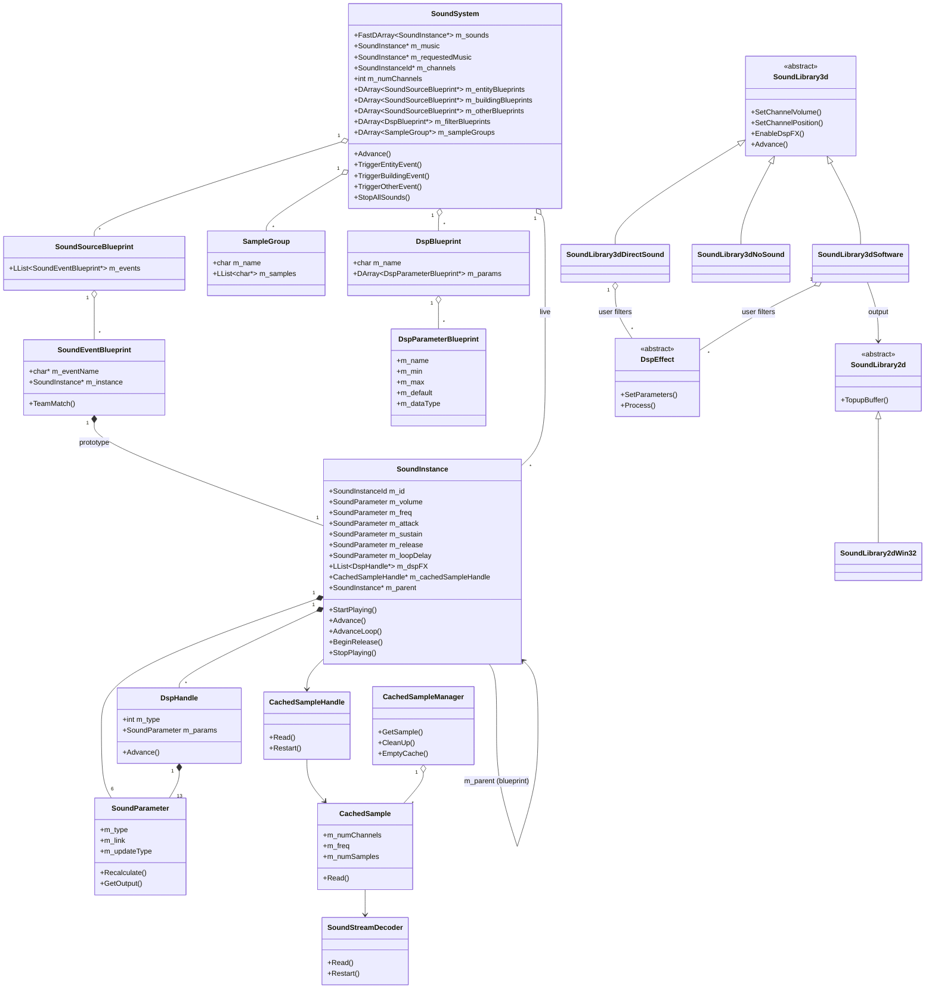
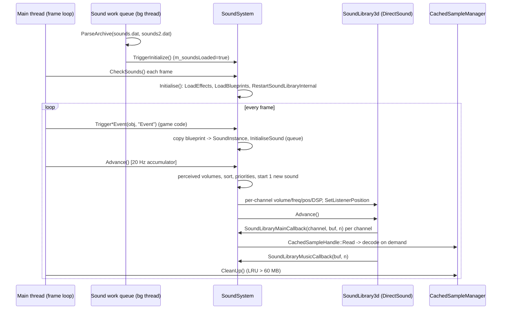
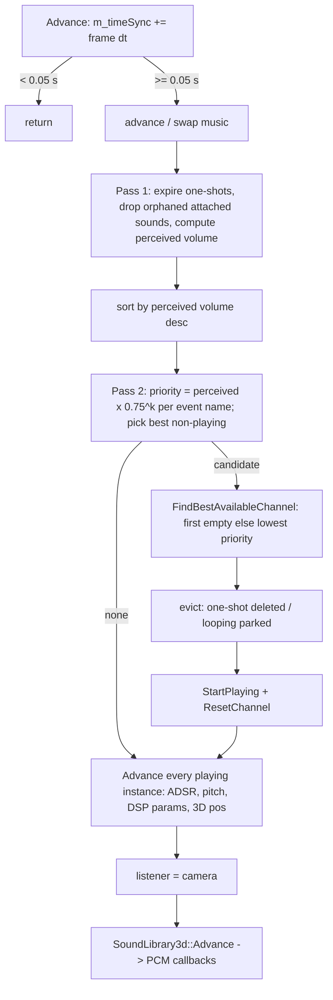
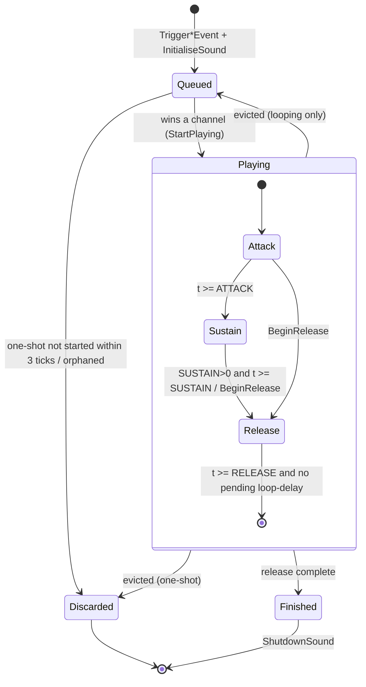
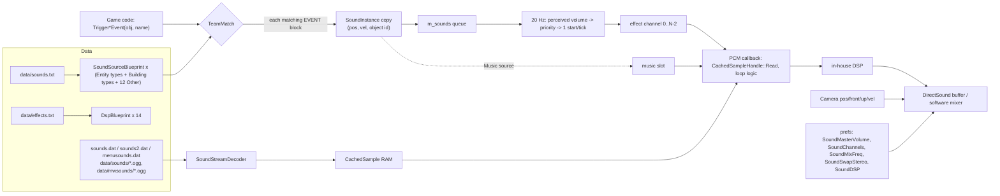

# Routed draft sections for document 27

<!-- from P16_sound -->
## [→ 27_audio_engine] 27.1 Layering and build reality

The audio stack has four layers [C]:

| Layer | Class(es) | File(s) | Role |
|---|---|---|---|
| L4 Game binding | `SoundSystem`, `SoundSourceBlueprint`, `SoundEventBlueprint`, `SampleGroup`, `DspBlueprint`, `DspParameterBlueprint` | `code/sound/soundsystem.*` | Loads `data/sounds.txt` + `data/effects.txt`; turns `Trigger*Event(object,eventName)` calls into `SoundInstance`s; runs the 20 Hz voice-allocation pass; owns the channel table and the single music slot |
| L3 Voice/instance | `SoundInstance`, `SoundInstanceId`, `SoundParameter`, `DspHandle` | `code/sound/sound_instance.*`, `code/sound/sound_parameter.*` | Per-sound state: ADSR envelope, loop/loop-delay, pitch, position tracking, parameter evaluation, DSP parameter feeding |
| L2 Sample data | `CachedSampleManager` (`g_cachedSampleManager`), `CachedSample`, `CachedSampleHandle`, `SoundStreamDecoder` | `code/sound/sample_cache.*`, `code/sound/sound_stream_decoder.*` | Lazy, incremental decode-to-RAM cache of mono 16-bit PCM, LRU eviction at 60 MB; WAV and Ogg Vorbis decoding |
| L1 Device ("3D library") | abstract `SoundLibrary3d` (`g_soundLibrary3d`); `SoundLibrary3dDirectSound`, `SoundLibrary3dSoftware`, `SoundLibrary3dNoSound`, `SoundLibrary3dXAudio` | `code/sound/sound_library_3d*.{h,cpp}` | N mono streaming "channels" + 1 music channel; per-channel volume/frequency/3D position/min-distance/DSP; pulls PCM through two callbacks |
| L0 Device ("2D library") | abstract `SoundLibrary2d` (`g_soundLibrary2d`); `SoundLibrary2dWin32`, `SoundLibrary2dSDL`, `SoundLibrary2dNoSound` | `code/sound/sound_library_2d*.{h,cpp}` | Stereo 16-bit output stream used only by the software 3D library |
| DSP | abstract `DspEffect`; `DspResLowPass`, `DspBitCrusher`, `DspGargle`, `DspEcho`, `DspReverb` | `code/sound/sound_filter.*` | In-house per-channel filters (run on mono 16-bit blocks) |

Library selection per build [C] `code/sound/soundsystem.cpp:SoundSystem::RestartSoundLibraryInternal`:

| Build | 2D library | 3D library | Tag |
|---|---|---|---|
| Win32 (`TARGET_MSVC`), pref `SoundLibrary`="dsound" (default) and an audio device present | `SoundLibrary2dWin32` (waveOut — opened but idle) | `SoundLibrary3dDirectSound` | **[B:FULL] [B:D3D]** — this is what ships |
| Win32, pref `SoundLibrary` = anything other than "dsound"/"none" (the options screen writes "software") | `SoundLibrary2dWin32` | `SoundLibrary3dSoftware` | [B:FULL] reachable only by editing `preferences.txt` — the options screen offers only DirectSound under `HAVE_DSOUND` (§09.1) |
| Win32, `g_systemInfo->m_audioInfo.m_preferredDevice == -1` (no device) or pref `SoundLibrary`="none" | `SoundLibrary2dNoSound` | `SoundLibrary3dNoSound` | [B:FULL] |
| Non-MSVC (Mac/Linux) | `SoundLibrary2dSDL` | `SoundLibrary3dSoftware` | [B:DEAD] for PC |
| Xbox 360 (`HAVE_XAUDIO`) | — | `SoundLibrary3dXAudio` (compiled to an empty TU on PC: whole file inside `#ifdef HAVE_XAUDIO`; `RestartSoundLibraryInternal` never instantiates it) | [B:DEAD] |

`SoundLibrary2dWin32` is constructed even when DirectSound is selected [C] (`RestartSoundLibraryInternal`: `g_soundLibrary2d = new SoundLibrary2dWin32` before the 3D choice). Its callback is only installed by `SoundLibrary3dSoftware`'s constructor, so under DirectSound the waveOut device sits open with its first 4 buffers of silence [C] `code/sound/sound_library_2d_win32.cpp:SoundLib2dBuf::SoundLib2dBuf`, `WaveOutProc`.

<!-- from P16_sound -->
## [→ 27_audio_engine] 27.2 Class roles (every class)

| Class | Role | Key members / behaviour | Ref |
|---|---|---|---|
| `SoundSystem` | Singleton (`g_app->m_soundSystem`). Blueprint store, live-instance store, channel allocator, music slot, profiler host | see §27.4–27.8 | [C] `code/sound/soundsystem.h:SoundSystem` |
| `SoundSourceBlueprint` | All event bindings for one sound *source*: an Entity type, a Building type, or one of 12 "Other" sources | `m_events` list; static name table for Other sources (§10.2) | [C] `soundsystem.h:SoundSourceBlueprint` |
| `SoundEventBlueprint` | One `EVENT` block: event name + a prototype `SoundInstance` | `TeamMatch(teamId)`: true if teamId==255, or by `m_teamMatchType` (§10.4) | [C] `soundsystem.cpp:SoundEventBlueprint::TeamMatch` |
| `SampleGroup` | Named list of sample filenames (lower-cased, extension stripped) for random selection | `m_name[256]`, `m_samples` | [C] `soundsystem.cpp:SampleGroup::AddSample` |
| `DspBlueprint` | One filter type from `data/effects.txt`: name + parameter descriptors | index in `m_filterBlueprints` **is** the filter type id (must match `SoundLibrary3d` FX enum order) | [C] `soundsystem.cpp:SoundSystem::LoadEffects` |
| `DspParameterBlueprint` | Parameter descriptor: name, min, max, default, data type (0=float, 1=long) | used by the editor sliders and by `DspHandle::Advance` to pack the parameter array | [C] `soundsystem.h:DspParameterBlueprint` |
| `SoundInstanceId` | Weak handle `{m_index, m_uniqueId}`; equality = both equal; invalid = (-1,-1). `m_uniqueId` from a global counter `++m_nextUniqueId` (starts 0, so first id is 1) | [C] `sound_instance.cpp:SoundInstanceId::GenerateUniqueId` |
| `SoundInstance` | Both the blueprint prototype (owned by a `SoundEventBlueprint`) and the live playing/queued voice (copied from the prototype; `m_parent` points back) | §27.6 | [C] `sound_instance.h:SoundInstance` |
| `SoundParameter` | A scalar control: fixed, ranged-random or linked to a world quantity, with optional smoothing | §10.5 | [C] `sound_parameter.h:SoundParameter` |
| `DspHandle` | One DSP effect attached to an instance: filter type id + up to `MAX_PARAMS`=13 `SoundParameter`s | `Advance()` evaluates each param, packs as float or long per blueprint data type, calls `g_soundLibrary3d->UpdateDspFX(channel, type, 13, params)` | [C] `sound_instance.cpp:DspHandle::Advance` |
| `CachedSampleManager` | Global sample cache keyed by sample name (`stdext::hash_map<std::string, CachedSample*>`), mutex-protected | §27.10 | [C] `sample_cache.cpp` |
| `CachedSample` | Fully-allocated PCM buffer for one file, filled incrementally on demand from a decoder; lock count + last-used time for LRU | §27.10 | [C] `sample_cache.cpp:CachedSample` |
| `CachedSampleHandle` | A read cursor into a `CachedSample` (one per instance); constructor locks, destructor unlocks the sample | `Read(dst,n)` clamps to remaining samples; `Restart()` rewinds | [C] `sample_cache.cpp:CachedSampleHandle` |
| `SoundStreamDecoder` | WAV (8/16-bit PCM) and Ogg Vorbis decoder to signed 16-bit | §27.11 | [C] `sound_stream_decoder.cpp` |
| `SoundLibrary3d` | Abstract device: channel count, sample rate, master volume (stored as mB attenuation), listener pos, callbacks, `m_musicChannelId`, `m_hw3dDesired`, `m_forceVolumeUpdate` | FX enum (§10.7); `SetMasterVolume(0..255)` → `m_masterVolume = (255-v)×-32` mB; `WriteSilence` = memset 0 | [C] `sound_library_3d.cpp:SoundLibrary3d::SetMasterVolume` |
| `SoundLibrary3dDirectSound` | DirectSound 8 implementation: one looping secondary buffer per channel (+1 music buffer), streamed by polling play cursors | §27.12 | [C] `sound_library_3d_dsound.cpp` |
| `SoundLibrary3dSoftware` | In-house mixer: pulls each channel into a mono buffer, applies user DSP, pans/attenuates to stereo float, normalises, outputs via `SoundLibrary2d` | §27.13 | [C] `sound_library_3d_software.cpp` |
| `SoundLibrary3dNoSound` / `SoundLibrary2dNoSound` | Null devices (all calls no-ops; `Initialise` returns true; `GetNumMainChannels()` returns 0) | | [C] `sound_library_3d.h:SoundLibrary3dNoSound`, `sound_library_2d.cpp` |
| `SoundLibrary2dWin32` | waveOut stereo 16-bit output: 10 ring buffers of `SoundBufferSize` (default 2000) stereo samples; `WOM_DONE` increments `m_fillsRequested`; `TopupBuffer()` (main thread) refills | also supports record-to-WAV-file at 20 updates/s | [C] `sound_library_2d_win32.cpp` |
| `SoundLibrary2dSDL` | SDL audio + ring buffer (Mac/Linux) | [B:DEAD] appendix | [C] `sound_library_2d_sdl.cpp` |
| `SoundLibrary3dXAudio` | Xbox 360 XAudio + X3DAudio 5.1 | [B:DEAD] appendix | [C] `sound_library_3d_xaudio.cpp` |
| `DirectSoundData`, `DirectSoundChannel`, `SoundLibFilter` | DSound-private: device/primary buffer/caps; per-channel buffer state; per-filter slot {user filter ptr, DX filter flag} | | [C] `sound_library_3d_dsound.cpp` |
| `SoftwareChannel`, `SoundLibFilterSoftware` | Software-private: per-channel mono buffer, cached params, ramp state; per-filter slot {chain index, user filter} | | [C] `sound_library_3d_software.cpp` |
| `StereoSample` | `{int16 left, right}` | | [C] `sound_library_2d.h` |
| `DspEffect` + 5 subclasses | In-house DSP (§10.7) | | [C] `sound_filter.h` |

<!-- from P16_sound -->
## [→ 27_audio_engine] 27.3 Lifecycle, loading and threading model

**Construction and loading** [C] `code/app.cpp:App::App`, `App::LoadSounds`, `App::CheckSounds`; `code/main.cpp:HandleCommonConditions`:

1. `App` constructor parses `menusounds.dat` together with `main.dat`, `patch.dat`, `language.dat`, `branding.dat` on the main thread, then `new SoundSystem()` (allocates two `Profiler`s and a `NetEvent`; no device yet).
2. On PC the sample archives are loaded on a **background work queue** (`m_soundsWorkQueue`): `App::LoadSounds` parses `sounds.dat` then `sounds2.dat`, sets `App::m_soundsLoaded = true` and calls `SoundSystem::TriggerInitialize()` (signals `m_initializedEvent`). Comment: serialised because unrar is not thread-safe [C] `code/app.cpp` (block after `g_loadingScreen->m_workQueue->Add( &App::Initialise, this )`).
3. Every frame `HandleCommonConditions()` calls `App::CheckSounds()`: if `!SoundSystem::IsInitialized()` → `SoundSystem::Initialise()` = `LoadEffects()` (`data/effects.txt`) + `LoadBlueprints()` (`data/sounds.txt`) + `RestartSoundLibraryInternal()` (creates the devices, §27.1). Once initialised, every frame also runs `g_cachedSampleManager.CleanUp()` (LRU eviction, §27.7).
4. `SoundSystem::WaitIsInitialized()` (called before starting a game from the lobby, e.g. `code/UI/GameMenuWindow.cpp`, `code/UI/PlayGameButton.h`, `code/UI/RollingDemoButton.h`) loops `m_initializedEvent->Wait(1000 ms)` + `App::CheckSounds()` until `m_isInitialized`.
5. Shutdown: `Finalise()` stops the 2D library and deletes both libraries; `g_cachedSampleManager.EmptyCache()` [C] `code/main.cpp:Finalise`.

**Game-sound gate** [C] `code/sound/soundsystem.cpp:SoundSystem::NotReadyForGameSoundsYet`: every `Trigger*Event` returns silently when `m_channels == NULL` or when any of: `!g_app->m_soundsLoaded`, `g_loadingScreen->IsRendering()`, or the caller is **not the main thread** (`NetGetCurrentThreadId() != g_app->m_mainThreadId`). (`TESTBED_ENABLED` additionally mutes when testbed rendering is off — [B:DEAD].) Design consequence: sounds requested from worker threads or during loading screens are dropped, not queued.

**Threading** (baseline Win32, `INVOKE_CALLBACK_FROM_SOUND_THREAD` undefined) [C]:
- All sound logic, all `SoundLibrary3d` calls **and the PCM fill callbacks** run on the **main thread** inside `SoundSystem::Advance()` → `g_soundLibrary3d->Advance()` (DirectSound polls its ring buffers; the software mixer is pulled by `SoundLibrary2d::TopupBuffer()`, also called from the main loop). There is no audio thread in the baseline; the only concurrency is the background archive loading and the waveOut driver callback `WaveOutProc`, which only increments `m_fillsRequested`.
- `CachedSampleManager` holds a `NetMutex m_lock` around its hash map (because Mac preloading runs on a worker thread) [C] `code/sound/sample_cache.h`.
- Under `INVOKE_CALLBACK_FROM_SOUND_THREAD` (Mac) every public `SoundSystem` mutator locks `SoundSystem::m_mutex`, and the SDL callback locks it while mixing [B:DEAD] for PC.
- Consequence for the audio engine: underruns happen if the main loop stalls longer than one channel buffer (DirectSound 20000 samples ≈ 0.45 s at 44.1 kHz / 0.91 s at 22.05 kHz playback rate). The main loop compensates when rendering is slow: if `m_renderer->m_fps < 15`, `SoundSystem::Advance()` is called a **second time** in the same frame (it re-adds `g_advanceTime`, so it may run two 20 Hz ticks) [C] `code/main.cpp:LocationGameLoop` (end of frame). Loading screens also pump `SoundSystem::Advance()` [C] `code/loading_screen.cpp`.

<!-- from P16_sound -->
## [→ 27_audio_engine] 27.4 The 20 Hz update (`SoundSystem::Advance`)

Rate: `#define SOUNDSYSTEM_UPDATEPERIOD 0.05f` (s) — accumulator `m_timeSync += g_advanceTime`; when `m_timeSync >= 0.05` exactly **one** tick runs and `m_timeSync -= 0.05` (no catch-up loop; excess time carries over to the next frame) [C] `code/sound/soundsystem.cpp:SoundSystem::Advance`. `g_advanceTime` is the real frame delta (not sim time). Before the accumulator: if `g_app->m_requestQuit && !m_quitWithoutSave` and `AreBlueprintsModified()` → cancel quit (always returns false in practice, see §27.13); if `!m_channels` or no audio device → return.

Tick steps, in order [C]:

1. **Music**: if `m_music` → `m_music->Advance()`; if it reports done → `ShutdownSound(m_music)`, `m_music = NULL`. Then if `m_music == NULL && m_requestedMusic` → promote: `OpenStream(false)`, `m_channelIndex = g_soundLibrary3d->m_musicChannelId`, `ResetChannel(music)`, `SetChannelFrequency(music, sample native rate)` (§27.10).
2. **Propagate blueprints** if `m_propagateBlueprints` (only true while the Sound Editor window exists [B:DEBUG]).
3. **Pass 1 – perceived volume and culling**, over every live instance in `m_sounds`:
   - if `!IsPlaying() && m_loopType == SinglePlay` → `m_restartAttempts--`;
   - if `m_restartAttempts < 0` → `ShutdownSound` (discard);
   - else if `m_positionType == Type3DAttachedToObject && GetAttachedObject() == NULL` → `ShutdownSound` (hard stop, no release);
   - else `CalculatePerceivedVolume()` and append its id to a sort array (static array, initial size 128, doubled while too small).
4. **Sort** ids by `m_perceivedVolume` **descending** (`qsort`, `SoundInstanceCompare`).
5. **Pass 2 – priorities**: walk the sorted list keeping a per-event-name multiplier table (`BTree<float>` keyed by the instance's full event name, e.g. `"Darwinian Attack"`): `m_calculatedPriority = m_perceivedVolume × M[event]` where `M` starts at 1.0 for the loudest instance of that event and is multiplied by 0.75 after each use (1, 0.75, 0.5625, 0.421875, …). Track the **not-playing** instance with the highest `m_calculatedPriority` strictly greater than 0.0 → `newInstance`.
6. **Start at most one new sound** (if `newInstance`): `ch = FindBestAvailableChannel()` (§27.5); evict the instance on `ch` (one-shot → `ShutdownSound`; looping → `StopPlaying()` so it stays queued); `newInstance->StartPlaying(ch)`; on success `m_channels[ch] = newInstance->m_id`, else `ShutdownSound(newInstance)`; always `g_soundLibrary3d->ResetChannel(ch)`.
7. **Advance all channels**: for each channel with a live instance → `instance->Advance()`; if it reports finished → `ShutdownSound`.
8. `g_soundLibrary3d->m_forceVolumeUpdate = false` (set by a master-volume change so every channel re-sends its volume once).
9. **Listener** = camera: position `camera->GetPos()`, front `GetFront()`, up `GetUp()` **negated unless pref `SoundSwapStereo` = 1**, velocity `camera->GetVel() × 0.2` → `SetListenerPosition`.
10. `g_soundLibrary3d->Advance()` (device pump; this is where PCM callbacks run, §27.11).

<!-- from P16_sound -->
## [→ 27_audio_engine] 27.5 Voice (channel) management — exact rules

| Rule | Value / formula | Ref |
|---|---|---|
| Requested channels | pref `SoundChannels` (default 32; UI options 8/16/32/64) | [C] `soundsystem.cpp:RestartSoundLibraryInternal`; `code/lib/preferences.cpp:GetDefaultSoundChannels` |
| DirectSound effect channels | `min(SoundChannels, GetMaxChannels()) − 1`; `GetMaxChannels()` = 64, or `dwMaxHw3DStreamingBuffers − 2` when HW3D is desired **and** the card reports > 3 HW 3D streaming buffers; the music channel is a separate extra buffer | [C] `sound_library_3d_dsound.cpp:Initialise`, `GetMaxChannels`, `Hardware3DSupport` |
| Software effect channels | `SoundChannels` must be a power of two (release-assert); last channel (index N−1) is music; effect channels = N−1 | [C] `sound_library_3d_software.cpp:Initialise`, `GetNumMainChannels` |
| Baseline result | 31 effect voices + 1 music voice | [I] from defaults above |
| Live instances | unbounded `FastDArray<SoundInstance*>`; every trigger that passes team matching creates one instance (except monophonic merge) | [C] `soundsystem.cpp:InitialiseSound` |
| Perceived volume | 2D or in-editor: 10.0. 3D: `d = |pos − cameraPos|`; `f = 1` if `d ≤ minDistance` else `minDistance / d`; `base = m_channelVolume` if playing else `m_volume.GetOutput()`; `perceived = base × f` (vol units × linear factor) | [C] `sound_instance.cpp:SoundInstance::CalculatePerceivedVolume` |
| Priority | `perceived × 0.75^k`, k = number of louder instances (this tick) with the same full event name | [C] `soundsystem.cpp:SoundSystem::Advance` |
| Starts per tick | **max 1** new sound per 0.05 s tick → ≤ 20 starts/s system-wide | [C] same |
| Candidate | highest-priority instance that is not playing and has priority > 0 (a sound whose volume evaluates to 0 never starts) | [C] same |
| Channel choice | first channel whose id does not resolve to a live instance; otherwise the channel with the **lowest** `m_calculatedPriority` (ties → lowest index). The candidate's priority is **not** compared with the victim's — the candidate always steals | [C] `soundsystem.cpp:FindBestAvailableChannel` |
| Victim handling | one-shot (`SinglePlay`) victim → destroyed; looping victim → `StopPlaying()` (DSP disabled, channel id cleared) and stays in `m_sounds` as a candidate; when it later restarts, `OpenStream(false)` rewinds a single sample or picks a new random member of a sample group | [C] `soundsystem.cpp:Advance`; `sound_instance.cpp:OpenStream` |
| One-shot patience | `m_restartAttempts = 3` at `InitialiseSound`; decremented each tick while not playing → a one-shot that has not won a channel within **3 ticks (0.10–0.15 s)** is discarded on the 4th. Looping sounds wait indefinitely | [C] `soundsystem.cpp:InitialiseSound`, `Advance` |
| Monophonic merge | if the new instance is `MonophonicRandom` or `MonophonicNearest` and any existing non-polyphonic instance has the same event name (case-insensitive), the new object ids are appended to that instance and no new instance is created | [C] `soundsystem.cpp:InitialiseSound` |
| Monophonic emitter choice | each tick (`GetAttachedObject`): dead ids are pruned; `Polyphonic` → first id; `MonophonicRandom` → `AppRandom() % n`, re-chosen only when the current object is gone or right after a (re)start; `MonophonicNearest` → id whose object is nearest the camera (squared distance), re-chosen every tick | [C] `sound_instance.cpp:SoundInstance::GetAttachedObject` |
| Orphans | attached sound whose object(s) are all gone, or any attached sound while not in a location (`g_app->m_locationId == -1`) → hard `ShutdownSound` at the next tick | [C] `soundsystem.cpp:Advance`; `sound_instance.cpp:GetAttachedObject` |
| Discard statistics | `NumSoundsDiscarded()` = live instances − channels in use (editor stats only) | [C] `soundsystem.cpp:NumSoundsDiscarded` |

Design notes [I]: the stealing rule means that in a dense battle the quietest voice is replaced by the loudest queued sound every 50 ms regardless of relative loudness; the per-event 0.75 decay is the only "voice limit per sound type" (there is no hard per-event cap). A looping victim and a looping candidate can alternate on a channel every tick (each tick the parked loop is the best candidate again) — nothing prevents this ping-pong.

<!-- from P16_sound -->
## [→ 27_audio_engine] 27.6 `SoundInstance` life cycle, envelope and looping

States (derived; the code stores only `m_adsrState` ∈ {`StateAttack`=0, `StateDecay`=1 (never used), `StateSustain`=2, `StateRelease`=3}, `m_channelIndex`, `m_loopDelayTimer`) [C] `code/sound/sound_instance.h`:

Envelope [C] `sound_instance.cpp:SoundInstance::UpdateChannelVolume` (evaluated every tick while playing; all times from `GetHighResTime()`, wall clock):
- `m_adsrTimer` is initialised in the **constructor** (i.e. at trigger time), not at `StartPlaying` — time spent queued eats into the attack.
- Attack: `frac = (ATTACK > 0) ? min(t/ATTACK, 1) : 1`; `vol = VOLUME × frac`; when `frac` is within 1e-6 of 1 → timer reset, state Sustain.
- Sustain: `vol = VOLUME`; if `SUSTAIN > 0` and `t ≥ SUSTAIN` → `BeginRelease(false)`. `SUSTAIN = 0` means "hold until the sample ends / until stopped". (SUSTAIN is a **duration**, not a level.)
- Release: `frac = (RELEASE > 0) ? min(t/RELEASE, 1) : 1`; `vol = VOLUME × (1 − frac)`; finished when `frac ≈ 1` **and** `m_loopDelayTimer ≈ 0`.
- `m_channelVolume = clamp(vol, 0, 10)` → `SetChannelVolume`. Ramps are linear in vol units, i.e. **exponential in amplitude** (§27.11 mapping), and quantised to the 20 Hz tick.
- `NearlyEquals(a,b)` ≡ `|a−b| < 1e-6` [C] `code/lib/math_utils.h`.

`BeginRelease(final)` [C] `sound_instance.cpp:SoundInstance::BeginRelease`: if not already releasing → state Release, timer = now, and for `LoopedADSR` with `final == false`: if `LOOPDELAY ≈ 0` spawn a duplicate immediately (`SoundSystem::TriggerDuplicateSound`: fresh instance copied from this one, same parent/pos/vel/object ids, goes through normal queueing) else arm `m_loopDelayTimer = now`. `final == true` on a `LoopedADSR` cancels a pending re-trigger (`m_loopDelayTimer = 0`). Callers: envelope sustain timeout (non-final), end of a one-shot's silence tail (non-final), `StopAllSounds` (final), music replacement (final), attached object lost in `Update3DPosition` (final, looping only), editor Stop (final).

Loop types and what happens when the sample data runs out (inside the PCM callback, `SoundSystem::SoundLibraryMainCallback`) [C] `soundsystem.cpp`; `sound_instance.cpp:SoundInstance::AdvanceLoop`:

| LOOPTYPE | Name (editor) | End-of-sample behaviour |
|---|---|---|
| 0 `SinglePlay` | PlayOnce | Write silence for the rest of the block and set `silenceRemaining = channelBufferSize − remainder`; keep writing silence on later fills; when `silenceRemaining ≤ 0` → `BeginRelease(false)` → instance finishes after RELEASE seconds. Effect: the voice is held for ≈ one device buffer of silence (flushes the DirectSound ring) plus RELEASE |
| 1 `Looped` | Loop | If `LOOPDELAY ≈ 0` → `OpenStream(false)` and keep filling (a `Sample` source rewinds; a `SampleGroupRandom` source **picks a new random member**). Else set `m_loopDelayTimer = now`, write silence; on each later fill, once `now ≥ timer + LOOPDELAY` → `OpenStream(false)`, timer = 0, continue. Runs until stopped |
| 2 `LoopedADSR` | LoopADSR | Each pass: if a loop-delay re-trigger is pending and due → spawn duplicate, timer = 0. Then `OpenStream(true)` (rewind the **same** sample) and keep filling. Combined with SUSTAIN > 0 this produces repeated, overlapping envelope "notes": at the start of each Release a fresh duplicate is spawned (after LOOPDELAY), so successive notes cross-fade; with a SAMPLEGROUP source each duplicate picks a new random sample |

`OpenStream(keepCurrent)` [C] `sound_instance.cpp:SoundInstance::OpenStream`: sets `m_restartOccured = true` (drives `UpdateOncePerLoop` parameters and `MonophonicRandom` re-selection); if a handle exists and (`keepCurrent` or source is `Sample`) → `Restart()` (rewind); else delete the handle and, for `SampleGroupRandom`, choose `index = AppRandom() % n` where `n = groupSize`, halved (×0.5) when pref `SoundMemoryUsage` = 2 and quartered (×0.25) when 3, minimum 1 — i.e. lower memory settings only ever use the first ½ or ¼ of each group; then `g_cachedSampleManager.GetSample(name)`.

`StartPlaying(ch)` [C] `sound_instance.cpp:SoundInstance::StartPlaying`: refuses (returns false) if the sound name still contains `"???"` (unset editor event); `OpenStream(false)`; 3D mode = 1 (head-relative) for `Type2D`/`TypeInEditor`, else 0 (world); `SetChannelMinDistance`; frequency = sample native rate × FREQUENCY × multiplayer pitch modifier (§27.9); `UpdateChannelVolume`; `Update3DPosition` + `SetChannelPosition`; if the instance carries DSP handles → `EnableDspFX(ch, n, types[])` (array of 16).

`Advance()` per tick while playing [C] `sound_instance.cpp:SoundInstance::Advance`: envelope (return true = finished); recompute frequency (skipped with a debug log if `< 0` or `> 144000` Hz); `DspHandle::Advance()` for each effect (re-evaluates its 13 parameters and calls `UpdateDspFX`); `Update3DPosition()`; clear `m_restartOccured`.

`Update3DPosition()` [C]: `Type2D` → pos = vel = 0 (no device call); `Type3DStationary` → unchanged; `Type3DAttachedToObject` → follow the selected object's `m_pos`/`m_vel` (buildings use `Building::m_centrePos`); if the object is gone → convert to `Type3DStationary`, vel 0, and loops get `BeginRelease(true)` (normally pre-empted by the hard orphan cull in Pass 1, §27.4); `TypeInEditor` → `(editorPos.x, 0, editorPos.z)`.

`StopPlaying()` disables DSP on the channel (if any), sets `m_channelIndex = -1`, and invalidates every channel slot that holds this id. `IsPlaying()` ≡ `GetChannelIndex() != -1`, which also verifies `m_channels[m_channelIndex] == m_id` [C].

<!-- from P16_sound -->
## [→ 27_audio_engine] 27.7 Sample cache (memory policy)

[C] `code/sound/sample_cache.cpp`:
- Key: the sample name as passed (lower-cased, extension stripped by the blueprint parser). Lookup path: `"sounds/<name>"` first, then `"mwsounds/<name>"`; the resource layer resolves the extension (`.ogg`/`.wav`) and the archive. Failure is a release-assert ("Failed to open sound stream decoder"). Archive files on disk have mixed-case names (e.g. `data/mwsounds/CrateFall1.ogg`) while blueprint names are lower-case — lookups therefore rely on a **case-insensitive** resource layer [I] (owned by P14/X1).
- `CachedSample` construction opens a `SoundStreamDecoder`, reads header info and **allocates the full PCM buffer immediately** (`channels × numSamples × 2` bytes) but decodes nothing. Sanity release-asserts: `0 < channels ≤ 8`, `0 < numSamples ≤ 268435456`, `0 < freq ≤ 192000`, `channels × numSamples ≤ 1073741824/2`.
- Decoding is **incremental and on demand**: `CachedSample::Read(start, n)` decodes forward until `start+n−1` is cached; when the whole file has been decoded the decoder is deleted. Playback therefore "streams" from disk/archive the first time and plays from RAM afterwards; a second handle to the same sample shares the decoded data.
- **Mono only**: `Read` release-asserts `m_numChannels == 1` ("%s is not mono audio") — this applies to music too. Every shipped asset is mono (1332 of 1332 Ogg files; all 44.1 kHz except one 22.05 kHz file in each folder) [C] header scan of `data/sounds/*.ogg`, `data/mwsounds/*.ogg`.
- `CachedSampleHandle` = read cursor; constructor `Lock()`s the sample, destructor `Unlock()`s it and stamps `m_lastUsedTime = GetHighResTime()` when the lock count reaches 0. Every `SoundInstance` owns at most one handle; deleting an instance or switching sample releases it.
- **Eviction** `CachedSampleManager::CleanUp()` (called every frame from `App::CheckSounds`): `maxSize = 60 × 1024 × 1024` bytes (comment: "Largest song takes 13 MB"); while total > max, evict the **unlocked** sample with the oldest `m_lastUsedTime` (strictly older than now); stop if none is evictable. Locked (in-use) samples are never evicted. Mac build disables LRU (`maxSize = 0`) [B:DEAD].
- `EmptyCache()` deletes everything (shutdown; and on a `SoundMemoryUsage` change under `USE_SOUND_MEMORY` [B:DEAD]). `GetMemoryUsage(total, unused)` feeds a debug log printed every 60 s (`code/main.cpp:PrintAvailableMemory`).
- Mac-only `Preload()` (decodes in 2048- or 512-sample chunks on a low-priority thread, first member of each group on the main thread) [B:DEAD].

<!-- from P16_sound -->
## [→ 27_audio_engine] 27.8 Streaming decoder

[C] `code/sound/sound_stream_decoder.cpp:SoundStreamDecoder`:
- Format chosen by the reader's file extension: `wav` → RIFF/WAVE parser; `ogg` → libvorbisfile (`ov_open_callbacks` with read/seek/tell callbacks over the engine's `BinaryReader`, close = no-op); anything else → release-assert.
- WAV: accepts only PCM (`fmt` tag 1), 1 or 2 channels, 8- or 16-bit; 8-bit is converted to signed 16-bit (`(u8 − 128) << 8`); other chunks skipped; `numSamples = dataBytes / (channels × bits/8)`; `Restart()` seeks to the data chunk.
- Ogg: `numSamples = ov_pcm_total`, `freq = vi->rate`, `channels = vi->channels`; `ov_read(…, 16-bit, signed, host endianness)` loop until the request is satisfied or EOF; `OV_HOLE`/`OV_EBADLINK` → release-assert "Ogg file corrupt"; `Restart()` = `ov_raw_seek(0)`.
- Output is always signed 16-bit. The 16-bit WAV path divides bytes by 2 regardless of channel count (only correct for mono — moot because of the mono rule).
- Libraries: `vorbis_static`, `vorbisfile_static`, `ogg_static` sub-projects [C] build_matrix §1.

<!-- from P16_sound -->
## [→ 27_audio_engine] 27.9 Pitch, and the game-speed pitch modifier

Channel frequency (Hz) = `sample native rate × FREQUENCY.GetOutput() × GetFrequencyModifier(positionType)` [C] `sound_instance.cpp:StartPlaying`, `Advance`.

`GetFrequencyModifier` [C] `sound_instance.cpp:GetFrequencyModifier`:
- 1.0 if not `App::Multiplayer()` (≡ `m_gameMode == GameModeMultiwinia`, i.e. any Multiwinia match incl. vs-AI), or during the pre-game grace period (`Multiwinia::GameInGracePeriod()`), or for `Type2D` sounds.
- Otherwise a function-static smoother `s = 0.99·s + 0.01·gameSpeed` (initial 1.0) is updated **on every call** (i.e. once per playing 3D instance per tick plus once per start — the smoothing rate depends on the number of active voices), and the modifier is `sqrt(max(s, 0.01))`.
- Effect [I]: world sounds pitch-bend with game speed changes — slow-motion/fast-forward crate effects and the end-of-game slow-down to speed 0 (`Multiwinia` game-over requests speed 0 over 0.2 s, `code/multiwinia.cpp` game-over block) produce a "tape stop" down to `sqrt(0.01)` = 0.1× pitch. 2D/UI sounds are unaffected.
- Device clamps: software mixer clamps to 3 × 48000 = 144000 Hz; instance code skips values outside [0, 144000]; editor slider for FREQUENCY is 0.0–3.0 [C].

<!-- from P16_sound -->
## [→ 27_audio_engine] 27.10 Music channel

[C] `soundsystem.cpp:SoundSystem::TriggerOtherEvent(WorldObject*,…)`, `SoundSystem::Advance`, `SoundLibraryMusicCallback`, `StopAllSounds`:
- Exactly one music instance (`m_music`) plus one pending request (`m_requestedMusic`). Music = any blueprint in the `OTHER Music` source. Music instances never enter `m_sounds`, never compete for effect channels, never pass through `StartPlaying` (so no 3D, no DSP enable, no pitch modifier on start).
- Trigger: if the current music has the **same sound file name** → ignore (keeps playing); else store as `m_requestedMusic` (a previous pending request is overwritten — and leaked [I]) and `BeginRelease(true)` the current music (fades by its own RELEASE; all shipped music entries have RELEASE 0 → immediate cut).
- Swap happens at the next tick after the old music reports finished; there is no cross-fade and no gap beyond ≤ 1 tick. The new music's ATTACK gives a fade-in (shipped values 0–5.23 s, §10.6).
- Stop: `StopAllSounds(id, name)` with `strstr(name, "Music")` → `m_music->BeginRelease(true)` regardless of which music is playing; `StopAllSounds(…, NULL)` does **not** stop music.
- Fill: the music channel is filled by `SoundLibraryMusicCallback` with the same loop/one-shot logic as effect channels; DirectSound music buffer = `bufSize × 10` = 200000 samples (≈ 4.5 s at 44.1 kHz); `m_musicChannelId` = −1 on DirectSound (separate buffer), N−1 on the software mixer; 3D disabled, initial volume 10, initial frequency 44100 Hz.
- Volume: music uses the same 0–10 VOLUME/ADSR and the global master volume; there is **no separate music volume** setting.
- Reachability in the Multiwinia baseline: see §10.9 — every music trigger site is either compiled out (`USE_LOADERS`) or Darwinia-campaign script content, so the music channel is effectively silent in Multiwinia [I].

<!-- from P16_sound -->
## [→ 27_audio_engine] 27.11 Device back-ends

### DirectSound (`SoundLibrary3dDirectSound`) — baseline [B:FULL]
[C] `code/sound/sound_library_3d_dsound.cpp`:
- Requires DirectX ≥ 9 (release-assert). `CoInitialize`, `DirectSoundCreate8(default device)`, cooperative level `DSSCL_PRIORITY` on the game window; caps cached.
- Primary buffer: stereo, 16-bit, `SoundMixFreq` Hz (`LOCHARDWARE` only if HW3D desired+available). Listener Doppler factor set to **0** (velocities have no audible effect). Rolloff factor and max distance are left at DirectSound defaults (rolloff 1.0, max distance 1e9) [I from absence of calls].
- One **mono 16-bit looping secondary buffer per channel** (flags `CTRL3D | CTRLFX | CTRLFREQUENCY | CTRLVOLUME | GETCURRENTPOSITION2`, software unless HW3D), size `_mainBufNumSamples` = 20000 samples; music buffer 200000 samples. Buffers are zero-filled and started looping at creation; samples are written at the sound's native rate and `SetFrequency` sets the playback rate.
- **Streaming**: `Advance()` → `CommitDeferredSettings()`, then for every channel and the music channel `AdvanceChannel()`: the real play cursor is queried on alternate ticks per channel (`(channel & 1) == (frame & 1)`, frame counter 0..3), otherwise a simulated cursor is extrapolated (`+ elapsed × freq × 2` bytes, wrapped, even-aligned) minus a 1000-byte safety margin and never behind the last written sample. The region from `lastWritten+1` to `playCursor−1` is refilled through the callback (buffer kept almost full ahead); user DSP filters (types ≥ 9) are applied in place to the freshly written block; `channelHealth = 1 − written/bufferSize`.
- `ResetChannel()` (on every new sound) refills from the **write cursor** up to the play cursor, so a new sound starts with minimal latency and overwrites the previous occupant's buffered audio.
- `SetChannelPosition` is skipped unless the new position differs from the last sent one by more than 5 % of the listener distance (`|Δ|² > 0.0025·|pos − listener|²`); position/velocity/min-distance use `DS3D_DEFERRED`. `SetChannel3DMode`: 0 = `DS3DMODE_NORMAL`, 1 = `HEADRELATIVE`, 2 = `DISABLE`. `SetChannelMinDistance` release-asserts `1.0 ≤ d ≤ 1e9` (`DS3D_DEFAULTMINDISTANCE`..`DS3D_DEFAULTMAXDISTANCE`). Values are cached per channel; device calls only on change (volume also when `m_forceVolumeUpdate`).
- Lost buffers (`DSERR_BUFFERLOST`) → `Restore()`; most other errors are debug-logged (release) or asserted (debug).
- DirectX FX (types 0–8) are attached with `SetFX` (buffer must be stopped and restarted; any existing FX are removed first); in-house filters (9–13) are host-side objects per channel slot.

### Volume mapping (identical semantic input 0–10 vol units)

| Back-end | Formula | 10 → | 5 → | 0 → | Master `SoundMasterVolume` m ∈ 0..255 |
|---|---|---|---|---|---|
| DirectSound | `mB = clamp(−(5 − v/2)·1000 + M, −10000, 0)`, `M = (255 − m)·(−32)` mB | 0 dB | −25 dB | −50 dB | 255 → 0 dB, 0 → −81.6 dB (5 dB per vol unit; 0.32 dB per master step) |
| Software | `amp = exp(clamp(−(5 − v/2) + M/1000, −10, 0))` | 1.0 (0 dB) | e^−2.5 (−21.7 dB) | e^−5 (−43.4 dB) | 0 → additional e^−8.16 (−70.9 dB) |
| XAudio [B:DEAD] | same mB formula as DirectSound | | | | |

[C] `sound_library_3d.cpp:SetMasterVolume`, `sound_library_3d_dsound.cpp:SetChannelVolume`, `sound_library_3d_software.cpp:CalcChannelVolumes`. A new implementation should pick one curve; the DirectSound one is what shipped.

### Software mixer (`SoundLibrary3dSoftware` + `SoundLibrary2dWin32`) [B:FULL, non-default]
[C] `code/sound/sound_library_3d_software.cpp`, `sound_library_2d_win32.cpp`:
- Pull model: `TopupBuffer()` (main thread) services each pending waveOut buffer (10 buffers × `SoundBufferSize` stereo samples; default line written by the prefs generator is 512, code fallback 2000) by calling `Callback(buf, n)`.
- `Callback`: `duration = n / outputRate`; per channel fetch `ceil(freq × duration ± 0.5)` source samples through the main/music callback into a per-channel mono buffer sized `samplesPerBuffer × (48000 / outputRate) × 3.1`; apply in-house DSP filters; mix to float L/R.
- Pan/attenuation per channel: 3D mode 0 → `to = normalize(pos − listener)` (skip normalise at distance 0), `right = (to · listenerRight + 1)/2`, `left = 1 − right` (linear pan law); if `dist > minDist` both × `minDist/dist`; listener right = `up × front` (cross product). Modes 1/2 → L = R = 1. Then × channel amplitude (above).
- Resampling: nearest-lower-sample (`index = (int)(j × freq/outRate)`), no interpolation. Volume ramps: fixed-volume mixer unless the channel was just reset, in which case a linear ramp from the previous to the new gain across the block (the intended "no ramp on new sound" logic is inverted in code).
- Output: block peak normalisation — if any |sample| > 32766 the **whole block** is scaled by `32766/peak` (acts as a block-rate limiter); then rounded to int16.
- Record-to-WAV hook (`StartRecordToFile`, 20 blocks/s of `SoundMixFreq/20` samples) exists for video capture (`AVI_GENERATOR`, [B:DEBUG]).
- After a library restart the waveOut buffers are not re-primed (static counter in `SoundLib2dBuf` only primes the first 4 buffers ever created), so a software-mixer restart may be silent [I].

### Null device
`SoundLibrary3dNoSound`/`SoundLibrary2dNoSound` when no device or pref `SoundLibrary = none`. Note `GetNumMainChannels()` is 0 → `RestartSoundLibraryInternal` release-asserts "Too few channels" if a device *is* present but `SoundLibrary = none` [I from code path].

<!-- from P16_sound -->
## [→ 27_audio_engine] 27.12 DSP chain implementation

- Per instance: up to any number of `DspHandle`s in data (editor UI shows 3 slots, `StartPlaying` packs up to 16 types); each handle holds 13 `SoundParameter`s evaluated every tick (they can be ranged-random or linked like any other parameter) [C] `sound_instance.h:MAX_PARAMS`, `DspHandle::Advance`.
- DSP is instantiated only if pref `SoundDSP` ≠ 0 at copy time (`SoundInstance::Copy`); default `SoundDSP = 0` on PC (`code/lib/preferences.cpp:GetDefaultSoundDSP`) and the toggle is compiled out of the options screen (`USE_SOUND_DSPEFFECTS` undefined) → **DSP is off in the shipped configuration** unless `preferences.txt` is edited [C].
- Each channel holds one slot per filter type (`NUM_FILTERS` = 14); filters run in **type-index order**, not data order; two effects of the same type on one sound share a slot (only one instance) [C] `sound_library_3d_dsound.cpp:PopulateBuffer`, `sound_library_3d_software.cpp:ApplyDspFX`.
- DirectSound bug notes [C]: `EnableDspFX` marks DX filters in slot `i` (loop index) instead of slot `type`, and `DSEFFECTDESC desc[DSP_DSOUND_WAVESREVERB]` has 8 entries for up to 9 DX types; parameters are passed by reinterpreting the 13-float array as the DirectX FX parameter struct (so `effects.txt` parameter order must equal the DX struct field order); `I3DL2Reverb` quality from param 12.
- In-house filter algorithms are specified in §10.7.

<!-- from P16_sound -->
## [→ 27_audio_engine] 27.13 Profiling, statistics and sound editor tooling [B:DEBUG]

All windows below are compiled only with `SOUND_EDITOR` (defined by `TARGET_DEBUG` only). They are opened from the debug menu (`code/interface/debugmenu.cpp`: "Sound Stats (F7)", "Sound Editor (F8)", "Sound Profile (F9)", plus "Pokey Playground") and the cheat window (`code/interface/cheat_window.cpp`: "Sound Editor", "Sound Stats"); the F7/F9/F11 hot-keys in `code/user_input.cpp` are commented out [C].

Always-compiled profiling [B:FULL]: `SoundSystem::m_mainProfiler` (sections `TriggerEntityEvent`, `TriggerBuildingEvent`, `TriggerOtherEvent`) and `m_eventProfiler` (one entry per event name, measured inside the PCM callback) are advanced every frame; the global profiler records "Advance SoundSystem" and sub-sections ("Shutdown Music", "Propagate Blueprints", "Allocate Sorted Array", "Perceived Volumes", "Sort Samples", "Recalculate Priorities", "Find best Channel", "Stop Old Sound", "Start New Sound", "Reset Channel", "Advance All Channels", "Shutdown Sound", "UpdateListener", "SoundLibrary3d Advance") [C] `soundsystem.cpp:Advance`.

| Window | Class(es) | Function | Ref |
|---|---|---|---|
| Sound Editor (`"Sound Editor"`) | `SoundEditorWindow`, `SoundEventButton`, `ObjectGroupMenu`, `ObjectTypeMenu`, `NewSoundEventMenu`, `SoundPositionButton` (unused), `PlayButton`, `PlayRepeatButton` (unused), `StopButton`, `SelectObjectButton`, `SaveAllButton`, `DeleteEventButton`, `SoundSelector` (file dialog on `sounds/`), `SoundSelectorButton`, `DspEffectButton`, `DeleteDspEffectButton`, `PurgeSoundsButton` (unused), `ConvertVolumesButton` (unused) | Pick Entity/Building/Other → type → event (or click an object in the world when both menus are unset); add events from the type's `ListSoundEvents` list; edit PositionType, LoopType, InstanceType, TeamMatchType, SourceType, sound name / sample group, MinDistance (value control, step 0.5, range 1–10000), and the 6 parameters (output ranges Volume 0–10, Frequency 0–3, Attack 0–60, Sustain 0–300, Release 0–60, LoopDelay 0–60); up to 3 DSP effects; Play (spawns a `TypeInEditor` copy at the camera), Stop (final release); Save → `SaveBlueprints("sounds.txt")`. While open, `m_propagateBlueprints = true` → every live instance re-syncs from its blueprint each tick (`SoundInstance::PropagateBlueprints`: restart if the sample or DSP list changed; copy min-distance, types, params). Renders every playing 3D voice as a camera-facing `sprites/sound.bmp` billboard sized `0.5·√d·√vol` | [C] `code/interface/soundeditor_window.cpp` |
| Effect editor (`"Effect Editor"`) | `DspEffectEditor`, `DspEffectTypeMenu` | Choose filter type from `m_filterBlueprints`; one `SoundParameterButton` per parameter with min/max from `effects.txt`; changing type resets params to the type defaults | same |
| Sample-group editor | `SampleGroupEditor`, `SampleGroupSelector`, `NewSampleGroupButton` (auto-names `newsamplegroup<N>`), `RenameSampleGroupButton`/`RenameSampleGroupWindow`/`RenameSampleGroupCommit` (unique-name check; updates every blueprint using the group), `SampleGroupAddSample`/`SampleGroupFileDialog`, `SampleGroupSampleName`, `SampleGroupSampleDelete` | Manage groups; file adds are validated by `IsSoundSourceOK` | same |
| Purge sounds (`"Purge Sounds"`) | `PurgeSoundsWindow`, `DeleteSoundButton`, `RefreshFileListButton`, `DeleteAllButton` | Lists files in `data/sounds/` not referenced by any blueprint/group (`IsSampleUsed`) and deletes them (two-click confirm). Button to open it is commented out | same |
| Parameter editor | `SoundParameterButton`, `SoundParameterEditor`, `SoundParameterGraph`, `SoundParameterGraphScaleToggle` (unused), `LinkTypeMenu`, `UpdateTypeMenu` | Graph editor for one `SoundParameter`: type, link, smooth (0–0.99, step 0.05), update type; LMB/RMB set lower/upper points; clicking left of the axis forces the linked input on the playing editor instance (`ForceParameter`). Input axis ranges: HeightAboveGround/Ypos 0–1000, Xpos/Zpos/CameraDistance 0–5000, Velocity 0–100, fixed/random 0–1 | [C] `code/interface/soundparameter_window.cpp` |
| Sound Stats (`"Sound Stats"`) | `SoundStatsWindow` | CPU overhead, max channels, channels used, live sounds, discarded, HW3D Enabled/Disabled/Unavailable, device name, one row per channel with health swatch and `SoundInstance::GetDescriptor()` (`name pri vol fxN looptype editor`) | [C] `code/interface/soundstats_window.cpp` |
| Sound Profile (`"Sound Profile"`) | `SoundProfileWindow`, `ResetHistoryButton` | Per-section and per-event timings (calls × ms/call = ms, history average), "Other" remainder vs global "Advance SoundSystem", library profiler; reset buttons | [C] `code/interface/sound_profile_window.cpp` |

Load/save tooling in `SoundSystem` [C]: `SaveBlueprints(filename)` writes ENTITY, BUILDING, OTHER (only sources with ≥ 1 event) and SAMPLEGROUP blocks in canonical form (§10.3); `AreBlueprintsModified()` returns false unconditionally ("Currently broken due to mod support") so the save-on-quit prompt (`SaveOnQuitWindow`) never appears; `LoadtimeVerify()` (writes `sounderrors.txt`, release-asserts on errors) exists but its call is commented out; `IsSoundSourceOK` checks spaces/existence/mono only in `_DEBUG` builds; `RuntimeVerify` only under `SOUNDSYSTEM_VERIFY` (undefined). Editor defects worth not copying: new events get a doubled event name (`"<Type> <Event> <Event>"`) until reload (`NewSoundEventMenu`); new DSP effects are initialised from each parameter's **min** instead of default (`DspEffectButton::MouseUp` passes the default pointer as `_min`); the stats window reads channel health for row `i` instead of `channelIndex`.

<!-- from P16_sound -->
## [→ 27_audio_engine] 27.14 Data flow

---

<!-- from P16_sound -->
## [→ 27_audio_engine] 27.15 Constants

| Constant | Value | Kind | Ref |
|---|---|---|---|
| Sound tick period | 0.05 s (20 Hz) | `#define SOUNDSYSTEM_UPDATEPERIOD` | `code/sound/soundsystem.cpp` |
| New voices per tick | 1 | code structure | `SoundSystem::Advance` |
| Same-event priority decay | ×0.75 per louder duplicate | literal | `SoundSystem::Advance` |
| Sort array initial size | 128 (doubles) | static | `SoundSystem::Advance` |
| One-shot restart attempts | 3 (ticks) | literal | `SoundSystem::InitialiseSound` |
| Default min distance | 100.0 wu | ctor | `SoundInstance::SoundInstance` |
| Default volume / frequency | 7.0 vol units / 1.0 | ctor | same |
| Initial calculated priority | 128.0 | ctor | same |
| Volume scale | 0.0–10.0 (clamped) | code | `SoundInstance::UpdateChannelVolume` |
| Perceived volume of 2D/editor sounds | 10.0 | literal | `CalculatePerceivedVolume` |
| Max DSP params per effect | 13 (`MAX_PARAMS`) | `#define` | `code/sound/sound_instance.h` |
| Max DSP types per instance at start | 16 (array) | literal | `SoundInstance::StartPlaying` |
| DSP filter types | 14 (`NUM_FILTERS`) | enum | `code/sound/sound_library_3d.h` |
| Frequency sanity window | 0–144000 Hz (3 × 48000) | literal | `SoundInstance::Advance`; `SoundLibrary3dSoftware::SetChannelFrequency` |
| Game-speed pitch smoothing | `s = 0.99 s + 0.01 speed` per call; floor 0.01; pitch √s | literals | `GetFrequencyModifier` |
| DirectSound main buffer | 20000 samples/channel (`bufSize`) | literal | `RestartSoundLibraryInternal` |
| DirectSound music buffer | 200000 samples (`bufSize × 10`) | literal | same |
| DirectSound max channels (software buffers) | 64 | literal | `SoundLibrary3dDirectSound::GetMaxChannels` |
| HW3D threshold | `dwMaxHw3DStreamingBuffers > 3`; usable = that − 2 | literal | `Hardware3DSupport`, `GetMaxChannels` |
| Position update threshold | 5 % of listener distance (`0.0025` squared) | literal | `SetChannelPosition` |
| Simulated play-cursor margin | 1000 bytes | literal | `AdvanceChannel` |
| Real play-cursor polling | every other tick per channel (4-phase counter) | literal | `AdvanceChannel`, `Advance` |
| Volume → mB | `−(5 − v/2)·1000 + master`, clamp [−10000, 0] | formula | `SetChannelVolume` |
| Master volume → mB | `(255 − m)·(−32)` | formula | `SoundLibrary3d::SetMasterVolume` |
| Listener velocity scale | 0.2 | literal | `SoundSystem::Advance` |
| Doppler factor | 0.0 | literal | `SoundLibrary3dDirectSound::Initialise` |
| Sample cache limit | 60 MiB (62914560 bytes) LRU, unlocked only | `const` | `CachedSampleManager::CleanUp` |
| Sample sanity limits | ≤ 8 channels, ≤ 268435456 samples, ≤ 192000 Hz, ≤ 1 GiB PCM | literals | `CachedSample::CachedSample` |
| waveOut buffers | 10 × `SoundBufferSize` stereo samples, 4 primed | literals | `SoundLibrary2dWin32`, `SoundLib2dBuf` |
| Software mixer channel buffer | `samplesPerBuffer × 48000/outRate × 3.1` | formula | `SoftwareChannel::SoftwareChannel` |
| Software output limiter | block peak > 32766 → scale | literal | `SoundLibrary3dSoftware::Callback` |
| Record-to-file rate | 20 blocks/s | literal | `SoundLibrary2dWin32::TopupBuffer` |
| Low-pass mapping | `f = e^(p/3850 + 4.7)`, `Q = e^(r/4) − 1`, ref rate 44100, ratio ≤ 0.499 | literals | `DspResLowPass` |
| Echo buffer | 3 s; default 200 ms, 50 % wet, 50 % feedback | literals | `DspEcho` |
| Reverb taps | 1.1/3/11/19/29/46 ms × 0.36/0.25/0.34/0.23/0.32/0.21; dry 0.23, wet 0.67 | literals | `DspReverb` |
| Gargle defaults | 50 % wet, 20 Hz, triangle | literals | `DspGargle` |
| Pref defaults | `SoundLibrary` dsound, `SoundMixFreq` 22050, `SoundMasterVolume` 255, `SoundChannels` 32, `SoundHW3D` 0, `SoundSwapStereo` 0, `SoundMemoryUsage` 1, `SoundBufferSize` 512, `SoundDSP` 0 | prefs file | `PrefsManager::CreateDefaultValues` |

---
