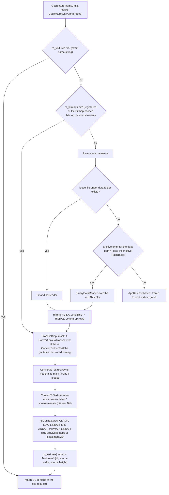

# 25 — Textures and assets

> Part C · Baseline build: Release|Win32 (OpenGL) + TARGET_PC_FULLGAME ([B:FULL]); see _work/build_matrix.md.
> Evidence: [C] confirmed · [I] inferred · [U] unknown. Citations are `path:Symbol` relative to the multiwinia/ source root.
> Sources merged: P12_render_core (§25.1–25.3 decoder, upload, resource manager), X1b_asset_formats (§25.X1b, §29.B5–B7, B16), X2a_asset_catalogue_visual (§25.0–25.15, CSVs `_work/drafts/X2a_textures.csv`, `X2a_shapes.csv`, `X2a_refs.csv`, `X2a_missing.csv`), X2b_asset_catalogue_audio (§25.A, §25.B, `_work/drafts/X2b_samples.csv`), `_work/drafts/P12_shapes.csv`.
> Generated: the per-file tables of §1.2, §2.6, §2.8, §2.15, §3–§6 and the Source map are produced by `_work/scripts/S_25_catalogue.py` (run `python3 -I _work/scripts/S_25_catalogue.py _work .` from the design directory) from the CSVs above and the hand-written template `_work/script_inputs/S_25_template.md`; the script also verifies that every file under `data/textures`, `data/sprites`, `data/shapes`, `data/animations`, `data/terrain`, `data/shaders`, `data/icons`, `data/thumbnails`, `data/mwhelp`, `data/sepulveda`, `data/sounds` and `data/mwsounds` listed in `_work/manifest.csv` appears in this document with its `data/...` path (2131 files; 0 missing at generation time).

## Contents

<!-- CONTENTS -->

## 1 Asset overview

### 1.1 Scope, asset classes and how to read this document

Every image, mesh, panel animation, shader and sound sample that the Multiwinia executable can load lives under `data/` as a loose file in the development tree and is packed into RAR `.dat` archives for release (§2.9). There is **no asset metadata**: no sidecar files, no import settings, no per-asset sampler state. Everything a renderer needs to know about an image (mip-maps, colour key, alpha source, wrap, filter, blend) is decided by the code that requests and draws it, which is why the per-file tables in §3 list the requesting call sites [C] `code/lib/resource.cpp:Resource::GetTextureWithFlags`.

| Asset class | Directory | Files | On-disk format | Loader (code site) | GPU resource |
|---|---|---|---|---|---|
| World and UI textures, logos, VFX strips | `data/textures` | 56 | BMP 4/8/24/32-bit (one RLE8) | `code/lib/resource.cpp:Resource::GetTexture` → `code/lib/bitmap.cpp:BitmapRGBA::LoadBmp` | RGBA8 2-D texture |
| Font atlases | `data/textures/unicode` | 138 | BMP 4/8/24-bit, 16 glyph columns | `code/lib/text_renderer.cpp:TextRenderer::BuildUnicodeArray` | RGBA8 texture (mip-mapped, magenta-keyed) |
| Unit sprites | `data/sprites` | 17 | BMP 24/32-bit | `GetTexture` (draw sites in `code/worldobject/*`, `code/team.cpp`) | RGBA8 texture |
| Animated help panels | `data/animations` | 6 `.anim` + 25 BMP | text key-frame script + BMP | `code/animatedpanel.cpp:AnimatedPanel` reader, `code/animatedpanel_renderer.cpp:AnimatedPanelRenderer` (`GetBitmap` + `GetTexture`) | RGBA8 texture per image |
| Terrain colour ramps, water tiles, wave tables | `data/terrain` | 36 | BMP 8/24-bit | `GetBitmap` (CPU look-up) for `landscape_*`/`waves_*`; `GetTexture` for `water_*` | water only |
| Icons (HUD, cursors, markers, crates, flags, controller glyphs) | `data/icons` | 121 BMP + 1 `.psp` | BMP 4/8/24/32-bit | `GetTexture` / `GetTextureWithAlpha` / `GetBinaryReader` + `AddBitmap` | RGBA8 texture |
| Map thumbnails | `data/thumbnails` | 57 | BMP 400×300 8/24-bit | `code/UI/MapImageButton.h:MapImageButton::Render` | RGBA8 texture, no mip-maps |
| Help images | `data/mwhelp` | 51 | BMP 24/32-bit | help windows, `MultiwiniaHelp`, game-type buttons | RGBA8 texture |
| Advisor portrait frames | `data/sepulveda` | 5 | BMP 8-bit 256×256 | `code/clouds.cpp:Clouds::RenderFace` (cheat builds only) | RGBA8 texture |
| HLSL shaders | `data/shaders` | 14 | HLSL text (`vs_main`/`ps_main`) + 1 include | `code/lib/FixedPipeline.cpp:FixedPipeline::FixedPipeline`, `code/deform.cpp:DeformEffect::DeformEffect`, `code/water_reflection.cpp:WaterReflectionEffect::WaterReflectionEffect` | D3D9 shaders [B:D3D] |
| Meshes | `data/shapes` | 139 `.shp` | text hierarchical flat-shaded mesh | `code/lib/resource.cpp:Resource::GetShape`, `GetShapeCopy` → `code/lib/shape.cpp:Shape::Load` | display list per shape |
| Mesh authoring sources | `data/shapes/source` | 133 `.max` | 3ds Max scene | none (never read) | — |
| Sound samples | `data/sounds`, `data/mwsounds` | 954 + 378 | Ogg Vorbis I, mono | `code/sound/sample_cache.cpp:CachedSample::CachedSample` → `code/lib/resource.cpp:Resource::GetSoundStreamDecoder` | PCM in the sample cache ([27](27_audio_engine.md)) |

Formal byte-level grammars of every format are in [29](29_data_formats_reference.md); rendering of textures and shapes in [24](24_rendering.md); panel animation playback in [26](26_animation_and_vfx.md); sound events in [10](10_audio_design.md) and the audio engine in [27](27_audio_engine.md); archive building in [31 §8](31_platform_build_and_tools.md#8-data-build-pipeline-and-the-dat-archives).

### 1.2 Statistics by directory and status

Counts are files on disk (generated). Status columns are mutually exclusive and use the vocabulary of §1.3; "Not packed" = no archive receives the file in the retail all-language data build (§2.9).

<!-- GEN:dir_stats -->

Audio (generated from `_work/drafts/X2b_samples.csv`; status vocabulary in §5.2):

<!-- GEN:audio_stats -->

Resolved: the X2a draft's key findings said "667 BMP bitmaps … all 667 have a 40-byte header"; the tree holds **506** `.bmp` files in these directories (194 + 17 + 25 + 36 + 121 + 57 + 51 + 5) [C] `find`, matching X1b's survey and [31 §8.7](31_platform_build_and_tools.md#87-the-archives--names-contents-load-order-override-rules); all 506 have a 40-byte `BITMAPINFOHEADER`.

### 1.3 Status vocabulary and evidence rules

| Status | Meaning | How decided [C] |
|---|---|---|
| referenced [B:FULL] | at least one confirmed reference from code compiled into the baseline and reachable in a Multiwinia session, or from a data file the baseline loads (live `data/levels/mp_*` maps, the six `.anim` files) | X2a lexed every `.cpp/.h/.inc` under `code/` and `contrib/eclipse/` (strings, comments, `#if` stacks per configuration, vcproj membership), folded `"…" TEXTURE_EXTENSION` into `….bmp`, and resolved run-time-built names by the rules below |
| referenced [B:LEGACY] only | compiled into FULL but unreachable in a Multiwinia match (single-player task managers, ShamanInterface, ControlHelpSystem, Darwinia world map, Darwinia cut-scene logo, prologue/campaign mode pictures) | reachability overrides verified by grep (table below) |
| referenced [B:D3D] only | only the Direct3D configuration loads it (all shaders, the three deform tables) | `#ifdef USE_DIRECT3D` around the load site |
| referenced [B:DEBUG] only | only `TARGET_DEBUG` builds reach it (cheat window, sound editor, crate help window, TankBattle thumbnails) | `CHEATMENU_ENABLED`, `SOUND_EDITOR`, `INCLUDE_CRATE_HELP_WINDOW`, `INCLUDEGAMEMODE_TANKBATTLE` |
| referenced [B:EDITOR] only | only `LOCATION_EDITOR` builds (`data/shapes/camera.shp`) | `#ifdef LOCATION_EDITOR` |
| unused (named only in dead/commented code or never-loaded data) [B:DEAD] | every mention is in non-compiled code, commented-out code, `data/levels/old/` or a Darwinia script | as above |
| unused (never named) | no string, rule or data reference at all, or only a coincidental bare word (reviewed by hand) | — |
| unused (authoring source, never read) | `.max` and `.psp` files | no loader exists |

Run-time-built names were resolved by these rules (each tied to the code that formats the name) [C]:

| Rule | Name pattern | Site(s) | Value set (source) |
|---|---|---|---|
| research icon | `icons/icon_<name>.bmp` | `code/taskmanager_interface_multiwinia.cpp:TaskManagerInterfaceMultiwinia::TaskManagerInterfaceMultiwinia` (pre-load), `RenderRecentRunTask`, `RenderRunningTasks`; `code/markersystem.cpp:MarkerSystem::Render`; `code/gamecursor.cpp:GameCursor::RenderSelectedTaskIcon`; `code/taskmanager_interface_icons.cpp`, `code/taskmanager_interface_gestures.cpp` (legacy) | the 29 names of `code/global_world.cpp:GlobalResearch::GetTypeName` (`Task::GetTaskName` delegates to it): Darwinian, Officer, Squad, Laser, Grenade, Rocket, Controller, AirStrike, Armour, TaskManager, Engineer, Harvester, Nuke, Subversion, PersonalShield, HotFeet, GunTurret, Shaman, Infection, MagicalForest, DarkForest, AntNest, Plague, Egg, MeteorShower, FireExtinguisher, Rage, Tank, DropShip |
| research gesture | `icons/gesture_<name>.bmp` | same task-manager constructors; `code/interface/gesture_window.cpp` (dead: `GESTURE_EDITOR && USE_SEPULVEDA_HELP_TUTORIAL`) | same 29 names (8 files exist) |
| crate icon | `icons/icon_<crate>.bmp` | `code/interface/helpandoptions_windows.cpp:CrateButton::CrateButton` (only via `INCLUDE_CRATE_HELP_WINDOW`, debug) | `code/worldobject/crate.cpp:Crate::GetName` |
| icon stem | `icons/<stem>.bmp` | stems passed to `code/control_help.cpp:ControlHelpSystem::RenderControlHelp` / `RenderControlHelpDPad` and `code/multiwiniahelp.cpp:MultiwiniaHelp::RenderControlHelp` | literal stems at the call sites |
| mode image | `mwhelp/mode_<blueprint>.bmp` (lower-cased) | `code/UI/GameMenuWindow.cpp:GameMenuWindow::SetupGameSelectPage`, `SetupSPDemoPage` (pre-load loops); `code/UI/GameTypeImageButton.h:GameTypeImageButton::Render` | `GAMETYPE` names in `data/multiwinia.txt`: Domination, KingOfTheHill, CaptureTheStatue, Assault, RocketRiot, Blitzkrieg, TankBattle |
| general help page | `mwhelp/general
.bmp` | `code/interface/helpandoptions_windows.cpp:GeneralHelpWindow::Create` | p = 1…5 (`MAX_PAGES`) |
| game-type help page | `mwhelp/help_<t>_
.bmp` | `code/interface/helpandoptions_windows.cpp:GameTypeHelpWindow::Create` | (t,p) for which the phrase `multiwinia_helppage_<t+1>_
` exists in `data/language/english.txt`: (0,1), (1,1–2), (2,1–3), (3,1–3), (4,1–4), (5,1–3) |
| map thumbnail | `thumbnails/<level stem>.bmp` lower-cased | `code/UI/MapImageButton.h:MapImageButton::Render`, `code/UI/GameMenuWindow.cpp:GameMenuWindow::PreloadThumbnails` | every `data/levels/mp_*` file listed by `code/game_menu.cpp:GameMenu::CreateMapList` whose `GameTypes` names a permitted blueprint; TankBattle maps → [B:DEBUG] (`code/app.cpp:App::IsGameModePermitted`); `data/levels/old/` is never listed |
| terrain | `terrain/<landColourFile / wavesColourFile / waterColourFile>` | `code/landscape_renderer.cpp:LandscapeRenderer::LandscapeRenderer`, `code/water.cpp:Water::Water`, `Water::RenderFlatWater`, `code/mapfile.cpp:MapFile::SaveTextures` | level keys (`code/level_file.cpp:LevelFile::ParseLandscapeData`), defaults `landscape_default.bmp` / `waves_default.bmp` / `water_default.bmp` (`LevelFile::LevelFile`), Christmas overrides `landscape_icecaps.bmp` / `waves_earth.bmp` / `water_icecaps.bmp` |
| animation image | `animations/<IMAGENAME>` | `code/animatedpanel_renderer.cpp:AnimatedPanelRenderer` | `IMAGENAME` values of the six `.anim` files, loaded by `code/multiwiniahelp.cpp:MultiwiniaHelp::InitialiseAnimatedPanel` (one per game type) |
| font atlas | `textures/unicode/.<lo>.<hi>.bmp` | `code/lib/text_renderer.cpp:TextRenderer::BuildUnicodeArray` (`ListResources("textures/unicode/", ".*.*.bmp")`) | fonts `speccy`, `editor`, `square` (`code/app.cpp:App::SetLanguage`) |
| cloud face | `sepulveda/sepulveda<n>.bmp` | `code/clouds.cpp:Clouds::RenderFace` | n = 1–3 random, 4 eyes shut, 5 mouth open |
| hurt Darwinian | `sprites/darwinian_ouch<n>.bmp` | `code/worldobject/darwinian.cpp:Darwinian::Render` | n = 1 + uid % 10 when uid % 10 < 3 (dead, airborne) → 1–3; `darwinian_ouch4.bmp` is a literal |
| army-ant shape | `armyant<n>.shp` | `code/worldobject/armyant.cpp:ArmyAnt::SetShape` | n = 2, 3 |
| HLSL include | `shaders/globals.h` | `code/lib/shader.cpp` (`MyD3DXInclude::Open`) | `#include "globals.h"` in the three `deform*.ps` files |
| level shapes | `shapes/<name>.shp` | `code/worldobject/staticshape.cpp:StaticShape` | `StaticShape` lines of loaded levels |

Reachability overrides (compiled into FULL, not reachable in a Multiwinia match) [C]:

| Code | Tag | Reason |
|---|---|---|
| `code/taskmanager_interface_icons.cpp`, `code/taskmanager_interface_gestures.cpp` | LEGACY | `code/taskmanager_interface.cpp:TaskManagerInterface::CreateTaskManager` creates `TaskManagerInterfaceMultiwinia` whenever `App::Multiplayer()`; the gesture interface only for single-player keyboard `ControlMethod` 0, the icon interface otherwise. Exception: `TaskManagerInterfaceIcons::TaskManagerInterfaceIcons` runs once at start-up (game mode None, `code/app.cpp:App::Initialise`) and pre-loads four textures — counted as FULL |
| `code/shaman_interface.cpp` | LEGACY | shown only from `TaskManagerInterfaceIcons` |
| `code/control_help.cpp` | LEGACY | `ControlHelpSystem::Render` returns immediately when `App::Multiplayer()`; `RenderHelp` also requires `App::IsSinglePlayer()` |
| `code/global_world.cpp` render code, `code/global_internet.cpp` | LEGACY | Darwinia world map (`Renderer` branch `m_locationId == -1`, [24 §3.3](24_rendering.md#33-branches-that-replace-passes-313)) |
| `code/multiwiniahelp.cpp:MultiwiniaHelp::RenderControlHelp` (no-argument overload), `RenderBasicControlHelp`, `RenderCurrentUnitHelp`, `RenderCurrentTaskHelp` | LEGACY | no live caller (the two task-manager calls are commented out) |
| `code/renderer.cpp:Renderer::RenderFrame` Darwin-logo block | LEGACY | `m_renderDarwinLogo` is set only by a script command (`code/script.cpp`) used by Darwinia cut-scenes |
| `code/renderer.cpp:Renderer::RenderFlatTexture` | LEGACY | its only call is commented out |
| `code/renderer.cpp:Renderer::RenderLogo` | DEAD in practice | its only call is inside `#ifdef PROMOTIONAL_BUILD` (never defined) |
| `code/UI/HelpImageButton.h`, `code/UI/NextHelpButton.h`, `code/UI/PrevHelpButton.h` | LEGACY | `GameMenuWindow` `PageHelp` has no live entry (`HelpModeButton` never instantiated, [28](28_ui_framework.md)) |
| `code/multiwiniahelp.cpp:MultiwiniaHelp::LoadIcons` `HelpDarwinians` tab icon | LEGACY | the tab's "appropriate" test is hard-coded false ([30](30_scripting_tutorial_and_cutscenes.md)) |
| `code/UI/GameTypeImageButton.h` prologue/campaign branch | LEGACY | `GAMETYPE_PROLOGUE`/`CAMPAIGN` highlighted only from `PageDarwinia` |
| `code/clouds.cpp:Clouds::RenderFace` | DEBUG | `m_faceTime` is set only by `Clouds::ShowDrSFace`, called only from `code/interface/cheat_window.cpp` (body under `CHEATMENU_ENABLED`, defined only for `TARGET_DEBUG`). Resolved: X1b called the `sepulveda/*` images "dead/legacy"; they are cheat-build only [B:DEBUG] [C] |
| `code/interface/gesture_window.cpp` | DEBUG/DEAD | created only by `code/interface/debugmenu.cpp`; body under `GESTURE_EDITOR && USE_SEPULVEDA_HELP_TUTORIAL` |
| `code/interface/helpandoptions_windows.cpp:CrateButton`, `CrateHelpWindow` | DEBUG | reachable only through `CrateHelpWindowButton` (`#ifdef INCLUDE_CRATE_HELP_WINDOW`) |

"Referenced [B:FULL]" means compiled and callable in a Multiwinia session, not necessarily seen: <!-- GEN:mp_unplaced_count --> of the FULL assets are consumed only by building classes that no live Multiwinia map places (§6.2) [C counts from `_work/drafts/P06_level_building_usage.csv`].

### 1.4 Key findings

- **One decoder, one format.** Every image is an uncompressed Windows BMP decoded on the CPU into RGBA8 and uploaded as an RGBA8 texture; there is no texture compression, no sRGB, no anisotropy and no LOD bias anywhere [C] `code/lib/bitmap.cpp:BitmapRGBA::ConvertToTexture`, grep. `data/textures/shaman_background.bmp` is RLE8 and **cannot be decoded** (garbage in release); it is used only by the legacy ShamanInterface [C].
- **Processing is chosen by the first caller.** The texture cache is keyed by the name string only, so the first request for a name fixes mip-mapping, colour keying and green→alpha conversion for the whole session; <!-- GEN:conflict_count --> textures are requested with conflicting flags by their reachable call sites, of which `data/icons/marker_colour.bmp` (green→alpha vs RGB) and the no-mip `textures/laser.bmp`/`textures/clouds.bmp` requests matter (§2.6) [C].
- **Three transparency mechanisms** coexist (magenta colour key by default, green-as-alpha masks, true 32-bit alpha) plus additive blending of art painted on black (§2.4) [C].
- **NPOT is common** (all thumbnails, most help images, many icons); images are rescaled **up** to the next power of two at upload whenever power-of-two textures are required — always in the D3D build (§2.8) [C].
- **Loose files override archives; archive look-ups are case-insensitive; nothing is encrypted** (§2.9) [C].
- **No missing-file crash is reachable in FULL.** Resolved: X2a and the coordinator log treated the unguarded `GetTexture("icons/compass_empty.bmp")` in `code/markersystem.cpp:MarkerSystem::RenderCompass` as a live fatal path; the branch requires a direction of exactly (0,0), but every caller passes a vector produced by `code/lib/vector2.cpp:Vector2::Normalise`, which maps a zero vector to (0,1), or the on-screen constant (0,−1) — the request can never be made [C] (§6.1).
- **Packaging differs from the tree:** 160 visual files are packed in no archive (133 `.max`, legacy fonts, platform/distributor branding, TankBattle/benchmark thumbnails, the cut `mp_cts_3p_3` map and every font atlas no language list names — including all three currency atlases `*.20a0.20af.bmp`, so U+20A0–20AF never renders in a packed build) (§2.9, §2.15) [C].
- **Shapes:** 139 meshes, 441 fragment blocks, 150 820 triangles, 425 markers; two files contain markers only; `data/shapes/carrycube.shp` repeats fragment name `Box04`; `data/shapes/carryweights.shp` (a live Capture-the-Statue mesh) and `data/shapes/sporegenerator.shp` declare more positions than vertices, which overruns the hit-test scratch buffer (§4.5) [C].
- **Audio:** 1332 mono Ogg Vorbis files; 898 can play in FULL, 242 are bound only to events that never fire, 192 are bound to nothing; 11 music/loader files are never shipped (§5) [C].

## 2 Loading pipeline, resource manager, runtime textures and fonts

### 2.1 Pipeline overview

[C] `code/lib/resource.cpp:Resource::GetTextureWithFlags`, `Resource::ProcessBmp`, `Resource::GetBinaryReader`, `Resource::GetBitmap`; `code/lib/bitmap.cpp:BitmapRGBA::LoadBmp`, `BitmapRGBA::ConvertToTextureAsync`, `BitmapRGBA::ConvertToTexture`.

### 2.2 Bitmap decoding (`BitmapRGBA::LoadBmp`) — supported BMP variants

In-memory format [C] `code/lib/bitmap.h`, `code/lib/bitmap.cpp`: `RGBAColour` is 4 bytes (r, g, b, a) per pixel; `m_pixels` is contiguous; `m_lines[y]` are row pointers; **row 0 is the bottom row** (BMP order is kept, matching the GL texture origin, so UI code puts `glTexCoord2i(0,1)` at the top-left vertex). `BitmapRGBA::Initialise(reader, type)` asserts `type == "bmp"` (debug only) and always calls `LoadBmp`; `TEXTURE_EXTENSION` is `#define`d as `"bmp"` in every build [C] `code/lib/universal_include.h`. There is no PNG/JPG/DDS/TGA reader.

| Header / field | Loader behaviour [C] `ReadBMPFileHeader`, `ReadWinBMPInfoHeader`, `ReadOS2BMPInfoHeader`, `ReadBMPPalette` |
|---|---|
| `bfType` | must be 19778 (`'BM'`) — debug assert only |
| `bfSize`, reserved | read, ignored |
| `bfOffBits` | **never used for seeking**; only to derive the palette size: `(bfOffBits − 54)/4` entries (Windows, BGRx) or `(bfOffBits − 26)/3` (OS/2, BGR); not clamped to 256 (a larger value overflows the 256-entry stack palette) |
| `biSize` = 40 | Windows `BITMAPINFOHEADER`: width, height, bit count, compression used; planes, size, resolution, `biClrUsed`, `biClrImportant` read and ignored |
| `biSize` = 12 | OS/2 header (16-bit width/height); compression forced 0 |
| `biSize` other (V4 108, V5 124) | `AppDebugAssert(0)`; in release the header stays uninitialised (garbage or crash) |
| height | read into an unsigned loop bound — negative (top-down) heights unsupported |
| `biCompression` | must be `BI_RGB` (0) — debug assert only; RLE4/RLE8/BITFIELDS decode as garbage in release |
| palette entries | alpha forced to 255 |

| Bit depth | Pixel decode | Row padding | Shipped files |
|---|---|---|---|
| 1, 16 | `AppDebugAssert(0)`; pixels left uninitialised in release | — | none |
| 4 | palette index per nibble, **high nibble = left pixel**; odd widths write one pixel past the row | **not consumed** → width must be a multiple of 8 | 58 (all widths multiples of 8) |
| 8 | palette index per byte | **not consumed** → width must be a multiple of 4 | 118 (all widths multiples of 4), plus the RLE8 file |
| 24 | B, G, R; alpha := 255 | consumed (`(4 − 3w) & 3` bytes) | 281 |
| 32 | B, G, R, A used as-is — the **only** way to ship real alpha | none needed | 49 |

Decoding gap [C]: `data/textures/shaman_background.bmp` (512×512, 8-bit, compression 1 = RLE8) is decoded as raw indices that run past the data (`BinaryDataReader::ReadU8` returns 0xFF at end of data) → corrupt image in release, debug assert in debug. Its only consumer is `code/shaman_interface.cpp:ShamanInterface::RenderBackground` [B:LEGACY]. Resolved: P12 left "whether shipped data contains any RLE or top-down BMP" open (P12-U4); the survey of all 506 files finds exactly this one RLE file and no top-down, OS/2, V4/V5, mis-padded or palette-gap file [C] `_work/drafts/X2a_textures.csv`.

Output paths [C]: `SaveBmp`/`WriteBmp` write 24-bit Windows BMPs at 2835 px/m; `SavePng`/`WritePng` (libpng) write 8-bit RGB with rows flipped to top-down, `Z_BEST_SPEED`, memory level 8, window 15, buffer 8192 — `SavePng` never forwards its `_saveAlpha` argument, so PNGs are always RGB. Used for screenshots (`code/lib/poster_maker.cpp`) and the Vista save thumbnail [B:DEAD].

### 2.3 Pixel operations (used by the resource system and by gameplay code to build run-time textures)

| Operation | Behaviour [C] `code/lib/bitmap.cpp` | Used by |
|---|---|---|
| `ConvertPinkToTransparent` | pixels exactly equal to RGBA (255,0,255,**255**) (`RGBAColour::operator==` compares all four channels, `code/lib/rgb_colour.cpp`) → (128,128,128,0); the grey RGB avoids magenta fringes under bilinear filtering and mip-mapping; a 32-bit magenta pixel with alpha ≠ 255 is not keyed | `Resource::ProcessBmp` (`WithMask`, the default) |
| `ConvertColourToAlpha` | alpha := **green** channel; RGB := (255,255,255) | `Resource::ProcessBmp` (`WithAlpha`) |
| `ConvertToGreyScale` | RGB := (r+g+b)/3 | UI helpers |
| `ConvertToColour(col, threshold)` | pixels whose mean < threshold become `col × (255 − mean)/255` | UI helpers |
| `ConvertColour(old, new)` | pixels within Euclidean RGB distance < 10 of `old` → `new` (alpha kept) | UI helpers |
| `ConvertRedChannel(col)` | pure-red pixels (g = b = 0, r > 0) → `col × r/255` | team tinting of flags/banners (`code/worldobject/flag.cpp:Flag::Render`) |
| `SwapRB` | swap red and blue | capture paths |
| `ApplyBlurFilter(scale)` | separable 5-tap kernel `[2,4,7,4,2] × scale × 0.0526`; horizontal pass into a cleared buffer, then the bitmap is cleared and a vertical pass with weights ×2 splats back; only non-black source pixels contribute; saturating add per channel; debug-asserts 1 ≤ size ≤ 1024 | blurred `shadow_*` copies (scale 10, §2.13) |
| `ApplyDilateFilter` | despite the name, replaces every interior pixel by the **mean of its 8 neighbours** (box blur without centre) | none in FULL |
| `Blit` / `BlitOr` | scaled copy (nearest via `GetPixelClipped`, or bilinear `GetInterpolatedPixel`); `BlitOr` ORs bytes; a negative source height flips vertically | upload rescale, `viriifull` build |
| `DrawLine`, `PutPixel(Clipped)`, `GetPixel(Clipped)` (clipped get returns black), `Clear` | primitives | legacy gesture textures |

### 2.4 Colour keying and alpha derivation

| Mechanism | How it is requested | What the shader sees | Files that actually use it |
|---|---|---|---|
| Magenta colour key | default `GetTexture(name)` (`mask = true`) | exact (255,0,255) → (128,128,128,0); drawn with alpha blending or alpha test | 16 files contain key pixels: `data/sprites/darwinian.bmp`, `darwinian_ouch1–4.bmp`, `brainwaves.bmp`, `santahat.bmp`, `lasertrooper.bmp` (unused), `sound.bmp` (debug); `data/textures/clouds.bmp`, `shapewireframe.bmp`, `dmacrew.bmp`, `program_darwinia.bmp`, `speccy_screen.bmp` (last three dead); `data/animations/darwinian.bmp`, `darwinian_ouch4.bmp`. Every other masked request is a no-op |
| Green channel as alpha | `GetTextureWithAlpha(name)` = `WithAlpha | WithMipmaps` (no mask) | RGB white, A = green; tinted by `glColor` | `data/textures/tree.bmp`, `data/icons/compass_shadow.bmp`, `marker_shadow.bmp`, `marker_colour.bmp` |
| True alpha | 32-bit BGRA file | A as authored, `SRC_ALPHA, ONE_MINUS_SRC_ALPHA` | 49 files (§3 Alpha column: "A8 …") |
| Additive black | art on black, `SRC_ALPHA, ONE` | black adds nothing; alpha from `glColor` | glows, beams, lasers, particles, font atlases (text is additive, [24 §4.22](24_rendering.md#422-text-rendering-and-font-atlases-incl-unicodecjk-c-codelibtext_renderercpp-codeappcppappsetlanguage)) |
| Darken by texel | `SRC_ALPHA, ONE_MINUS_SRC_COLOR` with colour (a,a,a,0) | destination darkened by texel brightness | blurred `shadow_*` copies, `icon_shadow.bmp`, `*_shadow.bmp` button art, text outline pass |
| Alpha test | `GL_ALPHA_TEST GREATER 0.04` (Darwinians) / 0.02 (units) | hard cut-out of keyed pixels | `data/sprites/darwinian*.bmp`, `futurewinian.bmp` |

Hazard [C+I]: `ProcessBmp` converts a bitmap from the bitmap store **in place**. The colour key is idempotent, but green→alpha is not: after a context flush (§2.12) a store-backed bitmap requested `WithAlpha` would be converted a second time (A := G = 255 → opaque white). No current store-backed name is requested `WithAlpha` [C grep of `AddBitmap`/`GetBitmap` names against the four `GetTextureWithAlpha` names], so the hazard is latent.

### 2.5 Texture upload (`BitmapRGBA::ConvertToTexture`)

[C] `code/lib/bitmap.cpp:BitmapRGBA::ConvertToTexture`, `ConvertToTextureAsync`; `code/lib/math_utils.cpp:RequirePowerOfTwoTextures`, `RequireSquareTextures`, `nearestPowerOfTwo`; `code/app.cpp:App::App` (`GL_MAX_TEXTURE_SIZE` → `BitmapRGBA::SetMaxTextureSize`).

1. Constraints. GL build: `requirePowerOfTwo = !GL_ARB_texture_non_power_of_two || pref ManuallyScaleTextures ≠ 0`; `requireSquare = !GL_ARB_texture_rectangle` (extension strings read once and cached in function statics). D3D build: power-of-two always, square never.
2. `maxTextureSize = GL_MAX_TEXTURE_SIZE` (queried right after `Renderer::Initialise`); if it is non-zero `requireScale = true` — the bool is otherwise uninitialised (undefined behaviour if the query returned 0).
3. New size: if either side exceeds the maximum, both are scaled by the smaller of the two ratios (never up). **Then**, if power-of-two is required, `newW = nearestPowerOfTwo(m_width)`, `newH = nearestPowerOfTwo(m_height)` are computed from the **original** size, discarding the max-size down-scale; `nearestPowerOfTwo(x)` returns the smallest power of two ≥ x (always rounds **up**; inputs above 2³¹ clamp). If square is required both become the larger.
4. If the size changed, the image is bilinear-`Blit`ed into a new bitmap and the function recurses.
5. `glGenTextures`, bind, `GL_TEXTURE_WRAP_S/T = GL_CLAMP`, `MAG = GL_LINEAR`, `MIN = GL_LINEAR_MIPMAP_LINEAR` — **for every texture**, including non-mip-mapped uploads; then `gluBuild2DMipmaps(GL_RGBA, …)` when mip-mapping, else `glTexImage2D(level 0, internal format 4, GL_RGBA, GL_UNSIGNED_BYTE)`. Under `USE_DIRECT3D` the `compressed` flag is forwarded to the emulated upload ([24 §1.5](24_rendering.md#15-direct3d-9-path-opengl-api-emulation-layer-bd3d)); no call site passes `compressed = true` [C grep].
6. A non-mip-mapped texture keeps `MIN = LINEAR_MIPMAP_LINEAR` unless the drawing code resets it; GL then treats it as incomplete. Draw sites that request `mip = false` and set no MIN filter: `code/location.cpp:Location::RenderWeapons` and `code/worldobject/weapons.cpp:Laser::Render` (`textures/laser.bmp`) — saved because the start-up pre-load requests that name mip-mapped first (§2.6).
7. `ConvertToTextureAsync`: when called off the main thread (the loading worker that runs `App::Initialise`), the upload is queued as a `Job` on `g_loadingScreen` and the caller waits — all GL calls happen on the main thread [C].
8. `GL_CLAMP` (not `GL_CLAMP_TO_EDGE`): with LINEAR filtering the specification blends the border colour (0,0,0,0) into edge texels; drivers of the period commonly treated it as clamp-to-edge [I]. A D3D12 port should use clamp-to-edge unless edge darkening is reproduced deliberately.

### 2.6 Texture cache, load flags and the cache-ignores-flags hazard

| Flag | Value | Effect in `Resource::ProcessBmp` [C] |
|---|---|---|
| `WithMipmaps` | 0x1 | `gluBuild2DMipmaps` |
| `WithMask` | 0x2 | `ConvertPinkToTransparent` |
| `WithAlpha` | 0x4 | `ConvertColourToAlpha` (green → alpha) |
| `WithCompression` | 0x8 | D3D compressed upload; never requested |

Entry points [C] `code/lib/resource.cpp`: `GetTexture(name, mipMapping = true, masked = true, compressed = false)`; `GetTextureWithAlpha(name)` = `WithAlpha | WithMipmaps`; `GetTextureWithFlags(name, flags)`; `DoesTextureExist(name)` (cache, bitmap store, then file existence — does not load); `GetTextureInfo(name, &w, &h)` (cache only; reports the **source** size, before any rescale — used by the font code); `DeleteTexture(Async)`; `GetBitmap(name)` (bitmap store, else decode the file and **store the decoded bitmap in `m_bitmaps` under the name as given** — used for terrain ramps, animation images, icon size queries and map saving).

Look-up order in `GetTextureWithFlags` [C]: (1) `m_textures`, a `stdext::hash_map<std::string, TextureInfo*>` keyed by the **exact string passed** (case-sensitive; flags not part of the key); (2) `m_bitmaps` (case-insensitive `HashTable`); (3) file (§2.9). Failure → `AppReleaseAssert(false, "Failed to load texture %s")` — fatal. A mutex is taken around the hash look-up/insert only while the loading screen is rendering concurrently (the code notes a possible texture leak in that window).

Consequences:
- **First requester wins**: whichever call reaches a name first decides mip/mask/alpha processing for every later caller until `Resource::FlushOpenGlState`; after a flush the next requester decides again [C].
- **Case variants are separate cache entries**: `textures/triangleOutline.bmp` (the spelling used by `code/landscape_renderer.cpp`, `code/water.cpp`, `code/worldobject/spiritstore.cpp`) and any lower-case spelling would upload the same file twice; all current callers use the same spelling, so only one copy exists [C].
- First requesters at start-up [C] `code/app.cpp:App::Initialise`: `TaskManagerInterface::CreateTaskManager` (game mode None → `TaskManagerInterfaceIcons`, which pre-loads `textures/interface_grey.bmp`, `textures/interface_red.bmp`, `icons/gestureguide.bmp`, `icons/icon_shadow.bmp` with mip, **no mask**), then `code/UI/GameMenuWindow.cpp:GameMenuWindow::PreloadTextures` (default flags) for `icons/button_b.bmp`, `icons/button_lb_shadow.bmp`, `icons/button_rb_shadow.bmp`, `icons/button_lb.bmp`, `icons/button_rb.bmp`, `icons/button_a.bmp`, `textures/interface_blur.bmp`, `sprites/darwinian.bmp`, `mwhelp/gear.bmp`, `textures/laser.bmp`, `textures/clouds.bmp`. When a match starts, `TaskManagerInterfaceMultiwinia::TaskManagerInterfaceMultiwinia` pre-loads every existing `icons/icon_<research>.bmp` and `icons/gesture_<research>.bmp` with mip, no mask.
- Resolved: P12 inferred that `Clouds::RenderBlobby` loads `textures/clouds.bmp` first (non-mip-mapped) and that `textures/laser.bmp` is saved by `Clouds::RenderSky`; the code shows both are first loaded mip-mapped and masked by `GameMenuWindow::PreloadTextures` at start-up [C] `code/app.cpp:App::Initialise` L466, `code/UI/GameMenuWindow.cpp:GameMenuWindow::PreloadTextures`.

Every texture whose reachable call sites request different processing (generated from the per-site flags of `_work/drafts/X2a_refs.csv`, completed by the hand-verified site table in the script):

<!-- GEN:conflict_table -->

Only two outcomes are visible: `data/icons/marker_colour.bmp` becomes a white alpha mask when `MarkerSystem::RenderColourCircle` (pass 16) runs before `TaskManagerInterfaceMultiwinia::RenderRecentRunTask` (pass 23) in the first frame that shows either [I from pass order, [24 §3.2](24_rendering.md#32-ordered-pass-table--one-multiwinia-match-frame-bfull)], and the no-mip draws of `textures/laser.bmp`/`textures/clouds.bmp` would sample an incomplete texture if they ever became the first requester (only after a flush with no front-end frame in between) [I]. A new engine should key the cache by (name, processing) or make processing a property of the asset.

### 2.7 Mip-map, wrap and filter selection per load site

There is no per-asset metadata: every choice is made by the request flags and by GL state the drawing code sets after binding. Defaults written at upload (every texture): wrap CLAMP/CLAMP, MAG LINEAR, MIN LINEAR_MIPMAP_LINEAR; the per-frame default state adds env MODULATE ([24 §2.3](24_rendering.md#23-baseline-gl-state--renderersetopenglstate-start-of-every-frame-c)). The per-file "Wrap / filter at draw" column of §3 lists the overrides found within ±14 lines of each bind (a heuristic window, hence [I] per entry — confirm in the cited function), completed by hand for rule-built names. The overrides by category [C for the functions named]:

| Choice | Assets | Where set |
|---|---|---|
| mip-mapped (default `GetTexture`) | all world-space art: building/unit glows, VFX, sprites, icons drawn in 3-D or scaled HUD, font atlases | every default call |
| **no mip-maps** + MIN/MAG LINEAR at draw | the 51 FULL thumbnails (+3 TankBattle, debug), `mwhelp/mode_*`, `mwhelp/general1–5`, `mwhelp/help_*` (16), `textures/mwtitle.bmp`, `textures/prices.bmp`, `textures/multiwinia.bmp` | `code/UI/MapImageButton.h:MapImageButton::Render`, `code/UI/GameMenuWindow.cpp:GameMenuWindow::PreloadThumbnails`, `code/UI/GameTypeImageButton.h:GameTypeImageButton::Render`, `code/UI/ImageButton.cpp:ImageButton::Render`, `code/UI/GameMenuWindow.cpp:GameMenuWindow::Render` (title) |
| no mip-maps, NEAREST | `textures/clouds.bmp` (blobby: MAG LINEAR / MIN NEAREST; flat: NEAREST/NEAREST) | `code/clouds.cpp:Clouds::RenderBlobby`, `Clouds::RenderFlat` |
| no mip-maps, MIN left at default | `textures/laser.bmp` | `code/location.cpp:Location::RenderWeapons`, `code/worldobject/weapons.cpp:Laser::Render` |
| mip-maps, MAG NEAREST (crisp pixels) | `textures/particle.bmp` (particle batches; LINEAR restored after), `sprites/darwinian.bmp` for the giant front-end Darwinian (restored after) | `code/particle_system.cpp:ParticleSystem::Render`, `code/UI/GameMenuWindow.cpp:GameMenuWindow::RenderBigDarwinian` |
| NEAREST both | `textures/interface_divider.bmp` (legacy task managers) | `code/taskmanager_interface_icons.cpp`, `code/taskmanager_interface_gestures.cpp` |
| **REPEAT** wrap (tiled / scrolling UVs) | `textures/clouds.bmp`, `cloudyglow.bmp` (front-end fill boxes), `fuel.bmp`, `interface_blur.bmp`, `interface_grey.bmp`, `interface_red.bmp`, `laser-long.bmp`, `laser.bmp` (sky grid), `laserfence.bmp`, `laserfence2.bmp`, `menuhighlight.bmp`, `radarsignal.bmp`, `triangleoutline.bmp` (landscape overlay), all `terrain/water_*.bmp`, `icons/mwlogo.bmp`, `icons/thickarrow.bmp` | the drawing functions listed per asset in §3 (`LandscapeRenderer::RenderOverlaySlow`, `Water::RenderFlatWater`, `LaserFence::RenderAlphas`, `RadarDish::RenderSignal`, `DrawFillBox`, `RenderHighlightBeam`); the functions inspected restore CLAMP afterwards (e.g. `code/team.cpp:Team::RenderVirii`) [I for the rest] |
| env DECAL | `textures/shapewireframe.bmp` on explosion debris | `code/explosion.cpp:ExplosionManager::Render` |
| env COMBINE_EXT, RGB REPLACE | `textures/laserfence.bmp` + `radarsignal.bmp` signal beams (two-texture) | `code/worldobject/radardish.cpp:RadarDish::RenderSignal`, `code/worldobject/feedingtube.cpp:FeedingTube::RenderSignal` |
| multitexture | `terrain/water_*.bmp` on unit 0 (REPEAT, LINEAR / LINEAR_MIPMAP_LINEAR, MODULATE) × `water_lightmap` on unit 1 (COMBINE_EXT, RGB MODULATE) | `code/water.cpp:Water::RenderFlatWater` |
| unmasked (`mask = false`) | `textures/triangleoutline.bmp`, `interface_grey/red.bmp`, `icons/compass.bmp` (task manager), `gestureguide.bmp`, `icon_shadow.bmp`, research icons (pre-load), all thumbnails, `mwhelp/mode_*`, `sepulveda/*` (current frame), `textures/deform*.bmp` | call arguments |
| green → alpha | `textures/tree.bmp`, `icons/compass_shadow.bmp`, `marker_shadow.bmp`, `marker_colour.bmp` | `GetTextureWithAlpha` |
| D3D sampler state set explicitly | deform tables: LINEAR, U WRAP / V CLAMP | `code/deform.cpp:DeformEffect` [B:D3D] |

Anisotropic filtering, texture compression, sRGB and LOD bias are never used [C grep: no `GL_TEXTURE_MAX_ANISOTROPY`, no compressed request].

### 2.8 Power-of-two handling

Images are stored at their authored size; when power-of-two textures are required (§2.5: always under D3D; under GL only without `GL_ARB_texture_non_power_of_two` or with `ManuallyScaleTextures`) each NPOT image is bilinear-resampled **up** to the next power of two on both axes and uploaded at that size; texture coordinates are not changed, so the whole image still maps to [0,1]². `GetTextureInfo` keeps reporting the source size. Every NPOT file and its upload size (generated):

<!-- GEN:npot_table -->

`data/terrain/waves_*.bmp` (400×10) appear above for completeness but are never uploaded (CPU look-up tables). Resolved: X1b counted "21 NPOT in `textures/`"; the count is 23 including the two `textures/plusmenu/*` images (unused) [C].

### 2.9 Resource manager: look-up order and archives

[C] `code/lib/resource.cpp:Resource::ParseArchive`, `GetTextReader`, `GetBinaryReader`, `GetShapeCopy`, `DoesShapeExist`, `ListResources`, `SoundExists`, `GetSoundStreamDecoder`; `contrib/unrar/unrar.cpp:UncompressedArchive::UncompressedArchive`; `contrib/systemiv/lib/tosser/hash_table.cpp:HashTable::HashFunc`, `HashTable::GetIndex`; `code/app.cpp:App::App`, `App::Initialise`, `App::LoadSounds`. One instance `g_app->m_resource`.

Archives — mount order, contents and override rules (contents per [31 §8.7](31_platform_build_and_tools.md#87-the-archives--names-contents-load-order-override-rules), re-checked against the per-file Packed column of §3–§5):

| Order | Archive | Mounted in | Built from | Visual / audio assets it receives (retail, all languages) |
|---|---|---|---|---|
| 1 | `init.dat` | `App::App`, before `PrefsManager` | `tools/init.list` (copied; `textures/xboxlivearcade.bmp` deleted on PC) | all 14 `data/shaders/*`, `data/sprites/darwinian.bmp`, `data/textures/ivlogo.bmp` — the loading screen needs these before `main.dat` is parsed (`code/loading_screen.cpp:LoadingScreen::RenderIVLogo`, `RenderFrame`) |
| 2 | `language.dat` | `App::Initialise` (loading worker) | `tools/build_language_dat.bat` with `tools/language.list` (retail, no language argument), `tools/englishlanguage.list` (non-retail scripts) or one `tools/*language.list` | 131 font atlases: Latin-1 for all three fonts, both Cyrillic `speccy` atlases, the kana atlas, 81 CJK and 44 Hangul `square` atlases; `tools/russianlanguage.list` adds the four Cyrillic `editor`/`square` atlases; **no list contains `*.20a0.20af.bmp`**. Resolved: X2a said "127 CJK/Hangul/kana `square.*` atlases"; `tools/language.list` names 127 `square` atlases of which 126 are kana/CJK/Hangul (the other is `square.0020.00ff.bmp`) — 131 atlases in total, as [31](31_platform_build_and_tools.md) states [C] |
| 3 | `main.dat` | `App::Initialise` | every `data/` file not matched by `tools/sounds.txt` + `tools/menu_sounds.txt` + `tools/multiwinia_exclusions.txt`, not under `sounds/`, with extension `tex bmp jpg shp txt vs ps ps3 h anim` | 496 visual files: animations 31, icons 121, mwhelp 50, sepulveda 5, shaders 8, shapes 139, sprites 16, terrain 36, textures 38, thumbnails 52. Resolved: X2a wrote 497; the per-file Packed column sums to 496 [C generated] |
| 4 | `patch.dat` | `App::Initialise` | no builder in `tools/` | [U] (25-U1) |
| 5 | `menusounds.dat` | `App::Initialise` | `tools/menu_sounds.txt` | 18 Oggs: 8 `data/sounds/*` + 10 `data/mwsounds/multilobbyamb*` |
| 6 | `branding.dat` | `App::Initialise` | no builder (only commented out in `tools/InstallerScript_retail_crashreporter_euro.iss`) | [U] (25-U1); [I] distributor overlays — `code/worldobject/statue.cpp:Statue::Render` draws an optional `carryspecialshape.shp` if any archive provides it (`DoesShapeExist`), and the four unreferenced `data/shapes/carrybillboard_*.shp` variants look like such overlays |
| 7 | `sounds.dat` | `App::LoadSounds` (sound work queue, after the loading worker has finished) | `tools/sounds.txt` | 1297 Oggs (935 `data/sounds`, 362 `data/mwsounds`) |
| 8 | `sounds2.dat` | `App::LoadSounds` | every `.ogg` not named by the lists above or excluded | 6 late UI Oggs in `data/mwsounds` |

Visual files excluded from every archive [C] `tools/multiwinia_exclusions.txt`: `shapes/source`, `textures/editor_font*`, `textures/speccy_font*`, `textures/unicode` (handled by `language.dat`), `shaders/FixedFunc*` (still shipped in `init.dat`), `sprites/darwinian.bmp` and `textures/ivlogo.bmp` (in `init.dat`), `textures/xboxlivearcade.bmp`, `textures/ambrosia_logo.bmp`, `textures/plusmenu/*`, `textures/msn_oberon_combosplash.bmp`, `textures/dmacrew.bmp`, `textures/speccy_screen.bmp`, `mwhelp/360_controller.bmp`, `thumbnails/mp_benchmark_*`, `thumbnails/mp_tankbattle_*`, `thumbnails/mp_cts_3p_3.bmp` (with `levels/mp_cts_3p_3.txt`); `data/icons/banner_template.psp` is dropped by the extension filter. The `deform*`, `water-meshwaves*` and `globals.h` shaders are in both `init.dat` and `main.dat` (identical bytes; the later archive's entry wins). Audio exclusions: `sounds/tresk*`, `sounds/trash80*`, `sounds/dma_sc*`, `sounds/twoataris*`, `sounds/pang*`, `sounds/speccyloader.ogg`, `sounds/matrix.ogg`, `sounds/fodder.ogg` (11 files).

Mount semantics [C]:
- A missing archive is silently skipped (`DoesFileExist`); an exception during decompression drops the archive.
- The **whole RAR archive is decompressed into RAM** at mount (`UncompressedArchive`, contrib/unrar, at most `MAX_FILES` = 16384 entries); the archive object is deleted but its `MemMappedFile`s move into `m_resourceFiles`.
- Entry names: `\` → `/`, then `strlwr`; **zero-byte entries are dropped**.
- A later archive's entry **replaces** an earlier one with the same name; effective precedence `sounds2 > sounds > branding > menusounds > patch > main > language > init`.
- `m_resourceFiles` is a `HashTable<MemMappedFile*>` whose hash masks the case bit (`& 0xDF`) and whose comparison is `stricmp`, so **archive look-ups are case-insensitive**; all access is under the resource mutex. Resolved: P12 wrote "text/binary assets inside archives must be requested in lower case [I]" (and P14 the same); the hash table makes case irrelevant [C] `contrib/systemiv/lib/tosser/hash_table.cpp:HashTable::GetIndex`.
- No encryption or password: every `ParseArchive` call passes `NULL`; only user save files use the "redshirt2" text obfuscation ([29](29_data_formats_reference.md)) [C].
- Unrar is not thread-safe: `App::App` waits for the loading worker queue (which mounts archives 2–6) to drain before queueing `App::LoadSounds`, so no two archives decompress concurrently [C] ([31 §8.7](31_platform_build_and_tools.md#87-the-archives--names-contents-load-order-override-rules)).

File look-up for a resource name *N* (`GetTextReader`, `GetBinaryReader`) [C]:
1. [B:DEAD] mod directories (`USE_DARWINIA_MOD_SYSTEM` undefined; `Resource::LoadMod` body compiled out).
2. **Loose file `data/` + *N*** (relative to the working directory; `fopen`, case-insensitive on Windows). Text: UTF-16 BOM → `UnicodeTextFileReader`, else `TextFileReader`; binary → `BinaryFileReader`.
3. Archive entry `data/` + *N* (text: BOM → `UnicodeTextDataReader`, else `TextDataReader`; binary → `BinaryDataReader`).
4. Not found → `NULL` (text look-ups log "Failed to find text resource"). Texture, bitmap and shape look-ups lower-case *N* first; `GetTextReader`/`GetBinaryReader` do not (harmless because of the case-insensitive table).

So **loose files always override archives** — the development tree runs with no archives at all, and a user or patch can override any asset by placing a file under `data/`. `ListResources(dir, filter, long)` lists loose `data/<dir>` files, then merges every archive entry whose directory part equals `data/<dir>` (`stricmp`) and whose file part matches the wildcard (`*`, `?`, `WildCmp`), by ordered insert (alphabetical; used for font atlases and the level list). Sounds: `SoundExists(name)` checks `sounds/<name>.ogg` then `mwsounds/<name>.ogg`; `GetSoundStreamDecoder(name)` opens `<name>.ogg` (§5.1). `GetBaseDirectory()` = `"data/"`; `GetTextFileWriter(name)` writes `data/<name>` (editor saves).

### 2.10 Caches and their keys

| Cache | Type | Key | Case | Filled by | Survives `FlushOpenGlState`? | Freed |
|---|---|---|---|---|---|---|
| `m_resourceFiles` | `HashTable<MemMappedFile*>` | lower-cased `data/...` entry name | insensitive | `ParseArchive` | yes | `~Resource` |
| `m_bitmaps` | `HashTable<BitmapRGBA*>` | name as given | insensitive | `AddBitmap` (ignored if the name exists), `GetBitmap` | yes | `DeleteBitmap` (only `water_lightmap` is ever deleted), `~Resource` |
| `m_textures` | `hash_map<std::string, TextureInfo*>` | exact name | **sensitive** | `GetTextureWithFlags` | **no** (all GL textures deleted) | `DeleteTexture`, flush, `~Resource` |
| `m_shapes` | `HashTable<Shape*>` | name as given (bare `x.shp` or synthetic team key) | insensitive | `GetShape`, `AddShape` | yes (display lists flushed) | `~Resource` |
| `m_displayLists` | `HashTable<int>` | generated decimal name (< 20 chars, debug assert) | insensitive | `CreateDisplayList` | **no** (all deleted) | `DeleteDisplayList(Async)`, flush |
| `CachedSampleManager` | sample cache | sample name | — | first play | n/a | 60 MiB LRU ([27](27_audio_engine.md)) |

### 2.11 Shapes cache and display lists

[C] `code/lib/resource.cpp:Resource::GetShape`, `GetShapeCopy`, `AddShape`, `DoesShapeExist`, `CreateDisplayList`, `CreateDisplayListAsync`, `GetDisplayList`, `DeleteDisplayList`, `DeleteDisplayListAsync`, `GenerateName`.
- `GetShape(name, makeNew = true)` returns a **shared, non-animating** instance cached by name; `GetShapeCopy(name, animating, buildDisplayList = true)` always parses a fresh instance from loose `data/shapes/<lower-cased name>` or the archive entry; missing → `AppReleaseAssert("Couldn't find shape file %s")` (fatal); `AddShape(shape, name)` registers a derived instance (team-coloured copies, §4.6) unless the name exists; `DoesShapeExist` checks cache, loose file, archive.
- `GenerateName()` returns a new decimal string from `m_nameSeed` (starting at 1); `CreateDisplayList(name)` = `glGenLists(1)` stored under the name (a `NULL` name makes an anonymous list); `CreateDisplayList(name, render, before, after)` runs `before`, compiles `render` with `GL_COMPILE`, runs `after`; `CreateDisplayListAsync` marshals to the main thread through a loading-screen job (the "D3D lists work from any thread" shortcut is disabled by the never-defined `USE_DIRECT3D_NOTTRUEANYMORE`); `GetDisplayList(name)` → id or −1; `DeleteDisplayListAsync` deletes directly under `USE_DIRECT3D`, else marshals.
- Shape geometry, transforms, team recolouring and hit tests are specified in [24 §4.5](24_rendering.md#45-shape-rendering-shp-meshes-c-codelibshapeh-codelibshapecpp); the per-file shape catalogue is §4.

### 2.12 Context loss, regeneration and the absence of hot reload

[C] `code/lib/resource.cpp:Resource::FlushOpenGlState`, `Resource::RegenerateOpenGlState`.
- **Flush**: delete every cached GL texture and clear `m_textures`; every cached shape `FlushDisplayList`; delete all named display lists and empty `m_displayLists`; `Location::FlushOpenGlState` (tree display lists). Registered bitmaps survive, so run-time textures are rebuilt from the stored bitmaps on the next request and file textures are re-read.
- **Regenerate**: fonts (`BuildUnicodeArray` for Unicode fonts, else `BuildOpenGlState`; the title font always Unicode), every shape `BuildDisplayList`, `Renderer::BuildOpenGlState` (new pixel-effect texture name), `Location::RegenerateOpenGlState` (landscape and water GL state), the loading-screen sprite id `GetTexture("sprites/darwinian.bmp")`, `Sphere::s_regenerateDisplayList = true`, and re-layout of `MultiwiniaHelp`'s animated panel: `scale = ScreenH/1300`, x centred (`ScreenW/2 − scale·width/2`), `y = ScreenH − 1.15·height·scale`, size `width·scale × height·scale`, border 5, title 25, caption 15.
- Triggers [C grep]: screen-mode change (`code/interface/prefs_screen_window.cpp`), `code/interface/mainmenus.cpp`, the cheat window (`code/interface/cheat_window.cpp`, debug), D3D device reset (`code/lib/opengl_directx.cpp`, [B:D3D]); `~Resource` flushes on shutdown.
- There is **no file watching / hot reload**. Because textures are evicted on flush and loose files override archives, editing a loose `data/` image and forcing a screen-mode change reloads it [I].

### 2.13 Runtime-generated textures and registered bitmaps

Names registered with `Resource::AddBitmap` behave exactly like files for `GetTexture`, `DoesTextureExist` and `GetBitmap`, survive context loss and are re-uploaded on demand; `AddBitmap` ignores a name that already exists. Names guarded by `DoesTextureExist` before building are built once per process and reused across matches [C].

| Key (texture name) | Built by | Source → processing | Size | Build / reach | Drawn by |
|---|---|---|---|---|---|
| `sprites/viriifull.bmp` | `code/team.cpp:Team::Initialise` (once, guarded by `DoesTextureExist`) | `sprites/virii.bmp` (32×32, read raw through `GetBinaryReader`) vertically flipped and bilinear-scaled into a black 160×512 canvas: copy *i* (i = 0…31) has side `32 − i/2` (integer division), x = `16 − side/2`, stacked from y = 0 while `destY + side < 512` → **18 copies** (32, 32, 31, 31, …, 24, 24 px; 504 px of the 512); then `textures/glow.bmp` 128×128 blitted at (32,0) | 160×512 (→ 256×512 when POT is required) | [B:FULL] | `code/team.cpp:Team::RenderVirii` (pass 7c, LINEAR / LINEAR_MIPMAP_LINEAR; blend `SRC_ALPHA, ONE`, or `ONE_MINUS_SRC_COLOR` for the monster team) → `code/worldobject/virii.cpp:Virii::Render`: the worm body is a quad strip with U ∈ [0, 32/160] and V advancing by `segment length × 6/512` per history point from 0, so a longer worm samples further down the column of ever-smaller copies (a tapering tail); the glow strip uses U ∈ [32/160, 1], V ∈ [0, 128/512] (the glow block). Resolved: P12 described "32 shrinking copies (32→17 px)"; the loop stops at 18 copies because the next one would cross y = 512 [C]; X2a's open question on the strip's visual role (X2a-U3) is answered by `Virii::Render`, `Virii::RenderLowDetail`, `Virii::RenderGlow` [C] |
| `icons/selectionarrow.bmp`, `shadow_icons/selectionarrow.bmp` | `code/gamecursor.cpp:GameCursor::GameCursor` | file read with `GetBinaryReader`, registered unchanged; a copy blurred with `ApplyBlurFilter(10)` registered as `shadow_…` | source size | [B:FULL] | selection-arrow rendering (pass 20): shadow pass `SRC_ALPHA, ONE_MINUS_SRC_COLOR`, then additive main pass |
| `shadow_<cursor>` for each `MouseCursor`: `icons/mouse_game.bmp`, `mouse_placement.bmp`, `mouse_disabled.bmp`, `mouse_movehere.bmp`, `mouse_highlight.bmp`, `mouse_turrettarget.bmp`, `mouse_selection.bmp`, `mouse_enter.bmp` (+ the originals) | `code/gamecursor.cpp:MouseCursor::MouseCursor` | as above (blur ×10) | source size | [B:FULL] | `MouseCursor::Render` (pass 20) |
| `shadow_icons/nukesymbol.bmp` | `code/worldobject/nuke.cpp:Nuke::RenderGroundMarker` | blur ×10 of `icons/nukesymbol.bmp` | 128×128 | [B:FULL] | same function |
| `shadow_icons/target.bmp` | `code/worldobject/crate.cpp:Crate::RenderGroundMarker` | blur ×10 of `icons/target.bmp` | 128×128 | [B:FULL] | same function |
| `<file>_255`, `<file>_selected_<colourId>_<coopPos>`, `<file>_<colourId>_<coopPos>` | `code/worldobject/flag.cpp:Flag::Render` (only when `App::Multiplayer()`) | file read raw, `ConvertRedChannel(c)`: c = (128,128,128) for no team, the team colour when selected/highlighted, team colour / 2 otherwise | source size | [B:FULL] | officer banners `icons/banner_*.bmp` (`Officer::RenderFlag`), Blitzkrieg zone flags `icons/flag*.bmp` (`MultiwiniaZone::RenderBlitzkrieg`) |
| `water_lightmap` (`LIGHTMAP_TEXTURE_NAME`) | `code/water.cpp:Water::GenerateLightMap` | grey = min(landMask × 855, 255), rows flipped (`MASK_SIZE − z − 1`); the previous bitmap and texture are deleted first; the same image also seeds the water depth map (depth = 1 − g/255) | 128×128 (`MASK_SIZE`) | [B:FULL] | `Water::RenderFlatWater`, texture unit 1 (`COMBINE_EXT`, RGB MODULATE) |
| custom-map terrain bitmaps (key = stored file name, e.g. `terrain/landscape_x.bmp`) | `code/mapfile.cpp:MapFile` texture loader (`AddBitmap(newFilename, bitmap)`) | raw RGBA pixel blob + width/height from the `.mwm` directory | as saved | [B:FULL] (custom `.mwm` maps are editor-made, [08](08_levels_and_level_design.md)) | `LandscapeRenderer`/`Water` like a file; `MapFile::SaveTextures` embeds a terrain bitmap only when it is not an archive entry |
| gesture-overlay textures (unnamed) | `code/taskmanager_interface_icons.cpp`, `code/taskmanager_interface_gestures.cpp` (`BITMAPW` = 64) | `BitmapRGBA` drawn on the CPU, `ConvertToTexture(false)` | 64×64 | [B:LEGACY] | single-player task managers |
| pixel-effect capture | `code/renderer.cpp:Renderer::PreRenderPixelEffect` | `glCopyTexImage2D` RGBA | `m_pixelSize`² (256²) | [B:LEGACY] (skipped when `App::Multiplayer()`, [24 §4.14](24_rendering.md#414-pixel-effect-screen-space-pixelation-ghosting-blegacy-c-coderenderercpp)) | `Renderer::ApplyPixelEffect` |
| menu-transition capture | `code/renderer.cpp:Renderer::CaptureFrameBuffer` | `glCopyTexImage2D` RGB of the back buffer | screen size, or its next power of two where required | [B:FULL] | `AdvanceMenuTransition` (pass 34) |
| deform render targets | `code/deform.cpp:DeformEffect::DeformEffect` | `Texture::Create(TF_RENDERTARGET)`: `m_screenTexture` (screen size), `m_deformTexture` (half size, `D3DFMT_A8R8G8B8`) | screen / half | [B:D3D]; never runs in a match | `DeformEffect` |
| water reflection target | `code/water_reflection.cpp:WaterReflectionEffect::WaterReflectionEffect` | `Texture::Create` half screen, back-buffer format, `TF_RENDERTARGET` | half screen | [B:D3D] | `water-meshwaves` shaders |
| legacy font up-scale | `code/lib/text_renderer.cpp:TextRenderer::BuildOpenGlState` | font bitmap ×2 nearest | 2× | dead in practice (no font name ends in `.bmp`) | — |
| Vista rich-save thumbnail | `code/app.cpp:App::SaveThumbnailScreenshot` | `PosterMaker` frame → bilinear 256×192 → PNG in the save header | 256×192 | [B:DEAD] (`TARGET_OS_VISTA`) | — |

### 2.14 Direct3D texture wrapper [B:D3D]

[C] `code/lib/texture.h`, `code/lib/texture.cpp:Texture::Create`. `TextureParams{w, h, D3DFORMAT, flags}`; flags `TF_RENDERTARGET` (1 → `D3DUSAGE_RENDERTARGET`, `D3DPOOL_DEFAULT`), `TF_CUBE` (2 → cube texture, must be square), `TF_LOCKABLE` (4 → `D3DUSAGE_DYNAMIC`, `D3DPOOL_DEFAULT`; debug-asserted exclusive with render target); otherwise `D3DPOOL_MANAGED`. Always one mip level; render-target surfaces fetched per face; `Create` returns `NULL` on failure. `D3DPOOL_DEFAULT` objects are destroyed and recreated around device resets (`ReleaseD3DPoolDefaultResources` / `CreateD3dPoolDefaultResources`, [24 §1.5](24_rendering.md#15-direct3d-9-path-opengl-api-emulation-layer-bd3d)). Ordinary file textures go through the GL-emulation upload, not this wrapper.

### 2.15 Fonts and atlases

- **Live fonts** [C] `code/app.cpp:App::SetLanguage`: `g_gameFont = "speccy"`, `g_editorFont = "editor"`, `g_titleFont = "square"`; each is the set of atlases `data/textures/unicode/.<lo>.<hi>.bmp` discovered with `Resource::ListResources("textures/unicode/", ".*.*.bmp", false)` and loaded with default flags (mip-mapped, magenta-keyed); `GetTextureInfo` supplies the source size used for the row count. Glyph metrics, UV formulae, the CJK font swap and drawing modes are in [24 §4.22](24_rendering.md#422-text-rendering-and-font-atlases-incl-unicodecjk-c-codelibtext_renderercpp-codeappcppappsetlanguage).
- **Atlas inventory** (generated; each atlas is 16 glyph cells wide, one row per 16 code points):

<!-- GEN:font_inventory -->

- **What ships** [C] `tools/language.list`, `tools/englishlanguage.list`, `tools/russianlanguage.list`: the all-language retail `language.dat` holds Latin-1 for all three fonts, Cyrillic **only for `speccy`**, and every kana/CJK/Hangul atlas for `square`; the Russian build adds Cyrillic for `editor` and `square`; an English-only build holds only the three Latin-1 atlases. The three currency atlases (U+20A0–20AF, including €) are in **no** list, so a packed build cannot draw those characters; characters without an atlas are skipped (`TextRenderer::GetTextureID` finds no range) [I]. Which list each retail SKU used is [U] (25-U2).
- **Anomaly**: the Hangul atlas for U+BB00 is named `square.bb00.bfff.bmp` (claims U+BB00–BFFF); the first-match look-up can map U+BC00–BFFF to it and sample outside the image [I] ([24 §4.22](24_rendering.md#422-text-rendering-and-font-atlases-incl-unicodecjk-c-codelibtext_renderercpp-codeappcppappsetlanguage)).
- **Legacy single-bitmap fonts** `data/textures/editor_font_*.bmp` (6) and `data/textures/speccy_font_*.bmp` (4): no compiled code requests them (only a commented `GetTexture("textures/editor_font_normal.bmp")` in `code/app.cpp:App::Initialise`), and `tools/multiwinia_exclusions.txt` keeps them out of every archive [C]; `TextRenderer::BuildOpenGlState` (2× nearest up-scale) is used only for font names ending in `.bmp`, which no caller passes.
- **For the new engine**: replace with a run-time glyph cache over licensed fonts (one body face, one display face, one CJK-capable face), keep the additive text + darkening outline look, and include U+20A0–20AF.

## 3 Per-file catalogue — bitmaps, animation scripts and shaders

### 3.0 Column legend

Generated from `_work/drafts/X2a_textures.csv` (file properties, computed by parsing every header exactly as `code/lib/bitmap.cpp:BitmapRGBA::LoadBmp` does) and `_work/drafts/X2a_refs.csv` (every reference, re-aggregated here without truncation) [C unless the column says otherwise].

| Column | Meaning |
|---|---|
| Path | file on disk (`data/...`); the resource name is the path below `data/`, lower-cased by the loader |
| Size (→ POT upload) | stored width × height in pixels; "→ W×H" = size uploaded when power-of-two textures are required (§2.8) |
| Format / channels | `P4`/`P8` palettised (16/256-entry palette; "n used" = distinct palette entries the pixels use), `BGR24`, `BGRA32`; every file is decoded to RGBA8 (palette and 24-bit alpha = 255); ⚠ marks a file the loader cannot decode |
| Alpha usage | `A8 x% zero, y% partial` = 32-bit alpha channel statistics; `magenta key n%` = share of exact (255,0,255) pixels, made transparent only by masked requests; `green→alpha` = requested through `GetTextureWithAlpha`; `black bg n%` = share of pure-black pixels (art meant for additive blending); `drawn add/alpha/darken` = blend functions set near the draw sites (`SRC_ALPHA,ONE` / `SRC_ALPHA,ONE_MINUS_SRC_ALPHA` / `SRC_ALPHA,ONE_MINUS_SRC_COLOR`; ±14-line scan, [I]); `opaque` = none of these |
| Mip | `yes`/`no` = mip chain requested by every reachable call site, followed by the colour processing (`mask`, `no mask`, `green→A`); `CONFLICT` = call sites disagree, the first requester wins (§2.6); `n/a (CPU look-up)` = read with `GetBitmap` only, never uploaded |
| Wrap / filter at draw [I] | overrides of the upload defaults (CLAMP, MAG L, MIN LML) set near the draw sites: `wrap`, `MIN`, `MAG` (L = LINEAR, LML = LINEAR_MIPMAP_LINEAR, N = NEAREST), `env` (texture environment); "upload default" = nothing set near the bind |
| Load site(s) | every reachable requesting site in the best build, as `file:Symbol` and source lines; data references list the referencing files (levels by stem) |
| Consumer | system/class drawing the asset; for building classes the number of placements in live Multiwinia maps |
| Pass | frame pass numbers of [24 §3.2](24_rendering.md#32-ordered-pass-table--one-multiwinia-match-frame-bfull) (3a–3d sky/clouds, 4a/4b landscape, 5a/5b water, 6 buildings, 7a–7d entities, 8 building alphas, 10a/10b effects/weapons, 14 explosions, 15 particles, 16 markers, 17 help overlay, 18 shaman, 19 UI windows, 20 cursor, 23 task manager, 25 control help, 28 match HUD, 30 sequences, 31 renderer overlays, 34 transitions; "all text" = every text-drawing pass) |
| Packed | archive receiving the file in the retail all-language build; `language.dat[lists]` names the per-language lists that contain the atlas (all are also in `tools/language.list` unless marked "NOT in the all-language list") |
| Status | §1.3 |

### 3.1 `data/textures` (excluding font atlases)

<!-- GEN:tex:textures -->

### 3.2 `data/textures/unicode` (font atlases)

<!-- GEN:tex:textures/unicode -->

### 3.3 `data/sprites`

<!-- GEN:tex:sprites -->

### 3.4 `data/animations` (bitmaps and .anim panel scripts)

<!-- GEN:tex:animations -->

### 3.5 `data/terrain` (colour ramps, water tiles and wave tables)

Semantics [C] ([23 §11](23_terrain_and_landscape.md#11-colour-ramp-application-dataterrainlandscape_bmp), [29](29_data_formats_reference.md)): `landscape_*.bmp` (64×64) is a 2-D CPU look-up — column = slope (left flat, right vertical, `u = (1 − normal.y)^0.4`), row = height (top row of the picture = sea level, bottom = highest point of the map, with a per-triangle jitter); `waves_*.bmp` (400×10) — only row y = 1 is read, as a 1-D colour table indexed by wave brightness (x = 0 calm open water, higher x crest/foam); `water_*.bmp` (128×128, 8-bit) is the only uploaded terrain image — a seamless tile repeated 30× across the sea plane and scrolled by 1/30 tile per second, multiplied by `water_lightmap`. The ramp file names come from each level's `landColourFile`, `wavesColourFile`, `waterColourFile`; the Christmas mode forces `landscape_icecaps`, `waves_earth`, `water_icecaps` [C] `code/landscape_renderer.cpp:LandscapeRenderer::LandscapeRenderer`, `code/water.cpp:Water::Water`.

<!-- GEN:tex:terrain -->

### 3.6 `data/icons`

<!-- GEN:tex:icons -->

### 3.7 `data/thumbnails`

<!-- GEN:tex:thumbnails -->

### 3.8 `data/mwhelp` (help images)

<!-- GEN:tex:mwhelp -->

### 3.9 `data/sepulveda`

<!-- GEN:tex:sepulveda -->

### 3.10 `data/shaders` (HLSL, Direct3D build only)

All 14 files are loaded only under `USE_DIRECT3D` [B:D3D]; file conventions (entry points `vs_main`/`ps_main`, profiles, the `globals.h` include) are in [29](29_data_formats_reference.md) and their behaviour in [24 §6](24_rendering.md#6-shaders-datashaders--all-bd3d). The deform and water-reflection effects never run in a Multiwinia match ([24 §4.13](24_rendering.md#413-deform-effect-screen-space-distortion-bd3d-c-codedeformh-codedeformcpp)).

<!-- GEN:tex:shaders -->

### 3.11 Animation panel scripts (.anim)

Each game type's help overlay plays one panel script; grammar in [29](29_data_formats_reference.md), playback model in [26](26_animation_and_vfx.md). Every referenced image is loaded with `GetBitmap` (size) and `GetTexture` (default flags: mip-mapped, magenta-keyed) by `code/animatedpanel_renderer.cpp:AnimatedPanelRenderer` [C].

<!-- GEN:anim_detail -->

## 4 Shape catalogue

### 4.1 Conventions and statistics

- Format, hierarchy, transforms, display lists, hit tests and team recolouring: [24 §4.5](24_rendering.md#45-shape-rendering-shp-meshes-c-codelibshapeh-codelibshapecpp) and the grammar in [29](29_data_formats_reference.md). The X2a parser reproduces the engine's triangle counts (strip → triangle conversion with degenerate removal and odd-triangle reversal, `code/lib/shape.cpp:ShapeFragment::ParseStripBlock`).
- Shapes are looked up as `data/shapes/<lower-cased name>` (`Resource::GetShapeCopy`), so code always passes bare names (`"armour.shp"`) [C].
- `Shape::Load` keeps at most 100 fragments and 100 markers in stack arrays (debug assert only); fragments attach to `SceneRoot` or to the **first** fragment with the named parent (a missing parent leaves the fragment orphaned in release); markers attach to their named parent fragment (a missing parent dereferences `NULL`) and record `Depth` parents up to `SceneRoot` [C] `code/lib/shape.cpp:Shape::Load`.

Statistics (generated from `_work/drafts/X2a_shapes.csv`):

<!-- GEN:shape_stats -->

Resolved: [24 §4.5](24_rendering.md#45-shape-rendering-shp-meshes-c-codelibshapeh-codelibshapecpp) and P12 count 440 fragments; X2a counts 441. The engine creates one fragment per `Fragment:` block; `data/shapes/carrycube.shp` has six blocks, two named `Box04`, so the engine holds 441 fragment instances with 440 distinct names [C] `Shape::Load`.

### 4.2 Per-file table

Columns: **Frags** fragment blocks excluding the synthetic `SceneRoot`; **Depth** deepest fragment level (1 = child of SceneRoot); **Pos / Verts / Tris** summed over fragments (⚠ pos>verts = more positions than vertices, §4.5); **Geom** `triangles` (explicit lists), `strips`, `none` (markers only); **Looked-up names** fragment/marker names the consuming code fetches by literal (`LookupFragment`/`LookupMarker`) that exist in this shape; other columns as §3.0.

<!-- GEN:shape_table -->

### 4.3 Hierarchies and markers (every .shp)

Notation: `Parent{child, child{grandchild}}` from `SceneRoot`, in file order; markers grouped by parent fragment as `@parent: names`.

<!-- GEN:shape_hier -->

### 4.4 Marker vocabulary

Code fetches markers and fragments by literal name, so a replacement mesh pipeline must preserve named attachment points (or replace them with an explicit socket table). Families over all 139 files (generated):

<!-- GEN:marker_vocab -->

### 4.5 Anomalies

| File | Anomaly | Consequence | Ref |
|---|---|---|---|
| `data/shapes/carrycube.shp` | fragment name `Box04` declared twice | debug assert in `Shape::Load`; in release both blocks attach and `LookupFragment("Box04")` returns the first | [C] `code/lib/shape.cpp:Shape::Load` |
| `data/shapes/carryweights.shp` | 1182 positions, 1082 vertices | `ShapeFragment::m_positionsInWS` is sized by vertex count but filled for every position during accurate ray/sphere hit tests → heap overrun; the mesh is one of the eight Capture-the-Statue statues chosen by `syncrand() % 8` | [C] `code/lib/shape.cpp:ShapeFragment::RayHit`, `code/worldobject/statue.cpp:Statue::Initialise`; whether an accurate hit test is ever run on a statue is [I] |
| `data/shapes/sporegenerator.shp` | 43 positions, 42 vertices | same overrun by one entry | [C] |
| `data/shapes/battlecannonbase.shp`, `data/shapes/portal.shp` | markers only, no fragment | valid; `portal.shp` is unused (the `Portal::Portal` `GetShape` call is commented out) | [C] |
| 39 strip-encoded files and 3 with `right:` lines | written by an older exporter | the in-tree `tools/ShapeExporter` writes triangle lists only and no longer compiles against `code/lib/shape.h` [I] | X1b |

### 4.6 Synthetic shape keys and level-placed meshes

- Per-team copies are cached with `AddShape` under synthetic keys (not files) [C]: `<shape>_<r>_<g>_<b>_<a>` (`code/worldobject/entity.cpp:Entity::SetupTeamShape`), `armour.shp_<colourId>_<coopGroup>` (`code/worldobject/armour.cpp:Armour::Begin`), `battlecannonturret.shp_<colour>_<group>` (gun turrets), `tank_body.shp_` / `tank_turret.shp_<colour>_<group>`, `armyant*.shp_<colour>_<group>`, and `<head/body>…_<colour>` variants for Centipede, Tentacle and SoulDestroyer.
- Level-placed meshes: `StaticShape` buildings name their mesh in the level file — `beachheadobstruction.shp`, `rockhead.shp`, `temple2.shp`, `temple3.shp`, `temple4.shp`, `statue.shp`, `spaceship.shp`, `carryspider.shp` in live Multiwinia maps; `temple1.shp` only in the Darwinia map `data/levels/map_temple.txt` [C] (§4.2 Load-site column lists every level).
- Capture-the-Statue mesh choice [C] `code/worldobject/statue.cpp:Statue::Initialise`: `syncrand() % 8` → `carrystatue`, `carrysquaddie`, `carryglobe`, `carrytelescope`, `carryweights`, `carrycube`, `carryteapot`, `carrybillboard` (the last also draws `carryspecialshape.shp` if an archive supplies it, `STATUE_SPECIALFILENAME`); the `carryspider`/`carrydollar` cases are commented out. Because the choice consumes the synchronised RNG, the statue mesh list is part of the lock-step contract ([22](22_determinism_and_networking.md)).

### 4.7 .max authoring sources

3ds Max scene files from which the `.shp` files were exported. No code reads `.max`; `shapes/source` is excluded from every archive (`tools/multiwinia_exclusions.txt`). Status for all: unused (authoring source). Pairing is by case-insensitive stem.

<!-- GEN:max_table -->

## 5 Audio sample catalogue

### 5.1 Audio assets in the pipeline

| Asset class | Location | Format (verified) | Loader / code site | Consumer | Packed in |
|---|---|---|---|---|---|
| Sound samples | `data/sounds/*.ogg` (954), `data/mwsounds/*.ogg` (378) | Ogg Vorbis I, 1 channel, 44100 Hz (2 files 22050 Hz), 33–128 kbps; mono is mandatory (`CachedSample::Read` release-asserts "not mono") | `code/sound/sample_cache.cpp:CachedSample::CachedSample` → `code/lib/resource.cpp:Resource::GetSoundStreamDecoder` (appends `.ogg`) → `code/sound/sound_stream_decoder.cpp:SoundStreamDecoder` (libvorbisfile) | `SoundInstance` via `CachedSampleManager` (lazy decode, 60 MiB LRU, [27](27_audio_engine.md)) | `menusounds.dat` (18), `sounds.dat` (1297), `sounds2.dat` (6); 11 not shipped |
| Sound bindings | `data/sounds.txt` | text, grammar in [29](29_data_formats_reference.md) | `code/sound/soundsystem.cpp:SoundSystem::LoadBlueprints` via `Resource::GetTextReader("sounds.txt")` | `SoundSystem` blueprints | `main.dat` |
| DSP descriptors | `data/effects.txt` | text | `SoundSystem::LoadEffects` | DSP chain (off in the shipped configuration) | `main.dat` |
| Packaging manifests | `tools/sounds.txt` (1297 lines), `tools/menu_sounds.txt` (18 lines), `tools/multiwinia_exclusions.txt` | text, CRLF, paths relative to `data/` | `tools/build_multiwinia_data.bat` | build only | — |
| Checking tools | `tools/unused_samples.sh`, `tools/unused_sample_groups.sh` | bash, run by hand from `data/`; ignore `data/mwsounds/` and orphan groups | content QA | — | — |
| Editor billboard | `data/sprites/sound.bmp` | bitmap (§3.3) | `code/interface/soundeditor_window.cpp:SoundEditorWindow::Render` [B:DEBUG] | sound editor | `main.dat` |

Name resolution [C] `code/sound/soundsystem.cpp:ParseSoundEvent`, `ParseSampleGroup`, `code/sound/sample_cache.cpp:CachedSample::CachedSample`: `SOUNDNAME`/`SAMPLE` values are lower-cased and cut at their last `.`; a group name (`SOURCETYPE 1`) is found by linear `stricmp` scan (first definition wins; missing → fatal); a sample name is tried as `sounds/<name>` then `mwsounds/<name>` (+ `.ogg`); if both fail → fatal `AppReleaseAssert("Failed to open sound stream decoder")`. Names are case-insensitive, extension-less, unique across both folders (0 collisions), space-free; there is no metadata sidecar — looping, gain, pitch and envelopes live entirely in `data/sounds.txt`. There is no language-specific audio [C]. Event bindings, triggers and liveness per event are in [10](10_audio_design.md).

### 5.2 Statistics

Status vocabulary: **live** = bound to at least one event fired by reachable FULL code; **dead** = bound only to events that never fire in Multiwinia (Darwinia-only objects, compiled-out triggers); **unused** = no `SAMPLE`/`SOUNDNAME` reference (an "orphan group" is a sample group no event uses). Encoders (Vorbis comment vendor): libVorbis 20040920 (863 files, 65 kbps except `data/sounds/fodder.ogg` 33 kbps), libVorbis 20020717 (466, 128 kbps; 8 at 96 kbps), libVorbis 20030909 (2), aoTuV b3 (1, `data/sounds/pang.ogg`). 466 files carry the bare comment `Sony Ogg Vorbis 1.0 Final`; 27 carry `DATE=` and an `ENGINEER=` personal name (value redacted in `_work/drafts/X2b_samples.csv`) [C].

<!-- GEN:audio_stats -->

### 5.3 `data/sounds`

Generated; one row per file (duration from the last Ogg granule position; KiB = 1024 bytes; full metadata including decoded PCM size in `_work/drafts/X2b_samples.csv`).

<!-- GEN:audio:sounds -->

### 5.4 `data/mwsounds`

<!-- GEN:audio:mwsounds -->

## 6 Missing names and unused assets

### 6.1 Names requested by code or data that have no file

A request for a missing texture through `Resource::GetTexture*` is fatal (`AppReleaseAssert("Failed to load texture %s")`) unless guarded by `DoesTextureExist`; a missing shape is fatal in `Resource::GetShapeCopy`. Run-time names registered with `AddBitmap` (§2.13) are not listed. Generated from `_work/drafts/X2a_missing.csv`, one row per requested name; names are shown as resource names (below `data/`).

<!-- GEN:missing_table -->

Result: no missing name is requested on a path reachable in a FULL Multiwinia match — every remaining entry is LEGACY, DEAD, DEBUG or guarded by `DoesTextureExist` [C]. `tools/FindUnusedResources.sh` additionally reports `shockwave.shp` as missing; no compiled code requests it [C X2a].

### 6.2 Assets referenced in FULL but consumed only by unplaced buildings

<!-- GEN:mp_unplaced_count --> FULL assets are drawn only by building classes that no live Multiwinia map places. Some are created at run time — Capture-the-Statue statues `carry*.shp` are spawned by `code/multiwinia.cpp` (`Building::CreateBuilding(Building::TypeStatue)`), crates use `icons/target.bmp`, triffids and master spawn points are spawned by crates/modes [I]; the rest are Darwinia-only buildings whose assets are practically unreachable [I] (25-U3).

<!-- GEN:mp_unplaced -->

### 6.3 Unused and non-baseline assets

Every visual file whose status is not "referenced [B:FULL]", grouped by reason (generated; evidence text from X2a). Unused audio files are the rows with status `unused` in §5.3–§5.4 (192 files: 73 in `data/sounds`, 119 in `data/mwsounds`).

<!-- GEN:unused_lists -->

### 6.4 Cross-check with `tools/FindUnusedResources.sh`

The Darwinia-era tool (it refuses to run unless the working directory is named `Darwinia`) greps only lines containing `GetShape(`/`GetSound(`/`GetTexture(` and a quote, keeps the last call on the line, strips directories and compares basenames case-insensitively against every `.bmp/.shp/.ogg/.jpg/.wav` under `data/`, with the exceptions of `tools/FindUnusedResourcesExceptions.txt` (`editor_font.bmp`, `landscape.bmp`, `viriifull.bmp`). It also counts commented-out code and cannot see names built with `sprintf`, arrays or data files, so it disagrees with this catalogue as follows (visual assets only; emulation by X2a):

<!-- GEN:fur_table -->

## 7 Usage conventions and asset-replacement plan

### 7.1 Texture usage conventions (what an artist and the engine must reproduce)

| Convention | Mechanism | Assets (FULL) | Ref |
|---|---|---|---|
| Magenta colour key | default masked request: exact (255,0,255,255) → (128,128,128,0) | the 16 files of §2.4 | `code/lib/bitmap.cpp:BitmapRGBA::ConvertPinkToTransparent` |
| Alpha test for sprites | `GL_ALPHA_TEST GREATER 0.04` for Darwinians, 0.02 for units | `data/sprites/darwinian*.bmp`, `futurewinian.bmp` | [24 §4.9](24_rendering.md#49-entities-sprites-and-billboards) |
| Monochrome mask as alpha | `GetTextureWithAlpha`: A := green, RGB := white, tinted by `glColor` | `data/textures/tree.bmp` (tree canopy), `data/icons/compass_shadow.bmp`, `marker_shadow.bmp`, `marker_colour.bmp` | `code/lib/resource.cpp:Resource::GetTextureWithAlpha` |
| True alpha | 32-bit BGRA, `SRC_ALPHA, ONE_MINUS_SRC_ALPHA` | 49 files: `data/textures/darwinian.bmp`, `mwtitle.bmp`, `prices.bmp`, `prices_ambrosia.bmp`, `prices_steam.bmp`; `data/sprites/futurewinian.bmp`; 19 of the 25 `data/animations/*.bmp`; 21 icons; `data/mwhelp/360_controller.bmp`, `control_camera.bmp`, `control_camera_french.bmp` | §3 Alpha column |
| Additive glow on black | art on black, `SRC_ALPHA, ONE`; alpha from `glColor` | `starburst`, `glow`, `cloudyglow`, `laser`, `laser-long`, `laserfence*`, `beam`, `bubble`, `lightning`, `muzzleflash`, `subversion`, `fuel`, `radarsignal`, `particle`, `triangleoutline` (landscape grid), cloud textures, font atlases | [24 §4.15](24_rendering.md#415-glow-starburst-god-rays-and-blur) |
| Dark halo / drop shadow | `SRC_ALPHA, ONE_MINUS_SRC_COLOR` with colour (a,a,a,0) darkens by texel brightness | blurred `shadow_*` copies, `icon_shadow.bmp`, `*_shadow.bmp` button art, text outline | `code/gamecursor.cpp:MouseCursor::Render`, `code/markersystem.cpp:MarkerSystem::RenderShadow` |
| Team colouring of 2-D art | (a) vertex-colour modulation of white/grey art (Darwinian sprites, icons, markers); (b) baked variants via `ConvertRedChannel` — only pure-red pixels are recoloured, so flag/banner art must paint the team area in pure red | `icons/banner_*.bmp`, `icons/flag*.bmp` | `code/worldobject/flag.cpp:Flag::Render` |
| Team colouring of meshes | palette entries with `r > 2g && r > 2b` replaced by a brightness-preserving team colour (root + direct children only), then ×0.7 | every team-owned `.shp` (red parts are the team parts) | `code/worldobject/entity.cpp:ConvertShapeColoursToTeam`, [24 §4.5](24_rendering.md#45-shape-rendering-shp-meshes-c-codelibshapeh-codelibshapecpp) |
| Mesh colour attenuation | every `.shp` colour ×0.85 at load | all shapes | `code/lib/shape.cpp:ShapeFragment::ParseColourBlock` |
| Ramps are not textures | `landscape_*`/`waves_*` read on the CPU; only `water_*` uploaded | 36 terrain files | §3.5 |
| UI pictures keep exact pixels | front-end images requested without mip-maps, drawn MIN/MAG LINEAR | thumbnails, mode/help pictures, title, buy-me images | §2.7 |
| Size conventions | icons 128×128 or 64×64 (also 50×50, 100×50, 128×64); sprites 32–128 px squares; VFX strips 128×32 / 64×256; thumbnails 400×300 (8-bit palettised except 4); mode pictures 300×200; help images 150×150 / 200×200; font atlases 512 px wide except the 81 CJK ideograph blocks (256×256) | — | §3 |
| Christmas variant | when `Location::ChristmasModEnabled()`: terrain forced to `landscape_icecaps` / `waves_earth` / `water_icecaps`; every Darwinian whose unique id % 3 == 0 wears `sprites/santahat.bmp` drawn 0.95 units above it (multiplayer, or team 0 in single-player) | — | `code/landscape_renderer.cpp:LandscapeRenderer::LandscapeRenderer`, `code/water.cpp:Water::Water`, `code/worldobject/darwinian.cpp:Darwinian::Render` |

### 7.2 Naming and look-up conventions a replacement pipeline must honour (or deliberately replace)

1. A texture/shape/sound name is a `data/`-relative path; textures carry the `.bmp` extension, shapes are bare `x.shp` names resolved under `shapes/`, sounds are extension-less names resolved under `sounds/` then `mwsounds/` [C].
2. Archive and loose-file look-ups are case-insensitive on Windows; the texture cache is case-sensitive (keep one spelling per asset) [C].
3. Many names are built at run time (§1.3 rule table) — renaming an asset requires changing the formatter, the value set (research/task names, game-type names, level stems, `IMAGENAME`s) and the file together.
4. Missing assets are fatal unless the caller probes with `DoesTextureExist`/`DoesShapeExist` (thumbnails fall back to `thumbnails/default.bmp`, `code/UI/MapImageButton.h:MapImageButton::Render`).
5. Markers and fragments are addressed by literal names (§4.4); statues are chosen by index from a fixed list consuming the synchronised RNG (§4.6).
6. Font coverage is defined by the set of atlas files present at start-up; the packaging list decides what a SKU can render (§2.15).

### 7.3 Asset-replacement plan (all art and audio is Introversion IP)

None of the files catalogued here may be reused by the new game (§IP items). The plan keeps each asset's **technical role** so the new engine can be built and tested before final art exists. Counts are FULL-referenced files (§1.2, §5.2).

| Category | FULL count | Technical constraints to preserve | Placeholder for development | Final-art brief |
|---|---|---|---|---|
| Unit sprites (`data/sprites`) | 15 | square power-of-two, cut-out alpha (alpha test 0.04/0.02), white/grey for vertex tinting, 4 hurt variants + side view + alternate faction | procedurally drawn flat-colour stick figures `unit_basic`, `unit_hurt_1..4`, `unit_side`, `unit_alt`, `creature_tail` | in-house character sheet in the new style |
| VFX textures (`data/textures` glows, beams, lasers, particle, wireframe) | 28 (incl. UI textures) | additive-on-black, 128×128 / 128×32 / 64×256 strips, REPEAT where scrolled | generated radial/linear gradients (`fx_glow_soft`, `fx_star`, `fx_beam`, `fx_spark`, `fx_grid_tri`) | VFX artist; keep additive authoring |
| UI panels, logos, title | (in `data/textures`, `data/icons`) | true alpha, no mip-maps for 2-D UI | flat panels and a text wordmark `game_title_wordmark`, `studio_logo_placeholder` | UI artist |
| HUD/crate/task icons (`icons/icon_*`) | 95 (all icons) | 128×128, masked or green-alpha masks for markers, names tied to ability ids | icon generator from ability name (`icon_<ability>`) | iconography set per ability |
| Cursor and marker art | (in icons) | blurred shadow copies generated at run time; pure-red team areas for flags | geometric glyphs `cursor_<state>`, `marker_ring`, `flag_team_red_mask` | UI artist |
| Controller/keyboard glyphs | (in icons) | per-platform sets | platform-neutral `input_glyph_<button>` | licensed or in-house glyph set (no console trade dress) |
| Font atlases | 138 (3 fonts) | full Latin-1, Cyrillic, CJK, Hangul and currency coverage | run-time glyph cache over open-licence fonts | licensed body, display and CJK faces |
| Terrain ramps / water / waves | 26 | ramp axes (slope × height), 1-D wave table row, seamless water tile | procedurally generated `terrain_ramp_<theme>`, `water_<theme>`, `waves_<theme>` | environment artist per biome |
| Map thumbnails | 51 | 4:3, no mip-maps | auto-rendered top-down captures of each new map | generated by the map tool |
| Help pictures and panel animations | 47 + 31 | per-mode pages; panel scripts reference images by name | diagram placeholders `help_<mode>_<page>`, `mode_<mode>`; re-author panels in the new UI animation format | UX writer + UI artist |
| Meshes (`data/shapes`) | 113 | flat-shaded, red = team colour, named markers/fragments used by code, statue set of 8 | primitive-built meshes per role (`bld_spawn_point`, `bld_capture_zone`, `bld_turret_base/barrel_<type>`, `unit_officer`, `prop_statue_<n>`) with the same socket names or an explicit socket table | 3-D artist; keep low-poly flat look |
| Shaders | 14 ([B:D3D]) | none (D3D9 GL emulation and two effects) | write new HLSL for D3D12 from [24](24_rendering.md) | — |
| Sound samples | 898 live | mono, short one-shots and loops; behaviour lives in the binding data | silent or synthesised `sfx_<event>` per live event (one file each) | commission per [10](10_audio_design.md) event list; add music (none is audible in Multiwinia) |

### 7.4 Recommendations for the new engine (Windows, C++23, DirectX 12)

1. Ship assets with an import manifest: format (BC7/BC4/BC5 or RGBA8), colour space (sRGB for colour art, linear for masks and ramps), alpha mode (straight/premultiplied/additive/cut-out with threshold), mip policy, sampler (wrap, filter), and team-tint mask channel — removing every "first requester wins" and per-call-site decision of §2.6–§2.7.
2. Key the texture cache by (asset id, processing variant); generate team-tinted and blurred-shadow variants offline or as explicit derived assets.
3. Replace magenta keys and green-as-alpha masks with real alpha channels at import; keep the additive art style through the blend mode, not through black backgrounds.
4. Author textures at power-of-two sizes or rely on D3D12's NPOT support with explicit UV-preserving padding; never resample UI art at load.
5. Use a packed archive with a table of contents (memory-mapped, no whole-archive decompression), case-insensitive ids, and an explicit override order (patch > base) — but forbid loose-file overrides in shipping builds of a multiplayer game (§2.9), because any client could otherwise replace simulation-relevant data such as level files.
6. Validate every reference at build time (the generator and checker in `_work/scripts/S_25_catalogue.py` show the needed inventory logic): no missing names, no unused files shipped, no undecodable formats.
7. Replace the bitmap fonts with a glyph cache; include U+20A0–20AF.
8. Store mesh sockets (markers) in a schema the code references by id, and keep the statue (and any other synchronised-RNG-selected) asset lists versioned as part of the lock-step data contract.

## Open questions and unknowns

| # | Question | Tag | What would resolve it |
|---|---|---|---|
| 25-U1 | Contents of `patch.dat` and `branding.dat` (e.g. whether `carryspecialshape.shp` or replacement art was delivered there); no builder exists in `tools/` | [U] | list the archives of a retail install (`code/lib/resource.cpp:Resource::ParseArchive` semantics) |
| 25-U2 | Which language list each retail SKU's `language.dat` was built with (decides which font atlases shipped; currency atlases ship in none) | [U] | release logs or archive listings of each SKU |
| 25-U3 | Which of the <!-- GEN:mp_unplaced_count --> FULL assets whose consumers have no placement in live maps are instantiated at run time (crate or mode spawning) | [I] | cross-reference [03](03_buildings_and_world_objects.md) and [04](04_crates_powerups_and_weapons.md) spawn analyses, or instrument a play session |
| 25-U4 | Whether period GL drivers treated `GL_CLAMP` as clamp-to-edge and accepted non-mip textures left with `MIN = LINEAR_MIPMAP_LINEAR` (affects edge darkening and the no-mip `laser.bmp` draws after a flush) | [U] | run on period hardware or a strict GL implementation |
| 25-U5 | Whether an accurate shape hit test is ever run on `carryweights.shp` or `sporegenerator.shp` (heap overrun, §4.5) | [I] | trace `RayHit`/`SphereHit` callers with `accurate = true` for statues and spore generators |
| 25-U6 | Visible result of the `marker_colour.bmp` processing conflict in the first frame (which pass requests it first after each flush) | [I] | capture the first match frame after a mode change |
| 25-U7 | Exact `tools/Rar.exe` version / RAR method used for retail `.dat` files | [U] | run `Rar.exe` on Windows or inspect a retail archive header |
| 25-U8 | Whether the retail sound archives match this tree's manifests | [U] | list a retail install's `sounds.dat`/`sounds2.dat`/`menusounds.dat` |
| 25-U9 | Audible content of voice samples (`data/mwsounds/YesSir*`, `Attack*`, `CrateReward_*`, `GameOver*`, `YouWon`, `YouLost2`) — words or gibberish | [U] | audition the files |
| 25-U10 | Whether data-only marker names (`MarkerIsland*`, `MarkerTrunk*to*`, `MarkerFloat*`) are looked up through a formatted name not caught by the literal scan | [I] | full call-graph search of `LookupMarker` arguments |

## Docs-vs-code discrepancies

| Doc / comment | Says | Code / data does | Ref |
|---|---|---|---|
| `docs/OpenGLState.txt` | MAG/MIN filters "undefined" in the baseline texture state | every texture object is created with MAG LINEAR / MIN LINEAR_MIPMAP_LINEAR and CLAMP wrap | `code/lib/bitmap.cpp:BitmapRGBA::ConvertToTexture` |
| `docs/RussianFontRequest.txt` | only Speccy has Cyrillic glyphs; Speccy was copied to Square and Editor | `data/textures/unicode/` holds distinct Cyrillic atlases for all three fonts, but `tools/language.list` still ships only the Speccy ones | §2.15 |
| `docs/landscape lightmap.txt` | `Landscape::ApplyLightmap` / `GenerateLightMap` with `m_lightMapTextureId` | the lightmap is the registered bitmap `water_lightmap` built by `Water::GenerateLightMap`; `Landscape` only triggers it | `code/water.cpp:Water::GenerateLightMap` |
| `code/lib/bitmap.h:BitmapRGBA::ConvertColourToAlpha` comment | luminance → alpha | green channel → alpha, RGB := white | `code/lib/bitmap.cpp:BitmapRGBA::ConvertColourToAlpha` |
| method name `ApplyDilateFilter` | dilate | 8-neighbour mean (box blur without centre) | `code/lib/bitmap.cpp:BitmapRGBA::ApplyDilateFilter` |
| `tools/FindUnusedResources.sh` | lists unused resources | misses 380 used visual files and counts 21 unused ones as used (§6.4) | X2a emulation |
| `tools/ShapeExporter` | "Futurewar Shape Format v1.0" exporter | no longer compiles against `code/lib/shape.h`; writes triangle lists only, while 39 shipped files are strips | X1b |
| `code/lib/shape.cpp:ShapeFragment::WriteToFile` | writes a loadable `.shp` | broken `%5.2`/`%7.3`/`%6.3` formats, colours not un-scaled | X1b |
| `code/sound/sample_cache.cpp:CachedSampleManager::CleanUp` comment | "Largest song takes 13 MB" | the largest track decodes to 30 389 760 bytes, but no music ships; the largest live file is `data/sounds/evil.ogg` (53.9 s ≈ 4.75 MB decoded) | §5 |
| `tools/unused_samples.sh`, `tools/unused_sample_groups.sh` | "run from the Darwinia data directory" | ignore `data/mwsounds/` and orphan-group membership; CRLF breaks the comparison on POSIX shells | X2b |

## IP items

All shipped art, meshes, animation scripts, fonts, shaders, sounds and file names in scope are Introversion Software IP or third-party brands; nothing may be reused.

| Item | Kind | Ref | Neutral placeholder |
|---|---|---|---|
| Darwinian / Multiwinian / Futurewinian sprites (`data/sprites/darwinian*.bmp`, `futurewinian.bmp`, `ghost.bmp`, `santahat.bmp`, `lasertrooper.bmp`, `egg.bmp`, `virii.bmp`, `brainwaves.bmp`, `nuke.bmp`, `sub*.bmp`, `sound.bmp`; `data/animations/darwinian*.bmp`; `data/textures/darwinian.bmp`) | art + character names | §3.3, §3.4 | `unit_basic`, `unit_hurt_1..4`, `unit_side`, `unit_alt`, `ghost_fx`, `hat_seasonal`, `creature_tail` |
| Dr Sepulveda portrait frames (`data/sepulveda/sepulveda{1,2,3,4,5}.bmp`) | character art | §3.9 | `advisor_face_idle_1..3`, `_blink`, `_talk` (or drop the feature) |
| Studio and game logos/titles (`data/textures/ivlogo.bmp`, `data/icons/mwlogo.bmp`, `data/textures/mwtitle.bmp`, `data/textures/multiwinia.bmp`, `data/textures/plusmenu/*`, `data/icons/darwin_research_associates.bmp` — in-fiction "Darwin Research Associates", `data/textures/program_darwinia.bmp`) | brand | §3.1, §3.6 | `studio_logo_placeholder`, `game_title_wordmark`, `in_fiction_corp_logo` |
| Third-party brands: `data/textures/xboxlivearcade.bmp` (Microsoft), `data/mwhelp/360_controller.bmp` and `data/icons/button_*.bmp` (Xbox 360 trade dress), `data/textures/ambrosia_logo.bmp`, `prices_ambrosia.bmp` (Ambrosia Software), `prices_steam.bmp` (Valve), `msn_oberon_combosplash.bmp` (MSN/Oberon), `data/shapes/carrybillboard_{pcg,tpcg,xfire,zone}.shp` and their `.max` sources (magazine/service names [I] from suffixes), `data/textures/dmacrew.bmp`, `speccy_screen.bmp` (demo-scene / ZX Spectrum homage) | third-party brand | §3, §4 | do not recreate; `input_glyph_<button>`, no store or magazine branding |
| All 139 meshes and 133 `.max` sources (names such as `souldestroyer*`, `darwinian.shp`, `officer.shp`, `trunkport*`, `spiritreceiver*`, `masterspawnpoint.shp`) | 3-D art + names | §4 | role-named meshes (§7.3) |
| Map thumbnails and map names (`data/thumbnails/mp_*.bmp`) | level art + names | §3.7 | `map_<mode>_<players>p_<n>_thumb` |
| Help illustrations, mode pictures and panel animations (`data/mwhelp/*.bmp`, `data/animations/*`) | art + layout | §3.4, §3.8 | `help_<mode>_<page>`, `mode_<mode>` |
| Terrain ramps and their names (`landscape_icecaps`, `launchpad`, `containment`, `stronghold`, `jailbreak`) | art (palette) + names | §3.5 | `terrain_ramp_<theme>`, `water_<theme>`, `waves_<theme>` |
| VFX and UI textures (`glow`, `starburst`, `cloudyglow`, `laser*`, `beam`, `bubble`, `lightning`, `particle`, `triangleoutline`, `shapewireframe`, `interface_*`, `menuhighlight`, cursor/marker/crate/task icons, `gesture_*`) | art | §3.1, §3.6 | `fx_*`, `ui_*`, `cursor_<state>`, `icon_<ability>` |
| Bitmap fonts `speccy`, `editor`, `square` (all atlases and legacy font sheets) | typeface art | §2.15 | open-licence fonts rasterised at run time |
| HLSL shaders (`data/shaders/*`) | code | §3.10 | re-implement from [24](24_rendering.md) |
| All 1332 sound samples (898 live), including third-party music (`tresk_*`, `trash80_*`, `dma_sc*`) and retro loader tunes (`fodder`, `speccyloader`, `pang`, `matrix`, `twoataris`) | audio | §5 | `sfx_<event>`, `vo_<role>_<line>`, `amb_<bed>`, `music_*` commissioned |
| Voice/bark and announcer sets (`darwin_*`, `DSelect*`, `Attack*`, `Retreat*`, `YesSir*`, `GDSpeech*`, `CrateReward_*` incl. `CrateReward_Futurewinians`, `CrateReward_Rocketwinians`, `GameOver*`, `YouWon`, `YouLost2`, `KOH_Zone_*`) | audio + embedded names | §5 | `vo_unit_select_01`, `vo_reward_<function>`, `vo_match_win`, `sfx_zone_captured` |
| File stems embedding IP names: "darwinian", "multiwinia", "sepulveda", "futurewinian", "darwinia", "souldestroyer", "virii", "multilobbyamb" | names | throughout | role-based names |
| Encoder vendor strings (`libVorbis`, `aoTuV`) | metadata (BSD) | §5.2 | none needed |

## Source map

One row per source, tool, data-definition or documentation file that implements or feeds the asset pipeline (<!-- GEN:source_map_count --> files; generated: hand-written roles for the implementation files, and every file that names an asset according to `_work/drafts/X2a_refs.csv`). The 2131 asset files themselves are catalogued one per row in §3, §4 and §5.

<!-- GEN:source_map -->

## Appendix — dead/legacy code

- [B:DEAD] `code/loaders/*` (`USE_LOADERS` off): `AmigaLoader` (`textures/dmacrew.bmp`), `SpeccyLoader` (`textures/program_darwinia.bmp`, `textures/speccy_screen.bmp`), `OberonLoader` (`textures/msn_oberon_combosplash.bmp`, `OBERONBUILD`), `EGamesLoader`, `CreditsLoader` (`sprites/darwinian.bmp`), and their music samples.
- [B:DEAD] `code/sepulveda.cpp` (`USE_SEPULVEDA_HELP_TUTORIAL`): `sepulveda/*`, `icons/mouse_main.bmp`, `icons/scrollbar.bmp`, `textures/godray.bmp`; the cloud-face reuse of `sepulveda/*` is cheat-only [B:DEBUG].
- [B:DEAD] mod loading (`USE_DARWINIA_MOD_SYSTEM`): `Resource::LoadMod`, mod-directory look-ups in `GetTextReader`/`GetBinaryReader`/`GetShapeCopy`/`ListResources`.
- [B:DEAD] `Resource::GetGestureDemo` (`USE_SEPULVEDA_HELP_TUTORIAL`); Vista rich-save thumbnail (`TARGET_OS_VISTA`); `Renderer::RenderLogo` (`PROMOTIONAL_BUILD`, `textures/privatedemo.bmp` which does not exist).
- [B:LEGACY] `code/global_world.cpp` / `code/global_internet.cpp` Darwinia world map: `globalworld_inner/middle/outer.shp`, `textures/glow.bmp`, `starburst.bmp`, `laserfence2.bmp` there.
- [B:LEGACY] single-player task managers and the shaman interface (`code/taskmanager_interface_icons.cpp`, `code/taskmanager_interface_gestures.cpp`, `code/shaman_interface.cpp`) — including the RLE8 `textures/shaman_background.bmp` and the non-existent `icons/shaman_*.bmp`; `code/control_help.cpp` (`ControlHelpSystem`) and its controller glyphs; Darwin-logo overlay (`icons/darwin_research_associates.bmp`); prologue/campaign mode pictures.
- [B:EDITOR] `code/location_editor.cpp` (`LOCATION_EDITOR`): `shapes/camera.shp`; terrain file dialogs in `code/interface/landscape_window.cpp`.
- [B:D3D] `code/deform.cpp`, `code/water_reflection.cpp`, `code/lib/FixedPipeline.cpp`, `code/lib/shader.cpp`, `code/lib/texture.cpp`: all shaders, the three deform tables and the render-target wrapper; the deform and reflection effects never run in a Multiwinia match.
- [B:DEBUG] cheat window (cloud face), sound editor (`sprites/sound.bmp`), crate help window (`icons/icon_template.bmp`, `icon_<crate>` names), TankBattle thumbnails.
- Dead help paths: `GameMenuWindow` `PageHelp` (`mwhelp/helppage_*`, no files), `MultiwiniaHelp::RenderBasicControlHelp` (`mwhelp/basic_*`, no files), `RenderCurrentUnitHelp` (`mwhelp/officercontrol*`, `mwhelp/darwiniancontrol*`, no files), the `HelpDarwinians` tab icon `mwhelp/darwinian.bmp` (no file).
