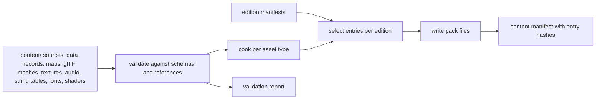

# Content build: one declarative, incremental, validating content build tool

## Context and Problem Statement

Every Species asset is newly authored (vision brief §5) and turned into runtime form by a content build: data records, maps, meshes, textures, audio, string tables, fonts and shaders are cooked and written into pack files ([ADR-0058](0058-pack-files-and-mount-policy.md)). Each product edition ships a defined subset. Errors in content (a missing reference, a schema error, an untranslated string, a map that breaks its mode's rules) must be found at build time with a precise location, never at run time. The cooked output must be reproducible, because its hashes are the content identity ([ADR-0060](0060-content-identity-by-hash.md)).

How is Species content built, validated and selected per edition?

## Decision Drivers

* Declarative selection of content per edition, without exclusion lists.
* Validation of every reference and schema at build time, with file and line.
* Incremental rebuilds driven by a dependency graph.
* Bit-identical output for identical inputs.
* The same parsing and validation code as the runtime loaders, so they cannot disagree.

## Considered Options

* A Species content build tool in C++23, sharing schema code with the engine
* Scripts in a general-purpose scripting language around separate converters
* Cooking on first load in the client

## Decision Outcome

Chosen option: "A Species content build tool in C++23, sharing schema code with the engine". It is a command-line program built from the same CMake project (`tools` product, [ADR-0056](0056-editions-build-flavours-and-feature-flags.md)) and run by developers and CI.

*Figure: content build flow from authoring sources to pack files and the content manifest.*

* **Edition manifests** list what each edition ships, by asset id, folder or tag; nothing is selected by exclusion. Unknown ids or flags are errors.
* **Dependency graph:** every output records its inputs, the tool version and its cook options; an output is rebuilt when any of their hashes changes.
* **Validators** (each failure names the file, line and field):
  * schema errors and unknown fields ([ADR-0061](0061-data-schemas-and-versioning.md));
  * missing references and references to the wrong kind of record;
  * keys that are not canonical or differ only in case;
  * unreferenced assets (an error for shipping editions, a warning otherwise);
  * per-mode map rules defined by the maps and level-design reference;
  * a separate collision asset for every collidable mesh;
  * string tables: missing keys per language, invalid message syntax, glyph coverage of the bundled fonts for every language an edition includes ([ADR-0063](0063-localisation.md));
  * texture, mesh and audio import settings (rules in the asset-pipeline ADRs).
* **Generated outputs:** map thumbnails rendered by the engine from a top-down view; the map index and other indexes the front end needs; the content manifest.
* **Reproducibility:** entries are written in sorted key order, with no timestamps or host paths in any output.
* **Enforcement:** CI runs the content build on every change; a validation error fails the change.

### Consequences

* Good, because content errors are found at build time with exact locations, and runtime loaders never parse authoring text.
* Good, because one implementation of each schema serves the tool, the editor and the runtime.
* Good, because reproducible output makes content hashes meaningful.
* Bad, because the tool is a first-party product that needs its own tests and maintenance.
* Bad, because thumbnail generation needs a GPU-capable or software-rendering build agent.

### Confirmation

* A reproducibility job builds the same revision twice on different agents and compares every pack byte for byte.
* Each validator has a failing fixture in the content build's test suite.
* An incremental-build test changes one source file and checks that only its dependants are rebuilt.

## Pros and Cons of the Options

### Species content build tool in C++23

* Good, because validation and runtime loading share code.
* Neutral, because tool and engine release together.

### Scripts around separate converters

* Good, because scripts are quick to write.
* Bad, because schema rules would be implemented twice, once in script and once in the engine, and drift.
* Bad, because a dependency graph and reproducible output must still be built by hand.

### Cooking on first load

* Bad, because errors surface on players' machines, start-up becomes slow, and the content identity would depend on the client.

## More Information

* Related: [ADR-0062](0062-authoring-syntax-and-schema-language.md) (authoring syntax), [ADR-0070](0070-continuous-integration.md) (CI jobs).
* Components: asset pipeline and resources (`AST`), build tooling and distribution (`BLD`), data schemas (`DAT`).
