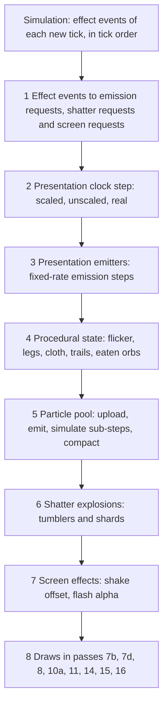
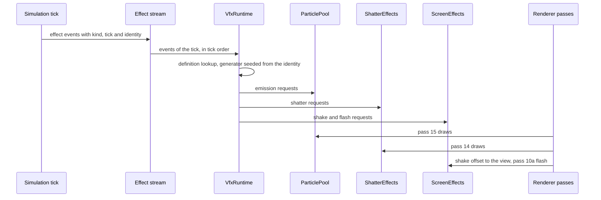
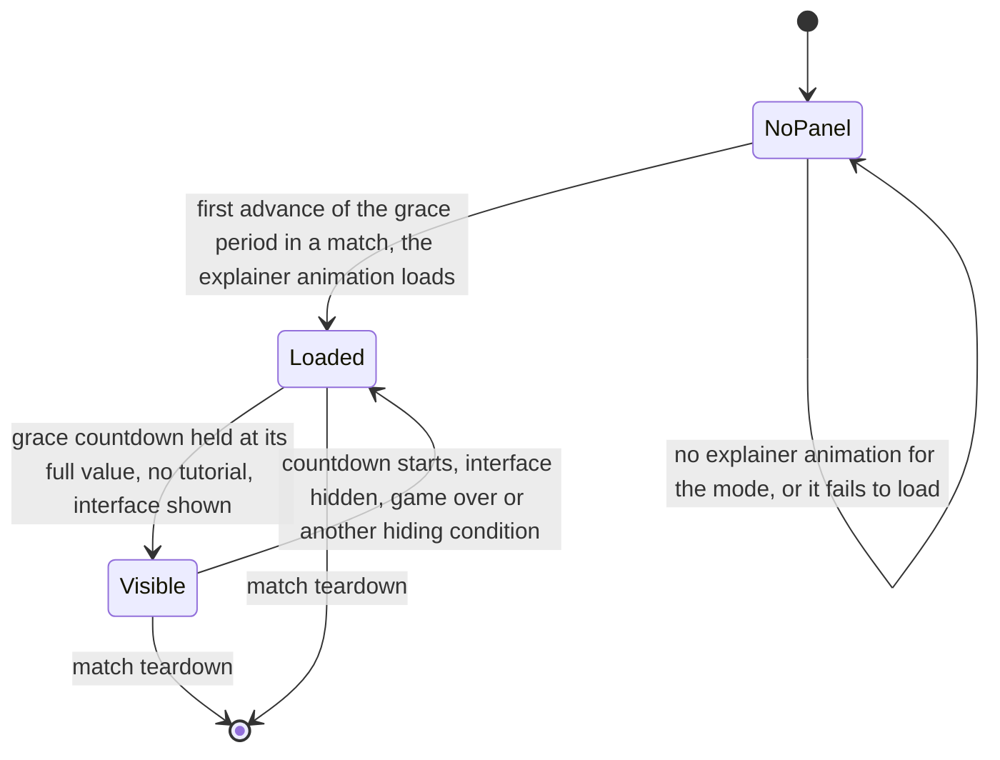

# Animation and VFX

> Status: Engine baseline · Prefix: VFX · ADRs: [ADR-0035](../../adr/0035-procedural-animation-runtime.md) · [ADR-0036](../../adr/0036-effect-events-and-presentation-clock.md) · [ADR-0010](../../adr/0010-gpu-particles-and-shatter-debris.md) · [ADR-0009](../../adr/0009-instanced-crowds-sprite-cards-and-shadows.md) · [ADR-0003](../../adr/0003-shader-language-compiler-and-material-shaders.md) · [ADR-0005](../../adr/0005-pipeline-state-catalogue.md) · [ADR-0013](../../adr/0013-working-colour-space-and-blending.md) · [ADR-0018](../../adr/0018-texture-import-manifest.md) · [ADR-0019](../../adr/0019-mesh-source-format-and-cooked-meshes.md) · [ADR-0020](../../adr/0020-flat-shading-and-team-tint.md) · [ADR-0021](../../adr/0021-mesh-socket-schema.md) · [ADR-0030](../../adr/0030-ui-framework-build-or-buy.md) · [ADR-0031](../../adr/0031-batched-ui-rendering.md) · [ADR-0033](../../adr/0033-ui-layout-scaling-and-dpi.md) · [ADR-0059](../../adr/0059-content-build-and-validators.md) · [ADR-0061](../../adr/0061-data-schemas-and-versioning.md) · [ADR-0064](../../adr/0064-accessibility-baseline-xag.md) · [ADR-0068](../../adr/0068-profiling-and-gpu-timing.md) · [ADR-0069](../../adr/0069-test-framework.md) · [ADR-0074](../../adr/0074-platform-clock-with-injectable-time.md) · Related: [Renderer](renderer/README.md) · [Frame graph and passes](renderer/frame_graph_and_passes.md) · [Entity and overlay renderers](renderer/entity_and_overlay_renderers.md) · [Randomness and integrity](../../reference/12_simulation_model/07_randomness_and_integrity.md) · [Weapons and projectiles](../../reference/04_supply_crates_powers_and_weapons/weapons_and_projectiles.md)

This component is the Species presentation runtime for everything that moves on screen without being simulation motion: the presentation clock; the effect events that the simulation emits and the effect definitions that turn them into visuals; the GPU particle pool; the shatter effects that break meshes into tumbling shards; procedural animation (procedural legs, segment chains, trails, tails and cloth flags); the animation recipes of sprite cards, billboards and overlays; the damage flicker; camera shake and full-screen flashes; and the player of the explainer animations. The renderer draws the results in the passes named here; this document states what is spawned, when, how it moves and how it fades.

## 1 Responsibilities and boundaries

### 1.1 What moves on screen

**VFX-001** (MUST) The look has no skeletal animation, no vertex skinning and no 3-D key-frame animation format (ADR-0035, ADR-0019). Everything that moves on screen is one of exactly these five kinds:

1. **simulation motion**: positions and orientations advanced by the simulation and drawn extrapolated to the frame's time ([renderer/frame_graph_and_passes.md](renderer/frame_graph_and_passes.md) RND-081, RND-082);
2. **procedural presentation animation**: sprite cards, sways, tumbles, trails, tails, cloth flags, pulsing glows and procedural legs, computed by this component from the presentation view of the simulation (§4.4 to §4.13);
3. **particles** in one particle pool (`ParticlePool`, §4.14) and **shatter debris** of the shatter effects (`ShatterEffects`, §4.17);
4. **effect objects**: the laser bolts and the effects of the match world (shockwave rings, lightning strikes, snowflakes and the others of [renderer/entity_and_overlay_renderers.md](renderer/entity_and_overlay_renderers.md) RND-332), which the simulation advances and the renderer and this component draw (§4.16);
5. **2-D key-framed explainer animations** (§4.3) and **screen-space effects**: camera shake and full-screen flashes (§4.18).

**VFX-002** (MUST) The pass order, the blend, depth and cull state of every pass, and the catalogue entries of the passes that the renderer owns are those of [renderer/frame_graph_and_passes.md](renderer/frame_graph_and_passes.md) RND-070 and [renderer/entity_and_overlay_renderers.md](renderer/entity_and_overlay_renderers.md) RND-308. This component owns the behaviour of the effects (what is spawned, when, how it moves, how it fades), the drawing of passes 11 (Essence orbs), 14 (shatter debris) and 15 (particles), the Worker ground-shadow values of pass 7d, the damage-flicker transform, the cloth-flag draws, and the catalogue entries of §3.9. The behaviour that drives an effect (states, targets, damage) belongs to the reference documents that §4.15 names for each effect.

### 1.2 Ownership and neighbours

**VFX-003** (MUST) The component depends on its neighbours only through these contracts:

| Neighbour | What this component receives | What it provides | What it never does |
|---|---|---|---|
| simulation ([reference/12](../../reference/12_simulation_model/README.md)) | the presentation snapshot and the effect events of each tick, in tick order (ADR-0036) | nothing | write a simulation field; draw from the simulation generator; feed a value back |
| renderer ([renderer/README.md](renderer/README.md)) | the frame's pass contexts, the catalogue, the `terrain_heights` resource (RND-063), the per-frame constants | the particle pool and its indirect arguments, the shard buffers, instance data for passes 7b, 7d, 10a, 11, 14 and 15, camera-shake offsets and flash requests | create pipeline states during a frame; issue barriers (RND-051) |
| camera ([camera_and_sequences.md](camera_and_sequences.md)) | the view of the frame | the shake rotation offset of the frame (§4.18) | move the camera or store an offset in its state |
| UI framework ([ui_framework/README.md](ui_framework/README.md)) | the explainer panel widget and its draw batch (ADR-0030, ADR-0031) | the explainer timeline player (§4.3) | lay out widgets |
| audio engine ([audio_engine.md](audio_engine.md)) | nothing | presentation events that this component raises (the spider footstep, the thrown-weapon fuse blink) | start a voice directly |
| platform layer ([platform_layer.md](platform_layer.md)) | the platform clock with injectable time (ADR-0074) | nothing | read an operating-system clock |
| content build ([asset_pipeline_and_resources.md](asset_pipeline_and_resources.md), [data_schemas.md](data_schemas.md)) | cooked effect definitions, explainer animations, textures and meshes with their sockets | nothing | parse authoring files at run time |

**VFX-004** (MUST) The component is a client-only module. The dedicated-server build links none of it; the simulation runs identically with this component replaced by a stub that discards every effect event (DEC-654, R-SIM-720).

### 1.3 Effects are cosmetic

**VFX-005** (MUST) Effects are cosmetic. Nothing that this component computes feeds the simulation; it never writes simulation state, never draws from the simulation generator (`SimRng`) and never reads local state from inside a simulation step (DEC-007, DEC-013, R-SIM-655). Every gameplay value is computed by the simulation on the CPU; GPU work here serves presentation only (DEC-654). No gameplay information is carried only by an effect, because presentation may drop or simplify any effect (ADR-0036).

**VFX-006** (MUST) Each way in which visual code can touch the simulation is closed by the rule in this table; the conformance tests of §7 check every row.

| # | Case | Species rule |
|---|---|---|
| 1 | a tree's crown hit volume produced as a by-product of building its render geometry, valid only at one detail level | the hit volume is baked collision data of the content build; render geometry never feeds the simulation (DEC-012, R-SIM-651) |
| 2 | a walking body whose motion depends on foot states timed by the real clock | no simulation body depends on a procedural foot; the only legged creature is the spider, whose legs are presentation only (DEC-007, §4.10) |
| 3 | spider feet timed by the real clock, read by foot-fall sounds and the next lift decision | foot and leg state is presentation state of this component on the presentation clock (DEC-007, ADR-0035) |
| 4 | simulation draws spent on cosmetic particle arguments inside simulation code | the simulation emits an effect event, and this component makes every cosmetic draw from its own presentation generator (DEC-013, DEC-222 item 7, R-SIM-622) |
| 5 | simulation draws spent by purely visual simulation objects (the volcano vent's idle roll, snowflakes, Wisps) | these draws are presentation draws (R-SIM-622); the objects' simulated state never depends on them |
| 6 | presentation draws made inside simulation code for particle counts and velocities | every such draw is made by this component from an effect event, never inside a tick (R-SIM-640) |
| 7 | render paths that write fields of simulated objects (a Worker's colour timer, a Barrier Emitter link, the world cursor's structure kind, the Reaper Serpent's eaten-orb list) | every such value is presentation state keyed by the object's handle (R-SIM-636, R-SIM-656, RND-301) |
| 8 | the damage-flicker flag stored in a simulated object | the flag is presentation state of this component (§4.9) and is never part of a simulation state hash (R-SIM-636) |
| 9 | presentation side effects started from simulation code or render code (the Launch Vessel's camera shake, the thrown weapon's fuse-blink sound) | they are effect events or presentation events, consumed in tick order (ADR-0036, DEC-007) |
| 10 | a seasonal theme switched on from each participant's own date, with seasonal effects that consume simulation draws | the seasonal state is match state fixed in the match setup, and its effects use presentation draws (DEC-118, R-SIM-726) |
| 11 | particle creation that does nothing while the match is paused, after its arguments (simulation draws included) have been evaluated | effect events carry no cosmetic draw, and no tick runs while the world is held, so pausing changes no simulation draw (R-SIM-622) |

### 1.4 Effect and animation inventory

**VFX-007** (MUST) The component provides exactly the effects and animations of this inventory; the last column names where each is specified.

| # | Effect or animation | Trigger | Specified in |
|---|---|---|---|
| 1 | mode explainer animation of the grace period | grace period while the players ready up | §4.3; [front_end_presentation.md](../../reference/09_front_end_and_match_flow/front_end_presentation.md) R-META-220 to R-META-233 |
| 2 | Worker card: terrain alignment, distance scaling, card-to-billboard blend | every frame | [renderer/entity_and_overlay_renderers.md](renderer/entity_and_overlay_renderers.md) RND-314; §4.5 |
| 3 | Worker airborne tumble and work sway | every frame, by state | §4.5; [worker.md](../../reference/02_units/worker.md) R-UNIT-143 |
| 4 | Worker state cards (hurt variants, side card, Visitor faction card) | Burning, airborne corpse, edge-on view, Visitor faction | RND-316; §4.5 |
| 5 | Worker overlays: control glow, Fury glow, Sickness bubble, Shield bubble, Visitor glow, Convert overlay, crate-capture beam, ground shadow, corpse fragments | state and Power links | §4.5; R-UNIT-147 |
| 6 | Worker team-colour cross-fade after a conversion | Convert hit | RND-317 |
| 7 | seasonal hats, snow, seasonal terrain ramps, bare trees, seasonal light colour | seasonal state of the match | §4.6 |
| 8 | damage flicker | each actor's health fraction | §4.9 |
| 9 | procedural legs with two-bone inverse kinematics; the spider gait | spider body motion | §4.10 |
| 10 | centipede segment chain | simulation chain | §4.11 |
| 11 | Reaper Serpent tail and eaten-orb display | position history; kills | §4.11 |
| 12 | Crawler worm and glow strips | position history | §4.11 |
| 13 | Brood Drifter tentacle tails | every frame | §4.11 |
| 14 | cloth flags of Leaders, Transports and Flag posts | every frame | §4.12 |
| 15 | tree sway, regrowth, burning and blighting | every frame | [renderer/world_renderers.md](renderer/world_renderers.md) |
| 16 | other procedural motions: Collector and Abductor beams, order markers and trail marks, the Allegiance Scrambler, shell casings, the thrown-weapon tumble | per object | §4.13 |
| 17 | particles of 17 types | the effect events and presentation emitters of §4.15 | §4.14, §4.15 |
| 18 | shatter debris | the shatter events of §4.17 | §4.17 |
| 19 | laser bolts and Convert bolts | every bolt | RND-338 to RND-341 |
| 20 | muzzle flashes | every shot | §4.16; R-CRATE-475 |
| 21 | shockwave ground ring, full-screen flash and blast | every explosion | RND-333 to RND-335; §4.18 |
| 22 | Core Device pulse-wave cylinders and flash | Siege Core Device | §4.16; R-CRATE-483 |
| 23 | lightning cloud glow and bolts | maps with lightning | RND-336, RND-337 |
| 24 | rocket flames and the Launch Vessel's booster | rockets; Launch Race | §4.15 |
| 25 | smoke columns and volcano eruptions | map objects | §4.15 |
| 26 | fire: burning Workers, Speed Boost, burning trees, firebombs, fireballs | simulation states and events | §4.15 |
| 27 | snowflakes, dust objects and dust vortices | maps with weather; seasonal state | §4.16 |
| 28 | Wisps | Reaper Serpent and Blight Grove kills | [creatures.md](../../reference/02_units/creatures.md) R-UNIT-597 |
| 29 | Essence-orb glow quads | every orb | §4.16 (pass 11) |
| 30 | Barrier Emitter curtain scrolling | every frame | [renderer/world_renderers.md](renderer/world_renderers.md) |
| 31 | structure lights, ports and blob shadows | every frame | [renderer/world_renderers.md](renderer/world_renderers.md); RND-325 |
| 32 | cursor highlight rings, selection-circle particles, formation dots, placement ghosts | every frame | [cursor_and_markers.md](../../reference/06_controls_camera_and_commands/cursor_and_markers.md); §4.15 |
| 33 | route highlight flashes | order issued | RND-350 |
| 34 | camera shake | laser bolts near the camera, shockwaves, the pulse wave, the Launch Vessel's ignition | §4.18 |
| 35 | full-screen flashes | shockwaves, the pulse wave | §4.18 |
| 36 | fades, the paused banner and the screen transition | UI | RND-085 to RND-098 |

**VFX-008** (MUST NOT) The component provides no screen-space distortion, no pixelation ghosting, no gesture trail or gesture symbol display, no tutorial gesture playback, no Leader shield of orbiting orbs, no three-legged walker and no sound-chip envelope sequencer (DEC-059, DEC-336, DEC-062). The audio filter chain that a reference effects file configures belongs to the [audio engine](audio_engine.md).

## 2 Interfaces

The interface below is a C++23 declaration sketch, not an implementation.

```cpp
namespace species::vfx {

struct PresentationTime {          // §3.1
  double scaled = 0.0;             // frame step x game speed; stops while the world is held
  double unscaled = 0.0;           // frame step; stops while the world is held
  double real = 0.0;               // the real clock (R-SIM-570); never stops
};

class PresentationClock {          // ADR-0036; time comes from the platform clock (ADR-0074)
public:
  explicit PresentationClock(const PlatformTimeSource& source);
  void BeginFrame(double gameSpeed, bool worldHeld);           // VFX-012
  [[nodiscard]] PresentationTime Now() const;
  [[nodiscard]] double StepScaled() const;                     // this frame's advance
  [[nodiscard]] double StepUnscaled() const;
};

enum class EffectKind : std::uint16_t;   // closed enumeration, table 4.15-A

struct EffectEventId {                    // stable identity; seeds the presentation generator
  std::uint32_t tick = 0;
  SimObjectId emitter;                    // invalid for events with no emitter
  std::uint16_t sequence = 0;             // order of the event among the emitter's events of the tick
};

struct ShatterPayload {                   // EffectKind::Shatter (§4.17)
  MeshAssetId mesh;
  Mat3x4 transform;
  float fraction = 1.0f;                  // share of facets released; >= 1 releases all
  std::uint8_t paletteIndex = 0;          // team palette entry for the facet tint (ADR-0020)
};

struct EffectEvent {
  EffectKind kind;
  EffectEventId id;
  SimObjectId subject;                    // the object the effect follows or comes from
  Vec3 position, velocity, direction;
  std::uint8_t colourId = 0xFF;           // team colour id (RND-016); 0xFF = none
  float a = 0.0f, b = 0.0f;               // kind-specific scalars of table 4.15-A
  std::optional<ShatterPayload> shatter;
};

enum class ParticleKind : std::uint8_t {  // table 4.14-A, in this order
  RocketTrail, ExplosionCore, ExplosionDebris, MuzzleFlash, Fire, ControlFlash, Spark,
  BlueSpark, Casing, MissileTrail, MissileFire, WorkerFire, Leaf, Sickness, SpeedBoostTrail,
  FireballFlame, Volcano
};
enum class ParticleBlend : std::uint8_t { Glow, Smoke };
enum class TerrainRule : std::uint8_t { None, Bounce, DieOnContact };

struct ParticleEmission {
  ParticleKind kind;
  Vec3 position, velocity;
  std::optional<float> size;              // none: the type size
  std::optional<ColourRgba> colour;       // none: the type's random colour (VFX-047)
};

class ParticlePool {                      // ADR-0010
public:
  void Emit(std::span<const ParticleEmission> requests);      // into the frame's upload buffer
  void RecordSimulate(PassContext& compute, const PresentationTime& now);
  void RecordDraw(PassContext& pass15) const;                 // darkening batch, then additive
  void Empty();                                               // match teardown (R-SIM-005)
  [[nodiscard]] PoolCounts Counts() const;                    // development read-back
};

class ShatterEffects {                    // ADR-0010
public:
  void Shatter(const ShatterPayload& request, FxRng& rng, const PresentationTime& now);
  void RecordUpdate(PassContext& compute, const PresentationTime& now);
  void RecordDraw(PassContext& pass14) const;
  void Reset();
};

class ScreenEffects {                     // ADR-0036, ADR-0064
public:
  void RequestShake(float intensity);                         // combined by maximum
  void RequestFlash(float alpha, const PresentationTime& now);
  [[nodiscard]] ShakeOffset ShakeOffsetFor(const PresentationTime& now) const;
  void RecordFlash(PassContext& pass10a) const;
};

class ExplainerPlayer {                   // the explainer timeline, hosted by the UI framework
public:
  static std::expected<ExplainerPlayer, LoadError> Load(const ExplainerAnimation& data);
  void Draw(UiBatch& batch, const ExplainerLayout& layout, double realNow, const TeamColours& roles);
};

class VfxRuntime {
public:
  void OnMatchStart(const MatchSetupView& setup);            // seasonal state, team palette
  void ConsumeTick(std::uint32_t tick, std::span<const EffectEvent> events);
  void Update(const PresentationSnapshot& snap, const FrameView& view);
  void RecordPass(PassId pass, PassContext& context);         // 7b, 7d, 8, 10a, 11, 14, 15, 16
  void OnMatchEnd();
};

}  // namespace species::vfx
```

**Events.** The component consumes the effect events of every tick (table 4.15-A) and the route-highlight request of the renderer (RND-350), which it serves through the particle pool. It raises these presentation events for the audio engine: the spider footstep at every foot plant (R-UNIT-578) and the thrown weapon's fuse blink once per second of its age (R-CRATE-414). It raises no event that the simulation reads.

**Data contracts.** Per drawn actor the presentation snapshot holds the fields of [renderer/README.md](renderer/README.md) §2 and, for this component: the angular velocity about y, the unit id and slot index, the team colour id, the health fraction, the state and the flags that select overlays and emitters (Burning, sick, Shield, Speed Boost, Fury, Convert link, controlled, airborne, captured by an ant, inside a Transport), the Crawler trail samples (R-UNIT-535), the Reaper Serpent's tail history (R-UNIT-594) and the centipede links (R-UNIT-549). Per match it holds the seasonal state (DEC-118), the game speed, the world-held flag and the game-over flag. Effect definitions and explainer animations are records of the schemas of [data_schemas.md](data_schemas.md) (ADR-0061), validated by the content build (ADR-0059).

**Threading contract.** `ConsumeTick` and `Update` run on the frame thread, `ConsumeTick` for each newly taken tick in tick order and before the frame's `Update` (ADR-0036). GPU work is recorded into the passes and compute work of the frame graph and never issues barriers (RND-051). Every presentation generator instance belongs to one thread (R-SIM-608). In development builds a changed effect definition is reloaded between frames, never during one.

## 3 Data model

### 3.1 Clocks

**VFX-009** (MUST) Every procedural motion and effect of this component names its clock. The reference clocks map onto the Species clocks as follows:

| Reference clock | Species reading | Users in this component |
|---|---|---|
| match time, advanced by the per-tick game-time step and stopped while the world is held | presentation time, scaled | particle birth and death, the spider's lift lock-out, the explainer-free effect lifetimes that the simulation does not own |
| per-tick game-time step (`ref.sim.tick_period` × game speed) | the particle sub-step of VFX-045, in scaled presentation time | particle integration |
| presentation frame time, stopped while the world is held | presentation time, unscaled | shatter lifetimes, procedural-leg swings, cloth wobble, glow pulses |
| presentation frame delta, clamped to `ref.sim.frame.delta_clamp` (0.25 s) | the unscaled frame step | shatter integration, camera-shake decay, cloth relaxation |
| real clock | real time | the explainer playback (R-META-229), the selection-circle rotation (R-CTRL-370), the Worker cross-fade (RND-317) |
| smooth presentation time (real time × game speed, smooth between ticks) | presentation time, scaled | the Worker tumble and sway |
| extrapolation time | the extrapolation time of R-SIM-560 | every draw of a simulated object (RND-081) |

**VFX-010** (MUST) No code of this component reads an operating-system clock, the wall clock or a raw frame delta; time comes from the presentation clock, which reads the platform clock (ADR-0074, R-SIM-573). With the platform clock's fixed-step source, captures and replays drive presentation at a fixed rate.

### 3.2 Presentation randomness

**VFX-011** (MUST) Every random draw of this component comes from a presentation generator (`FxRng`) owned by this component, one instance per thread, with the draw forms of R-SIM-607 (`FxRng::NextUint`, `FxRng::NextUnit`, `FxRng::NextSigned`); simulation code can reach none of them, and no code of this component can include the simulation generator's interface (DEC-013, DEC-242, R-SIM-608). For each effect event the generator is seeded by `FxRng::Seed` from a hash of the event identity (tick, emitter handle, sequence), so the same event produces the same particles, shards and offsets when the same moment is replayed on the same client (ADR-0036). A presentation emitter (§4.15.3) seeds from its emitter handle and its emission-step count. The cosmetic draws that the reference makes from the simulation stream (R-SIM-622) are made here, from these generators.

### 3.3 Shared easing curve

**VFX-012** (MUST) One quadratic ease-in and ease-out curve serves the explainer transform tracks and the procedural-leg swing. With f = (t − start) ÷ duration: ease(f) = 2f² for f < 0.5 and 1 − 2(1 − f)² for 0.5 ≤ f ≤ 1, continuous with a continuous first derivative at 0.5. After the duration (f > 1) the curve returns its caller's completion value: 1 for the explainer (R-META-228) and `ref.unit.spider.leg.swing_done` (1.0001) for the legs (R-UNIT-583), so that a leg's caller can test for a value above 1.

### 3.4 Particle record and particle type fields

**VFX-013** (MUST) A particle (`ParticleInstance`) holds its position (wu), its velocity (wu/s), its birth time on the scaled presentation clock, its particle kind, its size (the requested size, or the type size when none is requested) and its colour. Its colour is the requested colour, or else colour 1 × a + colour 2 × (1 − a) of its type, with a = `FxRng::NextUnit(1)` drawn once at emission; an explicitly requested colour of (0, 0, 0, 0) counts as no colour, and no emitter of §4.15 requests it.

**VFX-014** (MUST) A particle type (`ParticleTypeParams`) has a life, a type size, a gravity, a friction, two colours, a blend class (`Glow` or `Smoke`), a terrain rule (`None`, `Bounce` or `DieOnContact`), a priority class and a cap (§4.14.4). A field that an effect definition leaves unset takes the default of this table:

| Field | Default |
|---|---|
| life | `vfx.particle.default.life` (10.0 s of scaled presentation time) |
| type size | `vfx.particle.default.size` (1000) |
| friction | 0 |
| gravity | 0 |
| colour 1 | `vfx.particle.default.colour_1` (0.5, 0.5, 0.5) |
| colour 2 | `vfx.particle.default.colour_2` (0.95, 0.95, 0.95) |

Particles have no spin, no fade-in and no type-specific fade-out: the fade of VFX-049 is common to every type.

### 3.5 Effect definitions

**VFX-015** (MUST) Each effect kind of table 4.15-A maps to exactly one effect definition, a record of the effect-definition schema of [data_schemas.md](data_schemas.md) (ADR-0036, ADR-0061). A definition holds: the particle types it uses with their parameter sets (VFX-014); its emitter bursts, each with a particle type, a count rule, a position rule, a velocity rule, a size rule and a colour rule; its attachments to sockets (ADR-0021) or positions; its shatter request, if any; and its screen effects (shake and flash). The values of every definition are the reference values of §4.14 and §4.15. The content build rejects a definition with an unknown particle type, socket or parameter, and an effect kind without a definition (ADR-0059, DEC-015).

### 3.6 Shatter records

**VFX-016** (MUST) A shatter explosion (`ShatterExplosion`) is the set of released triangles of one mesh node. It holds `vfx.shatter.tumblers` (5) shard tumblers, each a rotation and an angular velocity shared by the shards that use it, its death time on the unscaled presentation clock, and one shard record per released triangle: the triangle's three corners relative to its centre, its facet normal, its facet colour (with the team tint applied, ADR-0020), its centre position, its velocity and its tumbler index. All shards of an explosion die together at its death time.

### 3.7 Procedural state

**VFX-017** (MUST) Procedural state is presentation state of this component, keyed by the handle of the object it belongs to and created and deleted only from the snapshot and from presentation events (R-SIM-636, RND-307):

| State | Key | Content | Lifetime |
|---|---|---|---|
| procedural legs and feet (`ProceduralLeg`, `ProceduralFoot`) | spider handle | the fields of R-UNIT-581, the active spider gait (`SpiderGait`) and the lift lock-out time | from the spider's first draw to its removal |
| cloth flag (`ClothFlag`) | owner handle and flag slot | 6 × 6 vertex positions, bounding sphere | from the owner's first draw to its removal |
| damage flicker | actor or structure handle | the flag, the chosen axis and the time of the last evaluation | while the object exists |
| Reaper Serpent eaten-orb display | Reaper Serpent handle | up to `ref.unit.reaper_serpent.max_eaten` (50) entries: offset, start time | while the Reaper Serpent exists |
| shared Brood Drifter tail velocity | none (one value) | the smoothed velocity of VFX-073 | the match |
| Worker colour cross-fade | Worker handle | owned by the renderer (RND-317) | — |

Trail histories are simulation state that this component reads: the Crawler trail samples (R-UNIT-535), the Reaper Serpent's tail positions (R-UNIT-594) and the centipede's three samples per segment (R-UNIT-551). Their GPU copies (`TrailPoint` buffers) are rebuilt from the snapshot every frame and never written back.

### 3.8 Explainer animation data

**VFX-018** (MUST) An explainer animation (`ExplainerAnimation`, asset `anim.explainer`) has the data model of [front_end_presentation.md](../../reference/09_front_end_and_match_flow/front_end_presentation.md) R-META-226: a canvas, a loop start and end, a playback time, and objects in draw order, each with its keys in authored order and the key fields and defaults of `ref.meta.explainer.key_defaults`. The player maps it one to one onto a UI timeline: one track per object and property, with the transform properties (x, y, scale) eased by the curve of VFX-012, the angle and the alpha linear (the alpha truncated to an integer), and the picture (`help.explainer_picture`), the colour role and the horizontal flip held from the earlier key. Its schema is the explainer schema of [data_schemas.md](data_schemas.md); the reference positional text format is not used.

### 3.9 Catalogue entries owned by this component

**VFX-019** (MUST) The draws of this component that the renderer's catalogue does not already hold use exactly these entries, each a full pipeline descriptor in the default-plus-differences form of RND-055, with the blend states of RND-058 and the shaders of [renderer/shaders.md](renderer/shaders.md):

| Entry | Shader | Blend | Depth | Cull | Bias or fog | Pass | Draws |
|---|---|---|---|---|---|---|---|
| `orb_ink` | `unlit_textured` | `Ink` | `Test` | `None` | — | 11 | Essence orbs of the Rogue faction slot |
| `orb_additive` | `unlit_textured` | `Additive` | `Test` | `None` | — | 11 | every other Essence orb |
| `shard_lit` | `mesh_lit`, `EDGE_MASK` on | `Alpha` | `TestWrite` | `None` | — | 14 | shatter debris, with the object lighting (RND-228) |
| `particle_darkening` | `unlit_textured`, point magnification | `Darkening` | `Test` | `None` | — | 15 | the smoke batch |
| `particle_additive` | `unlit_textured`, point magnification | `Additive` | `Test` | `None` | — | 15 | the glow batch |
| `cloth_cells` | `unlit_textured` | `Alpha` | `Test` | `None` | — | 7b | cloth-flag cells of Leaders and Transports |
| `cloth_cells_fog` | `unlit_textured`, fog | `Alpha` | `Test` | `None` | level fog | 8 | cloth-flag cells of Flag posts |
| `cloth_pole` | `unlit_vertex_colour` | `Alpha` | `Test` | `None` | — | 7b | cloth-flag poles |
| `cloth_pole_fog` | `unlit_vertex_colour`, fog | `Alpha` | `Test` | `None` | level fog | 8 | Flag-post poles |
| `cloth_pointer` | `unlit_textured` | `Alpha` | `Test` | `None` | `bias_flag_pointer` | 7b, 8 | the pointer `marker.flag_pointer` over a flag |
| `cloth_overlay` | `world_overlay`, `SOURCE = textured` | `Alpha` | in-shader (RND-309) | `None` | — | 16 | the local team's Leader banners and their pointers |

The particle entries sample `fx.particle_dot` with point filtering under magnification and linear filtering under minification (RND-432). The depth-bias variant `bias_flag_pointer` sets `SlopeScaledDepthBias` = `vfx.cloth.pointer_slope_bias` (1.0) and `DepthBias` = `vfx.cloth.pointer_constant_bias` (5) units towards the camera, in the reversed-Z convention of ADR-0016.

### 3.10 Lifetimes

**VFX-020** (MUST) The objects of this component have these lifetimes:

| Object | Lifetime |
|---|---|
| `VfxRuntime`, the presentation clock, the presentation generators | the client process |
| particle pool | the process; emptied at match teardown, holding content of the current match only (R-SIM-005) |
| shatter effects | the process; reset at match teardown (R-SIM-005) |
| effect definitions, particle parameter buffer | from content load to unload; replaced between frames on a development reload |
| procedural state | table of VFX-017 |
| explainer player | from the explainer panel's creation to match teardown (R-META-222) |
| screen-effect state (shake scalar, active flash) | the match; cleared at match start and end |

## 4 Behaviour and algorithms

### 4.1 The presentation clock and the frame step

**VFX-021** (MUST) At the start of each frame the presentation clock reads the platform clock and takes the step Δ = min(real now − real time of the previous frame, `ref.sim.frame.delta_clamp` (0.25 s)). While the world is held (R-SIM-550) both presentation readings stop: Δ counts as 0 for them. Otherwise the scaled reading advances by Δ × the game speed of the snapshot and the unscaled reading by Δ (ADR-0036). The real reading always follows the platform clock.

**VFX-022** (MUST) Each frame runs these steps in this order:

1. take the effect events of every tick that became current since the previous frame, in tick order (§4.2);
2. advance the presentation clock (VFX-021);
3. run the presentation emitters' due emission steps (§4.15.3);
4. update procedural state: damage flicker, procedural legs, cloth flags, trails and tails, the eaten-orb display (§4.9 to §4.13);
5. upload the frame's emission requests, then run the particle emit, simulate and compact compute work (§4.14);
6. update the shatter explosions (§4.17);
7. compute the camera-shake offset for the camera and the flash for pass 10a (§4.18);
8. record the draws of passes 7b, 7d, 8, 10a, 11, 14, 15 and 16.



Caption: one frame of the animation and VFX runtime; nothing on this path writes simulation state.

**VFX-023** (MUST) No effect depends on the frame rate (ADR-0036). A reference behaviour that runs once per rendered frame runs in Species as a fixed-rate step on the unscaled presentation clock, at `vfx.emit.step_rate` (60 steps per second): each step does exactly what the reference does in one frame, and a frame runs as many due steps as its clock advance holds, carrying the remainder to the next frame. A reference per-frame blend factor k becomes 1 − (1 − k)^(`vfx.emit.step_rate` × Δ) for a frame step Δ.

### 4.2 Effect events

**VFX-024** (MUST) For each effect event the runtime looks up the definition of its kind (VFX-015), seeds a presentation generator from the event identity (VFX-011) and executes the definition's bursts, shatter request and screen effects at the event's position and with its payload. The bursts become emission requests of the particle pool for the current frame.

**VFX-025** (MUST) Presentation MAY drop or simplify an effect event for distance, level of detail or caps (ADR-0010, ADR-0036, §4.14.4); doing so changes nothing in the game.

**VFX-026** (MUST) No tick runs while the world is held, so no effect event arrives, and no presentation emitter steps, because the unscaled clock stops (VFX-021). A Supply crate, a match message or any other gameplay object never depends on an effect having been drawn.



Caption: the one-way path from a simulation rule to its effect; no arrow returns to the simulation.

### 4.3 Explainer animations

**VFX-027** (MUST) The explainer animation of the mode explainer panel ([front_end_presentation.md](../../reference/09_front_end_and_match_flow/front_end_presentation.md) R-META-220, [reference/11](../../reference/11_tutorial_and_help.md) R-TUT-020) is played by the explainer player, a UI timeline component hosted by the UI framework (ADR-0030, ADR-0035) and drawn by the hint overlay in pass 17 (RND-070). The match's mode selects the `anim.explainer` of that mode (R-META-221); each of the six modes has one, and a mode without one shows no panel.

**VFX-028** (MUST) The panel's lifecycle follows this diagram, with the creation, visibility and teardown conditions of R-META-222 and R-META-223:



Caption: the explainer panel exists at most once per match and shows while the players ready up.

**VFX-029** (MUST) The state of an object at playback time t is evaluated by R-META-228 with the curve of VFX-012: the left key is the key with the greatest time at or before t and the right key the key with the smallest time at or after t, ties going to the first key in authored order; an object with no left key is not drawn, so an object never exists before its first key; an object with only a left key holds that key; keys closer than `ref.meta.explainer.key_merge_tolerance` (0.01 s) count as one key.

**VFX-030** (MUST) The playback clock runs on the real clock and ignores pause and game speed (R-META-229). On the first draw the playback time is 0, not the loop start, and the timer is set to now; on every draw the playback time grows by now − timer and the timer becomes now; when the playback time exceeds the loop end it is set to the loop start and the excess is discarded. The timer is refreshed only by a draw, so after a hidden span the first draw adds the whole span and the playback restarts at the loop start. These are the rules of the Open DEC-750; its default is the reference behaviour stated here.

**VFX-031** (MUST) The panel's place and size are those of R-META-224. The reference computes them once, when the panel is created; the Species panel is a widget of the UI framework and is laid out again whenever the screen size, the DPI or the text scale changes (ADR-0033).

**VFX-032** (MUST) The panel draws its background, frame, objects, title and caption by R-META-230 to R-META-233, through the batched UI renderer (ADR-0031) with standard alpha blending: each object is one textured quad of its picture, rotated about its centre by its angle, mirrored when its flip is on, inside the panel's clip rectangle. Colour roles are resolved at draw time against the local player's team colour (R-META-227, ADR-0035).

**VFX-033** (MUST) An explainer animation is validated against its schema by the content build; a malformed record, an over-long name or an unknown picture role is a build error, never a run-time fault (DEC-015). At run time an explainer animation that is missing or fails to load gives no panel for that match (R-META-222).

**VFX-034** (MAY) The player MAY expose an editing interface to an authoring tool: create and delete an object, insert a key at time t whose values are the object's evaluated state at t, find the key of an object within a time tolerance of t, delete a key, and write the animation. No game path uses it.

### 4.4 Sprite and billboard conventions

**VFX-035** (MUST) No sprite is animated frame by frame from a sheet. Every sprite is one image whose quad is transformed procedurally; the "frames" of a figure are state textures chosen by a condition, such as the hurt variants of `sprite.worker.hurt` (§4.5).

**VFX-036** (MUST) Sprites carry authored alpha by the alpha modes of ADR-0018; additive sprites rely on a black background, so black adds nothing.

**VFX-037** (MUST) A billboard is a `CameraFacing` quad (RND-306). A square billboard of half-extent s has half-width and half-height s; a diamond billboard, whose corners lie at p ± U × s and p ± R × s on the camera up and right vectors, is the square billboard of half-size s ÷ √2 rotated by π ÷ 4 about the view axis. The bottom-anchored, horizontally mirrored billboard is that of RND-329.

**VFX-038** (MUST) Unless a rule states otherwise: a pulse is |sin(k × t)| of the unscaled presentation time t, with the floor that the rule names; a blink compares the remainder of t divided by a period with a threshold; a fade is linear in the remaining life; and a figure is drawn at its extrapolated position (RND-081), with the figures that are drawn one tick behind or ahead named in their rules.

### 4.5 Worker cards and overlays

**VFX-039** (MUST) The Worker card's texture, size, distance scaling, card-to-billboard blend, colour and cross-fade are those of RND-314 to RND-318 and [worker.md](../../reference/02_units/worker.md) R-UNIT-142 to R-UNIT-148. A Worker that is destroyed, disabled or inside a Transport is not drawn.

**VFX-040** (MUST) This component sets the card's position and axes before the renderer builds the quad, with T the scaled presentation time, *hd* the high-detail factor and the far distance of RND-314 (1300 wu):

| Condition | Rule |
|---|---|
| *hd* > 0, closer than the far distance, on the ground | the card's foot point lies on the terrain height at its drawn position |
| *hd* > 0, closer than the far distance, airborne and neither Drowning nor InAbductionBeam | the foot point is raised by `vfx.worker.airborne_lift` (3 wu) |
| Manning, OpeningCrate, or watching an Essence orb (R-BLDG-203) | the up vector is turned about the front by sin(T) × `ref.unit.worker.sway_angle` (0.3 rad) |
| airborne, not Drowning, not of the Visitor faction | the up vector is turned about the front by T × (unit id mod 10) × `ref.unit.worker.tumble_rate` (0.1) rad, positive for an even unit id and negative for an odd one |
| Carrying | right = normalise(carryable position − card position) × up, and up is tilted about right by `vfx.worker.carry_lean` (0.3 rad) towards the load |
| CarriedByAnt | up = −normalise(velocity), right = the previous up, and the card is raised by `vfx.worker.ant_carry_lift` (4 wu) |
| beyond `ref.unit.worker.card_face_start` (300 wu) | in the card-to-billboard blend the camera right vector enters with a positive sign when the Worker's front · the camera front < 0 and with a negative sign otherwise, so the card never shows mirrored |

**VFX-041** (MUST) A Worker draws these layers in this order. "Current card" is the texture of RND-316; s is the card size of RND-314; t is the unscaled presentation time; every glow is additive with no depth test unless stated.

| Layer | Condition | Texture | Colour and blend | Geometry |
|---|---|---|---|---|
| ground shadow | *hd* > 0, alive, not InAbductionBeam, within `ref.unit.worker.shadow_range` (2000 wu) | current card | black at alpha `ref.unit.worker.shadow_alpha` (150) × *hd*, × `ref.unit.worker.shadow_rogue_factor` (0.3) for the Rogue faction, at most 255; `worker_ground_shadow`, no depth write (RND-221) | a flat quad `vfx.worker.shadow_lift` (0.3 wu) above the terrain, spanning the card's right vector and world +z by 2 × s |
| body | every Worker except the Rogue and Visitor factions, alive or airborne | current card | the colour of RND-317; `worker_card` | the card |
| Visitor body | Visitor faction | `sprite.visitor.front` | (0.5, 0.5, 0.5) (`vfx.worker.visitor_grey`) × the health factor of R-UNIT-146 | the card at s × `vfx.worker.visitor_scale` (1.3) |
| Visitor glow | Visitor faction | `fx.glow_round` | the saturated team colour (§4.7), alpha \|sin(`vfx.worker.glow_pulse_slow` × t)\| × `vfx.worker.visitor_glow_alpha` (0.3) | camera billboard of half-extent 2 × s |
| control glow | local team, controlled or selected, alive | current card | (0.1, 0.1, 1.0) (`vfx.worker.control_glow_colour`), alpha max(\|sin(`vfx.worker.glow_pulse_fast` × t)\|, `ref.unit.worker.control_glow_min` (0.3)) | `vfx.worker.control_glow_layers` (10) identical stacked cards, ten times the brightness of one |
| Fury glow | Fury, alive | current card; for the Rogue faction `sprite.worker.hurt` variant 04 at 1.5 × s | white, alpha max(\|sin(`vfx.worker.glow_pulse_slow` × t)\|, `vfx.worker.fury_glow_min` (0.3)) | the card |
| Sickness bubble | sick, alive | `fx.glow_round` | `ref.unit.worker.sickness_bubble_colour` (90, 130, 10), alpha \|sin(`vfx.worker.glow_pulse_slow` × t)\| × `vfx.worker.sickness_bubble_alpha` (0.8) | camera billboard of half-extent 2 × s, raised by s |
| Rogue body | Rogue faction | `sprite.worker.hurt` variant 04 | white, alpha blend with no cut-out, drawn twice | the card at s × `vfx.worker.rogue_scale` (1.5) |
| Shield bubble | Shield, alive | `fx.bubble_sphere` | the saturated team colour (§4.7), alpha \|sin(`vfx.worker.glow_pulse_slow` × t)\| × `vfx.worker.shield_bubble_alpha` (0.5) | camera billboard of half-extent 2 × s |
| side card | edge-on view, c = \|front × direction to the camera\| above `ref.unit.worker.side_view_threshold` (0.95) | `sprite.worker.side` | the team colour, alpha 255 × `vfx.worker.side_alpha_gain` (20) × (c − 0.95), at most 255 | a strip ± `vfx.worker.side_half_width` (0.25 wu) along the camera right vector, the card's height high |
| seasonal hat | R-UNIT-148 | `sprite.worker.seasonal_hat` | white | the card at s × `vfx.worker.hat_scale` (0.65), raised `vfx.worker.hat_raise` (0.95) × the card's up extent, moved `vfx.worker.hat_forward` (0.01) × front |
| Convert overlay | a Convert link, alive | `sprite.worker.state_overlay` | the team colour, alpha 255 × (1 − frac(t)), no cut-out, no depth write | the card at s × (`vfx.worker.convert_overlay_scale` (2.8) + frac(t)), so it expands once per second, lowered `vfx.worker.convert_overlay_drop` (0.4) × the up extent |
| crate-capture beam | OpeningCrate, within `ref.unit.worker.crate_spark_factor` (1.1) × the crate scan range | `fx.beam_short` | the team colour, alpha \|sin(`vfx.worker.capture_beam_pulse` × (t + unit id))\| × 255 | a `Segment` of half-width `vfx.worker.capture_beam_half_width` (0.5 wu) from the card position + `vfx.worker.capture_beam_lift` (4 wu) × up to the crate |
| corpse fragments | dead | current card | black, alpha health × `vfx.worker.fragment_alpha` (2.55) | `ref.unit.worker.corpse_fragments` (3) cards of half the size, drifting apart along ±x and ±z by 10 − h ÷ 10 wu (`vfx.worker.fragment_spread`, 10) and rising with their height, where h is a display health that falls by `vfx.worker.fragment_fade_ground` (40) per s of scaled presentation time on the ground and `vfx.worker.fragment_fade_air` (20) per s airborne |

A dead Worker's body is drawn in its colour × `ref.unit.worker.corpse_colour` (0.2) at alpha `ref.unit.worker.corpse_alpha_per_health` (2.5) × health (R-UNIT-146), and a paralysed Worker in `ref.unit.worker.paralysed_colour` (150, 150, 150). The glow pulse rates are `vfx.worker.glow_pulse_fast` (5 rad/s) and `vfx.worker.glow_pulse_slow` (2 rad/s). The launch-spectacle shadow of a watching Worker is never drawn: the spectacle is inactive in matches (DEC-009).

### 4.6 Seasonal theme

**VFX-042** (MUST) Whether the seasonal theme is active is match state, decided once in the match setup and identical for every participant (DEC-118, R-SIM-726); whether Species keeps it and who chooses it is the Open DEC-101, whose default is that the host's match setup applies the reference date window `ref.meta.seasonal.first_day` to `ref.meta.seasonal.last_day` of `ref.meta.seasonal.month` once. This component reads the state from the match setup and never from a local date. While it is active:

| Effect | Specified in |
|---|---|
| seasonal hats on every Worker whose unit id is divisible by `ref.unit.worker.seasonal_hat_period` (3) | R-UNIT-148, VFX-041 |
| snow on every map, from the presentation generator | R-SIM-234, R-CRATE-500, §4.16 |
| trees with branches of `ref.bldg.tree.seasonal_branch_rgb` (180, 100, 50) and no leaves | [trees_and_crate_structures.md](../../reference/03_buildings_and_world_objects/trees_and_crate_structures.md), [renderer/world_renderers.md](renderer/world_renderers.md) |
| the seasonal terrain ramp, sea tile and shore-wave gradient | [terrain.md](terrain.md) TER-042 |
| every light colour replaced by `rnd.light.seasonal_colour` (1.3, 1.2, 1.2); the light's alpha keeps its map value | RND-013 |

No other seasonal theme exists.

### 4.7 Team colour in effects

**VFX-043** (MUST) Effects take team colour from these sources:

| Source | Users |
|---|---|
| the team colour of the colour table (RND-016), as 8-bit RGBA | sprites, laser bolts, Essence orbs, rings, beams, cloth flags, particles given an explicit colour |
| the team palette index of a mesh instance (ADR-0020) | shatter debris, which keeps the tinted facet colours of the mesh it came from (§4.17) |
| the red-channel team area of a cloth-flag texture (`marker.leader_banner`, `marker.flag_post_state`) | cloth flags (§4.12) |

The Rogue faction's colour is near black, so its additive figures are drawn instead with the darkening or ink blend, or in white with alpha 0: Rogue faction Essence orbs, Crawler strips and laser bolts follow RND-327, RND-319 and RND-339.

**VFX-044** (MUST) The Shield bubble and the Visitor-faction glow take a saturated team colour: each channel of the 8-bit team colour is fully on when its value is at least 1 and fully off when it is 0, so most team colours give a white bubble, orange a yellow one and purple a magenta one (RND-408). This is the reference look and the default of the Open DEC-328. The Fury glow's colour (200, 200, 200) saturates to white by the same rule.

### 4.8 Other billboards and sprites

**VFX-045** (MUST) Each live entry of a Reaper Serpent's eaten-orb display (R-UNIT-591) is drawn, while its age is below `ref.unit.reaper_serpent.eaten_display_ticks` (600 ticks of presentation time), at the head position + its offset as two diamond billboards in `vfx.serpent.eaten_colour` (100, 50, 50) with a = 1 − age ÷ that span and d the camera distance: an inner one of half-extent `vfx.serpent.eaten_inner_size` (4) × a ÷ d^¼ at alpha `vfx.serpent.eaten_inner_alpha` (200) × a, and an outer one of half-extent `vfx.serpent.eaten_outer_size` (12) × a ÷ d^¼ at alpha `vfx.serpent.eaten_outer_alpha` (100) × a, additive with no depth test (`actor_glow_nodepth`). When the display is full, a new entry overwrites a slot chosen by `FxRng::NextUint` mod 50. An entry whose span has passed is removed by this component; the list is presentation state.

**VFX-046** (MUST) A Wisp's two cards (R-UNIT-597) are drawn along the Wisp's own right and up axes, not facing the camera.

**VFX-047** (MUST) An Essence orb whose broken marker is set (R-UNIT-308) hides its inner quad, sinks its outer quad at its break rate in wu per second and fades it by `vfx.orb.broken_fade` (10 of 255) per second; breaking an orb shows `vfx.orb.break_particles` (5) control-flash particles in its team colour, each with the velocity (`FxRng::NextUnit(5)`, `FxRng::NextUnit(5)`, `FxRng::NextUnit(5)`). No rule of a match breaks an orb (R-UNIT-308), so neither occurs in a match.

**VFX-048** (MUST) The thrown weapon's tumble and fuse-blink flash (R-CRATE-414), the barrage missile's warhead, launcher and ground marker ([hazards_and_projectiles.md](../../reference/02_units/hazards_and_projectiles.md), RND-324), the dust object (R-CRATE-505) and the snowflake (R-CRATE-501) are drawn as their owners state; the fuse blink's sound is a presentation event of the blink, never a sound started by drawing (DEC-007).

### 4.9 Damage flicker

**VFX-049** (MUST) An object's damage-flicker flag is presentation state of this component, evaluated once per `vfx.flicker.step` (one `ref.sim.tick_period`, 0.1 s of scaled presentation time), the cadence of the reference, never inside a tick and never stored in a simulated object (R-UNIT-051, R-SIM-636). With t the unscaled presentation time and s = sin(t + `ref.unit.flicker.phase_per_id` (10) × unit id), the flag of an actor is set when `FxRng::NextUnit`(`ref.unit.flicker.chance_scale` (0.75)) × (1 − \|s\| × `ref.unit.flicker.sine_weight` (0.8)) > its health fraction. A Spitter Plant's flag is set when `FxRng::NextUnit`(0.75) × (1 − \|s\| × `vfx.flicker.structure_sine_weight` (1.2)) > its damage ÷ `vfx.flicker.spitter_damage_divisor` (50), and it flickers only while its damage is above 0; a Hive's flag uses the same expression with its health ÷ `vfx.flicker.hive_health_divisor` (100). An object at full health never flickers; at low health it flickers on most steps, modulated by its slow sine.

**VFX-050** (MUST) While its flag is set, the object's body draw is replaced by a draw in which one axis of its mesh transform, chosen at each evaluation by a presentation draw, is scaled, with the catalogue entry that RND-324 gives (`actor_flicker_additive` for additive one-one blending; `actor_flicker_darkening` for the spider). Because the world is black, an additive flicker shows a brighter, briefly stretched ghost of the object, and only the spider darkens:

| Object (pass) | Axis choice | Scale of the chosen axis | Blend |
|---|---|---|---|
| spider (7b) | right or up, each with probability `vfx.flicker.spider_axis_share` (0.5) | 1 + s × `vfx.flicker.spider_gain` (0.5) | darkening, for the body only |
| Leader (7b), Trooper (7a) | front, up or right with probabilities `vfx.flicker.axis_shares` (0.3, 0.3, 0.4) | front and right: 1 − s × `vfx.flicker.gain` (0.5); up: 1 − s × `vfx.flicker.up_gain` (0.2) | additive |
| Brood Drifter (7b) | as the Leader | 1 − s × `vfx.flicker.gain` (0.5) on whichever axis is chosen | additive |
| Spitter Plant (6) | as the Leader | as the Leader | additive |
| Hive (6) | as the Leader | front and right: 1 − s × `vfx.flicker.hive_gain` (0.7); up: 1 − s × `vfx.flicker.gain` (0.5) | additive |
| Transport (7b) | right or front, each with probability 0.5 | 1 + sin(t) × `vfx.flicker.gain` (0.5), with no unit-id term | additive |

The Collector, the Builder, the Worker, the Crawler and every other object never flicker; the centipede's flag has no visible effect and is not evaluated.
