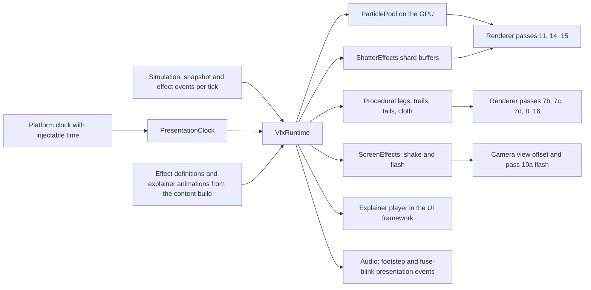
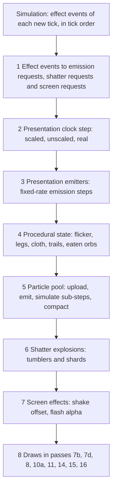
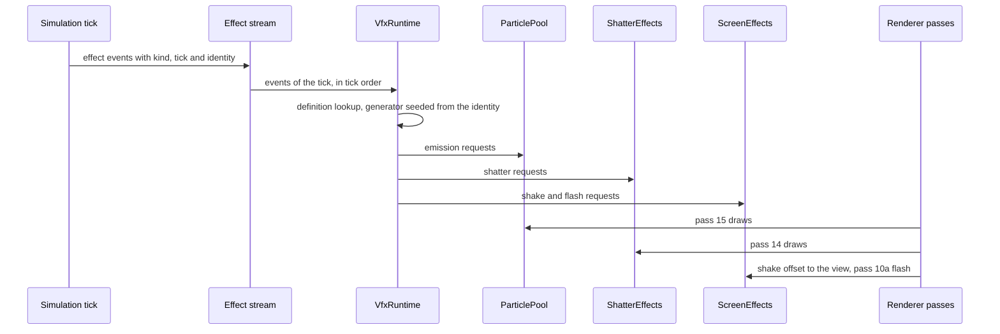

# Animation and VFX

> Status: Engine baseline · Prefix: VFX · ADRs: [ADR-035](../../../ADR/ADR-035-procedural-animation-runtime.md) · [ADR-036](../../../ADR/ADR-036-effect-events-and-presentation-clock.md) · [ADR-010](../../../ADR/ADR-010-gpu-particles-and-shatter-debris.md) · [ADR-003](../../../ADR/ADR-003-shader-language-compiler-and-material-shaders.md) · [ADR-005](../../../ADR/ADR-005-pipeline-state-catalogue.md) · [ADR-008](../../../ADR/ADR-008-gpu-memory-uploads-and-device-removal.md) · [ADR-009](../../../ADR/ADR-009-instanced-crowds-sprite-cards-and-shadows.md) · [ADR-016](../../../ADR/ADR-016-view-projection-and-depth-conventions.md) · [ADR-019](../../../ADR/ADR-019-mesh-source-format-and-cooked-meshes.md) · [ADR-030](../../../ADR/ADR-030-ui-framework-build-or-buy.md) · [ADR-059](../../../ADR/ADR-059-content-build-and-validators.md) · [ADR-061](../../../ADR/ADR-061-data-schemas-and-versioning.md) · [ADR-064](../../../ADR/ADR-064-accessibility-baseline-xag.md) · [ADR-066](../../../ADR/ADR-066-telemetry-with-consent.md) · [ADR-068](../../../ADR/ADR-068-profiling-and-gpu-timing.md) · [ADR-069](../../../ADR/ADR-069-test-framework.md) · [ADR-074](../../../ADR/ADR-074-platform-clock-with-injectable-time.md) · Related: [Renderer](../renderer/README.md) · [Frame graph and passes](../renderer/frame_graph_and_passes.md) · [Entity and overlay renderers](../renderer/entity_and_overlay_renderers.md) · [Randomness and integrity](../../../reference/12_simulation_model/07_randomness_and_integrity.md)

This folder specifies the Species presentation runtime for everything that moves on screen without being simulation motion: the presentation clock; the effect events that the simulation emits and the effect definitions that turn them into visuals; the GPU particle pool; the shatter effects that break meshes into tumbling shards; procedural animation (procedural legs, segment chains, trails, tails and cloth flags); the animation recipes of sprite cards, billboards and overlays; the damage flicker; camera shake and full-screen flashes; and the player of the explainer animations. The renderer draws the results in the passes named here; these documents state what is spawned, when, how it moves and how it fades.

## Folder index

| File | Holds | Requirement IDs |
|---|---|---|
| [README.md](README.md) (this file) | responsibilities and boundaries, the effect inventory, the interfaces, the clocks, presentation randomness, the easing curve, effect definitions, the catalogue entries of this component, the frame step, effect-event processing, budgets, failure modes, the shared acceptance tests and the open decisions | VFX-001 to VFX-099 |
| [explainers_sprites_and_procedural_animation.md](explainers_sprites_and_procedural_animation.md) | the explainer player, sprite and billboard conventions, Worker overlays, the seasonal theme, team colour in effects, other billboards, the damage flicker, procedural legs and the spider gait, segment chains, trails and tails, cloth flags and the other procedural motions | VFX-100 to VFX-199 |
| [particles_shatter_and_screen_effects.md](particles_shatter_and_screen_effects.md) | the particle pool and its 17 types, integration, caps and level of detail, drawing, the effect-event catalogue, the presentation emitters, muzzle flashes, pulse waves, weather and Essence-orb drawing, the shatter effects, camera shake and full-screen flashes | VFX-200 to VFX-299 |

Diagram — the component and its neighbours:



Caption: the runtime reads the simulation's snapshot and events and feeds the renderer, the camera, the UI and audio; nothing flows back into the simulation.

## 1 Responsibilities and boundaries

### 1.1 What moves on screen

**VFX-001** (MUST) The look has no skeletal animation, no vertex skinning and no 3-D key-frame animation format (ADR-035, ADR-019). Everything that moves on screen is one of exactly these five kinds:

1. **simulation motion**: positions and orientations advanced by the simulation and drawn extrapolated to the frame's time ([renderer/frame_graph_and_passes.md](../renderer/frame_graph_and_passes.md) RND-081, RND-082);
2. **procedural presentation animation**: sprite cards, sways, tumbles, trails, tails, cloth flags, pulsing glows and procedural legs, computed by this component from the presentation view of the simulation ([procedural animation](explainers_sprites_and_procedural_animation.md) §4.2 to §4.11);
3. **particles** in one particle pool (`ParticlePool`, [particles](particles_shatter_and_screen_effects.md) §4.1 to §4.5) and **shatter debris** of the shatter effects (`ShatterEffects`, [particles](particles_shatter_and_screen_effects.md) §4.10);
4. **effect objects**: the laser bolts and the effects of the match world (shockwave rings, lightning strikes, snowflakes and the others of [renderer/entity_and_overlay_renderers.md](../renderer/entity_and_overlay_renderers.md) RND-332), which the simulation advances and the renderer and this component draw ([particles](particles_shatter_and_screen_effects.md) §4.9);
5. **2-D key-framed explainer animations** ([procedural animation](explainers_sprites_and_procedural_animation.md) §4.1) and **screen-space effects**: camera shake and full-screen flashes ([particles](particles_shatter_and_screen_effects.md) §4.11).

**VFX-002** (MUST) The pass order, the blend, depth and cull state of every pass, and the catalogue entries of the passes that the renderer owns are those of [renderer/frame_graph_and_passes.md](../renderer/frame_graph_and_passes.md) RND-070 and [renderer/entity_and_overlay_renderers.md](../renderer/entity_and_overlay_renderers.md) RND-308. This component owns the behaviour of the effects (what is spawned, when, how it moves, how it fades), the drawing of passes 11 (Essence orbs), 14 (shatter debris) and 15 (particles), the Worker ground-shadow values of pass 7d, the damage-flicker transform, the cloth-flag draws, and the catalogue entries of §3.5. The behaviour that drives an effect (states, targets, damage) belongs to the reference documents that [particles](particles_shatter_and_screen_effects.md) table 4.7-A names for each effect.

### 1.2 Ownership and neighbours

**VFX-003** (MUST) The component depends on its neighbours only through these contracts:

| Neighbour | What this component receives | What it provides | What it never does |
|---|---|---|---|
| simulation ([reference/12](../../../reference/12_simulation_model/README.md)) | the presentation snapshot and the effect events of each tick, in tick order (ADR-036) | nothing | write a simulation field; draw from the simulation generator; feed a value back |
| renderer ([renderer/README.md](../renderer/README.md)) | the frame's pass contexts, the catalogue, the `terrain_heights` resource (RND-063), the per-frame constants | the particle pool and its indirect arguments, the shard buffers, instance data for passes 7b, 7d, 10a, 11, 14 and 15, camera-shake offsets and flash requests | create pipeline states during a frame; issue barriers (RND-051) |
| camera ([camera_and_sequences.md](../camera_and_sequences.md)) | the view of the frame | the shake rotation offset of the frame (VFX-232) | move the camera or store an offset in its state |
| UI framework ([ui_framework/README.md](../ui_framework/README.md)) | the explainer panel widget and its draw batch (ADR-030, ADR-031) | the explainer timeline player (VFX-104) | lay out widgets |
| audio engine ([audio_engine/README.md](../audio_engine/README.md)) | nothing | presentation events that this component raises (the spider footstep, the thrown-weapon fuse blink) | start a voice directly |
| platform layer ([platform_layer.md](../platform_layer.md)) | the platform clock with injectable time (ADR-074) | nothing | read an operating-system clock |
| content build ([asset_pipeline_and_resources.md](../asset_pipeline_and_resources.md), [data schemas](../data_schemas/README.md)) | cooked effect definitions, explainer animations, textures and meshes with their sockets | nothing | parse authoring files at run time |

**VFX-004** (MUST) The component is a client-only module. The dedicated-server build links none of it; the simulation runs identically with this component replaced by a stub that discards every effect event (DEC-654, R-SIM-720).

### 1.3 Effects are cosmetic

**VFX-005** (MUST) Effects are cosmetic. Nothing that this component computes feeds the simulation; it never writes simulation state, never draws from the simulation generator (`SimRng`) and never reads local state from inside a simulation step (DEC-007, DEC-013, R-SIM-655). Every gameplay value is computed by the simulation on the CPU; GPU work here serves presentation only (DEC-654). No gameplay information is carried only by an effect, because presentation may drop or simplify any effect (ADR-036).

**VFX-006** (MUST) Each way in which visual code can touch the simulation is closed by the rule in this table; the conformance tests of §7 check every row.

| # | Case | Species rule |
|---|---|---|
| 1 | a tree's crown hit volume produced as a by-product of building its render geometry, valid only at one detail level | the hit volume is baked collision data of the content build; render geometry never feeds the simulation (DEC-012, R-SIM-651) |
| 2 | a walking body whose motion depends on foot states timed by the real clock | no simulation body depends on a procedural foot; the only legged creature is the spider, whose legs are presentation only (DEC-007, VFX-128) |
| 3 | spider feet timed by the real clock, read by foot-fall sounds and the next lift decision | foot and leg state is presentation state of this component on the presentation clock (DEC-007, ADR-035) |
| 4 | simulation draws spent on cosmetic particle arguments inside simulation code | the simulation emits an effect event, and this component makes every cosmetic draw from its own presentation generator (DEC-013, DEC-222 item 7, R-SIM-622) |
| 5 | simulation draws spent by purely visual simulation objects (the volcano vent's idle roll, snowflakes, Wisps) | these draws are presentation draws (R-SIM-622); the objects' simulated state never depends on them, while the objects themselves stay in the simulated effect pool (DEC-266) |
| 6 | presentation draws made inside simulation code for particle counts and velocities | every such draw is made by this component from an effect event, never inside a tick (R-SIM-640) |
| 7 | render paths that write fields of simulated objects (a Worker's colour timer, a Barrier Emitter link, the world cursor's structure kind, the Reaper Serpent's eaten-orb list) | every such value is presentation state keyed by the object's handle (R-SIM-636, R-SIM-656, RND-301) |
| 8 | the damage-flicker flag stored in a simulated object | the flag is presentation state of this component (VFX-126) and is never part of a simulation state hash (R-SIM-636) |
| 9 | presentation side effects started from simulation code or render code (the Launch Vessel's camera shake, the thrown weapon's fuse-blink sound) | they are effect events or presentation events, consumed in tick order (ADR-036, DEC-007) |
| 10 | a seasonal theme switched on from each participant's own date, with seasonal effects that consume simulation draws | the seasonal state is match state fixed in the match setup, and its effects use presentation draws (DEC-118, R-SIM-726) |
| 11 | particle creation that does nothing while the match is paused, after its arguments (simulation draws included) have been evaluated | effect events carry no cosmetic draw, and no tick runs while the world is held, so pausing changes no simulation draw (R-SIM-622) |

### 1.4 Effect and animation inventory

**VFX-007** (MUST) The component provides exactly the effects and animations of this inventory; the last column names where each is specified. In that column, P is [explainers_sprites_and_procedural_animation.md](explainers_sprites_and_procedural_animation.md) and Q is [particles_shatter_and_screen_effects.md](particles_shatter_and_screen_effects.md).

| # | Effect or animation | Trigger | Specified in |
|---|---|---|---|
| 1 | mode explainer animation of the grace period | grace period while the players ready up | P §4.1; [front_end_presentation.md](../../../reference/09_front_end_and_match_flow/front_end_presentation.md) R-META-220 to R-META-233 |
| 2 | Worker card: terrain alignment, distance scaling, card-to-billboard blend | every frame | [renderer/entity_and_overlay_renderers.md](../renderer/entity_and_overlay_renderers.md) RND-314; P §4.3 |
| 3 | Worker airborne tumble and work sway | every frame, by state | P §4.3; [worker.md](../../../reference/02_units/worker.md) R-UNIT-143 |
| 4 | Worker state cards (hurt variants, side card, Visitor faction card) | Burning, airborne corpse, edge-on view, Visitor faction | RND-316; P §4.3 |
| 5 | Worker overlays: control glow, Fury glow, Sickness bubble, Shield bubble, Visitor glow, Convert overlay, crate-capture beam, ground shadow, corpse fragments | state and Power links | P §4.3; R-UNIT-147 |
| 6 | Worker team-colour cross-fade after a conversion | Convert hit | RND-317 |
| 7 | seasonal hats, snow, seasonal terrain ramps, bare trees, seasonal light colour | seasonal state of the match | P §4.4 |
| 8 | damage flicker | each actor's health fraction | P §4.7 |
| 9 | procedural legs with two-bone inverse kinematics; the spider gait | spider body motion | P §4.8 |
| 10 | centipede segment chain | simulation chain | P §4.9 |
| 11 | Reaper Serpent tail and eaten-orb display | position history; kills | P §4.9 |
| 12 | Crawler worm and glow strips | position history | P §4.9 |
| 13 | Brood Drifter tentacle tails | every frame | P §4.9 |
| 14 | cloth flags of Leaders, Transports and Flag posts | every frame | P §4.10 |
| 15 | tree sway, regrowth, burning and blighting | every frame | [renderer/world_renderers.md](../renderer/world_renderers.md) |
| 16 | other procedural motions: Collector and Abductor beams, order markers and trail marks, the Allegiance Scrambler, shell casings, the thrown-weapon tumble | per object | P §4.11 |
| 17 | particles of 17 types | the effect events and presentation emitters of Q §4.7 and §4.8 | Q §4.1 to §4.8 |
| 18 | shatter debris | the shatter sources of Q table 4.10-A | Q §4.10 |
| 19 | laser bolts (`fx.beam_short`) and Convert bolts (`fx.convert_beam`) | every bolt | RND-338 to RND-341 |
| 20 | muzzle flashes | every shot | Q §4.9; R-CRATE-475 |
| 21 | shockwave ground ring, full-screen flash and blast | every explosion | RND-333 to RND-335; Q §4.11 |
| 22 | Core Device pulse-wave cylinders and flash | Siege Core Device | Q §4.9; R-CRATE-483 |
| 23 | lightning cloud glow and bolts (`fx.glow_round`, `fx.lightning_strip`) | maps with lightning | RND-336, RND-337 |
| 24 | rocket flames and the Launch Vessel's booster | rockets; Launch Race | Q §4.7 |
| 25 | smoke columns and volcano eruptions | map objects | Q §4.7 |
| 26 | fire: burning Workers, Speed Boost, burning trees, firebombs, fireballs | simulation states and events | Q §4.7 |
| 27 | snowflakes, dust objects and dust vortices | maps with weather; seasonal state | Q §4.9 |
| 28 | Wisps | Reaper Serpent and Blight Grove kills | [creatures.md](../../../reference/02_units/creatures.md) R-UNIT-597 |
| 29 | Essence-orb glow quads | every orb | Q §4.9 (pass 11) |
| 30 | scrolling structure layers: the Barrier Emitter curtain (`fx.barrier_field`, `fx.barrier_field_wide`), the Beam Dish signal (`fx.dish_signal`) and the fuel-line flow (`fx.fuel_flow`) | every frame | [renderer/world_renderers.md](../renderer/world_renderers.md) |
| 31 | structure lights, ports and blob shadows | every frame | [renderer/world_renderers.md](../renderer/world_renderers.md); RND-325 |
| 32 | cursor highlight rings, selection-circle particles, formation dots, placement ghosts | every frame | [cursor_and_markers.md](../../../reference/06_controls_camera_and_commands/cursor_and_markers.md); Q §4.8 |
| 33 | route highlight flashes | order issued | RND-350 |
| 34 | camera shake | laser bolts near the camera, shockwaves, the pulse wave, the Launch Vessel's ignition | Q §4.11 |
| 35 | full-screen flashes | shockwaves, the pulse wave | Q §4.11 |
| 36 | fades, the paused banner and the screen transition | UI | RND-085 to RND-098 |

**VFX-008** (MUST NOT) The component provides no screen-space distortion, no pixelation ghosting, no gesture trail or gesture symbol display, no tutorial gesture playback, no Leader shield of orbiting orbs, no three-legged walker and no sound-chip envelope sequencer (DEC-059, DEC-336, DEC-062). The audio filter chain that a reference effects file configures belongs to the [audio engine](../audio_engine/README.md).


## 2 Interfaces

The interface below is a C++23 declaration sketch, not an implementation. `TimeSource` is the platform layer's (ADR-074), `AssetId` the asset pipeline's, `PassContext`, `PresentationSnapshot` and `FrameView` the renderer's, `TeamPalette` the renderer's team palette (RND-016), `DrawContext` the UI framework's handle to the batched UI stream and `LoadError` the data schemas'; a pass is named by its id in the renderer's pass table (RND-070). `InstanceWriter` and `MatchSetupView` are placeholders for the renderer's instance writer and the simulation's match-setup view until their owners declare them.

```cpp
namespace Engine
{

struct PresentationTime   // §3.1
{
  double scaled = 0.0;     // frame step x game speed; stops while the world is held
  double unscaled = 0.0;   // frame step; stops while the world is held
  double real = 0.0;       // the real clock (R-SIM-570); never stops
};

class PresentationClock   // ADR-036; time comes from the platform clock (ADR-074)
{
public:
  explicit PresentationClock(const TimeSource& _source);
  void BeginFrame(double _gameSpeed, bool _worldHeld);   // VFX-016
  [[nodiscard]] PresentationTime Now() const;
  [[nodiscard]] double StepScaled() const;               // this frame's advance
  [[nodiscard]] double StepUnscaled() const;
};

enum class EffectKind : std::uint16_t;   // closed enumeration, particles table 4.7-A

struct EffectEventId   // stable identity; seeds the presentation generator
{
  std::uint32_t tick = 0;
  SimObjectId emitter;           // invalid for events with no emitter
  std::uint16_t sequence = 0;    // order of the event among the emitter's events of the tick
};

struct ShatterPayload   // EffectKind::Shatter (particles §4.10)
{
  AssetId mesh;
  Mat3x4 transform;
  float fraction = 1.0f;          // share of facets released; >= 1 releases all
  std::uint8_t paletteIndex = 0;  // team palette entry for the facet tint (ADR-020)
};

struct EffectEvent
{
  EffectKind kind;
  EffectEventId id;
  SimObjectId subject;            // the object the effect follows or comes from
  Vec3 position;
  Vec3 velocity;
  Vec3 direction;
  std::uint8_t colorId = 0xFF;    // team colour id (RND-016); 0xFF = none
  float a = 0.0f;                 // kind-specific scalars of particles table 4.7-A
  float b = 0.0f;
  std::optional<ShatterPayload> shatter;
};

enum class ParticleKind : std::uint8_t   // particles table 4.2-A, in this order
{
  RocketTrail, ExplosionCore, ExplosionDebris, MuzzleFlare, Fire, ControlFlash, Spark, BlueSpark, Casing, MissileTrail,
  MissileFire, WorkerFire, Leaf, Sickness, SpeedBoostTrail, FireballFlame, Volcano
};
enum class ParticleBlend : std::uint8_t
{
  Glow, Smoke
};
enum class TerrainRule : std::uint8_t
{
  None, Bounce, DieOnContact
};

struct ParticleEmission
{
  ParticleKind kind;
  Vec3 position;
  Vec3 velocity;
  std::optional<float> size;        // none: the type size
  std::optional<ColorRgba> color;   // none: the type's random colour (VFX-202)
};

class ParticlePool   // ADR-010
{
public:
  void Emit(std::span<const ParticleEmission> _requests);                   // into the frame's upload buffer
  void RecordSimulate(PassContext& _compute, const PresentationTime& _now);
  void RecordDraw(PassContext& _pass15) const;                              // darkening batch, then additive
  void Empty();                                                             // match teardown (R-SIM-005)
  [[nodiscard]] PoolCounts Counts() const;                                  // Debug read-back
};

class ShatterEffects   // ADR-010
{
public:
  void Shatter(const ShatterPayload& _request, FxRng& _rng, const PresentationTime& _now);
  void RecordUpdate(PassContext& _compute, const PresentationTime& _now);
  void RecordDraw(PassContext& _pass14) const;
  void Reset();
};

class ScreenEffects   // ADR-036, ADR-064
{
public:
  void RequestShake(float _intensity);   // combined by maximum
  void RequestFlash(float _alpha, const PresentationTime& _now);
  [[nodiscard]] ShakeOffset ShakeOffsetFor(const PresentationTime& _now) const;
  void RecordFlash(PassContext& _pass10a) const;
};

class ExplainerPlayer   // the explainer timeline, hosted by the UI framework
{
public:
  static std::expected<ExplainerPlayer, LoadError> Load(const ExplainerAnimation& _data);
  void Draw(DrawContext& _batch, const ExplainerLayout& _layout, double _realNow, const TeamPalette& _roles);
};

class VfxRuntime
{
public:
  void OnMatchStart(const MatchSetupView& _setup);   // seasonal state, team palette
  void ConsumeTick(std::uint32_t _tick, std::span<const EffectEvent> _events);
  void Update(const PresentationSnapshot& _snap, const FrameView& _view);
  void RecordPass(std::string_view _passId, PassContext& _context);   // pass-table ids of 7b, 7d, 8, 10a, 11, 14, 15, 16
  void OnMatchEnd();
};

} // namespace Engine
```

**Events.** The component consumes the effect events of every tick ([particles](particles_shatter_and_screen_effects.md) table 4.7-A) and the route-highlight request of the renderer (RND-350), which it serves through the particle pool. It raises these presentation events for the audio engine: the spider footstep at every foot plant (R-UNIT-578) and the thrown weapon's fuse blink once per second of its age (R-CRATE-414). It raises no event that the simulation reads.

**Data contracts.** Per drawn actor the presentation snapshot holds the fields of [renderer/README.md](../renderer/README.md) §2 and, for this component: the angular velocity about y, the unit id and slot index, the team colour id, the health fraction, the state and the flags that select overlays and emitters (Burning, sick, Shield, Speed Boost, Fury, Convert link, controlled, airborne, captured by an ant, inside a Transport), the Crawler trail samples (R-UNIT-535), the Reaper Serpent's tail history (R-UNIT-594) and the centipede links (R-UNIT-549). Per match it holds the seasonal state (DEC-118), the game speed, the world-held flag and the game-over flag. Effect definitions and explainer animations are records of the schemas of [data schemas](../data_schemas/README.md) (ADR-061), validated by the content build (ADR-059).

**Threading contract.** `ConsumeTick` and `Update` run on the frame thread, `ConsumeTick` for each newly taken tick in tick order and before the frame's `Update` (ADR-036). GPU work is recorded into the passes and compute work of the frame graph and never issues barriers (RND-051). Every presentation generator instance belongs to one thread (R-SIM-608). In Debug builds a changed effect definition is reloaded between frames, never during one.


## 3 Data model

### 3.1 Clocks

**VFX-009** (MUST) Every procedural motion and effect of this component names its clock. The reference clocks map onto the Species clocks as follows:

| Reference clock | Species reading | Users in this component |
|---|---|---|
| match time, advanced by the per-tick game-time step and stopped while the world is held | presentation time, scaled | particle birth and death, the spider's lift lock-out, the lifetimes of presentation-only effects |
| per-tick game-time step (`ref.sim.tick_period` × game speed) | the particle sub-step of VFX-209, in scaled presentation time | particle integration |
| presentation frame time, stopped while the world is held | presentation time, unscaled | shatter lifetimes, procedural-leg swings, cloth wobble, glow pulses |
| presentation frame delta, clamped to `ref.sim.frame.delta_clamp` (0.25 s) | the unscaled frame step | shatter integration, camera-shake decay, cloth relaxation |
| real clock | real time | the explainer playback (R-META-229), the selection-circle rotation (R-CTRL-370), the Worker cross-fade (RND-317) |
| smooth presentation time (real time × game speed, smooth between ticks) | presentation time, scaled | the Worker tumble and sway |
| extrapolation time | the extrapolation time of R-SIM-560 | every draw of a simulated object (RND-081) |

**VFX-010** (MUST) No code of this component reads an operating-system clock, the wall clock or a raw frame delta; time comes from the presentation clock, which reads the platform clock (ADR-074, R-SIM-573). With the platform clock's fixed-step source, captures and replays drive presentation at a fixed rate.

### 3.2 Presentation randomness

**VFX-011** (MUST) Every random draw of this component comes from a presentation generator (`FxRng`) owned by this component, one instance per thread, with the draw forms of R-SIM-607 (`FxRng::NextUint`, `FxRng::NextUnit`, `FxRng::NextSigned`); simulation code can reach none of them, and no code of this component can include the simulation generator's interface (DEC-013, DEC-242, R-SIM-608). For each effect event the generator is seeded by `FxRng::Seed` from a hash of the event identity (tick, emitter handle, sequence), so the same event produces the same particles, shards and offsets when the same moment is replayed on the same client (ADR-036). A presentation emitter ([particles](particles_shatter_and_screen_effects.md) §4.8) seeds from its emitter handle and its emission-step count. The cosmetic draws that the reference makes from the simulation stream (R-SIM-622) are made here, from these generators.

### 3.3 Shared easing curve

**VFX-012** (MUST) One quadratic ease-in and ease-out curve serves the explainer transform tracks and the procedural-leg swing. With f = (t − start) ÷ duration: ease(f) = 2f² for f < 0.5 and 1 − 2(1 − f)² for 0.5 ≤ f ≤ 1, continuous with a continuous first derivative at 0.5. After the duration (f > 1) the curve returns its caller's completion value: 1 for the explainer (R-META-228) and `ref.unit.spider.leg.swing_done` (1.0001) for the legs (R-UNIT-583), so that a leg's caller can test for a value above 1.

### 3.4 Effect definitions

**VFX-013** (MUST) Each effect kind of [particles](particles_shatter_and_screen_effects.md) table 4.7-A maps to exactly one effect definition, a record of the effect-definition schema of [data schemas](../data_schemas/README.md) (ADR-036, ADR-061). A definition holds: the particle types it uses with their parameter sets (VFX-203); its emitter bursts, each with a particle type, a count rule, a position rule, a velocity rule, a size rule and a colour rule; its attachments to sockets (ADR-021) or positions; its shatter request, if any; and its screen effects (shake and flash). The values of every definition are the reference values of [particles](particles_shatter_and_screen_effects.md) §4.2 and §4.7. The content build rejects a definition with an unknown particle type, socket or parameter, and an effect kind without a definition (ADR-059, DEC-015).

### 3.5 Catalogue entries owned by this component

**VFX-014** (MUST) The draws of this component that the renderer's catalogue does not already hold use exactly these entries, each a full pipeline descriptor in the default-plus-differences form of RND-055, with the blend states of RND-058 and the shaders of [renderer/shaders.md](../renderer/shaders.md):

| Entry | Shader | Blend | Depth | Cull | Bias or fog | Pass | Draws |
|---|---|---|---|---|---|---|---|
| `orb_ink` | `UnlitTextured` | `Ink` | `Test` | `None` | — | 11 | Essence orbs of the Rogue faction slot |
| `orb_additive` | `UnlitTextured` | `Additive` | `Test` | `None` | — | 11 | every other Essence orb |
| `shard_lit` | `MeshLit`, `EDGE_MASK` on | `Alpha` | `TestWrite` | `None` | — | 14 | shatter debris, with the object lighting (RND-228) |
| `particle_darkening` | `UnlitTextured`, point magnification | `Darkening` | `Test` | `None` | — | 15 | the smoke batch |
| `particle_additive` | `UnlitTextured`, point magnification | `Additive` | `Test` | `None` | — | 15 | the glow batch |
| `cloth_cells` | `UnlitTextured` | `Alpha` | `Test` | `None` | — | 7b | cloth-flag cells of Leaders and Transports |
| `cloth_cells_fog` | `UnlitTextured`, `FOG` on | `Alpha` | `Test` | `None` | level fog | 8 | cloth-flag cells of Flag posts |
| `cloth_pole` | `UnlitVertexColor` | `Alpha` | `Test` | `None` | — | 7b | cloth-flag poles |
| `cloth_pole_fog` | `UnlitVertexColor`, `FOG` on | `Alpha` | `Test` | `None` | level fog | 8 | Flag-post poles |
| `cloth_pointer` | `UnlitTextured` | `Alpha` | `Test` | `None` | `bias_flag_pointer` | 7b, 8 | the pointer `marker.flag_pointer` over a flag |
| `cloth_overlay` | `WorldOverlay`, `SOURCE = TEXTURED` | `Alpha` | in-shader (RND-309) | `None` | — | 16 | the local team's Leader banners and their pointers |

The particle entries sample `fx.particle_dot` through its `point` view, whose point-magnify clamp-to-edge sampler filters by point under magnification and linearly under minification ([asset pipeline](../asset_pipeline_and_resources.md) AST-025, AST-027; RND-432). The depth-bias variant `bias_flag_pointer`, which this component defines beside the renderer's variants of RND-219, sets `SlopeScaledDepthBias` = `vfx.cloth.pointer_slope_bias` (1.0) and `DepthBias` = `vfx.cloth.pointer_constant_bias` (5) units towards the camera, in the reversed-Z convention of ADR-016.

### 3.6 Lifetimes

**VFX-015** (MUST) The objects of this component have these lifetimes:

| Object | Lifetime |
|---|---|
| `VfxRuntime`, the presentation clock, the presentation generators | the client process |
| particle pool | the process; emptied at match teardown, holding content of the current match only (R-SIM-005) |
| shatter effects | the process; reset at match teardown (R-SIM-005) |
| effect definitions, particle parameter buffer | from content load to unload; replaced between frames on a reload in Debug builds |
| procedural state | table of VFX-102 |
| explainer player | from the explainer panel's creation to match teardown (R-META-222) |
| screen-effect state (shake scalar, active flash) | the match; cleared at match start and end |


## 4 Behaviour and algorithms

### 4.1 The presentation clock and the frame step

**VFX-016** (MUST) At the start of each frame the presentation clock reads the platform clock and takes the step Δ = min(real now − real time of the previous frame, `ref.sim.frame.delta_clamp` (0.25 s)). While the world is held (R-SIM-550) both presentation readings stop: Δ counts as 0 for them. Otherwise the scaled reading advances by Δ × the game speed of the snapshot and the unscaled reading by Δ (ADR-036, DEC-955). The real reading always follows the platform clock.

**VFX-017** (MUST) Each frame runs these steps in this order:

1. take the effect events of every tick that became current since the previous frame, in tick order (§4.2);
2. advance the presentation clock (VFX-016);
3. run the presentation emitters' due emission steps ([particles](particles_shatter_and_screen_effects.md) §4.8);
4. update procedural state: damage flicker, procedural legs, cloth flags, trails and tails, the eaten-orb display ([procedural animation](explainers_sprites_and_procedural_animation.md) §4.7 to §4.11);
5. upload the frame's emission requests, then run the particle emit, simulate and compact compute work ([particles](particles_shatter_and_screen_effects.md) §4.1 to §4.5);
6. update the shatter explosions ([particles](particles_shatter_and_screen_effects.md) §4.10);
7. compute the camera-shake offset for the camera and the flash for pass 10a ([particles](particles_shatter_and_screen_effects.md) §4.11);
8. record the draws of passes 7b, 7d, 8, 10a, 11, 14, 15 and 16.



Caption: one frame of the animation and VFX runtime; nothing on this path writes simulation state.

**VFX-018** (MUST) No effect depends on the frame rate (ADR-036). A reference behaviour that runs once per rendered frame runs in Species as a fixed-rate step on the unscaled presentation clock, at `vfx.emit.step_rate` (60 steps per second): each step does exactly what the reference does in one frame, and a frame runs as many due steps as its clock advance holds, carrying the remainder to the next frame. A reference per-frame blend factor k becomes 1 − (1 − k)^(`vfx.emit.step_rate` × Δ) for a frame step Δ (DEC-960).

### 4.2 Effect events

**VFX-019** (MUST) For each effect event the runtime looks up the definition of its kind (VFX-013), seeds a presentation generator from the event identity (VFX-011) and executes the definition's bursts, shatter request and screen effects at the event's position and with its payload. The bursts become emission requests of the particle pool for the current frame.

**VFX-020** (MUST) Presentation MAY drop or simplify an effect event for distance, level of detail or caps (ADR-010, ADR-036, [particles](particles_shatter_and_screen_effects.md) §4.4); doing so changes nothing in the game.

**VFX-021** (MUST) No tick runs while the world is held, so no effect event arrives, and no presentation emitter steps, because the unscaled clock stops (VFX-016). A Supply crate, a match message or any other gameplay object never depends on an effect having been drawn.



Caption: the one-way path from a simulation rule to its effect; no arrow returns to the simulation.


## 5 Concurrency and performance budget

**VFX-022** (MUST) The runtime runs on the frame thread. Its GPU work (particle emit, simulate and compact; shard and tumbler updates; draws) is recorded into the compiled frame graph in the passes of §1.1 and runs on the direct queue; its CPU cost per frame is proportional to the number of effect events and presentation emitter steps, never to the number of live particles or shards, and the number of its dispatches and draws per frame is fixed (RND-455).

**VFX-023** (MUST) The GPU and CPU time of passes 10a to 15 and of this component's compute work belong to the effect pass group of the renderer's budget (RND-454). The reference records no particle count, frame time or per-system cost (DEC-106); the budget, the particle and shard caps and the level-of-detail distances are set from the prototype measurement of the design population and confirmed at the stress population of DEC-228 item 2, where the caps must hold and the frame must stay within budget on the minimum-specification GPU (ADR-010).

**VFX-024** (MUST) The reference limits and their Species counterparts are:

| System | Reference | Species |
|---|---|---|
| particles | grows without a maximum; no per-type cap; no distance culling at emission; the smoke batch view-tested, the glow batch not | hard pool and type caps, priority classes and emission level of detail ([particles](particles_shatter_and_screen_effects.md) VFX-212 to VFX-214) |
| shatter debris | an unbounded list; at most 502 shards per mesh node; perimeters below 6 wu dropped; every explosion lives 5 s | the same per-node rules within hard explosion and shard caps (VFX-230) |
| Crawler trails | 175 wu of history; detail levels 1 to 4; at most 250 Crawlers per team | kept (R-UNIT-535, R-UNIT-539, RND-322) |
| Reaper Serpent eaten-orb display | 50 slots, 600 ticks each | kept (R-UNIT-591) |
| Worker detail | the high-detail factor by entity detail; shadows within 2000 wu | kept (RND-314, RND-446) |
| cloth flags | 6 × 6 vertices per flag | kept (R-BLDG-272) |
| explainer animations | at most 28 objects per animation, one draw per object | one batched UI draw (ADR-031) |
| camera shake | one scalar, the maximum of the requests | kept (VFX-232) |

The quality settings that change effects are the entity, structure and tree detail settings and the Worker distance scale factor of [renderer/options_and_budgets.md](../renderer/options_and_budgets.md) RND-442.

## 6 Failure modes, diagnostics and telemetry

| Failure | Behaviour | Requirement |
|---|---|---|
| an effect kind without a definition, or a definition with an unknown particle type, socket or parameter | a content-build error | VFX-013 |
| a malformed explainer animation | a content-build error; at run time no panel | VFX-110 |
| a spider mesh without its leg or segment-end sockets | a content-build error | VFX-128 |
| the particle pool, a type cap or a class fill limit is reached | the emission is dropped and counted per type; the game is unaffected | VFX-212 |
| the shard caps are reached | the oldest explosions are retired early | VFX-230 |
| a frame advances more than the particle sub-step limit | the clock is clamped (VFX-016) and the sub-steps are capped; motion slows for that frame | VFX-209 |
| device removal | the pool and the shard buffers are re-created empty with the device (ADR-008); effects in flight are lost; the match is unaffected | VFX-015 |
| VFX code includes the simulation generator's interface, or takes write access to simulation state | a build failure | VFX-005, VFX-011 |
| an effect pass exceeds its budget | no behaviour change; the development overlay marks the pass group; telemetry records the frame time | VFX-023 |

Diagnostics: every compute dispatch and pass of this component carries a PIX marker and GPU timestamps (ADR-068); a development overlay shows the live particle count per type and class, the dropped emissions per type, the live explosions and shards and the effect events per tick; a frozen-frame inspector reads back the pool (ADR-010); effect definitions reload while the game runs in Debug builds (ADR-036, ADR-056). With the player's consent, telemetry carries the distribution of the effect passes' GPU time and the peak particle and shard counts (ADR-066).

## 7 Acceptance tests

| Test | Kind | Checks | Requirements |
|---|---|---|---|
| T1 boundary | build check | no source of this component includes the simulation generator's interface or takes non-const access to the snapshot; the dedicated-server link map holds none of its symbols | VFX-004, VFX-005, VFX-011 |
| T2 headless conformance | golden-hash | a match run with this component replaced by a stub that discards every event and the same match with the full client give identical per-tick state hashes | VFX-004, VFX-005, VFX-006 |
| T3 integrity cases | golden-hash | each of the 11 cases of VFX-006, forced on (for example 10 000 extra cosmetic particles, a seasonal client with a different local date, a pause during heavy effects), leaves the per-tick state hashes unchanged | VFX-006 |
| T4 replay | property | a recorded match played twice produces the same emission sequence, shard set and shake offsets for every event, seeded from its identity | VFX-011, VFX-019 |
| T5 clock | unit | with the manual time source: the scaled reading follows the game speed; both presentation readings stop while the world is held; a 1 s stall advances them by 0.25 s; the real reading never stops | VFX-009, VFX-010, VFX-016 |
| T6 frame-rate independence | property | the same recorded match rendered at 30, 60 and 144 frames per second gives, at matching presentation times and within a tolerance, the same particle positions, leg, trail and cloth poses, shake offsets, flash alphas and per-step emitter counts | VFX-018, VFX-209, VFX-232 |
| T7 drop safety | integration | emitting far beyond every cap never exceeds a cap, drops ambient particles before command feedback, and leaves the per-tick state hashes unchanged | VFX-020, VFX-212 |
| T8 definitions | build check | the reference definition set validates; a definition with an unknown type, socket or parameter and an event kind without a definition fail the build | VFX-013 |
| T9 catalogue | build check | every entry of VFX-014 exists in the pipeline-state catalogue and is used by its pass | VFX-014 |

The tests of the explainer player, the sprite recipes and the procedural animation are in [explainers_sprites_and_procedural_animation.md](explainers_sprites_and_procedural_animation.md) §7, and those of the particles, the shatter effects and the screen effects in [particles_shatter_and_screen_effects.md](particles_shatter_and_screen_effects.md) §7.

## 8 Open decisions

| Reference | Status | Where it applies |
|---|---|---|
| DEC-007 | Resolved | presentation never writes simulation state; leg, foot and flicker state are presentation (VFX-005, VFX-006) |
| DEC-008 | Resolved | flag picking is local presentation and input (VFX-140) |
| DEC-009 | Resolved | no simulation rule reads a presentation clock; the launch spectacle is inactive (VFX-010) |
| DEC-012 | Resolved | tree hit volumes are baked data (VFX-006 row 1) |
| DEC-013 | Resolved | every cosmetic draw comes from this component's presentation generators (VFX-011) |
| DEC-015 | Resolved | definitions and explainer animations are validated at build time; no load path is fatal (VFX-013, VFX-110) |
| DEC-029 | Resolved | the visual language is kept: additive glow on black, darkening smoke, shattering meshes, procedural spider legs (VFX-025) |
| DEC-059 | Dropped | screen-space distortion and pixelation ghosting are not specified (VFX-008) |
| DEC-062 | Dropped | actor kinds that no match creates draw no effect (VFX-008) |
| DEC-098 | Resolved | flag textures have one cache entry per asset and variant; their team looks are tint values (VFX-141) |
| DEC-101 | Open | whether Species keeps the seasonal theme and who chooses it (VFX-119) |
| DEC-106 | Open | the performance envelope: effect caps, budgets and level of detail are set by measurement (VFX-023) |
| DEC-118 | Resolved | the seasonal state is match state (VFX-006 row 10, VFX-119) |
| DEC-222 | Open | how the snapshot and the effect events reach presentation (VFX-003) |
| DEC-266 | Open | snowflakes, Wisps, muzzle flashes and shell casings stay in the simulated effect pool (VFX-006 row 5) |
| DEC-228 | Open | the stress population and the fixed-capacity effect pools (VFX-023) |
| DEC-242 | Open | the simulation generator's algorithm; one presentation generator per thread (VFX-011) |
| DEC-328 | Open | saturated team colours on the Shield and Visitor bubbles (VFX-121) |
| DEC-336 | Dropped | a second graphics back end and its debris and deform look are not specified (VFX-008) |
| DEC-461 | Resolved | turret casings come from each turret's own sockets and use presentation draws (VFX-219) |
| DEC-562 | Open | per-map weather switches or named weather presets (VFX-224) |
| DEC-654 | Resolved | GPU work serves presentation only (VFX-004, VFX-005) |
| DEC-750 | Open | the explainer loop and visibility rules (VFX-107) |
| DEC-856 | Open | the one tail velocity that every Brood Drifter shares (VFX-138) |
| DEC-955 | Resolved | the three clock readings, the camera clock and the additive shake offset (VFX-009, VFX-016, VFX-139, VFX-232) |
| DEC-960 | Resolved | reference per-frame behaviour runs in fixed steps (VFX-018, VFX-139, VFX-209) |
| DEC-961 | Resolved | the explainer panel is laid out again on every screen change (VFX-108) |
| DEC-962 | Open | defaults for effect values that the reference does not record (VFX-122, VFX-219, VFX-229) |
| DEC-963 | Open | the stiffer large and selected flags and the per-tick damage-flicker cadence (VFX-126, VFX-139) |
| DEC-964 | Open | the accessibility limits for camera shake and flashes (VFX-232, VFX-235) |
| ADR-010, ADR-035, ADR-036 | Accepted | the GPU particle pool and shard buffers, the procedural animation runtime, effect events and the presentation clock |

**VFX-025** (MUST) The effects keep the visual language (DEC-029): additive glow on a black world, darkening smoke that multiplies the destination, flat-shaded facets that shatter into lit shards with white edges, small figures as cards blending to billboards, and spiders walking on procedurally animated legs.

**Design-phase inputs.** The Species design phase must answer these questions for this component:

1. **Effect budgets at world scale.** The particle and shard caps, the priority fill limits and the level-of-detail distances for battles of hundreds of crowd units at the strategic zoom, measured on the prototype (DEC-106, DEC-228).
2. **Effect transport.** Which effect events a remote client receives and which it derives from replicated state, and what the event identity is across a region hand-over (DEC-222, DEC-200).
3. **Seasonal theme and weather.** Whether Species keeps the seasonal theme (DEC-101) and whether maps select weather presets (DEC-562).
4. **Accessibility defaults.** The reduced-flash and reduced-motion scales, the flash-onset limit and whether a setting turns shake off entirely (ADR-064, DEC-964).
5. **Explainers.** Whether the world game keeps explainer animations, and the loop rules (DEC-750).
6. **Values the reference does not record.** The counts, sizes and velocities of the emitters whose reference values are not recorded (the control flashes on crowd control, the demotion burst, the blue sparks of a crate opening, the fireball launch's sizes, the terrain-hit dust of a turret round, the spiralling rocket's burst, the order-marker cadence), the orbit offset range of the eaten-orb display, and the width of the shard edge lines; this component states a default for each (DEC-962).
7. **Reference quirks kept as defaults.** The one smoothed tail velocity shared by every Brood Drifter, the fixed relaxation factor of large or selected cloth flags, the frame-quantised explainer loop (DEC-750) and the saturated bubble colours (DEC-328), each kept here as the reference look (DEC-963, DEC-856).

## 9 Tuning table

| key | value | unit | range or notes | requirement | DEC |
|---|---|---|---|---|---|
| `vfx.emit.step_rate` | 60 | steps per s of unscaled presentation time | the rate at which reference per-frame behaviour runs; the renderer's target frame rate | VFX-018 | |
| `vfx.cloth.pointer_slope_bias` | 1.0 | slope-scaled depth bias | `bias_flag_pointer`, towards the camera | VFX-014 | |
| `vfx.cloth.pointer_constant_bias` | 5 | depth-bias units | `bias_flag_pointer`, towards the camera | VFX-014 | |
