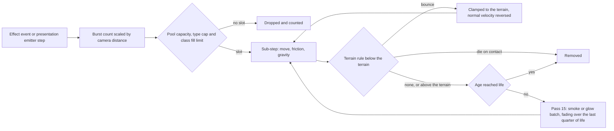

# Particles, shatter and screen effects

> Status: Engine baseline · Prefix: VFX · ADRs: [ADR-010](../../../ADR/ADR-010-gpu-particles-and-shatter-debris.md) · [ADR-036](../../../ADR/ADR-036-effect-events-and-presentation-clock.md) · [ADR-003](../../../ADR/ADR-003-shader-language-compiler-and-material-shaders.md) · [ADR-008](../../../ADR/ADR-008-gpu-memory-uploads-and-device-removal.md) · [ADR-009](../../../ADR/ADR-009-instanced-crowds-sprite-cards-and-shadows.md) · [ADR-011](../../../ADR/ADR-011-world-surface-rendering.md) · [ADR-015](../../../ADR/ADR-015-scene-anti-aliasing.md) · [ADR-020](../../../ADR/ADR-020-flat-shading-and-team-tint.md) · [ADR-064](../../../ADR/ADR-064-accessibility-baseline-xag.md) · Related: [Animation and VFX](README.md) · [Explainers, sprites and procedural animation](explainers_sprites_and_procedural_animation.md) · [Frame graph and passes](../renderer/frame_graph_and_passes.md) · [Entity and overlay renderers](../renderer/entity_and_overlay_renderers.md) · [Weapons and projectiles](../../../reference/04_supply_crates_powers_and_weapons/weapons_and_projectiles.md)

This document specifies the particle pool and its particle types, their integration, caps, level of detail and drawing; the effect kinds that the simulation raises and what each one shows; the presentation emitters; the drawing of muzzle flashes, pulse waves, weather objects and Essence orbs; the shatter effects; and camera shake and full-screen flashes. The clocks, the presentation generators and the frame step are those of the [folder README](README.md).

## 1 Responsibilities and boundaries

**VFX-200** (MUST) This document owns the particle pool (`ParticlePool`), the particle types and their reference values, the reference values of every effect definition, the presentation emitters, the shatter effects (`ShatterEffects`), the screen effects (`ScreenEffects`) and the drawing of passes 11, 14 and 15 and of the muzzle flashes, pulse waves, snowflakes and dust objects in pass 10a. None of them feeds the simulation (VFX-005).

**VFX-201** (MUST) When and whether an effect's cause happens is a rule of the owner named in table 4.7-A; this document only states what the effect shows. An effect never adds, removes or delays a simulation event.

## 2 Interfaces

The GPU records below are a declaration sketch in the shared C++ and HLSL header style of [renderer/shaders.md](../renderer/shaders.md), not an implementation; the CPU interfaces are those of [README.md](README.md) §2.

```cpp
namespace Engine
{

struct ParticleSlot   // one slot of the pool's structured buffer
{
  float3 position;
  float birth;   // birth on the scaled presentation clock
  float3 velocity;
  float size;
  uint color;    // RGBA8
  uint kind;     // ParticleKind
};

struct ParticleType   // one entry per ParticleKind, from the effect definitions
{
  float life, typeSize, gravity, friction;
  uint color1, color2;   // RGBA8
  uint blend, terrainRule, priorityClass, cap;
  float lodFull, lodCutoff;
};

struct Shard   // one released triangle (VFX-204)
{
  float3 center;
  float deathTime;
  float3 velocity;
  uint tumbler;
  float3 corner0, corner1, corner2;
  float3 normal;
  uint color;    // tinted facet colour, RGBA8
};

struct Tumbler
{
  float3x3 rotation;
  float3 angularVelocity;
};

} // namespace Engine
```

**Events.** This document consumes the effect events of table 4.7-A and the route-highlight request of RND-350. Its screen effects receive the shake requests of VFX-233 and give the camera the frame's rotation offset.

**Threading contract.** The CPU side runs on the frame thread; the emit, simulate, compact and shard-update dispatches run in the frame graph before passes 14 and 15 on the direct queue.

## 3 Data model

### 3.1 Particle record and particle type fields

**VFX-202** (MUST) A particle (`ParticleInstance`) holds its position (wu), its velocity (wu/s), its birth time on the scaled presentation clock, its particle kind, its size (the requested size, or the type size when none is requested) and its colour. Its colour is the requested colour, or else colour 1 × a + colour 2 × (1 − a) of its type, with a = `FxRng::NextUnit(1)` drawn once at emission; an explicitly requested colour of (0, 0, 0, 0) counts as no colour, and no emitter of §4.7 or §4.8 requests it.

**VFX-203** (MUST) A particle type (`ParticleTypeParams`) has a life, a type size, a gravity, a friction, two colours, a blend class (`Glow` or `Smoke`), a terrain rule (`None`, `Bounce` or `DieOnContact`), a priority class and a cap (§4.4). A field that an effect definition leaves unset takes the default of this table:

| Field | Default |
|---|---|
| life | `vfx.particle.default.life` (10.0 s of scaled presentation time) |
| type size | `vfx.particle.default.size` (1000) |
| friction | 0 |
| gravity | 0 |
| colour 1 | `vfx.particle.default.colour_1` (0.5, 0.5, 0.5) |
| colour 2 | `vfx.particle.default.colour_2` (0.95, 0.95, 0.95) |

Particles have no spin, no fade-in and no type-specific fade-out: the fade of VFX-215 is common to every type.

### 3.2 Shatter records

**VFX-204** (MUST) A shatter explosion (`ShatterExplosion`) is the set of released triangles of one mesh node. It holds `vfx.shatter.tumblers` (5) shard tumblers, each a rotation and an angular velocity shared by the shards that use it, its death time on the unscaled presentation clock, and one shard record per released triangle: the triangle's three corners relative to its centre, its facet normal, its facet colour (with the team tint applied, ADR-020), its centre position, its velocity and its tumbler index. All shards of an explosion die together at its death time.


## 4 Behaviour and algorithms

### 4.1 The particle pool

**VFX-205** (MUST) One particle pool (`ParticlePool`) exists per client process. It is created at start-up and emptied at match teardown, so it holds particles of the current match only (R-SIM-005). It is simulated on the GPU (ADR-010): every live particle sits in one structured buffer with a free list and a live list managed by compute work, and every particle's type parameters come from one parameter buffer built from the effect definitions ([README.md](README.md) VFX-013).

**VFX-206** (MUST) Each frame the runtime writes the frame's emission requests into an upload buffer (ADR-008); an emit pass allocates their slots from the free list, and a request that finds no slot under the caps of §4.4 is dropped. No simulation code can read particle state: the pool offers only emission, simulation, drawing, emptying and a development read-back of its counts.



Caption: the life of one particle in the GPU pool, from its emission request to its removal.

### 4.2 Particle types

**VFX-207** (MUST) The particle types are exactly those of table 4.2-A, in this order. Life is in seconds of scaled presentation time (the tick equivalent at the reference rate is life ÷ `ref.sim.tick_period`); the half-extent at the type size is size ÷ `vfx.particle.size_divisor`; gravity is in wu/s², positive falling; friction is per second (VFX-210); colours are RGB of 255. "Glow" is the additive batch and "smoke" the darkening batch (VFX-217).

Table 4.2-A Particle types.

| Kind | Life (s) | Type size | Gravity | Friction | Colour 1 to colour 2 | Terrain rule | Blend | Class | Keys |
|---|---|---|---|---|---|---|---|---|---|
| `RocketTrail` | 2.0 | 15 | 15.0 | 0.6 | (128, 128, 128) to (200, 200, 200) | none | glow | 1 | `vfx.particle.rocket_trail.*` |
| `ExplosionCore` | 2.0 | 150 | 10.0 | 0.2 | (200, 100, 100) to (255, 120, 120) | none | glow | 1 | `vfx.particle.explosion_core.*` |
| `ExplosionDebris` | 6.0 | 40 | 20.0 | 0.2 | (200, 128, 128) to (250, 200, 200) | none; emits puffs (VFX-211) | smoke | 1 | `vfx.particle.explosion_debris.*` |
| `MuzzleFlare` | 1.0 | 10 | 0 | 0.2 | (255, 128, 128) to (200, 100, 100) | none | glow | 0 | `vfx.particle.muzzle_flash.*` |
| `Fire` | 4.0 | 50 | −4.0 | 0 | (150, 50, 50) to (150, 120, 50) | none; rises | glow | 1 | `vfx.particle.fire.*` |
| `ControlFlash` | 1.0 | 30 | −2.0 | 0 | (50, 50, 150) to (50, 50, 250) | none; rises | glow | 0 | `vfx.particle.control_flash.*` |
| `Spark` | 4.0 | 15 | 15.0 | 1.5 | (250, 200, 0) to (250, 200, 50) | bounce | glow | 1 | `vfx.particle.spark.*` |
| `BlueSpark` | 4.0 | 15 | 15.0 | 1.5 | (50, 50, 200) to (50, 70, 255) | bounce | glow | 1 | `vfx.particle.blue_spark.*` |
| `Casing` | 2.0 | 4 | 30.0 | 0.5 | (250, 200, 0) to (250, 200, 50) | bounce | glow | 2 | `vfx.particle.casing.*` |
| `MissileTrail` | 5.0 | 200 | 1.0 | 0 | (100, 100, 100) to (200, 200, 200) | none | smoke | 2 | `vfx.particle.missile_trail.*` |
| `MissileFire` | 0.5 | 300 | 0 | 0 | (150, 50, 50) to (150, 120, 50) | none | glow | 2 | `vfx.particle.missile_fire.*` |
| `WorkerFire` | 1.0 | 25 | −10.0 | 0 | (150, 50, 50) to (150, 120, 50) | none; rises fast | glow | 1 | `vfx.particle.worker_fire.*` |
| `Leaf` | 60.0 | 25 | 5.0 | 1.5 | (50, 150, 50) to (50, 200, 50) | bounce | glow | 3 | `vfx.particle.leaf.*` |
| `Sickness` | 2.0 | 25 | −0.5 | 0 | (40, 200, 40) to (50, 200, 50) | none; rises slowly | glow | 1 | `vfx.particle.sickness.*` |
| `SpeedBoostTrail` | 1.0 | 25 | 0 | 0 | (150, 50, 50) to (150, 120, 50) | none | glow | 1 | `vfx.particle.speed_boost_trail.*` |
| `FireballFlame` | 1.0 | 25 | 0 | 0 | (150, 50, 50) to (150, 120, 50) | dies on contact | glow | 1 | `vfx.particle.fireball.*` |
| `Volcano` | 12.0 | 400 | 10.0 | 0 | (150, 50, 50) to (150, 120, 50) | dies on contact | glow | 3 | `vfx.particle.volcano.*` |

Each type's keys are `.life`, `.size`, `.gravity`, `.friction` and `.colours` (§9). These values are the reference particle set, and the effect definitions hold them as data.

**VFX-208** (MUST) Every type is drawn with `fx.particle_dot` as a diamond billboard of half-extent size ÷ `vfx.particle.size_divisor` (16), with no spin, depth test on, no depth write and no culling (VFX-014). A particle's gravity is scaled by its size ÷ its type size, so a larger particle falls or rises faster.

### 4.3 Integration

**VFX-209** (MUST) The simulate pass advances every live particle in fixed sub-steps of h = `vfx.particle.sub_step` (1/60 s of scaled presentation time), as many as the frame's scaled clock advance holds and at most `vfx.particle.max_sub_steps` (30) per frame, which covers a 0.25 s frame at the highest game speed, 2.0 (`ref.sim.speed.time_rush_min` + `ref.sim.speed.time_rush_spread`), carrying the remainder to the next frame (ADR-010, DEC-960). Particle motion is therefore independent of the simulation tick and of the frame rate.

**VFX-210** (MUST) Each sub-step, with T = `ref.sim.tick_period` (0.1 s), the reference integration step at game speed 1, P the scaled presentation time and H, N the terrain height and normal sampled from `terrain_heights` (RND-063, [terrain](../terrain/README.md)):

```text
for each live particle p with type T_p:
    if P >= p.birth + T_p.life: remove p; continue
    p.pos += p.vel * h
    p.vel *= (1 - T * T_p.friction) ^ (h / T)                 # the reference's per-tick factor, per sub-step
    if T_p.gravity != 0: p.vel.y -= h * T_p.gravity * (p.size / T_p.size)
    if T_p.terrain == DieOnContact and p.pos.y <= H(p.pos.xz): remove p; continue
    puffed = false
    if p.kind == ExplosionDebris and FxRng::NextUnit(1) < vfx.particle.debris.puff_rate * h:
        emit MissileTrail at p.pos with velocity p.vel / vfx.particle.debris.puff_velocity_divisor
             and size p.size / vfx.particle.debris.puff_size_divisor
        puffed = true
    if not puffed and T_p.terrain == Bounce and p.pos.y <= H(p.pos.xz):
        p.pos.y = H(p.pos.xz)
        n = N(p.pos.xz)
        p.vel -= n * 2 * dot(n, p.vel) * vfx.particle.bounce_factor   # normal component x -0.4
```

With h = T this reproduces the reference trajectories exactly at game speed 1: friction 1.5 multiplies the velocity by 0.85 per tick, and a bounce keeps the tangential velocity and reverses 0.4 of the normal velocity, with `vfx.particle.bounce_factor` (0.7). A puff takes the debris velocity ÷ `vfx.particle.debris.puff_velocity_divisor` (5) and the debris size ÷ `vfx.particle.debris.puff_size_divisor` (1.5). Explosion debris, at the puff rate `vfx.particle.debris.puff_rate` (5 per second, 0.5 per tick), is the only particle type that emits particles.

**VFX-211** (MUST) A puff made inside the simulate pass is appended to the frame's allocations like any other emission and obeys the caps of §4.4; a debris particle that made a puff in a sub-step skips that sub-step's bounce test.

### 4.4 Caps, priorities and level of detail

**VFX-212** (MUST) The pool holds at most `vfx.particle.pool_capacity` (65 536) live particles, and each type at most `vfx.particle.type_cap` (16 384) unless its effect definition sets a lower cap; both are fixed capacities allocated at load (DEC-228). The types fall into the priority classes of table 4.2-A: 0 command feedback, 1 combat and hazards, 2 trails and engines, 3 ambient. A particle of class *c* is allocated only while the pool's live count is below its capacity × the class's fill limit `vfx.particle.class_fill_limits` (1.0, 0.95, 0.9, 0.8), so that, as the pool fills, ambient particles are dropped first and command feedback last (ADR-010). A dropped emission is not retried.

**VFX-213** (MUST) Emission is scaled down with camera distance d from the emission point: a burst of n particles emits n × clamp((`vfx.particle.lod.cutoff_distance` (8000 wu) − d) ÷ (`vfx.particle.lod.cutoff_distance` − `vfx.particle.lod.full_distance` (4000 wu)), 0, 1) particles, the fractional part kept by a presentation draw, so nothing is emitted beyond the cut-off distance. An effect definition may set its own distances for a type. Particles of the presentation emitters of §4.8 are not scaled.

**VFX-214** (MUST) The reference pool starts at `vfx.budget.reference_particle_start` (1500) slots, grows by `vfx.budget.reference_particle_growth` (200) and has no maximum, no per-type cap and no distance culling at emission; the only reference particle level of detail is the burning-tree count ÷ structure detail (R-BLDG-629). The Species caps and distances of VFX-212 and VFX-213 are engine-baseline values, confirmed or changed by the prototype measurement of DEC-106.

### 4.5 Drawing

**VFX-215** (MUST) Particles are drawn in pass 15 at the frame's presentation time (ADR-010): each at its integrated position + its velocity × the sub-step remainder, with age = scaled presentation time − birth. Their alpha, of 255, is `vfx.particle.alpha` (90) while age < `vfx.particle.fade_start` (0.75) × life, and then 90 − 90 × (age − 0.75 × life) ÷ (0.25 × life), truncated to an integer and floored at 0: a linear fade over the last quarter of life and no fade-in.

**VFX-216** (MUST) With the camera up and right vectors U and R each scaled by size ÷ `vfx.particle.size_divisor`, a particle's quad has the corners p − U (texture coordinates 0, 0), p + R (0, 1), p + U (1, 1) and p − R (1, 0), a diamond.

**VFX-217** (MUST) Pass 15 draws two batches, both sampling `fx.particle_dot`, each one indirect draw (RND-455):

1. the **smoke** batch, the missile-trail and explosion-debris particles whose positions lie in the view frustum, with `particle_darkening`: vertex colour = RGB × alpha ÷ `vfx.particle.smoke_shade_divisor` (100) and vertex alpha 0, so the destination is multiplied by one minus the source colour: dark smoke that needs no sorting;
2. the **glow** batch, every other particle, with `particle_additive`: vertex colour = RGB with the computed alpha. The reference glow batch has no view test; a conservative GPU cull (RND-236) MAY skip particles outside the frustum.

The smoke batch is drawn first. Smoke on a black world reads as a shadowy veil, and every other type adds light.

### 4.6 Emitter idioms

**VFX-218** (MUST) Particles come from exactly four idioms:

| Idiom | Examples | Rule |
|---|---|---|
| burst on an event | explosions, Power grants, promotion | one effect event per occurrence (§4.7); counts scale with the event's payload, such as an explosion's range × damage |
| continuous, per tick | burning Workers, smoke columns, engines, trails, burning trees, falling leaves | one effect event per emitter per tick (§4.7), so the rate is per tick and follows the game-speed semantics of R-SIM-363 |
| per frame in the reference | the selection circle, placement sparkles, the Allegiance Scrambler, rocket flames | a presentation emitter (§4.8) that runs at the fixed step rate of [README.md](README.md) VFX-018 |
| particle spawns particle | explosion debris making missile-trail puffs | VFX-210; the only chain |

### 4.7 The effect event catalogue

**VFX-219** (MUST) The effect kinds (`EffectKind`) are exactly those of table 4.7-A, a closed enumeration whose order carries no meaning. Each row names the rule that raises the event, what its effect definition does, and the owner of the values; "U[a, b)" denotes a + `FxRng::NextUnit`(b − a), whose range includes b (R-SIM-607), "± x" denotes `FxRng::NextSigned`(2x), and "n of type" emits n particles of that type at the event position unless stated. Every draw is made by this component (VFX-011, DEC-013); a value marked with a key of this document is owned here, and the values that the reference does not record are the defaults of DEC-962 item 1.

Table 4.7-A Effect kinds.

| Kind | Raised by | Effect | Values owned by |
|---|---|---|---|
| `Explosion` | every explosion of range r and damage D (R-CRATE-406 step 1, R-UNIT-195) | cores: n = ⌊r × D × `ref.weapon.explosion.particle_factor`⌋, plus ⌊U[0, n)⌋ more, explosion cores at position + (0, `ref.weapon.explosion.core_lift` × r, 0), size `vfx.emit.explosion.core_size` (120 + U[0, 120)), velocity `vfx.emit.explosion.core_velocity` (± 15, 10 + U[0, 10), ± 15); debris: m = ⌊clamp(r × D × `ref.weapon.explosion.particle_factor`, `ref.weapon.explosion.debris_min`, `ref.weapon.explosion.debris_max`)⌋ explosion-debris particles at position + (0, `vfx.emit.explosion.debris_lift` (0.2) × r, 0), particle i at the angle i × 2π ÷ m with velocity normalise((cos, `vfx.emit.explosion.debris_rise` (2 + U[0, 2)), sin)) × `vfx.emit.explosion.debris_speed` (20 + U[0, 30)), size `vfx.emit.explosion.debris_size` (20 + U[0, 20)) | reference/04 and this document |
| `RocketBurst` | a spiralling rocket's explosion (R-CRATE-432) | explosion cores as the `Explosion` core rule, all in one colour of the team colour table drawn per burst | this document |
| `StructureDestroyed` | R-BLDG-037 | ⌊i ÷ `ref.bldg.structure.destroy_particle_divisor`⌋ explosion cores of size `ref.bldg.structure.destroy_particle_size`, velocity per axis `ref.bldg.structure.destroy_particle_speed`; the shatters of §4.10 | reference/03 |
| `LaserHitStructure` | a laser bolt meeting a structure (R-CRATE-441 step 6) | `vfx.emit.laser_hit.count` (1) spark | this document |
| `RoundHitStructure` | a turret round meeting a structure (R-CRATE-451 step 4) | `vfx.emit.round_hit.structure_count` (3) sparks; the round's shatter of §4.10 | this document |
| `RoundHitTerrain` | a turret round meeting the terrain (R-CRATE-451 step 5) | dust at the terrain hit: `vfx.emit.round_hit.terrain_count` (1) rocket trail, a small grey puff (DEC-962); the round's shatter | this document |
| `ThrownWeaponTrail` | each tick of a grenade, airstrike bomb or firebomb canister in flight (R-CRATE-414) | with probability 1 − `ref.weapon.thrown.trail_skip` ÷ game speed, one missile trail of size `ref.weapon.thrown.trail_size` at p − v × dt, velocity v ÷ 4 ± `ref.weapon.thrown.trail_jitter` ÷ 2 per axis | reference/04 |
| `AirstrikeMarkerSmoke` | each tick of an airstrike target marker (R-CRATE-422) | one fire particle of size `ref.weapon.marker.smoke_size`, velocity v ÷ 4 + presentation jitter | reference/04 |
| `RocketFlame` | each tick of a rocket (R-CRATE-433) | with probability `ref.weapon.rocket.trail_chance`, one fire particle | reference/04 |
| `FireballLaunched` | a fireball's first tick (R-CRATE-460) | `vfx.emit.fireball.count` (80) fireball-flame particles | this document |
| `FirebombBurst` | a firebomb canister's burst (R-CRATE-421) | `ref.weapon.firebomb.burst_particles` (80) particles split `vfx.emit.firebomb.split` (51 fireball flames, 20 fire, 9 missile trails), size `vfx.emit.firebomb.size` (150 + U[0, 100)) | reference/04 and this document |
| `LightningStrike` | each strike (R-CRATE-495) | at the ground under the cloud: `vfx.emit.lightning.debris_count` (5) explosion debris of size `vfx.emit.lightning.debris_size` (150 + U[0, 100)) and `vfx.emit.lightning.fire_count` (10) fire of size `vfx.emit.lightning.fire_size` (160 + U[0, 120)) | this document |
| `SwarmHit` | a Swarm streak's hit on an actor or an Essence orb (R-CRATE-489, R-CRATE-490) | `vfx.emit.swarm_hit.count` (5 + `FxRng::NextUint` mod 5) fire particles | this document |
| `TurretCooling` | each cooling step of a gun turret (R-BLDG-430) | at each barrel's muzzle, ⌊U[0, ⌊1 + heat ÷ `ref.bldg.turret.smoke_heat_divisor`⌋)⌋ missile trails | reference/03 |
| `TurretShot` | each turret shot (R-BLDG-418, R-CRATE-455) | the shell casings of R-CRATE-456 from the barrel's own casing socket, every draw from the presentation generator (DEC-461) | reference/04 |
| `TrooperShot` | each Trooper shot ([strike_team.md](../../../reference/02_units/strike_team.md)) | one casing particle with speed `ref.unit.trooper.casing_speed_base` + U[0, `ref.unit.trooper.casing_speed_range`) | reference/02 |
| `BarrierSpark` | a Barrier Emitter spark (R-BLDG-447) | the spark particles of R-BLDG-447 | reference/03 |
| `ControlGained`, `ControlLost` | a Worker taken into or released from crowd control (R-UNIT-149) | `vfx.emit.control.count` (1) control flash | this document |
| `LeaderPromoted` | a promotion (R-UNIT-153, R-CTRL-071) | `ref.ctrl.promote.flash_count` control flashes with velocity `ref.ctrl.promote.flash_velocity` | reference/06 |
| `LeaderDemoted` | a demotion (R-UNIT-154) | the burst of `LeaderPromoted` | reference/06 |
| `CrowdOrder` | a crowd order to Workers (R-UNIT-140) | two muzzle flashes of sizes `vfx.emit.order.sizes` (75 and 60) in the team colour at the target | this document |
| `LeaderOrder` | a Leader's waypoint order ([leader_and_formations.md](../../../reference/02_units/leader_and_formations.md)) | as `CrowdOrder`, at the order position | this document |
| `LeaderFormUp` | `FormUp` for the local team (R-UNIT-172) | two muzzle flashes of size `ref.unit.leader.preview_flash_size` in the team colour at each formation slot | reference/02 |
| `OrderMarkerStep` | each tick of an order marker (R-UNIT-185) | one muzzle flash of size `vfx.emit.order_marker.size` (30) in the team colour | this document |
| `WorkerBurning` | each tick of a Burning Worker (R-UNIT-079) | k = `FxRng::NextUint` mod `vfx.emit.burning.count_mod` (8) particles: those with index below `vfx.emit.burning.fire_share` (5) Worker fire, the rest missile trails, at position + up × U[0, `vfx.emit.burning.lift` (5)), size `vfx.emit.burning.size` (20 + U[0, 30)), velocity v × `vfx.emit.burning.velocity_factor` (0.3) + up × `vfx.emit.burning.rise` (3 + U[0, 3)) | this document |
| `WorkerSpeedBoost` | each tick of a Worker with Speed Boost (R-UNIT-123) | as `WorkerBurning`, with Speed Boost trails for the low indices, at ground level and with velocity v × `vfx.emit.burning.velocity_factor` only | this document |
| `WorkerSick` | each tick of a sick Worker (R-UNIT-130) | with probability `vfx.emit.sick.chance` (0.5) one Sickness particle of size `vfx.emit.sick.size` (20 + U[0, 20)) in `vfx.emit.sick.colour` (140, 200, 5, 150) | this document |
| `PowerReachedWorker` | a Shield, Speed Boost, Convert or Fury Power reaching a Worker (R-CRATE-167, R-UNIT-149) | `vfx.emit.power_reached.count` (20) Worker-fire particles in the team colour | this document |
| `WorkerOpeningCrate` | each tick of a Worker opening a Supply crate in range (R-UNIT-078) | one blue spark in the team colour | this document |
| `WorkerAbducted` | each tick of a Worker in an Abductor's beam (R-UNIT-084) | with probability `vfx.emit.abducted.chance` (0.5) one blue spark of size `vfx.emit.abducted.size` (30) in `vfx.emit.abducted.colour` (150, 150, 255, 155) | this document |
| `ActorHit` | a registered non-lethal hit on a Builder, a Collector or a Bomber (R-UNIT-461, R-UNIT-718) | one muzzle flash | reference/02 |
| `Bite` | an ant's or a Crawler's bite (R-UNIT-564, R-UNIT-532) | `vfx.emit.bite.count` (3) muzzle flashes | this document |
| `TransportExhaust` | each tick of a Transport (R-UNIT-409) | 1 + trunc(speed ÷ `ref.unit.transport.exhaust_speed_step`) missile trails of size `vfx.emit.transport_exhaust.size` (50 + U[0, 49)) | reference/02 and this document |
| `CollectorEngine` | each tick of each Collector engine socket (R-UNIT-443) | `ref.unit.collector.exhaust_fire_count` missile fire of size `ref.unit.collector.exhaust_fire_size` in `ref.unit.collector.exhaust_colour`, and one missile trail | reference/02 |
| `AbductorEngine` | each tick of each Abductor engine socket (R-UNIT-710) | `ref.unit.abductor.engine_sparks` blue spark of size `ref.unit.abductor.engine_spark_size_min` to `ref.unit.abductor.engine_spark_size_max` in `vfx.emit.abductor.spark_colour` (150, 150, 255), and `ref.unit.abductor.engine_fire_particles` missile fire of size `ref.unit.abductor.engine_fire_size` in `vfx.emit.abductor.fire_colour` (50, 50, 250) | reference/02 and this document |
| `MeteorFire` | each tick of a meteor (R-UNIT-735) | `ref.hazard.meteor_shower.fire_particles` fire of size `ref.hazard.meteor_shower.fire_size` ± `ref.hazard.meteor_shower.fire_size_spread` ÷ 2 | reference/02 |
| `OrbBroken` | an Essence orb breaking ([explainers_sprites_and_procedural_animation.md](explainers_sprites_and_procedural_animation.md) VFX-124) | the control-flash burst of VFX-124 | this document |
| `TreeBurning` | each tick of a burning tree (R-BLDG-629) | the fire particles of R-BLDG-629 | reference/03 |
| `TreeLeaf` | a tree's leaf drop (R-BLDG-615) | one leaf in the tree's leaf colour | reference/03 |
| `SpitterPlantBurning` | each tick of a burning Spitter Plant (R-BLDG-650) | `ref.bldg.spitter_plant.fire_particles` fire, and with chance `ref.bldg.spitter_plant.debris_chance` one explosion debris | reference/03 |
| `SmokeColumn` | each tick of a smoke column (R-BLDG-468) | the missile trails of R-BLDG-468 | reference/03 |
| `VolcanoEruption` | each tick of an eruption (R-BLDG-471) | the volcano particles of R-BLDG-471 | reference/03 |
| `FuelPumpStroke` | a fuel pump's arm stroke (R-BLDG-199) | one Worker-fire particle at the `arm_tip` socket | reference/03 |
| `FuelDepotBoarding` | a boarding at a fuel depot (R-BLDG-203) | the control flashes of R-BLDG-203 | reference/03 |
| `VesselBooster` | each tick of a Launch Vessel in PreLaunch, Countdown or Flight (R-BLDG-338) | `ref.bldg.launch_vessel.booster_particles` particles of size `vfx.emit.booster.size` (500) at the `thruster` socket + `vfx.emit.booster.offset` (± 10, 10, ± 10) with velocity `vfx.emit.booster.velocity` (± 25, −U[0, 150), ± 25): split `vfx.emit.booster.split` (11 missile fire, then 4 missile trails), the missile trails with their x and z velocity × `vfx.emit.booster.trail_spread` (0.75) | reference/03 and this document |
| `VesselWrecked` | each tick of a Wrecked Launch Vessel (R-BLDG-323) | at each window socket `window_01` to `window_03`: one fire particle while it holds fuel and one missile trail of size `vfx.emit.wreck.size` (150 + U[0, 150)); and a shatter of `vfx.emit.wreck.shatter` (0.01) of its mesh | this document |
| `CameraShake` | each tick while a Launch Vessel's ignition shake lasts (R-BLDG-332, R-BLDG-338) | a shake request of the vessel's shake ÷ `vfx.emit.vessel_shake_divisor` (5), at every participant whatever its camera position; the vessel's shake starts at `ref.bldg.launch_vessel.camera_shake` (5) and falls by `vfx.emit.vessel_shake_decay` (0.1) per tick, to 0 after 50 ticks | reference/03 and this document |
| `Shatter` | every shatter source of table 4.10-A | the shatter of §4.10 | §4.10 |

Every sound that accompanies these effects is a sound event of its owner's rule ([reference/10](../../../reference/10_audio_design/README.md)), not of the effect.

### 4.8 Presentation emitters

**VFX-220** (MUST) These emitters run in presentation from the snapshot and the local interface state, at the fixed step rate of [README.md](README.md) VFX-018 (DEC-960); each step emits what the reference emits in one frame:

| Emitter | Particles per step | Owner of the values |
|---|---|---|
| the local selection circle | `ref.ctrl.cursor.circle_particles` (30) control flashes of the circle's radius, evenly spaced, turning with the real clock | R-CTRL-370 |
| placement sparkles of a waiting Power's target areas | two muzzle flashes of size `ref.ctrl.panel.sparkle_size` per area | R-CTRL-235 |
| the Allegiance Scrambler effect | two muzzle flashes of size `ref.bldg.allegiance_scrambler.flash_size` in team colours drawn by the presentation generator | R-BLDG-654 |
| a rocket in flight | `ref.weapon.rocket.render_trail_particles` (5) missile fire | R-CRATE-433 |
| a highlighted route, once per highlight event | two muzzle flashes per `rnd.route.highlight_step` along the route | RND-350 |

### 4.9 Beams, muzzle flashes, pulse waves, weather and Essence orbs

**VFX-221** (MUST) Laser bolts and Convert bolts are drawn by the renderer (RND-338 to RND-341). Shockwave rings and lightning strikes draw their geometry by RND-333 to RND-337; their full-screen flash and camera shake are those of §4.11. Their timings and ground effects are simulation rules ([weapons_and_projectiles.md](../../../reference/04_supply_crates_powers_and_weapons/weapons_and_projectiles.md)).

**VFX-222** (MUST) A muzzle flash (`MuzzleFlashEffect`) is drawn in pass 10a as `ref.weapon.muzzle_flash.quads` (5) nested camera-facing quads of `fx.muzzle_flash` at its extrapolated position, each `ref.weapon.muzzle_flash.shrink` (0.8) × the size of the previous, at alpha clamp(life × `ref.weapon.muzzle_flash.alpha_factor` (0.75), 0, 1), with the sizes and lives that the shot helpers of R-CRATE-405 give and the motion and decay of R-CRATE-475. It is additive; while its size is below `ref.weapon.muzzle_flash.depth_test_size` (50) it is drawn with no depth test, otherwise with the depth test of `effect_additive` (RND-308).

**VFX-223** (MUST) A Core Device pulse wave (`CorePulseWave`, R-CRATE-480 to R-CRATE-483) is drawn in pass 10a, without a view test, as three cylinders around its centre at its radius r in its team colour, each at alpha × (1 − r ÷ the map's world size x): a ground outline `ref.weapon.pulse_wave.outline_height` (200 wu) high, a glow tube of `fx.beam_long` `ref.weapon.pulse_wave.tube_height` (400 wu) high and a faint sky tube `ref.weapon.pulse_wave.sky_height` (1000 wu) high. Each cylinder is a strip of segments of `vfx.pulse.segment_angle` (1 ÷ 3 rad) around the circle, 19 segments, whose start angle advances with the unscaled presentation time. Its flash and shake are those of §4.11.

**VFX-224** (MUST) A snowflake is drawn in pass 10a as a white bottom-anchored billboard of `fx.starburst` of `ref.weapon.snow.sprite_size` (20 wu), and a dust object as a bottom-anchored billboard of `fx.glow_cloudy` in `ref.weapon.dust.colour` at its size (RND-329, R-CRATE-501, R-CRATE-505), both with `effect_additive`. Which weather effects a map switches on, one by one (snow, lightning strikes, dust vortices and the Essence-orb rain that no reference map enables), is map data; whether maps select named lighting and weather presets instead is the Open DEC-562, whose default is the reference's per-map switches.

**VFX-225** (MUST) Pass 11 draws the Essence orbs as two batches of camera-facing quads of `fx.glow_round` (R-UNIT-330 to R-UNIT-332): first the orbs of the Rogue faction slot with `orb_ink` in `rnd.crowd.rogue_orb_colour` (100, 100, 100, alpha 0), which darken (RND-327), then every other orb with `orb_additive` in its team colour, or white with no team. The sizes and alphas are the match values of R-UNIT-330, scaled at birth and during ascent by R-UNIT-331, and every orb is drawn one tick behind, at its position extrapolated to the extrapolation time − `ref.sim.tick_period` (R-UNIT-332, RND-082). A Reaper Serpent's carried orbs are drawn by RND-324.

### 4.10 Shatter effects

**VFX-226** (MUST) The shatter effects (`ShatterEffects`) turn a shatter request (mesh, transform, fraction, palette index) into tumbling shards (ADR-010). They use the unscaled presentation clock and the presentation generator; nothing in the simulation reads them; they do not advance while the world is held; and they are reset at match teardown (R-SIM-005). Their constants are:

| Quantity | Key | Value |
|---|---|---|
| life of every shard and explosion | `vfx.shatter.lifetime` | 5.0 s |
| initial speed factor on (triangle centre − node centre) | `vfx.shatter.initial_speed` | 3.0 |
| tumbler angular velocity per axis | `vfx.shatter.angular_speed` | `FxRng::NextSigned(4)`, ±2 rad/s |
| shard gravity | `vfx.shatter.gravity` | 10 wu/s² |
| added vertical speed | `vfx.shatter.rise` | 10 wu/s |
| speed-proportional drag | `vfx.shatter.drag` | 0.05 |
| angular drag | `vfx.shatter.spin_drag` | 0.2 per s |
| tumblers per explosion | `vfx.shatter.tumblers` | 5 |
| smallest released perimeter | `vfx.shatter.min_perimeter` | 6.0 wu |
| last source-triangle index before the cap | `vfx.shatter.triangle_cap_index` | 500 |
| centre factor | `vfx.shatter.centre_factor` | 0.3333 |

**VFX-227** (MUST) A shatter request is processed by this algorithm, with every draw from the event's presentation generator:

```text
Shatter(mesh, transform, fraction):
    if fraction <= 0: return
    ShatterNode(mesh.root, transform, fraction)

ShatterNode(node, parentTransform, fraction):
    if node has triangles: add ShatterExplosion(node, parentTransform, fraction)
    for child in node.children: ShatterNode(child, node.transform * parentTransform, fraction)

ShatterExplosion(node, T, fraction):
    tumblers[0..4] = { rotation = identity,
                       angular velocity = (NextSigned(4), NextSigned(4), NextSigned(4)) }
    deathTime = unscaled now + vfx.shatter.lifetime
    total = node.transform * T; nodeCenter = total * node.center
    for j in 0 .. node.triangleCount - 1:
        if fraction < 1 and NextUnit(1) > fraction: continue        # kept with probability fraction
        v1, v2, v3 = the triangle's corners under total
        if any two corners are equal: continue
        if |v1 - v2| + |v2 - v3| + |v3 - v1| < vfx.shatter.min_perimeter: continue
        c = (v1 + v2 + v3) * vfx.shatter.centre_factor
        store the corners minus c, the facet normal and the tinted facet colour (ADR-020)
        velocity = (c - nodeCenter) * vfx.shatter.initial_speed; velocity.y += vfx.shatter.rise
        position = c; tumbler = NextUint() mod 5
        keep the shard
        if j > vfx.shatter.triangle_cap_index: stop
```

A node therefore releases at most 502 shards: those of source indices 0 to 500 and the first kept one beyond. A fraction of 1 or more releases every triangle, so a wall's 3.0 and a damage fraction of 1.0 both shatter the whole mesh, and a lightly damaged actor sheds a few shards. The facet normal is the cooked facet normal (ADR-020); no per-index sign correction applies, because cooked meshes have one winding. An explosion with no kept shard is not drawn.

**VFX-228** (MUST) Every frame, with Δ the unscaled step, a compute pass advances each tumbler by rotation ← rotation × R(angular velocity × Δ) and angular velocity × (1 − `vfx.shatter.spin_drag` × Δ), and each shard by position += velocity × Δ, then velocity × (1 − min(1, |velocity| × `vfx.shatter.drag` × Δ)), then velocity.y −= `vfx.shatter.gravity` × Δ. Shards do not collide with the terrain; they fall through it. An explosion is finished, and freed, when the unscaled time passes its death time.

**VFX-229** (MUST) Pass 14 draws each explosion as one instanced draw of its shards with `shard_lit` (VFX-014), the object lighting and the depth test and write on. A shard's corner is rotation × corner + position and its normal rotation × facet normal, with rotation its tumbler's; its colour is its facet colour at alpha 1 − age, with age = (`vfx.shatter.lifetime` + now − death time) ÷ `vfx.shatter.lifetime`, so it fades linearly over its life. The edge mask gives every shard white edge lines: with *m* the smallest barycentric coordinate of the fragment and *e* = 1 − smoothstep(0, `vfx.shatter.edge_width` (1 ÷ 64, DEC-962 item 2), *m*), widened with screen-space derivatives so that the lines do not alias (ADR-003, ADR-015), the fragment colour is lerp(lit facet colour, white, *e*) with the shard's alpha; the lines are unlit. No edge texture is sampled at run time (ADR-010); the edge pattern `fx.shard_edges` is the art reference against which the edge mask is checked (T15).

**VFX-230** (MUST) The live explosions hold at most `vfx.shatter.max_explosions` (1024) explosions and `vfx.shatter.max_shards` (131 072) shards, fixed capacities allocated at load (DEC-228); a new explosion that does not fit retires the oldest live explosions until it fits.

**VFX-231** (MUST) The shatter sources of a match are exactly those of table 4.10-A; each raises a `Shatter` effect event with its mesh, its transform, its fraction and its team palette index.

Table 4.10-A Shatter sources.

| Source | Fraction | Owner |
|---|---|---|
| a structure destroyed | 1.0, `ref.bldg.structure.destroy_shatter_count` (3) times; fuel-chain structures also shatter their line mesh | R-BLDG-037 |
| a wall destroyed | `ref.bldg.wall.shatter_strength` (3.0), all facets | R-BLDG-454, R-BLDG-457 |
| a Breach Charge, a Relic or the Core Device destroyed | 1.0 | R-BLDG-288, R-BLDG-292, R-BLDG-314 |
| a Relic appearing outside the grace period | `ref.bldg.relic.spawn_shatter_fraction` (0.5) | R-BLDG-284 |
| a turret destroyed | 1.0, for its head and its barrel meshes | [defences_and_props.md](../../../reference/03_buildings_and_world_objects/defences_and_props.md) |
| a turret round hitting a structure, or the terrain, or expiring | `ref.weapon.turret_round.shatter_hit` (0.1); `ref.weapon.turret_round.shatter_end` (0.2) | R-CRATE-451 |
| a Supply crate opened | 1.0 | [crates_and_powers.md](../../../reference/04_supply_crates_powers_and_weapons/crates_and_powers.md) |
| the Hive outcome placing a Hive | 1.0, of the Hive mesh | [crates_and_powers.md](../../../reference/04_supply_crates_powers_and_weapons/crates_and_powers.md) |
| a Hive damaged, and destroyed | 1 − health ÷ 100 on damage; 1.0 on death | [trees_and_crate_structures.md](../../../reference/03_buildings_and_world_objects/trees_and_crate_structures.md) |
| a Transport hit, and its death | per health band, R-UNIT-374; 1.0 at death; turret-round puffs | R-UNIT-374 |
| a Builder, a Collector or a Bomber hit | the fraction of health lost, per band, against the reference health of its owner rule | R-UNIT-461, [collector.md](../../../reference/02_units/collector.md), R-UNIT-718 |
| a spider, a Brood Drifter or a Reaper Serpent hit | the fraction of health lost; every Reaper Serpent tail segment at 1.0 | R-UNIT-577, R-UNIT-546, R-UNIT-593 |
| a centipede segment's death | its size | R-UNIT-557 |
| a Leader's, a Trooper's or an ant's death | 1.0 (the ant at its scale) | [leader_and_formations.md](../../../reference/02_units/leader_and_formations.md), R-UNIT-362, R-UNIT-568 |
| a Spitter Plant launching its head | 1.0, of the head mesh | R-BLDG-650 |
| a Seed Pod destroyed or hatching | 1.0 | [creatures.md](../../../reference/02_units/creatures.md) |
| a Wrecked Launch Vessel, each tick | `vfx.emit.wreck.shatter` (0.01) | `VesselWrecked`, table 4.7-A |

### 4.11 Camera shake and full-screen flashes

**VFX-232** (MUST) Camera shake is one scalar of this component's screen effects. A request of intensity i sets shake := max(shake, i), so requests never accumulate and a request repeated every frame has the effect of one; while shake is above 0 it falls by 1 per second of unscaled presentation time (R-CTRL-463). At each step of [README.md](README.md) VFX-018 the screen effects draw a yaw and a roll from the presentation generator by `ref.ctrl.camera.shake` (yaw `FxRng::NextSigned`(0.05 × shake) rad, roll 0.3 × `FxRng::NextSigned`(shake) rad) and hold them until the next step; the camera turns its front by the yaw about the world vertical and rolls its up vector about the front by the roll, re-orthogonalises, and applies the result as an additive rotation offset of the frame's view, never stored in its state (ADR-036, DEC-955 item 5). The offset is scaled by the motion setting: × 1 at full motion and × `vfx.screen.reduced_motion_scale` (0.25) with reduced motion (ADR-064, DEC-964).

**VFX-233** (MUST) The shake sources are exactly:

| Source | Intensity | Condition | Owner |
|---|---|---|---|
| a laser bolt passing within √`ref.weapon.laser.shake_range_sq` of the camera | `ref.weapon.laser.shake` (0.5) | not game over, not paused; requested while its instances are written | RND-340 |
| a shockwave ring | its flash alpha (VFX-234) | during its flash | R-CRATE-473 |
| the Core Device pulse wave | its flash alpha, 1 | during its flash | R-CRATE-483 |
| a Launch Vessel's ignition | the vessel's shake ÷ 5 per tick | the `CameraShake` events of table 4.7-A | R-BLDG-332 |

**VFX-234** (MUST) A full-screen flash is a white full-screen quad drawn additively in pass 10a with `effect_gradient_nodepth` (RND-308), once per frame with the largest requested alpha of the frame:

| Source | Duration | Alpha | Condition |
|---|---|---|---|
| a shockwave ring | its first `ref.weapon.shockwave.flash_time` (0.1 s), age taken with the extrapolation time | (1 − age ÷ 0.1) × max(0, 1 − distance to the camera ÷ `ref.weapon.shockwave.flash_range` (500 wu)) | its centre in the view frustum; not game over; not paused |
| the Core Device pulse wave | its first `ref.weapon.pulse_wave.flash_time` (0.3 s) of unscaled presentation time | `vfx.screen.pulse_flash_alpha` (1); the distance factor is not applied | not game over |

**VFX-235** (MUST) Flashes obey the photosensitivity rule (ADR-064, RND-248, DEC-964): a flash whose alpha reaches `vfx.screen.flash_count_threshold` (0.1), a luminance change of 10 %, counts as a flash onset; at most `vfx.screen.flash_onsets` (3) onsets are shown in any `vfx.screen.flash_window` (1 s) of real time, and a further onset inside the window is not drawn. The reduced-flash setting multiplies every flash alpha by `vfx.screen.reduced_flash_scale` (0.25). The settings themselves are stored by the settings store, and this component reads them (RND-440).

### 4.12 Other screen-space effects

**VFX-236** (MUST) The fade to and from black, the paused banner and the screen transition are the renderer's (RND-085 to RND-098). The look has no bloom, blur, motion blur, colour grading or screen-space distortion (RND-247), and no pixelation ghosting (DEC-059).

## 5 Concurrency and performance budget

**VFX-237** (MUST) The per-frame GPU work of this document is a fixed set of dispatches and draws: one emit, one or more simulate sub-steps, one compact and one shard update dispatch, the two particle batches of pass 15 and one `ExecuteIndirect` call in pass 14 whose argument buffer holds one instanced draw per live explosion, so the number of calls never grows with the number of particles or explosions (RND-455, ADR-010). Its cost belongs to the effect pass group of RND-454 and is bounded by the caps of VFX-212 and VFX-230.

## 6 Failure modes, diagnostics and telemetry

| Failure | Behaviour | Requirement |
|---|---|---|
| an emission finds no slot within its caps | it is dropped and counted per type | VFX-212 |
| a frame's scaled advance needs more sub-steps than the limit | the remaining advance is dropped for that frame and particles move slower once | VFX-209 |
| the shard caps are reached | the oldest explosions are retired | VFX-230 |
| a shatter request names a mesh with no triangles, or every triangle is filtered out | no explosion is drawn | VFX-227 |
| more flash onsets than the photosensitivity limit | the extra onsets are not drawn | VFX-235 |
| a terrain height field is not yet resident | particles with a terrain rule fall without terrain contact until it is | VFX-210 |

Diagnostics: the counts of live and dropped particles per type and class, live explosions and shards, the shake scalar and the flash onsets of the last second, in the development overlay (ADR-068).

## 7 Acceptance tests

| Test | Kind | Checks | Requirements |
|---|---|---|---|
| T1 types | build check | the cooked reference definitions hold exactly the values of table 4.2-A | VFX-203, VFX-207 |
| T2 integration | unit | with h = 0.1 s each type's trajectory equals the reference step formulas over 60 steps; with h = 1/60 s positions at the tick boundaries agree within a tolerance | VFX-209, VFX-210 |
| T3 terrain rules | unit | a bouncing particle keeps its tangential velocity and reverses 0.4 of its normal velocity; a die-on-contact particle is removed at contact | VFX-210 |
| T4 debris puffs | property | explosion debris makes 5 puffs per second of scaled time on average at h = 1/60 s and at h = 0.1 s | VFX-210, VFX-211 |
| T5 fade and quad | unit | alpha 90 until 75 % of life, then linear to 0 at death; the diamond's corners and texture coordinates | VFX-215, VFX-216 |
| T6 blending | golden-image | the smoke batch drawn in two orders gives the same image; overlapping glow saturates | VFX-217 |
| T7 caps and classes | integration | a flood of every class never exceeds the pool or a type cap, and ambient particles are dropped before command feedback | VFX-212 |
| T8 level of detail | unit | a burst of 100 at 4000 wu emits 100, at 6000 wu 50 and at 8000 wu none | VFX-213 |
| T9 event vectors | unit | each kind of table 4.7-A emits its stated counts, types, sizes and colours; an `Explosion` of range 12.5 and damage 50 emits 6 to 11 cores and 6 debris particles | VFX-219 |
| T10 presentation emitters | property | at 30 and 144 frames per second the selection circle emits the same number of particles per second | VFX-220 |
| T11 muzzle flash | golden-image | five nested quads shrinking by 0.8, the alpha clamp, and no depth test below size 50 | VFX-222 |
| T12 pulse wave and orbs | golden-image | the three cylinders and their fade with the radius; the Rogue orb batch first, every orb one tick behind | VFX-223, VFX-225 |
| T13 shatter release | unit | perimeters below 6 wu and degenerate triangles are skipped; a node of 1000 triangles releases at most 502; a fraction of 0.5 keeps about half; a fraction of 3.0 keeps all | VFX-227 |
| T14 shatter motion | unit | tumblers and shards follow VFX-228; every shard dies 5 s after its explosion | VFX-228 |
| T15 shard look | golden-image | lit facets with unlit white edges that fade linearly; no edge texture bound | VFX-229 |
| T16 shatter caps | integration | a flood of explosions never exceeds the caps and retires the oldest first | VFX-230 |
| T17 shake | property | requests combine by maximum and decay by 1 per second; the offset at matching presentation times is equal at 30 and 144 frames per second; reduced motion scales it | VFX-232, VFX-233 |
| T18 flashes | capture | the shockwave and pulse-wave alphas follow VFX-234; no 1 s window shows more than 3 onsets; the reduced-flash setting scales every alpha | VFX-234, VFX-235 |

## 8 Open decisions

| Reference | Status | Where it applies |
|---|---|---|
| DEC-013 | Resolved | every cosmetic draw is a presentation draw (VFX-219) |
| DEC-106 | Open | the caps and level-of-detail distances are measured on the prototype (VFX-214) |
| DEC-955 | Resolved | camera shake is an additive view offset, never stored in the pose (VFX-232) |
| DEC-960 | Resolved | particle sub-steps and fixed-step presentation emitters (VFX-209, VFX-220) |
| DEC-962 | Open | defaults for emitter values and the shard edge width that the reference does not record (VFX-219, VFX-229) |
| DEC-964 | Open | reduced motion, reduced flashing and the flash-onset limit (VFX-232, VFX-235) |
| DEC-228 | Open | fixed-capacity effect pools (VFX-212, VFX-230) |
| DEC-461 | Resolved | turret casings from each turret's own sockets (VFX-219) |
| DEC-562 | Open | per-map weather switches or presets (VFX-224) |
| DEC-059 | Dropped | no screen-space distortion or pixelation (VFX-236) |
| ADR-010, ADR-036, ADR-064 | Accepted, Accepted, Proposed | the particle pool and shard buffers; effect events and the presentation clock; photosensitivity and motion settings |

The design-phase inputs of this component are listed in the [folder README](README.md) §8.

## 9 Tuning table

| key | value | unit | range or notes | requirement | DEC |
|---|---|---|---|---|---|
| `vfx.particle.default.life` | 10.0 | s of scaled presentation time | default of an unset life | VFX-203 | |
| `vfx.particle.default.size` | 1000 | particle size | default of an unset type size | VFX-203 | |
| `vfx.particle.default.colour_1` | 0.5, 0.5, 0.5 | RGB fraction | | VFX-203 | |
| `vfx.particle.default.colour_2` | 0.95, 0.95, 0.95 | RGB fraction | | VFX-203 | |
| `vfx.particle.size_divisor` | 16 | — | half-extent = size ÷ 16 | VFX-208 | |
| `vfx.particle.sub_step` | 1/60 | s of scaled presentation time | particle integration step | VFX-209 | |
| `vfx.particle.max_sub_steps` | 30 | per frame | covers a 0.25 s frame at game speed 2.0 | VFX-209 | |
| `vfx.particle.debris.puff_rate` | 5 | puffs per s of scaled time | 0.5 per reference tick | VFX-210 | |
| `vfx.particle.debris.puff_velocity_divisor` | 5 | — | puff velocity = debris velocity ÷ 5 | VFX-210 | |
| `vfx.particle.debris.puff_size_divisor` | 1.5 | — | puff size = debris size ÷ 1.5 | VFX-210 | |
| `vfx.particle.bounce_factor` | 0.7 | — | normal component × −0.4 | VFX-210 | |
| `vfx.particle.pool_capacity` | 65 536 | particles | engine baseline | VFX-212 | DEC-106, DEC-228 |
| `vfx.particle.type_cap` | 16 384 | particles | per type unless its definition lowers it | VFX-212 | DEC-106 |
| `vfx.particle.class_fill_limits` | 1.0, 0.95, 0.9, 0.8 | × capacity | classes 0 to 3 | VFX-212 | DEC-106 |
| `vfx.particle.lod.full_distance` | 4000 | wu | full emission within | VFX-213 | DEC-106 |
| `vfx.particle.lod.cutoff_distance` | 8000 | wu | no emission beyond | VFX-213 | DEC-106 |
| `vfx.budget.reference_particle_start` | 1500 | slots | reference pool start | VFX-214 | DEC-106 |
| `vfx.budget.reference_particle_growth` | 200 | slots | reference growth step, no maximum | VFX-214 | DEC-106 |
| `vfx.particle.alpha` | 90 | of 255 | until the fade | VFX-215 | |
| `vfx.particle.fade_start` | 0.75 | × life | linear fade over the last quarter | VFX-215 | |
| `vfx.particle.smoke_shade_divisor` | 100 | — | smoke colour = RGB × alpha ÷ 100 | VFX-217 | |
| `vfx.particle.rocket_trail.life` | 2.0 | s | 20 ticks | VFX-207 | |
| `vfx.particle.rocket_trail.size` | 15 | particle size | | VFX-207 | |
| `vfx.particle.rocket_trail.gravity` | 15.0 | wu/s² | | VFX-207 | |
| `vfx.particle.rocket_trail.friction` | 0.6 | per s | | VFX-207 | |
| `vfx.particle.rocket_trail.colours` | 128, 128, 128 to 200, 200, 200 | RGB | | VFX-207 | |
| `vfx.particle.explosion_core.life` | 2.0 | s | 20 ticks | VFX-207 | |
| `vfx.particle.explosion_core.size` | 150 | particle size | | VFX-207 | |
| `vfx.particle.explosion_core.gravity` | 10.0 | wu/s² | | VFX-207 | |
| `vfx.particle.explosion_core.friction` | 0.2 | per s | | VFX-207 | |
| `vfx.particle.explosion_core.colours` | 200, 100, 100 to 255, 120, 120 | RGB | | VFX-207 | |
| `vfx.particle.explosion_debris.life` | 6.0 | s | 60 ticks | VFX-207 | |
| `vfx.particle.explosion_debris.size` | 40 | particle size | | VFX-207 | |
| `vfx.particle.explosion_debris.gravity` | 20.0 | wu/s² | | VFX-207 | |
| `vfx.particle.explosion_debris.friction` | 0.2 | per s | | VFX-207 | |
| `vfx.particle.explosion_debris.colours` | 200, 128, 128 to 250, 200, 200 | RGB | smoke | VFX-207 | |
| `vfx.particle.muzzle_flash.life` | 1.0 | s | 10 ticks | VFX-207 | |
| `vfx.particle.muzzle_flash.size` | 10 | particle size | | VFX-207 | |
| `vfx.particle.muzzle_flash.gravity` | 0 | wu/s² | | VFX-207 | |
| `vfx.particle.muzzle_flash.friction` | 0.2 | per s | | VFX-207 | |
| `vfx.particle.muzzle_flash.colours` | 255, 128, 128 to 200, 100, 100 | RGB | | VFX-207 | |
| `vfx.particle.fire.life` | 4.0 | s | 40 ticks | VFX-207 | |
| `vfx.particle.fire.size` | 50 | particle size | | VFX-207 | |
| `vfx.particle.fire.gravity` | −4.0 | wu/s² | rises | VFX-207 | |
| `vfx.particle.fire.friction` | 0 | per s | | VFX-207 | |
| `vfx.particle.fire.colours` | 150, 50, 50 to 150, 120, 50 | RGB | | VFX-207 | |
| `vfx.particle.control_flash.life` | 1.0 | s | 10 ticks | VFX-207 | |
| `vfx.particle.control_flash.size` | 30 | particle size | | VFX-207 | |
| `vfx.particle.control_flash.gravity` | −2.0 | wu/s² | rises | VFX-207 | |
| `vfx.particle.control_flash.friction` | 0 | per s | | VFX-207 | |
| `vfx.particle.control_flash.colours` | 50, 50, 150 to 50, 50, 250 | RGB | | VFX-207 | |
| `vfx.particle.spark.life` | 4.0 | s | 40 ticks | VFX-207 | |
| `vfx.particle.spark.size` | 15 | particle size | | VFX-207 | |
| `vfx.particle.spark.gravity` | 15.0 | wu/s² | | VFX-207 | |
| `vfx.particle.spark.friction` | 1.5 | per s | × 0.85 per tick | VFX-207 | |
| `vfx.particle.spark.colours` | 250, 200, 0 to 250, 200, 50 | RGB | | VFX-207 | |
| `vfx.particle.blue_spark.life` | 4.0 | s | 40 ticks | VFX-207 | |
| `vfx.particle.blue_spark.size` | 15 | particle size | | VFX-207 | |
| `vfx.particle.blue_spark.gravity` | 15.0 | wu/s² | | VFX-207 | |
| `vfx.particle.blue_spark.friction` | 1.5 | per s | | VFX-207 | |
| `vfx.particle.blue_spark.colours` | 50, 50, 200 to 50, 70, 255 | RGB | | VFX-207 | |
| `vfx.particle.casing.life` | 2.0 | s | 20 ticks | VFX-207 | |
| `vfx.particle.casing.size` | 4 | particle size | | VFX-207 | |
| `vfx.particle.casing.gravity` | 30.0 | wu/s² | | VFX-207 | |
| `vfx.particle.casing.friction` | 0.5 | per s | | VFX-207 | |
| `vfx.particle.casing.colours` | 250, 200, 0 to 250, 200, 50 | RGB | | VFX-207 | |
| `vfx.particle.missile_trail.life` | 5.0 | s | 50 ticks | VFX-207 | |
| `vfx.particle.missile_trail.size` | 200 | particle size | | VFX-207 | |
| `vfx.particle.missile_trail.gravity` | 1.0 | wu/s² | | VFX-207 | |
| `vfx.particle.missile_trail.friction` | 0 | per s | | VFX-207 | |
| `vfx.particle.missile_trail.colours` | 100, 100, 100 to 200, 200, 200 | RGB | smoke | VFX-207 | |
| `vfx.particle.missile_fire.life` | 0.5 | s | 5 ticks | VFX-207 | |
| `vfx.particle.missile_fire.size` | 300 | particle size | | VFX-207 | |
| `vfx.particle.missile_fire.gravity` | 0 | wu/s² | | VFX-207 | |
| `vfx.particle.missile_fire.friction` | 0 | per s | | VFX-207 | |
| `vfx.particle.missile_fire.colours` | 150, 50, 50 to 150, 120, 50 | RGB | | VFX-207 | |
| `vfx.particle.worker_fire.life` | 1.0 | s | 10 ticks | VFX-207 | |
| `vfx.particle.worker_fire.size` | 25 | particle size | | VFX-207 | |
| `vfx.particle.worker_fire.gravity` | −10.0 | wu/s² | rises fast | VFX-207 | |
| `vfx.particle.worker_fire.friction` | 0 | per s | | VFX-207 | |
| `vfx.particle.worker_fire.colours` | 150, 50, 50 to 150, 120, 50 | RGB | | VFX-207 | |
| `vfx.particle.leaf.life` | 60.0 | s | 600 ticks | VFX-207 | |
| `vfx.particle.leaf.size` | 25 | particle size | | VFX-207 | |
| `vfx.particle.leaf.gravity` | 5.0 | wu/s² | | VFX-207 | |
| `vfx.particle.leaf.friction` | 1.5 | per s | | VFX-207 | |
| `vfx.particle.leaf.colours` | 50, 150, 50 to 50, 200, 50 | RGB | replaced by the tree's leaf colour | VFX-207 | |
| `vfx.particle.sickness.life` | 2.0 | s | 20 ticks | VFX-207 | |
| `vfx.particle.sickness.size` | 25 | particle size | | VFX-207 | |
| `vfx.particle.sickness.gravity` | −0.5 | wu/s² | rises slowly | VFX-207 | |
| `vfx.particle.sickness.friction` | 0 | per s | | VFX-207 | |
| `vfx.particle.sickness.colours` | 40, 200, 40 to 50, 200, 50 | RGB | | VFX-207 | |
| `vfx.particle.speed_boost_trail.life` | 1.0 | s | 10 ticks | VFX-207 | |
| `vfx.particle.speed_boost_trail.size` | 25 | particle size | | VFX-207 | |
| `vfx.particle.speed_boost_trail.gravity` | 0 | wu/s² | | VFX-207 | |
| `vfx.particle.speed_boost_trail.friction` | 0 | per s | | VFX-207 | |
| `vfx.particle.speed_boost_trail.colours` | 150, 50, 50 to 150, 120, 50 | RGB | | VFX-207 | |
| `vfx.particle.fireball.life` | 1.0 | s | 10 ticks | VFX-207 | |
| `vfx.particle.fireball.size` | 25 | particle size | | VFX-207 | |
| `vfx.particle.fireball.gravity` | 0 | wu/s² | | VFX-207 | |
| `vfx.particle.fireball.friction` | 0 | per s | | VFX-207 | |
| `vfx.particle.fireball.colours` | 150, 50, 50 to 150, 120, 50 | RGB | dies on terrain contact | VFX-207 | |
| `vfx.particle.volcano.life` | 12.0 | s | 120 ticks | VFX-207 | |
| `vfx.particle.volcano.size` | 400 | particle size | | VFX-207 | |
| `vfx.particle.volcano.gravity` | 10.0 | wu/s² | | VFX-207 | |
| `vfx.particle.volcano.friction` | 0 | per s | | VFX-207 | |
| `vfx.particle.volcano.colours` | 150, 50, 50 to 150, 120, 50 | RGB | dies on terrain contact | VFX-207 | |
| `vfx.emit.explosion.core_size` | 120 + U[0, 120) | particle size | | VFX-219 | DEC-013 |
| `vfx.emit.explosion.core_velocity` | ± 15, 10 + U[0, 10), ± 15 | wu/s | | VFX-219 | DEC-013 |
| `vfx.emit.explosion.debris_lift` | 0.2 | × range | | VFX-219 | |
| `vfx.emit.explosion.debris_rise` | 2 + U[0, 2) | before normalisation | | VFX-219 | DEC-013 |
| `vfx.emit.explosion.debris_speed` | 20 + U[0, 30) | wu/s | | VFX-219 | DEC-013 |
| `vfx.emit.explosion.debris_size` | 20 + U[0, 20) | particle size | | VFX-219 | DEC-013 |
| `vfx.emit.laser_hit.count` | 1 | particles | sparks | VFX-219 | |
| `vfx.emit.round_hit.structure_count` | 3 | particles | sparks | VFX-219 | |
| `vfx.emit.round_hit.terrain_count` | 1 | particles | rocket trails standing for the dust; the reference records neither count nor type | VFX-219 | DEC-962 |
| `vfx.emit.fireball.count` | 80 | particles | first tick of a fireball | VFX-219 | |
| `vfx.emit.firebomb.split` | 51, 20, 9 | particles | fireball flame, fire, missile trail | VFX-219 | |
| `vfx.emit.firebomb.size` | 150 + U[0, 100) | particle size | | VFX-219 | |
| `vfx.emit.lightning.debris_count` | 5 | particles | | VFX-219 | |
| `vfx.emit.lightning.debris_size` | 150 + U[0, 100) | particle size | | VFX-219 | |
| `vfx.emit.lightning.fire_count` | 10 | particles | | VFX-219 | |
| `vfx.emit.lightning.fire_size` | 160 + U[0, 120) | particle size | | VFX-219 | |
| `vfx.emit.swarm_hit.count` | 5 + (NextUint mod 5) | particles | 5 to 9 | VFX-219 | |
| `vfx.emit.control.count` | 1 | particles | reference count not recorded | VFX-219 | DEC-962 |
| `vfx.emit.order.sizes` | 75, 60 | particle size | two particles per order | VFX-219 | |
| `vfx.emit.order_marker.size` | 30 | particle size | | VFX-219 | |
| `vfx.emit.burning.count_mod` | 8 | — | NextUint mod 8 particles per tick | VFX-219 | |
| `vfx.emit.burning.fire_share` | 5 | index | indices below are Worker fire | VFX-219 | |
| `vfx.emit.burning.lift` | 5 | wu | U[0, 5) along up | VFX-219 | |
| `vfx.emit.burning.size` | 20 + U[0, 30) | particle size | | VFX-219 | |
| `vfx.emit.burning.velocity_factor` | 0.3 | × velocity | | VFX-219 | |
| `vfx.emit.burning.rise` | 3 + U[0, 3) | wu/s along up | | VFX-219 | |
| `vfx.emit.sick.chance` | 0.5 | per tick | | VFX-219 | |
| `vfx.emit.sick.size` | 20 + U[0, 20) | particle size | | VFX-219 | |
| `vfx.emit.sick.colour` | 140, 200, 5, 150 | RGBA | | VFX-219 | |
| `vfx.emit.power_reached.count` | 20 | particles | | VFX-219 | |
| `vfx.emit.abducted.chance` | 0.5 | per tick | | VFX-219 | |
| `vfx.emit.abducted.size` | 30 | particle size | | VFX-219 | |
| `vfx.emit.abducted.colour` | 150, 150, 255, 155 | RGBA | | VFX-219 | |
| `vfx.emit.bite.count` | 3 | particles | | VFX-219 | |
| `vfx.emit.transport_exhaust.size` | 50 + U[0, 49) | particle size | | VFX-219 | |
| `vfx.emit.abductor.spark_colour` | 150, 150, 255 | RGB | Abductor engine sparks | VFX-219 | |
| `vfx.emit.abductor.fire_colour` | 50, 50, 250 | RGB | Abductor engine fire | VFX-219 | |
| `vfx.emit.booster.size` | 500 | particle size | Launch Vessel booster | VFX-219 | |
| `vfx.emit.booster.split` | 11, 4 | particles | missile fire, then missile trails | VFX-219 | |
| `vfx.emit.booster.offset` | ± 10, 10, ± 10 | wu | from the `thruster` socket | VFX-219 | |
| `vfx.emit.booster.velocity` | ± 25, −U[0, 150), ± 25 | wu/s | | VFX-219 | |
| `vfx.emit.booster.trail_spread` | 0.75 | × x and z velocity | missile trails only | VFX-219 | |
| `vfx.emit.wreck.size` | 150 + U[0, 150) | particle size | | VFX-219 | |
| `vfx.emit.wreck.shatter` | 0.01 | fraction per tick | | VFX-219 | |
| `vfx.emit.vessel_shake_divisor` | 5 | — | request = vessel shake ÷ 5 | VFX-219 | |
| `vfx.emit.vessel_shake_decay` | 0.1 | per tick | 5 to 0 in 50 ticks | VFX-219 | |
| `vfx.pulse.segment_angle` | 1/3 | rad | 19 segments per cylinder | VFX-223 | |
| `vfx.shatter.lifetime` | 5.0 | s of unscaled presentation time | | VFX-226 | |
| `vfx.shatter.initial_speed` | 3.0 | × (centre − node centre) per s | | VFX-226 | |
| `vfx.shatter.angular_speed` | 4 | NextSigned range, rad/s | ± 2 rad/s per axis | VFX-226 | |
| `vfx.shatter.gravity` | 10 | wu/s² | | VFX-226 | |
| `vfx.shatter.rise` | 10 | wu/s | added to every shard | VFX-226 | |
| `vfx.shatter.drag` | 0.05 | per (wu/s) per s | speed-proportional | VFX-226 | |
| `vfx.shatter.spin_drag` | 0.2 | per s | | VFX-226 | |
| `vfx.shatter.tumblers` | 5 | per explosion | | VFX-226 | |
| `vfx.shatter.min_perimeter` | 6.0 | wu | | VFX-226 | |
| `vfx.shatter.triangle_cap_index` | 500 | source index | at most 502 shards per node | VFX-226 | |
| `vfx.shatter.centre_factor` | 0.3333 | — | as written, not exactly one third | VFX-226 | |
| `vfx.shatter.edge_width` | 1/64 | barycentric | edge line width; not recorded by the reference | VFX-229 | DEC-962 |
| `vfx.shatter.max_explosions` | 1024 | explosions | engine baseline | VFX-230 | DEC-228 |
| `vfx.shatter.max_shards` | 131 072 | shards | engine baseline | VFX-230 | DEC-228 |
| `vfx.screen.reduced_motion_scale` | 0.25 | × shake offset | reduced-motion setting | VFX-232 | DEC-964 |
| `vfx.screen.pulse_flash_alpha` | 1 | alpha | pulse-wave flash | VFX-234 | |
| `vfx.screen.flash_count_threshold` | 0.1 | alpha | a 10 % luminance change | VFX-235 | DEC-964 |
| `vfx.screen.flash_onsets` | 3 | onsets | per window | VFX-235 | DEC-964 |
| `vfx.screen.flash_window` | 1 | s of real time | | VFX-235 | DEC-964 |
| `vfx.screen.reduced_flash_scale` | 0.25 | × flash alpha | reduced-flash setting | VFX-235 | DEC-964 |
