# Asset pipeline and resources

> Status: Engine baseline · Prefix: AST · ADRs: [ADR-0017](../../adr/0017-texture-container-and-block-compression.md) · [ADR-0018](../../adr/0018-texture-import-manifest.md) · [ADR-0019](../../adr/0019-mesh-source-format-and-cooked-meshes.md) · [ADR-0020](../../adr/0020-flat-shading-and-team-tint.md) · [ADR-0021](../../adr/0021-mesh-socket-schema.md) · [ADR-0025](../../adr/0025-audio-formats-codecs-and-residency.md) · [ADR-0058](../../adr/0058-pack-files-and-mount-policy.md) · [ADR-0059](../../adr/0059-content-build-and-validators.md) · [ADR-0060](../../adr/0060-content-identity-by-hash.md) · [ADR-0061](../../adr/0061-data-schemas-and-versioning.md) · also [ADR-0003](../../adr/0003-shader-language-compiler-and-material-shaders.md), [ADR-0006](../../adr/0006-root-signature-and-bindless-resource-access.md), [ADR-0008](../../adr/0008-gpu-memory-uploads-and-device-removal.md), [ADR-0013](../../adr/0013-working-colour-space-and-blending.md), [ADR-0016](../../adr/0016-view-projection-and-depth-conventions.md), [ADR-0034](../../adr/0034-text-rendering-and-glyph-cache.md), [ADR-0056](../../adr/0056-editions-build-flavours-and-feature-flags.md), [ADR-0057](../../adr/0057-version-identity.md), [ADR-0062](../../adr/0062-authoring-syntax-and-schema-language.md), [ADR-0063](../../adr/0063-localisation.md), [ADR-0071](../../adr/0071-install-layout-runtime-files-and-user-data.md) · Related: [Renderer](renderer/README.md) · [Data schemas](data_schemas.md) · [Build tooling and distribution](build_tooling_and_distribution.md) · [Audio engine](audio_engine.md) · [Terrain](terrain.md) · [Game assets](../../assets/GameAssets.md) · [Asset manifest](../../assets/asset_manifest.csv) · [Assets README](../../assets/README.md)

This component specifies how Species content travels from the authored source files under the content root `content/` to the resources a running client or server uses. At build time it covers the import records that fix every processing choice per asset (format, colour space, alpha mode, mip policy, sampler, team-tint mask); the texture, mesh, collision and audio cookers; derived assets and processing variants; the placeholder that the content build generates for every manifest row with no authored file; the build-time validators; the pack files with their table of contents; and content hashing. At run time it covers the mount set with its explicit override order, case-insensitive look-up and the development-only loose-file mount; the asynchronous content reader over memory-mapped packs; the asset cache keyed by asset id and processing variant; the resident sound banks; and run-time generated textures. Its list of assets is [`assets/asset_manifest.csv`](../../assets/asset_manifest.csv), whose columns it consumes as §2.4 states.

Notation: a **key** is the canonical name of a pack entry (§3.1); an **asset id** is the dotted id of a manifest row; a **member** is one file of a multi-file asset; a **variant** is a processing variant of an asset (a derived variant or a view, §3.5); KiB is 1024 bytes and MiB is 1024 KiB.

## 1 Responsibilities and boundaries

**AST-001** (MUST) The asset pipeline owns these build-time parts of the content build (ADR-0059): reading the asset manifest and the import record of every source (§3.2 to §3.11); the texture, mesh, collision and audio cookers (§4.2 to §4.6); derived variants (§4.3); placeholders (§4.7); the asset validators (§4.8); the pack writer (§4.9); and the entry hashes and the content manifest (§4.10).

**AST-002** (MUST) It owns these run-time parts: the mount set and the pack reader (§4.11); the asynchronous content reader (§4.13); the asset cache (`AssetCache`), which holds textures and meshes keyed by asset id and processing variant (§4.12, DEC-098); the resident sound banks held by the sample cache (`SampleCache`, ADR-0025); and the registry of run-time textures built from RGBA8 images (`ImageRgba8`, §4.15).

**AST-003** (MUST NOT) No processing choice is made where an asset is requested. A requester names an asset id and, optionally, a variant that the asset's import record declares; it never passes processing flags, and no request changes what another requester receives (ADR-0018, DEC-098).

**AST-004** (MUST NOT) The runtime never decodes an authoring format, never resamples, converts or re-encodes a texture, never parses glTF or authoring text, and never recolours art for a team when it loads it (ADR-0017, ADR-0019, ADR-0020, ADR-0061).

**AST-005** (MUST NOT) No simulation data is derived from render geometry. Collision volumes and simulation-relevant socket positions come only from the collision assets and simulation data records that the content build writes and validates (DEC-012, ADR-0019, ADR-0021). The asset pipeline never writes simulation state (DEC-007) and never draws from the simulation random generator.

**AST-006** (MUST NOT) Profile and shipping builds contain no code that reads content from loose files; they read packed content only (ADR-0058, ADR-0056).

**AST-007** (MUST) The dedicated-server product uses the same pack reader, mount set and content hashing as the client and loads only data records, maps, collision assets and simulation data records; it never creates GPU resources, sound banks or glyph pages (ADR-0056).

Table 1-A Boundaries.

| Neighbour | Gives the asset pipeline | Takes from it |
|---|---|---|
| [data schemas](data_schemas.md) (`DAT`) | the record schemas, the authoring parser, the import-record schemas, the map schema | cooked binary records with their schema id and version |
| [build tooling and distribution](build_tooling_and_distribution.md) (`BLD`) | edition manifests, products and flavours, the CI jobs that run the content build | the packs, the mount manifest, the content manifest and the validation report |
| [renderer](renderer/README.md) (`RND`) | the device, the copy queue and its fences (ADR-0008); the tint function, the cut-out thresholds and the look constants that the cookers apply | cooked textures and meshes by (asset id, variant); texture views |
| [audio engine](audio_engine.md) (`AEN`) | the streaming threshold, the memory budgets per category and the stream decoder (`AudioDecoder`) (ADR-0025) | resident sound banks and sound-stream entries |
| [UI framework](ui_framework/README.md) (`UI`) | the glyph cache (ADR-0034) | font files and string tables |
| [terrain](terrain.md) (`TER`) | the shore mask and the other run-time images it produces | run-time texture registrations |
| [platform layer](platform_layer.md) (`PLT`) | the install directory, file mapping and the user-data folders (ADR-0071) | none |
| simulation ([reference/12](../../reference/12_simulation_model/05_space_routing_and_physics.md)) | none | data records, maps, collision assets and simulation socket records |

```mermaid
flowchart LR
  subgraph BUILD["Content build"]
    MAN["asset manifest"] --> VAL["validate sources, import records and references"]
    SRC["content/ sources and import records"] --> VAL
    VAL --> COOK["cook textures, meshes, collision, audio and records"]
    COOK --> DER["derived variants and placeholders"]
    DER --> SEL["select entries per edition"]
    SEL --> PW["pack writer"]
    PW --> OUT["packs, mount manifest, content manifest"]
  end
  subgraph RUN["Runtime"]
    MNT["mount set"] --> CACHE{"asset cache: (asset id, variant) present?"}
    REQ["request (asset id, variant)"] --> CACHE
    CACHE -- yes --> HND["handle"]
    CACHE -- no --> RES["resolve the key in the mount set"]
    RES --> READ["asynchronous chunk reads"]
    READ --> VER["verify the entry hash where required"]
    VER --> CRE["create the resource; copy-queue upload"]
    CRE --> FEN["upload fence complete: resident"]
    FEN --> HND
  end
  OUT --> MNT
```



*Figure 1: from authored sources to resident resources.*

## 2 Interfaces

### 2.1 Interface sketch

```cpp
namespace species::assets {

// ---- identity -------------------------------------------------------------
struct AssetId   { std::string value; };   // dotted, lower case, a row of the asset manifest
struct VariantId { std::string value; };   // empty: the asset's default processing
struct AssetKey  { AssetId asset; VariantId variant; auto operator<=>(const AssetKey&) const = default; };
using  ContentKey   = std::string;                   // canonical pack key (§3.1)
using  Sha256Digest = std::array<std::byte, 32>;
struct AssetError;        // asset id, key, error kind and message (§6)
struct MountOptions;      // flavour, optional loose-content directory (development builds only)
struct MountOverride;     // key, overridden pack, overriding pack
struct RuntimeTextureId { std::uint32_t value; };   // never collides with a manifest asset id
class  ImageProducer;     // produces the pixels of a run-time texture on demand (§4.15)

enum class ContentType : std::uint8_t {
  Texture, CpuTable, Mesh, Collision, SimRecord, Record, Map, MapIndex,
  StringTable, Font, ResidentSound, SoundStream, ExplainerScript, Shader, AssetIndex };

// ---- import records (schemas owned by data_schemas.md, ADR-0061) ---------
enum class TextureKind : std::uint8_t { Colour, Ui, Normal, Mask, ExactData, CpuTable };
enum class ColourSpace : std::uint8_t { Srgb, Linear };
enum class AlphaMode   : std::uint8_t { Opaque, Straight, Premultiplied, Additive, Cutout };
enum class MipPolicy   : std::uint8_t { Full, None };
enum class SamplerId   : std::uint8_t { LinearClamp, LinearWrap, PointClamp };   // fixed heap indices (ADR-0006)
enum class Derivation  : std::uint8_t { BlurredShadow, StackedCopies, Greyscale, ToColour, ReplaceColour };

struct TextureView    { VariantId id; std::uint32_t firstLevel; std::uint32_t levelCount; SamplerId sampler; };
struct DerivedVariant { VariantId id; Derivation op; std::vector<float> parameters; };

struct TextureImportRecord {
  AssetId asset; std::uint32_t member;              // member index of a multi-file asset
  TextureKind kind; ColourSpace colourSpace; AlphaMode alphaMode;
  std::optional<float> cutoutThreshold;             // required with AlphaMode::Cutout
  MipPolicy mips; SamplerId sampler; bool pixelExact; std::uint32_t authoringScale;
  std::optional<AssetId> tintMask;                  // companion single-channel mask (ADR-0020)
  std::vector<DerivedVariant> derived; std::vector<TextureView> views;
};

enum class TintMarking : std::uint8_t { None, VertexWeight, MaterialFlag };
struct MeshImportRecord {
  AssetId asset; std::uint32_t member; std::string assetClass;   // selects the socket schema (ADR-0021)
  float unitScale;                                               // glTF metres to wu
  TintMarking tint; std::vector<std::string> smoothPrimitives;   // ADR-0020 exceptions
  std::optional<AssetId> collision;                              // required for collidable meshes
};

struct AudioImportRecord {
  AssetId asset; std::uint32_t member;
  bool positional; std::optional<std::array<std::uint64_t, 2>> loopSamples;   // [start, end)
};

// ---- packs and mounting (ADR-0058) ----------------------------------------
enum class PackCodec : std::uint8_t { Stored, Zstd };
struct EntryRef { std::uint32_t pack; std::uint32_t entry; };
struct PackEntry {
  ContentKey key; ContentType type; std::uint32_t schemaId, schemaVersion;
  std::uint64_t size; std::uint32_t firstChunk, chunkOffset; bool simulationRelevant; Sha256Digest hash; };

class PackFile {
 public:
  static std::expected<PackFile, AssetError> Open(const std::filesystem::path& path);  // maps and checks the TOC
  std::optional<std::uint32_t> Find(std::string_view canonicalKey) const;
  std::span<const PackEntry> Entries() const;
};

struct MountManifest;   // ordered pack list with kinds and patch targets (§3.13)
class MountSet {
 public:
  static std::expected<MountSet, AssetError> Mount(const MountManifest&, const MountOptions&);
  std::optional<EntryRef> Resolve(std::string_view requestedKey) const;   // canonicalises, then exact look-up
  std::vector<ContentKey> List(std::string_view prefix) const;           // sorted, one per effective key
  std::span<const ContentKey> MembersOf(const AssetId&) const;            // member keys in member order
  bool Contains(const AssetId&) const;
  std::span<const MountOverride> Overrides() const;                       // every override, logged at mount
  Sha256Digest SimulationIdentity() const;                                // §4.10
};

// ---- asynchronous reads ---------------------------------------------------
enum class ReadPriority : std::uint8_t { Immediate, Normal, Background };
class ContentReader {   // one interface; memory-mapped or streamed back-ends
 public:
  std::future<std::expected<std::vector<std::byte>, AssetError>> ReadEntry(EntryRef, ReadPriority);
};

// ---- the asset cache ------------------------------------------------------
enum class LoadState : std::uint8_t { Queued, Reading, Creating, Uploading, Resident, Failed };
struct TextureSize { std::uint32_t width, height, displayWidth, displayHeight, levels; };

class LoadGroup;        // a residency scope: start-up, front end, match (§4.12)
class TextureHandle;    // reference counted
class MeshHandle;       // reference counted; exposes the cooked MeshAsset

class AssetCache {
 public:
  LoadGroup&    BeginGroup(std::string_view name);
  TextureHandle RequestTexture(LoadGroup&, const AssetKey&, ReadPriority = ReadPriority::Normal);
  MeshHandle    RequestMesh(LoadGroup&, const AssetId&, std::uint32_t member, ReadPriority = ReadPriority::Normal);
  LoadState     State(const TextureHandle&) const;
  TextureSize   Size(const TextureHandle&) const;          // valid once Resident
  RuntimeTextureId Register(ImageProducer& producer);     // run-time textures (§4.15)
  void EndGroup(LoadGroup&);                               // releases the group's references
  void OnDeviceRebuilt();                                  // recreate resident GPU resources (ADR-0008)
  void Pump();                                             // once per frame: completions and events
};

}  // namespace species::assets
```

**AST-008** (MUST) The interface is the one above in substance: requests take an asset id and an optional declared variant; every handle is reference counted; every result that can fail is a `std::expected` or carries `LoadState::Failed` with an `AssetError` that names the asset id, the key and the reason.

### 2.2 Events

**AST-009** (MUST) The asset cache raises these events, delivered by `AssetCache::Pump()` on the thread that calls it (the presentation thread on the client):

| Event | When | Payload |
|---|---|---|
| `AssetLoaded` | an entry becomes resident | the handle and its asset key |
| `AssetFailed` | an entry fails to load (§6) | the asset key, the key and the `AssetError` |
| `LoadGroupProgress` | at most once per frame while a group loads | the group, bytes done, bytes total, entries done, entries total |
| `LoadGroupCompleted` | every entry of a group is resident or failed | the group and its failure count |
| `AssetReloaded` | development builds only: a reload command replaced an entry (§4.14) | the asset key |

Completion is always signalled by an event or a completed future, never inferred from an idle queue (DEC-226).

### 2.3 Threading contract

**AST-010** (MUST) `MountSet`, `PackFile` and the asset index are immutable once mounting has finished, so any number of threads may resolve keys and read entries at once without locks. The asset cache is safe for concurrent requests from any thread at all times, by contract and not by timing (DEC-224). Reads, decompression, hashing and resource creation run on the asset system's I/O thread and worker jobs; no loader ever blocks on the presentation thread, and GPU uploads go through the copy queue (ADR-0008). How these jobs map to threads follows the Species threading model, which the design phase decides (see DEC-224); until then the baseline is one I/O thread plus worker jobs of the engine job queue (`JobQueue`).

**AST-011** (MUST) The asset pipeline never reads or writes simulation state and is never called from inside a simulation step; a level load that draws from the simulation generator does so in the simulation's own load steps, whose draw order the asset system's scheduling never changes (DEC-224, DEC-226).

### 2.4 Data contract: the asset manifest

**AST-012** (MUST) The content build reads [`assets/asset_manifest.csv`](../../assets/asset_manifest.csv), one row per file, and uses its columns exactly as table 2.4-A states. A row whose columns contradict each other, or contradict the file's import record, is a build error naming the asset id, the member and the column.

Table 2.4-A The manifest columns and their use.

| Column | Use in the pipeline |
|---|---|
| `asset_id` | the asset id of the row; every member of one asset carries the same id; the asset index of the packs (§3.14) maps it to its member keys |
| `category` | selects the cooker and the validator rules (table 3.2-A); a reference to an asset of the wrong category is a build error |
| `subcategory` | refines the cooker rules within a category (for example `thumbnail` within maps and thumbnails) |
| `consumers` | documentation of the requirement ids and documents that use the asset; never an input to edition selection |
| `role` | documentation |
| `target_format` | the runtime format: texture kind, pixel format and mip policy, or the mesh, map, string-table, explainer, font, resident-sound or sound-stream cooker (table 3.3-B); the import record must agree with it |
| `spec` | the properties the validator checks: the texture size, read with "display size" and "author at 2x" as §4.2 states; "wrap repeat"; a mesh's triangle budget, node count, depth and socket list (§3.9); audio channels and durations where stated |
| `colour_space` | the import record's colour space; the two must agree |
| `alpha_mode` | the import record's alpha mode, through table 3.3-C |
| `variants` | the member index of the row ("file k of n"); "single file" is the only member; members keep this order |
| `priority` | a selection tag for edition manifests (ADR-0059) and the grouping of the placeholder report (§4.7) |
| `placeholder` | the placeholder generator for the row (table 4.7-A) |
| `brief_ref` | documentation |
| `species_filename` | the source path under `content/`; it also gives the member's key (§3.1) |
| `source_format` | the decoder and the source checks of §4.8 |

## 3 Data model

### 3.1 Content root, keys and asset ids

**AST-013** (MUST) Every authored source lives under the content root `content/`, in the folders of [GameAssets §2.1](../../assets/GameAssets.md#21-content-root-and-folders). The content build rejects a source outside the content root, and a file under it that belongs to no manifest row, no import record and no data record (a stray file).

**AST-014** (MUST) The **key** of a member's cooked entry is its `species_filename` relative to the content root, with the file extension removed: the member `content/sprites/worker_front.png` has the key `sprites/worker_front`. A derived variant's key is its parent's key followed by `@` and the variant id (§3.5). Keys are UTF-8 and consist only of the lower-case ASCII letters, the digits and the characters `_`, `.`, `/` and `@`; they are at most `ast.pack.max_key_bytes` (255) bytes long (DEC-801). Data records, maps and string tables take their keys from their sources in the same way.

**AST-015** (MUST) Asset ids and keys are case-insensitive for requesters and exact in storage. A request is canonicalised before the look-up: ASCII upper-case letters become lower case and `\` becomes `/`; the canonical key is then looked up exactly (ADR-0058). The content build rejects two keys, or two asset ids, that differ only in case, and any key or id with a character outside the set of AST-014.

**AST-016** (MUST) An asset id names one asset with one or more members, in the order of the `variants` column. The order carries meaning where the row's `spec` gives each number a meaning (states, pages, themes, the map default as member 1), and for `mesh.relic.variant`, whose member the simulation chooses with a draw among its 8 members (DEC-012): the member order of that asset is simulation-relevant, so it is part of the asset's simulation data record and of the simulation content identity (§4.10).

**AST-017** (MUST) Code selects an asset only by an asset-id constant or through a data table that maps an enumeration to asset ids (a Power kind to its icon, a mode to its mode card). Asset ids are never assembled from display text or other run-time strings. The content build checks that every enumerator of such a table maps to an existing asset id of the expected category, and that every asset-id constant of the code exists; the code's constants are compiled into an **engine asset table**, a data record that the content build reads as a source of references (§4.8).

### 3.2 Import records and cookers

**AST-018** (MUST) Every source has one **import record** beside it, sharing its stem, in the import-record schema that the data-schemas component defines (ADR-0061, ADR-0062). The content tools create the record from the manifest row and the defaults per kind (table 3.3-A); an author edits only the fields that the row leaves open (sampler, cut-out threshold, tint mask, derived variants, views, smooth primitives, loop points). A texture without an import record is a build error (ADR-0018).

Table 3.2-A Cookers by manifest category.

| `category` | Cooker | Content types written |
|---|---|---|
| Unit sprites; VFX textures; UI panels and title; HUD, supply-crate and power icons; Cursors and markers; Input glyphs; the pictures of Help images and explainer animations | texture cooker (§4.2) | `Texture` |
| Terrain ramps, water and waves | texture cooker: the sea tiles as `Texture`, the ramps and shore-wave gradients as `CpuTable` | `Texture`, `CpuTable` |
| the scripts of Help images and explainer animations | record cooker of the data-schemas component | `ExplainerScript` |
| Meshes | mesh cooker (§4.4) with its collision assets and simulation data records (§4.5) | `Mesh`, `Collision`, `SimRecord` |
| Audio by source and event; UI sounds; Ambience; Music | audio cooker (§4.6) | `ResidentSound`, `SoundStream` |
| Fonts | validated, stored unchanged | `Font` |
| String table | record cooker of the data-schemas component | `StringTable` |
| Maps and thumbnails | map cooker of the data-schemas and terrain components; thumbnail renderer (§4.7.2) | `Map`, `Texture`, `MapIndex` |

### 3.3 Texture import record

**AST-019** (MUST) A texture import record has the fields of table 3.3-A, with the closed value sets given there (ADR-0018). An unknown kind, alpha mode, sampler, derivation or variant is a build error.

Table 3.3-A Texture import-record fields.

| Field | Values | Default |
|---|---|---|
| kind | `Colour`, `Ui`, `Normal`, `Mask`, `ExactData`, `CpuTable` | from `target_format` (table 3.3-B) |
| colour space | `srgb` (colour art), `linear` (masks, ramps used as data, exact data) | from `colour_space` |
| alpha mode | `opaque`, `straight`, `premultiplied`, `additive` (colour is added, alpha is ignored, black contributes nothing), `cutout` with a threshold | from `alpha_mode` (table 3.3-C) |
| cut-out threshold | an alpha value; a texel is kept when its alpha is greater | required with `cutout`: the threshold of the pipeline-state entry that draws the art ([frame graph and passes](renderer/frame_graph_and_passes.md) RND-060) |
| mip policy | `full`, or `none` for art drawn only at its authored scale | from `target_format` |
| sampler | linear clamp-to-edge, linear wrap, point clamp-to-edge | linear clamp-to-edge; linear wrap when `spec` or `target_format` says "wrap repeat"; point clamp-to-edge when pixel-exact |
| tint mask | none, or the asset id of a companion single-channel mask whose value is the team-tint weight (ADR-0020) | none |
| pixel-exact | off or on (UI art that is neither compressed nor filtered) | off |
| authoring scale | 1, or `ast.texture.ui_authoring_scale` (2) | 2 where `spec` says "author at 2x", otherwise 1 |
| derived variants | list of (variant id, derivation, parameters) (§3.5) | none |
| views | list of (variant id, first level, level count, sampler) (§3.4) | none |

Table 3.3-B Texture kinds, runtime formats and the manifest's `target_format` (ADR-0017).

| Kind | Runtime format | Colour space | Mips | `target_format` values |
|---|---|---|---|---|
| `Colour` | `BC7_UNORM_SRGB` | `srgb` | full | "DDS (DX10 header) BC7_UNORM_SRGB, full mip chain", also with ", wrap repeat" or "; team area recoloured per team at load" (read as a `Colour` texture with a tint mask, AST-022) |
| `Ui` | `BC7_UNORM_SRGB`; `R8G8B8A8_UNORM_SRGB` when pixel-exact | `srgb` | none | "DDS (DX10 header) BC7_UNORM_SRGB, no mips" |
| `Normal` | `BC5_UNORM`, Z reconstructed in the shader | `linear` | full | no row uses it |
| `Mask` | `BC4_UNORM` | `linear` | full | "DDS (DX10 header) BC4_UNORM, full mip chain" |
| `ExactData` | `R8_UNORM` or `R8G8_UNORM`, uncompressed | `linear` | as declared | no row uses it |
| `CpuTable` | `R8G8B8A8_UNORM_SRGB`, uncompressed, one level; read on the CPU and never uploaded to the GPU | `srgb` | none | "uncompressed R8G8B8A8_UNORM_SRGB table in the pack, no mips; read on the CPU" |

Table 3.3-C The manifest's `alpha_mode` values and the import-record alpha mode.

| `alpha_mode` | Kind | Alpha mode | Blend of the materials that draw it |
|---|---|---|---|
| opaque | `Colour` or `Ui` | `opaque` | opaque, or the blend of the material's combine mode |
| opaque fill (blend chosen by the widget) | `Colour` | `opaque` | the widget's blend (UI framework) |
| opaque (modulated by the sea light map) | `Colour` | `opaque` | the sea flat layer's combine ([world renderers](renderer/world_renderers.md) RND-142) |
| straight alpha blend | `Colour` or `Ui` | `straight` | alpha |
| straight alpha, tinted by vertex colour | `Colour` | `straight` | alpha |
| straight alpha; pure-red texels take the team colour | `Colour` with a tint mask (AST-022) | `straight` | alpha |
| cut-out (alpha test at the consumer threshold) | `Colour` | `cutout` with the threshold of AST-019 | opaque with alpha cut-out |
| additive (black adds nothing; colour from the draw tint) | `Mask` | `additive` | additive |
| alpha mask (white colour, mask as alpha, tinted at draw) | `Mask`, sampled as white with the mask as alpha | `straight` where its pass alpha-blends it (`marker.team_disc_shadow`, `marker.edge_compass_shadow`); `additive` where its pass adds it (`marker.team_disc`, `fx.tree_canopy`) | alpha or additive, as the record states |
| darkening layer (destination x (1 - texel)) | `Mask` | `opaque`: the single channel is the darkening weight | darkening or ink |
| none (look-up table) | `CpuTable` | `opaque` | none: not drawn |
| opaque (team parts painted mostly red) | not a texture: a mesh (§3.7) | `opaque` | the material shaders of ADR-0003 |
| coverage (premultiplied in the UI shader) | not a texture: a font (§3.11) | none | the glyph cache's states (ADR-0034) |
| n/a | not a texture | none | none |

**AST-020** (MUST) The colour space agrees with the kind: `srgb` only with `BC7_UNORM_SRGB` and `R8G8B8A8_UNORM_SRGB`, `linear` only with `BC4_UNORM`, `BC5_UNORM`, `R8_UNORM` and `R8G8_UNORM`. The cooker tags sRGB textures as sRGB in the DX10 header, so the metadata stays truthful while the renderer samples encoded values through a `UNORM` view (ADR-0013).

**AST-021** (MUST) The validator pairs each texture with the blend state of every material and pipeline-state entry that draws it, as ADR-0018 states: `straight` with the alpha blend, `premultiplied` with the premultiplied blend, `additive` with the additive blend, and `cutout` with the opaque state and alpha cut-out. Any other pairing of these four alpha modes is a build error naming the asset, the material and the pass. Textures of alpha mode `opaque` are drawn with the blend that their material declares, which is how darkening and ink layers and opaque fills are drawn.

**AST-022** (MUST) Textured art that takes the team colour (the cloth of `marker.leader_banner` and `marker.flag_post_state`) names a companion tint mask in its import record: a `Mask` texture of the same size, whose value is the team-tint weight, 1 where the team colour applies fully. The art itself carries the intensity of the team area as grey levels. The renderer applies the tint from the instance's team palette index with the tint function of the renderer component (ADR-0020); no per-team copy exists and nothing is recoloured at load. A tint mask whose size differs from its parent's, or a team-tinted texture without one, is a build error.

**AST-023** (MUST) A pixel-exact texture is cooked uncompressed as `R8G8B8A8_UNORM_SRGB` with mip policy `none` and the point clamp-to-edge sampler, and is drawn only at its authored scale (ADR-0017).

**AST-024** (MUST) A row whose `spec` gives a display size and says "author at 2x" is authored at `ast.texture.ui_authoring_scale` (2) times its display size in both dimensions. The cooked top level is the authored size, never resampled (ADR-0017); `TextureSize` reports the display size as the top-level size divided by the authoring scale, for layout. With mip policy `full`, the UI draws the level closest to the final pixel size (ADR-0033); with `none`, it draws the top level scaled to the final size with linear filtering.

### 3.4 Samplers and views

**AST-025** (MUST) The sampler of a texture is one of the closed set of ADR-0018, held in the sampler heap at the fixed indices of the shared header (ADR-0006): linear clamp-to-edge (the default), linear wrap (repeating terrain, water and sky layers and every row whose `spec` says "wrap repeat"), and point clamp-to-edge (pixel-exact art). Clamp-to-edge never blends a border colour into edge texels.

**AST-026** (MUST) A **view** is a declared variant that shares the cooked resource of its texture and restricts the levels a shader sees, or names another sampler of the closed set. A view never creates a second cooked copy. The baseline views are the views `level0` (first level 0, one level) of `fx.sky_cloud` (RND-153), of `fx.beam_short` and `fx.convert_beam` (RND-339), and of `marker.edge_compass` and `marker.edge_compass_shadow` (RND-378); a pass that draws one of these textures without mip-mapping requests that view.

### 3.5 Processing variants and derived assets

**AST-027** (MUST) An asset has exactly these processing variants: its default processing (the empty variant id), the views of its import record (§3.4) and the derived variants of its import record. A derived variant is a separate cooked entry produced offline by the cooker from its parent's source (ADR-0018). It has its own asset id, the parent's id followed by `.` and the variant id, its own manifest row naming the parent as its source, and the key of AST-014. A request for an undeclared variant fails with a diagnostic and never creates a resource.

Table 3.5-A Derivations (the pseudocode is in §4.3).

| Derivation | Parameters | Output |
|---|---|---|
| `BlurredShadow` | blur scale `rnd.shadow.icon_blur_radius` (10), normaliser `rnd.look.blur_normaliser` (0.0526), kernel `ast.derive.blur_kernel`, vertical gain `ast.derive.blur_vertical_gain` | a `Mask` texture of the parent's size, alpha mode `opaque`, drawn as a darkening layer under its parent ([view, lighting and fog](renderer/view_lighting_and_fog.md) RND-243, [visual language](renderer/visual_language.md) RND-422) |
| `StackedCopies` | column width `rnd.crawler.trail_column_width` (32 px), column height `rnd.crawler.trail_column_height` (512 px), shrink `rnd.crawler.trail_copy_shrink` (1 px per two copies) | a column of shrinking copies of the parent, of the parent's kind, alpha mode and mip policy ([entity and overlay renderers](renderer/entity_and_overlay_renderers.md) RND-320) |
| `Greyscale` | none | the parent with each colour replaced by the mean of its red, green and blue values |
| `ToColour` | a colour *C* and a threshold *t* | the parent with every texel whose RGB mean is below *t* replaced by *C* × (255 − mean) ÷ 255 |
| `ReplaceColour` | an old colour *O* and a new colour *N* | the parent with every texel whose RGB distance from *O* is below `ast.derive.replace_colour_distance` (10) replaced by *N*, alpha kept |

**AST-028** (MUST) The look requires these derived variants: a `BlurredShadow` of every cursor of [cursor and markers](../../reference/06_controls_camera_and_commands/cursor_and_markers.md) table 2.1-A that is shadowed (R-CTRL-350), of `marker.crate_landing` and of `marker.barrage_target` (RND-243, RND-366, RND-422); and the `StackedCopies` Crawler trail of `sprite.crawler.segment` (RND-320). An artist MAY instead author a shadow as greyscale art, as its own manifest row with the darkening profile (RND-422).

**AST-029** (MUST) The baseline has no team-tinted derived variant: every team colour is applied in the shader from the instance's palette index (ADR-0020). A team-tinted variant is allowed only for art that a shader cannot tint, declared in its import record.

**AST-030** (MUST) Each asset has one processing per use: two passes that need different processing of one image use two declared variants, never one cooked copy whose processing depends on which pass loads it first (DEC-098). In particular `marker.team_disc` has the single processing of its alpha-mask record and every pass draws that, and the passes that draw `fx.sky_cloud` and `fx.beam_short` without mip-mapping use their `level0` views.

### 3.6 Texture usage conventions the engine reproduces

**AST-031** (MUST) The import records of the asset families of table 3.6-A declare the processing given there, which is how the look of [the visual-language requirements](renderer/visual_language.md) reaches the screen (RND-393).

Table 3.6-A Texture usage conventions.

| Convention | Processing | Assets |
|---|---|---|
| hard cut-out crowd cards | `cutout` at the threshold of the pipeline-state entry that draws them; mips keep the alpha-test coverage (AST-041) | `sprite.worker.front`, `sprite.worker.hurt`, `sprite.worker.side`, `sprite.worker.state_overlay`, `sprite.worker.seasonal_hat` |
| a single-channel mask drawn as white with the mask as alpha | `Mask` kind, `straight` or `additive` as table 3.3-C states | `fx.tree_canopy`, `marker.team_disc`, `marker.team_disc_shadow`, `marker.edge_compass_shadow` |
| art with real alpha | `straight`; sources carry real alpha channels, and no colour value or colour channel stands in for transparency (ADR-0018) | colour, icon, marker and UI art of the straight profiles |
| additive glow on black | `Mask` kind, `additive`: black adds nothing and the colour comes from the draw tint, so the additive look comes from the blend, never from a black background standing in for transparency | the `fx.*` glows, beams, flares and grids, `sprite.crawler.segment`, `sprite.wisp.body`, `ui.menu_highlight` |
| darkening by texel | `Mask` kind, `opaque`, drawn with the darkening or ink blend; white means full darkening | `icon.hud.icon_halo`, `sprite.missile_barrage.launcher_shadow`, `glyph.pad.face_shadow`, `glyph.pad.shoulder_left_shadow`, `glyph.pad.shoulder_right_shadow`, `glyph.pad.trigger_shadow`, the blurred shadow variants (AST-028) |
| team colour of 2-D art | white or light-grey art modulated by the draw colour; cloth art with a companion tint mask (AST-022) | `sprite.worker.*`, `icon.*`, `cursor.*`, `marker.*`, `marker.leader_banner`, `marker.flag_post_state` |
| team colour of meshes | an explicit tint weight per facet (AST-033), applied by the renderer's tint function ([world renderers](renderer/world_renderers.md) RND-161, RND-162) | every team-tinted mesh of RND-162 |
| mesh colour attenuation | every facet colour × `rnd.mesh.colour_attenuation` (0.85), once, by the mesh cooker (RND-160, AST-052) | every mesh |
| look-up tables are not GPU textures | `CpuTable`, read on the CPU by the terrain component | `terrain.ramp`, `terrain.shore_wave_gradient` |
| UI pictures | `Ui` kind with the linear clamp-to-edge sampler and the mip policy of their row; tiled strips keep their mips and use linear wrap | `help.*` pictures, `ui.*` panels and logos, `thumb.*` |
| sizes | the size of the row's `spec`, checked by the validator (AST-076) | every texture row |
| seasonal theme | asset selection only: while the seasonal state is active, the ramp, shore-wave gradient and sea tile that the theme forces replace the map's own ([maps: rules and conventions](../../reference/08_maps_and_level_design/rules_and_conventions.md) R-MAP-086), and every third Worker wears `sprite.worker.seasonal_hat` ([Worker](../../reference/02_units/worker.md) R-UNIT-148) | `terrain.ramp`, `terrain.shore_wave_gradient`, `terrain.sea_tile`, `sprite.worker.seasonal_hat` |

### 3.7 Mesh import record and the tint attribute

**AST-032** (MUST) A mesh import record declares (ADR-0019): the asset id and member; the **asset class**, which selects the socket schema (§3.8); the unit scale from glTF metres to world units; the tint marking (AST-033); the primitives declared smooth-shaded, if any (AST-035); and, for a collidable mesh, the asset id of its collision asset (§3.9). The cooker converts glTF axes and units to Species world axes once, at cook time, with the conventions of ADR-0016.

**AST-033** (MUST) Team regions of a mesh are marked explicitly, in one of the two ways of ADR-0020, and the import record names which:
1. **vertex weight**: the application-specific glTF vertex attribute `_SPECIES_TINT`, a `SCALAR` accessor of `FLOAT`, or of normalised `UNSIGNED_BYTE` or `UNSIGNED_SHORT`, with values from 0 (keep the facet colour) to 1 (full team tint);
2. **material flag**: the member `species_team_tint` with the value `true` in the `extras` object of a glTF material, which marks every triangle of the primitives that use the material with weight 1.

The cooker bakes one tint weight per triangle (§4.4) and never infers a tint weight from colour values. The content tools MAY offer an authoring helper that proposes `_SPECIES_TINT` values for art made in the key-colour style (facets whose red channel exceeds twice each of the other two, [world renderers](renderer/world_renderers.md) RND-162) and writes them into the source as explicit weights, which the artist reviews.

**AST-034** (MUST) Every mesh that the renderer tints (the team-tinted meshes of RND-162) declares a tint marking and carries a weight above 0 on at least one triangle; a mesh whose record declares no tint marking carries neither the attribute nor the flag. A violation of either rule is a build error naming the asset (ADR-0020).

**AST-035** (MUST) A primitive without `NORMAL` is faceted (implicit flat normals). A primitive with `NORMAL` is accepted only when the import record declares it smooth-shaded, as a documented exception of the visual-language requirements (ADR-0020).

**AST-036** (MUST) Mesh sources are binary glTF 2.0. The cooker accepts only the extensions `KHR_materials_unlit`, `KHR_materials_emissive_strength` and `KHR_mesh_quantization`, only triangle primitives, and only materials that map onto the material shader set of ADR-0003; it rejects every other extension, glTF skins, morph targets and animation channels (ADR-0019, ADR-0035).

### 3.8 Socket names, kinds and schemas

**AST-037** (MUST) A socket is a glTF node without a mesh, placed as a child of the node it moves with (ADR-0021). Its name is the reserved prefix `socket_`, then the socket kind, then, for an indexed kind, `_` and a number of `ast.mesh.socket_index_digits` (2) decimal digits counting from `ast.mesh.socket_first_number` (1) without gaps, for example `socket_port_01` and `socket_door`. The cooked index of a socket is its number minus 1; an indexed kind written without a number is index 0, and a mesh that carries both forms of one kind is rejected. No node that is not a socket has a name starting with the prefix. The manifest's `spec` lists sockets without the prefix (`port_01`).

**AST-038** (MUST) The socket kinds form the closed Species enumeration of table 3.8-A (the `MeshSocket` kind). Each kind states whether it is indexed, whether its order carries meaning and whether it is simulation-relevant, and names its consumers.

Table 3.8-A Socket kinds.

| Kind | Indexed | Order carries meaning | Simulation-relevant | Consumers |
|---|---|---|---|---|
| `port` | yes | yes: port numbers are addressed by the rules | yes | R-BLDG-044, R-BLDG-124, R-BLDG-405 |
| `status` | yes | yes: status *n* belongs to port *n* | no | R-BLDG-017, R-BLDG-046, R-BLDG-175, R-BLDG-405 |
| `light` | yes | no | no | R-BLDG-044, R-BLDG-432 |
| `glow` | yes | no | no | R-BLDG-175 |
| `door` | no | n/a | yes | R-BLDG-123, R-BLDG-124 |
| `entrance` | no | n/a | yes | R-BLDG-202, R-BLDG-203, R-UNIT-372 |
| `gate_entrance` | no | n/a | yes | R-BLDG-146, R-BLDG-153 |
| `gate_exit` | yes | yes | yes | R-BLDG-140 (no rule reads it directly; DEC-330) |
| `gate_surface` | no | n/a | no | R-BLDG-140, R-BLDG-144 |
| `beam_focus` | no | n/a | yes | R-BLDG-153, R-BLDG-154, R-BLDG-157 |
| `essence_link` | no | n/a | no | R-BLDG-104, R-BLDG-113, R-BLDG-124 |
| `grid_link` | no | n/a | no | R-BLDG-170, R-BLDG-173, R-BLDG-175, R-BLDG-185 |
| `fuel_point` | no | n/a | no | R-BLDG-192, R-BLDG-196, R-BLDG-197, R-BLDG-201, R-BLDG-202, R-BLDG-319 |
| `arm_tip` | no | n/a | no | R-BLDG-197, R-BLDG-199 |
| `dish_direction` | no | n/a | no | R-BLDG-299, R-BLDG-303 |
| `thruster` | no | n/a | no | R-BLDG-319, R-BLDG-338 |
| `window` | yes | no | no | R-BLDG-319 |
| `field_anchor` | yes | yes: 1 is the field base, 2 the field top | yes | R-BLDG-432, R-BLDG-440 |
| `barrel_mount` | no | n/a | yes | R-BLDG-405 |
| `kill_counter` | no | n/a | no | R-BLDG-405, R-BLDG-427 |
| `muzzle` | yes | yes: barrels fire in socket order | yes | R-BLDG-405, R-UNIT-342, R-UNIT-354, R-UNIT-356 |
| `casing_eject` | yes | yes: casing *n* belongs to muzzle *n* | no | R-BLDG-405, R-UNIT-342, R-UNIT-354 |
| `launch_point` | no | n/a | yes | R-BLDG-642, R-BLDG-648 |
| `stem` | no | n/a | no | R-BLDG-642 (no rule reads it directly; DEC-330) |
| `egg_spawn` | no | n/a | yes | R-UNIT-544 |
| `egg_lay` | no | n/a | yes | R-UNIT-573, R-UNIT-580 |
| `carry` | no | n/a | yes | R-UNIT-565 |
| `tail` | yes | yes: tails are drawn in socket order | no | R-UNIT-547, R-UNIT-594 |
| `leg` | yes | yes: the leg number drives the gait | no | R-UNIT-580 |
| `segment_end` | no | n/a | no | R-UNIT-581 |
| `engine` | yes | no | no | R-UNIT-418, R-UNIT-710 |
| `flag` | no | n/a | no | R-UNIT-372 |
| `eye` | yes | no | no | none confirmed (DEC-330) |
| `grab` | yes | no | no | none confirmed (DEC-330) |

**AST-039** (MUST) The socket schema of an asset class is the `sockets:` clause of its manifest row's `spec`, each kind with the exact count listed, except where a consumer rule declares a range (the Collector's `engine` sockets, 0 to 4, R-UNIT-418); a parent-node constraint written as "(on node *n*)" is part of the schema. The cooker rejects a mesh with a missing or surplus socket, an unknown kind, a duplicate, a gap in the numbers of a kind, or a socket under the wrong parent node, and names the asset, the kind and the number (ADR-0021, DEC-015).

**AST-040** (MUST) Every socket kind that a row's `spec` lists is part of its asset class's schema, including kinds whose consumer is not confirmed (`eye`, `grab`, `gate_exit`, `stem`); this is the default of DEC-330, whose option B would leave such kinds out of the schemas.

**AST-041** (MUST) Each turret type takes its sockets from its own barrel mesh: every member of `mesh.structure.turret_barrel` carries its own `muzzle` sockets, and its `casing_eject` sockets where its `spec` lists them, and the validator checks the barrel of every turret type against its own row (DEC-461).

**AST-042** (MUST) For every simulation-relevant socket kind, the cooker writes the socket transforms into the asset's simulation data record (§3.9): for each socket, in index order, its transform relative to its parent node and the rest transforms of the node chain from that parent to the root, in world units, so that the simulation can apply its own node rotations. The simulation reads only that record, never the render mesh (ADR-0021).

### 3.9 Collision assets and simulation data records

**AST-043** (MUST) Every collidable mesh, that is every mesh that a structure's sphere, mesh or ray test reads ([buildings and world objects](../../reference/03_buildings_and_world_objects/README.md) R-BLDG-041, R-BLDG-042), has a **collision asset**: a separate asset with its own asset id and source, a glTF 2.0 file of triangle primitives with no materials, cooked into a `Collision` entry flagged simulation-relevant. A collidable mesh without a collision asset is a build error (ADR-0019, DEC-012). Collision geometry is authored as its own source; render geometry never produces it.

**AST-044** (MUST) The mesh and collision validators reject a mesh with two nodes of the same name, and a primitive whose attribute accessors do not all have the same element count, which covers a hit-test mesh whose position count differs from its vertex count; they accept a socket-only mesh with no geometry node, such as `mesh.structure.turret_mount` (ADR-0059, DEC-012).

**AST-045** (MUST) Each mesh asset whose consumers read simulation-relevant data has a **simulation data record** (`SimRecord`), flagged simulation-relevant: the socket transforms of AST-042, the asset's member order where AST-016 makes it simulation-relevant, and the bounding sphere of each collision asset. The record carries the schema id and version of its record type (ADR-0061).

**AST-046** (MUST) For every tree that a map places, the content build bakes the crown centre and crown radius into the cooked map's collision data by running the tree generator of [trees and crate structures](../../reference/03_buildings_and_world_objects/trees_and_crate_structures.md) R-BLDG-603 to R-BLDG-605 on the tree's parameters, with each centre stated explicitly (the crown hit centre ignores the tree's rotation, [space, routing and physics](../../reference/12_simulation_model/05_space_routing_and_physics.md) R-SIM-327). Trees created during a match are computed by the simulation (R-BLDG-603).

### 3.10 Audio asset classes in the pipeline

**AST-047** (MUST) The audio content of the pipeline is the classes of table 3.10-A (ADR-0025).

Table 3.10-A Audio asset classes.

| Class | Source | Runtime | Notes |
|---|---|---|---|
| sample groups `sfx.*` (by source and event, outcome stings, UI sounds) | WAV at `ast.audio.sample_rate` (48 kHz), 24-bit integer or 32-bit float PCM; mono for every positional sound, mono or stereo for 2-D sounds | `ResidentSound`: 16-bit PCM at 48 kHz in a resident bank; or `SoundStream`, as the row's `target_format` states | the members are the group's numbered files (`_NN`), in member order |
| ambience beds `amb.*` | as above, 2-D | `SoundStream` | seamless loops |
| music `music.*` | WAV at 48 kHz, stereo | `SoundStream` | loops or one-shots |
| sound-event and sound-source definitions (`SoundEventDef`, `SoundSourceDef`) | data records | `Record` | looping, gain, pitch and envelopes live here ([event model and sound data](../../reference/10_audio_design/event_model_and_sound_data.md)), never in an audio import record |
| DSP filter definitions (`DspFilterDef`) | data records | `Record` | the effect chain of the audio engine |

**AST-048** (MUST) A sound-event layer names a sample group by its asset id, matched exactly after canonicalisation (AST-015); the group's members are found through the asset index, never by searching folders or appending extensions. Two sample groups with the same id are a build error (DEC-801), and so is a layer that names no group or a missing one (DEC-015).

**AST-049** (MUST) An audio import record holds only what the source cannot state: whether the group is positional (which makes mono mandatory) and, for a stream, its loop points in samples, which default to the whole file. Audio is language-neutral: a group has one recording set for every language unless the voice decision gives spoken lines one set per language (see DEC-317), in which case each set is a member list keyed by its BCP 47 tag (ADR-0063).

### 3.11 Other content types

**AST-050** (MUST) The other content types are cooked as table 3.11-A states. Data records are bound by field name, carry their schema id and version, and are never parsed from text at run time (ADR-0061).

Table 3.11-A Other content types.

| Content | Source under `content/` | Runtime entry | Schema owner |
|---|---|---|---|
| data records: statistics, rules, Supply-crate tables, sound bindings, effect definitions, input bindings, the engine asset table | JSON validated by JSON Schema (ADR-0062) | `Record` | [data schemas](data_schemas.md) |
| maps `map.*` | a JSON map definition in the Species map schema (ADR-0062) | `Map`: a header readable without the terrain, the placed records, the terrain inputs of the terrain runtime model (see DEC-246) and the baked collision data of AST-046 | data schemas, [terrain](terrain.md) |
| the map index | generated by the content build (AST-073) | `MapIndex` | data schemas |
| thumbnails `thumb.*` | rendered by the content build (AST-072) | `Texture` of kind `Ui` | this component |
| string tables `strings.*` | UTF-8 JSON mapping string ids to ICU MessageFormat text, with the BCP 47 tag stored in the file (ADR-0063) | `StringTable` | data schemas, [UI framework](ui_framework/README.md) |
| explainer scripts `anim.explainer` | JSON key-frame scripts that animate pictures by asset id | `ExplainerScript` | data schemas, UI framework |
| fonts `font.*` | OpenType fonts licensed for embedding | `Font`, stored unchanged; glyphs are rasterised at run time into `R8_UNORM` glyph-cache pages (ADR-0034) | UI framework |
| shaders | HLSL, compiled offline by the pinned DXC with the options of ADR-0003 | `Shader`: DXIL blobs only | [renderer](renderer/shaders.md) |
| the asset index | generated by the pack writer (§3.14) | `AssetIndex`, one per pack | this component |

**AST-051** (MUST) The cooked mesh is the versioned `MeshAsset` record of ADR-0019, stored as a pack entry of content type `Mesh`; it has no file of its own and no container format other than the pack.

### 3.12 Pack file layout

**AST-052** (MUST) A pack file (`PackFile`) has the layout of ADR-0058, with the extension `.pack`: a fixed header (the Species magic value, the format version `ast.pack.format_version` (1), flags, and the offset, size and SHA-256 of the table of contents); the chunk area; and the table of contents (TOC).

**AST-053** (MUST) The TOC holds the chunk records, then the entry records sorted by key in byte-wise order:
- a **chunk record** holds the chunk's file offset, which is a multiple of `ast.pack.chunk_alignment_kib` (64 KiB); its stored size; its uncompressed size, at most `ast.pack.chunk_max_kib` (256 KiB); and its codec id;
- an **entry record** holds the canonical key; the content type (`ContentType`); for data records, the schema id and version; the uncompressed size; the first chunk and the byte offset in it; the simulation-relevant flag; the placeholder flag (§4.7); and the SHA-256 of the uncompressed entry.

A zero-byte entry is a valid entry with no chunk.

**AST-054** (MUST) The codec ids are: 0 stored, 1 Zstandard. The other values are reserved, so that a further codec (for example LZ4, or one that the GPU decompresses) can be added without a format change; a reader that meets an unknown codec id rejects the chunk with a diagnostic naming the pack and the chunk.

### 3.13 The mount manifest and the pack set

**AST-055** (MUST) The **mount manifest** is an ordered list of packs. Each item has a pack id, a kind (`base` or `update`), whether the pack is required or optional, and, for an update pack, the base packs whose entries it may override. The content build writes one mount manifest per edition beside the packs, in the install directory's pack folder (ADR-0071).

**AST-056** (MUST) The baseline pack set, in mount order, is that of table 3.13-A. No content is needed before the settings store starts, because the settings defaults are compiled into the build (DEC-100).

Table 3.13-A The baseline pack set.

| Order | Pack id | Kind | Required | Contents |
|---|---|---|---|---|
| 1 | `startup` | base | yes | the shader blobs; the art that the loading view draws before the other packs are mounted: `sprite.worker.front` and `ui.studio_splash` |
| 2 | `locale` | base | yes | the fonts and string tables of the edition's languages |
| 3 | `core` | base | yes | every other texture, mesh, collision asset, simulation data record, data record, map, thumbnail, explainer script and the map index |
| 4 | `audio` | base | yes | the resident sounds and the sound streams |
| 5 and later | `update_<nn>`, two-digit *nn* from 01 | update | as each update declares | entries that replace entries of the base packs that the update names, and new entries |

**AST-057** (MUST) Each pack holds an **asset index** entry (`AssetIndex`) that maps every asset id whose members it holds to the keys of those members in member order, and every declared variant id to its key. The mount set merges the indexes with the override rules of §4.11.

### 3.14 The content manifest

**AST-058** (MUST) The content build writes the **content manifest** beside the packs (ADR-0060). It lists, for every entry of every pack: its key, its pack id, its content type, its asset id and member where it has them, its SHA-256, its simulation-relevant flag and its placeholder flag; and, for each edition, the simulation content identity (§4.10). The SHA-256 of the content manifest is part of the build identity (ADR-0057).

### 3.15 Caches and their keys

**AST-059** (MUST) The run-time caches are those of table 3.15-A; no other component keeps its own copy of a cooked texture, mesh or sound bank.

Table 3.15-A Caches and their keys.

| Cache | Owner | Key | Filled by | After device removal | Freed |
|---|---|---|---|---|---|
| mount table | `MountSet` | canonical key | mounting at start-up (§4.11) | unchanged (CPU data) | shutdown |
| asset index | `MountSet` | asset id | mounting | unchanged | shutdown |
| textures | `AssetCache` | (asset id, variant) | requests (§4.12) | each GPU resource recreated from its pack entry | when the last load group that holds it ends |
| meshes | `AssetCache` | (asset id, member) | requests | GPU buffers recreated from the pack entry; the node hierarchy and socket table stay in memory | when the last load group that holds it ends |
| run-time textures | `AssetCache` | `RuntimeTextureId` | registration (§4.15) | recreated from the producer | when the producer unregisters it |
| resident sound banks | `SampleCache` | asset id of the sample group | load groups (§4.12) | unaffected | when the last load group that holds it ends |
| glyph pages | the UI framework's glyph cache | the key of ADR-0034 | text drawing | rebuilt, not restored (ADR-0034) | least recently used page first |

### 3.16 RGBA8 images and run-time textures

**AST-060** (MUST) An RGBA8 image (`ImageRgba8`) is a decoded image in memory: its width, its height and its pixels row by row from the top, each pixel 8-bit red, green, blue and alpha, with straight alpha. It is the in-memory form of every decoded source image in the content build and of every run-time image. Its operations are: clear to a colour; read a pixel, where a read outside the image returns (0, 0, 0, 0); write a pixel, where a write outside the image does nothing; a scaled copy into a rectangle of another image with nearest or bilinear sampling; and the derivations of table 3.5-A.

**AST-061** (MUST) A **run-time texture** is an image that a component produces while the game runs, registered with the asset cache through an `ImageProducer`: the terrain component's shore mask ([terrain](terrain.md)), and the sea tile and thumbnail embedded in a custom map (AST-062). It is uncompressed (`R8G8B8A8_UNORM_SRGB` for colour, `R8_UNORM` for a single channel), has one level, uses the linear clamp-to-edge sampler unless its producer names another sampler of the closed set, has an id that can never equal a manifest asset id, and is never written into a pack. After device removal the asset cache asks the producer for the pixels again; it keeps no CPU copy of its own for rebuilding (ADR-0008).

**AST-062** (MUST) The images embedded in a custom map ([map editor hooks](../../reference/08_maps_and_level_design/map_editor_hooks.md) R-MAP-391) take the place of the asset of their role for that map only: the land colour ramp and the shore-wave gradient as CPU tables handed to the terrain component, and the sea tile and the thumbnail as run-time textures. The custom-map container, its identity and its transfer are design-phase inputs (see DEC-204).

**AST-063** (MUST NOT) The captured frame of the screen transition and the screenshot read-back are frame-graph resources of the renderer, not run-time textures; the asset cache never holds them.

