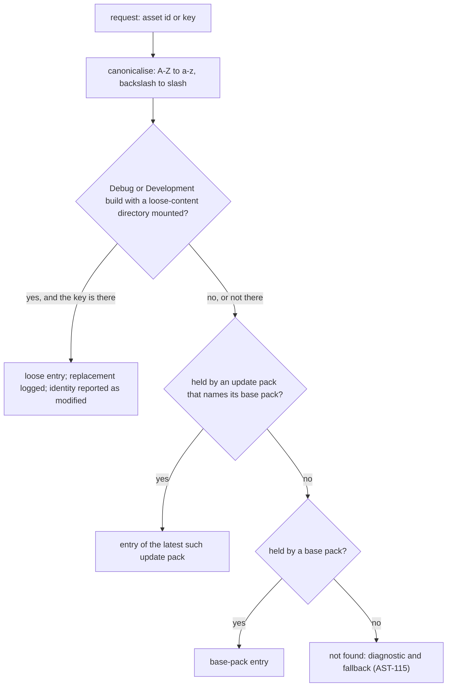
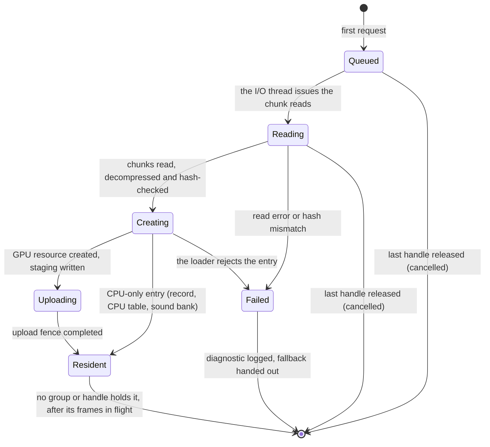
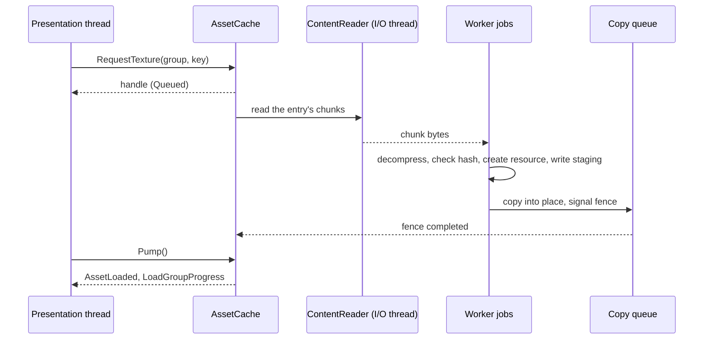

# Asset pipeline and resources

> Status: Engine baseline · Prefix: AST · ADRs: [ADR-0017](../../adr/0017-texture-container-and-block-compression.md) · [ADR-0018](../../adr/0018-texture-import-manifest.md) · [ADR-0019](../../adr/0019-mesh-source-format-and-cooked-meshes.md) · [ADR-0020](../../adr/0020-flat-shading-and-team-tint.md) · [ADR-0021](../../adr/0021-mesh-socket-schema.md) · [ADR-0025](../../adr/0025-audio-formats-codecs-and-residency.md) · [ADR-0058](../../adr/0058-pack-files-and-mount-policy.md) · [ADR-0059](../../adr/0059-content-build-and-validators.md) · [ADR-0060](../../adr/0060-content-identity-by-hash.md) · [ADR-0061](../../adr/0061-data-schemas-and-versioning.md) · also [ADR-0003](../../adr/0003-shader-language-compiler-and-material-shaders.md), [ADR-0006](../../adr/0006-root-signature-and-bindless-resource-access.md), [ADR-0008](../../adr/0008-gpu-memory-uploads-and-device-removal.md), [ADR-0013](../../adr/0013-working-colour-space-and-blending.md), [ADR-0016](../../adr/0016-view-projection-and-depth-conventions.md), [ADR-0034](../../adr/0034-text-rendering-and-glyph-cache.md), [ADR-0056](../../adr/0056-editions-build-flavours-and-feature-flags.md), [ADR-0057](../../adr/0057-version-identity.md), [ADR-0062](../../adr/0062-authoring-syntax-and-schema-language.md), [ADR-0063](../../adr/0063-localisation.md), [ADR-0071](../../adr/0071-install-layout-runtime-files-and-user-data.md) · Related: [Renderer](renderer/README.md) · [Data schemas](data_schemas/README.md) · [Build tooling and distribution](build_tooling_and_distribution.md) · [Audio engine](audio_engine.md) · [Terrain](terrain.md) · [Game assets](../../assets/GameAssets.md) · [Asset manifest](../../assets/asset_manifest.csv) · [Assets README](../../assets/README.md)

This component specifies how Species content travels from the authored source files under the content root `content/` to the resources a running client or server uses. At build time it covers the import records that fix every processing choice per asset (format, colour space, alpha mode, mip policy, sampler, team-tint mask); the texture, mesh, collision and audio cookers; derived assets and processing variants; the placeholder that the content build generates for every manifest row with no authored file; the build-time validators; the pack files with their table of contents; and content hashing. At run time it covers the mount set with its explicit override order, case-insensitive look-up and the development-only loose-file mount; the asynchronous content reader over memory-mapped packs; the asset cache keyed by asset id and processing variant; the resident sound banks; and run-time generated textures. Its list of assets is [`assets/asset_manifest.csv`](../../assets/asset_manifest.csv), whose columns it consumes as §2.4 states.

Notation: a **key** is the canonical name of a pack entry (§3.1); an **asset id** is the dotted id of a manifest row; a **member** is one file of a multi-file asset; a **variant** is a processing variant of an asset (a derived variant or a view, §3.5); KiB is 1024 bytes and MiB is 1024 KiB.

## 1 Responsibilities and boundaries

**AST-001** (MUST) The asset pipeline owns these build-time parts of the content build (ADR-0059): reading the asset manifest and the import record of every source (§3.2 to §3.11); the texture, mesh, collision and audio cookers (§4.2 to §4.6); derived variants (§4.3); placeholders (§4.7); the asset validators (§4.8); the pack writer (§4.9); and the entry hashes and the content manifest (§4.10).

**AST-002** (MUST) It owns these run-time parts: the mount set and the pack reader (§4.11); the asynchronous content reader (§4.13); the asset cache (`AssetCache`), which holds textures and meshes keyed by asset id and processing variant (§4.12, DEC-098); the resident sound banks held by the sample cache (`SampleCache`, ADR-0025); and the registry of run-time textures built from RGBA8 images (`ImageRgba8`, §4.15).

**AST-003** (MUST NOT) No processing choice is made where an asset is requested. A requester names an asset id and, optionally, a variant that the asset's import record declares; it never passes processing flags, and no request changes what another requester receives (ADR-0018, DEC-098).

**AST-004** (MUST NOT) The runtime never decodes an authoring format, never resamples, converts or re-encodes a texture, never parses glTF or authoring text, and never recolours art for a team when it loads it (ADR-0017, ADR-0019, ADR-0020, ADR-0061).

**AST-005** (MUST NOT) No simulation data is derived from render geometry. Collision volumes and simulation-relevant socket positions come only from the collision assets and simulation data records that the content build writes and validates (DEC-012, ADR-0019, ADR-0021). The asset pipeline never writes simulation state (DEC-007) and never draws from the simulation random generator.

**AST-006** (MUST NOT) Profile and shipping builds contain no code that reads content from loose files; they read packed content only (ADR-0058, ADR-0056).

**AST-007** (MUST) The dedicated-server product uses the same pack reader, mount set and content hashing as the client and loads only data records, maps, collision assets and simulation data records; it never creates GPU resources, sound banks or glyph pages (ADR-0056).

Table 1-A Boundaries.

| Neighbour | Gives the asset pipeline | Takes from it |
|---|---|---|
| [data schemas](data_schemas/README.md) (`DAT`) | the record schemas, the authoring parser, the import-record schemas, the map schema | cooked binary records with their schema id and version |
| [build tooling and distribution](build_tooling_and_distribution.md) (`BLD`) | edition manifests, products and flavours, the CI jobs that run the content build | the packs, the mount manifest, the content manifest and the validation report |
| [renderer](renderer/README.md) (`RND`) | the device, the copy queue and its fences (ADR-0008); the tint function, the cut-out thresholds and the look constants that the cookers apply | cooked textures and meshes by (asset id, variant); texture views |
| [audio engine](audio_engine.md) (`AEN`) | the streaming threshold, the memory budgets per category and the stream decoder (`AudioDecoder`) (ADR-0025) | resident sound banks and sound-stream entries |
| [UI framework](ui_framework/README.md) (`UI`) | the glyph cache (ADR-0034) | font files and string tables |
| [terrain](terrain.md) (`TER`) | the shore mask and the other run-time images it produces | run-time texture registrations |
| [platform layer](platform_layer.md) (`PLT`) | the install directory, file mapping and the user-data folders (ADR-0071) | none |
| simulation ([reference/12](../../reference/12_simulation_model/05_space_routing_and_physics.md)) | none | data records, maps, collision assets and simulation socket records |

```mermaid
flowchart LR
  subgraph BUILD["Content build"]
    MAN["asset manifest"] --> VAL["validate sources, import records and references"]
    SRC["content/ sources and import records"] --> VAL
    VAL --> COOK["cook textures, meshes, collision, audio and records"]
    COOK --> DER["derived variants and placeholders"]
    DER --> SEL["select entries per edition"]
    SEL --> PW["pack writer"]
    PW --> OUT["packs, mount manifest, content manifest"]
  end
  subgraph RUN["Runtime"]
    MNT["mount set"] --> CACHE{"asset cache: (asset id, variant) present?"}
    REQ["request (asset id, variant)"] --> CACHE
    CACHE -- yes --> HND["handle"]
    CACHE -- no --> RES["resolve the key in the mount set"]
    RES --> READ["asynchronous chunk reads"]
    READ --> VER["verify the entry hash where required"]
    VER --> CRE["create the resource; copy-queue upload"]
    CRE --> FEN["upload fence complete: resident"]
    FEN --> HND
  end
  OUT --> MNT
```



*Figure 1: from authored sources to resident resources.*

## 2 Interfaces

### 2.1 Interface sketch

```cpp
namespace species::assets {

// ---- identity -------------------------------------------------------------
struct AssetId   { std::string value; };   // dotted, lower case, a row of the asset manifest
struct VariantId { std::string value; };   // empty: the asset's default processing
struct AssetKey  { AssetId asset; VariantId variant; auto operator<=>(const AssetKey&) const = default; };
using  ContentKey   = std::string;                   // canonical pack key (§3.1)
using  Sha256Digest = std::array<std::byte, 32>;
struct AssetError;        // asset id, key, error kind and message (§6)
struct MountOptions;      // flavour, optional loose-content directory (development builds only)
struct MountOverride;     // key, overridden pack, overriding pack
struct RuntimeTextureId { std::uint32_t value; };   // never collides with a manifest asset id
class  ImageProducer;     // produces the pixels of a run-time texture on demand (§4.15)

enum class ContentType : std::uint8_t {
  Texture, CpuTable, Mesh, Collision, SimRecord, Record, Map, MapIndex,
  StringTable, Font, ResidentSound, SoundStream, ExplainerScript, Shader, AssetIndex };

// ---- import records (schemas owned by data_schemas.md, ADR-0061) ---------
enum class TextureKind : std::uint8_t { Colour, Ui, Normal, Mask, ExactData, CpuTable };
enum class ColourSpace : std::uint8_t { Srgb, Linear };
enum class AlphaMode   : std::uint8_t { Opaque, Straight, Premultiplied, Additive, Cutout };
enum class MipPolicy   : std::uint8_t { Full, None };
enum class SamplerId   : std::uint8_t { LinearClamp, LinearWrap, PointClamp };   // fixed heap indices (ADR-0006)
enum class Derivation  : std::uint8_t { BlurredShadow, StackedCopies, Greyscale, ToColour, ReplaceColour };

struct TextureView    { VariantId id; std::uint32_t firstLevel; std::uint32_t levelCount; SamplerId sampler; };
struct DerivedVariant { VariantId id; Derivation op; std::vector<float> parameters; };

struct TextureImportRecord {
  AssetId asset; std::uint32_t member;              // member index of a multi-file asset
  TextureKind kind; ColourSpace colourSpace; AlphaMode alphaMode;
  std::optional<float> cutoutThreshold;             // required with AlphaMode::Cutout
  MipPolicy mips; SamplerId sampler; bool pixelExact; std::uint32_t authoringScale;
  std::optional<AssetId> tintMask;                  // companion single-channel mask (ADR-0020)
  std::vector<DerivedVariant> derived; std::vector<TextureView> views;
};

enum class TintMarking : std::uint8_t { None, VertexWeight, MaterialFlag };
struct MeshImportRecord {
  AssetId asset; std::uint32_t member; std::string assetClass;   // selects the socket schema (ADR-0021)
  float unitScale;                                               // glTF metres to wu
  TintMarking tint; std::vector<std::string> smoothPrimitives;   // ADR-0020 exceptions
  std::optional<AssetId> collision;                              // required for collidable meshes
};

struct AudioImportRecord {
  AssetId asset; std::uint32_t member;
  bool positional; std::optional<std::array<std::uint64_t, 2>> loopSamples;   // [start, end)
};

// ---- packs and mounting (ADR-0058) ----------------------------------------
enum class PackCodec : std::uint8_t { Stored, Zstd };
struct EntryRef { std::uint32_t pack; std::uint32_t entry; };
struct PackEntry {
  ContentKey key; ContentType type; std::uint32_t schemaId, schemaVersion;
  std::uint64_t size; std::uint32_t firstChunk, chunkOffset; bool simulationRelevant; Sha256Digest hash; };

class PackFile {
 public:
  static std::expected<PackFile, AssetError> Open(const std::filesystem::path& path);  // maps and checks the TOC
  std::optional<std::uint32_t> Find(std::string_view canonicalKey) const;
  std::span<const PackEntry> Entries() const;
};

struct MountManifest;   // ordered pack list with kinds and patch targets (§3.13)
class MountSet {
 public:
  static std::expected<MountSet, AssetError> Mount(const MountManifest&, const MountOptions&);
  std::optional<EntryRef> Resolve(std::string_view requestedKey) const;   // canonicalises, then exact look-up
  std::vector<ContentKey> List(std::string_view prefix) const;           // sorted, one per effective key
  std::span<const ContentKey> MembersOf(const AssetId&) const;            // member keys in member order
  bool Contains(const AssetId&) const;
  std::span<const MountOverride> Overrides() const;                       // every override, logged at mount
  Sha256Digest SimulationIdentity() const;                                // §4.10
};

// ---- asynchronous reads ---------------------------------------------------
enum class ReadPriority : std::uint8_t { Immediate, Normal, Background };
class ContentReader {   // one interface; memory-mapped or streamed back-ends
 public:
  std::future<std::expected<std::vector<std::byte>, AssetError>> ReadEntry(EntryRef, ReadPriority);
};

// ---- the asset cache ------------------------------------------------------
enum class LoadState : std::uint8_t { Queued, Reading, Creating, Uploading, Resident, Failed };
struct TextureSize { std::uint32_t width, height, displayWidth, displayHeight, levels; };

class LoadGroup;        // a residency scope: start-up, front end, match (§4.12)
class TextureHandle;    // reference counted
class MeshHandle;       // reference counted; exposes the cooked MeshAsset

class AssetCache {
 public:
  LoadGroup&    BeginGroup(std::string_view name);
  TextureHandle RequestTexture(LoadGroup&, const AssetKey&, ReadPriority = ReadPriority::Normal);
  MeshHandle    RequestMesh(LoadGroup&, const AssetId&, std::uint32_t member, ReadPriority = ReadPriority::Normal);
  LoadState     State(const TextureHandle&) const;
  TextureSize   Size(const TextureHandle&) const;          // valid once Resident
  RuntimeTextureId Register(ImageProducer& producer);     // run-time textures (§4.15)
  void EndGroup(LoadGroup&);                               // releases the group's references
  void OnDeviceRebuilt();                                  // recreate resident GPU resources (ADR-0008)
  void Pump();                                             // once per frame: completions and events
};

}  // namespace species::assets
```

**AST-008** (MUST) The interface is the one above in substance: requests take an asset id and an optional declared variant; every handle is reference counted; every result that can fail is a `std::expected` or carries `LoadState::Failed` with an `AssetError` that names the asset id, the key and the reason.

### 2.2 Events

**AST-009** (MUST) The asset cache raises these events, delivered by `AssetCache::Pump()` on the thread that calls it (the presentation thread on the client):

| Event | When | Payload |
|---|---|---|
| `AssetLoaded` | an entry becomes resident | the handle and its asset key |
| `AssetFailed` | an entry fails to load (§6) | the asset key, the key and the `AssetError` |
| `LoadGroupProgress` | at most once per frame while a group loads | the group, bytes done, bytes total, entries done, entries total |
| `LoadGroupCompleted` | every entry of a group is resident or failed | the group and its failure count |
| `AssetReloaded` | development builds only: a reload command replaced an entry (§4.14) | the asset key |

Completion is always signalled by an event or a completed future, never inferred from an idle queue (DEC-226).

### 2.3 Threading contract

**AST-010** (MUST) `MountSet`, `PackFile` and the asset index are immutable once mounting has finished, so any number of threads may resolve keys and read entries at once without locks. The asset cache is safe for concurrent requests from any thread at all times, by contract and not by timing (DEC-224). Reads, decompression, hashing and resource creation run on the asset system's I/O thread and worker jobs; no loader ever blocks on the presentation thread, and GPU uploads go through the copy queue (ADR-0008). How these jobs map to threads follows the Species threading model, which the design phase decides (see DEC-224); until then the baseline is one I/O thread plus worker jobs of the engine job queue (`JobQueue`).

**AST-011** (MUST) The asset pipeline never reads or writes simulation state and is never called from inside a simulation step; a level load that draws from the simulation generator does so in the simulation's own load steps, whose draw order the asset system's scheduling never changes (DEC-224, DEC-226).

### 2.4 Data contract: the asset manifest

**AST-012** (MUST) The content build reads [`assets/asset_manifest.csv`](../../assets/asset_manifest.csv), one row per file, and uses its columns exactly as table 2.4-A states. A row whose columns contradict each other, or contradict the file's import record, is a build error naming the asset id, the member and the column.

Table 2.4-A The manifest columns and their use.

| Column | Use in the pipeline |
|---|---|
| `asset_id` | the asset id of the row; every member of one asset carries the same id; the asset index of the packs (§3.13) maps it to its member keys |
| `category` | selects the cooker and the validator rules (table 3.2-A); a reference to an asset of the wrong category is a build error |
| `subcategory` | refines the cooker rules within a category (for example `thumbnail` within maps and thumbnails) |
| `consumers` | documentation of the requirement ids and documents that use the asset; never an input to edition selection |
| `role` | documentation |
| `target_format` | the runtime format: texture kind, pixel format and mip policy, or the mesh, map, string-table, explainer, font, resident-sound or sound-stream cooker (table 3.3-B); the import record must agree with it |
| `spec` | the properties the validator checks: the texture size, read with "display size" and "author at 2x" as §4.2 states; "wrap repeat"; a mesh's triangle budget, node count, depth and socket list (§3.8); audio channels and durations where stated |
| `colour_space` | the import record's colour space; the two must agree |
| `alpha_mode` | the import record's alpha mode, through table 3.3-C |
| `variants` | the member index of the row ("file k of n"); "single file" is the only member; members keep this order |
| `priority` | a selection tag for edition manifests (ADR-0059) and the grouping of the placeholder report (§4.7) |
| `placeholder` | the placeholder generator for the row (table 4.7-A) |
| `brief_ref` | documentation |
| `species_filename` | the source path under `content/`; it also gives the member's key (§3.1) |
| `source_format` | the decoder and the source checks of §4.8 |

## 3 Data model

### 3.1 Content root, keys and asset ids

**AST-013** (MUST) Every authored source lives under the content root `content/`, in the folders of [GameAssets §2.1](../../assets/GameAssets.md#21-content-root-and-folders). The content build rejects a source outside the content root, and a file under it that belongs to no manifest row, no import record and no data record (a stray file).

**AST-014** (MUST) The **key** of a member's cooked entry is its `species_filename` relative to the content root, with the file extension removed: the member `content/sprites/worker_front.png` has the key `sprites/worker_front`. A derived variant's key is its parent's key followed by `@` and the variant id (§3.5). Keys are UTF-8 and consist only of the lower-case ASCII letters, the digits and the characters `_`, `.`, `/` and `@`; they are at most `ast.pack.max_key_bytes` (255) bytes long (DEC-801). Data records, maps and string tables take their keys from their sources in the same way.

**AST-015** (MUST) Asset ids and keys are case-insensitive for requesters and exact in storage. A request is canonicalised before the look-up: ASCII upper-case letters become lower case and `\` becomes `/`; the canonical key is then looked up exactly (ADR-0058). The content build rejects two keys, or two asset ids, that differ only in case, and any key or id with a character outside the set of AST-014.

**AST-016** (MUST) An asset id names one asset with one or more members, in the order of the `variants` column. The order carries meaning where the row's `spec` gives each number a meaning (states, pages, themes, the map default as member 1), and for `mesh.relic.variant`, whose member the simulation chooses with a draw among its 8 members (DEC-012): the member order of that asset is simulation-relevant, so it is part of the asset's simulation data record and of the simulation content identity (§4.10).

**AST-017** (MUST) Code selects an asset only by an asset-id constant or through a data table that maps an enumeration to asset ids (a Power kind to its icon, a mode to its mode card). Asset ids are never assembled from display text or other run-time strings. The content build checks that every enumerator of such a table maps to an existing asset id of the expected category, and that every asset-id constant of the code exists; the code's constants are compiled into an **engine asset table**, a data record that the content build reads as a source of references (§4.8).

### 3.2 Import records and cookers

**AST-018** (MUST) Every source has one **import record** beside it, sharing its stem, in the import-record schema that the data-schemas component defines (ADR-0061, ADR-0062). The content tools create the record from the manifest row and the defaults per kind (table 3.3-A); an author edits only the fields that the row leaves open (sampler, cut-out threshold, tint mask, derived variants, views, smooth primitives, loop points). A texture without an import record is a build error (ADR-0018).

Table 3.2-A Cookers by manifest category.

| `category` | Cooker | Content types written |
|---|---|---|
| Unit sprites; VFX textures; UI panels and title; HUD, supply-crate and power icons; Cursors and markers; Input glyphs; the pictures of Help images and explainer animations | texture cooker (§4.2) | `Texture` |
| Terrain ramps, water and waves | texture cooker: the sea tiles as `Texture`, the ramps and shore-wave gradients as `CpuTable` | `Texture`, `CpuTable` |
| the scripts of Help images and explainer animations | record cooker of the data-schemas component | `ExplainerScript` |
| Meshes | mesh cooker (§4.4) with its collision assets and simulation data records (§4.5) | `Mesh`, `Collision`, `SimRecord` |
| Audio by source and event; UI sounds; Ambience; Music | audio cooker (§4.6) | `ResidentSound`, `SoundStream` |
| Fonts | validated, stored unchanged | `Font` |
| String table | record cooker of the data-schemas component | `StringTable` |
| Maps and thumbnails | map cooker of the data-schemas and terrain components; thumbnail renderer (§4.7.2) | `Map`, `Texture`, `MapIndex` |

### 3.3 Texture import record

**AST-019** (MUST) A texture import record has the fields of table 3.3-A, with the closed value sets given there (ADR-0018). An unknown kind, alpha mode, sampler, derivation or variant is a build error.

Table 3.3-A Texture import-record fields.

| Field | Values | Default |
|---|---|---|
| kind | `Colour`, `Ui`, `Normal`, `Mask`, `ExactData`, `CpuTable` | from `target_format` (table 3.3-B) |
| colour space | `srgb` (colour art), `linear` (masks, ramps used as data, exact data) | from `colour_space` |
| alpha mode | `opaque`, `straight`, `premultiplied`, `additive` (colour is added, alpha is ignored, black contributes nothing), `cutout` with a threshold | from `alpha_mode` (table 3.3-C) |
| cut-out threshold | an alpha value; a texel is kept when its alpha is greater | required with `cutout`: the threshold of the pipeline-state entry that draws the art ([frame graph and passes](renderer/frame_graph_and_passes.md) RND-060) |
| mip policy | `full`, or `none` for art drawn at or near its authored scale (pixel-exact art and UI pictures) | from `target_format` |
| sampler | linear clamp-to-edge, linear wrap, point clamp-to-edge | linear clamp-to-edge; linear wrap when `spec` or `target_format` says "wrap repeat"; point clamp-to-edge when pixel-exact |
| tint mask | none, or the asset id of a companion single-channel mask whose value is the team-tint weight (ADR-0020) | none |
| pixel-exact | off or on (UI art that is neither compressed nor filtered) | off |
| authoring scale | 1, or `ast.texture.ui_authoring_scale` (2) | 2 where `spec` says "author at 2x", otherwise 1 |
| derived variants | list of (variant id, derivation, parameters) (§3.5) | none |
| views | list of (variant id, first level, level count, sampler) (§3.4) | none |

Table 3.3-B Texture kinds, runtime formats and the manifest's `target_format` (ADR-0017).

| Kind | Runtime format | Colour space | Mips | `target_format` values |
|---|---|---|---|---|
| `Colour` | `BC7_UNORM_SRGB` | `srgb` | full | "DDS (DX10 header) BC7_UNORM_SRGB, full mip chain", also with ", wrap repeat" or "; team area recoloured per team at load" (read as a `Colour` texture with a tint mask, AST-022) |
| `Ui` | `BC7_UNORM_SRGB`; `R8G8B8A8_UNORM_SRGB` when pixel-exact | `srgb` | none | "DDS (DX10 header) BC7_UNORM_SRGB, no mips" |
| `Normal` | `BC5_UNORM`, Z reconstructed in the shader | `linear` | full | no row uses it |
| `Mask` | `BC4_UNORM` | `linear` | full | "DDS (DX10 header) BC4_UNORM, full mip chain" |
| `ExactData` | `R8_UNORM` or `R8G8_UNORM`, uncompressed | `linear` | as declared | no row uses it |
| `CpuTable` | `R8G8B8A8_UNORM_SRGB`, uncompressed, one level; read on the CPU and never uploaded to the GPU | `srgb` | none | "uncompressed R8G8B8A8_UNORM_SRGB table in the pack, no mips; read on the CPU" |

Table 3.3-C The manifest's `alpha_mode` values and the import-record alpha mode.

| `alpha_mode` | Kind | Alpha mode | Blend of the materials that draw it |
|---|---|---|---|
| opaque | `Colour` or `Ui` | `opaque` | opaque, or the blend of the material's combine mode |
| opaque fill (blend chosen by the widget) | `Colour` | `opaque` | the widget's blend (UI framework) |
| opaque (modulated by the sea light map) | `Colour` | `opaque` | the sea flat layer's combine ([world renderers](renderer/world_renderers.md) RND-142) |
| straight alpha blend | `Colour` or `Ui` | `straight` | alpha |
| straight alpha, tinted by vertex colour | `Colour` | `straight` | alpha |
| straight alpha; pure-red texels take the team colour | `Colour` with a tint mask (AST-022) | `straight` | alpha |
| cut-out (alpha test at the consumer threshold) | `Colour` | `cutout` with the threshold of AST-019 | opaque with alpha cut-out |
| additive (black adds nothing; colour from the draw tint) | `Mask` | `additive` | additive |
| alpha mask (white colour, mask as alpha, tinted at draw) | `Mask`, sampled as white with the mask as alpha | `straight` where its pass alpha-blends it (`marker.team_disc_shadow`, `marker.edge_compass_shadow`); `additive` where its pass adds it (`marker.team_disc`, `fx.tree_canopy`) | alpha or additive, as the record states |
| darkening layer (destination x (1 - texel)) | `Mask` | `opaque`: the single channel is the darkening weight | darkening or ink |
| none (look-up table) | `CpuTable` | `opaque` | none: not drawn |
| opaque (team parts painted mostly red) | not a texture: a mesh (§3.7) | `opaque` | the material shaders of ADR-0003 |
| coverage (premultiplied in the UI shader) | not a texture: a font (§3.11) | none | the glyph cache's states (ADR-0034) |
| n/a | not a texture | none | none |

**AST-020** (MUST) The colour space agrees with the kind: `srgb` only with `BC7_UNORM_SRGB` and `R8G8B8A8_UNORM_SRGB`, `linear` only with `BC4_UNORM`, `BC5_UNORM`, `R8_UNORM` and `R8G8_UNORM`. The cooker tags sRGB textures as sRGB in the DX10 header, so the metadata stays truthful while the renderer samples encoded values through a `UNORM` view (ADR-0013).

**AST-021** (MUST) The validator pairs each texture with the blend state of every material and pipeline-state entry that draws it, as ADR-0018 states: `straight` with the alpha blend, `premultiplied` with the premultiplied blend, `additive` with the additive blend, and `cutout` with the opaque state and alpha cut-out. Any other pairing of these four alpha modes is a build error naming the asset, the material and the pass. Textures of alpha mode `opaque` are drawn with the blend that their material declares, which is how darkening and ink layers and opaque fills are drawn.

**AST-022** (MUST) Textured art that takes the team colour (the cloth of `marker.leader_banner` and `marker.flag_post_state`) names a companion tint mask in its import record: a `Mask` texture of the same size, whose value is the team-tint weight, 1 where the team colour applies fully. The art itself carries the intensity of the team area as grey levels. The renderer applies the tint from the instance's team palette index with the tint function of the renderer component (ADR-0020); no per-team copy exists and nothing is recoloured at load. Which tint colour a cloth flag takes, for no team, while selected or highlighted, and otherwise, is a rule of the cloth renderer ([animation and VFX](animation_and_vfx/README.md)). A tint mask whose size differs from its parent's, or a team-tinted texture without one, is a build error.

**AST-023** (MUST) A pixel-exact texture is cooked uncompressed as `R8G8B8A8_UNORM_SRGB` with mip policy `none` and the point clamp-to-edge sampler, and is drawn only at its authored scale (ADR-0017).

**AST-024** (MUST) A row whose `spec` gives a display size and says "author at 2x" is authored at `ast.texture.ui_authoring_scale` (2) times its display size in both dimensions. The cooked top level is the authored size, never resampled (ADR-0017); `TextureSize` reports the display size as the top-level size divided by the authoring scale, for layout. With mip policy `full`, the UI draws the level closest to the final pixel size (ADR-0033); with `none`, it draws the top level scaled to the final size with linear filtering.

### 3.4 Samplers and views

**AST-025** (MUST) The sampler of a texture is one of the closed set of ADR-0018, held in the sampler heap at the fixed indices of the shared header (ADR-0006): linear clamp-to-edge (the default), linear wrap (repeating terrain, water and sky layers and every row whose `spec` says "wrap repeat"), and point clamp-to-edge (pixel-exact art). Clamp-to-edge never blends a border colour into edge texels.

**AST-026** (MUST) A **view** is a declared variant that shares the cooked resource of its texture and restricts the levels a shader sees, or names another sampler of the closed set. A view never creates a second cooked copy. The baseline views are the views `level0` (first level 0, one level) of `fx.sky_cloud` (RND-153), of `fx.beam_short` and `fx.convert_beam` (RND-339), and of `marker.edge_compass` and `marker.edge_compass_shadow` (RND-378); a pass that draws one of these textures without mip-mapping requests that view.

**AST-027** (MUST) Art that the look magnifies with nearest filtering, `fx.particle_dot` in the particle batches and `sprite.worker.front` on the front-end backdrop, declares a view `point` with the point clamp-to-edge sampler, and the passes that magnify it request that view. Under minification that view also samples the nearest level, where the look filters linearly, because the closed sampler set has no sampler that magnifies by nearest and minifies linearly (§8).

### 3.5 Processing variants and derived assets

**AST-028** (MUST) An asset has exactly these processing variants: its default processing (the empty variant id), the views of its import record (§3.4) and the derived variants of its import record. A derived variant is a separate cooked entry produced offline by the cooker from its parent's source (ADR-0018). It has its own asset id, the parent's id followed by `.` and the variant id, its own manifest row naming the parent as its source, and the key of AST-014. A request for an undeclared variant fails with a diagnostic and never creates a resource.

Table 3.5-A Derivations (the pseudocode is in §4.3).

| Derivation | Parameters | Output |
|---|---|---|
| `BlurredShadow` | blur scale `rnd.shadow.icon_blur_radius` (10), normaliser `rnd.look.blur_normaliser` (0.0526), kernel `ast.derive.blur_kernel`, vertical gain `ast.derive.blur_vertical_gain` | a `Mask` texture of the parent's size, alpha mode `opaque`, drawn as a darkening layer under its parent ([view, lighting and fog](renderer/view_lighting_and_fog.md) RND-243, [visual language](renderer/visual_language.md) RND-422) |
| `StackedCopies` | column width `rnd.crawler.trail_column_width` (32 px), column height `rnd.crawler.trail_column_height` (512 px), shrink `rnd.crawler.trail_copy_shrink` (1 px per two copies) | a column of shrinking copies of the parent, of the parent's kind, alpha mode and mip policy ([entity and overlay renderers](renderer/entity_and_overlay_renderers.md) RND-320) |
| `Greyscale` | none | the parent with each colour replaced by the mean of its red, green and blue values |
| `ToColour` | a colour *C* and a threshold *t* | the parent with every texel whose RGB mean is below *t* replaced by *C* × (255 − mean) ÷ 255 |
| `ReplaceColour` | an old colour *O* and a new colour *N* | the parent with every texel whose RGB distance from *O* is below `ast.derive.replace_colour_distance` (10) replaced by *N*, alpha kept |

**AST-029** (MUST) The look requires these derived variants: a `BlurredShadow` of every cursor of [cursor and markers](../../reference/06_controls_camera_and_commands/cursor_and_markers.md) table 2.1-A that is shadowed (R-CTRL-350), of `marker.crate_landing` and of `marker.barrage_target` (RND-243, RND-366, RND-422); and the `StackedCopies` Crawler trail of `sprite.crawler.segment` (RND-320). An artist MAY instead author a shadow as greyscale art, as its own manifest row with the darkening profile (RND-422).

**AST-030** (MUST) The baseline has no team-tinted derived variant: every team colour is applied in the shader from the instance's palette index (ADR-0020). A team-tinted variant is allowed only for art that a shader cannot tint, declared in its import record.

**AST-031** (MUST) Each asset has one processing per use: two passes that need different processing of one image use two declared variants, never one cooked copy whose processing depends on which pass loads it first (DEC-098). In particular `marker.team_disc` has the single processing of its alpha-mask record and every pass draws that, and the passes that draw `fx.sky_cloud` and `fx.beam_short` without mip-mapping use their `level0` views.

### 3.6 Texture usage conventions the engine reproduces

**AST-032** (MUST) The import records of the asset families of table 3.6-A declare the processing given there, which is how the look of [the visual-language requirements](renderer/visual_language.md) reaches the screen (RND-393).

Table 3.6-A Texture usage conventions.

| Convention | Processing | Assets |
|---|---|---|
| hard cut-out crowd cards | `cutout` at the threshold of the pipeline-state entry that draws them; mips keep the alpha-test coverage (AST-070) | `sprite.worker.front`, `sprite.worker.hurt`, `sprite.worker.side`, `sprite.worker.state_overlay`, `sprite.worker.seasonal_hat` |
| a single-channel mask drawn as white with the mask as alpha | `Mask` kind, `straight` or `additive` as table 3.3-C states | `fx.tree_canopy`, `marker.team_disc`, `marker.team_disc_shadow`, `marker.edge_compass_shadow` |
| art with real alpha | `straight`; sources carry real alpha channels, and no colour value or colour channel stands in for transparency (ADR-0018) | colour, icon, marker and UI art of the straight profiles |
| additive glow on black | `Mask` kind, `additive`: black adds nothing and the colour comes from the draw tint, so the additive look comes from the blend, never from a black background standing in for transparency | the `fx.*` glows, beams, flares and grids, `sprite.crawler.segment`, `sprite.wisp.body`, `uitex.menu_highlight` |
| darkening by texel | `Mask` kind, `opaque`, drawn with the darkening or ink blend; white means full darkening | `icon.hud.icon_halo`, `sprite.missile_barrage.launcher_shadow`, `glyph.pad.face_shadow`, `glyph.pad.shoulder_left_shadow`, `glyph.pad.shoulder_right_shadow`, `glyph.pad.trigger_shadow`, the blurred shadow variants (AST-029) |
| team colour of 2-D art | white or light-grey art modulated by the draw colour; cloth art with a companion tint mask (AST-022) | `sprite.worker.*`, `icon.*`, `cursor.*`, `marker.*`, `marker.leader_banner`, `marker.flag_post_state` |
| team colour of meshes | an explicit tint weight per facet (AST-034), applied by the renderer's tint function ([world renderers](renderer/world_renderers.md) RND-161, RND-162) | every team-tinted mesh of RND-162 |
| mesh colour attenuation | every facet colour × `rnd.mesh.colour_attenuation` (0.85), once, by the mesh cooker (RND-160, AST-076) | every mesh |
| look-up tables are not GPU textures | `CpuTable`, read on the CPU by the terrain component | `terrain.ramp`, `terrain.shore_wave_gradient` |
| UI pictures | `Ui` kind with the linear clamp-to-edge sampler and the mip policy of their row; tiled strips keep their mips and use linear wrap | `help.*` pictures, `ui.*` panels and logos, `thumb.*` |
| sizes | the size of the row's `spec`, checked by the validator (AST-068) | every texture row |
| seasonal theme | asset selection only: while the seasonal state is active, the ramp, shore-wave gradient and sea tile that the theme forces replace the map's own ([maps: rules and conventions](../../reference/08_maps_and_level_design/rules_and_conventions.md) R-MAP-086), and every third Worker wears `sprite.worker.seasonal_hat` ([Worker](../../reference/02_units/worker.md) R-UNIT-148) | `terrain.ramp`, `terrain.shore_wave_gradient`, `terrain.sea_tile`, `sprite.worker.seasonal_hat` |

### 3.7 Mesh import record and the tint attribute

**AST-033** (MUST) A mesh import record declares (ADR-0019): the asset id and member; the **asset class**, which selects the socket schema (§3.8); the unit scale from glTF metres to world units; the tint marking (AST-034); the primitives declared smooth-shaded, if any (AST-036); and, for a collidable mesh, the asset id of its collision asset (§3.9). The cooker converts glTF axes and units to Species world axes once, at cook time, with the conventions of ADR-0016.

**AST-034** (MUST) Team regions of a mesh are marked explicitly, in one of the two ways of ADR-0020, and the import record names which:
1. **vertex weight**: the application-specific glTF vertex attribute `_SPECIES_TINT`, a `SCALAR` accessor of `FLOAT`, or of normalised `UNSIGNED_BYTE` or `UNSIGNED_SHORT`, with values from 0 (keep the facet colour) to 1 (full team tint);
2. **material flag**: the member `species_team_tint` with the value `true` in the `extras` object of a glTF material, which marks every triangle of the primitives that use the material with weight 1.

The cooker bakes one tint weight per triangle (§4.4) and never infers a tint weight from colour values. The content tools MAY offer an authoring helper that proposes `_SPECIES_TINT` values for art made in the key-colour style (facets whose red channel exceeds twice each of the other two, [world renderers](renderer/world_renderers.md) RND-162) and writes them into the source as explicit weights, which the artist reviews.

**AST-035** (MUST) Every mesh that the renderer tints (the team-tinted meshes of RND-162) declares a tint marking and carries a weight above 0 on at least one triangle; a mesh whose record declares no tint marking carries neither the attribute nor the flag. A violation of either rule is a build error naming the asset (ADR-0020).

**AST-036** (MUST) A primitive without `NORMAL` is faceted (implicit flat normals). A primitive with `NORMAL` is accepted only when the import record declares it smooth-shaded, as a documented exception of the visual-language requirements (ADR-0020).

**AST-037** (MUST) Mesh sources are binary glTF 2.0. The cooker accepts only the extensions `KHR_materials_unlit`, `KHR_materials_emissive_strength` and `KHR_mesh_quantization`, only triangle primitives, and only materials that map onto the material shader set of ADR-0003; it rejects every other extension, glTF skins, morph targets and animation channels (ADR-0019, ADR-0035).

### 3.8 Socket names, kinds and schemas

**AST-038** (MUST) A socket is a glTF node without a mesh, placed as a child of the node it moves with (ADR-0021). Its name is the reserved prefix `socket_`, then the socket kind, then, for an indexed kind, `_` and a number of `ast.mesh.socket_index_digits` (2) decimal digits counting from `ast.mesh.socket_first_number` (1) without gaps, for example `socket_port_01` and `socket_door`. The cooked index of a socket is its number minus 1; an indexed kind written without a number is index 0, and a mesh that carries both forms of one kind is rejected. No node that is not a socket has a name starting with the prefix. The manifest's `spec` lists sockets without the prefix (`port_01`).

**AST-039** (MUST) The socket kinds form the closed Species enumeration of table 3.8-A (the `MeshSocket` kind). Each kind states whether it is indexed, whether its order carries meaning and whether it is simulation-relevant, and names its consumers.

Table 3.8-A Socket kinds.

| Kind | Indexed | Order carries meaning | Simulation-relevant | Consumers |
|---|---|---|---|---|
| `port` | yes | yes: port numbers are addressed by the rules | yes | R-BLDG-044, R-BLDG-124, R-BLDG-405 |
| `status` | yes | yes: status *n* belongs to port *n* | no | R-BLDG-017, R-BLDG-046, R-BLDG-175, R-BLDG-405 |
| `light` | yes | no | no | R-BLDG-044, R-BLDG-432 |
| `glow` | yes | no | no | R-BLDG-175 |
| `door` | no | n/a | yes | R-BLDG-123, R-BLDG-124 |
| `entrance` | no | n/a | yes | R-BLDG-202, R-BLDG-203, R-UNIT-372 |
| `gate_entrance` | no | n/a | yes | R-BLDG-146, R-BLDG-153 |
| `gate_exit` | yes | yes | yes | R-BLDG-140 (no rule reads it directly; DEC-330) |
| `gate_surface` | no | n/a | no | R-BLDG-140, R-BLDG-144 |
| `beam_focus` | no | n/a | yes | R-BLDG-153, R-BLDG-154, R-BLDG-157 |
| `essence_link` | no | n/a | no | R-BLDG-104, R-BLDG-113, R-BLDG-124 |
| `grid_link` | no | n/a | no | R-BLDG-170, R-BLDG-173, R-BLDG-175, R-BLDG-185 |
| `fuel_point` | no | n/a | no | R-BLDG-192, R-BLDG-196, R-BLDG-197, R-BLDG-201, R-BLDG-202, R-BLDG-319 |
| `arm_tip` | no | n/a | no | R-BLDG-197, R-BLDG-199 |
| `dish_direction` | no | n/a | no | R-BLDG-299, R-BLDG-303 |
| `thruster` | no | n/a | no | R-BLDG-319, R-BLDG-338 |
| `window` | yes | no | no | R-BLDG-319 |
| `field_anchor` | yes | yes: 1 is the field base, 2 the field top | yes | R-BLDG-432, R-BLDG-440 |
| `barrel_mount` | no | n/a | yes | R-BLDG-405 |
| `kill_counter` | no | n/a | no | R-BLDG-405, R-BLDG-427 |
| `muzzle` | yes | yes: barrels fire in socket order | yes | R-BLDG-405, R-UNIT-342, R-UNIT-354, R-UNIT-356 |
| `casing_eject` | yes | yes: casing *n* belongs to muzzle *n* | no | R-BLDG-405, R-UNIT-342, R-UNIT-354 |
| `launch_point` | no | n/a | yes | R-BLDG-642, R-BLDG-648 |
| `stem` | no | n/a | no | R-BLDG-642 (no rule reads it directly; DEC-330) |
| `egg_spawn` | no | n/a | yes | R-UNIT-544 |
| `egg_lay` | no | n/a | yes | R-UNIT-573, R-UNIT-580 |
| `carry` | no | n/a | yes | R-UNIT-565 |
| `tail` | yes | yes: tails are drawn in socket order | no | R-UNIT-547, R-UNIT-594 |
| `leg` | yes | yes: the leg number drives the gait | no | R-UNIT-580 |
| `segment_end` | no | n/a | no | R-UNIT-581 |
| `engine` | yes | no | no | R-UNIT-418, R-UNIT-710 |
| `flag` | no | n/a | no | R-UNIT-372 |
| `eye` | yes | no | no | none confirmed (DEC-330) |
| `grab` | yes | no | no | none confirmed (DEC-330) |

**AST-040** (MUST) The socket schema of an asset class is the `sockets:` clause of its manifest row's `spec`, each kind with the exact count listed, except where a consumer rule declares a range (the Collector's `engine` sockets, 0 to 4, R-UNIT-418); a parent-node constraint written as "(on node *n*)" is part of the schema. The cooker rejects a mesh with a missing or surplus socket, an unknown kind, a duplicate, a gap in the numbers of a kind, or a socket under the wrong parent node, and names the asset, the kind and the number (ADR-0021, DEC-015).

**AST-041** (MUST) Every socket kind that a row's `spec` lists is part of its asset class's schema, including kinds whose consumer is not confirmed (`eye`, `grab`, `gate_exit`, `stem`); this is the default of DEC-330, whose option B would leave such kinds out of the schemas.

**AST-042** (MUST) Each turret type takes its sockets from its own barrel mesh: every member of `mesh.structure.turret_barrel` carries its own `muzzle` sockets, and its `casing_eject` sockets where its `spec` lists them, and the validator checks the barrel of every turret type against its own row (DEC-461).

**AST-043** (MUST) For every simulation-relevant socket kind, the cooker writes the socket transforms into the asset's simulation data record (§3.9): for each socket, in index order, its transform relative to its parent node and the rest transforms of the node chain from that parent to the root, in world units, so that the simulation can apply its own node rotations. The simulation reads only that record, never the render mesh (ADR-0021).

### 3.9 Collision assets and simulation data records

**AST-044** (MUST) Every collidable mesh, that is every mesh that a structure's sphere, mesh or ray test reads ([buildings and world objects](../../reference/03_buildings_and_world_objects/README.md) R-BLDG-041, R-BLDG-042), has a **collision asset**: a separate asset with its own asset id and source, a glTF 2.0 file of triangle primitives with no materials, cooked into a `Collision` entry flagged simulation-relevant. A collidable mesh without a collision asset is a build error (ADR-0019, DEC-012). Collision geometry is authored as its own source; render geometry never produces it.

**AST-045** (MUST) The mesh and collision validators reject a mesh with two nodes of the same name, and a primitive whose attribute accessors do not all have the same element count, which covers a hit-test mesh whose position count differs from its vertex count; they accept a socket-only mesh with no geometry node, such as `mesh.structure.turret_mount` (ADR-0059, DEC-012).

**AST-046** (MUST) Each mesh asset whose consumers read simulation-relevant data has a **simulation data record** (`SimRecord`), flagged simulation-relevant: the socket transforms of AST-043, the asset's member order where AST-016 makes it simulation-relevant, and the bounding sphere of each collision asset. The record carries the schema id and version of its record type (ADR-0061).

**AST-047** (MUST) For every tree that a map places, the content build bakes the crown centre and crown radius into the cooked map's collision data by running the tree generator of [trees and crate structures](../../reference/03_buildings_and_world_objects/trees_and_crate_structures.md) R-BLDG-603 to R-BLDG-605 on the tree's parameters, with each centre stated explicitly (the crown hit centre ignores the tree's rotation, [space, routing and physics](../../reference/12_simulation_model/05_space_routing_and_physics.md) R-SIM-327). Trees created during a match are computed by the simulation (R-BLDG-603).

### 3.10 Audio asset classes in the pipeline

**AST-048** (MUST) The audio content of the pipeline is the classes of table 3.10-A (ADR-0025).

Table 3.10-A Audio asset classes.

| Class | Source | Runtime | Notes |
|---|---|---|---|
| sample groups `sfx.*` (by source and event, outcome stings, UI sounds) | WAV at `ast.audio.sample_rate` (48 kHz), 24-bit integer or 32-bit float PCM; mono for every positional sound, mono or stereo for 2-D sounds | `ResidentSound`: 16-bit PCM at 48 kHz in a resident bank; or `SoundStream`, as the row's `target_format` states | the members are the group's numbered files (`_NN`), in member order |
| ambience beds `amb.*` | as above, 2-D | `SoundStream` | seamless loops |
| music `music.*` | WAV at 48 kHz, stereo | `SoundStream` | loops or one-shots |
| sound-event and sound-source definitions (`SoundEventDef`, `SoundSourceDef`) | data records | `Record` | looping, gain, pitch and envelopes live here ([event model and sound data](../../reference/10_audio_design/event_model_and_sound_data.md)), never in an audio import record |
| DSP filter definitions (`DspFilterDef`) | data records | `Record` | the effect chain of the audio engine |

**AST-049** (MUST) A sound-event layer names a sample group by its asset id, matched exactly after canonicalisation (AST-015); the group's members are found through the asset index, never by searching folders or appending extensions. Two sample groups with the same id are a build error (DEC-801), and so is a layer that names no group or a missing one (DEC-015).

**AST-050** (MUST) An audio import record holds only what the source cannot state: whether the group is positional (which makes mono mandatory) and, for a stream, its loop points in samples, which default to the whole file. Audio is language-neutral: a group has one recording set for every language unless the voice decision gives spoken lines one set per language (see DEC-317), in which case each set is a member list keyed by its BCP 47 tag (ADR-0063).

### 3.11 Other content types

**AST-051** (MUST) The other content types are cooked as table 3.11-A states. Data records are bound by field name, carry their schema id and version, and are never parsed from text at run time (ADR-0061).

Table 3.11-A Other content types.

| Content | Source under `content/` | Runtime entry | Schema owner |
|---|---|---|---|
| data records: statistics, rules, Supply-crate tables, sound bindings, effect definitions, input bindings, the engine asset table | JSON validated by JSON Schema (ADR-0062) | `Record` | [data schemas](data_schemas/README.md) |
| maps `map.*` | a JSON map definition in the Species map schema (ADR-0062) | `Map`: a header readable without the terrain, the placed records, the terrain inputs of the terrain runtime model (see DEC-246) and the baked collision data of AST-047 | data schemas, [terrain](terrain.md) |
| the map index | generated by the content build (AST-086) | `MapIndex` | data schemas |
| thumbnails `thumb.*` | rendered by the content build (AST-087) | `Texture` of kind `Ui` | this component |
| string tables `strings.*` | UTF-8 JSON mapping string ids to ICU MessageFormat text, with the BCP 47 tag stored in the file (ADR-0063) | `StringTable` | data schemas, [UI framework](ui_framework/README.md) |
| explainer scripts `anim.explainer` | JSON key-frame scripts that animate pictures by asset id | `ExplainerScript` | data schemas, UI framework |
| fonts `font.*` | OpenType fonts licensed for embedding | `Font`, stored unchanged; glyphs are rasterised at run time into `R8_UNORM` glyph-cache pages (ADR-0034) | UI framework |
| shaders | HLSL, compiled offline by the pinned DXC with the options of ADR-0003 | `Shader`: DXIL blobs only | [renderer](renderer/shaders.md) |
| the asset index | generated by the pack writer (§3.13) | `AssetIndex`, one per pack | this component |

**AST-052** (MUST) The cooked mesh is the versioned `MeshAsset` record of ADR-0019, stored as a pack entry of content type `Mesh`; it has no file of its own and no container format other than the pack.

### 3.12 Pack file layout

**AST-053** (MUST) A pack file (`PackFile`) has the layout of ADR-0058, with the extension `.pack`: a fixed header (the Species magic value, the format version `ast.pack.format_version` (1), flags, and the offset, size and SHA-256 of the table of contents); the chunk area; and the table of contents (TOC). Packs are not encrypted: their integrity rests on the hashes of AST-054 and AST-107. Chunk and entry counts are 32-bit.

**AST-054** (MUST) The TOC holds the chunk records, then the entry records sorted by key in byte-wise order:
- a **chunk record** holds the chunk's file offset, which is a multiple of `ast.pack.chunk_alignment_kib` (64 KiB); its stored size; its uncompressed size, at most `ast.pack.chunk_max_kib` (256 KiB); and its codec id;
- an **entry record** holds the canonical key; the content type (`ContentType`); for data records, the schema id and version; the uncompressed size; the first chunk and the byte offset in it; the simulation-relevant flag; the placeholder flag (§4.7); and the SHA-256 of the uncompressed entry.

A zero-byte entry is a valid entry with no chunk.

**AST-055** (MUST) The codec enumeration is, in this order: stored, Zstandard. Its further values are reserved, so that another codec (for example LZ4, or one that the GPU decompresses) can be added without a format change; a reader that meets an unknown codec id rejects the chunk with a diagnostic naming the pack and the chunk.

### 3.13 The mount manifest and the pack set

**AST-056** (MUST) The **mount manifest** is an ordered list of packs. Each item has a pack id, a kind (`base` or `update`), whether the pack is required or optional, and, for an update pack, the base packs whose entries it may override. The content build writes one mount manifest per edition beside the packs, in the install directory's pack folder (ADR-0071).

**AST-057** (MUST) The baseline pack set, in mount order, is that of table 3.13-A. No content is needed before the settings store starts, because the settings defaults are compiled into the build (DEC-100).

Table 3.13-A The baseline pack set.

| Order | Pack id | Kind | Required | Contents |
|---|---|---|---|---|
| 1 | `startup` | base | yes | the shader blobs; the art that the loading view draws before the other packs are mounted: `sprite.worker.front` and `uitex.studio_splash` |
| 2 | `locale` | base | yes | the fonts and string tables of the edition's languages |
| 3 | `core` | base | yes | every other texture, mesh, collision asset, simulation data record, data record, map, thumbnail, explainer script and the map index |
| 4 | `audio` | base | yes | the resident sounds and the sound streams |
| 5 and later | `update_<nn>`, two-digit *nn* from 01 | update | as each update declares | entries that replace entries of the base packs that the update names, and new entries |

**AST-058** (MUST) Each pack holds an **asset index** entry (`AssetIndex`) that maps every asset id whose members it holds to the keys of those members in member order, and every declared variant id to its key. The mount set merges the indexes with the override rules of §4.11.

### 3.14 The content manifest

**AST-059** (MUST) The content build writes the **content manifest** beside the packs (ADR-0060). It lists, for every entry of every pack: its key, its pack id, its content type, its asset id and member where it has them, its SHA-256, its simulation-relevant flag and its placeholder flag; and, for each edition, the simulation content identity (§4.10). The SHA-256 of the content manifest is part of the build identity (ADR-0057).

### 3.15 Caches and their keys

**AST-060** (MUST) The run-time caches are those of table 3.15-A; no other component keeps its own copy of a cooked texture, mesh or sound bank.

Table 3.15-A Caches and their keys.

| Cache | Owner | Key | Filled by | After device removal | Freed |
|---|---|---|---|---|---|
| mount table | `MountSet` | canonical key | mounting at start-up (§4.11) | unchanged (CPU data) | shutdown |
| asset index | `MountSet` | asset id | mounting | unchanged | shutdown |
| textures | `AssetCache` | (asset id, variant) | requests (§4.12) | each GPU resource recreated from its pack entry | when the last load group that holds it ends |
| meshes | `AssetCache` | (asset id, member) | requests | GPU buffers recreated from the pack entry; the node hierarchy and socket table stay in memory | when the last load group that holds it ends |
| run-time textures | `AssetCache` | `RuntimeTextureId` | registration (§4.15) | recreated from the producer | when the producer unregisters it |
| resident sound banks | `SampleCache` | asset id of the sample group | load groups (§4.12) | unaffected | when the last load group that holds it ends |
| glyph pages | the UI framework's glyph cache | the key of ADR-0034 | text drawing | rebuilt, not restored (ADR-0034) | least recently used page first |

### 3.16 RGBA8 images and run-time textures

**AST-061** (MUST) An RGBA8 image (`ImageRgba8`) is a decoded image in memory: its width, its height and its pixels row by row from the top, each pixel 8-bit red, green, blue and alpha, with straight alpha. It is the in-memory form of every decoded source image in the content build and of every run-time image. Its operations are: clear to a colour; read a pixel, where a read outside the image returns (0, 0, 0, 0); write a pixel, where a write outside the image does nothing; a scaled copy into a rectangle of another image with nearest or bilinear sampling; and the derivations of table 3.5-A.

**AST-062** (MUST) A **run-time texture** is an image that a component produces while the game runs, registered with the asset cache through an `ImageProducer`: the terrain component's shore mask ([terrain](terrain.md)), and the sea tile and thumbnail embedded in a custom map (AST-063). It is uncompressed (`R8G8B8A8_UNORM_SRGB` for colour, `R8_UNORM` for a single channel), has one level, uses the linear clamp-to-edge sampler unless its producer names another sampler of the closed set, has an id that can never equal a manifest asset id, and is never written into a pack. After device removal the asset cache asks the producer for the pixels again; it keeps no CPU copy of its own for rebuilding (ADR-0008).

**AST-063** (MUST) The images embedded in a custom map ([map editor hooks](../../reference/08_maps_and_level_design/map_editor_hooks.md) R-MAP-391) take the place of the asset of their role for that map only: the land colour ramp and the shore-wave gradient as CPU tables handed to the terrain component, and the sea tile and the thumbnail as run-time textures. The custom-map container, its identity and its transfer are design-phase inputs (see DEC-204).

**AST-064** (MUST NOT) The captured frame of the screen transition and the screenshot read-back are frame-graph resources of the renderer, not run-time textures; the asset cache never holds them.

## 4 Behaviour and algorithms

### 4.1 Content-build flow

**AST-065** (MUST) The content build runs these steps in this order; an error in any step fails the build, and CI runs the build on every change (ADR-0059, ADR-0070):
1. read the asset manifest, the edition manifests and every import record;
2. check every source (AST-068, AST-076, AST-079, AST-091);
3. cook every member whose inputs changed (§4.2 to §4.6), where an output is rebuilt when the hash of any of its inputs, of the tool version or of its cook options changes;
4. produce the derived variants (§4.3);
5. generate a placeholder for every row with no authored file (§4.7.1);
6. cook the data records, maps, string tables and explainer scripts, and produce the generated outputs: thumbnails, the map index and the residency lists (§4.7.2, AST-067);
7. check every reference and the unreferenced assets (AST-089, AST-090, AST-092);
8. select the entries of each edition from its edition manifest, by asset id, folder or tag, never by exclusion;
9. write the packs, their asset indexes and the mount manifests (§4.9);
10. write the content manifest and the validation report (§4.10).

**AST-066** (MUST) Identical inputs give bit-identical packs: entries are written in byte-wise key order; no output holds a timestamp or a host path; every cook option, including the compression level `ast.pack.zstd_level` (19), is fixed by the tool version or stated in the import record; and CI encodes BC7 with the software codec (ADR-0017, ADR-0059).

**AST-067** (MUST) The content build writes a **residency list** for the start-up group, for the front end and for each map: the closure of the asset ids that it references, where a map's closure covers the map's records, the match rules of every mode the map supports, every Supply-crate outcome those rules can enable, and the entries of the engine asset table (AST-017) that are marked for that scope. Load groups request these lists (§4.12), and the audio engine's resident budgets are checked against them (ADR-0025).

### 4.2 Texture cooking

**AST-068** (MUST) The cooker decodes each texture source with the decoder of its `source_format` into an RGBA8 image (for a greyscale source, the grey value in every colour channel and an alpha of 255) and checks it:
1. its size equals the size of its row's `spec` times its authoring scale (AST-024);
2. neither dimension exceeds `ast.texture.max_dimension` (16384 px);
3. for a block-compressed format, both top-level dimensions are multiples of `ast.texture.block_dimension` (4 px); dimensions need not be powers of two;
4. a source whose alpha mode needs alpha (`straight`, `premultiplied`, `cutout`) has an alpha channel;
5. a `Mask` or `CpuTable` source has the channel layout of its `source_format`.

A source that fails a check is a build error naming the asset id, the member, the file and the check; nothing is padded or resampled (ADR-0017).

**AST-069** (MUST) For a `premultiplied` texture the cooker multiplies the colour by the alpha before it generates the mip levels (ADR-0018).

**AST-070** (MUST) With mip policy `full`, the cooker generates the full chain down to 1 × 1. sRGB-tagged levels are filtered with sRGB-aware filtering: decoded to linear values with the exact sRGB curve, averaged, and encoded again; linear levels are averaged on their stored values (ADR-0013). For a `cutout` texture, each level's alpha is scaled so that the share of texels whose alpha is above the declared threshold equals that share in level 0, which keeps alpha-test coverage at every distance (ADR-0018).

**AST-071** (MUST) The cooker encodes each level in the format of its kind (table 3.3-B) with the DirectXTex library of ADR-0017 and writes a DDS with the DX10 header, which states the format, its sRGB tag, the resource dimension and the array size. The loader rejects a DDS without the DX10 header, with an unknown format or with a truncated payload, and names the asset id (ADR-0017).

**AST-072** (MUST) A `CpuTable` entry is the decoded table in `R8G8B8A8_UNORM_SRGB`, one level, read by the component that uses it on the CPU (the terrain component for `terrain.ramp` and `terrain.shore_wave_gradient`); the asset cache never uploads it to the GPU.

### 4.3 Derived variants

**AST-073** (MUST) A `BlurredShadow` variant is computed from its parent's decoded RGBA8 image *S* of width *W* and height *H*, with the weights *w*ₖ = `ast.derive.blur_kernel`[*k*] × `rnd.shadow.icon_blur_radius` × `rnd.look.blur_normaliser` for *k* = −2 to 2, in two passes that add into cleared images and saturate every channel at 255:

```
# pass 1: horizontal, from S into T
T := image(W, H) cleared to (0, 0, 0, 0)
for y in 0 .. H-1, for x in 0 .. W-1:
    if S(x, y).r = 0 and S(x, y).g = 0 and S(x, y).b = 0: continue      # black texels add nothing
    for k in -2 .. 2:
        if 0 <= x + k < W:
            for c in (r, g, b, a): T(x+k, y).c := min(255, T(x+k, y).c + round(S(x, y).c * w[k]))

# pass 2: vertical, from T into D, with the vertical gain
D := image(W, H) cleared to (0, 0, 0, 0)
for y in 0 .. H-1, for x in 0 .. W-1:
    if T(x, y).r = 0 and T(x, y).g = 0 and T(x, y).b = 0: continue
    for k in -2 .. 2:
        if 0 <= y + k < H:
            for c in (r, g, b, a):
                D(x, y+k).c := min(255, D(x, y+k).c + round(T(x, y).c * w[k] * ast.derive.blur_vertical_gain))
```

The variant's value is the `Greyscale` mean of *D*'s red, green and blue, cooked as a `Mask` texture (§3.5). The parent's width and height lie between `ast.derive.blur_min_size` (1 px) and `ast.derive.blur_max_size` (1024 px); a parent outside that range is a build error.

**AST-074** (MUST) A `StackedCopies` variant of a square parent of side *s*₀ is a column of width *W* = `rnd.crawler.trail_column_width` and height *H* = `rnd.crawler.trail_column_height`, cleared to (0, 0, 0, 0), into which copies of the parent are placed from the top:

```
y := 0; i := 0
loop:
    side := s0 - floor(i / 2) * rnd.crawler.trail_copy_shrink
    if y + side >= H: stop
    copy the parent, scaled bilinearly to side x side, to the rectangle
         x from floor(W / 2) - floor(side / 2), y from y, width side, height side
    y := y + side; i := i + 1
```

With *s*₀ = 32 px this places 18 copies, of sides 32, 32, 31, 31, 30, 30, 29, 29, 28, 28, 27, 27, 26, 26, 25, 25, 24 and 24 px, filling 504 px of the 512 (RND-320).

**AST-075** (MUST) The colour derivations of table 3.5-A use integer arithmetic on 8-bit channels: `Greyscale` sets each of red, green and blue to ⌊(*r* + *g* + *b*) ÷ 3⌋; `ToColour` computes the mean the same way and, for a mean below *t*, sets each channel *c* of red, green and blue to ⌊*C*.*c* × (255 − mean) ÷ 255⌋, leaving other texels unchanged; `ReplaceColour` replaces the red, green and blue of a texel whose Euclidean distance from *O* in 8-bit red, green and blue is below `ast.derive.replace_colour_distance` (10) by those of *N* and keeps its alpha. A derived variant is then cooked with its parent's import record, except where table 3.5-A states another output.

### 4.4 Mesh cooking

**AST-076** (MUST) The mesh cooker first validates each source against the glTF 2.0 specification (for example with the Khronos glTF validator), then against the rules of AST-034 to AST-042 and AST-045, then cooks it as follows (ADR-0019, ADR-0020, ADR-0013, RND-157, RND-160):

```
convert every node transform and position to Species world axes and units (unit scale, ADR-0016)
for each mesh node n, for each primitive p of n:
    for each triangle (i0, i1, i2) of p:
        corner colour k(i) := baseColorFactor(p.material) * COLOR_0[i]      # linear glTF values; COLOR_0 absent = 1
        e(i) := quantise8(srgb_encode(k(i)))                                  # exact sRGB curve, per channel
        if p is faceted:
            require e(i0) = e(i1) = e(i2)                                     # else error: asset, node, triangle
            facet colour f := e(i0)
            facet normal m := normalise(cross(P(i1) - P(i0), P(i2) - P(i0)))
        f.rgb := quantise8(f.rgb * rnd.mesh.colour_attenuation)               # alpha unchanged
        tint weight t := per AST-034: the corners' _SPECIES_TINT values, which must be equal after
                         quantisation to 8 bits; 1 for a flagged material; 0 for no marking
        emit three vertices, each with its position, f, m, t and the barycentric corner
             (1, 0, 0), (0, 1, 0), (0, 0, 1)
    record n's rest transform, draw range, axis-aligned bounding box, vertical extent (lowest and
        highest y) and bounding sphere (centre: the box centre; radius: the largest distance from it to
        any vertex of n)
write the socket table: for each kind in table 3.8-A order, the sockets in index order, each with its
    parent node, its transform relative to that node and its chain of nodes up to the root
```

Smooth-shaded primitives (AST-036) keep their vertex normals and colours and take the same colour conversion and attenuation per vertex. A mesh whose node or socket count exceeds the capacity of the cooked format, which is at least `rnd.mesh.max_nodes` (100) nodes and `rnd.mesh.max_sockets` (100) sockets (RND-156), is a build error. A mesh whose triangle count exceeds the budget of its row's `spec` is a build error naming the budget and the count.

### 4.5 Collision assets and simulation data records

**AST-077** (MUST) The collision cooker converts a collision source to Species world axes and units as AST-076 does, keeps its node hierarchy, writes per node its triangles in world units relative to the asset origin and its bounding sphere, and stores the entry flagged simulation-relevant. Collision cooking reads no material, colour or texture data and no render mesh (DEC-012).

**AST-078** (MUST) The simulation data record of a mesh asset (AST-046) is cooked from the same validated source as its render mesh, in one cooker run, so that the socket transforms of AST-043 always match the render mesh's sockets; it holds no render data.

### 4.6 Audio cooking

**AST-079** (MUST) The audio cooker checks every source: a WAV file at `ast.audio.sample_rate` (48 kHz), 24-bit integer or 32-bit float PCM, mono when its group is positional (AST-050), mono or stereo otherwise. The content build resamples nothing, and a source at another rate or in another format is a build error (ADR-0025).

**AST-080** (MUST) A member whose row's `target_format` is resident is converted to `ast.audio.resident_bits` (16-bit) PCM at 48 kHz, each sample rounded to the nearest 16-bit value with no dither, so that the output is reproducible; a resident member longer than the audio engine's streaming threshold (ADR-0025, [audio engine](audio_engine.md)) is a build error. A member whose row's `target_format` is a stream is encoded to Opus at 48 kHz and stored in the Species stream format inside the pack: the Opus packets, a seek table and the loop points of its import record, so that seeking and looping are sample-accurate (ADR-0025). Stream entries use the stored codec (AST-055).

**AST-081** (MUST) For every residency list (AST-067), the content build sums the resident sizes per audio-engine budget category and fails when a sum exceeds its budget, naming the list, the category and the largest members (ADR-0025).

### 4.7 Placeholders and generated outputs

#### 4.7.1 The placeholder rule

**AST-082** (MUST) The content build generates a stand-in, a **placeholder**, for every manifest row that has no authored file, at the same key and in the same runtime format as the authored file would have, so that the game always builds and runs; an authored file replaces its placeholder when it appears, with no other change. The generator is the row's `placeholder` column, as table 4.7-A states.

Table 4.7-A Placeholder generators.

| `placeholder` | What the content build generates |
|---|---|
| generated figure | a flat-colour figure or shape that fills the role's silhouette, with an alpha outline, at the row's size |
| generated gradient | a white-on-black radial or linear gradient of the row's size |
| generated glyph | a white geometric glyph (circle, arrow or ring) with the initials of the asset id |
| generated panel | a flat panel of the row's size with the asset id printed on it |
| generated ramp | a two-axis colour gradient (slope by height) |
| generated noise tile | a seamless value-noise tile |
| diagram card | a card with the asset id and the page number |
| static mode card | a still card that shows the mode's name and the explainer's asset id |
| auto-rendered capture | the thumbnail rendered from the map that exists (AST-087), a generated test map until the map is authored |
| primitive mesh with sockets | boxes, cylinders and cones at the bounding size of the role, with every socket of the row's `spec` present at plausible places, and a collision asset of the same primitives where the mesh is collidable |
| synthesised tone | a sine or noise burst of the row's duration, looping where the row says loop |
| text-to-speech line | a synthetic voice line of the row's duration |
| silence | a silent file of the row's length, looping where the row says loop |
| fallback font | an open-licence font with the same script coverage |
| pseudo-localised text | text generated from each string id, padded to test layout |
| generated test map | a flat map with the objects its mode needs for its player count |

**AST-083** (MUST) A placeholder passes every check that an authored file of its row must pass, so the validators run on the full manifest at every stage of production. Its entries carry the placeholder flag in the TOC and in the content manifest (AST-054, AST-059), and the validation report lists the placeholders grouped by the rows' `priority`.

**AST-084** (MUST) Placeholders are deterministic: each is a pure function of its row's columns and of the asset id, so they have stable entry hashes like any other content (AST-066).

**AST-085** (MUST NOT) An edition that its edition manifest marks for release contains no placeholder; the content build fails such an edition and lists the rows that have no authored file. Every other edition may contain placeholders.

#### 4.7.2 Thumbnails, the map index and the font coverage

**AST-086** (MUST) The content build generates the map index: the map ids of every map that the edition lists, the ids that the Completionist achievement hook counts (DEC-047), in byte-wise order of map id, packaged in the same pack as the maps it lists. Map lists are keyed by the stable map id together with the map's content hash, never by a file name alone (DEC-563, DEC-204).

**AST-087** (MUST) For every map that the edition lists, the content build renders the map's thumbnail with the engine, from a top-down view of the cooked map at the aspect ratio `ref.map.thumbnail.aspect` of [maps: rules and conventions](../../reference/08_maps_and_level_design/rules_and_conventions.md) (4:3, R-MAP-022), at the size of the thumbnail row's `spec`, and cooks it as that row's member (DEC-563). The image written at the row's `species_filename` is an output of the build for review, never an input; a generated thumbnail always matches the map it shows.

**AST-088** (MUST) For every language that an edition includes, the content build checks that the edition's bundled fonts cover every character of that language's string table and every character of the currency-symbol block `ast.font.currency_block` (U+20A0 to U+20AF), and fails naming the language, the font role and the first missing characters (ADR-0059, ADR-0063). A language is offered only when its string table is complete (DEC-099).

### 4.8 Validation

**AST-089** (MUST) The content build checks that **no name is missing**: every reference from a data record, a map, a sound-event layer, an explainer script, a material, an import record (tint masks, collision assets, derived variants) or the engine asset table resolves to an existing asset id of the expected category, member and variant. A missing or wrong-kind reference is a build error with the file, line and field of the reference (ADR-0059, DEC-015).

**AST-090** (MUST) The content build checks that **no unused file goes into a pack**: every file under the content root belongs to a manifest row (AST-013), and every asset that an edition selects is referenced from that edition's maps, records, scripts or engine asset table, directly or through other referenced assets. An unreferenced asset is an error for an edition marked for release and a warning for any other edition (ADR-0059, DEC-563). Until DEC-329 is decided, an asset whose only consumer is an object that no map places but a rule may create during a match counts as referenced, through the record of that object.

**AST-091** (MUST) The content build checks that **no undecodable format goes into a pack**: every source decodes with the decoder of its `source_format`, every glTF source passes the glTF validator, every audio source passes AST-079, and every cooked entry is read back by the runtime loader of its content type and compared with what the cooker wrote.

**AST-092** (MUST) The content build also rejects, each with a diagnostic naming the asset id, the member and the rule: an import record that disagrees with its row (AST-012); a texture that breaks AST-019 to AST-024 or AST-068; a material pairing that breaks AST-021; a mesh that breaks AST-034 to AST-045 or AST-076; a collidable mesh without a collision asset (AST-044); keys or ids that differ only in case or are not canonical (AST-015); a key listed twice in one authoring object and two records with the same stable id (DEC-801); an unknown id or flag in an edition manifest (ADR-0056); and an edition marked for release that contains a placeholder (AST-085).

**AST-093** (MUST) Each validator has a failing fixture in the content build's test suite (ADR-0059).

### 4.9 Pack writing

**AST-094** (MUST) The pack writer lays the entries of each pack out in byte-wise key order into chunks of at most `ast.pack.chunk_max_kib` (256 KiB) uncompressed, each chunk starting at a multiple of `ast.pack.chunk_alignment_kib` (64 KiB) in the file. An entry of at most the chunk size never straddles two chunks: it starts a new chunk when it does not fit in the rest of the current one. A larger entry starts a new chunk and fills consecutive chunks (ADR-0058).

**AST-095** (MUST) A chunk that holds only stream entries is stored; every other chunk is compressed with Zstandard at `ast.pack.zstd_level`, and stored instead when compression does not make it smaller (AST-055).

**AST-096** (MUST) The pack writer writes the TOC after the chunk area, computes the SHA-256 of the TOC, and writes the header last; it writes the asset index of the pack as an entry. Two base packs of one mount manifest never hold the same key; the content build fails when they would.

### 4.10 Content hashing and identity

**AST-097** (MUST) The hash of an entry is the SHA-256 of its uncompressed cooked bytes (ADR-0060). Because cooked output is canonical (AST-066), the same content always gives the same hash, and an edit of an authoring file that changes only its formatting or line endings leaves every hash unchanged.

**AST-098** (MUST) These content types are **simulation-relevant**, and their entries carry the flag: `Map`, `Collision`, `SimRecord`, `MapIndex`, and every `Record` whose schema the data-schemas component marks as read by the simulation (statistics, rules, Supply-crate tables, match options). Textures, meshes, sounds, fonts, string tables, explainer scripts and shaders are not.

**AST-099** (MUST) The identity of a map is the entry hash of its cooked map, which holds its header, every placed record, its baked collision data and every terrain input of the terrain runtime model; whichever terrain inputs the design phase chooses (see DEC-246), the hash covers what the cooked map contains. Code and data refer to a map by its map id (`map_<mode>_<players>p_<nn>`); the hash is the content version of that id, never a substitute name, and no source file embeds a map's hash (ADR-0060).

**AST-100** (MUST) The **simulation content identity** of a mount set is the SHA-256 over the byte-wise sorted list of (key, entry hash) pairs of every effective simulation-relevant entry, followed by the simulation-relevant runtime feature flags of the edition (ADR-0056, ADR-0060). Logs and the build details show the first `ast.hash.display_hex_digits` (16) hexadecimal digits; every comparison uses all `ast.hash.digest_bytes` (32) bytes. When and how processes exchange and compare identities is a design-phase decision (see DEC-204).

### 4.11 Mounting and look-up

**AST-101** (MUST) At start-up the client and the server read the mount manifest and mount its packs in its order. Mounting a pack maps the file read-only, checks the header's magic value and format version, reads the TOC, verifies the TOC's SHA-256 in every build flavour, and adds the pack's entries to the mount table (ADR-0058). The `startup` pack is mounted first and before the loading view's first frame, so that the loading view can draw from it; the other packs are then mounted on the I/O thread while the loading view runs.

**AST-102** (MUST) A required pack that is missing, has another format version, or fails its TOC check stops the start-up with a message that names the pack: the string ids `ui.error.content_missing` ("A game file is missing. Repair or reinstall the game.") and `ui.error.content_damaged` ("A game file is damaged. Repair or reinstall the game."). A missing optional pack is skipped and logged. No pack is ever skipped silently, and no damaged pack is mounted in part.

**AST-103** (MUST) The mount table resolves each key to the entry of the latest pack in mount order that holds it, under these rules (ADR-0058):
1. two base packs never hold the same key; if they do, mounting fails and names both packs;
2. an update pack may replace an entry only of a base pack that its mount-manifest item names, and may add new keys; an update pack that holds a key of a base pack it does not name fails to mount;
3. among update packs, the later one wins;
4. every replacement is logged with the key, the replaced pack and the replacing pack, and is listed by `MountSet::Overrides()`.

The asset indexes merge under the same rules; an update that replaces an asset's entry in the index replaces its whole member list.

**AST-104** (MUST) A look-up canonicalises the requested key (AST-015) and then looks it up exactly. `MountSet::Contains` answers whether an asset id exists without loading anything, which is how a custom map without a thumbnail shows the outline alone (R-MAP-022). `MountSet::List` returns the effective keys under a prefix, each once, in byte-wise order.

**AST-105** (MUST) In `Debug` and `Development` builds, and only there, an explicit start-up option mounts a **loose-content directory** last: a directory of cooked entries laid out by key, as the content build's incremental output writes them. A loose entry replaces any packed entry of the same key; every replacement is logged; and the session's simulation content identity is computed over the effective entries and reported as modified (ADR-0058). Profile and shipping builds contain no loose-file mount code (AST-006), and a CI check confirms it.

**AST-106** (MUST NOT) No Species program writes into the install directory, into a pack or into the mount table while the game runs (ADR-0071). Tools that save content, such as the map editor, write authoring files: under the content root of a development checkout, or into the player's map folder for custom maps ([map editor hooks](../../reference/08_maps_and_level_design/map_editor_hooks.md)), through the lossless and atomic writers of DEC-800.



*Figure 2: key look-up and override order.*

**AST-107** (MUST) Every simulation-relevant entry is checked against its SHA-256 on every load. Other entries are checked in `Debug` and `Development` builds, in QA runs and by the repair function (ADR-0058). A mismatch fails the load of that entry, with a diagnostic naming the key and the pack. The asset pipeline provides the repair function's check: it verifies every entry of every mounted pack and lists the packs that fail.

**AST-108** (MUST) Entry reads go through the asynchronous content reader (`ContentReader`) over the read-only mapping of each pack. A stored chunk is served from the mapping; a compressed chunk is decompressed into a buffer; no pack is ever decompressed as a whole. Because packs and the mount table are immutable after mounting, concurrent reads need no locks and are safe by contract (DEC-226). The reader's back-end can be replaced by a DirectStorage back-end behind the same interface; DirectStorage is not used in the baseline (ADR-0058).

### 4.12 The asset cache and load groups

**AST-109** (MUST) The asset cache creates the entry of a key (asset id, variant) on its first request; every later request for the same key shares that entry; requests for two variants of one asset get two entries (DEC-098). A view's entry shares its parent's GPU resource and adds its own descriptor and sampler. For a multi-file asset, the request names the member.

**AST-110** (MUST) A mesh entry is shared and immutable. Per-instance state (the node transforms that animation sets, the team palette index, the new colour of one instance whose team changes) lives in the instance data of the renderer and the animation runtime (ADR-0009, ADR-0020, ADR-0035); no copy of a mesh exists per instance or per team.

**AST-111** (MUST) Every request belongs to a **load group**, a residency scope: the start-up group (the art of the loading view, then the front end's residency list), the front-end group, and one match group per match load (the map's residency list, AST-067). An entry stays resident while a load group or a handle holds it. `EndGroup` releases the group's references; an entry that nothing holds any more is destroyed once every frame in flight that may use it has completed (ADR-0006, ADR-0008).

**AST-112** (MUST) Map thumbnails and other previews of the front end load at `Background` priority while the front end runs, without a loading view (DEC-226).

**AST-113** (MUST) `AssetCache::Size` reports a texture's top-level size, its display size (AST-024) and its level count, read from the cooked entry; it never reports the size of a source file.

**AST-114** (MUST) The resident sound banks of a load group are loaded by the sample cache (`SampleCache`) from the group's residency list and released with the group; streamed sounds are opened by the audio engine as stream entries and read through the content reader, never decoded whole (ADR-0025).

**AST-115** (MUST) A failed load, which a validated build never produces unless its packs are damaged, is reported once per asset id in the log and by `AssetFailed`, and never ends the process (DEC-015). The requester then receives a built-in fallback that needs no pack: for a texture, an opaque grey and white checker of `ast.fallback.texture_size` (4 px) square; for a mesh, an empty mesh with no node, whose socket look-ups return the instance origin; for a sample group, silence. A failed data record or map is reported to its caller, which decides what follows.

### 4.13 Asynchronous loading

**AST-116** (MUST) Each cache entry follows the load state machine of figure 3: requests queue by priority (`Immediate` before `Normal` before `Background`, first in first out within a priority); the I/O thread keeps at most `ast.load.max_reads_in_flight` (32) chunk reads in flight; decompression, hash checks and resource creation run as worker jobs; static GPU data is written into staging buffers of at most `ast.load.staging_budget_mib` (64 MiB) in total and copied into place on the copy queue; and an entry becomes `Resident`, visible to the renderer, only after its upload fence has completed (ADR-0008). `AssetCache::Pump()` spends at most `ast.load.main_thread_budget_ms` (1.0 ms) of the presentation thread per frame on completions and events.



*Figure 3: load state machine of an asset-cache entry.*

**AST-117** (MUST) A load group reports its progress, bytes done of bytes total and entries done of entries total, at most once per frame through `LoadGroupProgress`, and its end through `LoadGroupCompleted`; completion is never inferred from an idle queue (DEC-226). Releasing the last handle of a `Queued` or `Reading` entry cancels it; an entry in `Creating` or `Uploading` finishes and is then destroyed.

**AST-118** (MUST NOT) No loader blocks on the presentation thread, and no graphics work is handed to another thread through a blocking request; the asset system never blocks the thread that runs the network or the server tick (DEC-224, DEC-226).



*Figure 4: an asynchronous texture load.*

### 4.14 Device removal, settings changes and development reload

**AST-119** (MUST) When the renderer rebuilds the device (ADR-0008, [renderer](renderer/README.md) RND-034), the asset cache recreates every resident texture and mesh resource from its pack entry and every run-time texture from its producer, at `Immediate` priority and with load-group progress for the loading indicator. CPU data (the mount table, the asset indexes, the node hierarchies and socket tables, the sound banks) is untouched, and nothing is held twice in memory only for this purpose.

**AST-120** (MUST NOT) A change of settings (window size, render size, sample count, HDR output, detail levels) never flushes or reloads the asset cache; the renderer's reconfiguration keeps every asset resource (RND-030).

**AST-121** (MAY) In `Debug` and `Development` builds with a loose-content directory mounted, a development command reloads named assets, or every loose entry that changed since it was loaded; each replaced entry raises `AssetReloaded`, and simulation-relevant entries reload only between matches. Profile and shipping builds never reload content while they run (ADR-0056).

### 4.15 Run-time textures

**AST-122** (MUST) `AssetCache::Register` takes an `ImageProducer` that states the run-time texture's size, format and sampler (AST-062) and supplies its pixels as an RGBA8 image or a single-channel image; the cache creates the resource and uploads the pixels through the copy queue. A producer that changes its pixels triggers a new upload; the previous resource is destroyed once the frames in flight that may use it have completed. The id stays valid until the producer unregisters it.

**AST-123** (MUST) The producer owns the content of its run-time textures and their reproducibility; the asset cache adds no processing. The shore mask is specified by the terrain component (TER-007, [terrain](terrain.md)).

## 5 Concurrency and performance budget

**AST-124** (MUST) The content build cooks independent members in parallel, and its output does not depend on the number of threads or the order in which jobs finish (AST-066). Incremental builds rebuild only the outputs whose inputs changed, and cooked textures are cached by the hash of their source and cook options, because software BC7 encoding is slow (ADR-0017, ADR-0059).

**AST-125** (SHOULD) The run-time asset system meets the baseline budgets of table 5-A on the reference test machine of the diagnostics component ([diagnostics, test and performance](diagnostics_test_and_performance.md)), which confirms them by its performance tests.

Table 5-A Baseline budgets.

| Budget | Value | Requirement |
|---|---|---|
| presentation-thread time in `AssetCache::Pump()` per frame | `ast.load.main_thread_budget_ms` (1.0 ms) | AST-116 |
| staging memory for uploads in flight | `ast.load.staging_budget_mib` (64 MiB) | AST-116 |
| chunk reads in flight | `ast.load.max_reads_in_flight` (32) | AST-116 |
| mounting the baseline pack set, TOC checks included | `ast.mount.budget_ms` (200 ms) | AST-101 |
| SHA-256 of the simulation-relevant entries of a map load | measured and reported per map by the load performance test (ADR-0060) | AST-107 |

## 6 Failure modes, diagnostics and telemetry

| Failure | Detected | Behaviour | Requirement |
|---|---|---|---|
| a source outside the content root, or a stray file under it | content build | build error naming the file | AST-013 |
| an import record that disagrees with its manifest row | content build | build error naming the asset id, the member and the column | AST-012 |
| a texture of the wrong size, too large, not a multiple of 4 in a block format, or without the alpha its mode needs | content build | build error naming the check | AST-068 |
| a texture drawn with a blend that its alpha mode does not pair with | content build | build error naming the asset, the material and the pass | AST-021 |
| a mesh that breaks the glTF or Species mesh rules, the socket schema or its triangle budget | content build | build error naming the asset, the node, the triangle or the socket | AST-034 to AST-045, AST-076 |
| a collidable mesh without a collision asset | content build | build error | AST-044 |
| a missing or wrong-kind reference | content build | build error with the file, line and field | AST-089 |
| an unreferenced asset | content build | error for an edition marked for release, warning otherwise | AST-090 |
| a placeholder in an edition marked for release | content build | build error listing the rows | AST-085 |
| an audio source in the wrong format, or a resident budget exceeded | content build | build error | AST-079 to AST-081 |
| two base packs that hold the same key | content build and mounting | build error; mount failure naming both packs | AST-096, AST-103 |
| a required pack missing, of another format version or with a bad TOC | start-up | start-up stops with `ui.error.content_missing` or `ui.error.content_damaged` | AST-102 |
| an update pack that replaces an entry of a base pack it does not name | mounting | mount failure | AST-103 |
| an entry whose hash does not match | load | the load fails with the key and the pack; fallback; never fatal | AST-107, AST-115 |
| an unknown codec id, or a DDS without the DX10 header, of an unknown format or truncated | load | the entry is rejected with a diagnostic | AST-055, AST-071 |
| a request for an undeclared variant | request | the request fails with a diagnostic; no resource | AST-028 |
| loose content mounted in a development build | mounting | every replacement logged; the content identity reported as modified | AST-105 |

**AST-126** (MUST) The asset system logs in its own category of the logging system (ADR-0067): mounts, overrides, failures (once per asset id), load-group start, progress and end, and device-rebuild reloads. The development overlay shows the resident bytes per load group and content type, the number of cache entries in each load state, the override list and the placeholder count; every GPU allocation is recorded by asset id (ADR-0008). Load durations per load group are available to the diagnostics component; what reaches telemetry is the fixed data set of ADR-0066.

## 7 Acceptance tests

| Test | Kind | Checks | Requirements |
|---|---|---|---|
| T1 keys | unit, build fixture | requests in mixed case and with `\` resolve to the same entry; two keys or ids that differ only in case, or hold a character outside the set, fail the build | AST-014, AST-015 |
| T2 variants | unit | two declared variants of one asset give two resources; an undeclared variant fails; the result never depends on the order of requests | AST-028, AST-031, AST-109 |
| T3 views | unit | a `level0` view shares its parent's resource and shows one level | AST-026 |
| T4 alpha modes | golden-image | one texture of each alpha mode, including cut-out coverage at the smallest level, matches its reference image | AST-021, AST-070 |
| T5 texture checks | build fixture | a block-compressed source of 50 × 50 px, a source above 16384 px, a straight-alpha source without alpha and an sRGB mask each fail | AST-020, AST-068 |
| T6 sRGB mips | unit | a level of an sRGB texture equals the encoded mean of the decoded texels of the level above | AST-070 |
| T7 blurred shadow | unit | a one-texel white source and a 3 × 3 source give the outputs computed from AST-073; sources of 0 and 1025 px fail | AST-073 |
| T8 Crawler trail | unit | a 32 px source gives 18 copies, of sides 32, 32, 31, 31 to 24, 24 px, at the x offsets of AST-074, filling 504 px | AST-074 |
| T9 colour derivations | unit | vectors for `Greyscale`, `ToColour` and `ReplaceColour`, including a texel at distance exactly 10 that is kept | AST-075 |
| T10 mesh cook | unit | a reference glTF mesh round-trips: hierarchy, transforms, facet colours encoded and × 0.85, facet normals, tint weights, bounds, vertical extents, socket table | AST-034, AST-076 |
| T11 mesh fixtures | build fixture | differing corner colours, `NORMAL` without a smooth declaration, duplicate node names, unequal attribute counts, a disallowed extension, a socket gap, a socket under the wrong node, a team-tinted mesh without weights: each fails | AST-035 to AST-041, AST-045 |
| T12 turret sockets | build fixture | a turret barrel member without its own `muzzle` sockets fails | AST-042 |
| T13 simulation records | unit | the socket transforms of a record equal the render mesh's sockets in the rest pose; the Relic member order is in the record | AST-016, AST-043, AST-046 |
| T14 tree crowns | unit | the baked crown of a map tree equals the generator's output, with its centre stated explicitly | AST-047 |
| T15 audio | build fixture | a 44.1 kHz source, a stereo positional source, a resident member above the streaming threshold and a residency list above its budget each fail | AST-079 to AST-081 |
| T16 placeholders | build and integration | a manifest with no authored file builds, and a skirmish match runs on a generated test map; two builds give identical placeholder hashes; an edition marked for release with a placeholder fails | AST-082 to AST-085 |
| T17 references | build fixture | a missing reference, a wrong-kind reference, an unreferenced asset and a stray file each give the diagnostic of §6 | AST-013, AST-089, AST-090 |
| T18 reproducibility | CI | two builds of one revision on different agents give byte-identical packs | AST-066, AST-094 |
| T19 reader fuzzing | fuzz | truncated packs, a wrong TOC hash, an out-of-range chunk reference and an unknown codec id are rejected without a crash | AST-053 to AST-055, AST-101, AST-102 |
| T20 mounting | integration | base and update packs give the expected effective entry for every key and the expected override log; an update of an unnamed base pack and two base packs with one key both fail | AST-103 |
| T21 loose files | CI check, integration | profile and shipping binaries contain no loose-file mount code; in a development build a loose entry replaces its packed entry and the identity is reported as modified | AST-006, AST-105 |
| T22 content identity | unit | reformatting an authoring file leaves its entry hash unchanged; changing one statistic changes its entry hash and the simulation content identity | AST-097, AST-098, AST-100 |
| T23 integrity at load | integration | a corrupted simulation-relevant entry fails to load and names its key; other entries are checked in development builds only | AST-107, AST-115 |
| T24 asynchronous loading | integration | load-group progress never decreases and ends with `LoadGroupCompleted`; cancelling a queued entry frees it; a frame-time trace shows no presentation-thread wait on a load | AST-116 to AST-118 |
| T25 device removal | integration | a forced removal during a match recreates every resident resource and run-time texture while the match continues | AST-119 |
| T26 settings | integration | changing the render size reads no pack entry | AST-120 |
| T27 round trip | CI | cook, pack, mount and read every entry, and compare its SHA-256 with the content manifest | AST-059, AST-091, AST-097 |
| T28 fonts | build fixture | a language with a character that no bundled font covers fails, and so does a font set without U+20AC | AST-088 |
| T29 generated outputs | build | every listed map has a generated 4:3 thumbnail, and the map index lists every listed map id in order | AST-086, AST-087 |
| T30 budgets | performance | the budgets of table 5-A hold on the reference test machine | AST-125 |

## 8 Open decisions

| Reference | Status | Where it applies |
|---|---|---|
| DEC-012 | Resolved | collision volumes are asset and map data; no simulation data from render geometry (AST-005, AST-044 to AST-047, AST-077) |
| DEC-015 | Resolved | build-time validation and loads that are never fatal (AST-040, AST-049, AST-089, AST-115) |
| DEC-047 | Open | the map index that the Completionist hook counts (AST-086) |
| DEC-098 | Resolved | the cache keyed by asset id and variant (AST-003, AST-028, AST-031, AST-109) |
| DEC-099 | Resolved | a language is offered only when complete (AST-088) |
| DEC-100 | Resolved | settings defaults compiled into the build, so no pack is needed first (AST-057) |
| DEC-204 | Open | how content identities are exchanged and what a mismatch does (AST-086, AST-100); custom-map identity (AST-063) |
| DEC-224 | Open | the threads that run the asset jobs (AST-010, AST-011, AST-118) |
| DEC-226 | Open | loading and streaming of world content (AST-009, AST-108, AST-112, AST-117, AST-118) |
| DEC-246 | Open | which terrain inputs a cooked map holds, and so what its hash covers (AST-099, table 3.11-A) |
| DEC-317 | Open | one recording set, or one per language (AST-050) |
| DEC-329 | Open | assets of objects that only rules create; the default counts them as referenced (AST-090) |
| DEC-330 | Open | socket kinds without a confirmed consumer; the default keeps them in the schemas (AST-041) |
| DEC-332 | Dropped | what other editions and packaged archives of the reference contained is not specified; Species defines its own pack set (AST-057) |
| DEC-340 | Dropped | the reference's archive and production tools are not specified; Species defines its pack format and content build (AST-053, AST-065) |
| DEC-461 | Resolved | each turret type's sockets come from its own barrel mesh (AST-042) |
| DEC-563 | Resolved | thumbnails and the map index are build outputs; no unreferenced asset is packaged (AST-086, AST-087, AST-090) |
| DEC-801 | Resolved | duplicate keys and ids are build errors; declared maximum lengths (AST-014, AST-049, AST-092) |
| ADR-0017, ADR-0018, ADR-0019, ADR-0020, ADR-0021, ADR-0025, ADR-0058, ADR-0059, ADR-0060, ADR-0061 | Accepted (ADR-0025 Proposed) | the decisions this component implements |

**Design-phase inputs.**
1. **World content streaming.** How a persistent world streams terrain and content: region packs or chunks, server-delivered content with its hash check, and whether the content reader gets a DirectStorage back-end (DEC-226, DEC-204, DEC-246, ADR-0058).
2. **Asset threads.** Which threads run the I/O and worker jobs of the asset system (DEC-224).
3. **Player content.** Whether a shipping build ever mounts player content (mod packs, community maps), and how such content enters the content identity; loose files stay a development feature (ADR-0058).
4. **Custom maps.** The custom-map container, its embedded images, its identity, listing and transfer (AST-063, DEC-204).
5. **Voice.** One recording set for every language, or one per language (DEC-317).
6. **Test editions.** Which placeholder rows a playtest edition may contain (AST-085).
7. **Load targets.** Load-time targets for skirmish entry and for a region hand-over on the minimum specification (DEC-226).

## 9 Tuning table

| key | value | unit | range or notes | requirement | DEC |
|---|---|---|---|---|---|
| `ast.pack.format_version` | 1 | format version | the first Species pack format | AST-053 | |
| `ast.pack.chunk_max_kib` | 256 | KiB | uncompressed size limit of a chunk | AST-054, AST-094 | |
| `ast.pack.chunk_alignment_kib` | 64 | KiB | alignment of every chunk in the file | AST-054, AST-094 | |
| `ast.pack.zstd_level` | 19 | Zstandard level | fixed per content-build version, for reproducible packs | AST-066, AST-095 | |
| `ast.pack.max_key_bytes` | 255 | bytes | longest key | AST-014 | DEC-801 |
| `ast.hash.digest_bytes` | 32 | bytes | SHA-256; every comparison uses all of them | AST-100 | DEC-204 |
| `ast.hash.display_hex_digits` | 16 | hexadecimal digits | shown in logs and the build details | AST-100 | |
| `ast.texture.max_dimension` | 16384 | px | largest texture dimension | AST-068 | |
| `ast.texture.block_dimension` | 4 | px | block-compressed top-level dimensions are multiples of it | AST-068 | |
| `ast.texture.ui_authoring_scale` | 2 | × display size | rows whose `spec` says "author at 2x" | AST-019, AST-024 | |
| `ast.derive.blur_kernel` | 2, 4, 7, 4, 2 | weights for the offsets −2 to 2 | they sum to 19; scaled by `rnd.shadow.icon_blur_radius` and `rnd.look.blur_normaliser` | AST-073 | |
| `ast.derive.blur_vertical_gain` | 2 | × | applied in the vertical pass only | AST-073 | |
| `ast.derive.blur_min_size` | 1 | px | smallest parent width or height | AST-073 | |
| `ast.derive.blur_max_size` | 1024 | px | largest parent width or height | AST-073 | |
| `ast.derive.replace_colour_distance` | 10 | 8-bit RGB distance | strictly below it is replaced | AST-075 | |
| `ast.mesh.socket_index_digits` | 2 | decimal digits | socket numbers | AST-038 | |
| `ast.mesh.socket_first_number` | 1 | socket number | the cooked index is the number minus 1 | AST-038 | |
| `ast.audio.sample_rate` | 48000 | Hz | sources and runtime | AST-048, AST-079, AST-080 | |
| `ast.audio.resident_bits` | 16 | bits per sample | resident sounds | AST-080 | |
| `ast.font.currency_block` | U+20A0 to U+20AF | code points | checked for every language | AST-088 | |
| `ast.fallback.texture_size` | 4 | px | side of the built-in checker texture | AST-115 | DEC-015 |
| `ast.load.max_reads_in_flight` | 32 | chunk reads | | AST-116, AST-125 | |
| `ast.load.staging_budget_mib` | 64 | MiB | staging memory of uploads in flight | AST-116, AST-125 | |
| `ast.load.main_thread_budget_ms` | 1.0 | ms per frame | presentation-thread time in `AssetCache::Pump()` | AST-116, AST-125 | |
| `ast.mount.budget_ms` | 200 | ms | mounting the baseline pack set | AST-125 | |

Values that the rules above use and other documents own: `rnd.mesh.colour_attenuation`, `rnd.mesh.max_nodes`, `rnd.mesh.max_sockets` ([world renderers](renderer/world_renderers.md)); `rnd.shadow.icon_blur_radius` ([view, lighting and fog](renderer/view_lighting_and_fog.md)); `rnd.look.blur_normaliser` ([visual language](renderer/visual_language.md)); `rnd.crawler.trail_column_width`, `rnd.crawler.trail_column_height`, `rnd.crawler.trail_copy_shrink` ([entity and overlay renderers](renderer/entity_and_overlay_renderers.md)); the cut-out thresholds `rnd.pso.*_cutout` ([frame graph and passes](renderer/frame_graph_and_passes.md)); `ref.map.thumbnail.aspect` ([maps: rules and conventions](../../reference/08_maps_and_level_design/rules_and_conventions.md)); the streaming threshold and resident budgets of the [audio engine](audio_engine.md).
