# Asset pipeline and resources

> Status: Engine baseline · Prefix: AST · ADRs: [ADR-0017](../../adr/0017-texture-container-and-block-compression.md) · [ADR-0018](../../adr/0018-texture-import-manifest.md) · [ADR-0019](../../adr/0019-mesh-source-format-and-cooked-meshes.md) · [ADR-0020](../../adr/0020-flat-shading-and-team-tint.md) · [ADR-0021](../../adr/0021-mesh-socket-schema.md) · [ADR-0025](../../adr/0025-audio-formats-codecs-and-residency.md) · [ADR-0058](../../adr/0058-pack-files-and-mount-policy.md) · [ADR-0059](../../adr/0059-content-build-and-validators.md) · [ADR-0060](../../adr/0060-content-identity-by-hash.md) · [ADR-0061](../../adr/0061-data-schemas-and-versioning.md) · also [ADR-0003](../../adr/0003-shader-language-compiler-and-material-shaders.md), [ADR-0006](../../adr/0006-root-signature-and-bindless-resource-access.md), [ADR-0008](../../adr/0008-gpu-memory-uploads-and-device-removal.md), [ADR-0013](../../adr/0013-working-colour-space-and-blending.md), [ADR-0016](../../adr/0016-view-projection-and-depth-conventions.md), [ADR-0034](../../adr/0034-text-rendering-and-glyph-cache.md), [ADR-0056](../../adr/0056-editions-build-flavours-and-feature-flags.md), [ADR-0057](../../adr/0057-version-identity.md), [ADR-0062](../../adr/0062-authoring-syntax-and-schema-language.md), [ADR-0063](../../adr/0063-localisation.md), [ADR-0071](../../adr/0071-install-layout-runtime-files-and-user-data.md) · Related: [Renderer](renderer/README.md) · [Data schemas](data_schemas.md) · [Build tooling and distribution](build_tooling_and_distribution.md) · [Audio engine](audio_engine.md) · [Terrain](terrain.md) · [Game assets](../../assets/GameAssets.md) · [Asset manifest](../../assets/asset_manifest.csv) · [Assets README](../../assets/README.md)

This component specifies how Species content travels from the authored source files under the content root `content/` to the resources a running client or server uses. At build time it covers the import records that fix every processing choice per asset (format, colour space, alpha mode, mip policy, sampler, team-tint mask); the texture, mesh, collision and audio cookers; derived assets and processing variants; the placeholder that the content build generates for every manifest row with no authored file; the build-time validators; the pack files with their table of contents; and content hashing. At run time it covers the mount set with its explicit override order, case-insensitive look-up and the development-only loose-file mount; the asynchronous content reader over memory-mapped packs; the asset cache keyed by asset id and processing variant; the resident sound banks; and run-time generated textures. Its list of assets is [`assets/asset_manifest.csv`](../../assets/asset_manifest.csv), whose columns it consumes as §2.4 states.

Notation: a **key** is the canonical name of a pack entry (§3.1); an **asset id** is the dotted id of a manifest row; a **member** is one file of a multi-file asset; a **variant** is a processing variant of an asset (a derived variant or a view, §3.5); KiB is 1024 bytes and MiB is 1024 KiB.

## 1 Responsibilities and boundaries

**AST-001** (MUST) The asset pipeline owns these build-time parts of the content build (ADR-0059): reading the asset manifest and the import record of every source (§3.2 to §3.11); the texture, mesh, collision and audio cookers (§4.2 to §4.6); derived variants (§4.3); placeholders (§4.7); the asset validators (§4.8); the pack writer (§4.9); and the entry hashes and the content manifest (§4.10).

**AST-002** (MUST) It owns these run-time parts: the mount set and the pack reader (§4.11); the asynchronous content reader (§4.13); the asset cache (`AssetCache`), which holds textures and meshes keyed by asset id and processing variant (§4.12, DEC-098); the resident sound banks held by the sample cache (`SampleCache`, ADR-0025); and the registry of run-time textures built from RGBA8 images (`ImageRgba8`, §4.15).

**AST-003** (MUST NOT) No processing choice is made where an asset is requested. A requester names an asset id and, optionally, a variant that the asset's import record declares; it never passes processing flags, and no request changes what another requester receives (ADR-0018, DEC-098).

**AST-004** (MUST NOT) The runtime never decodes an authoring format, never resamples, converts or re-encodes a texture, never parses glTF or authoring text, and never recolours art for a team when it loads it (ADR-0017, ADR-0019, ADR-0020, ADR-0061).

**AST-005** (MUST NOT) No simulation data is derived from render geometry. Collision volumes and simulation-relevant socket positions come only from the collision assets and simulation data records that the content build writes and validates (DEC-012, ADR-0019, ADR-0021). The asset pipeline never writes simulation state (DEC-007) and never draws from the simulation random generator.

**AST-006** (MUST NOT) Profile and shipping builds contain no code that reads content from loose files; they read packed content only (ADR-0058, ADR-0056).

**AST-007** (MUST) The dedicated-server product uses the same pack reader, mount set and content hashing as the client and loads only data records, maps, collision assets and simulation data records; it never creates GPU resources, sound banks or glyph pages (ADR-0056).

Table 1-A Boundaries.

| Neighbour | Gives the asset pipeline | Takes from it |
|---|---|---|
| [data schemas](data_schemas.md) (`DAT`) | the record schemas, the authoring parser, the import-record schemas, the map schema | cooked binary records with their schema id and version |
| [build tooling and distribution](build_tooling_and_distribution.md) (`BLD`) | edition manifests, products and flavours, the CI jobs that run the content build | the packs, the mount manifest, the content manifest and the validation report |
| [renderer](renderer/README.md) (`RND`) | the device, the copy queue and its fences (ADR-0008); the tint function, the cut-out thresholds and the look constants that the cookers apply | cooked textures and meshes by (asset id, variant); texture views |
| [audio engine](audio_engine.md) (`AEN`) | the streaming threshold, the memory budgets per category and the stream decoder (`AudioDecoder`) (ADR-0025) | resident sound banks and sound-stream entries |
| [UI framework](ui_framework/README.md) (`UI`) | the glyph cache (ADR-0034) | font files and string tables |
| [terrain](terrain.md) (`TER`) | the shore mask and the other run-time images it produces | run-time texture registrations |
| [platform layer](platform_layer.md) (`PLT`) | the install directory, file mapping and the user-data folders (ADR-0071) | none |
| simulation ([reference/12](../../reference/12_simulation_model/05_space_routing_and_physics.md)) | none | data records, maps, collision assets and simulation socket records |

```mermaid
flowchart LR
  subgraph BUILD["Content build"]
    MAN["asset manifest"] --> VAL["validate sources, import records and references"]
    SRC["content/ sources and import records"] --> VAL
    VAL --> COOK["cook textures, meshes, collision, audio and records"]
    COOK --> DER["derived variants and placeholders"]
    DER --> SEL["select entries per edition"]
    SEL --> PW["pack writer"]
    PW --> OUT["packs, mount manifest, content manifest"]
  end
  subgraph RUN["Runtime"]
    MNT["mount set"] --> CACHE{"asset cache: (asset id, variant) present?"}
    REQ["request (asset id, variant)"] --> CACHE
    CACHE -- yes --> HND["handle"]
    CACHE -- no --> RES["resolve the key in the mount set"]
    RES --> READ["asynchronous chunk reads"]
    READ --> VER["verify the entry hash where required"]
    VER --> CRE["create the resource; copy-queue upload"]
    CRE --> FEN["upload fence complete: resident"]
    FEN --> HND
  end
  OUT --> MNT
```



*Figure 1: from authored sources to resident resources.*

## 2 Interfaces

### 2.1 Interface sketch

```cpp
namespace species::assets {

// ---- identity -------------------------------------------------------------
struct AssetId   { std::string value; };   // dotted, lower case, a row of the asset manifest
struct VariantId { std::string value; };   // empty: the asset's default processing
struct AssetKey  { AssetId asset; VariantId variant; auto operator<=>(const AssetKey&) const = default; };
using  ContentKey   = std::string;                   // canonical pack key (§3.1)
using  Sha256Digest = std::array<std::byte, 32>;
struct AssetError;        // asset id, key, error kind and message (§6)
struct MountOptions;      // flavour, optional loose-content directory (development builds only)
struct MountOverride;     // key, overridden pack, overriding pack
struct RuntimeTextureId { std::uint32_t value; };   // never collides with a manifest asset id
class  ImageProducer;     // produces the pixels of a run-time texture on demand (§4.15)

enum class ContentType : std::uint8_t {
  Texture, CpuTable, Mesh, Collision, SimRecord, Record, Map, MapIndex,
  StringTable, Font, ResidentSound, SoundStream, ExplainerScript, Shader, AssetIndex };

// ---- import records (schemas owned by data_schemas.md, ADR-0061) ---------
enum class TextureKind : std::uint8_t { Colour, Ui, Normal, Mask, ExactData, CpuTable };
enum class ColourSpace : std::uint8_t { Srgb, Linear };
enum class AlphaMode   : std::uint8_t { Opaque, Straight, Premultiplied, Additive, Cutout };
enum class MipPolicy   : std::uint8_t { Full, None };
enum class SamplerId   : std::uint8_t { LinearClamp, LinearWrap, PointClamp };   // fixed heap indices (ADR-0006)
enum class Derivation  : std::uint8_t { BlurredShadow, StackedCopies, Greyscale, ToColour, ReplaceColour };

struct TextureView    { VariantId id; std::uint32_t firstLevel; std::uint32_t levelCount; SamplerId sampler; };
struct DerivedVariant { VariantId id; Derivation op; std::vector<float> parameters; };

struct TextureImportRecord {
  AssetId asset; std::uint32_t member;              // member index of a multi-file asset
  TextureKind kind; ColourSpace colourSpace; AlphaMode alphaMode;
  std::optional<float> cutoutThreshold;             // required with AlphaMode::Cutout
  MipPolicy mips; SamplerId sampler; bool pixelExact; std::uint32_t authoringScale;
  std::optional<AssetId> tintMask;                  // companion single-channel mask (ADR-0020)
  std::vector<DerivedVariant> derived; std::vector<TextureView> views;
};

enum class TintMarking : std::uint8_t { None, VertexWeight, MaterialFlag };
struct MeshImportRecord {
  AssetId asset; std::uint32_t member; std::string assetClass;   // selects the socket schema (ADR-0021)
  float unitScale;                                               // glTF metres to wu
  TintMarking tint; std::vector<std::string> smoothPrimitives;   // ADR-0020 exceptions
  std::optional<AssetId> collision;                              // required for collidable meshes
};

struct AudioImportRecord {
  AssetId asset; std::uint32_t member;
  bool positional; std::optional<std::array<std::uint64_t, 2>> loopSamples;   // [start, end)
};

// ---- packs and mounting (ADR-0058) ----------------------------------------
enum class PackCodec : std::uint8_t { Stored, Zstd };
struct EntryRef { std::uint32_t pack; std::uint32_t entry; };
struct PackEntry {
  ContentKey key; ContentType type; std::uint32_t schemaId, schemaVersion;
  std::uint64_t size; std::uint32_t firstChunk, chunkOffset; bool simulationRelevant; Sha256Digest hash; };

class PackFile {
 public:
  static std::expected<PackFile, AssetError> Open(const std::filesystem::path& path);  // maps and checks the TOC
  std::optional<std::uint32_t> Find(std::string_view canonicalKey) const;
  std::span<const PackEntry> Entries() const;
};

struct MountManifest;   // ordered pack list with kinds and patch targets (§3.13)
class MountSet {
 public:
  static std::expected<MountSet, AssetError> Mount(const MountManifest&, const MountOptions&);
  std::optional<EntryRef> Resolve(std::string_view requestedKey) const;   // canonicalises, then exact look-up
  std::vector<ContentKey> List(std::string_view prefix) const;           // sorted, one per effective key
  std::span<const ContentKey> MembersOf(const AssetId&) const;            // member keys in member order
  bool Contains(const AssetId&) const;
  std::span<const MountOverride> Overrides() const;                       // every override, logged at mount
  Sha256Digest SimulationIdentity() const;                                // §4.10
};

// ---- asynchronous reads ---------------------------------------------------
enum class ReadPriority : std::uint8_t { Immediate, Normal, Background };
class ContentReader {   // one interface; memory-mapped or streamed back-ends
 public:
  std::future<std::expected<std::vector<std::byte>, AssetError>> ReadEntry(EntryRef, ReadPriority);
};

// ---- the asset cache ------------------------------------------------------
enum class LoadState : std::uint8_t { Queued, Reading, Creating, Uploading, Resident, Failed };
struct TextureSize { std::uint32_t width, height, displayWidth, displayHeight, levels; };

class LoadGroup;        // a residency scope: start-up, front end, match (§4.12)
class TextureHandle;    // reference counted
class MeshHandle;       // reference counted; exposes the cooked MeshAsset

class AssetCache {
 public:
  LoadGroup&    BeginGroup(std::string_view name);
  TextureHandle RequestTexture(LoadGroup&, const AssetKey&, ReadPriority = ReadPriority::Normal);
  MeshHandle    RequestMesh(LoadGroup&, const AssetId&, std::uint32_t member, ReadPriority = ReadPriority::Normal);
  LoadState     State(const TextureHandle&) const;
  TextureSize   Size(const TextureHandle&) const;          // valid once Resident
  RuntimeTextureId Register(ImageProducer& producer);     // run-time textures (§4.15)
  void EndGroup(LoadGroup&);                               // releases the group's references
  void OnDeviceRebuilt();                                  // recreate resident GPU resources (ADR-0008)
  void Pump();                                             // once per frame: completions and events
};

}  // namespace species::assets
```

**AST-008** (MUST) The interface is the one above in substance: requests take an asset id and an optional declared variant; every handle is reference counted; every result that can fail is a `std::expected` or carries `LoadState::Failed` with an `AssetError` that names the asset id, the key and the reason.

### 2.2 Events

**AST-009** (MUST) The asset cache raises these events, delivered by `AssetCache::Pump()` on the thread that calls it (the presentation thread on the client):

| Event | When | Payload |
|---|---|---|
| `AssetLoaded` | an entry becomes resident | the handle and its asset key |
| `AssetFailed` | an entry fails to load (§6) | the asset key, the key and the `AssetError` |
| `LoadGroupProgress` | at most once per frame while a group loads | the group, bytes done, bytes total, entries done, entries total |
| `LoadGroupCompleted` | every entry of a group is resident or failed | the group and its failure count |
| `AssetReloaded` | development builds only: a reload command replaced an entry (§4.14) | the asset key |

Completion is always signalled by an event or a completed future, never inferred from an idle queue (DEC-226).

### 2.3 Threading contract

**AST-010** (MUST) `MountSet`, `PackFile` and the asset index are immutable once mounting has finished, so any number of threads may resolve keys and read entries at once without locks. The asset cache is safe for concurrent requests from any thread at all times, by contract and not by timing (DEC-224). Reads, decompression, hashing and resource creation run on the asset system's I/O thread and worker jobs; no loader ever blocks on the presentation thread, and GPU uploads go through the copy queue (ADR-0008). How these jobs map to threads follows the Species threading model, which the design phase decides (see DEC-224); until then the baseline is one I/O thread plus worker jobs of the engine job queue (`JobQueue`).

**AST-011** (MUST) The asset pipeline never reads or writes simulation state and is never called from inside a simulation step; a level load that draws from the simulation generator does so in the simulation's own load steps, whose draw order the asset system's scheduling never changes (DEC-224, DEC-226).

### 2.4 Data contract: the asset manifest

**AST-012** (MUST) The content build reads [`assets/asset_manifest.csv`](../../assets/asset_manifest.csv), one row per file, and uses its columns exactly as table 2.4-A states. A row whose columns contradict each other, or contradict the file's import record, is a build error naming the asset id, the member and the column.

Table 2.4-A The manifest columns and their use.

| Column | Use in the pipeline |
|---|---|
| `asset_id` | the asset id of the row; every member of one asset carries the same id; the asset index of the packs (§3.14) maps it to its member keys |
| `category` | selects the cooker and the validator rules (table 3.2-A); a reference to an asset of the wrong category is a build error |
| `subcategory` | refines the cooker rules within a category (for example `thumbnail` within maps and thumbnails) |
| `consumers` | documentation of the requirement ids and documents that use the asset; never an input to edition selection |
| `role` | documentation |
| `target_format` | the runtime format: texture kind, pixel format and mip policy, or the mesh, map, string-table, explainer, font, resident-sound or sound-stream cooker (table 3.3-B); the import record must agree with it |
| `spec` | the properties the validator checks: the texture size, read with "display size" and "author at 2x" as §4.2 states; "wrap repeat"; a mesh's triangle budget, node count, depth and socket list (§3.9); audio channels and durations where stated |
| `colour_space` | the import record's colour space; the two must agree |
| `alpha_mode` | the import record's alpha mode, through table 3.3-C |
| `variants` | the member index of the row ("file k of n"); "single file" is the only member; members keep this order |
| `priority` | a selection tag for edition manifests (ADR-0059) and the grouping of the placeholder report (§4.7) |
| `placeholder` | the placeholder generator for the row (table 4.7-A) |
| `brief_ref` | documentation |
| `species_filename` | the source path under `content/`; it also gives the member's key (§3.1) |
| `source_format` | the decoder and the source checks of §4.8 |

