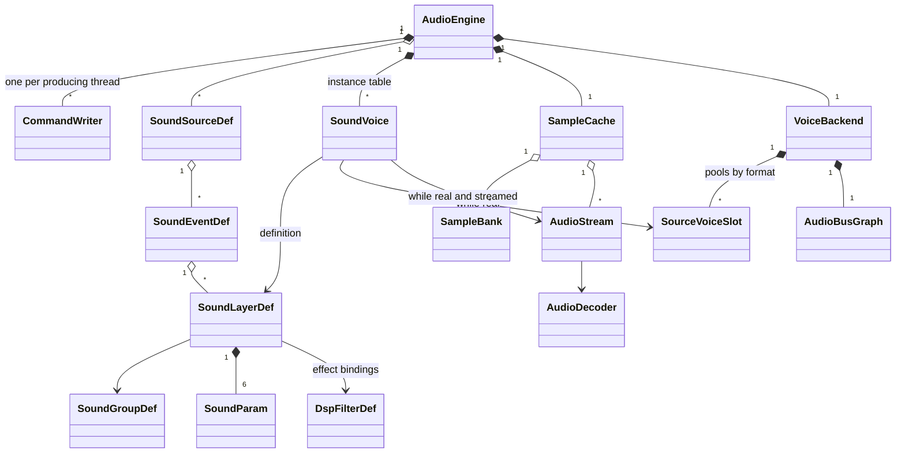

# Audio engine

> Status: Engine baseline · Prefix: AEN · ADRs: [ADR-0022](../../adr/0022-audio-engine-on-xaudio2.md) · [ADR-0023](../../adr/0023-virtual-voices-and-voice-stealing.md) · [ADR-0024](../../adr/0024-audio-buses-and-per-bus-effects.md) · [ADR-0025](../../adr/0025-audio-formats-codecs-and-residency.md) · [ADR-0026](../../adr/0026-audio-command-queue-and-callbacks.md) · [ADR-0027](../../adr/0027-spatialisation-and-distance-attenuation.md) · [ADR-0016](../../adr/0016-view-projection-and-depth-conventions.md) · [ADR-0058](../../adr/0058-pack-files-and-mount-policy.md) · [ADR-0059](../../adr/0059-content-build-and-validators.md) · [ADR-0061](../../adr/0061-data-schemas-and-versioning.md) · [ADR-0067](../../adr/0067-logging.md) · [ADR-0068](../../adr/0068-profiling-and-gpu-timing.md) · [ADR-0069](../../adr/0069-test-framework.md) · [ADR-0074](../../adr/0074-platform-clock-with-injectable-time.md) · Related: [audio design](../../reference/10_audio_design/README.md) · [event model and sound data](../../reference/10_audio_design/event_model_and_sound_data.md) · [event catalogue](../../reference/10_audio_design/event_catalogue.md) · [positional, priorities and mix](../../reference/10_audio_design/positional_priorities_and_mix.md) · [front end, HUD, voice and ambience](../../reference/10_audio_design/front_end_hud_voice_and_ambience.md) · [music hooks and brief](../../reference/10_audio_design/music_hooks_and_sound_design_brief.md) · [tick timing and main loop](../../reference/12_simulation_model/01_tick_timing_and_main_loop.md) · [randomness and integrity](../../reference/12_simulation_model/07_randomness_and_integrity.md) · [options](../../reference/09_front_end_and_match_flow/options_localisation_and_hooks.md) · [asset pipeline and resources](asset_pipeline_and_resources.md) · [data schemas](data_schemas.md) · [platform layer](platform_layer.md) · [diagnostics, test and performance](diagnostics_test_and_performance.md)

This component turns the sound events that game code raises into samples at the speakers. It owns the binding of (source, event) pairs to layers and sample groups from data, the sound instances with their envelopes, loops and modulatable values, the ranking of instances onto a bounded set of real XAudio2 source voices with virtual voices and margin-protected stealing, the bus graph with the player volumes, the limiter and the bus effects, the spatialisation with X3DAudio, the residency of sample data in resident banks and streams, the decoder, and the device handling. The audio design ([audio design](../../reference/10_audio_design/README.md)) states what plays and the design rules; this component states how, precisely enough to implement and test. Where the Species engine differs from the reference engine, the reference behaviour is stated as the **reference model** next to the Species rule, so that the design phase can compare them.

**Notation and units.**

- **Levels** are in dB relative to a voice's full level, 0 dB (DEC-042); an amplitude is 10^(dB ÷ 20), computed with `XAudio2DecibelsToAmplitudeRatio`. A level of the reference ten-step scale v converts to `ref.aud.level.reference_step_db` × (v − 10) dB ([audio design](../../reference/10_audio_design/README.md) R-AUD-004). The **envelope floor** F = −10 × `ref.aud.level.reference_step_db` = −50 dB is the bottom of that scale: quiet, not silent.
- **Distances** are in world units (`wu`), measured in three dimensions in the right-handed, +Y-up world frame of ADR-0016.
- **Audio time** is real time in seconds on the audio clock, which reads the platform's monotonic clock (ADR-0074). Game speed and pausing never scale it. Audio durations are presentation durations; no simulation duration is ever measured in audio time.
- **Frames** are sample frames at `aen.format.sample_rate`.
- **Terms** follow the audio design ([audio design](../../reference/10_audio_design/README.md) §2.1): a **sound source**, an **event** `<source>.<event>`, a **layer**, an **instance** (type `SoundVoice`), an **emitter**. An instance is **real** while a source voice mixes it and **virtual** while it is tracked and advanced without one. A **voice** is one pooled XAudio2 source voice.

## 1 Responsibilities and boundaries

**AEN-001** (MUST) The audio engine (`AudioEngine`) owns: the sound data at run time (source, event, layer, sample-group and effect-kind definitions, §3); the command queues from game code and the result queue back to it (§2); the sound instances, their envelopes, loops, play positions and modulatable values (§4.8 to §4.13); the ranking of instances, the real-voice budget, the per-bus and per-event caps, virtualisation and stealing (§4.6); the spatialisation (§4.14); the bus graph, the player volumes, ducking, the limiter and the bus effects (§4.15, §4.16); the residency of sample data in resident banks and streams and the decoder (§4.17, §4.18); the XAudio2 device, its loss and its rebuilding (§4.19); and its diagnostics (§6).

**AEN-002** (MUST) The engine is built in five layers, each depending only on the layers below it (ADR-0022):

| Layer | Contents | Species types |
|---|---|---|
| 5 binding | (source, event) look-up, audience filter, layer copy, shared-voice merge | `SoundSourceDef`, `SoundEventDef`, `SoundLayerDef`, `SoundGroupDef` |
| 4 instances | instances, envelopes, loops, play positions, modulatable values, ranking, virtual and real states | `SoundVoice`, `SoundVoiceId`, `SoundParam` |
| 3 sample data | resident banks, streams, decoding | `SampleCache`, `SampleBank`, `AudioStream`, `AudioDecoder` |
| 2 voices and device | the XAudio2 graph, pooled source voices, spatialisation, device loss | `VoiceBackend`, `SourceVoiceSlot`, `AudioBusGraph` |
| 1 effects | XAPO chains on buses | `DspFilterDef` and the Species XAPOs of §4.16 |

The reference engine has the same separation, with interchangeable device back-ends in place of layer 2; Species has exactly one voice back-end, on XAudio2 2.9 and X3DAudio.

**AEN-003** (MUST NOT) The audio engine never writes simulation state, never reads simulation or presentation objects directly, and never includes a simulation header with write access. Everything it knows about the world arrives in commands that presentation code builds from the immutable per-tick snapshots and the presentation events of the simulation (DEC-007, DEC-222; §2.3). A build-time include check enforces this (ADR-0022).

**AEN-004** (MUST NOT) The audio engine never draws from the simulation generator. It owns one presentation generator instance (`FxRng`), shared with no other system and used only on its update thread; its draws choose sample-group members, shared-random emitters and random values (DEC-013, ADR-0022; [randomness and integrity](../../reference/12_simulation_model/07_randomness_and_integrity.md) R-SIM-608). The instance is seeded with `aen.rng.match_seed` when the engine is created and again at every `BeginMatch`.

**AEN-005** (MUST) What a participant hears may differ from what another hears, by design: audience filtering by the local team, camera-relative ranking, shared-nearest emitter choice, camera-distance links, virtualisation and dropped commands all depend on the local participant ([audio design](../../reference/10_audio_design/README.md) R-AUD-001). No simulation rule ever branches on an audio result; game code uses results only for presentation decisions.

**AEN-006** (MUST) The audio engine runs on its own clock (the audio clock), never on the simulation tick or on the presentation clock of ADR-0036. In the reference model the audio logic advances from an accumulator of the presentation frame delta (`ref.sim.frame.audio_update_period`, `ref.sim.frame.delta_clamp`, [tick timing](../../reference/12_simulation_model/01_tick_timing_and_main_loop.md) R-SIM-570, R-SIM-571), while envelopes, loop delays and sample-use stamps read the real clock; §4.4 states the reference accumulator and the Species schedule.

**AEN-007** (MUST) The dedicated server and every headless build link no part of the audio engine (ADR-0022). A headless participant raises the same presentation events and plays nothing.

**AEN-008** (MUST) The audio design is the authority for every design rule this component implements: the event set, layer data and defaults, audiences, sharing, envelopes and loops as heard, links, groups, the 14 effect kinds and their behaviour, the distance and panning laws, the buses, their levels and priority classes, and the music hooks ([audio design](../../reference/10_audio_design/README.md) R-AUD-006). This component cites the design's requirements and `ref.aud.*` keys and never redefines them; it owns the arithmetic, the scheduling and every engine value of its tuning table (§4.21).

## 2 Interfaces

### 2.1 Interface sketch

```cpp
namespace species::audio {

using Seconds  = double;                     // audio time (platform clock, ADR-0074)
using Decibels = float;

// Data tokens of the audio design in brackets; order kept where noted.
enum class SoundPosition    : std::uint8_t { Screen2d, WorldFixed, Attached };          // [2d, fix, att]
enum class SoundSharing     : std::uint8_t { PerTrigger, SharedRandom, SharedNearest }; // [poly, share-rnd, share-near]
enum class SoundLoop        : std::uint8_t { Once, Loop, NoteLoop };                    // [once, loop, note]
enum class SoundAudience    : std::uint8_t { All, OwnTeam, Enemy, NoTeam };             // [all, own, enemy, none]
enum class SoundParamKind   : std::uint8_t { Fixed, Random, Linked };
enum class SoundParamUpdate : std::uint8_t { Continuous, PerNote };
enum class SoundLink        : std::uint8_t { None, Height, PosX, Altitude, PosZ, Speed, CameraDistance,
                                             ObjectAge, TeamsNearby, TimeRemaining, UnitCount };
enum class EnvelopeStage    : std::uint8_t { Attack, Hold, Release };                   // no decay stage
enum class VoiceState       : std::uint8_t { Pending, Virtual, Real, Retired };
// Order carries meaning: own-algorithm kinds run in this order in a chain (R-AUD-077, R-AUD-080).
enum class DspFilterKind : std::uint8_t { Chorus, Compressor, Distortion, StereoEcho, Flanger,
    StandardGargle, RoomReverb, ParametricEq, StudioReverb, ResonantLowPass, BitCrusher, Gargle,
    Echo, SimpleReverb };
// Order is the priority-class order, highest first (DEC-570); Music is outside the ranking.
enum class AudioBus : std::uint8_t { Ui, Announcer, Voice, World, Ambience, Music };
enum class StopMatch : std::uint8_t { ExactEvent, SourcePrefix, Everything };
enum class MatchPhase : std::uint8_t { NoMatch, Grace, Running, Ended };

struct SoundVoiceId { std::uint32_t slot = 0; std::uint32_t generation = 0; };  // generation 0 = invalid

struct TriggerCommand {                      // AEN-130
  SourceId source; EventId event;            // the full id is <source>.<event>
  SimObjectId emitter;                       // invalid = no emitter
  std::optional<TeamId> team;                // nullopt = no team (R-AUD-025)
  Vec3 position, velocity;                   // world frame, wu and wu/s
  Seconds issueTime;                         // audio clock at issue (AEN-024)
};
struct StopCommand  { SimObjectId emitter; StopMatch match; SourceId source; EventId event; Seconds issueTime; };
struct EmitterUpdate {                       // AEN-041
  SimObjectId emitter; bool present;
  Vec3 position, velocity; float heightAboveTerrain; float age;
  std::uint16_t teamsNearby, unitCount;
};
struct ListenerUpdate { Vec3 position, front, up, velocity; float heightAboveTerrain; };
struct MatchState { MatchPhase phase; std::optional<TeamId> localTeam; float gameSpeed; float timeRemaining; };

class CommandWriter {                        // one per producing thread; every call writes one command
public:
  bool Trigger(const TriggerCommand&);       // false: the queue is full; the command is dropped and counted
  bool Stop(const StopCommand&);
  bool UpdateEmitters(std::span<const EmitterUpdate>);
  bool SetListener(const ListenerUpdate&);
  bool SetMatchState(const MatchState&);
  bool BeginMatch(TeamId localTeam);         // per-match state starts (AEN-197)
  bool EndMatch();                           // per-match state discarded
  bool SetLoadingView(bool shown);           // AEN-111
  bool SetMasterVolume(std::uint8_t step);   // 0 to ref.meta.options.sound.volume_max
  bool SetBusVolume(AudioBus, std::uint8_t step);
  bool SetSwapStereo(bool on);
  bool SetEffectsEnabled(bool on);           // AEN-221
  bool LoadBank(BankId); bool ReleaseBank(BankId);
  bool QueryCount(RequestId, SimObjectId emitter, EventId event);   // invalid emitter = any emitter
  bool QueryPlaying(RequestId, SimObjectId emitter);
  bool Pause(); bool Resume();
  bool RestartDevice();                      // AEN-259
};

struct AudioResult { ResultKind kind; RequestId request; std::uint32_t count; bool playing; SoundVoiceId voice; };

class AudioEngine {
public:
  static std::unique_ptr<AudioEngine> Create(const AudioSettings&, const SoundDataSet&, SampleCache&);
  CommandWriter& Producer();                 // the calling thread's queue (ADR-0026)
  void DrainResults(std::function<void(const AudioResult&)>);  // game thread, once per frame
  ~AudioEngine();                            // AEN-106 teardown order
};

// Layer 2; the only code that includes XAudio2 or X3DAudio headers (ADR-0026).
class VoiceBackend {
public:
  bool Build(const BusGraphDef&);            // mastering voice on the default device and format, buses
  void Teardown();
  SourceVoiceSlot* Acquire(VoiceFormat);     // pooled per format (ADR-0023)
  void Release(SourceVoiceSlot*);            // resets every per-voice setting (DEC-752)
  void SetVolume(SourceVoiceSlot&, float amplitude, std::uint32_t operationSet);
  void SetFrequencyRatio(SourceVoiceSlot&, float ratio, std::uint32_t operationSet);
  void SetOutputMatrix(SourceVoiceSlot&, std::span<const float> matrix, std::uint32_t operationSet);
  void SetFilter(SourceVoiceSlot&, const XAUDIO2_FILTER_PARAMETERS&, std::uint32_t operationSet);
  void SetSends(SourceVoiceSlot&, std::span<const SendLevel>, std::uint32_t operationSet);
  void Submit(SourceVoiceSlot&, const XAUDIO2_BUFFER&);
  void Start(SourceVoiceSlot&, std::uint32_t operationSet);
  void Stop(SourceVoiceSlot&, std::uint32_t operationSet);
  void ApplyOperationSet(std::uint32_t operationSet);   // IXAudio2::CommitChanges
};

}  // namespace species::audio
```

### 2.2 Commands, results and the threading contract

**AEN-020** (MUST) Game code never calls XAudio2 and never waits for audio. Every public operation of `CommandWriter` writes one command into the calling thread's bounded, lock-free single-producer single-consumer queue of `aen.queue.command_capacity` commands and returns (ADR-0026). Any thread may produce; each producing thread has its own queue.

**AEN-021** (MUST) When a queue is full, the newest command is dropped, the call returns false and the drop is counted per command kind in the development overlay (§6). The audio update drains every queue at each update.

**AEN-022** (MUST) Commands from all queues are applied in the order of their issue time; commands with equal issue times are applied in queue creation order and, within one queue, in write order.

**AEN-023** (MUST) Results return through one lock-free result queue of `aen.queue.result_capacity` results, which game code drains once per frame: query answers (AEN-136), instance-ended notices and readiness changes (AEN-104). A full result queue drops the newest result and counts it.

**AEN-024** (MUST) Every command carries its issue time, the audio clock read by the producer when it writes the command. A trigger's **start time** is its issue time plus `aen.update.schedule_latency`, so the order and spacing of triggers are preserved into the mix (AEN-148).

**AEN-025** (MUST) XAudio2 callbacks (`IXAudio2VoiceCallback`, `IXAudio2EngineCallback`) only set atomic flags or push to lock-free queues: a buffer start, buffer end, loop end or stream-end notice to the update, a stream-buffer-free notice to the decode task, a critical-error notice to the update. They never allocate, lock, log synchronously, create or destroy voices, or call game code (ADR-0026). The XAudio2 processing thread touches only the sample memory and buffers that the engine handed it.

| Command | Effect | Requirements |
|---|---|---|
| `Trigger` | raises an event: zero or more instances | AEN-130 to AEN-133 |
| `Stop` | stops instances by emitter and event | AEN-134 |
| `UpdateEmitters` | positions, velocities and link inputs of emitters; absence or `present = false` means the emitter has left the match world | AEN-041, AEN-185 |
| `SetListener` | the listener (camera) | AEN-209 |
| `SetMatchState` | match phase, local team, game speed, time remaining | AEN-196, AEN-197 |
| `BeginMatch`, `EndMatch` | the per-match audio state | AEN-197 |
| `SetLoadingView` | the loading-view gate | AEN-111 |
| `SetMasterVolume`, `SetBusVolume` | player volumes | AEN-215 |
| `SetSwapStereo` | swap left and right | AEN-205 |
| `SetEffectsEnabled` | the effects switch | AEN-221 |
| `LoadBank`, `ReleaseBank` | residency | AEN-244 |
| `QueryCount`, `QueryPlaying` | answered in the result queue | AEN-136 |
| `Pause`, `Resume` | stop and resume the advance and output of every instance | AEN-138 |
| `RestartDevice` | rebuilds the graph | AEN-259 |

### 2.3 Inputs from the simulation and presentation

**AEN-040** (MUST) The simulation emits sound cues as typed presentation events at the tick where the rule fires (DEC-007, DEC-222 item 5). Presentation code (the audio bridge, outside this component) turns each cue into a `Trigger` or `Stop` command. The engine depends only on receiving commands in issue order; whether cues arrive in-process or from a server is decided with the threading and networking models (DEC-222, DEC-224).

**AEN-041** (MUST) Once per frame, presentation sends one `EmitterUpdate` for each emitter that the engine lists as tracked, read from the newest immutable snapshot: the position (a structure's centre position for a structure), the velocity, the height above the terrain at the position, the age, and the counts of teams and of actors near the position used by the `teams_nearby` and `unit_count` links. The engine publishes its tracked-emitter set in the result queue whenever it changes: every emitter of an attached or shared instance, and every emitter whose instance has a linked value that reads emitter data.

**AEN-042** (MUST) Once per frame, presentation sends the listener (the camera's position, front, up and velocity, and the terrain height under the camera for the `height` link of two-dimensional instances) and the match state (phase, local team, game speed, match time remaining). The audio engine itself queries nothing.

**AEN-043** (MUST) Presentation sends these commands in every application loop that shows a frame: the match, the front end and the loading view. The engine's update runs whether or not any arrive (AEN-120).

### 2.4 Voice back-end contract

**AEN-045** (MUST) The voice back-end (`VoiceBackend`) replaces the reference engine's device contract as follows:

| Reference device operation | Species voice back-end |
|---|---|
| create the device with a mixing rate, a channel count, a hardware-positioning flag and per-channel ring sizes | `Build`: one mastering voice on the default device with the default format, the bus graph of §4.16, and the voice pools of AEN-142 |
| N − 1 effect channels and one music channel | the real-voice budget, caps and the music voice pair of §4.6 and §8.2 |
| per-channel pull of sample data through a fill callback | buffer submission per voice (§4.10); callbacks only signal (AEN-025) |
| master volume 0 to 255 applied to every channel | the gain of the pre-master bus (AEN-215) |
| per-channel volume on the ten-step scale | the voice volume in dB (AEN-214) |
| per-channel playback frequency | the voice frequency ratio (AEN-196) |
| per-channel world, head-relative or disabled positioning, position, velocity, minimum distance | the distance gain and output matrix computed by the engine (§4.14) |
| per-channel effect enable, parameter update and disable | routing to effect buses (§4.16); no voice carries an effect chain (ADR-0024) |
| listener position, orientation and velocity | `SetListener` (AEN-209) |
| reset a channel for a new sound | `Acquire` from the pool and a start with an offset (AEN-148, AEN-182) |
| device pump: apply deferred settings and refill rings | one operation set per update, applied with `ApplyOperationSet` (AEN-123) |
| silence writer | a shared silent buffer of `aen.voice.silence_buffer` (AEN-174) |

**AEN-046** (MUST) Voices are released with every per-voice setting reset: volume, frequency ratio, output matrix, filter, send levels and buffers. A voice given to a new instance starts from that instance's own settings only (DEC-752).

## 3 Data model

### 3.1 Types, ownership and lifetimes

**AEN-060** (MUST) The engine uses these types:

| Type | Layer | Role | Owner and lifetime |
|---|---|---|---|
| `SoundSourceDef` | 5 | the event definitions of one sound source: an actor kind, a structure kind or one of the eleven non-object sources of [event catalogue](../../reference/10_audio_design/event_catalogue.md) R-AUD-121, in that order | cooked sound data; process lifetime, reloadable in development builds |
| `SoundEventDef` | 5 | one event: its full id `<source>.<event>` and its layers | as above |
| `SoundLayerDef` | 5 | one layer: the fields of [event model](../../reference/10_audio_design/event_model_and_sound_data.md) R-AUD-049 plus the engine fields of AEN-062 | as above |
| `SoundGroupDef` | 5 | a sample group: its asset id, its members, their weights, resident or streamed | as above |
| `DspFilterDef` | 1 | one of the 14 effect kinds: its parameter descriptors (§3.4) | built into the engine; process lifetime |
| `SoundParam` | 4 | the definition of one modulatable value: kind, link, update mode, ranges, smoothing (R-AUD-051 to R-AUD-054) | part of a layer or an effect binding |
| `SoundVoice` | 4 | one instance (§3.3) | the engine's instance table of `aen.instances.capacity` slots; from trigger to retirement |
| `SoundVoiceId` | 4 | a weak handle {slot, generation}; two handles are equal when both fields are; generation 0 is invalid; each new instance takes the next generation of its slot, starting at 1 | value type |
| `SampleCache` | 3 | residency: banks, group reference counts, stream heads (§4.17) | the engine; process lifetime |
| `SampleBank` | 3 | a set of resident groups loaded and released together | `SampleCache`; its scope (AEN-244) |
| `AudioStream` | 3 | the decode state and buffer ring of one real streamed instance | `SampleCache`; while its instance is real |
| `AudioDecoder` | 3 | the Opus decoder of the stream format of AEN-072 | the decode task (AEN-302) |
| `VoiceBackend` | 2 | the XAudio2 engine, mastering voice, voice pools and bus graph | the engine; process lifetime, rebuilt on device loss |
| `SourceVoiceSlot` | 2 | one pooled `IXAudio2SourceVoice` with its callback object | its pool |
| `AudioBusGraph` | 2 | the submix voices of §4.16 | `VoiceBackend` |
| `CommandWriter`, `AudioResult` | — | the queues of §2.2 | the engine; process lifetime |

**AEN-061** (MUST) The engine holds no simulation object pointer. Emitters are named only by `SimObjectId`, and their state is the latest `EmitterUpdate` the engine has received (AEN-041).



Diagram 3-A: the engine's types and their ownership (AEN-060).

### 3.2 Layer data used by the engine

**AEN-062** (MUST) Besides the fields of [event model](../../reference/10_audio_design/event_model_and_sound_data.md) R-AUD-049, a layer's event data carries these engine fields; a field that the data omits takes the default shown:

| Field | Default | Used by |
|---|---|---|
| copy decay (× per louder copy) | `ref.aud.rank.copy_decay` (0.75) | AEN-141 |
| patience window of a `once` layer | `ref.aud.layer.one_shot_patience_updates` × `ref.sim.frame.audio_update_period` (0.15 s) | AEN-146 |
| per-event real-voice cap | the bus default of AEN-143 | AEN-143 |
| maximum distance | `aen.spatial.max_distance_default` | AEN-202 |
| Doppler, distance-filter and distance-reverb factors | `aen.spatial.doppler_factor_default`, `aen.spatial.filter_factor_default`, `aen.spatial.reverb_factor_default` | AEN-207 |

**AEN-063** (MUST) The copy decay is an authored design value of each event, and its default is the audio design's key `ref.aud.rank.copy_decay`; the engine owns the ranking arithmetic that applies it (AEN-141) and defines no copy-decay key of its own. The patience window is likewise an event value whose default derives from the audio design's `ref.aud.layer.one_shot_patience_updates`.

**AEN-064** (MUST) Event ids are matched exactly (R-AUD-022); source and event ids, group asset ids and effect-kind names are resolved to indices when the sound data is cooked, so no run-time look-up compares strings.

### 3.3 Instance state

**AEN-066** (MUST) A `SoundVoice` holds: its handle; its layer; its full event id; its state (`Pending`, `Virtual`, `Real`, `Retired`); its envelope stage and envelope timer; the current output and the restart flag of each of its six modulatable values; its effect-parameter outputs; its emitter set and selected emitter; its position and velocity; its trigger time and start time; its play position in frames and its current group member; whether it has ever been real; the time of its last change between virtual and real; its source voice while real and its stream while real and streamed; a pending note re-trigger time; and its audibility and score of the current update.

**AEN-067** (MUST) A new instance copies its definition from its layer ([event model](../../reference/10_audio_design/event_model_and_sound_data.md) R-AUD-049): a field the data omits takes the design default, and the engine fields take AEN-062's defaults. Its restart flag is set, its envelope stage is `Attack`, its play position is 0 and its state is `Pending` until its start time (AEN-148).

### 3.4 Effect kinds

**AEN-070** (MUST) A `DspFilterDef` lists, for each parameter of its kind, in the order of [event model](../../reference/10_audio_design/event_model_and_sound_data.md) R-AUD-077: the name, the minimum, the maximum, the declared default, whether it is an integer, and its schema default. A layer's effect binding gives its parameters by position (R-AUD-050), at most `aen.dsp.max_params` of them; an integer parameter takes its evaluated value truncated toward zero. The 14 kinds are realised as follows, with routing as defined in AEN-224:

| # | Kind | Parameters | Species realisation | Routing |
|---|---|---|---|---|
| 0 | chorus | 7 | Species XAPO `ChorusFx` | send |
| 1 | compressor | 6 | Species XAPO `CompressorFx` | insert |
| 2 | distortion | 5 | Species XAPO `DistortionFx` | insert |
| 3 | stereo echo | 5 | built-in `FXEcho` when the left and right delays are equal and the pan delay is 0 (mix ÷ 100, feedback ÷ 100, delay); otherwise Species XAPO `StereoEchoFx` | send |
| 4 | flanger | 7 | Species XAPO `FlangerFx` | send |
| 5 | standard gargle | 2 | Species XAPO `StandardGargleFx` | insert |
| 6 | room reverb | 13 | the XAudio2 reverb (`XAudio2CreateReverb`), its first 12 parameters converted with `ReverbConvertI3DL2ToNative` at a wet/dry mix of 100; the quality parameter has no counterpart | send |
| 7 | parametric equaliser | 3 | built-in `FXEQ`: band 0 at the centre, gain converted from dB to an amplitude ratio, bandwidth ÷ 12 octaves; bands 1 to 3 at unity gain | insert |
| 8 | studio reverb | 4 | Species XAPO `StudioReverbFx` | insert |
| 9 | resonant low-pass | 3 | Species XAPO `ResonantLowPassFx` (AEN-230) | insert |
| 10 | bit crusher | 1 | Species XAPO `BitCrusherFx` (AEN-231) | insert |
| 11 | gargle | 3 | Species XAPO `GargleFx` (AEN-232) | send for the triangle shape, insert for the square shape |
| 12 | echo | 3 | Species XAPO `EchoFx` (AEN-233) | send |
| 13 | simple reverb | 1 | Species XAPO `SimpleReverbFx` (AEN-234) | insert |

**AEN-071** (MUST) **Schema defaults.** The schema default of every effect parameter is its declared default of R-AUD-077, not 0.0. A binding that omits a parameter therefore takes the declared default, where the reference takes 0.0 (R-AUD-050, R-AUD-078). The choice is deliberate (DEC-567):

1. 21 of the 63 effect parameters have a range that excludes 0.0 (among them every delay, cut-off, centre frequency, bandwidth, rate, ratio, attack, release, decay time, bit depth and reverb time), so a 0.0 default would make an omission a range error, and two of them make a sound unusable: a bit depth of 0 quantises every sample to silence, and an echo delay of 0 has no delay line;
2. every effect binding of the reference event set states all its parameters ([event model](../../reference/10_audio_design/event_model_and_sound_data.md) R-AUD-082, FX-01 to FX-15), so the choice changes nothing in the reference set;
3. no reference sound data is imported (R-AUD-003), so parity with omitted parameters has no value;
4. effects are off by default (DEC-567, R-AUD-076), so no default is audible until effects are enabled.

The content build rejects a binding with more parameters than its kind has, and a parameter value outside its kind's range (DEC-015, ADR-0059).

### 3.5 Sample groups, banks and the stream format

**AEN-072** (MUST) Every group member is cooked to 16-bit PCM at `aen.format.sample_rate`, mono for every positioned layer and mono or stereo for two-dimensional layers (ADR-0025). The content build marks a group **streamed** when its longest member is longer than `aen.residency.stream_threshold`, and marks every music group streamed; every other group is **resident** and is stored in banks. A streamed member is stored as one Species stream: a header (channel count, sample rate, total frames, the Opus pre-skip, loop start and loop end frames, the seek-table interval `aen.stream.seek_interval`), a seek table from frame positions to packet offsets, and Opus packets of `aen.stream.packet_duration` (libopus 1.5.2, ADR-0025).

**AEN-073** (MUST) With the asset manifest of this library, the streamed groups are `amb.lobby_bed`, `amb.match_bed`, `amb.match_bed_b`, `amb.match_bed_c` and `sfx.creature.abductor.presence_loop`, and the music groups `music.front_end.theme`, `music.match.bed`, `music.match.sting_victory` and `music.match.sting_defeat`; every other `sfx.` group is resident. The longest resident member is about 18 s (`sfx.building.spitter_plant.burning`).

**AEN-074** (MUST) Resident groups belong to these banks; a group named by both banks is loaded once and counted by reference (AEN-245):

| Bank | Groups | Scope |
|---|---|---|
| interface | `sfx.ui.match_ui.chat_message`, `sfx.ui.match_ui.countdown_tick`, `sfx.ui.match_ui.error`, `sfx.ui.match_ui.menu_back`, `sfx.ui.match_ui.menu_select`, `sfx.ui.match_ui.selection_circle`, `sfx.ui.match_ui.unit_highlight`, `sfx.ui.match_ui.unit_select`, `sfx.ui.power_input.begin`, `sfx.ui.power_input.confirm`, `sfx.ui.power_slots.discard`, `sfx.ui.power_slots.icon_hover`, and the lobby-bed heartbeat `sfx.building.launch_vessel.fuelled_b`; plus the stream heads (AEN-253) of `amb.lobby_bed`, `amb.match_bed`, `amb.match_bed_b`, `amb.match_bed_c` and `music.front_end.theme` | loaded at start-up, held for the process lifetime |
| match | every other resident group of the [event catalogue](../../reference/10_audio_design/event_catalogue.md), plus the stream heads of `sfx.creature.abductor.presence_loop`, `music.match.bed`, `music.match.sting_victory` and `music.match.sting_defeat` | loaded during each match load, released when the match world is torn down |

### 3.6 Settings read by the engine

**AEN-076** (MUST) The engine reads these settings from the settings store when it is created and when it is restarted ([options](../../reference/09_front_end_and_match_flow/options_localisation_and_hooks.md) R-META-429 to R-META-439, R-META-454); the reference defaults are those of the defaults table (DEC-100):

| Setting | Reference default | Species effect |
|---|---|---|
| audio output | `aen.settings.output_default` (the platform back end) | a value that names no back end selects the silent device (AEN-321) |
| master volume | `aen.settings.volume_default` (255) | the pre-master gain (AEN-215) |
| bus volumes, one per bus of R-AUD-221 | `aen.settings.volume_default` (255) | the bus gains (AEN-215) |
| voices | `aen.settings.voices_default` (32) | none: the real-voice budget is `aen.voice.budget` (DEC-570) |
| mixing rate | `aen.settings.mix_rate_reader_default` (22 050 Hz) at the engine's reader; `aen.settings.output_mix_rate_reader_default` (44 100 Hz) at the reader of the secondary output path | none: the mastering voice takes the device's format (ADR-0022) |
| output buffer length | `aen.settings.output_buffer_first_run` (512) written on first run; `aen.settings.output_buffer_reader_default` (2 000) at its readers | none |
| hardware positioning | off | none |
| swap left and right | `aen.settings.swap_stereo_default` (off) | AEN-205; read at every update |
| sample-memory level | `aen.settings.sample_memory_level_default` (1) | none (AEN-077) |
| effects switch | `aen.settings.effects_default` (off) | AEN-221 |

**AEN-077** (MUST) In the reference model the sample-memory level restricts the choice of every group draw: level 2 draws among the first `aen.reference.sample_memory.level2_fraction` (½) of a group's members and level 3 among the first `aen.reference.sample_memory.level3_fraction` (¼), the member count truncated and at least 1, while level 1 uses all members; it is read at every draw and never changes the cache budget. In Species every draw uses all members (R-AUD-065, DEC-097), and the setting is read and ignored.

