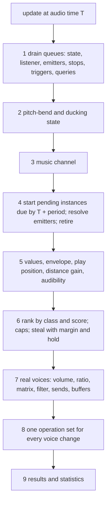
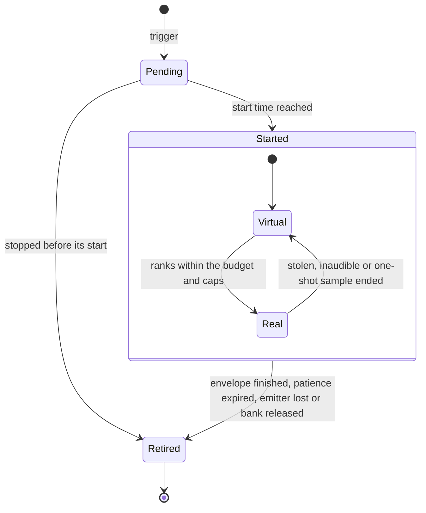
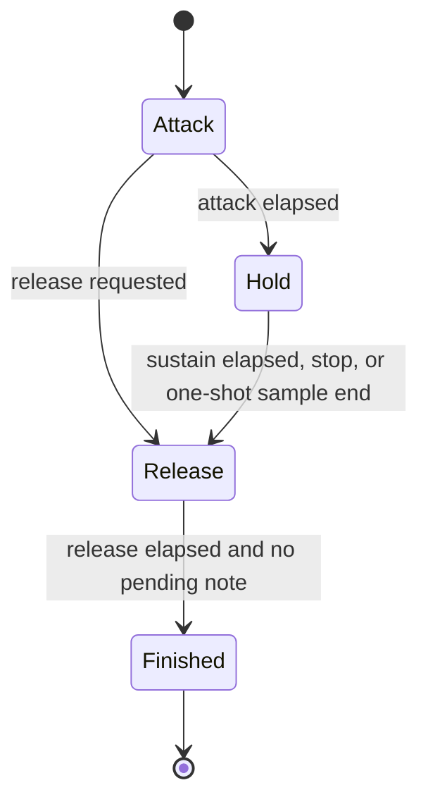
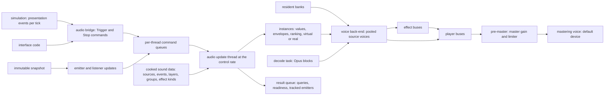

# Audio engine

> Status: Engine baseline · Prefix: AEN · ADRs: [ADR-0022](../../adr/0022-audio-engine-on-xaudio2.md) · [ADR-0023](../../adr/0023-virtual-voices-and-voice-stealing.md) · [ADR-0024](../../adr/0024-audio-buses-and-per-bus-effects.md) · [ADR-0025](../../adr/0025-audio-formats-codecs-and-residency.md) · [ADR-0026](../../adr/0026-audio-command-queue-and-callbacks.md) · [ADR-0027](../../adr/0027-spatialisation-and-distance-attenuation.md) · [ADR-0016](../../adr/0016-view-projection-and-depth-conventions.md) · [ADR-0058](../../adr/0058-pack-files-and-mount-policy.md) · [ADR-0059](../../adr/0059-content-build-and-validators.md) · [ADR-0061](../../adr/0061-data-schemas-and-versioning.md) · [ADR-0067](../../adr/0067-logging.md) · [ADR-0068](../../adr/0068-profiling-and-gpu-timing.md) · [ADR-0069](../../adr/0069-test-framework.md) · [ADR-0074](../../adr/0074-platform-clock-with-injectable-time.md) · Related: [audio design](../../reference/10_audio_design/README.md) · [event model and sound data](../../reference/10_audio_design/event_model_and_sound_data.md) · [event catalogue](../../reference/10_audio_design/event_catalogue.md) · [positional, priorities and mix](../../reference/10_audio_design/positional_priorities_and_mix.md) · [tick timing and main loop](../../reference/12_simulation_model/01_tick_timing_and_main_loop.md) · [randomness and integrity](../../reference/12_simulation_model/07_randomness_and_integrity.md) · [options](../../reference/09_front_end_and_match_flow/options_localisation_and_hooks.md) · [asset pipeline and resources](asset_pipeline_and_resources.md) · [data schemas](data_schemas/README.md)

This component turns the sound events that game code raises into samples at the speakers: the binding of (source, event) pairs to layers and sample groups from data, the instances, the ranking onto a bounded set of real XAudio2 source voices with virtual voices and stealing, the buses, player volumes, limiter and effects, X3DAudio spatialisation, resident banks and streams, the decoder and the device. The [audio design](../../reference/10_audio_design/README.md) states what plays; this component states how, precisely enough to implement and test. Where the Species engine differs from the reference engine, the reference behaviour is stated as the **reference model** next to the Species rule.

**Notation and units.**

- **Levels** are in dB relative to a voice's full level, 0 dB (DEC-042); an amplitude is 10^(dB ÷ 20), computed with `XAudio2DecibelsToAmplitudeRatio`. A level of the reference ten-step scale v converts to `ref.aud.level.reference_step_db` × (v − 10) dB ([audio design](../../reference/10_audio_design/README.md) R-AUD-004). The **envelope floor** F = −10 × `ref.aud.level.reference_step_db` = −50 dB is the bottom of that scale: quiet, not silent.
- **Distances** are in world units (`wu`), measured in three dimensions in the right-handed, +Y-up world frame of ADR-0016.
- **Audio time** is real time in seconds on the audio clock, which reads the platform's monotonic clock (ADR-0074). Game speed and pausing never scale it. Audio durations are presentation durations; no simulation duration is ever measured in audio time.
- **Frames** are sample frames at `aen.format.sample_rate`.
- **Terms** follow the audio design ([audio design](../../reference/10_audio_design/README.md) §2.1): a **sound source**, an **event** `<source>.<event>`, a **layer**, an **instance** (type `SoundVoice`), an **emitter**. An instance is **real** while a source voice mixes it and **virtual** while it is tracked and advanced without one. A **voice** is one pooled XAudio2 source voice.

## 1 Responsibilities and boundaries

**AEN-001** (MUST) The audio engine (`AudioEngine`) owns: the sound data at run time (source, event, layer, sample-group and effect-kind definitions, §3); the command queues from game code and the result queue back to it (§2); the sound instances, their envelopes, loops, play positions and modulatable values (§4.8 to §4.13); the ranking of instances, the real-voice budget, the per-bus and per-event caps, virtualisation and stealing (§4.6); the spatialisation (§4.14); the bus graph, the player volumes, ducking, the limiter and the bus effects (§4.15, §4.16); the residency of sample data in resident banks and streams and the decoder (§4.17, §4.18); the XAudio2 device, its loss and its rebuilding (§4.19); and its diagnostics (§6).

**AEN-002** (MUST) The engine is built in five layers, each depending only on the layers below it (ADR-0022):

| Layer | Contents | Species types |
|---|---|---|
| 5 binding | (source, event) look-up, audience filter, layer copy, shared-voice merge | `SoundSourceDef`, `SoundEventDef`, `SoundLayerDef`, `SoundGroupDef` |
| 4 instances | instances, envelopes, loops, play positions, modulatable values, ranking, virtual and real states | `SoundVoice`, `SoundVoiceId`, `SoundParam` |
| 3 sample data | resident banks, streams, decoding | `SampleCache`, `SampleBank`, `AudioStream`, `AudioDecoder` |
| 2 voices and device | the XAudio2 graph, pooled source voices, spatialisation, device loss | `VoiceBackend`, `SourceVoiceSlot`, `AudioBusGraph` |
| 1 effects | XAPO chains on buses | `DspFilterDef` and the Species XAPOs of §4.16 |

The reference engine has the same separation, with interchangeable device back-ends in place of layer 2; Species has exactly one voice back-end, on XAudio2 2.9 and X3DAudio.

**AEN-003** (MUST NOT) The audio engine never writes simulation state, never reads simulation or presentation objects directly, and never includes a simulation header with write access. Everything it knows about the world arrives in commands that presentation code builds from the immutable per-tick snapshots and the presentation events of the simulation (DEC-007, DEC-222; §2.3). A build-time include check enforces this (ADR-0022).

**AEN-004** (MUST NOT) The audio engine never draws from the simulation generator. It owns one presentation generator instance (`FxRng`), shared with no other system and used only on its update thread; its draws choose sample-group members, shared-random emitters and random values (DEC-013, ADR-0022; [randomness and integrity](../../reference/12_simulation_model/07_randomness_and_integrity.md) R-SIM-608). The instance is seeded with `aen.rng.match_seed` when the engine is created and again at every `BeginMatch`.

**AEN-005** (MUST) What a participant hears may differ from what another hears, by design: audience filtering by the local team, camera-relative ranking, shared-nearest emitter choice, camera-distance links, virtualisation and dropped commands all depend on the local participant ([audio design](../../reference/10_audio_design/README.md) R-AUD-001). No simulation rule ever branches on an audio result; game code uses results only for presentation decisions.

**AEN-006** (MUST) The audio engine runs on its own clock (the audio clock), never on the simulation tick or on the presentation clock of ADR-0036. In the reference model the audio logic advances from an accumulator of the presentation frame delta (`ref.sim.frame.audio_update_period`, `ref.sim.frame.delta_clamp`, [tick timing](../../reference/12_simulation_model/01_tick_timing_and_main_loop.md) R-SIM-570, R-SIM-571), while envelopes, loop delays and sample-use stamps read the real clock; §4.4 states the reference accumulator and the Species schedule.

**AEN-007** (MUST) The dedicated server and every headless build link no part of the audio engine (ADR-0022). A headless participant raises the same presentation events and plays nothing.

**AEN-008** (MUST) The audio design is the authority for every design rule this component implements: the event set, layer data and defaults, audiences, sharing, envelopes and loops as heard, links, groups, the 14 effect kinds and their behaviour, the distance and panning laws, the buses, their levels and priority classes, and the music hooks ([audio design](../../reference/10_audio_design/README.md) R-AUD-006). This component cites the design's requirements and `ref.aud.*` keys and never redefines them; it owns the arithmetic, the scheduling and every engine value of its tuning table (§4.21).

## 2 Interfaces

### 2.1 Interface sketch

```cpp
namespace species::audio {

using Seconds  = double;                     // audio time (platform clock, ADR-0074)
using Decibels = float;

// Data tokens of the audio design in brackets; order kept where noted.
enum class SoundPosition    : std::uint8_t { Screen2d, WorldFixed, Attached };          // [2d, fix, att]
enum class SoundSharing     : std::uint8_t { PerTrigger, SharedRandom, SharedNearest }; // [poly, share-rnd, share-near]
enum class SoundLoop        : std::uint8_t { Once, Loop, NoteLoop };                    // [once, loop, note]
enum class SoundAudience    : std::uint8_t { All, OwnTeam, Enemy, NoTeam };             // [all, own, enemy, none]
enum class SoundParamKind   : std::uint8_t { Fixed, Random, Linked };
enum class SoundParamUpdate : std::uint8_t { Continuous, PerNote };
enum class SoundLink        : std::uint8_t { None, Height, PosX, Altitude, PosZ, Speed, CameraDistance,
                                             ObjectAge, TeamsNearby, TimeRemaining, UnitCount };
enum class EnvelopeStage    : std::uint8_t { Attack, Hold, Release };                   // no decay stage
enum class VoiceState       : std::uint8_t { Pending, Virtual, Real, Retired };
// Order carries meaning: own-algorithm kinds run in this order in a chain (R-AUD-077, R-AUD-080).
enum class DspFilterKind : std::uint8_t { Chorus, Compressor, Distortion, StereoEcho, Flanger,
    StandardGargle, RoomReverb, ParametricEq, StudioReverb, ResonantLowPass, BitCrusher, Gargle,
    Echo, SimpleReverb };
// Order is the priority-class order, highest first (DEC-570); Music is outside the ranking.
enum class AudioBus : std::uint8_t { Ui, Announcer, Voice, World, Ambience, Music };
enum class StopMatch : std::uint8_t { ExactEvent, SourcePrefix, Everything };
enum class MatchPhase : std::uint8_t { NoMatch, Grace, Running, Ended };

struct SoundVoiceId { std::uint32_t slot = 0; std::uint32_t generation = 0; };  // generation 0 = invalid

struct TriggerCommand {                      // AEN-130
  SourceId source; EventId event;            // the full id is <source>.<event>
  SimObjectId emitter;                       // invalid = no emitter
  std::optional<TeamId> team;                // nullopt = no team (R-AUD-025)
  Vec3 position, velocity;                   // world frame, wu and wu/s
  Seconds issueTime;                         // audio clock at issue (AEN-024)
};
struct StopCommand  { SimObjectId emitter; StopMatch match; SourceId source; EventId event; Seconds issueTime; };
struct EmitterUpdate {                       // AEN-041
  SimObjectId emitter; bool present;
  Vec3 position, velocity; float heightAboveTerrain; float age;
  std::uint16_t teamsNearby, unitCount;
};
struct ListenerUpdate { Vec3 position, front, up, velocity; float heightAboveTerrain; };
struct MatchState { MatchPhase phase; std::optional<TeamId> localTeam; float gameSpeed; float timeRemaining; };

class CommandWriter {                        // one per producing thread; every call writes one command
public:
  bool Trigger(const TriggerCommand&);       // false: the queue is full; the command is dropped and counted
  bool Stop(const StopCommand&);
  bool UpdateEmitters(std::span<const EmitterUpdate>);
  bool SetListener(const ListenerUpdate&);
  bool SetMatchState(const MatchState&);
  bool BeginMatch(TeamId localTeam);         // per-match state starts (AEN-197)
  bool EndMatch();                           // per-match state discarded
  bool SetLoadingView(bool shown);           // AEN-111
  bool SetMasterVolume(std::uint8_t step);   // 0 to ref.meta.options.sound.volume_max
  bool SetBusVolume(AudioBus, std::uint8_t step);
  bool SetSwapStereo(bool on);
  bool SetEffectsEnabled(bool on);           // AEN-221
  bool LoadBank(BankId); bool ReleaseBank(BankId);
  bool QueryCount(RequestId, SimObjectId emitter, EventId event);   // invalid emitter = any emitter
  bool QueryPlaying(RequestId, SimObjectId emitter);
  bool Pause(); bool Resume();
  bool RestartDevice();                      // AEN-259
};

struct AudioResult { ResultKind kind; RequestId request; std::uint32_t count; bool playing; SoundVoiceId voice; };

class AudioEngine {
public:
  static std::unique_ptr<AudioEngine> Create(const AudioSettings&, const SoundDataSet&, SampleCache&);
  CommandWriter& Producer();                 // the calling thread's queue (ADR-0026)
  void DrainResults(std::function<void(const AudioResult&)>);  // game thread, once per frame
  ~AudioEngine();                            // AEN-106 teardown order
};

// Layer 2; the only code that includes XAudio2 or X3DAudio headers (ADR-0026).
class VoiceBackend {                         // Op = an XAudio2 operation set id
public:
  bool Build(const BusGraphDef&);            // mastering voice on the default device and format, buses
  void Teardown();
  SourceVoiceSlot* Acquire(VoiceFormat);     // pooled per format (ADR-0023)
  void Release(SourceVoiceSlot*);            // resets every per-voice setting (DEC-752)
  void SetVolume(SourceVoiceSlot&, float amplitude, Op);   void SetFrequencyRatio(SourceVoiceSlot&, float, Op);
  void SetOutputMatrix(SourceVoiceSlot&, std::span<const float>, Op);
  void SetFilter(SourceVoiceSlot&, const XAUDIO2_FILTER_PARAMETERS&, Op);
  void SetSends(SourceVoiceSlot&, std::span<const SendLevel>, Op);
  void Submit(SourceVoiceSlot&, const XAUDIO2_BUFFER&);  void Start(SourceVoiceSlot&, Op);  void Stop(SourceVoiceSlot&, Op);
  void ApplyOperationSet(Op);                // IXAudio2::CommitChanges
};

}  // namespace species::audio
```

### 2.2 Commands, results and the threading contract

**AEN-020** (MUST) Game code never calls XAudio2 and never waits for audio. Every public operation of `CommandWriter` writes one command into the calling thread's bounded, lock-free single-producer single-consumer queue of `aen.queue.command_capacity` commands and returns (ADR-0026). Any thread may produce; each producing thread has its own queue.

**AEN-021** (MUST) When a queue is full, the newest command is dropped, the call returns false and the drop is counted per command kind in the development overlay (§6). The audio update drains every queue at each update.

**AEN-022** (MUST) Commands from all queues are applied in the order of their issue time; commands with equal issue times are applied in queue creation order and, within one queue, in write order.

**AEN-023** (MUST) Results return through one lock-free result queue of `aen.queue.result_capacity` results, which game code drains once per frame: query answers (AEN-136), readiness changes (AEN-104) and the tracked-emitter set (AEN-041). A full result queue drops the newest result and counts it.

**AEN-024** (MUST) Every command carries its issue time, the audio clock read by the producer when it writes the command. A trigger's **start time** is its issue time plus `aen.update.schedule_latency`, so the order and spacing of triggers are preserved into the mix (AEN-148).

**AEN-025** (MUST) XAudio2 callbacks (`IXAudio2VoiceCallback`, `IXAudio2EngineCallback`) only set atomic flags or push to lock-free queues: a buffer start, buffer end, loop end or stream-end notice to the update, a stream-buffer-free notice to the decode task, a critical-error notice to the update. They never allocate, lock, log synchronously, create or destroy voices, or call game code (ADR-0026). The XAudio2 processing thread touches only the sample memory and buffers that the engine handed it.

| Command | Effect | Requirements |
|---|---|---|
| `Trigger` | raises an event: zero or more instances | AEN-130 to AEN-133 |
| `Stop` | stops instances by emitter and event | AEN-134 |
| `UpdateEmitters` | positions, velocities and link inputs of emitters; absence or `present = false` means the emitter has left the match world | AEN-041, AEN-185 |
| `SetListener` | the listener (camera) | AEN-209 |
| `SetMatchState` | match phase, local team, game speed, time remaining | AEN-196, AEN-197 |
| `BeginMatch`, `EndMatch` | the per-match audio state | AEN-197 |
| `SetLoadingView` | the loading-view gate | AEN-111 |
| `SetMasterVolume`, `SetBusVolume` | player volumes | AEN-215 |
| `SetSwapStereo` | swap left and right | AEN-205 |
| `SetEffectsEnabled` | the effects switch | AEN-221 |
| `LoadBank`, `ReleaseBank` | residency | AEN-244 |
| `QueryCount`, `QueryPlaying` | answered in the result queue | AEN-136 |
| `Pause`, `Resume` | stop and resume the advance and output of every instance | AEN-138 |
| `RestartDevice` | rebuilds the graph | AEN-259 |

### 2.3 Inputs from the simulation and presentation

**AEN-040** (MUST) The simulation emits sound cues as typed presentation events at the tick where the rule fires (DEC-007, DEC-222 item 5). Presentation code (the audio bridge, outside this component) turns each cue into a `Trigger` or `Stop` command. The engine depends only on receiving commands in issue order; whether cues arrive in-process or from a server is decided with the threading and networking models (DEC-222, DEC-224). Under the default of DEC-318 the fuse-blink and match-clock sounds are raised by drawing code, so they arrive only while drawn; the engine treats them like any trigger.

**AEN-041** (MUST) Once per frame, presentation sends one `EmitterUpdate` for each emitter that the engine lists as tracked, read from the newest immutable snapshot: the position (a structure's centre position for a structure), the velocity, the height above the terrain at the position, the age, and the counts of teams and of actors near the position used by the `teams_nearby` and `unit_count` links. The engine publishes its tracked-emitter set in the result queue whenever it changes: every emitter of an attached or shared instance, and every emitter whose instance has a linked value that reads emitter data.

**AEN-042** (MUST) Once per frame, presentation sends the listener (the camera's position, front, up and velocity, and the terrain height under the camera for the `height` link of two-dimensional instances) and the match state (phase, local team, game speed, match time remaining). The audio engine itself queries nothing.

**AEN-043** (MUST) Presentation sends these commands in every application loop that shows a frame: the match, the front end and the loading view. The engine's update runs whether or not any arrive (AEN-120).

### 2.4 Voice back-end contract

**AEN-045** (MUST) The voice back-end (`VoiceBackend`) replaces the reference engine's device contract as follows:

| Reference device operation | Species voice back-end |
|---|---|
| create the device with a mixing rate, a channel count, a hardware-positioning flag and per-channel ring sizes | `Build`: one mastering voice on the default device with the default format, the bus graph of §4.16, and the voice pools of AEN-142 |
| N − 1 effect channels and one music channel | the real-voice budget, caps and the music voice pair of §4.6 and §8.2 |
| per-channel pull of sample data through a fill callback | buffer submission per voice (§4.10); callbacks only signal (AEN-025) |
| master volume 0 to 255 applied to every channel | the gain of the pre-master bus (AEN-215) |
| per-channel volume on the ten-step scale | the voice volume in dB (AEN-214) |
| per-channel playback frequency | the voice frequency ratio (AEN-196) |
| per-channel world, head-relative or disabled positioning, position, velocity, minimum distance | the distance gain and output matrix computed by the engine (§4.14) |
| per-channel effect enable, parameter update and disable | routing to effect buses (§4.16); no voice carries an effect chain (ADR-0024) |
| listener position, orientation and velocity | `SetListener` (AEN-209) |
| reset a channel for a new sound | `Acquire` from the pool and a start with an offset (AEN-148, AEN-182) |
| device pump: apply deferred settings and refill rings | one operation set per update, applied with `ApplyOperationSet` (AEN-123) |
| silence writer | a shared silent buffer of `aen.voice.silence_buffer` (AEN-174) |

**AEN-046** (MUST) Voices are released with every per-voice setting reset: volume, frequency ratio, output matrix, filter, send levels and buffers. A voice given to a new instance starts from that instance's own settings only (DEC-752).

## 3 Data model

### 3.1 Types, ownership and lifetimes

**AEN-060** (MUST) The engine uses these types:

| Type | Layer | Role | Owner and lifetime |
|---|---|---|---|
| `SoundSourceDef` | 5 | the event definitions of one sound source: an actor kind, a structure kind or one of the eleven non-object sources of [event catalogue](../../reference/10_audio_design/event_catalogue.md) R-AUD-121, in that order | cooked sound data; process lifetime, reloadable in development builds |
| `SoundEventDef` | 5 | one event: its full id `<source>.<event>` and its layers | as above |
| `SoundLayerDef` | 5 | one layer: the fields of [event model](../../reference/10_audio_design/event_model_and_sound_data.md) R-AUD-049 plus the engine fields of AEN-062 | as above |
| `SoundGroupDef` | 5 | a sample group: its asset id, its members, their weights, resident or streamed | as above |
| `DspFilterDef` | 1 | one of the 14 effect kinds: its parameter descriptors (§3.4) | built into the engine; process lifetime |
| `SoundParam` | 4 | the definition of one modulatable value: kind, link, update mode, ranges, smoothing (R-AUD-051 to R-AUD-054) | part of a layer or an effect binding |
| `SoundVoice` | 4 | one instance (§3.3) | the engine's instance table of `aen.instances.capacity` slots; from trigger to retirement |
| `SoundVoiceId` | 4 | a weak handle {slot, generation}; two handles are equal when both fields are; generation 0 is invalid; each new instance takes the next generation of its slot, starting at 1 | value type |
| `SampleCache` | 3 | residency: banks, group reference counts, stream heads (§4.17) | the engine; process lifetime |
| `SampleBank` | 3 | a set of resident groups loaded and released together | `SampleCache`; its scope (AEN-244) |
| `AudioStream` | 3 | the decode state and buffer ring of one real streamed instance | `SampleCache`; while its instance is real |
| `AudioDecoder` | 3 | the Opus decoder of the stream format of AEN-072 | the decode task (AEN-302) |
| `VoiceBackend` | 2 | the XAudio2 engine, mastering voice, voice pools and bus graph | the engine; process lifetime, rebuilt on device loss |
| `SourceVoiceSlot` | 2 | one pooled `IXAudio2SourceVoice` with its callback object | its pool |
| `AudioBusGraph` | 2 | the submix voices of §4.16 | `VoiceBackend` |
| `CommandWriter`, `AudioResult` | — | the queues of §2.2 | the engine; process lifetime |

**AEN-061** (MUST) The engine holds no simulation object pointer. Emitters are named only by `SimObjectId`, and their state is the latest `EmitterUpdate` the engine has received (AEN-041).

### 3.2 Layer data used by the engine

**AEN-062** (MUST) Besides the fields of [event model](../../reference/10_audio_design/event_model_and_sound_data.md) R-AUD-049, a layer's event data carries these engine fields; a field that the data omits takes the default shown:

| Field | Default | Used by |
|---|---|---|
| copy decay (× per louder copy) | `ref.aud.rank.copy_decay` (0.75) | AEN-141 |
| patience window of a `once` layer | `ref.aud.layer.one_shot_patience_updates` × `ref.sim.frame.audio_update_period` (0.15 s) | AEN-146 |
| per-event real-voice cap | the bus default of AEN-143 | AEN-143 |
| maximum distance | `aen.spatial.max_distance_default` | AEN-202 |
| Doppler, distance-filter and distance-reverb factors | `aen.spatial.doppler_factor_default`, `aen.spatial.filter_factor_default`, `aen.spatial.reverb_factor_default` | AEN-207 |

**AEN-063** (MUST) The copy decay is an authored design value of each event, and its default is the audio design's key `ref.aud.rank.copy_decay`; the engine owns the ranking arithmetic that applies it (AEN-141) and defines no copy-decay key of its own. The patience window is likewise an event value whose default derives from the audio design's `ref.aud.layer.one_shot_patience_updates`.

**AEN-064** (MUST) Event ids are matched exactly (R-AUD-022); source and event ids, group asset ids and effect-kind names are resolved to indices when the sound data is cooked, so no run-time look-up compares strings.

### 3.3 Instance state

**AEN-066** (MUST) A `SoundVoice` holds: its handle; its layer; its full event id; its state (`Pending`, `Virtual`, `Real`, `Retired`); its envelope stage and envelope timer; the current output and the restart flag of each of its six modulatable values; its effect-parameter outputs; its emitter set and selected emitter; its position and velocity; its trigger time and start time; its play position in frames and its current group member; whether it has ever been real; the time of its last change between virtual and real; its source voice while real and its stream while real and streamed; a pending note re-trigger time; and its audibility and score of the current update.

**AEN-067** (MUST) A new instance copies its definition from its layer ([event model](../../reference/10_audio_design/event_model_and_sound_data.md) R-AUD-049): a field the data omits takes the design default, and the engine fields take AEN-062's defaults. Its restart flag is set, its envelope stage is `Attack`, its play position is 0 and its state is `Pending` until its start time (AEN-148).

### 3.4 Effect kinds

**AEN-070** (MUST) A `DspFilterDef` lists, for each parameter of its kind, in the order of [event model](../../reference/10_audio_design/event_model_and_sound_data.md) R-AUD-077: the name, the minimum, the maximum, the declared default, whether it is an integer, and its schema default. A layer's effect binding gives its parameters by position (R-AUD-050), at most `aen.dsp.max_params` of them; an integer parameter takes its evaluated value truncated toward zero. The 14 kinds are realised as follows, with routing as defined in AEN-224:

| # | Kind | Parameters | Species realisation | Routing |
|---|---|---|---|---|
| 0 | chorus | 7 | Species XAPO `ChorusFx` | send |
| 1 | compressor | 6 | Species XAPO `CompressorFx` | insert |
| 2 | distortion | 5 | Species XAPO `DistortionFx` | insert |
| 3 | stereo echo | 5 | built-in `FXEcho` when the left and right delays are equal and the pan delay is 0 (mix ÷ 100, feedback ÷ 100, delay); otherwise Species XAPO `StereoEchoFx` | send |
| 4 | flanger | 7 | Species XAPO `FlangerFx` | send |
| 5 | standard gargle | 2 | Species XAPO `StandardGargleFx` | insert |
| 6 | room reverb | 13 | the XAudio2 reverb (`XAudio2CreateReverb`), its first 12 parameters converted with `ReverbConvertI3DL2ToNative` at a wet/dry mix of 100; the quality parameter has no counterpart | send, with direct and send levels of 1 |
| 7 | parametric equaliser | 3 | built-in `FXEQ`: band 0 at the centre, gain converted from dB to an amplitude ratio, bandwidth ÷ 12 octaves; bands 1 to 3 at unity gain | insert |
| 8 | studio reverb | 4 | Species XAPO `StudioReverbFx` | insert |
| 9 | resonant low-pass | 3 | Species XAPO `ResonantLowPassFx` (AEN-230) | insert |
| 10 | bit crusher | 1 | Species XAPO `BitCrusherFx` (AEN-231) | insert |
| 11 | gargle | 3 | Species XAPO `GargleFx` (AEN-232) | send for the triangle shape, insert for the square shape |
| 12 | echo | 3 | Species XAPO `EchoFx` (AEN-233) | send |
| 13 | simple reverb | 1 | Species XAPO `SimpleReverbFx` (AEN-234) | insert |

**AEN-071** (MUST) **Schema defaults.** The schema default of every effect parameter is its declared default of R-AUD-077, not 0.0. A binding that omits a parameter therefore takes the declared default, where the reference takes 0.0 (R-AUD-050, R-AUD-078). The choice is deliberate (DEC-567):

1. 21 of the 63 effect parameters have a range that excludes 0.0 (among them every delay, cut-off, centre frequency, bandwidth, rate, ratio, attack, release, decay time, bit depth and reverb time), so a 0.0 default would make an omission a range error, and two of them make a sound unusable: a bit depth of 0 quantises every sample to silence, and an echo delay of 0 has no delay line;
2. every effect binding of the reference event set states all its parameters ([event model](../../reference/10_audio_design/event_model_and_sound_data.md) R-AUD-082, FX-01 to FX-15), so the choice changes nothing in the reference set;
3. no reference sound data is imported (R-AUD-003), so parity with omitted parameters has no value;
4. effects are off by default (DEC-567, R-AUD-076), so no default is audible until effects are enabled.

The content build rejects a binding with more parameters than its kind has, and a parameter value outside its kind's range (DEC-015, ADR-0059).

### 3.5 Sample groups, banks and the stream format

**AEN-072** (MUST) Every group member is cooked to 16-bit PCM at `aen.format.sample_rate`, mono for every positioned layer and mono or stereo for two-dimensional layers (ADR-0025). The content build marks a group **streamed** when its longest member is longer than `aen.residency.stream_threshold`, and marks every music group streamed; every other group is **resident** and is stored in banks. A streamed member is stored as one Species stream: a header (channel count, sample rate, total frames, the Opus pre-skip, loop start and loop end frames, the seek-table interval `aen.stream.seek_interval`), a seek table from frame positions to packet offsets, and Opus packets of `aen.stream.packet_duration` (libopus 1.5.2, ADR-0025).

**AEN-073** (MUST) With the asset manifest of this library, the streamed groups are `amb.lobby_bed`, `amb.match_bed`, `amb.match_bed_b`, `amb.match_bed_c` and `sfx.creature.abductor.presence_loop`, and the music groups `music.front_end.theme`, `music.match.bed`, `music.match.sting_victory` and `music.match.sting_defeat`; every other `sfx.` group is resident. The longest resident member is about 18 s (`sfx.building.spitter_plant.burning`).

**AEN-074** (MUST) Resident groups belong to these banks; a group named by both banks is loaded once and counted by reference (AEN-245):

| Bank | Groups | Scope |
|---|---|---|
| interface | `sfx.ui.match_ui.chat_message`, `sfx.ui.match_ui.countdown_tick`, `sfx.ui.match_ui.error`, `sfx.ui.match_ui.menu_back`, `sfx.ui.match_ui.menu_select`, `sfx.ui.match_ui.selection_circle`, `sfx.ui.match_ui.unit_highlight`, `sfx.ui.match_ui.unit_select`, `sfx.ui.power_input.begin`, `sfx.ui.power_input.confirm`, `sfx.ui.power_slots.discard`, `sfx.ui.power_slots.icon_hover`, and the lobby-bed heartbeat `sfx.building.launch_vessel.fuelled_b`; plus the stream heads (AEN-253) of `amb.lobby_bed`, `amb.match_bed`, `amb.match_bed_b`, `amb.match_bed_c` and `music.front_end.theme` | loaded at start-up, held for the process lifetime |
| match | every other resident group of the [event catalogue](../../reference/10_audio_design/event_catalogue.md), plus the stream heads of `sfx.creature.abductor.presence_loop`, `music.match.bed`, `music.match.sting_victory` and `music.match.sting_defeat` | loaded during each match load, released when the match world is torn down |

### 3.6 Settings read by the engine

**AEN-076** (MUST) The engine reads these settings from the settings store when it is created and when it is restarted ([options](../../reference/09_front_end_and_match_flow/options_localisation_and_hooks.md) R-META-429 to R-META-439, R-META-454); the reference defaults are those of the defaults table (DEC-100):

| Setting | Reference default | Species effect |
|---|---|---|
| audio output | `aen.settings.output_default` (the platform back end) | a value that names no back end selects the silent device (AEN-321) |
| master volume | `aen.settings.volume_default` (255) | the pre-master gain (AEN-215) |
| bus volumes, one per bus of R-AUD-221 | `aen.settings.volume_default` (255) | the bus gains (AEN-215) |
| voices | `aen.settings.voices_default` (32) | none: the real-voice budget is `aen.voice.budget` (DEC-570) |
| mixing rate | `aen.settings.mix_rate_reader_default` (22 050 Hz) at the engine's reader; `aen.settings.output_mix_rate_reader_default` (44 100 Hz) at the reader of the secondary output path | none: the mastering voice takes the device's format (ADR-0022) |
| output buffer length | `aen.settings.output_buffer_first_run` (512) written on first run; `aen.settings.output_buffer_reader_default` (2 000) at its readers | none |
| hardware positioning | off | none |
| swap left and right | `aen.settings.swap_stereo_default` (off) | AEN-205; read at every update |
| sample-memory level | `aen.settings.sample_memory_level_default` (1) | none (AEN-077) |
| effects switch | `aen.settings.effects_default` (off) | AEN-221 |

**AEN-077** (MUST) In the reference model the sample-memory level restricts the choice of every group draw: level 2 draws among the first `aen.reference.sample_memory.level2_fraction` (½) of a group's members and level 3 among the first `aen.reference.sample_memory.level3_fraction` (¼), the member count truncated and at least 1, while level 1 uses all members; it is read at every draw and never changes the cache budget. In Species every draw uses all members (R-AUD-065, DEC-097), and the setting is read and ignored.

## 4 Behaviour and algorithms

### 4.1 Lifecycle

**AEN-100** (MUST) The engine is created after the settings store ([options](../../reference/09_front_end_and_match_flow/options_localisation_and_hooks.md) R-META-402, R-META-478) and initialises in this order:

1. load the cooked sound data: the 14 effect-kind definitions first, then the sound sources with their events, layers and groups; a source kind that has no definitions receives an empty definition, so every source index resolves;
2. build the voice back-end: the XAudio2 engine, the mastering voice on the default device with the default format, the bus graph (§4.16) and the voice pools (AEN-142); if this fails, the engine runs on the silent device (AEN-321);
3. start the update thread (AEN-120) and the decode task (AEN-302);
4. request the interface bank (AEN-074) from the asset system, asynchronously;
5. report each readiness point in the result queue (AEN-104).

**AEN-101** (MUST) In the reference model the engine object is created on the loading worker with no device; the sample archives load on a sound-loading thread after the boot work; the device comes up on the main thread at the first front-end frame, after the effect-kind and then the sound definitions, without waiting for the samples, so triggers are dropped until they are loaded (AEN-110); every later frame runs the cache clean-up (AEN-241). A match launch waits for the engine, and the loading view for the sounds when the front end requires it.

**AEN-102** (MUST) A match load requests the match bank. The match loop starts only after the match bank and its stream heads are resident, so no match trigger is dropped for residency once the match runs; the wait is part of the load and is reported as load progress (DEC-226).

**AEN-103** (MUST) The content build applies the reference loader's rules as validation (DEC-015, DEC-801, ADR-0059): sample names become asset ids; a priority field is ignored (R-AUD-049); an unknown effect kind, an unknown source, event or field, a duplicate key or group, a malformed block and a stray blank line inside a block are build errors with their location (R-AUD-068); effect parameters are taken by position, and a binding with more parameters than its kind is a build error (AEN-071). The reference loader resolves an unknown effect kind to an invalid index and only checks unknown sources and fields in development builds.

**AEN-104** (MUST) The engine has three readiness points, each reported once in the result queue: **device ready** (the graph is built, or the silent device is in use), **interface ready** (the interface bank is resident) and **match ready** (the match bank is resident). A trigger issued before the readiness point of its group is dropped, not deferred (AEN-111).

**AEN-106** (MUST) Teardown is the reverse of creation (DEC-221 item 3): stop accepting commands; stop and join the update thread; stop and join the decode task; stop every voice; destroy the source voices, the effect buses, the player buses, the pre-master bus and the mastering voice; release the XAudio2 engine; release the banks. Every wait is bounded by `aen.lifecycle.teardown_wait`, after which the remaining step is abandoned with a diagnostic (DEC-221 item 7).

### 4.2 The trigger gate

**AEN-110** (MUST) In the reference model a trigger returns at once, and is **dropped, not queued**, when: the engine has no channel table; the samples are not loaded yet, so not even the front-end sounds play before every archive is read; a loading view is showing; or the call comes from any thread other than the main thread. The lobby bed starts on the first front-end update at which the gate is open ([front end, HUD, voice and ambience](../../reference/10_audio_design/front_end_hud_voice_and_ambience.md) R-AUD-321).

**AEN-111** (MUST) In Species a trigger is dropped, counted by reason, and never deferred, when: the bank or stream head of a group of its layers is not resident (AEN-104); the loading-view gate is set (`SetLoadingView(true)`), which drops every trigger (R-AUD-048, R-AUD-325, DEC-319); or the instance table is full (AEN-300). Stops, queries and every other command pass the gate.

**AEN-112** (MUST) A trigger from any thread is accepted (AEN-020); the reference's main-thread-only contract is replaced by per-thread queues (ADR-0026, DEC-224 item 12).

### 4.3 Where the audio update runs

**AEN-115** (MUST) In the reference model the audio logic is advanced by the loops that draw frames: once per rendered frame in the match loop after the simulation step, and once more after rendering when the frame rate is below `ref.sim.frame.low_fps_audio_threshold` ([tick timing](../../reference/12_simulation_model/01_tick_timing_and_main_loop.md) R-SIM-581); once per frame in the front-end loop; and once per loading frame in the loading view, whose frames last `ref.sim.frame.loading_frame_period`.

**AEN-116** (MUST) In Species the update runs on the engine's own thread in every application state, at its own rate, whatever the frame rate; the application loops only send commands (AEN-043). The threading model that places this thread is DEC-224's.

### 4.4 Update schedule and step order

**AEN-120** (MUST) The engine runs one update every `aen.update.period` of audio time, equal to one XAudio2 processing quantum, so the changes of one update take effect within one quantum. Each update reads the audio clock once (T) and uses T, or the elapsed time Δt since the previous update, for every timed quantity. An update that starts late runs once; there are no catch-up updates, and lateness changes only granularity.

**AEN-121** (MUST) In the reference model each advance adds the presentation frame delta (clamped to `ref.sim.frame.delta_clamp`) to an accumulator and runs exactly one audio update of `ref.sim.frame.audio_update_period` when the accumulator holds at least that much, keeping the surplus; there is no catch-up loop. While the game is paused the last frame delta keeps being added (R-SIM-571), and the command-stream recording hook drives a fixed capture rate (R-SIM-740). At or below 20 frames per second one update runs per frame and the backlog grows; below the low-frame-rate threshold the second advance adds the frame delta again, so the time is counted twice. Envelopes and loop delays read the real clock, so the update rate changes only their granularity and the rate of starts. With no device, no update runs.

**AEN-122** (MUST) The reference update runs these steps in order; the Species step of AEN-123 that replaces each is given:

| # | Reference step | Species |
|---|---|---|
| 1 | advance the music instance; when it has finished, promote the pending music request (§8.2) | step 3 |
| 2 | development step of the sound editor | none (§8.3) |
| 3 | size a working array for the instance ids | none |
| 4 | pass 1: expire one-shots out of patience; remove attached instances with no emitter, without release; compute every instance's audibility | steps 4 and 5 |
| 5 | sort by audibility, loudest first | step 6 |
| 6 | pass 2: priorities with the copy decay; remember the best instance with no voice and a priority above 0 | step 6 |
| 7 | give that one instance a voice, evicting the lowest-ranked occupant (AEN-156) | step 6 |
| 8 | advance every playing instance: envelope, pitch, effect parameters, position | steps 5 and 7 |
| 9 | clear the flag that makes every voice re-send its volume once after a master-volume change | step 7 (every update sends every value) |
| 10 | set the listener from the camera | step 1 |
| 11 | device pump: apply deferred positioning and refill every voice's buffer, running the fill callbacks | steps 7 and 8 |

**AEN-123** (MUST) The Species update runs these steps in order:

1. drain the command queues (AEN-022): match state, listener, swap, volumes, effects switch, bank requests, emitter updates, then stops (AEN-134) and triggers (AEN-130) in issue order, then queries (AEN-136);
2. advance the per-match pitch-bend state (AEN-197) and the ducking state (AEN-216);
3. advance the music channel (§8.2);
4. start the pending instances whose start time is at most T + `aen.update.period` (AEN-148); resolve each shared instance's emitter (AEN-157) and each attached instance's emitter (AEN-185); retire the instances due for retirement (AEN-146);
5. for every started instance: evaluate its values (AEN-188), advance its envelope (AEN-166) and play position (AEN-173), and compute its distance gain and audibility (AEN-140, AEN-202);
6. rank the instances and decide the real set (AEN-141 to AEN-147);
7. for every real instance: compute and set its volume, frequency ratio, output matrix, filter and send levels (AEN-196, AEN-204, AEN-214, AEN-224) and submit its next buffers (AEN-174);
8. apply every voice change of this update as one XAudio2 operation set, so they take effect at the same sample (ADR-0026);
9. publish query answers, readiness changes, the tracked-emitter set (AEN-041) and statistics (AEN-137).



Diagram 4-A: one audio update (AEN-123).

### 4.5 From a command to an instance

**AEN-130** (MUST) A `Trigger` looks up its source and event (R-AUD-022). An event with no definition, or a source with none, does nothing (R-AUD-027). For every layer whose audience accepts the event on the local participant (R-AUD-024, R-AUD-025), evaluated once at the trigger with the local team of the latest match state, the engine creates one instance copied from the layer (AEN-067) with the trigger's position and velocity, records the trigger's emitter in its emitter set at once (R-AUD-038, DEC-323), and evaluates its six values once each (AEN-188). Outside a match, or with no local team, the own and enemy audiences never pass. An event of the `music` source raised with an object or none goes to the music channel instead (§8.2).

**AEN-131** (MUST) A layer whose sharing is shared-random or shared-nearest merges into the live instance of the same full event id with the same kind of sharing, if one exists: the trigger's emitter is appended to that instance's emitter set and the new instance is discarded (R-AUD-029). The reference merges into any live shared instance of the same full event id.

**AEN-132** (MUST) A new instance takes a free slot of the instance table and the next generation of that slot, the state `Pending` and the start time of AEN-024. In the reference the number of waiting instances is unbounded; in Species it is bounded by the table (AEN-300).

**AEN-133** (MUST) A note re-trigger (AEN-178) creates a duplicate: a new instance copied from the live instance (its current values, position, velocity and emitter set), with the same layer as its definition, created by the same path as a trigger. A duplicate of a shared note layer therefore merges into the note it was copied from and plays no next note.

**AEN-134** (MUST) A `Stop` selects instances by recorded emitter and by event as [event model](../../reference/10_audio_design/event_model_and_sound_data.md) R-AUD-036 specifies: a started instance (virtual or real) is released with a final release (AEN-169); a pending instance is retired at once. A stop that names no emitter acts only on instances raised with no emitter, and a stop reaches the music channel only when it names the `music` source (R-AUD-403). In the reference model a stop matches the emitter that an update has resolved, which two-dimensional and world-fixed instances never have, and an event name that contains the given text.

**AEN-135** (MUST) Retiring an instance stops its voice, if it has one, and returns the voice to its pool with every per-voice setting reset (AEN-046), releases its stream, removes it from every count and frees its slot.

**AEN-136** (MUST) `QueryCount` answers the number of live instances (states `Pending`, `Virtual` and `Real`) of the full event id whose emitter set holds the emitter, or of any emitter when the emitter is invalid; `QueryPlaying` answers whether any live instance's emitter set holds the emitter. Both are defined in every state of every slot and never fail (DEC-752, R-AUD-037), and a query is answered after the triggers and stops issued before it, so a query made right after a trigger finds its instances (DEC-323). In the reference model the count of playing instances fails as soon as it meets an empty voice when an emitter is given, and the count of all instances misses instances whose emitter an update has not yet resolved.

**AEN-137** (MUST) The engine keeps these statistics per update: live instances, real instances, virtual instances, and real instances per bus. The reference keeps the live count, the occupied voice count and their difference.

**AEN-138** (MUST) `Pause` stops the XAudio2 engine and freezes the advance of every instance; `Resume` restarts both, and every timer resumes where it stopped. The reference never pauses audio: during a paused match every sound keeps playing and the interface keeps raising its sounds, so no match pause issues `Pause` by default (§8.3).

### 4.6 Ranking, virtual voices and stealing

**AEN-140** (MUST) **Audibility.** At step 5 of every update each started instance gets an audibility in dB ([positional, priorities and mix](../../reference/10_audio_design/positional_priorities_and_mix.md) R-AUD-215): 0 dB, the full level, for a two-dimensional instance; otherwise base + 20 log₁₀ G(d), where G is the distance gain of AEN-201 and AEN-202 and base is the instance's current envelope level (AEN-166) if it has ever been real, or its level target if it has not. An instance is **inaudible** when its audibility plus its bus gain and the pre-master gain (AEN-215) is at or below `ref.aud.mix.floor_db`.

**AEN-141** (MUST) **Score.** The instances of each full event id are ordered by audibility, loudest first (ties: earlier start time, then lower slot), and the k-th louder copy (k = 0 for the loudest) scores audibility + k × 20 log₁₀ c, where c is the event's copy decay (AEN-062; R-AUD-216). With c = 0.75 each further copy loses about 2.5 dB.

**AEN-142** (MUST) **Voice pools.** Source voices are pooled per format, one pool for mono and one for stereo 16-bit PCM at `aen.format.sample_rate` (ADR-0023). Each pool holds `aen.voice.budget` + `aen.voice.pool_headroom` voices, all created when the graph is built with a maximum frequency ratio of `aen.voice.max_frequency_ratio`; no voice is created or destroyed during a session. A voice that is fading out after a steal belongs to its pool, not to the budget.

**AEN-143** (MUST) **Budget and caps** (DEC-570). At most `aen.voice.budget` instances are real at once. Each bus has a cap: `aen.voice.bus_cap.ui`, `aen.voice.bus_cap.announcer`, `aen.voice.bus_cap.voice`, `aen.voice.bus_cap.world`, `aen.voice.bus_cap.ambience`; the music bus has `aen.voice.bus_cap.music` voices that only the music channel uses (§8.2). An event on the voice bus has at most `aen.voice.event_cap.voice` real instances; an event on the world bus has at most `aen.voice.event_cap.world_default`, which its data may raise to at most `aen.voice.event_cap.world_max`; events on the other buses have no cap beyond their bus cap.

**AEN-144** (MUST) **Allocation.** The rank order is the class order of `AudioBus` (UI first), then score (highest first), then start time (earlier first), then slot (lower first). At step 6:

1. **Keep.** A real instance stays real unless it ends, becomes inaudible, which makes it virtual at once, or is stolen (AEN-145).
2. **Fill.** Every other started, audible instance is visited in rank order and becomes real when its event cap, its bus cap and the budget all have room; otherwise it may steal (AEN-145); otherwise it stays virtual.

**AEN-145** (MUST) **Stealing.** The victim of a candidate is the lowest-ranked real instance whose removal makes room in the first full limit: an instance of the same event when the event cap is full; else of the same bus when the bus cap is full; else, when only the budget is full, of the candidate's class or a lower one. The candidate takes the victim's place only if all hold:

1. its score is at least the victim's score + `aen.voice.steal_margin_db` (DEC-570);
2. the victim has been real, and the candidate virtual, for at least `aen.voice.state_hold`;
3. the victim is not on the UI bus, whose instances are never stolen;
4. the candidate is not a world-bus instance taking an ambience-bus voice.

The victim becomes virtual and its voice fades to silence over `aen.voice.steal_fade` before it returns to the pool; the candidate starts at once on another voice of its pool. Every change between virtual and real, other than one caused by ending or by inaudibility, therefore happens at most once per hold time per instance (ADR-0023).

**AEN-146** (MUST) **Patience.** A `once` instance is retired when it is virtual at an update at or after its start time + its patience window (AEN-062; R-AUD-061), or when its sound has ended (AEN-175). A `once` instance that has never been real does not advance its play position. A `loop` or `note` instance never expires while virtual; it ends by a stop, by losing its emitter, or by its envelope.

**AEN-147** (MUST) No per-update start quota limits the starts; `aen.voice.max_starts_per_update` can cap the number of instances that become real in one update (highest rank first), and its default 0 means no cap (ADR-0023).

**AEN-148** (MUST) **Starts.** A pending instance starts at the first update whose time T satisfies start time ≤ T + `aen.update.period`; it then becomes virtual or real in the same update. A voice that starts at a start time s plays a leading silence of round((s − T) × `aen.format.sample_rate`) frames, at least 0 and at most one update period, so triggers keep their order and spacing; a start time already past plays at once and is counted as a late start. Any number of instances may start in one update.

**AEN-149** (MUST) Every volume and pitch change of a real voice reaches its new value over one update period, never as a step (ADR-0023). An instance that becomes real at a play position above 0 fades in from silence over `aen.voice.steal_fade`; one that becomes real at position 0 starts at its envelope level.

**AEN-150** (MUST) **Worked example (Species).** The world bus is at its cap of 32 real instances; the three lowest score −30, −28 and −26 dB, and every instance has held its state longer than the hold time. In one update three instances start on the world bus: an explosion one-shot scoring −8 dB, a second copy of a gunfire one-shot whose audibility is −11.5 dB and which scores −14 dB after one copy decay, and a virtual ambient loop scoring −40 dB. In this update the explosion takes the −30 dB instance's place (margin 22 dB), the gunfire copy takes the −28 dB instance's place (margin 14 dB), and the loop stays virtual (−40 dB is below −26 + 3 dB). Both victims become virtual: a victim one-shot past its patience is retired at the next update, and a victim loop keeps advancing in time.

### 4.7 The reference allocation and emitter selection

**AEN-156** (MUST) **Reference model.** The reference allocation is [positional, priorities and mix](../../reference/10_audio_design/positional_priorities_and_mix.md) R-AUD-219, with these engine details:

1. audibility is on the ten-step scale times the distance factor: two-dimensional instances rank at the top of the scale; a positioned instance ranks by its envelope output while it plays, so a long release ranks lower as it fades (R-AUD-074), and by its level from the trigger while it waits;
2. priority is audibility × `ref.aud.rank.copy_decay`^k over the full event id;
3. the candidate is the best-ranked waiting instance with a priority above 0, so an instance whose level evaluates to the bottom of the scale never starts, and a one-shot then expires;
4. the candidate takes the first free voice, else that of the strictly lowest-priority occupant (lowest index on a tie), with no comparison of priorities; a one-shot occupant is destroyed, a looping one waits and later restarts from its beginning or with a new member; a failed start (no sample) destroys the candidate;
5. a one-shot's patience counter starts at `ref.aud.layer.one_shot_patience_updates`, is decremented at every update in which the one-shot is not playing, before that update's start attempt, and retires it when it falls below 0: the one-shot has the start attempts of three updates and is discarded at the fourth, 0.15 to 0.20 s after its trigger.

**AEN-157** (MUST) **Emitter selection** (both models). Gone emitters are removed from an instance's emitter set first: an emitter is gone when an emitter update marks it not present, or when a frame's emitter updates, sent after the engine published it as tracked (AEN-041), omit it; until its first update an emitter keeps its trigger's position and velocity. The emitter is chosen again when the selected one is gone, at every update for shared-nearest, and right after every start and restart for shared-random: per-trigger takes the first emitter of its set; shared-random takes member `FxRng::NextUint` mod n; shared-nearest takes the emitter with the smallest squared distance to the camera among those within `ref.aud.crowd.nearest_radius` (R-AUD-213, DEC-109). An attached instance left with no selectable emitter has lost its emitter (AEN-185).

**AEN-158** (MUST) **Worked example (reference model).** All 31 effect voices are busy, their occupants' priorities range from 0.40 to 9.0 on the reference scale, and three instances wait: an explosion one-shot (audibility 6.0), a second copy of a gunfire one-shot (audibility 4.0, a louder copy playing, so priority 3.0) and an ambient loop evicted at the previous update (0.30). Update 1: the explosion is the candidate and takes the voice of the 0.40 occupant, a one-shot, which is destroyed. Update 2: the gunfire copy (3.0) takes the voice of the lowest occupant, a loop ranked 0.45, which waits. Update 3: that loop (0.45) outranks the ambient loop and takes the voice of the lowest occupant, a one-shot ranked 0.50, which is destroyed although it ranked above the loop. Update 4: the ambient loop (0.30) takes the lowest occupant's voice. Had the gunfire copy lost three updates in a row, it would have been discarded at the fourth.

### 4.8 Instance states

**AEN-162** (MUST) An instance moves through the states of diagram 4-B; `Started` is either `Virtual` or `Real` and has the envelope stages of diagram 4-C.



Diagram 4-B: the states of an instance (AEN-144 to AEN-148, AEN-185).



Diagram 4-C: the envelope stages (AEN-166 to AEN-169). A note loop spawns its next note at release (AEN-178).

**AEN-163** (MUST) In the reference model the states are derived from the envelope stage and the voice index: an instance plays while a voice holds its handle, so being evicted silently makes it a waiting instance; a stop disables its effects and clears its voice.

**AEN-164** (MUST) The reference envelope has a decay stage that no instance ever enters; Species has none (R-AUD-057).

### 4.9 Envelope arithmetic

**AEN-166** (MUST) With V the level target (dB, clamped to [F, 0]), A, S and R the attack, sustain and release in seconds, ε = `aen.envelope.epsilon`, and t = T − timer:

| Stage | Level (dB) | Transition |
|---|---|---|
| Attack | frac = min(t ÷ A, 1) if A > 0, else 1; level = F + (V − F) × frac | when \|frac − 1\| < ε: timer := T, stage Hold |
| Hold | level = V | when S > 0 and T ≥ timer + S: release, not final (AEN-169); S = 0 holds until a stop or the end of a one-shot sample |
| Release | frac = min(t ÷ R, 1) if R > 0, else 1; level = F + (V − F) × (1 − frac) | finished when \|frac − 1\| < ε and no note re-trigger is pending (AEN-178) |

The level is clamped to [F, 0] dB. Envelope ramps are linear in dB (R-AUD-224); a finished instance's voice stops from the floor level F.

**AEN-167** (MUST) The timer starts at the instance's start time, so the time an instance waits for a voice eats into its attack, as the time spent waiting does in the reference model, where the timer starts at the trigger (R-AUD-056).

**AEN-168** (MUST) The level target, attack, sustain and release are re-evaluated by their update modes (AEN-188), so random and linked values move the envelope while it runs.

**AEN-169** (MUST) A **release** request with a final flag: when the instance is not already in Release, the stage becomes Release and timer := T, and for a `note` instance with the flag clear, the next note is arranged (AEN-178); independently, a final request on a `note` instance already in Release cancels its pending next note. Requests come from: the end of the sustain (not final); the end of a one-shot sample (not final); a stop (final); music replacement (final, §8.2); and the loss of an emitter on the graceful path of DEC-321 option B (final, loops only).

### 4.10 Play position, loops and the end of a sample

**AEN-173** (MUST) An instance's play position is in frames of its current member. A real voice's position is the frames it has played; a virtual instance's position advances by Δt × `aen.format.sample_rate` × its frequency ratio at each update: from its start for `loop` and `note` instances, and only after it has been real for `once` instances (AEN-146).

**AEN-174** (MUST) A real resident voice is fed buffers that point into its bank at the play position, and silences are fed from one shared silent buffer of `aen.voice.silence_buffer` frames, repeated as needed; a real streamed voice is fed from its stream (AEN-252). The next segment is decided and submitted when the play position comes within `aen.voice.loop_lookahead` of the end of the current one, so consecutive segments play without a gap.

**AEN-175** (MUST) **`once`.** When the play position reaches the end of the sample, the instance is released, not finally (R-AUD-058). It then has no signal left, so it leaves its real voice at once and stays live, virtual, until its release has finished. In the reference model the release starts one device buffer after the sample end, so that the buffered audio plays out, and starts early when the sample ends exactly at a buffer boundary; Species has no device buffers, so the release starts at the sample's last frame.

**AEN-176** (MUST) **`loop`.** At the end of the sample the loop delay is evaluated (AEN-188). With a delay below ε, the next member (AEN-180) follows without a gap; otherwise a silence of the delay follows, then the next member (R-AUD-059).

**AEN-177** (MUST) **`note`.** A note repeats its own member, rewound, without a gap for as long as it lives; members are drawn only for new notes.

**AEN-178** (MUST) **Next note.** When a `note` instance is released not finally: with a loop delay below ε, its duplicate (AEN-133) is created at once; otherwise a re-trigger time T is recorded, and the duplicate is created at the first wrap of the releasing note's member at or after that time + the loop delay, because the reference checks the delay only when the member wraps. The releasing note stays live, silent once its release has ended, until its next note has been created, so notes cross-fade (R-AUD-060).

**AEN-179** (MUST) The reference model takes these end-of-sample decisions while it fills device buffers ahead of playback, up to one buffer early. A zero-length member is a content-build error, because a zero-length looping member with no loop delay never ends its loop.

**AEN-180** (MUST) **Opening a member.** At every start, loop restart and new note, the instance's restart flag is set and its group chooses a member (R-AUD-064): a one-member group repeats its member; otherwise members are weighted, the previous member is excluded, and with W the sum of the eligible weights the engine draws u = `FxRng::NextUnit`(W) and takes the first eligible member whose cumulative weight is at least u (R-AUD-063, DEC-568). The reference draws uniformly with `NextUint` mod n and may repeat the previous member.

### 4.11 Start, advance and position

**AEN-182** (MUST) When an instance becomes real, the engine takes a voice of its format from the pool (AEN-046), sets its output matrix, filter, send levels, frequency ratio and volume, submits its buffers from the play position and starts it in the update's operation set with the offset of AEN-148. In the reference model a start refuses a layer with no sample, opens the member, sets head-relative positioning for two-dimensional instances and world positioning otherwise, the minimum distance, the frequency, the volume and the position, and enables the instance's effects.

**AEN-183** (MUST) At every update a started instance: advances its envelope, and is retired when it has finished (AEN-166); evaluates its values (AEN-188) and sets its frequency ratio (AEN-196); updates its position (AEN-184); and clears its restart flag at the end of the update.

**AEN-184** (MUST) Positions follow the position kind (R-AUD-207): `2d` has no position and sits at the listener; `fix` keeps the position and velocity of its trigger; `att` takes its selected emitter's position and velocity from the latest emitter update at every update, a structure's attached instance its centre position.

**AEN-185** (MUST) **Emitter loss.** An attached instance whose emitter set has no selectable emitter at an update stops at once, without its release, and is retired (R-AUD-209). This is the default of DEC-321; under its option B the instance instead becomes world-fixed at its last position with velocity 0, and a looping instance is released finally. In the reference model this graceful path runs only when the emitter disappears between the cull and the advance of the same update.

**AEN-186** (MUST) A world-fixed instance keeps its recorded emitter for stops and counts (DEC-323), which never moves it.

### 4.12 Modulatable values

**AEN-188** (MUST) Values are evaluated on this schedule:

| When | Values |
|---|---|
| at the trigger | all six, once each (the restart flag is set) |
| at the start | pitch, then attack, sustain, release and level |
| at every update while started | attack, sustain, release, level, pitch, then the effect parameters |
| at a `loop` layer's segment decision (AEN-174, AEN-176) | loop delay |
| before the start | none: the audibility uses the level from the trigger |

A per-note value is evaluated only while the restart flag is set: at the trigger, at the start and at the first update after each start or restart (R-AUD-053).

**AEN-189** (MUST) A fixed value's target is its value; a random value's target is lo + `FxRng::NextUnit`(hi − lo), which can equal hi; a linked value's target is the piecewise map of [event model](../../reference/10_audio_design/event_model_and_sound_data.md) R-AUD-051 of its link's input (R-AUD-052), read from the latest emitter update and listener: `height` = the height above the terrain, `pos_x`, `altitude` and `pos_z` the position's coordinates, `speed` = \|velocity\|, `camera_distance` = \|camera − position\|, `object_age`, `teams_nearby` and `unit_count` from the emitter update, `time_remaining` from the match state; a two-dimensional instance reads the camera's position, velocity and height above the terrain.

**AEN-190** (MUST) **Smoothing.** With a = √s for smoothing s, one step sets out := target × (1 − ρ) + out × ρ. The trigger, start and per-note evaluations, and the first update evaluation after the start, take one step with ρ = a; every later update evaluation takes ρ = a^(Δt ÷ `ref.sim.frame.audio_update_period`), Δt being the audio time since the previous update evaluation (R-AUD-054, ADR-0026). A value with s = 0 is its target.

**AEN-191** (MUST) **Start values** (DEC-322). Under the default, the previous output of a fresh instance is: level `ref.aud.layer.level_default`, pitch `ref.aud.layer.pitch_default`, attack, sustain, release and loop delay `ref.aud.layer.envelope_default`, and each effect parameter its schema default (AEN-071), so a smoothed random pitch is compressed towards 1.0 at the start of a note (R-AUD-055); a per-note pitch with s = 0.66 takes three steps before it is first heard, starting near 0.54 × 1.0 + 0.46 × its draws. Under option B the first evaluation sets the output to its target.

### 4.13 Pitch and the game-speed bend

**AEN-196** (MUST) A real voice's frequency ratio is pitch × bend, where every sample is at `aen.format.sample_rate` and XAudio2 converts to the device rate. A ratio above `aen.voice.max_frequency_ratio` (3 × 48 kHz in the reference's terms) is not applied: the previous ratio stays and the event is counted; a ratio below `aen.voice.min_frequency_ratio` is raised to it.

**AEN-197** (MUST) **Bend** (DEC-569, DEC-751, R-AUD-211; the match-end drop is DEC-320's default). The bend is 1 for two-dimensional instances, for every bus other than voice and world, and whenever the match phase is not `Running`. Otherwise it is √max(g, `ref.aud.pitch_bend.speed_floor`), where g is the smoothed game speed: `BeginMatch` sets g := `ref.sim.speed.normal`; it stays there through the grace period; while the phase is `Running` or `Ended` it follows the game speed G of the match state as g := G + (g − G) × e^(−Δt ÷ `aen.pitch_bend.time_constant`) at every update; `EndMatch` discards it. The smoothing never depends on how many sounds play, and no match inherits the state of the one before.

**AEN-198** (MUST) In the reference model the bend applies in any match after its grace period to every instance that is not two-dimensional (music is two-dimensional), and its smoothed speed is one process-wide value that moves a fixed fraction towards the game speed at every pitch evaluation of a playing positioned instance and at every start, never reset between matches (DEC-751 option B).

**AEN-199** (MUST) Pitch values outside the design range are content-build errors; the engine never rejects a ratio silently other than by AEN-196.

### 4.14 Spatialisation

**AEN-201** (MUST) **Distance gain** (ADR-0027, R-AUD-202). For a positioned real or virtual instance, d = \|emitter position − listener position\| in wu and md is its layer's minimum distance: g(d) = 1 for d ≤ md and md ÷ d otherwise.

**AEN-202** (MUST) **Maximum distance.** G(d) = g(d) × h(d), with dmax the event's maximum distance (AEN-062) and f = `aen.spatial.max_distance_fade_fraction` × dmax: h = 1 for d ≤ dmax − f, (dmax − d) ÷ f for dmax − f < d < dmax, and 0 for d ≥ dmax. The global default `aen.spatial.max_distance_default` is the reference engine's effective maximum distance, beyond every distance in a map, so with the defaults G = g and the default mix keeps DEC-566's default of no maximum distance; a per-event maximum is the mechanism of DEC-566's option B.

**AEN-203** (MUST) The same G(d) feeds the audibility (AEN-140) and the voice volume (AEN-214).

**AEN-204** (MUST) **Stereo output.** When the mastering voice has two channels, the engine computes each real mono positioned voice's output matrix with the constant-power pan of [positional, priorities and mix](../../reference/10_audio_design/positional_priorities_and_mix.md) R-AUD-205: with u the unit vector from the listener to the emitter and r the listener's right vector (AEN-209), x = u · r, p = (x + 1) ÷ 2, left = cos(p × π ÷ 2) and right = sin(p × π ÷ 2); an emitter at the listener's position is centred (x = 0). A two-dimensional mono voice takes the centred value on both channels; a two-dimensional stereo voice maps left to left and right to right, each at the centred value, so a stereo member made of a duplicated mono signal sounds like that mono member.

**AEN-205** (MUST) **Swap left and right.** With the setting on, r is reversed for the stereo pan, and the output matrix's left and right channels are exchanged on every other layout (front, side and back pairs); two-dimensional voices are unaffected because they are centred (R-META-435).

**AEN-206** (MUST) **Other layouts.** For a mastering voice with more than two channels, the engine calls `X3DAudioCalculate` with the emitter's position and velocity, a single-channel emitter, a volume curve that is constant at 1, so that the matrix carries only panning, and the listener of AEN-209; the distance gain G is applied as the voice volume. Two-dimensional voices feed the front-left and front-right channels at the centred value.

**AEN-207** (MUST) **Doppler, distance filtering and distance reverb.** X3DAudio's Doppler factor, direct-path low-pass coefficient and reverb level are scaled by the event's factors (AEN-062), whose defaults `aen.spatial.doppler_factor_default`, `aen.spatial.filter_factor_default` and `aen.spatial.reverb_factor_default` are 0, so with every default the frequency ratio, the voice filter and the reverb send are neutral, as the reference mix has none of them (R-AUD-201). On stereo output the engine requests these values from `X3DAudioCalculate` only for events with a non-zero factor.

**AEN-208** (MUST) Two-dimensional instances, and music, bypass every spatial calculation.

**AEN-209** (MUST) **Listener.** The listener is the camera of the latest `SetListener` (R-AUD-200, DEC-566): its position, its front and up vectors and its velocity × `aen.listener.velocity_scale`. r = normalise(front × up) in the right-handed world frame (ADR-0016); z is negated once, at the boundary, for X3DAudio's left-handed convention. A listener command whose front or up vector has zero length, or whose front and up are parallel, is rejected, and the previous orientation is kept (ADR-0027).

**AEN-210** (MUST) Every real positioned voice is recalculated at every update, whatever its movement (ADR-0027, R-AUD-208); a value may be skipped only when it is bit-identical to the value already set. In the reference model a voice's settings are sent only when they change; a position is re-sent only when it has moved further than `aen.reference.voice.position_threshold` (5 %) of the listener distance (compared as squared distances, × 0.0025), so a two-dimensional voice whose last sent world position lies within that distance of the world origin keeps the stale offset; the orientation is not sent when either vector is zero; the Doppler factor is 0; and the roll-off is 1 with the maximum distance at `aen.spatial.max_distance_default`, so the distance law is g(d) with no maximum in practice.

**AEN-211** (MUST) The engine accepts every minimum distance of the design's range `ref.aud.layer.min_distance_range`; the content build rejects other values. The reference engine accepts 1 wu up to its maximum distance.

### 4.15 Volume law and gain stages

**AEN-214** (MUST) A real voice's volume is the amplitude of its envelope level (AEN-166) + 20 log₁₀ G(d) (0 for two-dimensional voices), converted with `XAudio2DecibelsToAmplitudeRatio`; a total at or below `ref.aud.mix.floor_db` is set to that floor (R-AUD-224, R-AUD-225).

**AEN-215** (MUST) **Bus and master gains.** A player bus's gain is its default level `ref.aud.bus.<bus>.level` (R-AUD-221) − `ref.aud.mix.master_step_db` × (`ref.meta.options.sound.volume_max` − its volume step), plus its ducking (AEN-216); the pre-master gain is −`ref.aud.mix.master_step_db` × (`ref.meta.options.sound.volume_max` − the master step) (R-AUD-225). No stage goes below `ref.aud.mix.floor_db`. A change takes effect at the next update, ramped over one update period (AEN-149), and each player setting changes exactly one bus gain; the bus volumes extend the reference's single master volume (DEC-044, DEC-570).

**AEN-216** (MUST) **Ducking.** When an instance on the announcer bus starts, the world bus is ducked by `ref.aud.bus.announcer.duck_world_db` until `ref.aud.bus.announcer.duck_time` after the latest such start; ducks do not add up. The duck enters and leaves over `aen.mix.duck_ramp`.

**AEN-217** (MUST) In the reference model there is one gain stage above the voices: the master step attenuates every voice, music included, by `ref.aud.mix.master_step_db` per step below the maximum, the ten-step scale gives `ref.aud.level.reference_step_db` per step, the sum of the voice and master attenuations is clamped at `ref.aud.mix.floor_db`, which is silence, and after a master change every voice re-sends its volume at the next update.

### 4.16 Buses, routing and effects

**AEN-220** (MUST) **Bus graph** (ADR-0024, DEC-570). The graph is: the mastering voice; under it the **pre-master** submix, which applies the pre-master gain and the built-in `FXMasteringLimiter` (release `aen.mix.limiter.release`, loudness `aen.mix.limiter.loudness`), set so that a signal below full scale passes unchanged; under it the six player buses of R-AUD-221, UI, announcer and stings, voice, world, ambience and music, each a submix; under the player buses the effect buses of AEN-223, each feeding the player bus of the sounds routed to it. Every submix has the mastering voice's channel count and sample rate, and processing stages order effect buses before player buses before the pre-master. Every source voice outputs to its event's bus (R-AUD-222) and, through sends, to effect buses.

**AEN-221** (MUST) **Effects switch** (DEC-567, DEC-752, R-AUD-076). With the switch off, which is the default (`aen.settings.effects_default`), every source voice has a send level of 0 and a direct level of 1 and every effect bus's chain is disabled, so no effect processes any signal. Switching takes effect at the next update for every live instance, with no restart; switching off leaves no processing on any voice or bus. In the reference model an instance copies its layer's effects only at its trigger and only with the switch on; applying the options with the switch on copies every live instance's effects again from its layer and restarts the instances whose effects changed, and with the switch off removes them while the voices keep processing them (DEC-752).

**AEN-222** (MUST) Until DEC-567 is decided, the reference is heard dry: the effect bindings of the data are cooked and validated, the switch stays off, and the limiter is the only processing of the graph.

**AEN-223** (MUST) **Effect buses.** The content build creates one effect bus for each distinct combination of a parent player bus and a chain of effect kinds with fixed values of their non-mix parameters among the effect bindings of the data (R-AUD-081). A binding whose non-mix parameter is random or linked (FX-10) gets its own effect bus per parent bus, whose parameters follow the highest-ranked real instance routed to it at each update.

**AEN-224** (MUST) **Routing.** A chain of one **send** kind (AEN-070) runs 100 % wet on its bus, and the voice's direct level is 1 − w and its send level w, where w = the binding's wet/dry mix ÷ 100, evaluated per instance (AEN-188); this equals the reference mixing x × (1 − w) + effect × w because the send kinds are linear. A chain of one **insert** kind, or of several kinds, takes the whole signal: the direct level is 0, the send level 1, and the send kinds in a multi-kind chain apply their own wet/dry mix inside the effect. Own-algorithm kinds run in kind order, then the standard kinds (R-AUD-080).

**AEN-225** (MUST) Every Species XAPO processes 32-bit float at its bus's actual sample rate, with its own state per channel, and computes every time constant and coefficient from that rate (ADR-0024). Full scale ±1.0 corresponds to `aen.fx.full_scale` on the 16-bit scale on which the reference constants are stated. `StereoEchoFx` applies the left delay to the left and centre channels and the right delay to the right channels.

**AEN-226** (MUST) At every update each effect bus's parameters are evaluated (AEN-188) and set within the update's operation set; integer parameters are truncated toward zero (AEN-070).

**AEN-227** (MUST) In the reference model each voice has one effect slot per kind, so two effects of one kind on a sound share a slot and the last one written wins (a build error in Species, R-AUD-080); the own-algorithm kinds process each block of mono 16-bit samples in kind order and the standard kinds act after them at playback; enabling effects stops and restarts the voice; and every update feeds the kind's parameter slots, as floats or as integer bits.

**AEN-228** (MUST) Because a bus effect's tail is produced by the effect, a voice's release envelope no longer shapes it; in the reference model the release fades the effected signal, which is why one-shots carry long releases (R-AUD-074). Sounds are authored for the effect model that DEC-567 chooses.

The own-algorithm effects (R-AUD-079) compute, per sample x on the 16-bit scale (the float sample × `aen.fx.full_scale`), with rate = the bus sample rate:

**AEN-230** (MUST) **Resonant low-pass** (`ResonantLowPassFx`). From the parameters p0, p1, p2: f = e^(p0 ÷ `aen.fx.lowpass.cutoff_divisor` + `aen.fx.lowpass.cutoff_offset`) Hz; Q = max(e^(p1 ÷ `aen.fx.lowpass.q_divisor`) − 1, `aen.fx.lowpass.q_floor`); gain = p2. Then ratio = min(f ÷ rate, `aen.fx.lowpass.max_ratio`), ω = 2π × ratio, α = sin ω ÷ (2Q); a0 = a2 = (1 − cos ω) ÷ 2 ÷ (1 + α), a1 = (1 − cos ω) ÷ (1 + α), b1 = −2 cos ω ÷ (1 + α), b2 = (1 − α) ÷ (1 + α). Per sample y = a0 x + a1 x₁ + a2 x₂ − b1 y₁ − b2 y₂, and the output is round(clamp(y × gain, ±`aen.fx.lowpass.clamp`)); after each block `aen.fx.denormal_offset` is added to y₁. Before its first parameters the filter uses `aen.fx.lowpass.initial_cutoff`, Q 1 and gain 1. The reference computes the ratio against a fixed rate instead of the running rate (DEC-339).

**AEN-231** (MUST) **Bit crusher** (`BitCrusherFx`). step = 65536 ÷ 2^b for b bits; output = step × trunc(x ÷ step), clamped to ±`aen.fx.bitcrusher.clamp`.

**AEN-232** (MUST) **Gargle** (`GargleFx`). A phase φ in [0, 2) advances by 2 × rate_hz ÷ rate per sample and wraps at 2; the triangle is tri = φ for φ < 1 and 2 − φ otherwise. Wave shape 0: output = x × (1 − w) + x × tri × w, w = mix ÷ 100 (as a send, the bus outputs x × tri). Wave shape 1: output = x for φ < 1 and 0 otherwise; the mix is ignored. The wave shape is an integer parameter.

**AEN-233** (MUST) **Echo** (`EchoFx`). A float delay line of `aen.fx.echo.buffer_seconds` × rate samples; D = delay_ms × rate ÷ 1000 samples, truncated. Per sample: output = clamp(x × (1 − w) + line[j] × w, ±`aen.fx.echo.clamp`) with w = mix ÷ 100 (as a send, the bus outputs line[j]); then line[j] := line[j] × attenuation ÷ 100 + x; j advances and wraps at D, not at the line length. When D grows, the newly exposed part of the line is set to 0.

**AEN-234** (MUST) **Simple reverb** (`SimpleReverbFx`). A history h of `aen.fx.reverb.history_seconds` × rate samples and six taps at the delays `aen.fx.reverb.tap_delays_ms` with the gains `aen.fx.reverb.tap_gains`: y = `aen.fx.reverb.dry` × x + `aen.fx.reverb.wet` × Σ gainᵢ × h[n − delayᵢ], clamped to ±`aen.fx.reverb.clamp` and written back to h[n]. The mix parameter is ignored. The reference accumulates the taps in integers and truncates each product; the float version does not (ADR-0024).

**AEN-235** (MUST) Each standard kind realised by a Species XAPO (AEN-070) implements its parameter set of R-AUD-077 and is written when the audio data first uses the kind; until then the content build rejects a binding of that kind.

### 4.17 Sample residency

**AEN-240** (MUST) **Reference model: the sample cache.**

| Aspect | Reference behaviour |
|---|---|
| key | the member's lower-case name; an entry is created at first use |
| look-up | two sample folders in a fixed order; a sample found in neither stops the program |
| creation | opens a decoder, reads channels, frames and rate, and allocates the whole decoded buffer (channels × frames × 2 bytes) at once, decoding nothing; it stops the program unless 0 < channels ≤ `aen.reference.cache.max_channels`, 0 < frames ≤ `aen.reference.cache.max_frames`, 0 < rate ≤ `aen.reference.cache.max_rate` and channels × frames ≤ `aen.reference.cache.max_samples` |
| decoding | incremental, on demand: a read decodes forward until the requested range is decoded, on the thread that fills the device buffers; once the whole sample is decoded, the decoder is deleted; the first playback decodes from the archive and later playbacks and simultaneous readers share the decoded copy |
| channels | every read checks that the sample is mono and stops the program otherwise, music included |
| handle | a read cursor per instance; creating it locks the sample, deleting it unlocks the sample and, at a lock count of 0, stamps the last-use time with the real clock |
| statistics | total and unused memory, written to the memory log every `ref.sim.frame.memory_log_interval` |
| shutdown | the cache is emptied at process exit |

**AEN-241** (MUST) **Reference eviction.** Every frame the cache runs this clean-up, with B = `aen.reference.cache.budget`:

```
while total allocated bytes > B:              // counts whole buffers, decoded or not
    victim := the unlocked sample with the oldest last-use time strictly older than now
    if no victim: stop                         // locked samples are never evicted
    delete victim
```

Samples in use are never evicted, so the cache can exceed B.

**AEN-243** (MUST) **Species model** (ADR-0025). Resident groups are cooked to PCM and held in banks (AEN-074); a resident member is never decoded at play time and starts without delay. Streamed groups are decoded block by block (§4.18) and never decoded whole. Nothing is evicted while its bank's scope lasts; a bank is released with its scope. Each bank has a hard budget, and a bank whose resident groups exceed it is a content-build error: `aen.memory.interface_bank_budget` for the interface bank and `aen.memory.match_bank_budget` for the match bank, with `aen.memory.stream_budget` for every stream buffer and stream head together.

**AEN-244** (MUST) `LoadBank` asks the asset system to read the bank's groups from the pack files (ADR-0058) asynchronously; the bank is resident when every group and stream head is in memory (AEN-104). `ReleaseBank` first retires every live instance whose group would be freed, at once, and then frees the groups whose reference count falls to 0.

**AEN-245** (MUST) Group residency is counted by reference across banks, so a group of two resident banks is loaded once and freed with the last of them.

**AEN-246** (MUST) The reference elements map onto the Species model as follows:

| Reference | Species |
|---|---|
| one cache keyed by member name, holding any sample once it has been played | banks keyed by asset id, holding exactly the groups of their scope |
| decode on first play, on the mixing thread | decoded at content build; no decode for a resident member |
| whole decoded buffer allocated for long samples | streamed Opus with a small buffer ring (§4.18) |
| least-recently-used eviction above `aen.reference.cache.budget`, unlocked samples only, every frame | no eviction within a scope; banks released with their scope |
| a soft budget that samples in use can exceed | hard budgets, checked by the content build |
| mono only | mono and stereo |
| the sample-memory level limits group variety | no effect (AEN-077) |

**AEN-247** (MUST) A trigger whose group is not resident is dropped (AEN-111); a member missing from a resident bank is a diagnostic and its layer is silent (R-AUD-046).

### 4.18 Decoding and streaming

**AEN-251** (MUST) **Reference model: the decoder.** It chooses the format by the file type: a compressed stream or an uncompressed wave file; any other type stops the program. Opening a compressed stream that is corrupt, or that holds no frames, stops the program; reads loop until the request is met or the stream ends, a corrupt section stops the program and other read errors are not handled; output is always signed 16-bit in host byte order. The wave path accepts only integer PCM with 1 or 2 channels and 8 or 16 bits (an 8-bit sample becomes (u − 128) × 256), skips other chunks, counts frames as data bytes ÷ (channels × bytes per sample), and in its 16-bit read divides the byte count by 2 whatever the channel count, which is correct for mono only; the cache requests only the compressed format, so the wave path is never reached. Restarting seeks to the first frame; the cache never uses it. There is no streaming path: a long sample's decoding is only spread over the reads that first reach each part, while its whole buffer is allocated at open.

**AEN-252** (MUST) **Species streams** (ADR-0025). A real streamed instance owns an `AudioStream`: a ring of `aen.stream.blocks_per_stream` blocks of `aen.stream.block_frames` 16-bit frames, which the decode task refills one block at a time when the voice's buffer-end notice frees one (AEN-025), and which it submits in order. At most `aen.stream.max_streams` streamed instances are real at once; a streamed instance that ranks for a voice beyond that stays virtual and is counted. A virtual streamed instance holds no stream and keeps only its play position.

**AEN-253** (MUST) **Stream heads.** The first block of every member of a streamed group is decoded when its bank loads and kept with the bank (AEN-074), so a stream that starts at position 0 starts without waiting for the decode task.

**AEN-254** (MUST) A streamed instance that becomes real at a position p > 0 seeks to the seek-table entry at or before p, decodes from there and discards the frames before p; it stays virtual until its first block is ready, and a start delayed by this is counted as late.

**AEN-255** (MUST) Loop start and loop end are sample-accurate: at the loop end the decoder continues from the loop start without a gap; a `loop` layer's loop delay inserts silence as for resident members (AEN-176).

**AEN-256** (MUST) A corrupt packet, a bad seek table or a missing stream retires the instance with a diagnostic; nothing in decoding stops the program (DEC-015).

**AEN-257** (MUST NOT) No decoding runs on a game thread or inside an XAudio2 callback (ADR-0025, ADR-0026).

### 4.19 Device loss and restart

**AEN-259** (MUST) On `RestartDevice`, on `IXAudio2EngineCallback::OnCriticalError` and on `XAUDIO2_E_DEVICE_INVALIDATED`, the engine rebuilds the graph and the voice pools on the current default device, resubmits every real instance from its stored play position with its current settings, and continues: loops and one-shots continue where they were, and no instance restarts from its beginning (ADR-0022). If the rebuild fails, the engine runs on the silent device (AEN-321) and tries again at the next `RestartDevice` or device-arrival notice.

**AEN-260** (MUST) **Reference model: restart from the options.** Applying the sound options deletes the channel table and the devices, re-reads the settings (AEN-076), creates the device with the voice count and sets the master volume; when creation fails with hardware positioning requested, the setting is cleared and creation is tried again, and when it fails without, the program stops. The new channel table is empty, so every instance has lost its voice: a looping instance waits and starts again from the beginning of its sample, or with a new group member; a one-shot keeps the patience it had left, 0 to 2 of its `ref.aud.layer.one_shot_patience_updates` updates since a one-shot that started has used at least one, and plays again from its beginning if it wins a voice, a group one-shot drawing a new member; music keeps its read position. The apply then copies or removes the effects by the effects switch (AEN-221).

**AEN-261** (MUST) Applying the Species sound options writes the settings, applies the volumes, swap and effects switch directly, and issues `RestartDevice` (R-META-437), so the restart continues every sound by AEN-259.

### 4.20 Data flow from event to output



Diagram 4-D: from a raised event to the device (AEN-020 to AEN-043, AEN-123, AEN-220).

**AEN-264** (MUST) **Start latency (Species).** A trigger reaches the device `aen.update.schedule_latency` after its issue time plus at most one processing quantum and the device's own latency; a burst of triggers is decided in the update that drains it, so no trigger waits for a start quota (AEN-147).

**AEN-265** (MUST) **Start latency (reference model).** A trigger waits for the next audio update (0 to one update period), then loses up to `ref.aud.layer.one_shot_patience_updates` updates while better candidates start one per update (`ref.aud.reference.starts_per_update`), then the device's write-to-play gap; a burst of 30 explosions takes 1.5 s to start (DEC-570), and a two-dimensional interface sound, which outranks every positioned sound below the top of the scale, usually starts at the next update.

### 4.21 Tuning table

Every value is an engine value of this component; the reference values are the starting values (DEC-004). Keys of other documents are cited, not repeated: `ref.aud.*` in the [audio design](../../reference/10_audio_design/README.md) files, `ref.sim.frame.*` and `ref.sim.speed.normal` in [tick timing](../../reference/12_simulation_model/01_tick_timing_and_main_loop.md), `ref.meta.options.sound.*` in [options](../../reference/09_front_end_and_match_flow/options_localisation_and_hooks.md).

| key | value | unit | range or notes | requirement | DEC |
|---|---|---|---|---|---|
| `aen.format.sample_rate` | 48 000 | Hz | every cooked member (ADR-0025) | AEN-072, AEN-148 | — |
| `aen.update.period` | 0.01 | s | 100 updates per second; one processing quantum | AEN-120, AEN-148 | DEC-224 |
| `aen.update.schedule_latency` | 0.03 | s | added to every issue time | AEN-024, AEN-264 | DEC-570 |
| `aen.queue.command_capacity` | 4 096 | commands | per producing thread | AEN-020 | — |
| `aen.queue.result_capacity` | 1 024 | results | | AEN-023 | — |
| `aen.instances.capacity` | 1 024 | instances | live instances | AEN-060, AEN-300 | — |
| `aen.rng.match_seed` | 1 | seed | the engine's presentation generator | AEN-004 | DEC-013 |
| `aen.lifecycle.teardown_wait` | 1 | s | per teardown wait | AEN-106 | DEC-221 |
| `aen.voice.budget` | 64 | voices | real instances at once | AEN-142, AEN-143 | DEC-570 |
| `aen.voice.pool_headroom` | 8 | voices | per format pool, for fades | AEN-142 | — |
| `aen.voice.bus_cap.ui` | 4 | voices | never stolen | AEN-143 | DEC-570 |
| `aen.voice.bus_cap.announcer` | 4 | voices | | AEN-143 | DEC-570 |
| `aen.voice.bus_cap.voice` | 16 | voices | | AEN-143 | DEC-570 |
| `aen.voice.bus_cap.world` | 32 | voices | | AEN-143 | DEC-570 |
| `aen.voice.bus_cap.ambience` | 4 | voices | never taken by world instances | AEN-143 | DEC-570 |
| `aen.voice.bus_cap.music` | 2 | voices | the music voice pair | AEN-143, AEN-361 | DEC-570 |
| `aen.voice.event_cap.voice` | 3 | voices | per event on the voice bus | AEN-143 | DEC-570 |
| `aen.voice.event_cap.world_default` | 4 | voices | per event on the world bus | AEN-143 | DEC-570 |
| `aen.voice.event_cap.world_max` | 6 | voices | the most an event may author | AEN-143 | DEC-570 |
| `aen.voice.steal_margin_db` | 3 | dB | | AEN-145 | DEC-570 |
| `aen.voice.state_hold` | 0.25 | s | minimum time between state changes | AEN-145 | — |
| `aen.voice.steal_fade` | 0.02 | s | fade-out of a victim; fade-in mid-sound | AEN-145, AEN-149 | — |
| `aen.voice.max_starts_per_update` | 0 | instances | 0 = no cap | AEN-147 | DEC-570 |
| `aen.voice.max_frequency_ratio` | 3.0 | × | above it the previous ratio stays | AEN-142, AEN-196 | — |
| `aen.voice.min_frequency_ratio` | 1/1024 | × | XAudio2's minimum | AEN-196 | — |
| `aen.voice.silence_buffer` | 48 000 | frames | 1 s, repeated as needed | AEN-045, AEN-174 | — |
| `aen.voice.loop_lookahead` | 0.05 | s | | AEN-174 | — |
| `aen.envelope.epsilon` | 1e-6 | — | equality tolerance of envelope fractions and delays | AEN-166, AEN-176 | — |
| `aen.pitch_bend.time_constant` | 0.17 | s | the reference constant with 30 world sounds | AEN-197 | DEC-751 |
| `aen.spatial.max_distance_default` | 1 000 000 000 | wu | the reference's effective maximum | AEN-062, AEN-202, AEN-210 | DEC-566 |
| `aen.spatial.max_distance_fade_fraction` | 0.1 | of dmax | | AEN-202 | DEC-566 |
| `aen.spatial.doppler_factor_default` | 0 | × | off | AEN-062, AEN-207 | DEC-566 |
| `aen.spatial.filter_factor_default` | 0 | × | off | AEN-062, AEN-207 | DEC-566 |
| `aen.spatial.reverb_factor_default` | 0 | × | off | AEN-062, AEN-207 | DEC-566 |
| `aen.listener.velocity_scale` | 0.2 | × | camera velocity to listener velocity | AEN-209 | — |
| `aen.reference.voice.position_threshold` | 5 | % of the listener distance | reference model only | AEN-210 | — |
| `aen.mix.duck_ramp` | 0.05 | s | | AEN-216 | DEC-570 |
| `aen.mix.limiter.release` | 6 | — | `FXMasteringLimiter` range 1 to 20 | AEN-220 | DEC-567 |
| `aen.mix.limiter.loudness` | 1 000 | — | range 1 to 1 800 | AEN-220 | DEC-567 |
| `aen.dsp.max_params` | 13 | parameters | the largest kind | AEN-070 | — |
| `aen.fx.full_scale` | 32 768 | 16-bit units | float ±1.0 | AEN-225 | — |
| `aen.fx.lowpass.cutoff_divisor` | 3 850 | — | f = e^(p0 ÷ 3850 + 4.7) | AEN-230 | — |
| `aen.fx.lowpass.cutoff_offset` | 4.7 | — | | AEN-230 | — |
| `aen.fx.lowpass.q_divisor` | 4 | — | Q = e^(p1 ÷ 4) − 1 | AEN-230 | — |
| `aen.fx.lowpass.q_floor` | 1e-5 | — | | AEN-230 | — |
| `aen.fx.lowpass.max_ratio` | 0.499 | of the rate | | AEN-230 | — |
| `aen.fx.lowpass.clamp` | 32 765 | 16-bit units | | AEN-230 | — |
| `aen.fx.lowpass.initial_cutoff` | 1 000 | Hz | with Q 1 and gain 1 | AEN-230 | — |
| `aen.fx.denormal_offset` | 1e-26 | 16-bit units | added after each block | AEN-230 | — |
| `aen.fx.bitcrusher.clamp` | 32 767 | 16-bit units | | AEN-231 | — |
| `aen.fx.echo.buffer_seconds` | 3 | s | | AEN-233 | — |
| `aen.fx.echo.clamp` | 32 766 | 16-bit units | | AEN-233 | — |
| `aen.fx.reverb.history_seconds` | 3 | s | | AEN-234 | — |
| `aen.fx.reverb.tap_delays_ms` | 1.1, 3, 11, 19, 29, 46 | ms | in tap order | AEN-234 | — |
| `aen.fx.reverb.tap_gains` | 0.36, 0.25, 0.34, 0.23, 0.32, 0.21 | × | in tap order | AEN-234 | — |
| `aen.fx.reverb.dry` | 0.23 | × | | AEN-234 | — |
| `aen.fx.reverb.wet` | 0.67 | × | | AEN-234 | — |
| `aen.fx.reverb.clamp` | 32 766 | 16-bit units | | AEN-234 | — |
| `aen.residency.stream_threshold` | 20 | s | longest member of a group | AEN-072 | — |
| `aen.memory.interface_bank_budget` | 8 | MiB | | AEN-243 | — |
| `aen.memory.match_bank_budget` | 192 | MiB | | AEN-243, AEN-304 | — |
| `aen.memory.stream_budget` | 8 | MiB | stream rings and heads | AEN-243, AEN-304 | — |
| `aen.stream.block_frames` | 4 800 | frames | 0.1 s | AEN-252 | — |
| `aen.stream.blocks_per_stream` | 3 | blocks | | AEN-252 | — |
| `aen.stream.max_streams` | 16 | streams | real at once | AEN-252 | — |
| `aen.stream.seek_interval` | 1 | s | | AEN-072 | — |
| `aen.stream.packet_duration` | 0.02 | s | | AEN-072 | — |
| `aen.reference.cache.budget` | 60 | MiB | 62 914 560 bytes; reference model | AEN-241, AEN-246 | — |
| `aen.reference.cache.max_channels` | 8 | channels | reference model | AEN-240 | — |
| `aen.reference.cache.max_frames` | 268 435 456 | frames | reference model | AEN-240 | — |
| `aen.reference.cache.max_rate` | 192 000 | Hz | reference model | AEN-240 | — |
| `aen.reference.cache.max_samples` | 536 870 912 | samples | channels × frames; reference model | AEN-240 | — |
| `aen.reference.sample_memory.level2_fraction` | 0.5 | of the members | reference model | AEN-077 | DEC-097 |
| `aen.reference.sample_memory.level3_fraction` | 0.25 | of the members | reference model | AEN-077 | DEC-097 |
| `aen.settings.output_default` | platform | — | the platform back end | AEN-076 | DEC-100 |
| `aen.settings.volume_default` | 255 | steps | master and every bus | AEN-076 | DEC-100 |
| `aen.settings.voices_default` | 32 | voices | no Species effect | AEN-076 | DEC-100 |
| `aen.settings.mix_rate_reader_default` | 22 050 | Hz | engine reader; no Species effect | AEN-076 | DEC-100 |
| `aen.settings.output_mix_rate_reader_default` | 44 100 | Hz | secondary output path; no Species effect | AEN-076 | DEC-100 |
| `aen.settings.output_buffer_first_run` | 512 | frames | no Species effect | AEN-076 | DEC-100 |
| `aen.settings.output_buffer_reader_default` | 2 000 | frames | no Species effect | AEN-076 | DEC-100 |
| `aen.settings.swap_stereo_default` | off | — | | AEN-076 | DEC-100 |
| `aen.settings.sample_memory_level_default` | 1 | level | no Species effect | AEN-076 | DEC-097 |
| `aen.settings.effects_default` | off | — | | AEN-076, AEN-221 | DEC-567 |
| `aen.perf.update_cpu_budget` | 0.5 | ms per update | on the minimum CPU at full instance capacity | AEN-303 | — |

## 5 Concurrency and performance budget

**AEN-300** (MUST) The instance table holds `aen.instances.capacity` instances and is allocated when the engine is created; when it is full, a new trigger is dropped and counted. Command and result queues, voice pools and stream rings are also allocated at creation, so the update thread does not allocate during a session except for bank bookkeeping.

**AEN-301** (MUST) Threads and what each touches: producing threads write only their own command queue; the update thread alone owns every instance, every definition at run time and every voice setting; the decode task alone writes stream blocks; the XAudio2 processing thread reads only submitted buffers and resident bank memory, which no thread writes while the bank is resident. No other thread touches audio memory (DEC-224 item 12).

**AEN-302** (MUST) The decode task is a recurring task that the engine owns, woken by buffer-free notices and by seek requests; it refills blocks in the order of the notices. Which worker runs it follows the threading model (DEC-224, ADR-0025).

**AEN-303** (MUST) An update costs O(n log n) in its n live instances (the ranking sort) plus O(r) in its r real voices, and stays within `aen.perf.update_cpu_budget` on the minimum CPU with the table full (test T27).

**AEN-304** (MUST) Memory stays within the budgets of AEN-243. With the reference durations of the asset manifest, the resident groups hold about 1 888 s of audio in 868 files, about 173 MiB of 16-bit mono at 48 kHz, of which the interface bank takes about 2 MiB; authoring the two-dimensional stings in stereo would add about 14 MiB. The streams need 16 rings of 3 blocks, under 1 MiB, plus the heads. The match bank is therefore about three times the reference cache budget, which held about one eighth of the reference library (474 MiB decoded) and whose largest single sample, a 344.6 s music track, decoded to 29 MiB.

**AEN-305** (MUST) In the reference model the whole audio logic and the mixing run on the main thread, the sample cache is guarded by a lock, triggers from other threads are dropped, and a buffer counter is shared between the device callback and the main thread without synchronisation (DEC-224 item 7).

## 6 Failure modes, diagnostics and telemetry

**AEN-320** (MUST) Failures and their handling; none stops the program (DEC-015):

| Failure | Handling |
|---|---|
| no device, or the graph cannot be built, or the output setting names no back end | silent device (AEN-321) |
| device lost or invalidated | rebuild (AEN-259) |
| cooked sound data missing or invalid | an empty sound set and a diagnostic; every trigger does nothing |
| group or member missing | the layer is silent, with a diagnostic (R-AUD-046) |
| bank not resident at a trigger, loading view, table full, queue full | the trigger is dropped and counted by reason (AEN-021, AEN-111, AEN-300) |
| stream corrupt or missing | the instance is retired with a diagnostic (AEN-256) |
| frequency ratio out of range | AEN-196, counted |
| start later than its start time | started at once, counted (AEN-148, AEN-254) |
| stream block not ready when its voice needs it | the voice plays silence for the gap, counted as an underrun |

**AEN-321** (MUST) **Silent device** (R-AUD-044). With no XAudio2 graph, the engine runs its full update with zero real voices: every instance is virtual, one-shots retire by their patience, loops live until they are stopped or lose their emitter, and queries are answered. In the reference model every device call is a no-op and no update runs, so waiting instances are never freed and accumulate for the whole session.

**AEN-322** (MUST) **Profiling** (ADR-0068). The update, each of its steps (AEN-123), the decode task and each bank load are bracketed by profiling markers; the engine counts the cost of the triggers per entry kind and of decoding per event id. These replace the reference engine's always-compiled profile nodes: one per trigger entry kind, one per event measuring its buffer-fill cost, and one per update step.

**AEN-323** (MUST) **Development overlay** (ADR-0022). Development builds show: real and virtual instances per bus; the highest-ranked instances with their scores; the peak level of each player bus; memory per bank and for streams; drops by reason; late starts; one-shots retired unheard; steals per second; stream underruns. Development builds also reload the cooked sound data while the game runs, at an update boundary; live instances keep the layer copy they started with.

**AEN-324** (MUST) The engine logs in its own category (ADR-0067): readiness, bank loads and releases, device changes and rebuilds, and every diagnostic of AEN-320; it writes a memory summary every `ref.sim.frame.memory_log_interval`, as the reference's memory log does.

**AEN-325** (MUST) The engine sends no telemetry of its own; its counters are available to the diagnostics component ([diagnostics, test and performance](diagnostics_test_and_performance.md)).

## 7 Acceptance tests

| Test | Kind | Checks | Requirements |
|---|---|---|---|
| T1 queue contract | unit | commands from three producers apply in issue-time order; a full queue drops the newest command, returns false and counts it; no producer call blocks | AEN-020 to AEN-022 |
| T2 callbacks | static analysis | the callback translation units call no allocator, lock, logger or voice creation, and only the voice back-end includes XAudio2 or X3DAudio headers | AEN-025, AEN-003 |
| T3 integrity | property | a recorded match replayed with audio on and off gives the same per-tick state hashes; audio code includes no simulation-generator or writable simulation header | AEN-003, AEN-004, AEN-005 |
| T4 audience and merge | unit | own and enemy layers follow the local team (R-AUD-024); a no-team event creates only all and no-team layers; a second `worker.spawn` adds an emitter, not an instance | AEN-130, AEN-131 |
| T5 emitter at trigger | unit | a query right after a trigger counts it, for every position kind; a stop in the same frame retires it unheard | AEN-134, AEN-136 |
| T6 counts in every state | unit | counts are correct with pending, virtual, real and retired instances, with and without an emitter, and over empty slots | AEN-136 |
| T7 copy decay | unit | four equal instances of one event score a, a − 2.50, a − 5.00 and a − 7.49 dB | AEN-141 |
| T8 budget and caps | property | over recorded battle trigger streams, real instances never exceed the budget, a bus cap or an event cap | AEN-143, AEN-144 |
| T9 margin and hold | property | no instance changes between virtual and real more than once per hold time except by ending or inaudibility; a candidate within the margin never steals | AEN-145 |
| T10 worked examples | unit | the Species example of AEN-150 and the reference model of AEN-158 give the outcomes stated | AEN-150, AEN-156, AEN-158 |
| T11 patience | unit | a one-shot that never gets a voice is retired at the first update at or after start + 0.15 s; a loop is never retired while virtual | AEN-146 |
| T12 start spacing | unit | ten triggers 5 ms apart start 5 ms apart in the output, within one frame, in order; a burst of 30 starts in one update | AEN-148, AEN-147 |
| T13 loop resume | capture | a loop stolen and given back resumes at its advanced position, fading in, with no discontinuity | AEN-145, AEN-149, AEN-173 |
| T14 envelope | unit | levels at sampled times of attack, hold and release equal AEN-166 within 0.01 dB, starting and ending at −50 dB | AEN-166, AEN-167 |
| T15 note loop | unit | a note layer with loop delay 0 spawns its next note at release; with a delay it spawns at the first member wrap at or after the delay; a final stop cancels it | AEN-178, AEN-169 |
| T16 smoothing | unit | a per-note pitch 0.75 to 1.35 with smoothing 0.66 starts within 0.88 to 1.16 (DEC-322 default) or 0.75 to 1.35 (option B); continuous smoothing is the same at update periods of 0.01 and 0.05 s | AEN-190, AEN-191 |
| T17 group draw | property | weighted draws match their weights within statistical tolerance and never repeat a member of a group of two or more | AEN-180 |
| T18 pitch bend | unit | game speed 0.25 settles at 0.5× and 0 at 0.1×; two-dimensional, UI and announcer instances stay at 1.0×; the next match starts at 1.0×; smoothing is the same with 1 and 30 sounds | AEN-197 |
| T19 distance and pan | unit | gains at 50 to 2000 wu equal R-AUD-203; the stereo pan at 0°, ±45° and ±90°, centred and swapped, equals AEN-204 and AEN-205; with defaults the maximum distance changes no gain below 10⁸ wu | AEN-201, AEN-202, AEN-204, AEN-205 |
| T20 other layouts | unit | with four- and six-channel mastering voices X3DAudio's matrices carry no distance attenuation, and the Doppler, filter and reverb values are neutral with default factors | AEN-206, AEN-207 |
| T21 gains | unit | master and bus steps 255, 128 and 0 give 0, −40.64 and −81.6 dB; each setting changes one bus gain; a sting ducks the world bus by 6 dB for 1 s | AEN-215, AEN-216 |
| T22 limiter | stress | the loudest recorded battle stays within full scale after the pre-master, and a signal below full scale passes unchanged | AEN-220 |
| T23 effects | unit | each Species XAPO matches AEN-230 to AEN-234 at 44.1 and 48 kHz with the same delays, rates and cut-offs; with the switch off no bus processes a sample; a send-routed echo equals x × (1 − w) + echo × w | AEN-221, AEN-224, AEN-225, AEN-230 to AEN-234 |
| T24 voice reset | unit | a voice reused after an instance with sends and a filter starts with neutral settings | AEN-046, AEN-135 |
| T25 residency | content build | the manifest's banks fit their budgets; a bank above budget, a positioned stereo member, a source not at 48 kHz and a zero-length member are build errors; a trigger before its bank is resident is dropped and counted | AEN-072 to AEN-074, AEN-111, AEN-243 |
| T26 streaming | capture | every streamed member plays with seeks and loops with no gap and sample-accurate loop points; no decoding runs on a game thread during a full match | AEN-252 to AEN-257 |
| T27 performance | performance | an update with 1 024 live instances and 64 real voices stays within `aen.perf.update_cpu_budget` on the minimum CPU; memory stays within the budgets | AEN-303, AEN-304 |
| T28 device change | integration | switching and unplugging the default device, running and paused, continues every sound from its position | AEN-259, AEN-261 |
| T29 silent device | unit | with no device, a session of triggers keeps the live count bounded and answers every query | AEN-321 |
| T30 effect defaults | unit | a binding that omits a parameter takes its declared default; a binding with too many parameters or an out-of-range value is a build error | AEN-071 |

## 8 Open decisions

### 8.1 Decisions and architecture records

Open: DEC-044, DEC-049, DEC-109, DEC-221, DEC-222, DEC-224, DEC-226, DEC-318, DEC-320, DEC-321, DEC-322, DEC-566, DEC-567; DEC-339 is Dropped; the others are Resolved.

| Decision | Where | Default specified |
|---|---|---|
| DEC-013 | AEN-004 | own presentation generator |
| DEC-027 | AEN-143 to AEN-145, AEN-220 | binding model kept; priorities and mix replaced |
| DEC-042 | AEN-214 | levels in dB |
| DEC-044 | AEN-076, AEN-215 | the reference option set plus the bus volumes; no voice-budget setting |
| DEC-049 | AEN-360 | the music channel as a hook only |
| DEC-097 | AEN-077, AEN-247, AEN-321 | the audio corrections |
| DEC-109 | AEN-157 | crowd radius `ref.aud.crowd.nearest_radius` |
| DEC-221 | AEN-100, AEN-106 | creation and teardown order |
| DEC-222 | AEN-003, AEN-040 to AEN-042 | commands built from snapshots and events |
| DEC-224 | AEN-112, AEN-116, AEN-301, AEN-302 | own update thread and decode task |
| DEC-226 | AEN-102, AEN-104, AEN-111 | readiness points; early triggers dropped |
| DEC-318 | AEN-040 | drawing code raises fuse-blink and clock sounds |
| DEC-320 | AEN-197 | the match-end pitch drop kept |
| DEC-321 | AEN-185 | hard cut |
| DEC-322 | AEN-191 | compressed start of smoothed values |
| DEC-323 | AEN-130, AEN-136 | emitter recorded at trigger |
| DEC-339 | AEN-230 | device-level details not specified |
| DEC-566 | AEN-202, AEN-209 | camera listener, no effective maximum distance |
| DEC-567 | AEN-071, AEN-221, AEN-222 | dry; declared parameter defaults |
| DEC-568 | AEN-180 | weighted draws without repeats |
| DEC-569, DEC-751 | AEN-197 | per-match, time-based bend |
| DEC-570 | AEN-143, AEN-145 | six buses, 64 voices, 3 dB margin |
| DEC-752 | AEN-046, AEN-136, AEN-221 | no stale voice state |
| DEC-801 | AEN-103 | duplicates are build errors |

The audio ADRs are settled in this component as follows:

- **ADR-0024 and DEC-570.** The bus graph is data-defined, and its baseline has the six player buses of DEC-570 and R-AUD-221 under the pre-master bus (AEN-220), not the four buses that ADR-0024's text lists. Room reverb uses the XAudio2 reverb with I3DL2 conversion (AEN-070), which ADR-0024's list of built-in effects does not name.
- **ADR-0027 and DEC-566.** The per-event maximum distance exists, and its global default is the reference's effective maximum (AEN-202), so the default mix has no maximum distance until DEC-566 is decided.
- **ADR-0023 and the copy decay.** The copy decay and the patience window are per-event design values whose defaults are the audio design's keys; the engine owns the arithmetic, the budget, the caps, the margin and the hold time (AEN-063).
- **ADR-0022 and the type names.** `SoundVoice` names an instance (layer 4), and the pooled source voice is `SourceVoiceSlot` (layer 2).
- **ADR-0026.** A command's issue time is the audio clock, a real-time reading of the platform clock, not the game-speed-scaled presentation clock.
- **ADR-0025.** The streaming threshold applies to a group's longest member, the banks are those of AEN-074, and their budgets are those of AEN-243.

### 8.2 Music hook (KH-MUSIC)

**AEN-360** (MUST) Until DEC-049 is decided, the engine provides the music channel of [music hooks and brief](../../reference/10_audio_design/music_hooks_and_sound_design_brief.md) R-AUD-400 to R-AUD-405 as a hook: one playing and one pending music instance; a request for the member that is playing is ignored; any other request replaces the pending one, which is retired, and releases the playing track finally; at the first update after the playing track has finished, the pending one starts, with its attack timed from its request (R-AUD-404); each update advances the music instance fully (envelope, pitch, loops and ends by AEN-166 and AEN-175 to AEN-178); music never enters the ranking and is never positioned, bent or effected; a stop reaches it only when it names the `music` source (R-AUD-403).

**AEN-361** (MUST) The music bus's `aen.voice.bus_cap.music` voices are reserved for the music channel, so that a music system can cross-fade two streams with sample-accurate timing in one operation set (ADR-0024, R-AUD-405).

**AEN-362** (MUST) In the reference model the music channel is a separate device buffer that is never positioned, starts at full level, has no volume of its own beyond the master volume, and is reached by no skirmish rule (R-AUD-400).

### 8.3 Design-phase inputs

1. **Threads and transport.** Where the update thread and the decode task run (DEC-224), and whether emitter and listener updates come from an in-process snapshot or from a server (DEC-222).
2. **A persistent world.** Bank scopes for a world of many regions instead of one match bank: residency per region or biome, streaming ahead of the camera, and a budget per scope (DEC-226); how emitters far from the camera are culled when a region holds many more emitters than a skirmish map.
3. **Listening point and distance limits** (DEC-566, DEC-109), including per-event maximum distances for strategic zoom.
4. **Effects** (DEC-567): dry, reverb send and limiter, or per-event effects, and the release lengths that go with the choice (AEN-228).
5. **Music** (DEC-049) on the reserved music voices (AEN-361).
6. **Options** (DEC-044): which bus volumes the front end shows, and whether a voice-budget setting replaces the reference voices setting.
7. **Pause**: whether a paused skirmish, or a suspended application, pauses audio (AEN-138).
8. **Development tools**: a sound-tuning tool over the data reload of AEN-323; the reference's sound editor, parameter editors, statistics and profile windows are development tools that this library does not specify.
9. **Accessibility** (ADR-0064): a mono output option and visual cues for important sounds.
