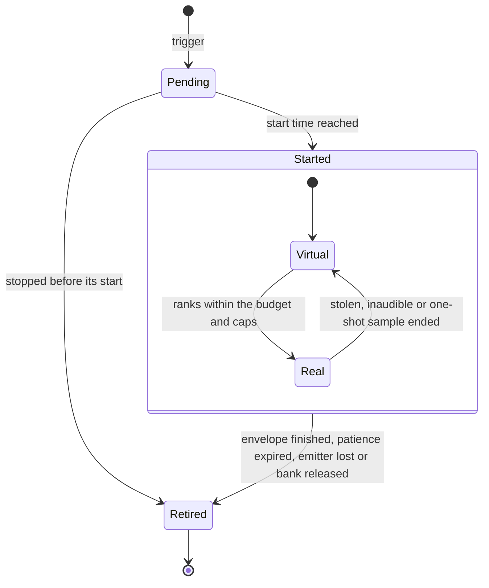
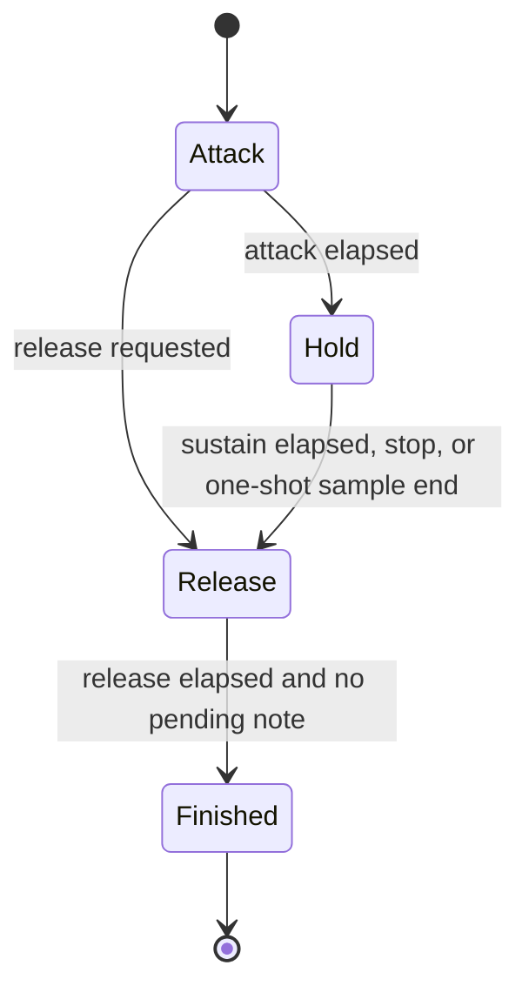

# Instances, voices and envelopes

> Status: Engine baseline · Prefix: AEN · ADRs: [ADR-022](../../../ADR/ADR-022-audio-engine-on-xaudio2.md) · [ADR-023](../../../ADR/ADR-023-virtual-voices-and-voice-stealing.md) · [ADR-026](../../../ADR/ADR-026-audio-command-queue-and-callbacks.md) · Related: [Audio engine](README.md) · [Spatialisation, mixing and streaming](spatialisation_mixing_and_streaming.md) · [event model and sound data](../../../reference/10_audio_design/event_model_and_sound_data.md) · [positional, priorities and mix](../../../reference/10_audio_design/positional_priorities_and_mix.md)

This document specifies how a command becomes an instance and how instances live: the trigger and stop paths, the ranking onto the real-voice budget with virtual voices and stealing, the reference allocation, the instance states, the envelope, the play position and loops, the start and advance of an instance, the modulatable values and the game-speed pitch bend. The notation and the units are those of the [folder README](README.md), and section numbers are those of the whole component.

## 1 Responsibilities and boundaries

The responsibilities and boundaries of the audio engine are [README](README.md) §1.

## 2 Interfaces

The interface sketch, the commands, the inputs and the voice back-end contract are [README](README.md) §2.

## 3 Data model

The types, the layer data, the instance state, the effect kinds and the stream format are [README](README.md) §3.

## 4 Behaviour and algorithms

### 4.5 From a command to an instance

**AEN-130** (MUST) A `Trigger` looks up its source and event (R-AUD-022). An event with no definition, or a source with none, does nothing (R-AUD-027). For every layer whose audience accepts the event on the local participant (R-AUD-024, R-AUD-025), evaluated once at the trigger with the local team of the latest match state, the engine creates one instance copied from the layer (AEN-067) with the trigger's position and velocity, records the trigger's emitter in its emitter set at once (R-AUD-038, DEC-323), and evaluates its six values once each (AEN-188). Outside a match, or with no local team, the own and enemy audiences never pass. An event of the `music` source raised with an object or none goes to the music channel instead (§8.2).

**AEN-131** (MUST) A layer whose sharing is shared-random or shared-nearest merges into the live instance of the same full event id with the same kind of sharing, if one exists: the trigger's emitter is appended to that instance's emitter set and the new instance is discarded (R-AUD-029). The reference merges into any live shared instance of the same full event id.

**AEN-132** (MUST) A new instance takes a free slot of the instance table and the next generation of that slot, the state `Pending` and the start time of AEN-024. In the reference the number of waiting instances is unbounded; in Species it is bounded by the table (AEN-300).

**AEN-133** (MUST) A note re-trigger (AEN-178) creates a duplicate: a new instance copied from the live instance (its current values, position, velocity and emitter set), with the same layer as its definition, created by the same path as a trigger. A duplicate of a shared note layer therefore merges into the note it was copied from and plays no next note (DEC-965 item 3).

**AEN-134** (MUST) A `Stop` selects instances by recorded emitter and by event as [event model](../../../reference/10_audio_design/event_model_and_sound_data.md) R-AUD-036 specifies: a started instance (virtual or real) is released with a final release (AEN-169); a pending instance is retired at once. A stop that names no emitter acts only on instances raised with no emitter, and a stop reaches the music channel only when it names the `music` source (R-AUD-403). In the reference model a stop matches the emitter that an update has resolved, which two-dimensional and world-fixed instances never have, and an event name that contains the given text.

**AEN-135** (MUST) Retiring an instance stops its voice, if it has one, and returns the voice to its pool with every per-voice setting reset (AEN-046), releases its stream, removes it from every count and frees its slot.

**AEN-136** (MUST) `QueryCount` answers the number of live instances (states `Pending`, `Virtual` and `Real`) of the full event id whose emitter set holds the emitter, or of any emitter when the emitter is invalid; `QueryPlaying` answers whether any live instance's emitter set holds the emitter. Both are defined in every state of every slot and never fail (DEC-752, R-AUD-037), and a query is answered after the triggers and stops issued before it, so a query made right after a trigger finds its instances (DEC-323). In the reference model the count of playing instances fails as soon as it meets an empty voice when an emitter is given, and the count of all instances misses instances whose emitter an update has not yet resolved.

**AEN-137** (MUST) The engine keeps these statistics per update: live instances, real instances, virtual instances, and real instances per bus. The reference keeps the live count, the occupied voice count and their difference.

**AEN-138** (MUST) `Pause` stops the XAudio2 engine and freezes the advance of every instance; `Resume` restarts both, and every timer resumes where it stopped. The reference never pauses audio: during a paused match every sound keeps playing and the interface keeps raising its sounds, so no match pause issues `Pause` by default (DEC-965 item 4; §8.3).

### 4.6 Ranking, virtual voices and stealing

**AEN-140** (MUST) **Audibility.** At step 5 of every update each started instance gets an audibility in dB ([positional, priorities and mix](../../../reference/10_audio_design/positional_priorities_and_mix.md) R-AUD-215): 0 dB, the full level, for a two-dimensional instance; otherwise base + 20 log₁₀ G(d), where G is the distance gain of AEN-201 and AEN-202 and base is the instance's current envelope level (AEN-166) if it has ever been real, or its level target if it has not, so an instance in a slow attack ranks low (DEC-965 item 2). An instance is **inaudible** when its audibility plus its bus gain and the pre-master gain (AEN-215) is at or below `ref.aud.mix.floor_db`.

**AEN-141** (MUST) **Score.** The instances of each full event id are ordered by audibility, loudest first (ties: earlier start time, then lower slot), and the k-th louder copy (k = 0 for the loudest) scores audibility + k × 20 log₁₀ c, where c is the event's copy decay (AEN-062; R-AUD-216). With c = 0.75 each further copy loses about 2.5 dB.

**AEN-142** (MUST) **Voice pools.** Source voices are pooled per format (ADR-023): one pool for mono and one for stereo 16-bit PCM at `aen.format.sample_rate`, each of `aen.voice.budget` + `aen.voice.pool_headroom` voices; and one pool for each MS-ADPCM format of the streamed groups, a channel count and a samples-per-block value (with `aen.stream.samples_per_block` for every group, one mono and one stereo pool), each of `aen.stream.max_streams` + `aen.voice.pool_headroom` voices (ADR-025). Every voice is created when the graph is built with a maximum frequency ratio of `aen.voice.max_frequency_ratio`; no voice is created or destroyed during a session. A voice that is fading out after a steal belongs to its pool, not to the budget.

**AEN-143** (MUST) **Budget and caps** (DEC-570). At most `aen.voice.budget` instances are real at once. Each bus has a cap: `aen.voice.bus_cap.ui`, `aen.voice.bus_cap.announcer`, `aen.voice.bus_cap.voice`, `aen.voice.bus_cap.world`, `aen.voice.bus_cap.ambience`; the music bus has `aen.voice.bus_cap.music` voices that only the music channel uses (§8.2). An event on the voice bus has at most `aen.voice.event_cap.voice` real instances; an event on the world bus has at most `aen.voice.event_cap.world_default`, which its data may raise to at most `aen.voice.event_cap.world_max`; events on the other buses have no cap beyond their bus cap.

**AEN-144** (MUST) **Allocation.** The rank order is the class order of `AudioBus` (UI first), then score (highest first), then start time (earlier first), then slot (lower first). At step 6:

1. **Keep.** A real instance stays real unless it ends, becomes inaudible, which makes it virtual at once, or is stolen (AEN-145).
2. **Fill.** Every other started, audible instance is visited in rank order and becomes real when its event cap, its bus cap and the budget all have room; otherwise it may steal (AEN-145); otherwise it stays virtual.

**AEN-145** (MUST) **Stealing.** The victim of a candidate is the lowest-ranked real instance whose removal makes room in the first full limit: an instance of the same event when the event cap is full; else of the same bus when the bus cap is full; else, when only the budget is full, of the candidate's class or a lower one. The candidate takes the victim's place only if all hold:

1. its score is at least the victim's score + `aen.voice.steal_margin_db` (DEC-570);
2. the victim has been real, and the candidate virtual, for at least `aen.voice.state_hold`;
3. the victim is not on the UI bus, whose instances are never stolen;
4. the candidate is not a world-bus instance taking an ambience-bus voice.

The victim becomes virtual and its voice fades to silence over `aen.voice.steal_fade` before it returns to the pool; the candidate starts at once on another voice of its pool. Every change between virtual and real, other than one caused by ending or by inaudibility, therefore happens at most once per hold time per instance (ADR-023).

**AEN-146** (MUST) **Patience.** A `once` instance is retired when it is virtual at an update at or after its start time + its patience window (AEN-062; R-AUD-061), or when its sound has ended (AEN-175). A `once` instance that has never been real does not advance its play position. A `loop` or `note` instance never expires while virtual; it ends by a stop, by losing its emitter, or by its envelope.

**AEN-147** (MUST) No per-update start quota limits the starts; `aen.voice.max_starts_per_update` can cap the number of instances that become real in one update (highest rank first), and its default 0 means no cap (ADR-023).

**AEN-148** (MUST) **Starts.** A pending instance starts at the first update whose time T satisfies start time ≤ T + `aen.update.period`; it then becomes virtual or real in the same update. A voice that starts at a start time s plays a leading silence of round((s − T) × `aen.format.sample_rate`) frames, at least 0 and at most one update period, so triggers keep their order and spacing; a start time already past plays at once and is counted as a late start. Any number of instances may start in one update.

**AEN-149** (MUST) Every volume and pitch change of a real voice reaches its new value over one update period, never as a step (ADR-023). An instance that becomes real at a play position above 0 fades in from silence over `aen.voice.steal_fade`; one that becomes real at position 0 starts at its envelope level.

**AEN-150** (MUST) **Worked example (Species).** The world bus is at its cap of 32 real instances; the three lowest score −30, −28 and −26 dB, and every instance has held its state longer than the hold time. In one update three instances start on the world bus: an explosion one-shot scoring −8 dB, a second copy of a gunfire one-shot whose audibility is −11.5 dB and which scores −14 dB after one copy decay, and a virtual ambient loop scoring −40 dB. In this update the explosion takes the −30 dB instance's place (margin 22 dB), the gunfire copy takes the −28 dB instance's place (margin 14 dB), and the loop stays virtual (−40 dB is below −26 + 3 dB). Both victims become virtual: a victim one-shot past its patience is retired at the next update, and a victim loop keeps advancing in time.

### 4.7 The reference allocation and emitter selection

**AEN-156** (MUST) **Reference model.** The reference allocation is [positional, priorities and mix](../../../reference/10_audio_design/positional_priorities_and_mix.md) R-AUD-219, with these engine details:

1. audibility is on the ten-step scale times the distance factor: two-dimensional instances rank at the top of the scale; a positioned instance ranks by its envelope output while it plays, so a long release ranks lower as it fades (R-AUD-074), and by its level from the trigger while it waits;
2. priority is audibility × `ref.aud.rank.copy_decay`^k over the full event id;
3. the candidate is the best-ranked waiting instance with a priority above 0, so an instance whose level evaluates to the bottom of the scale never starts, and a one-shot then expires;
4. the candidate takes the first free voice, else that of the strictly lowest-priority occupant (lowest index on a tie), with no comparison of priorities; a one-shot occupant is destroyed, a looping one waits and later restarts from its beginning or with a new member; a failed start (no sample) destroys the candidate;
5. a one-shot's patience counter starts at `ref.aud.layer.one_shot_patience_updates`, is decremented at every update in which the one-shot is not playing, before that update's start attempt, and retires it when it falls below 0: the one-shot has the start attempts of three updates and is discarded at the fourth, 0.15 to 0.20 s after its trigger.

**AEN-157** (MUST) **Emitter selection** (both models). Gone emitters are removed from an instance's emitter set first: an emitter is gone when an emitter update marks it not present, or when a frame's emitter updates, sent after the engine published it as tracked (AEN-041), omit it; until its first update an emitter keeps its trigger's position and velocity. The emitter is chosen again when the selected one is gone, at every update for shared-nearest, and right after every start and restart for shared-random: per-trigger takes the first emitter of its set; shared-random takes member `FxRng::NextUint` mod n; shared-nearest takes the emitter with the smallest squared distance to the camera among those within `ref.aud.crowd.nearest_radius` (R-AUD-213, DEC-109). An attached instance left with no selectable emitter has lost its emitter (AEN-185).

**AEN-158** (MUST) **Worked example (reference model).** All 31 effect voices are busy, their occupants' priorities range from 0.40 to 9.0 on the reference scale, and three instances wait: an explosion one-shot (audibility 6.0), a second copy of a gunfire one-shot (audibility 4.0, a louder copy playing, so priority 3.0) and an ambient loop evicted at the previous update (0.30). Update 1: the explosion is the candidate and takes the voice of the 0.40 occupant, a one-shot, which is destroyed. Update 2: the gunfire copy (3.0) takes the voice of the lowest occupant, a loop ranked 0.45, which waits. Update 3: that loop (0.45) outranks the ambient loop and takes the voice of the lowest occupant, a one-shot ranked 0.50, which is destroyed although it ranked above the loop. Update 4: the ambient loop (0.30) takes the lowest occupant's voice. Had the gunfire copy lost three updates in a row, it would have been discarded at the fourth.

### 4.8 Instance states

**AEN-162** (MUST) An instance moves through the states of diagram 4-B; `Started` is either `Virtual` or `Real` and has the envelope stages of diagram 4-C.

Diagram 4-B: the states of an instance (AEN-144 to AEN-148, AEN-185).

Diagram 4-C: the envelope stages (AEN-166 to AEN-169). A note loop spawns its next note at release (AEN-178).

**AEN-163** (MUST) In the reference model the states are derived from the envelope stage and the voice index: an instance plays while a voice holds its handle, so being evicted silently makes it a waiting instance; a stop disables its effects and clears its voice.

**AEN-164** (MUST) The reference envelope has a decay stage that no instance ever enters; Species has none (R-AUD-057).

### 4.9 Envelope arithmetic

**AEN-166** (MUST) With V the level target (dB, clamped to [F, 0]), A, S and R the attack, sustain and release in seconds, ε = `aen.envelope.epsilon`, and t = T − timer:

| Stage | Level (dB) | Transition |
|---|---|---|
| Attack | frac = min(t ÷ A, 1) if A > 0, else 1; level = F + (V − F) × frac | when \|frac − 1\| < ε: timer := T, stage Hold |
| Hold | level = V | when S > 0 and T ≥ timer + S: release, not final (AEN-169); S = 0 holds until a stop or the end of a one-shot sample |
| Release | frac = min(t ÷ R, 1) if R > 0, else 1; level = F + (V − F) × (1 − frac) | finished when \|frac − 1\| < ε and no note re-trigger is pending (AEN-178) |

The level is clamped to [F, 0] dB. Envelope ramps are linear in dB (R-AUD-224); a finished instance's voice stops from the floor level F.

**AEN-167** (MUST) The timer starts at the instance's start time, so the time an instance waits for a voice eats into its attack, as the time spent waiting does in the reference model, where the timer starts at the trigger (R-AUD-056).

**AEN-168** (MUST) The level target, attack, sustain and release are re-evaluated by their update modes (AEN-188), so random and linked values move the envelope while it runs.

**AEN-169** (MUST) A **release** request with a final flag: when the instance is not already in Release, the stage becomes Release and timer := T, and for a `note` instance with the flag clear, the next note is arranged (AEN-178); independently, a final request on a `note` instance already in Release cancels its pending next note. Requests come from: the end of the sustain (not final); the end of a one-shot sample (not final); a stop (final); music replacement (final, §8.2); and the loss of an emitter on the graceful path of DEC-321 option B (final, loops only).

### 4.10 Play position, loops and the end of a sample

**AEN-173** (MUST) An instance's play position is in frames of its current member. A real voice's position is the frames it has played; a virtual instance's position advances by Δt × `aen.format.sample_rate` × its frequency ratio at each update: from its start for `loop` and `note` instances, and only after it has been real for `once` instances (AEN-146).

**AEN-174** (MUST) A real resident voice is fed buffers that point into its bank at the play position, and silences are fed from one shared silent buffer of `aen.voice.silence_buffer` frames, repeated as needed; a real streamed voice is fed from its stream (AEN-252). The next segment is decided and submitted when the play position comes within `aen.voice.loop_lookahead` of the end of the current one, so consecutive segments play without a gap.

**AEN-175** (MUST) **`once`.** When the play position reaches the end of the sample, the instance is released, not finally (R-AUD-058). It then has no signal left, so it leaves its real voice at once and stays live, virtual, until its release has finished. In the reference model the release starts one device buffer after the sample end, so that the buffered audio plays out, and starts early when the sample ends exactly at a buffer boundary; Species has no device buffers, so the release starts at the sample's last frame.

**AEN-176** (MUST) **`loop`.** At the end of the sample the loop delay is evaluated (AEN-188). With a delay below ε, the next member (AEN-180) follows without a gap; otherwise a silence of the delay follows, then the next member (R-AUD-059).

**AEN-177** (MUST) **`note`.** A note repeats its own member, rewound, without a gap for as long as it lives; members are drawn only for new notes.

**AEN-178** (MUST) **Next note.** When a `note` instance is released not finally: with a loop delay below ε, its duplicate (AEN-133) is created at once; otherwise a re-trigger time T is recorded, and the duplicate is created at the first wrap of the releasing note's member at or after that time + the loop delay, because the reference checks the delay only when the member wraps (DEC-965 item 1). The releasing note stays live, silent once its release has ended, until its next note has been created, so notes cross-fade (R-AUD-060).

**AEN-179** (MUST) The reference model takes these end-of-sample decisions while it fills device buffers ahead of playback, up to one buffer early. A zero-length member is a content-build error, because a zero-length looping member with no loop delay never ends its loop.

**AEN-180** (MUST) **Opening a member.** At every start, loop restart and new note, the instance's restart flag is set and its group chooses a member (R-AUD-064): a one-member group repeats its member; otherwise members are weighted, the previous member is excluded, and with W the sum of the eligible weights the engine draws u = `FxRng::NextUnit`(W) and takes the first eligible member whose cumulative weight is at least u (R-AUD-063, DEC-568). The reference draws uniformly with `NextUint` mod n and may repeat the previous member.

### 4.11 Start, advance and position

**AEN-182** (MUST) When an instance becomes real, the engine takes a voice of its format from the pool (AEN-046), sets its output matrix, filter, send levels, frequency ratio and volume, submits its buffers from the play position and starts it in the update's operation set with the offset of AEN-148. In the reference model a start refuses a layer with no sample, opens the member, sets head-relative positioning for two-dimensional instances and world positioning otherwise, the minimum distance, the frequency, the volume and the position, and enables the instance's effects.

**AEN-183** (MUST) At every update a started instance: advances its envelope, and is retired when it has finished (AEN-166); evaluates its values (AEN-188) and sets its frequency ratio (AEN-196); updates its position (AEN-184); and clears its restart flag at the end of the update.

**AEN-184** (MUST) Positions follow the position kind (R-AUD-207): `2d` has no position and sits at the listener; `fix` keeps the position and velocity of its trigger; `att` takes its selected emitter's position and velocity from the latest emitter update at every update, a structure's attached instance its centre position.

**AEN-185** (MUST) **Emitter loss.** An attached instance whose emitter set has no selectable emitter at an update stops at once, without its release, and is retired (R-AUD-209). This is the default of DEC-321; under its option B the instance instead becomes world-fixed at its last position with velocity 0, and a looping instance is released finally. In the reference model this graceful path runs only when the emitter disappears between the cull and the advance of the same update.

**AEN-186** (MUST) A world-fixed instance keeps its recorded emitter for stops and counts (DEC-323), which never moves it.

### 4.12 Modulatable values

**AEN-188** (MUST) Values are evaluated on this schedule:

| When | Values |
|---|---|
| at the trigger | all six, once each (the restart flag is set) |
| at the start | pitch, then attack, sustain, release and level |
| at every update while started | attack, sustain, release, level, pitch, then the effect parameters |
| at a `loop` layer's segment decision (AEN-174, AEN-176) | loop delay |
| before the start | none: the audibility uses the level from the trigger |

A per-note value is evaluated only while the restart flag is set: at the trigger, at the start and at the first update after each start or restart (R-AUD-053).

**AEN-189** (MUST) A fixed value's target is its value; a random value's target is lo + `FxRng::NextUnit`(hi − lo), which can equal hi; a linked value's target is the piecewise map of [event model](../../../reference/10_audio_design/event_model_and_sound_data.md) R-AUD-051 of its link's input (R-AUD-052), read from the latest emitter update and listener: `height` = the height above the terrain, `pos_x`, `altitude` and `pos_z` the position's coordinates, `speed` = \|velocity\|, `camera_distance` = \|camera − position\|, `object_age`, `teams_nearby` and `unit_count` from the emitter update, `time_remaining` from the match state; a two-dimensional instance reads the camera's position, velocity and height above the terrain.

**AEN-190** (MUST) **Smoothing.** With a = √s for smoothing s, one step sets out := target × (1 − ρ) + out × ρ. The trigger, start and per-note evaluations, and the first update evaluation after the start, take one step with ρ = a; every later update evaluation takes ρ = a^(Δt ÷ `ref.sim.frame.audio_update_period`), Δt being the audio time since the previous update evaluation (R-AUD-054, ADR-026). A value with s = 0 is its target.

**AEN-191** (MUST) **Start values** (DEC-322). Under the default, the previous output of a fresh instance is: level `ref.aud.layer.level_default`, pitch `ref.aud.layer.pitch_default`, attack, sustain, release and loop delay `ref.aud.layer.envelope_default`, and each effect parameter its schema default (AEN-071), so a smoothed random pitch is compressed towards 1.0 at the start of a note (R-AUD-055); a per-note pitch with s = 0.66 takes three steps before it is first heard, starting near 0.54 × 1.0 + 0.46 × its draws. Under option B the first evaluation sets the output to its target.

### 4.13 Pitch and the game-speed bend

**AEN-196** (MUST) A real voice's frequency ratio is pitch × bend, where every sample is at `aen.format.sample_rate` and XAudio2 converts to the device rate. A ratio above `aen.voice.max_frequency_ratio` (3 × 48 kHz in the reference's terms) is not applied: the previous ratio stays and the event is counted; a ratio below `aen.voice.min_frequency_ratio` is raised to it.

**AEN-197** (MUST) **Bend** (DEC-569, DEC-751, R-AUD-211; the match-end drop is DEC-320's default). The bend is 1 for two-dimensional instances, for every bus other than voice and world, and whenever the match phase is not `Running`. Otherwise it is √max(g, `ref.aud.pitch_bend.speed_floor`), where g is the smoothed game speed: `BeginMatch` sets g := `ref.sim.speed.normal`; it stays there through the grace period; while the phase is `Running` or `Ended` it follows the game speed G of the match state as g := G + (g − G) × e^(−Δt ÷ `aen.pitch_bend.time_constant`) at every update; `EndMatch` discards it. The smoothing never depends on how many sounds play, and no match inherits the state of the one before.

**AEN-198** (MUST) In the reference model the bend applies in any match after its grace period to every instance that is not two-dimensional (music is two-dimensional), and its smoothed speed is one process-wide value that moves a fixed fraction towards the game speed at every pitch evaluation of a playing positioned instance and at every start, never reset between matches (DEC-751 option B).

**AEN-199** (MUST) Pitch values outside the design range are content-build errors; the engine never rejects a ratio silently other than by AEN-196.

## 5 Concurrency and performance budget

The threads, the budgets and the memory figures are [README](README.md) §5.

## 6 Failure modes, diagnostics and telemetry

The failure table, the silent device and the diagnostics are [README](README.md) §6.

## 7 Acceptance tests

The tests of this document are in [README](README.md) §7: T4 to T18.

## 8 Open decisions

The decisions and architecture records are [README](README.md) §8.1.
