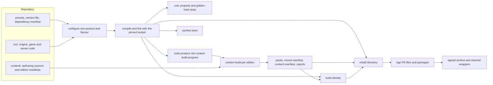

# Build tooling and distribution

> Status: Engine baseline · Prefix: BLD · ADRs: [ADR-0051](../../adr/0051-windows-toolchain-and-compiler-policy.md) · [ADR-0052](../../adr/0052-cpp23-language-standard.md) · [ADR-0053](../../adr/0053-modules-and-import-std.md) · [ADR-0054](../../adr/0054-build-system-cmake-presets.md) · [ADR-0055](../../adr/0055-dependencies-vcpkg-manifest-mode.md) · [ADR-0056](../../adr/0056-editions-build-flavours-and-feature-flags.md) · [ADR-0057](../../adr/0057-version-identity.md) · [ADR-0059](../../adr/0059-content-build-and-validators.md) · [ADR-0060](../../adr/0060-content-identity-by-hash.md) · [ADR-0065](../../adr/0065-crash-reporting.md) · [ADR-0070](../../adr/0070-continuous-integration.md) · [ADR-0071](../../adr/0071-install-layout-runtime-files-and-user-data.md) · [ADR-0072](../../adr/0072-distribution-channels-and-package-formats.md) · [ADR-0073](../../adr/0073-code-signing.md) · also [ADR-0001](../../adr/0001-direct3d-12-renderer-on-the-agility-sdk.md), [ADR-0003](../../adr/0003-shader-language-compiler-and-material-shaders.md), [ADR-0050](../../adr/0050-client-platform-and-minimum-os.md), [ADR-0058](../../adr/0058-pack-files-and-mount-policy.md), [ADR-0061](../../adr/0061-data-schemas-and-versioning.md), [ADR-0062](../../adr/0062-authoring-syntax-and-schema-language.md), [ADR-0063](../../adr/0063-localisation.md), [ADR-0066](../../adr/0066-telemetry-with-consent.md), [ADR-0067](../../adr/0067-logging.md), [ADR-0068](../../adr/0068-profiling-and-gpu-timing.md), [ADR-0069](../../adr/0069-test-framework.md) · Related: [Asset pipeline and resources](asset_pipeline_and_resources.md) · [Data schemas](data_schemas/README.md) · [Platform layer](platform_layer.md) · [Diagnostics, test and performance](diagnostics_test_and_performance.md) · [Maps: rules and conventions](../../reference/08_maps_and_level_design/rules_and_conventions.md) · [Map editor hooks](../../reference/08_maps_and_level_design/map_editor_hooks.md) · [Options, localisation and hooks](../../reference/09_front_end_and_match_flow/options_localisation_and_hooks.md) · [Game assets](../../assets/GameAssets.md)

This component specifies how Species is built, checked and delivered. It covers the toolchain and its pins; the build definition with its products, flavours and presets; the third-party dependencies; the generated build identity; the **content build** program, which runs the stages of the asset pipeline and the data schemas for each edition and adds its reports and the map-identity listing; the localisation build and the translation workflow; the hooks that a map tool uses; continuous integration; the client install directory, its packages and channel wrappers; code signing; and the build side of crash reporting. The rules of each content stage (import records, cookers, placeholders, validators, the pack format, entry hashes and the content manifest) belong to the [asset pipeline](asset_pipeline_and_resources.md) and the [data schemas](data_schemas/README.md); this document cites them and never restates them.

Notation used throughout:

- A **product** is one of the three programs of ADR-0056: `client` (which can also host the integrated server), `server` (the headless dedicated server) and `tools` (the content build and the other tools).
- A **flavour** is one of the four build configurations `Debug`, `Development`, `Profile` and `Shipping` (ADR-0054, ADR-0056).
- An **edition** is one selection of content with its runtime feature flags, described by one **edition manifest** (ADR-0056, ADR-0059). An edition **marked for release** is one whose manifest sets the release flag (§3.2).
- A **channel** is a distribution channel, and a **channel wrapper** is the package that one channel delivers (ADR-0072).
- The **repository layout** is that of ADR-0054: `src/` (engine, game and server code), `content/` (the authoring sources of the content build), `tools/` (the content build and the other tools) and `documentation/`.
- A **CI job** is one workflow preset that the continuous-integration service runs (ADR-0054, ADR-0070).

## 1 Responsibilities and boundaries

**BLD-001** (MUST) The build tooling owns: the toolchain definition and its pins (§4.1); the build definition, which is `CMakePresets.json`, the products, the flavours and their compile-time switches (§3.1, §4.2); the dependency manifest and the overlay triplets (§4.1); the edition-manifest semantics and the release flag (§3.2, §4.3); the build-identity generator (§3.3, §4.4); the content build program, which is its command line, its run modes, the order of its stages, its edition handling, its reports and the map-identity listing (§2.2, §4.5, §4.6); the localisation build and the translation export and import (§4.7); the build-side hooks of map tools (§4.8); the CI pipelines (§4.9); the install directory, the packages, the channel wrappers and the repair function (§4.10); code signing (§4.11); and symbol publication with the build side of crash reporting (§4.12).

**BLD-002** (MUST NOT) The build tooling restates no rule of a content stage. The import records, cookers, derived variants, placeholders, asset validators, pack format, pack writer, entry hashes, content manifest and simulation content identity are the asset pipeline's (AST-001). The schemas, the authoring parser, the record validators, the cooked record format, the canonical writer and the schema migration are the data schemas' (DAT-001). The content build program runs those stages in the order of §4.5 and never changes what they produce.

**BLD-003** (MUST NOT) No build is configured by editing a source file. The product, the flavour, the edition, the version and every pin come from the presets, the version file, the edition manifests and the dependency manifest (ADR-0056, ADR-0057). No number that identifies a build or a map is typed by hand in more than one place, and no source file holds a table of map identities (ADR-0060).

**BLD-004** (MUST NOT) No build step writes into an install directory after packaging has finished, and no Species program writes into its own install directory at run time (ADR-0071). The crash path itself is not part of this component: the [platform layer](platform_layer.md) installs the crash handlers and registers the files and memory that a crash report carries, and the [diagnostics](diagnostics_test_and_performance.md) component owns the contents of the black box, the soak-test harness, the test harness and the performance tests. This component provides the symbols, signatures, version resources and test-machine settings that make those reports usable (§4.12).

**BLD-005** (MUST) The build produces the three products of ADR-0056 from one build definition. The `server` product is headless and links no graphics, audio, input or text-rendering library (ADR-0056, ADR-0001). Which process roles the client and the server play is DEC-220; until it is decided, the build provides all three products, and the integrated server is the same library that the `server` product links (DEC-220 item 1).

Table 1-A Boundaries.

| Neighbour | Gives the build tooling | Takes from it |
|---|---|---|
| [asset pipeline](asset_pipeline_and_resources.md) (`AST`) | the content stages, the packs, the asset indexes, the mount manifests, the content manifest, the placeholder flags and the asset diagnostics | the edition manifests and their release flag, the products and flavours, the CI jobs that run the content build, the installation of the packs (AST-056) |
| [data schemas](data_schemas/README.md) (`DAT`) | the edition-manifest schema, the record diagnostics (DAT-057), the canonical writer and the migration step | the content build program that runs them, CI |
| [platform layer](platform_layer.md) (`PLT`) | the crash path and its registrations, the user-data folders, the start-up checks and the start-up message path | the build identity, the install layout, the channel tag, the test-machine dump settings |
| [diagnostics](diagnostics_test_and_performance.md) (`DBG`) | the black box, the test harness, the soak harness, the performance tests and their budgets | the CI jobs and their artefacts, the build identity, the symbol store, the soak edition |
| [renderer](renderer/README.md) (`RND`) | the use of the Agility SDK runtime and the version string drawn in the front end (RND-076) | the exported Agility SDK constants, generated from the package pin (§4.1) |
| [UI framework](ui_framework/README.md) (`UI`) | the string-table merge (UI-222) and the caption markup (UI-223, UI-224) | the localisation report and the translation export (§4.7) |
| maps ([reference/08](../../reference/08_maps_and_level_design/rules_and_conventions.md)) | the map id, the map catalogue, the per-mode map rules | the map-identity listing (§4.6), the validators that map tools call (§4.8) |
| front end ([reference/09](../../reference/09_front_end_and_match_flow/options_localisation_and_hooks.md)) | the reference language set (R-META-461) and the language test (R-META-473) | the localisation report (§4.7) |
| simulation ([reference/12](../../reference/12_simulation_model/README.md)) | none | the build settings of the simulation targets (§4.2) |



*Figure 1-A: from the repository to signed packages and the symbol store. CI runs every arrow on every change (§4.9).*

## 2 Interfaces

### 2.1 The build definition

**BLD-006** (MUST) The build definition is one CMake project with a checked-in `CMakePresets.json` (ADR-0054). Each configure preset selects exactly one operating system, compiler, flavour and product, and its name is `<os>-<compiler>-<flavour>` followed by `-<product>`; each configure preset has a build preset and a test preset of the same name, and each CI job is one workflow preset named `ci-<tier>-<job>` (§4.9). `CMakeUserPresets.json` is local and never checked in. The presets of the baseline are those of table 2.1-A.

Table 2.1-A Configure presets of the baseline. "Products" lists the products that have a preset of that row; the preset name ends with the product.

| Preset stem | Compiler | Flavour or configuration | Products | Use |
|---|---|---|---|---|
| `windows-msvc-debug` | MSVC | `Debug` | client, server, tools | developer debugging |
| `windows-msvc-development` | MSVC | `Development` | client, server, tools | everyday development; required CI build |
| `windows-msvc-profile` | MSVC | `Profile` | client, server | profiling captures (ADR-0068) |
| `windows-msvc-shipping` | MSVC | `Shipping` | client, server, tools | release candidates; required CI build |
| `windows-clangcl-analysis` | clang-cl | `Development`, with static analysis | server, tools | portability and analysis build of the shared and server code; never distributed (ADR-0051) |
| `windows-msvc-asan` | MSVC | `Development`, with AddressSanitizer | client, server, tools | nightly sanitiser tests and fuzzing (ADR-0069, ADR-0070) |
| `windows-msvc-analyze` | MSVC | `Development`, with `/analyze` | client, server, tools | nightly code analysis (ADR-0070) |

**BLD-007** (MUST) The cache variables of table 2.1-B are the only inputs that select what a configure produces. CI passes no `-D` option that its preset does not hold (ADR-0054).

Table 2.1-B Cache variables.

| Variable | Values | Default | Set by | Meaning |
|---|---|---|---|---|
| `SPECIES_PRODUCT` | `client`, `server`, `tools` | none | the configure preset | the one product of this configure (ADR-0056) |
| `SPECIES_IMPORT_STD` | `ON`, `OFF` | `OFF` | the configure preset | `import std` in client-only targets (ADR-0053) |
| `SPECIES_BUILD_NUMBER` | an integer from 0 to `bld.version.part_max` | 0 | the CI service | the CI build number of the build identity (§4.4) |
| `SPECIES_SOURCE_REVISION` | a source-control revision id | read from the working tree at configure | configure | the revision of the build identity, with the modified marker (§4.4) |
| `VCPKG_TARGET_TRIPLET`, `VCPKG_HOST_TRIPLET` | `x64-windows-species` | `x64-windows-species` | the hidden base preset | the overlay triplet (ADR-0055) |
| `VCPKG_MANIFEST_DIR` | the repository root | the repository root | the hidden base preset | the dependency manifest (ADR-0055) |

### 2.2 The content build command line

**BLD-008** (MUST) The content build is one command-line program of the `tools` product, `species-contentbuild` (ADR-0059). It takes the commands of table 2.2-A, each with the options of table 2.2-B. Every path is a separate argument, and a path that contains spaces is valid.

Table 2.2-A Commands of the content build.

| Command | What it runs | What it writes |
|---|---|---|
| `build` | every stage of §4.5 for the named editions | packs, asset indexes, mount manifests, the content manifest and every report of §2.4, per edition |
| `validate` | the stages of §4.5 up to and including validation, for the named editions; it writes no pack | the validation report, the localisation report and the placeholder report |
| `loose` | an incremental cook of the changed sources and their dependants into the loose-content directory of a development checkout (AST-105) | cooked entries laid out by key, and the validation report |
| `strings-export` | the translation export of §4.7 for the named languages | one translator pack per language and the base-language strings file |
| `strings-import` | the translation import of §4.7 for the named translator files | the string tables, through the canonical writer (DEC-800) |

Table 2.2-B Options of the content build.

| Option | Meaning | Default |
|---|---|---|
| `--edition <id>` (repeatable) or `--all-editions` | the editions to build or validate | every edition |
| `--content-root <dir>` | the content root | `content/` of the checkout |
| `--out <dir>` | the output directory (§3.4) | `out/content/` of the build tree |
| `--clean` | removes the output directory first, so every output is rebuilt | off: incremental |
| `--jobs <n>` | the number of worker threads | the hardware thread count |
| `--language <tag>` (repeatable) | the languages of `strings-export` | every non-base language of the content set |
| `--previous <dir>` | the outputs of an earlier build to compare the map-identity listing with (§4.6) | the last outputs in `--out`, when present |

**BLD-009** (MUST) The content build ends with the exit codes of table 2.2-C. A run with only warnings succeeds; a run with any error fails, and CI fails the change (ADR-0059).

Table 2.2-C Exit codes of the content build.

| Code | Meaning |
|---|---|
| `bld.cb.exit_ok` (0) | every stage passed; warnings may be present |
| `bld.cb.exit_content_errors` (1) | at least one content error; the validation report lists every error |
| `bld.cb.exit_usage` (2) | an unknown command, option, edition or language |
| `bld.cb.exit_tool_failure` (3) | a tool or I/O failure (a missing tool input, a full disk, an internal error); the log names the stage |

### 2.3 Interface sketch

The sketch is a C++23 declaration outline, not an implementation (ADR-0052). Diagnostics are those of the data schemas (`species::data::Diagnostic`, DAT-057); packs and hashes are those of the asset pipeline (`species::assets`).

```cpp
namespace species::build {

enum class Product : std::uint8_t { Client, Server, Tools };                    // ADR-0056
enum class Flavour : std::uint8_t { Debug, Development, Profile, Shipping };    // ADR-0054

struct SemanticVersion { std::uint16_t major, minor, patch; };

struct BuildIdentity {                                   // ADR-0057, §3.3
  SemanticVersion version;
  std::uint32_t   buildNumber;                           // CI build number, 0 for developer builds
  std::string     sourceRevision;                        // source-control revision id
  bool            modifiedTree;                          // built from a modified working tree
  species::assets::Sha256Digest contentManifestHash;     // the content manifest of the mounted packs
  Product         product;
  Flavour         flavour;
};

const BuildIdentity& CurrentBuildIdentity() noexcept;   // code fields generated; content hash from the content manifest
std::string DisplayVersion(const BuildIdentity&);       // "MAJOR.MINOR.PATCH+build.<number>"
std::string FullIdentityText(const BuildIdentity&);     // build details screen, log header (§4.4)
std::array<std::uint16_t, 4> VersionResourceQuad(const BuildIdentity&);   // MAJOR.MINOR.PATCH.build
std::string_view ChannelTag() noexcept;                 // §3.3; "unknown" when no channel file exists

}  // namespace species::build

namespace species::contentbuild {

using EditionId = std::string;                           // stable id of an edition manifest
struct ToolError;                                        // stage, input and reason of a tool or I/O failure

enum class Command : std::uint8_t { Build, Validate, Loose, StringsExport, StringsImport };   // table 2.2-A

enum class Stage : std::uint8_t {                        // §4.5; the order carries meaning
  ResolveEditions, ReadInputs, CheckSources, Cook, Derive, Placeholders, CookRecordsAndGenerate,
  CheckReferences, SelectEditions, Localisation, MapIdentities, WritePacks, WriteManifestsAndReports };

struct RunOptions {
  std::vector<EditionId> editions;                       // empty: every edition
  std::filesystem::path  contentRoot, outDir;
  std::optional<std::filesystem::path> previousOutDir;
  bool clean = false;
  std::uint32_t jobs = 0;                                // 0: the hardware thread count
};

struct MapIdentityEntry {                                // §4.6
  std::string mapId;                                     // map_<mode>_<players>p_<nn>
  species::assets::Sha256Digest hash;                    // AST-099
  std::vector<std::string> modes;                        // the header's mode list, in its order
  std::uint8_t players;
  std::string packId;
};

struct LanguageFindings {                                // §4.7
  std::string tag;                                       // BCP 47
  std::vector<std::string> missing, untranslated, unknown;
  std::uint32_t baseIds, presentIds;
};

struct RunResult {
  int exitCode;                                          // table 2.2-C
  std::vector<species::data::Diagnostic> diagnostics;    // every diagnostic of the run, grouped by file
  std::vector<MapIdentityEntry> mapIdentities;           // per edition
  std::vector<LanguageFindings> localisation;            // per edition
};

class ContentBuild {
 public:
  std::expected<RunResult, ToolError> Run(Command, const RunOptions&);   // table 2.2-A
  // Map tools validate a map definition with the same code as the build (§4.8, R-MAP-400).
  std::vector<species::data::Diagnostic> ValidateMapFile(const std::filesystem::path& authoringFile) const;
};

}  // namespace species::contentbuild
```

**BLD-010** (MUST) The interfaces are those above in substance. Every operation that can fail returns `std::expected` or a list of diagnostics, never a partial result without an error. `ContentBuild::ValidateMapFile` runs exactly the validators that the `validate` command runs on a map definition, so a map tool and the content build accept and reject the same maps (§4.8).

### 2.4 Data contracts: the outputs

**BLD-011** (MUST) The build writes the outputs of table 2.4-A, and only those. Every output is canonical: entries and records in byte-wise order of their keys or ids, with no timestamp, no host path and no user name (AST-066, ADR-0059).

Table 2.4-A Outputs of the build.

| Output | Written by | Content owned by | Consumers |
|---|---|---|---|
| packs, asset indexes, mount manifest | content build | asset pipeline (AST-053 to AST-058) | client, server, packaging |
| content manifest | content build | asset pipeline (AST-059) | client, server, packaging, the build identity, the soak harness (DEC-804) |
| validation report | content build | data schemas (DAT-057) and asset pipeline (§6 of that document) | developers, CI |
| placeholder report | content build | asset pipeline (AST-083) | producers, CI |
| localisation report | content build | this document (§4.7) | translators, the release sign-off, CI |
| map-identity listing | content build | this document (§4.6) | CI, the soak harness, release notes |
| residency lists | content build | asset pipeline (AST-067) | the asset cache, the audio engine's budget check |
| dependency graph | content build | this document (§4.5) | the next incremental run |
| build identity: generated header and data file | configure and packaging | this document (§4.4) | every program, every package, the symbol store |
| dependency licence list | configure | this document (§4.1) | packaging (the licence notices), release review |
| install directory, signed archive, channel wrappers | packaging | this document (§4.10) | testers, players, channels |
| symbols | CI | this document (§4.12) | the symbol store, crash analysis |

### 2.5 Threading contract

**BLD-012** (MUST) The content build runs each stage as tasks on `--jobs` worker threads, one authoring file or one member per task, and merges the results of a stage in byte-wise key order before the next stage starts. Its outputs and its reports do not depend on the number of threads or on the order in which tasks finish (DAT-054, AST-066). Cross-file checks run only after every file of the content set has passed the per-file stages (DAT-054).

## 3 Data model

### 3.1 Products, flavours and compile-time switches

**BLD-013** (MUST) The products are those of table 3.1-A. Each is a separate set of CMake targets, named by `SPECIES_PRODUCT` (ADR-0056).

Table 3.1-A Products.

| Product | Programs | Links | Never links | Content it mounts |
|---|---|---|---|---|
| `client` | `species.exe`, the game client, which can host the integrated server | the engine, the game, the server library, the renderer, audio, input, the UI framework, the platform crash path | none of the tools | the packs of one client edition |
| `server` | `species_server.exe`, the headless dedicated server | the engine core, the game rules, the server library, the platform layer without a window | `d3d12`, `dxgi`, any renderer, audio, input, UI or text-rendering code (ADR-0001, ADR-0056) | the packs of one server edition: data records, maps, collision assets and simulation data records only (AST-007) |
| `tools` | `species-contentbuild.exe` and the other content tools, including the schema code generator (ADR-0062) | the engine core, the schema and record code of the data schemas, the cookers of the asset pipeline, a software or GPU renderer for thumbnails (AST-087) | none of the client's crash or presentation services | none: it reads authoring sources |

**BLD-014** (MUST) The compile-time switches are those of table 3.1-B. Each is a CMake option derived from the flavour by the build definition; no preset, cache variable or source file sets one directly, and configure fails when one is set by hand (ADR-0056). They exist only for code that must not be present in a binary.

Table 3.1-B Compile-time switches by flavour.

| Switch | `Debug` | `Development` | `Profile` | `Shipping` | Owner of the code |
|---|---|---|---|---|---|
| developer console and debug commands, including the cheats as sequenced debug commands and the network statistics window (DEC-041) | compiled in | compiled in | compiled out | compiled out | [diagnostics](diagnostics_test_and_performance.md) |
| PIX markers (`SPECIES_PROFILE_SCOPE`) and `WinPixEventRuntime.dll` | compiled in | compiled in | compiled in | compiled out | diagnostics (ADR-0068) |
| loose-content mount, opt-in by a start-up option | compiled in | compiled in | compiled out | compiled out | asset pipeline (AST-105) |
| test hooks | compiled in | compiled in | compiled out | compiled out | diagnostics |
| assertions | all | all | release checks only | release checks only | diagnostics; `NDEBUG` is defined in `Profile` and `Shipping` only, and no development check depends on `NDEBUG` alone (ADR-0051) |
| optimisation | off | on | on | on | this document |

### 3.2 Edition manifests

**BLD-015** (MUST) An edition manifest is a record of type `edition.manifest`, authored under `content/records/editions/` in the schema of the [data schemas](data_schemas/README.md) (`import_and_build_records.md`, DAT table 1-A). Its fields have the meanings of table 3.2-A; this document owns those meanings, and the schema owns the field types.

Table 3.2-A Edition-manifest fields.

| Field | Meaning | Rule |
|---|---|---|
| `id` | the edition id, a lower-case stable id | unique among the edition manifests (DEC-801) |
| `product` | `client` or `server` | exactly one product (BLD-@ed_product@) |
| `release` | the release flag: the edition is marked for release | BLD-@ed_release@; set only by a release change (BLD-@ed_release_change@) |
| `server_edition` | for a client edition, the server edition it plays with | BLD-@ed_pair@ |
| `languages` | BCP 47 tags, or one language group of table 4.7-A | the base language `ref.meta.lang.base` ([reference/09](../../reference/09_front_end_and_match_flow/options_localisation_and_hooks.md)) is always included (BLD-@l10n_base@) |
| `select` | asset ids, folders under the content root and asset tags (the manifest's `priority` values among them) | positive selection only (BLD-@ed_select@) |
| `maps` | `all`, or a list of map ids: the permitted maps of the edition | BLD-@ed_maps@ |
| `features` | the runtime feature flags of table 3.2-B | every flag named; an unknown flag is an error (ADR-0056) |

**BLD-016** (MUST) The runtime feature flags are those of table 3.2-B. The client and the server read them once at start-up, from the edition's flag record in the packs, and never change them while the process runs (ADR-0056). The flags marked "yes" change simulation behaviour and enter the simulation content identity (AST-100, ADR-0060).

Table 3.2-B Runtime feature flags. The value in the "Reference edition" column is the **reference feature set**: the edition `full` of table 3.2-D has exactly these values.

| Flag | Values | Reference edition | Simulation-relevant | Meaning |
|---|---|---|---|---|
| `modes` | a list of mode ids from `spawn_control`, `zone_control`, `relic_run`, `siege`, `launch_race`, `flag_chain` | all six, in the catalogue order of [reference/01](../../reference/01_skirmish_rules_and_modes/README.md) R-MODE-029 | no | the modes that match setup offers |
| `crate_classes` | a list from `basic`, `advanced` | `basic`, `advanced` | yes | the Supply-crate outcome classes of [reference/04](../../reference/04_supply_crates_powers_and_weapons/README.md) table 2.2-A that exist in the edition |
| `tutorial` | `on`, `off` | `on` | no | the two tutorials of [reference/11](../../reference/11_tutorial_and_help.md) are offered |
| `play_local_network` | `on`, `off` | `on` | no | sessions on the local network are offered; the session model is a design-phase decision (DEC-243 to DEC-245) |
| `play_internet` | `on`, `off` | `on` | no | sessions over the internet are offered; same design-phase dependency |
| `map_editor` | `on`, `off` | `off` | no | the map-editor entry exists in the edition; no player edition offers it (R-MAP-301, DEC-045) |

**BLD-017** (MUST) The reference build behaviours that are not runtime flags have the Species homes of table 3.2-C, so that no edition can switch them.

Table 3.2-C Reference build behaviours that are not edition flags.

| Reference behaviour | Value in the reference edition | Species home |
|---|---|---|
| network statistics window | present | the developer console of `Debug` and `Development` builds (table 3.1-B, DEC-041) |
| debug log written to a file | on | the rotating log file of every flavour (ADR-0067) |
| developer tools: cheat window, sound-tuning and other in-game editors, video capture, random-draw tracking, Supply-crate help window | absent | the cheats are sequenced debug commands of `Debug` and `Development` builds (DEC-041); the other tools are not specified |
| object kinds that no match creates are refused | on | a build error (DEC-802, DAT-032) |
| player authentication | required | entitlement and identity are DEC-248; until decided, no entitlement check applies |
| permitted maps | every map of the edition | the `maps` field `all` (BLD-@ed_maps@) |
| exactly one build target per build | enforced | exactly one product per configure (BLD-@one_product@) and exactly one edition per install directory (BLD-@ed_one_install@) |

**BLD-@ed_baseline@** (MUST) The baseline editions are those of table 3.2-D. The design phase adds or replaces editions; every edition follows §4.3.

Table 3.2-D Baseline editions.

| Edition | Product | Release flag | Selects | Languages |
|---|---|---|---|---|
| `full` | client | set by the release change of a release (BLD-@ed_release_change@) | the reference feature set of table 3.2-B and every asset its maps, records and engine asset table reference | the languages that are complete (BLD-@l10n_offer@) |
| `full_server` | server | as `full` | the simulation-relevant content of `full` | none |
| `development` | client | never | every manifest row, the test maps of DEC-802 and every placeholder | every language of the content set |
| `soak` | server | never | every mode and map of `full`, and the test maps that the soak sequence and the stress population name (DEC-804, DEC-228) | none |

### 3.3 Build identity

**BLD-018** (MUST) The build identity has the fields of table 3.3-A, each from exactly one source (ADR-0057).

Table 3.3-A Build-identity fields.

| Field | Source | Form |
|---|---|---|
| semantic version | the version file `species_version.json` at the repository root, changed only by release changes | `MAJOR.MINOR.PATCH`, each from 0 to `bld.version.part_max` |
| build number | `SPECIES_BUILD_NUMBER`, set by the CI service; 0 in developer builds | 0 to `bld.version.part_max` |
| source revision | the source-control revision id of the working tree, read at configure | the full revision id, followed by the modified marker `-modified` when the working tree differs from that revision |
| content manifest hash | the SHA-256 of the content manifest of the packs built with it (AST-059) | 32 bytes; displayed as `ast.hash.display_hex_digits` hexadecimal digits |
| product | `SPECIES_PRODUCT` | `client`, `server` or `tools` |
| flavour | the configure preset | `Debug`, `Development`, `Profile` or `Shipping` |

**BLD-019** (MUST) Configure generates the header `species_build_identity.h` with every field except the content manifest hash, so that a content change never recompiles code. Packaging writes the data file `build_identity.json` into the install directory with every field, the content manifest hash included. At start-up the client and the server read the content manifest hash from the content manifest they mount, compose the full identity with the generated fields, and log a mismatch with `build_identity.json` as a modified installation (§6).

**BLD-020** (MUST) The **channel tag** names the channel that delivered an install. A channel wrapper writes it as the first line of `channel_tag.txt` in the install directory: lower-case ASCII letters, digits, `_` and `-`, at most `bld.channel.tag_max_chars` characters. A missing file, an empty first line or a tag that breaks these rules reads as `unknown`. The tag is written into the log header next to the build identity (ADR-0067); it never changes behaviour, and it is not a field of the build identity, because one build is wrapped for several channels. Whether it reaches an online service is a design-phase input (DEC-249).

### 3.4 The output directory

**BLD-021** (MUST) The content build writes under its output directory (`--out`) exactly this layout:
- `editions/<edition id>/packs/`: the packs, the mount manifest and the content manifest of the edition (AST-056, AST-059), which packaging copies unchanged into the install directory's `packs\` folder;
- `editions/<edition id>/reports/`: `validation_report.json`, `placeholder_report.json`, `localisation_report.json` and `map_identities.json`, each with a plain-text rendering beside it;
- `loose/`: the loose-content directory of the `loose` command, laid out by key (AST-105);
- `graph/`: the dependency graph of the incremental build (BLD-@cb_graph@);
- `translation/`: the translator packs of `strings-export` (§4.7).

### 3.5 The install directory

**BLD-022** (MUST) A client install directory holds the files of table 3.5-A and nothing else. It is relocatable and read-only, and the client runs from it as a standard user (ADR-0071).

Table 3.5-A Install-directory contents.

| Path | Content | From | Present |
|---|---|---|---|
| `species.exe` | the client | the `client` product, `Shipping` flavour for every channel package | always |
| first-party DLLs | the client's own libraries, if any | the `client` product | as built |
| `D3D12\D3D12Core.dll` | the Agility SDK runtime `bld.pin.agility_sdk` | the pinned Agility SDK package (BLD-@agility@) | always |
| `packs\` | the packs, the mount manifest and the content manifest of exactly one edition | the content build (BLD-021) | always |
| `build_identity.json` | the full build identity | packaging (BLD-019) | always |
| `channel_tag.txt` | the channel tag | the channel wrapper (BLD-020) | channel packages only |
| `licences\` | the third-party licence notices of every distributed dependency | the dependency licence list (BLD-@licences@) | always |
| Visual C++ runtime DLLs | the runtime of the pinned toolset | the pinned Visual C++ redistributable | only for a channel that cannot run prerequisites (ADR-0071) |

**BLD-023** (MUST NOT) An install directory never holds: `D3D12SDKLayers.dll` or any file of a preview Agility SDK (ADR-0001); the shader compiler or any of its libraries (ADR-0003); `WinPixEventRuntime.dll` in a `Shipping` install (ADR-0068); PDB files or other symbol files; a crash-dump helper library, a support or crash-upload tool, an updater, a copy helper or a profile locator (ADR-0065, ADR-0071, ADR-0072); loose content files; any file that table 3.5-A does not list.

**BLD-024** (MUST) User data never lives in the install directory. Its folders are those of ADR-0071 under `%LOCALAPPDATA%\<Studio>\Species\` (`settings\`, `logs\`, `crashes\`), resolved by the [platform layer](platform_layer.md); `<Studio>` is the publisher-name parameter (CONVENTIONS §8.11).

### 3.6 The symbol store

**BLD-025** (MUST) The symbol store holds, for every CI build, every PE file that the build produced for any product and the PDB of each, filed under the build identity and also indexed by the PE and PDB signatures that debuggers use (ADR-0065). A publication is immutable: publishing the same build identity again with different files fails. How long the store keeps builds that were never release candidates is an infrastructure choice; release-candidate and release builds are kept permanently.
