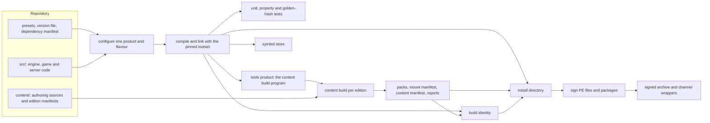
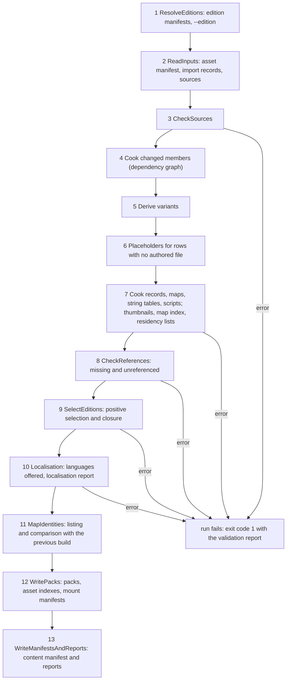
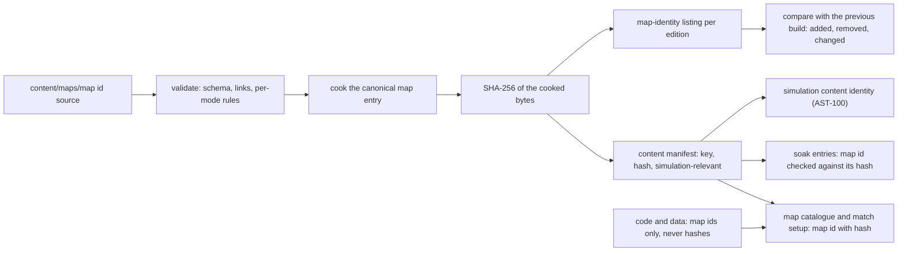
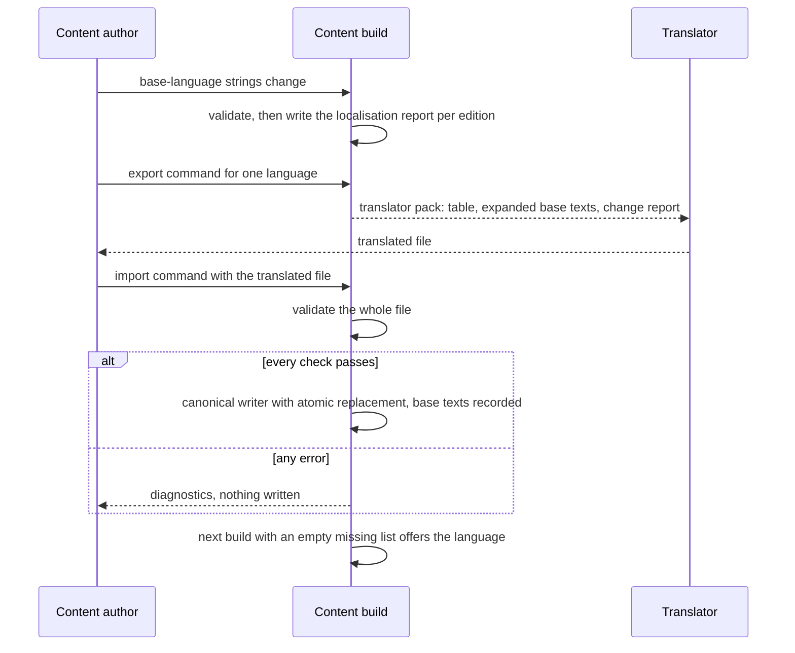
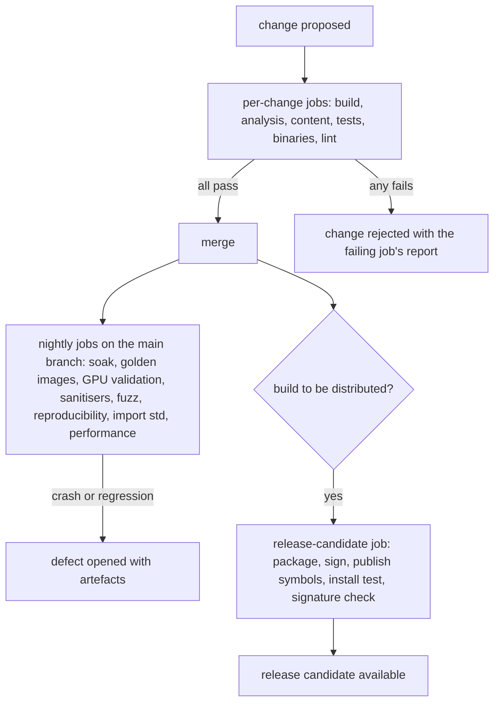

# Build tooling and distribution

> Status: Engine baseline · Prefix: BLD · ADRs: [ADR-051](../../ADR/ADR-051-windows-toolchain-and-compiler-policy.md) · [ADR-052](../../ADR/ADR-052-cpp23-language-standard.md) · [ADR-053](../../ADR/ADR-053-modules-and-import-std.md) · [ADR-054](../../ADR/ADR-054-build-system-cmake-presets.md) · [ADR-055](../../ADR/ADR-055-dependencies-vcpkg-manifest-mode.md) · [ADR-056](../../ADR/ADR-056-editions-build-flavours-and-feature-flags.md) · [ADR-057](../../ADR/ADR-057-version-identity.md) · [ADR-059](../../ADR/ADR-059-content-build-and-validators.md) · [ADR-060](../../ADR/ADR-060-content-identity-by-hash.md) · [ADR-065](../../ADR/ADR-065-crash-reporting.md) · [ADR-070](../../ADR/ADR-070-continuous-integration.md) · [ADR-071](../../ADR/ADR-071-install-layout-runtime-files-and-user-data.md) · [ADR-072](../../ADR/ADR-072-distribution-channels-and-package-formats.md) · [ADR-073](../../ADR/ADR-073-code-signing.md) · also [ADR-001](../../ADR/ADR-001-direct3d-12-renderer-on-the-agility-sdk.md), [ADR-003](../../ADR/ADR-003-shader-language-compiler-and-material-shaders.md), [ADR-050](../../ADR/ADR-050-client-platform-and-minimum-os.md), [ADR-058](../../ADR/ADR-058-pack-files-and-mount-policy.md), [ADR-061](../../ADR/ADR-061-data-schemas-and-versioning.md), [ADR-062](../../ADR/ADR-062-authoring-syntax-and-schema-language.md), [ADR-063](../../ADR/ADR-063-localisation.md), [ADR-066](../../ADR/ADR-066-telemetry-with-consent.md), [ADR-067](../../ADR/ADR-067-logging.md), [ADR-068](../../ADR/ADR-068-profiling-and-gpu-timing.md), [ADR-069](../../ADR/ADR-069-test-framework.md) · Related: [Asset pipeline and resources](asset_pipeline_and_resources.md) · [Data schemas](data_schemas/README.md) · [Platform layer](platform_layer.md) · [Diagnostics, test and performance](diagnostics_test_and_performance.md) · [Maps: rules and conventions](../../reference/08_maps_and_level_design/rules_and_conventions.md) · [Map editor hooks](../../reference/08_maps_and_level_design/map_editor_hooks.md) · [Options, localisation and hooks](../../reference/09_front_end_and_match_flow/options_localisation_and_hooks.md) · [Game assets](../../assets/GameAssets.md)

This component specifies how Species is built, checked and delivered. It covers the toolchain and its pins; the build definition with its products, flavours and presets; the third-party dependencies; the generated build identity; the **content build** program, which runs the stages of the asset pipeline and the data schemas for each edition and adds its reports and the map-identity listing; the localisation build and the translation workflow; the hooks that a map tool uses; continuous integration; the client install directory, its packages and channel wrappers; code signing; and the build side of crash reporting. The rules of each content stage (import records, cookers, placeholders, validators, the pack format, entry hashes and the content manifest) belong to the [asset pipeline](asset_pipeline_and_resources.md) and the [data schemas](data_schemas/README.md); this document cites them and never restates them.

Notation used throughout:

- A **product** is one of the three programs of ADR-056: `client` (which can also host the integrated server), `server` (the headless dedicated server) and `tools` (the content build and the other tools).
- A **flavour** is one of the four build configurations `Debug`, `Development`, `Profile` and `Shipping` (ADR-054, ADR-056).
- An **edition** is one selection of content with its runtime feature flags, described by one **edition manifest** (ADR-056, ADR-059). An edition **marked for release** is one whose manifest sets the release flag (§3.2).
- A **channel** is a distribution channel, and a **channel wrapper** is the package that one channel delivers (ADR-072).
- The **repository layout** is that of ADR-054: `src/` (engine, game and server code), `content/` (the authoring sources of the content build), `tools/` (the content build and the other tools) and `documentation/`.
- A **CI job** is one workflow preset that the continuous-integration service runs (ADR-054, ADR-070).

## 1 Responsibilities and boundaries

**BLD-001** (MUST) The build tooling owns: the toolchain definition and its pins (§4.1); the build definition, which is `CMakePresets.json`, the products, the flavours and their compile-time switches (§3.1, §4.2); the dependency manifest and the overlay triplets (§4.1); the edition-manifest semantics and the release flag (§3.2, §4.3); the build-identity generator (§3.3, §4.4); the content build program, which is its command line, its run modes, the order of its stages, its edition handling, its reports and the map-identity listing (§2.2, §4.5, §4.6); the localisation build and the translation export and import (§4.7); the build-side hooks of map tools (§4.8); the CI pipelines (§4.9); the install directory, the packages, the channel wrappers and the repair function (§4.10); code signing (§4.11); and symbol publication with the build side of crash reporting (§4.12).

**BLD-002** (MUST NOT) The build tooling restates no rule of a content stage. The import records, cookers, derived variants, placeholders, asset validators, pack format, pack writer, entry hashes, content manifest and simulation content identity are the asset pipeline's (AST-001). The schemas, the authoring parser, the record validators, the cooked record format, the canonical writer and the schema migration are the data schemas' (DAT-001). The content build program runs those stages in the order of §4.5 and never changes what they produce.

**BLD-003** (MUST NOT) No build is configured by editing a source file. The product, the flavour, the edition, the version and every pin come from the presets, the version file, the edition manifests and the dependency manifest (ADR-056, ADR-057). No number that identifies a build or a map is typed by hand in more than one place, and no source file holds a table of map identities (ADR-060).

**BLD-004** (MUST NOT) No build step writes into an install directory after packaging has finished, and no Species program writes into its own install directory at run time (ADR-071). The crash path itself is not part of this component: the [platform layer](platform_layer.md) installs the crash handlers and registers the files and memory that a crash report carries, and the [diagnostics](diagnostics_test_and_performance.md) component owns the contents of the black box, the soak-test harness, the test harness and the performance tests. This component provides the symbols, signatures, version resources and test-machine settings that make those reports usable (§4.12).

**BLD-005** (MUST) The build produces the three products of ADR-056 from one build definition. The `server` product is headless and links no graphics, audio, input or text-rendering library (ADR-056, ADR-001). Which process roles the client and the server play is DEC-220; until it is decided, the build provides all three products, and the integrated server is the same library that the `server` product links (DEC-220 item 1).

Table 1-A Boundaries.

| Neighbour | Gives the build tooling | Takes from it |
|---|---|---|
| [asset pipeline](asset_pipeline_and_resources.md) (`AST`) | the content stages, the packs, the asset indexes, the mount manifests, the content manifest, the placeholder flags and the asset diagnostics | the edition manifests and their release flag, the products and flavours, the CI jobs that run the content build, the installation of the packs (AST-056) |
| [data schemas](data_schemas/README.md) (`DAT`) | the edition-manifest schema, the record diagnostics (DAT-051), the canonical writer and the migration step | the content build program that runs them, CI |
| [platform layer](platform_layer.md) (`PLT`) | the crash path and its registrations, the user-data folders, the start-up checks and the start-up message path | the build identity, the install layout, the channel tag, the test-machine dump settings |
| [diagnostics](diagnostics_test_and_performance.md) (`DBG`) | the black box, the test harness, the soak harness, the performance tests and their budgets | the CI jobs and their artefacts, the build identity, the symbol store, the soak edition |
| [renderer](renderer/README.md) (`RND`) | the use of the Agility SDK runtime and the version string drawn in the front end (RND-076) | the exported Agility SDK constants, generated from the package pin (§4.1) |
| [UI framework](ui_framework/README.md) (`UI`) | the string-table merge (UI-222) and the caption markup (UI-223, UI-224) | the localisation report and the translation export (§4.7) |
| maps ([reference/08](../../reference/08_maps_and_level_design/rules_and_conventions.md)) | the map id, the map catalogue, the per-mode map rules | the map-identity listing (§4.6), the validators that map tools call (§4.8) |
| front end ([reference/09](../../reference/09_front_end_and_match_flow/options_localisation_and_hooks.md)) | the reference language set (R-META-461) and the language test (R-META-473) | the localisation report (§4.7) |
| simulation ([reference/12](../../reference/12_simulation_model/README.md)) | none | the build settings of the simulation targets (§4.2) |



*Figure 1-A: from the repository to signed packages and the symbol store. CI runs configure, compile, tests and the content build on every change, and packaging, signing and symbol upload for release candidates (§4.9).*

## 2 Interfaces

### 2.1 The build definition

**BLD-006** (MUST) The build definition is one CMake project with a checked-in `CMakePresets.json` (ADR-054). Each configure preset selects exactly one operating system, compiler, flavour and product, and its name is `<os>-<compiler>-<flavour>` followed by `-<product>`; each configure preset has a build preset and a test preset of the same name, and each CI job is one workflow preset named `ci-<tier>-<job>` (§4.9). `CMakeUserPresets.json` is local and never checked in. The presets of the baseline are those of table 2.1-A.

Table 2.1-A Configure presets of the baseline. "Products" lists the products that have a preset of that row; the preset name ends with the product.

| Preset stem | Compiler | Flavour or configuration | Products | Use |
|---|---|---|---|---|
| `windows-msvc-debug` | MSVC | `Debug` | client, server, tools | developer debugging |
| `windows-msvc-development` | MSVC | `Development` | client, server, tools | everyday development; required CI build |
| `windows-msvc-profile` | MSVC | `Profile` | client, server | profiling captures (ADR-068) |
| `windows-msvc-shipping` | MSVC | `Shipping` | client, server, tools | release candidates; required CI build |
| `windows-clangcl-analysis` | clang-cl | `Development`, with static analysis | server, tools | portability and analysis build of the shared and server code; never distributed (ADR-051) |
| `windows-msvc-asan` | MSVC | `Development`, with AddressSanitizer | client, server, tools | nightly sanitiser tests and fuzzing (ADR-069, ADR-070) |
| `windows-msvc-analyze` | MSVC | `Development`, with `/analyze` | client, server, tools | nightly code analysis (ADR-070) |

**BLD-007** (MUST) The cache variables of table 2.1-B are the only inputs that select what a configure produces. CI passes no `-D` option that its preset does not hold (ADR-054).

Table 2.1-B Cache variables.

| Variable | Values | Default | Set by | Meaning |
|---|---|---|---|---|
| `SPECIES_PRODUCT` | `client`, `server`, `tools` | none | the configure preset | the one product of this configure (ADR-056) |
| `SPECIES_IMPORT_STD` | `ON`, `OFF` | `OFF` | the configure preset | `import std` in client-only targets (ADR-053) |
| `SPECIES_BUILD_NUMBER` | an integer from 0 to `bld.version.part_max` | 0 | the CI service | the CI build number of the build identity (§4.4) |
| `SPECIES_SOURCE_REVISION` | a source-control revision id | read from the working tree at configure | configure | the revision of the build identity, with the modified marker (§4.4) |
| `VCPKG_TARGET_TRIPLET`, `VCPKG_HOST_TRIPLET` | `x64-windows-species` | `x64-windows-species` | the hidden base preset | the overlay triplet (ADR-055) |
| `VCPKG_MANIFEST_DIR` | the repository root | the repository root | the hidden base preset | the dependency manifest (ADR-055) |

### 2.2 The content build command line

**BLD-008** (MUST) The content build is one command-line program of the `tools` product, `species-contentbuild` (ADR-059). It takes the commands of table 2.2-A, each with the options of table 2.2-B. Every path is a separate argument, and a path that contains spaces is valid.

Table 2.2-A Commands of the content build.

| Command | What it runs | What it writes |
|---|---|---|
| `build` | every stage of §4.5 for the named editions | packs, asset indexes, mount manifests, the content manifest and every report of §2.4, per edition |
| `validate` | the stages of §4.5 up to and including validation, for the named editions; it writes no pack | the validation report, the localisation report and the placeholder report |
| `loose` | an incremental cook of the changed sources and their dependants into the loose-content directory of a development checkout (AST-105) | cooked entries laid out by key, and the validation report |
| `strings-export` | the translation export of §4.7 for the named languages | one translator pack per language and the base-language strings file |
| `strings-import` | the translation import of §4.7 for the named translator files | the string tables, through the canonical writer (DEC-800) |

Table 2.2-B Options of the content build.

| Option | Meaning | Default |
|---|---|---|
| `--edition <id>` (repeatable) or `--all-editions` | the editions to build or validate | every edition |
| `--content-root <dir>` | the content root | `content/` of the checkout |
| `--out <dir>` | the output directory (§3.4) | `out/content/` of the build tree |
| `--clean` | removes the output directory first, so every output is rebuilt | off: incremental |
| `--jobs <n>` | the number of worker threads | the hardware thread count |
| `--language <tag>` (repeatable) | the languages of `strings-export` | every non-base language of the content set |
| `--previous <dir>` | the outputs of an earlier build to compare the map-identity listing with (§4.6) | the last outputs in `--out`, when present |

**BLD-009** (MUST) The content build ends with the exit codes of table 2.2-C. A run with only warnings succeeds; a run with any error fails, and CI fails the change (ADR-059).

Table 2.2-C Exit codes of the content build.

| Code | Meaning |
|---|---|
| `bld.cb.exit_ok` (0) | every stage passed; warnings may be present |
| `bld.cb.exit_content_errors` (1) | at least one content error; the validation report lists every error |
| `bld.cb.exit_usage` (2) | an unknown command, option, edition or language |
| `bld.cb.exit_tool_failure` (3) | a tool or I/O failure (a missing tool input, a full disk, an internal error); the log names the stage |

### 2.3 Interface sketch

The sketch is a C++23 declaration outline, not an implementation (ADR-052). Diagnostics are those of the data schemas (`species::data::Diagnostic`, DAT-051); packs and hashes are those of the asset pipeline (`species::assets`).

```cpp
namespace species::build {

enum class Product : std::uint8_t { Client, Server, Tools };                    // ADR-056
enum class Flavour : std::uint8_t { Debug, Development, Profile, Shipping };    // ADR-054

struct SemanticVersion { std::uint16_t major, minor, patch; };

struct BuildIdentity {                                   // ADR-057, §3.3
  SemanticVersion version;
  std::uint32_t   buildNumber;                           // CI build number, 0 for developer builds
  std::string     sourceRevision;                        // source-control revision id
  bool            modifiedTree;                          // built from a modified working tree
  species::assets::Sha256Digest contentManifestHash;     // the content manifest of the mounted packs
  Product         product;
  Flavour         flavour;
};

const BuildIdentity& CurrentBuildIdentity() noexcept;   // code fields generated; content hash from the content manifest
std::string DisplayVersion(const BuildIdentity&);       // "MAJOR.MINOR.PATCH+build.<number>"
std::string FullIdentityText(const BuildIdentity&);     // build details screen, log header (§4.4)
std::array<std::uint16_t, 4> VersionResourceQuad(const BuildIdentity&);   // MAJOR.MINOR.PATCH.build
std::string_view ChannelTag() noexcept;                 // §3.3; "unknown" when no channel file exists

}  // namespace species::build

namespace species::contentbuild {

using EditionId = std::string;                           // stable id of an edition manifest
struct ToolError;                                        // stage, input and reason of a tool or I/O failure

enum class Command : std::uint8_t { Build, Validate, Loose, StringsExport, StringsImport };   // table 2.2-A

enum class Stage : std::uint8_t {                        // §4.5; the order carries meaning
  ResolveEditions, ReadInputs, CheckSources, Cook, Derive, Placeholders, CookRecordsAndGenerate,
  CheckReferences, SelectEditions, Localisation, MapIdentities, WritePacks, WriteManifestsAndReports };

struct RunOptions {
  std::vector<EditionId> editions;                       // empty: every edition
  std::filesystem::path  contentRoot, outDir;
  std::optional<std::filesystem::path> previousOutDir;
  bool clean = false;
  std::uint32_t jobs = 0;                                // 0: the hardware thread count
};

struct MapIdentityEntry {                                // §4.6
  std::string mapId;                                     // map_<mode>_<players>p_<nn>
  species::assets::Sha256Digest hash;                    // AST-099
  std::vector<std::string> modes;                        // the header's mode list, in its order
  std::uint8_t players;
  std::string packId;
};

struct LanguageFindings {                                // §4.7
  std::string tag;                                       // BCP 47
  std::vector<std::string> missing, untranslated, unknown;
  std::uint32_t baseIds, presentIds;
};

struct RunResult {
  int exitCode;                                          // table 2.2-C
  std::vector<species::data::Diagnostic> diagnostics;    // every diagnostic of the run, grouped by file
  std::vector<MapIdentityEntry> mapIdentities;           // per edition
  std::vector<LanguageFindings> localisation;            // per edition
};

class ContentBuild {
 public:
  std::expected<RunResult, ToolError> Run(Command, const RunOptions&);   // table 2.2-A
  // Map tools validate a map definition with the same code as the build (§4.8, R-MAP-400).
  std::vector<species::data::Diagnostic> ValidateMapFile(const std::filesystem::path& authoringFile) const;
};

}  // namespace species::contentbuild
```

**BLD-010** (MUST) The interfaces are those above in substance. Every operation that can fail returns `std::expected` or a list of diagnostics, never a partial result without an error. `ContentBuild::ValidateMapFile` runs exactly the validators that the `validate` command runs on a map definition, so a map tool and the content build accept and reject the same maps (§4.8).

### 2.4 Data contracts: the outputs

**BLD-011** (MUST) The build writes the outputs of table 2.4-A, and only those. Every output is canonical: entries and records in byte-wise order of their keys or ids, with no timestamp, no host path and no user name (AST-066, ADR-059).

Table 2.4-A Outputs of the build.

| Output | Written by | Content owned by | Consumers |
|---|---|---|---|
| packs, asset indexes, mount manifest | content build | asset pipeline (AST-053 to AST-058) | client, server, packaging |
| content manifest | content build | asset pipeline (AST-059) | client, server, packaging, the build identity, the soak harness (DEC-804) |
| validation report | content build | data schemas (DAT-051) and asset pipeline (§6 of that document) | developers, CI |
| placeholder report | content build | asset pipeline (AST-083) | producers, CI |
| localisation report | content build | this document (§4.7) | translators, the release sign-off, CI |
| map-identity listing | content build | this document (§4.6) | CI, the soak harness, release notes |
| residency lists | content build | asset pipeline (AST-067) | the asset cache, the audio engine's budget check |
| dependency graph | content build | this document (§4.5) | the next incremental run |
| build identity: generated header and data file | configure and packaging | this document (§4.4) | every program, every package, the symbol store |
| dependency licence list | configure | this document (§4.1) | packaging (the licence notices), release review |
| install directory, signed archive, channel wrappers | packaging | this document (§4.10) | testers, players, channels |
| symbols | CI | this document (§4.12) | the symbol store, crash analysis |

### 2.5 Threading contract

**BLD-012** (MUST) The content build runs each stage as tasks on `--jobs` worker threads, one authoring file or one member per task, and merges the results of a stage in byte-wise key order before the next stage starts. Its outputs and its reports do not depend on the number of threads or on the order in which tasks finish (DAT-048, AST-066). Cross-file checks run only after every file of the content set has passed the per-file stages (DAT-048).

## 3 Data model

### 3.1 Products, flavours and compile-time switches

**BLD-013** (MUST) The products are those of table 3.1-A. Each is a separate set of CMake targets, named by `SPECIES_PRODUCT` (ADR-056).

Table 3.1-A Products.

| Product | Programs | Links | Never links | Content it mounts |
|---|---|---|---|---|
| `client` | `species.exe`, the game client, which can host the integrated server | the engine, the game, the server library, the renderer, audio, input, the UI framework, the platform crash path | none of the tools | the packs of one client edition |
| `server` | `species_server.exe`, the headless dedicated server | the engine core, the game rules, the server library, the platform layer without a window | `d3d12`, `dxgi`, any renderer, audio, input, UI or text-rendering code (ADR-001, ADR-056) | the packs of one server edition: data records, maps, collision assets and simulation data records only (AST-007) |
| `tools` | `species-contentbuild.exe` and the other content tools, including the schema code generator (ADR-062) | the engine core, the schema and record code of the data schemas, the cookers of the asset pipeline, a software or GPU renderer for thumbnails (AST-087) | no dependency beyond those it declares (BLD-041) | none: it reads authoring sources |

**BLD-014** (MUST) The compile-time switches are those of table 3.1-B. Each is a CMake option derived from the flavour by the build definition; no preset, cache variable or source file sets one directly, and configure fails when one is set by hand (ADR-056). They exist only for code that must not be present in a binary.

Table 3.1-B Compile-time switches by flavour.

| Switch | `Debug` | `Development` | `Profile` | `Shipping` | Owner of the code |
|---|---|---|---|---|---|
| developer console and debug commands, including the cheats as sequenced debug commands and the network statistics window (DEC-041) | compiled in | compiled in | compiled out | compiled out | [diagnostics](diagnostics_test_and_performance.md) |
| PIX markers (`SPECIES_PROFILE_SCOPE`) and `WinPixEventRuntime.dll` | compiled in | compiled in | compiled in | compiled out | diagnostics (ADR-068) |
| loose-content mount, opt-in by a start-up option | compiled in | compiled in | compiled out | compiled out | asset pipeline (AST-105) |
| test hooks | compiled in | compiled in | compiled out | compiled out | diagnostics |
| assertions | all | all | release checks only | release checks only | diagnostics; `NDEBUG` is defined in `Profile` and `Shipping` only, and no development check depends on `NDEBUG` alone (ADR-051) |
| optimisation | off | on | on | on | this document |

### 3.2 Edition manifests

**BLD-015** (MUST) An edition manifest is a record of type `edition.manifest`, authored under `content/records/editions/` in the schema of the [data schemas](data_schemas/README.md) (`import_and_build_records.md`, DAT table 1-A). Its fields have the meanings of table 3.2-A; this document owns those meanings, and the schema owns the field types.

Table 3.2-A Edition-manifest fields.

| Field | Meaning | Rule |
|---|---|---|
| `id` | the edition id, a lower-case stable id | unique among the edition manifests (DEC-801) |
| `product` | `client` or `server` | exactly one product (BLD-050) |
| `release` | the release flag: the edition is marked for release | BLD-054; set only by a release change (BLD-055) |
| `server_edition` | for a client edition, the server edition it plays with | BLD-051 |
| `languages` | BCP 47 tags, or one language group of table 4.7-A | the base language `ref.meta.lang.base` ([reference/09](../../reference/09_front_end_and_match_flow/options_localisation_and_hooks.md)) is always included (BLD-078) |
| `select` | asset ids, folders under the content root and asset tags (the manifest's `priority` values among them) | positive selection only (BLD-049) |
| `maps` | `all`, or a list of map ids: the permitted maps of the edition | BLD-053 |
| `features` | the runtime feature flags of table 3.2-B | every flag named; an unknown flag is an error (ADR-056) |

**BLD-016** (MUST) The runtime feature flags are those of table 3.2-B. The client and the server read them once at start-up, from the edition's flag record in the packs, and never change them while the process runs (ADR-056). The flags marked "yes" change simulation behaviour and enter the simulation content identity (AST-100, ADR-060).

Table 3.2-B Runtime feature flags. The value in the "Reference edition" column is the **reference feature set**: the edition `full` of table 3.2-D has exactly these values.

| Flag | Values | Reference edition | Simulation-relevant | Meaning |
|---|---|---|---|---|
| `modes` | a list of mode ids from `spawn_control`, `zone_control`, `relic_run`, `siege`, `launch_race`, `flag_chain` | all six, in the catalogue order of [reference/01](../../reference/01_skirmish_rules_and_modes/README.md) R-MODE-029 | no | the modes that match setup offers |
| `crate_classes` | a list from `basic`, `advanced` | `basic`, `advanced` | yes | the Supply-crate outcome classes of [reference/04](../../reference/04_supply_crates_powers_and_weapons/README.md) table 2.2-A that exist in the edition |
| `tutorial` | `on`, `off` | `on` | no | the two tutorials of [reference/11](../../reference/11_tutorial_and_help.md) are offered |
| `play_local_network` | `on`, `off` | `on` | no | sessions on the local network are offered; the session model is a design-phase decision (DEC-243 to DEC-245) |
| `play_internet` | `on`, `off` | `on` | no | sessions over the internet are offered; same design-phase dependency |
| `map_editor` | `on`, `off` | `off` | no | the map-editor entry exists in the edition; no player edition offers it (R-MAP-301, DEC-045) |

**BLD-017** (MUST) The reference build behaviours that are not runtime flags have the Species homes of table 3.2-C, so that no edition can switch them.

Table 3.2-C Reference build behaviours that are not edition flags.

| Reference behaviour | Value in the reference edition | Species home |
|---|---|---|
| network statistics window | present | the developer console of `Debug` and `Development` builds (table 3.1-B, DEC-041) |
| debug log written to a file | on | the rotating log file of every flavour (ADR-067) |
| developer tools: the cheat window, a sound editor, a gesture editor, a video generator, random-draw tracking and a Supply-crate help window | absent | the cheats are sequenced debug commands of `Debug` and `Development` builds (DEC-041); the other tools are not specified |
| object kinds that no match creates are refused | on | a build error (DEC-802, DAT-026) |
| player authentication | required | entitlement and identity are DEC-248; until decided, no entitlement check applies |
| permitted maps | every map of the edition | the `maps` field `all` (BLD-053) |
| exactly one build target per build | enforced | exactly one product per configure (BLD-044) and exactly one edition per install directory (BLD-052) |

**BLD-018** (MUST) The baseline editions are those of table 3.2-D. The design phase adds or replaces editions; every edition follows §4.3.

Table 3.2-D Baseline editions.

| Edition | Product | Release flag | Selects | Languages |
|---|---|---|---|---|
| `full` | client | set by the release change of a release (BLD-055) | the reference feature set of table 3.2-B and every asset its maps, records and engine asset table reference | the languages that are complete (BLD-081) |
| `full_server` | server | as `full` | the content of `full` that the server loads (AST-007) | none |
| `development` | client | never | every manifest row, the test maps of DEC-802 and every placeholder | every language of the content set |
| `soak` | server | never | every mode and map of `full`, and the test maps that the soak sequence and the stress population name (DEC-804, DEC-228) | none |

### 3.3 Build identity

**BLD-019** (MUST) The build identity has the fields of table 3.3-A, each from exactly one source (ADR-057).

Table 3.3-A Build-identity fields.

| Field | Source | Form |
|---|---|---|
| semantic version | the version file `species_version.json` at the repository root, changed only by release changes | `MAJOR.MINOR.PATCH`, each from 0 to `bld.version.part_max` |
| build number | `SPECIES_BUILD_NUMBER`, set by the CI service; 0 in developer builds | 0 to `bld.version.part_max` |
| source revision | the source-control revision id of the working tree, read at configure | the full revision id, followed by the modified marker `-modified` when the working tree differs from that revision |
| content manifest hash | the SHA-256 of the content manifest of the packs built with it (AST-059) | 32 bytes; displayed as `ast.hash.display_hex_digits` hexadecimal digits |
| product | `SPECIES_PRODUCT` | `client`, `server` or `tools` |
| flavour | the configure preset | `Debug`, `Development`, `Profile` or `Shipping` |

**BLD-020** (MUST) Configure generates the header `species_build_identity.h` with every field except the content manifest hash, so that a content change never recompiles code. The packaging step of the build definition writes the data file `build_identity.json` into the install directory with every field, the content manifest hash included. At start-up the client and the server read the content manifest hash from the content manifest they mount, compose the full identity with the generated fields, and log a mismatch with `build_identity.json` as a modified installation (§6).

**BLD-021** (MUST) The **channel tag** names the channel that delivered an install. A channel wrapper writes it as the first line of `channel_tag.txt` in the install directory: lower-case ASCII letters, digits, `_` and `-`, at most `bld.channel.tag_max_chars` characters. A missing file, an empty first line or a tag that breaks these rules reads as `unknown`. The tag is written into the log header next to the build identity (ADR-067); it never changes behaviour, and it is not a field of the build identity, because one build is wrapped for several channels. Whether it reaches an online service is a design-phase input (DEC-249).

### 3.4 The output directory

**BLD-022** (MUST) The content build writes under its output directory (`--out`) exactly this layout:
- `editions/<edition id>/packs/`: the packs, the mount manifest and the content manifest of the edition (AST-056, AST-059), which packaging copies unchanged into the install directory's `packs\` folder;
- `editions/<edition id>/reports/`: `validation_report.json`, `placeholder_report.json`, `localisation_report.json` and `map_identities.json`, each with a plain-text rendering beside it;
- `loose/`: the loose-content directory of the `loose` command, laid out by key (AST-105);
- `graph/`: the dependency graph of the incremental build (BLD-066);
- `translation/`: the translator packs of `strings-export` (§4.7).

### 3.5 The install directory

**BLD-023** (MUST) A client install directory holds the files of table 3.5-A and nothing else. It is relocatable and read-only, and the client runs from it as a standard user (ADR-071).

Table 3.5-A Install-directory contents.

| Path | Content | From | Present |
|---|---|---|---|
| `species.exe` | the client | the `client` product, `Shipping` flavour for every channel package | always |
| first-party DLLs | the client's own libraries, if any | the `client` product | as built |
| `D3D12\D3D12Core.dll` | the Agility SDK runtime `bld.pin.agility_sdk` | the pinned Agility SDK package (BLD-042) | always |
| `packs\` | the packs, the mount manifest and the content manifest of exactly one edition | the content build (BLD-022) | always |
| `build_identity.json` | the full build identity | packaging (BLD-020) | always |
| `channel_tag.txt` | the channel tag | the channel wrapper (BLD-021) | channel packages only |
| `licences\` | the third-party licence notices of every distributed dependency | the dependency licence list (BLD-039) | always |
| Visual C++ runtime DLLs | the runtime of the pinned toolset | the pinned Visual C++ redistributable | only for a channel that cannot run prerequisites (ADR-071) |

**BLD-024** (MUST NOT) An install directory never holds: `D3D12SDKLayers.dll` or any file of a preview Agility SDK (ADR-001); the shader compiler or any of its libraries (ADR-003); `WinPixEventRuntime.dll` in a `Shipping` install (ADR-068); PDB files or other symbol files; a crash-dump helper library, a support or crash-upload tool, an updater, a copy helper or a profile locator (ADR-065, ADR-071, ADR-072); loose content files; any file that table 3.5-A does not list.

**BLD-025** (MUST) User data never lives in the install directory. Its folders are those of ADR-071 under `%LOCALAPPDATA%\<Studio>\Species\` (`settings\`, `logs\`, `crashes\`), resolved by the [platform layer](platform_layer.md) (PLT-016, PLT-017), which also holds the `diagnostics\` and `maps\` folders; `<Studio>` is the publisher-name parameter (CONVENTIONS §8.11).

### 3.6 The symbol store

**BLD-026** (MUST) The symbol store holds, for every CI build, every PE file that the build produced for any product and the PDB of each, filed under the build identity and also indexed by the PE and PDB signatures that debuggers use (ADR-065). A publication is immutable: publishing the same build identity again with different files fails. How long the store keeps builds that were never release candidates is an infrastructure choice; release-candidate and release builds are kept permanently.

## 4 Behaviour and algorithms

### 4.1 Toolchain and dependencies

**BLD-027** (MUST) Every distributed binary is compiled and linked by MSVC Build Tools at the pinned toolset `bld.pin.msvc_toolset` (14.51). Developers use Visual Studio 2026, version `bld.pin.visual_studio` (18.11) or later; CI agents use the Visual Studio Build Tools edition at the same toolset. The pin lives in one place, the hidden toolchain preset, and CI honours it through `VCToolsVersion`. Configure fails when `CMAKE_CXX_COMPILER_VERSION` does not belong to the pinned toolset (ADR-051).

**BLD-028** (MUST) The toolset moves to `bld.pin.msvc_toolset_next` (14.52) in one reviewed change when that toolset becomes the default, and the language switch changes to `/std:c++23` in the same change (ADR-051, ADR-052). `bld.pin.msvc_toolset_fallback` (14.50, long-term support) is used only if a change of the C++23-preview ABI breaks the build.

**BLD-029** (MUST) One Windows SDK release, `bld.pin.windows_sdk`, is pinned in the toolchain preset: at least the release for Windows 11 version 24H2, the OS floor of ADR-050. The Agility SDK headers are included before the Windows SDK headers (ADR-051, ADR-001).

**BLD-030** (MUST) The always-on compiler options are `/permissive-`, `/Zc:__cplusplus`, `/Zc:preprocessor`, `/utf-8`, `/W4`, `/EHsc`, `/Zi`, `/guard:cf`, `/GS` and `/MD`, with `/WX` on CI. The always-on linker options are `/DEBUG:FULL`, `/DYNAMICBASE`, `/HIGHENTROPYVA`, `/NXCOMPAT`, `/CETCOMPAT` and `/guard:cf`, with `/OPT:REF` and `/OPT:ICF` in the optimised flavours. Every configuration writes a PDB for every binary (ADR-051).

**BLD-031** (MUST) The language switch is `bld.pin.cxx_switch`, set in one place. Configure fails when `/std:c++latest` appears in a `Profile` or `Shipping` configuration. No C++26 feature and no extended floating-point type is used in any code (ADR-052).

**BLD-032** (MUST) While the preview switch is in use, every first-party target and every vcpkg dependency form one ABI unit: a toolset change rebuilds all of them, because the overlay triplet records the toolset version, and no C++23-mode binary built by one toolset is linked with code of another (ADR-052, ADR-055).

**BLD-033** (MUST) The shared and server targets, which are everything that the `server` product links, stay within the portable subset of ADR-052: they use no `std::stacktrace`, `std::generator`, `std::move_only_function` or constexpr `<cmath>`. A lint rule rejects these facilities in those targets, and the `windows-clangcl-analysis` presets compile them with clang-cl `bld.pin.clangcl_min` (19.1) or newer as a portability and static-analysis check (ADR-051). Client-only code may use the full MSVC C++23 library.

**BLD-034** (MUST) `SPECIES_IMPORT_STD` is `OFF` by default. When it is `ON`, client-only targets may `import std`. A translation unit uses either `import std;` or standard headers, never both, and a lint step rejects the mix; test translation units never import it; header units and first-party named modules are not used. The default is reviewed at the CMake 4.5 release (ADR-053, ADR-069).

**BLD-035** (MUST) The project requires CMake `bld.pin.cmake_min` (4.4) or newer, presets schema `bld.pin.presets_schema` (10), and the Ninja Multi-Config generator with Ninja `bld.pin.ninja_min` (1.11) or newer for every command-line and CI build. Developers open the CMake folder directly in Visual Studio; generated solution files are not a build path. A check validates `CMakePresets.json` against the declared schema version (ADR-054).

**BLD-036** (MUST) Third-party dependencies come from vcpkg in manifest mode: `vcpkg.json` and `vcpkg-configuration.json` at the repository root, a pinned `builtin-baseline` (the registry revision of release tag `bld.pin.vcpkg_registry_tag` at the baseline date), `overrides` for libraries that must not move with the baseline, and baseline moves only in a reviewed change. vcpkg itself is pinned, as a submodule or a pinned checkout on CI. Classic mode is never used; a CI check fails when `builtin-baseline` is missing or a classic-mode install is detected (ADR-055).

**BLD-037** (MUST) The overlay triplet `x64-windows-species` builds static libraries with the dynamic CRT (`/MD`) and records the pinned toolset version; a CI check compares that version with the toolchain pin. The presets set `toolchainFile` to vcpkg's CMake toolchain file and set the triplet and manifest variables before the first `project()`. CI uses vcpkg binary caching keyed by vcpkg's ABI hash (ADR-055).

**BLD-038** (MUST) A vendor package comes from vcpkg where a port exists (for example `directx-headers`), and otherwise from the vendor's NuGet package at a pinned version: the Agility SDK `Microsoft.Direct3D.D3D12` at `bld.pin.agility_sdk` (1.619.6), WinPixEventRuntime at `bld.pin.pix_event_runtime` (1.0.240308001), and the GameInput package at the version that ADR-028 pins. Each version is pinned in exactly one file (ADR-055).

**BLD-039** (MUST) Configure writes the dependency licence list: every dependency with its version, its licence and whether it is distributed. Adding a dependency needs a licence review recorded in the list. Packaging writes the notices of every distributed dependency into `licences\`, and the list is an artefact of every release build (ADR-055). The GameInput redistributable's licence terms are read and recorded before the first external build (ADR-071).

**BLD-040** (MUST) The floating-point model is a per-target property of the build. Until the numeric model is decided (DEC-240), every target uses the compiler's default model, no target sets a fast or strict floating-point option, and the simulation targets carry the property explicitly, so that the decision changes the simulation targets alone (ADR-051).

**BLD-041** (MUST) The build enforces declared dependencies: each library target lists the libraries it links and whose headers it includes, and a link to an undeclared library fails the build. The simulation and server libraries never link the renderer, audio, input or UI libraries (ADR-056). The build also provides a per-target include allow-list that fails on a forbidden include; whether the simulation library uses it to enforce the simulation and presentation boundary is DEC-222 (item 3).

**BLD-042** (MUST) The Agility SDK is pinned once, as the package version `bld.pin.agility_sdk`. The constants that `species.exe` exports, `D3D12SDKVersion` = `bld.pin.d3d12_sdk_version` and `D3D12SDKPath` = `bld.pin.d3d12_sdk_path`, are generated from that package, and packaging copies its `D3D12Core.dll` into `D3D12\`. A build check fails when the exported version differs from the minor version of the packaged `D3D12Core.dll`. No preview SDK and no `D3D12SDKLayers.dll` is packaged; the debug layer runs in development and in the CI validation job only (ADR-001, ADR-071). The `server` product exports neither constant.

**BLD-043** (MUST) The shader compiler and the texture library of the cookers are build-time tools of the asset pipeline, pinned through the dependency manifest at the releases that ADR-003 and ADR-017 name; neither is ever distributed (ADR-003). Authors export meshes as glTF 2.0 from their own content-creation tools (ADR-019), and Species ships no exporter plug-in. The geometry and maths code that the tools and the engine share is one library with its own unit tests (ADR-069).

### 4.2 Products, flavours and binary checks

**BLD-044** (MUST) Configure fails unless `SPECIES_PRODUCT` is exactly one of `client`, `server` and `tools`: a configure with no product, with an unknown product or with two products produces nothing, and its message names the known products (ADR-056).

**BLD-045** (MUST) A CI check reads the link map of the `server` product and fails when it holds a `d3d12`, `dxgi`, renderer, audio, input, UI or text-rendering symbol (ADR-001, ADR-056).

**BLD-046** (MUST) A CI check scans every `Shipping` binary and fails when it holds a developer-console, debug-command, loose-file-mount or test-hook symbol, imports the PIX event runtime, holds a profile-marker string, or embeds a key or token (ADR-056, ADR-066, ADR-068, AST-105). The same check runs on every `Profile` binary for the developer console, the debug commands, the loose-file mount and the test hooks.

**BLD-047** (MUST) A CI check reads every distributed PE file and fails when it lacks Control Flow Guard, CET shadow-stack compatibility, ASLR with high-entropy addresses or data-execution prevention, or when the symbol store holds no matching PDB (ADR-051).

**BLD-048** (MUST) The `server` product is built for Windows x64 with the same toolchain as the client. Because its code stays within the portable subset (BLD-033), a server build for another host operating system remains possible; presets, triplets and agents for such a build are added only when the design phase decides to build one (ADR-054, ADR-055, DEC-220).

### 4.3 Editions and runtime feature flags

**BLD-049** (MUST) An edition selects content positively, by asset id, folder or tag, and the content build adds the closure of everything that the selected maps, records, scripts and engine asset table reference (AST-089, AST-090). Nothing is selected by exclusion, and no rule selects every remaining file of a kind: an entry is in an edition only because the edition's manifest selects it, directly or through references (ADR-059). An unknown asset id, folder, tag, map id, mode, flag or language is a content error naming the edition and the field (ADR-056).

**BLD-050** (MUST) An edition names exactly one product. A server edition holds only the content types that the server loads (AST-007); a selection that would put any other content type into a server edition is a content error.

**BLD-051** (MUST) A client edition names its server edition, and the content build fails when the simulation content identities (AST-100) of the two editions differ, naming the first key that differs. The simulation-relevant flags of table 3.2-B are therefore equal in both. When and how a client and a server compare identities at run time is DEC-204.

**BLD-052** (MUST) An install directory, and every package made from it, holds the packs, the mount manifest and the content manifest of exactly one edition; packaging fails for zero editions or several. The client and the server read the feature flags of that edition only.

**BLD-053** (MUST) The `maps` field fixes the **permitted maps** of an edition at build time: `all` permits every map of the edition, and a list permits only the listed map ids, each of which must be a map of the edition. A match-start command that names a map outside the permitted set does not start a match, and the refusal is logged with the map id. The permitted set is never changed or supplied at run time; trial and full access are separated by the platform entitlement, never by an in-game list of maps or modes (DEC-248 item 5). The reference edition permits every map it holds.

**BLD-054** (MUST) An edition marked for release obeys these rules in addition, each a content error when broken: it holds no placeholder (AST-085); every asset it selects is referenced (AST-090); every language that it lists is complete, so that no listed language is withheld unnoticed (BLD-081); a package of it is made only from a CI build whose identity carries no modified marker; and every package of it is signed (§4.11). An edition not marked for release may hold placeholders and unreferenced assets, which its reports list (AST-090, DAT-032).

**BLD-055** (MUST) The release flag of an edition, like the semantic version, changes only in a reviewed release change. CI builds and validates every edition on every change, whether or not it is marked for release (ADR-070), so the reports of an edition that is to be released show its remaining placeholders and fallback ids throughout production.

**BLD-056** (MUST) Every generated index ships in the same edition and pack as the data it indexes: the map index with the maps it lists (AST-086, DEC-563), and each asset index with its pack (AST-058). No edition holds an index without its data, or data without its index.

**BLD-057** (MUST) Test, stress and benchmark maps are selected by their own tag into the `development` and `soak` editions (DEC-228, DEC-804). Whether a player edition may also hold such maps is DEC-802; under its default, a map whose mode list is empty may be selected into any edition and is listed under no mode ([maps: rules and conventions](../../reference/08_maps_and_level_design/rules_and_conventions.md) R-MAP-014).

### 4.4 Version identity

**BLD-058** (MUST) Configure reads the version file, the build number, the source revision with its modified marker, the product and the flavour, and generates `species_build_identity.h`; no other source of any of these values exists, and no source file states a version number (ADR-057). A build from a modified working tree carries the marker in every artefact.

**BLD-059** (MUST) Every distributed PE file carries a version resource generated from the identity: `FileVersion` and `ProductVersion` are the four parts `MAJOR.MINOR.PATCH.<build number>`, `ProductName` is the product name (`kProductName`, Species), and `FileDescription` names the program: the client, the dedicated server or the tool. Configure fails when a part exceeds `bld.version.part_max` (65535), the largest value of a version-resource part (ADR-057).

**BLD-060** (MUST) Every version field of a package (the archive name, an MSIX identity version, an installer version, a depot build description) is generated from the same identity by a mapping that is unit-tested for each package format (ADR-057, ADR-072).

**BLD-061** (MUST) The display form of the identity is `MAJOR.MINOR.PATCH+build.<number>` (ADR-057). The full identity text adds the source revision with its marker, the first `ast.hash.display_hex_digits` (16) hexadecimal digits of the content manifest hash, the product and the flavour. It is the first line of every log file (ADR-067), the build details of the options screen, and the version string that the front end draws (RND-076). Every comparison of two identities compares every field and all 32 bytes of the hash (AST-100).

**BLD-062** (MUST) The crash black box (ADR-065), the log header (ADR-067), telemetry submissions (ADR-066), the symbol store (§4.12), the soak log (DEC-804) and every package read the identity from the generated header or from `build_identity.json`; none of them keeps its own version number. Compatibility checks between a client and a server, and between stored data and a build, are design-phase decisions that read this identity and no other number (DEC-204).

**BLD-063** (MUST) Every Species executable accepts the start-up switch `--write-build-identity <file>`: it writes its full identity, in the form of `build_identity.json`, to `<file>` and ends at once, before any other initialisation, as the [platform layer](platform_layer.md) handles it (PLT-023, with the exit code `plt.lifecycle.exit_code.normal`). Packaging uses it to check that every executable it packages agrees with `build_identity.json` (BLD-097).

### 4.5 The content build



*Figure 4.5-A: the stages of one content-build run. Stages 2 to 9 and 12 to 13 are the asset pipeline's and the data schemas' (AST-065); stages 1, 10 and 11 are this document's.*

**BLD-064** (MUST) A `build` run executes the stages of table 4.5-A in that order, each with the rules of the document named. A stage starts only when the previous stage has finished for every edition of the run (BLD-012). `validate` runs stages 1 to 11 and writes the reports of stage 13 without packs; `loose` runs stages 2 to 8 for the changed sources and their dependants and writes cooked entries into `loose/`.

Table 4.5-A Stage order of a content-build run.

| # | Stage | What happens | Rules |
|---|---|---|---|
| 1 | `ResolveEditions` | read the edition manifests, resolve `--edition`, check every manifest field | §4.3 |
| 2 | `ReadInputs` | read the asset manifest, every import record and the authoring sources | AST-065 step 1 |
| 3 | `CheckSources` | check every source | AST-065 step 2 |
| 4 | `Cook` | cook every member whose inputs changed | AST-065 step 3, BLD-066 |
| 5 | `Derive` | produce the derived variants | AST-065 step 4 |
| 6 | `Placeholders` | generate a placeholder for every manifest row with no authored file | AST-065 step 5, AST-082 to AST-085 |
| 7 | `CookRecordsAndGenerate` | cook data records, maps, string tables and explainer scripts; render thumbnails; generate the map index and the residency lists | AST-065 step 6, DAT-033 |
| 8 | `CheckReferences` | check every reference and the unreferenced assets | AST-065 step 7, BLD-069 |
| 9 | `SelectEditions` | select the entries of each edition | AST-065 step 8, BLD-049 |
| 10 | `Localisation` | decide the offered languages of each edition, write the localisation report | §4.7 |
| 11 | `MapIdentities` | write the map-identity listing and compare it with the previous build | §4.6 |
| 12 | `WritePacks` | write the packs, the asset indexes and the mount manifests | AST-065 step 9 |
| 13 | `WriteManifestsAndReports` | write the content manifest, the validation report, the placeholder report and the files of §3.4 | AST-065 step 10 |

**BLD-065** (MUST) An error in any stage fails the run with the stage and the input named (AST-065). Every input that a stage declares must exist: a missing tool, list, record or source is a tool failure or a content error, never a skipped step, and the run never continues past a failed stage. An error in one file does not stop the per-file checks of the other files, so one run reports every error of a stage (DAT-024).

**BLD-066** (MUST) An incremental run keeps a dependency graph: each output records the hashes of its inputs, the content build's tool version and the hash of its cook options, and is rebuilt when any of them changes (ADR-059). An output whose new bytes equal its old bytes is not rewritten, so its dependants are not rebuilt and its file time does not change. A `--clean` run removes the output directory first. A clean run and an incremental run of the same inputs give byte-identical outputs.

**BLD-067** (MUST) Identical inputs give byte-identical packs, manifests and reports on any build agent and with any `--jobs` value (AST-066, BLD-012). A nightly CI job builds one revision twice, on different agents and with clean output directories, and compares every output byte for byte (ADR-059).

**BLD-068** (MUST) The content build runs every validator class of table 4.5-B. The document named owns the rule of each class; the content build reports every diagnostic in the validation report with its class, file, line, column and field (DAT-051), and each class has a failing fixture in the content build's test suite (AST-093, DAT-031).

Table 4.5-B Validator classes of the content build.

| Class | Catches | Severity | Rule |
|---|---|---|---|
| schema errors | malformed text, unknown or missing fields, wrong types, out-of-range or over-long values, positional tables, unknown or unmigrated schema versions | error | DAT-019 to DAT-027, DAT-046; DEC-015 |
| duplicates | a key twice in one object; two records of one type with one stable id; a repeated field | error | DAT-022, DAT-025; DEC-801 |
| missing references | an asset, record or string id that does not resolve, or that resolves to the wrong kind | error | AST-089, DAT-028 to DAT-030; DEC-015 |
| case mismatches | keys or ids that differ only in case; a key or id that is not canonical | error | AST-014, AST-015, DAT-026 |
| stray files | a file under the content root that belongs to no manifest row, import record or data record | error | AST-013 |
| unreferenced assets | an asset that an edition selects and nothing references | error in an edition marked for release, warning otherwise | AST-090, BLD-069; DEC-563 |
| placeholders | a manifest row with no authored file | error in an edition marked for release, listed otherwise | AST-083, AST-085 |
| map rules | the per-mode rules of Relic Run, Flag Chain, Siege and Launch Race, and the other rules of R-MAP-400 | error | DEC-561, R-MAP-400 |
| asset rules | the texture, mesh, collision and audio rules and budgets | error | AST-068 to AST-081, AST-092 |
| font coverage | a character of an edition's language that no bundled font covers | error | AST-088 |
| string coverage | base-language ids that a language lacks | listed; decides whether the language is offered | BLD-081, DEC-099 |
| edition manifests | the errors of §4.3 | error | ADR-056, §4.3 |

**BLD-069** (MUST) The missing-reference and unreferenced-asset checks work on the reference graph of the content, never on a text search of the code under `src/`: code names assets only through asset-id constants and enumeration tables, which the engine asset table carries into the graph (AST-017). Assets are compared by full canonical key and asset id, never by base file name, so two files of one name in different folders stay distinct. No list of exceptions exists: an asset that only a rule creates during a match counts as referenced through the record of its object (AST-090, DEC-329), and every other asset is referenced or reported. The validation report lists missing references and unreferenced assets separately, each with the referring file or the asset's manifest row.

**BLD-070** (MUST) The content build applies the placeholder rule of the asset pipeline (AST-082 to AST-085; [assets README](../../assets/README.md)): it generates a placeholder for every manifest row that has no authored file, so that every edition builds and runs at every stage of production. The placeholder report lists the placeholders grouped by priority with their count per category, and the run's summary states the total.

**BLD-071** (MUST) Pack production and content hashing follow the asset pipeline: chunking, alignment and codecs (AST-094, AST-095), the table of contents, its hash and the header (AST-096), entry hashes (AST-097), simulation relevance (AST-098), map identity (AST-099) and the simulation content identity (AST-100). Packs are not encrypted (AST-053). The content build hands the SHA-256 of each edition's content manifest to packaging, where it enters the build identity (BLD-019, ADR-057).

### 4.6 Map identity from the content build

**BLD-072** (MUST) The identity of a map is its map id together with the SHA-256 entry hash of its cooked map (AST-099, ADR-060). The map id is the stable name `map_<mode>_<players>p_<nn>` ([maps: rules and conventions](../../reference/08_maps_and_level_design/rules_and_conventions.md) R-MAP-010); a map source whose file name is not a canonical map id is a content error, and the build never renames or rewrites a name to make it canonical. The hash is taken over the canonical cooked bytes, so a change of line endings or formatting in the authoring file, and a load-and-save round trip through the canonical writer, leave it unchanged (AST-097, DEC-800 item 2); every change of content changes it.

**BLD-073** (MUST) Hashing reads an entry as a stream and has no size limit: no map of any size is truncated, padded or copied into a fixed-size buffer to be hashed (DEC-204 item 8).

**BLD-074** (MUST) For every edition the content build writes the **map-identity listing** `map_identities.json`: one entry per map of the edition, in byte-wise order of map id, with the map id, the full hash, the header's mode list in its order, the player count and the pack that holds the map (`MapIdentityEntry`). It covers every cooked map of the edition, maps with an empty mode list included (R-MAP-014). It serves CI, the soak harness and release review; the client and the server take map hashes from the content manifest, never from this listing.

**BLD-075** (MUST) The content build compares each listing with the listing of the previous build (`--previous`) and reports the maps added, removed and changed, or reports that no map changed. The listing file is rewritten only when its content changes (BLD-066).

**BLD-076** (MUST NOT) No source file, generated header or compiled table holds a map hash. Code refers to a map only by its map id, taken from data (for example the tutorial maps of [reference/11](../../reference/11_tutorial_and_help.md) R-TUT-051), and a lint step rejects any source file that embeds a map hash (ADR-060). Editing a map therefore never requires a code build.

**BLD-077** (MUST) The map identity serves the uses of table 4.6-A. How processes exchange and compare identities before a session, and what a mismatch does, is a design-phase decision (DEC-204).

Table 4.6-A Uses of the map identity.

| Use | Rule | Owner |
|---|---|---|
| match-setup map lists | the map catalogue lists maps by map id, in the base order and sort of the catalogue; lists are keyed by the map id together with its hash | R-MAP-010 to R-MAP-016, AST-086 |
| finding a map in a mode's list | a look-up of a map id in a mode's map list gives its position, or "absent" when no map of the list has the id | R-MAP-013 |
| custom maps | a map id that no mounted content set holds is read from the player's map folder as a custom map; its identity and transfer are design-phase inputs | R-MAP-015, R-MAP-040, DEC-204 |
| permitted maps | a match starts only on a permitted map of the edition | BLD-053 |
| tutorials | each tutorial names its map by map id; its entry is inactive while that map is not in the Zone Control map list | R-TUT-051; [screen flow and match setup](../../reference/09_front_end_and_match_flow/screen_flow_and_match_setup.md) |
| soak and test runs | each soak entry names its map by map id, and the map is checked against its hash in the content manifest before the match runs | DEC-804 |
| the map index | the map ids that the Completionist hook counts, packaged with the maps | AST-086, DEC-563, DEC-047 |
| session records and identity exchange | what a hosted session advertises and what joining processes compare | design phase: DEC-204, DEC-245 |



*Figure 4.6-A: a map's identity, from its authoring source to the places that read it.*

### 4.7 Localisation build

**BLD-078** (MUST) An edition's languages are the BCP 47 tags of its manifest, or one language group of table 4.7-A. The base language `ref.meta.lang.base` (`en-GB`, [reference/09](../../reference/09_front_end_and_match_flow/options_localisation_and_hooks.md)) is part of every client edition, because every other language falls back to it per string id (ADR-063).

Table 4.7-A Language groups.

| Group | Languages, in this order |
|---|---|
| `all` | the reference language set of R-META-461: `en-GB`, `fr-FR`, `de-DE`, `es-ES`, `it-IT`, `ru-RU`, `ja-JP`, `ko-KR`, `pt-BR` |
| `efigs` | `en-GB`, `fr-FR`, `de-DE`, `it-IT`, `es-ES` |

**BLD-079** (MUST) For each language of an edition the content build merges the language's string sources into one table (UI-222), checks its message syntax and its arguments (ADR-063), its caption markup and its lengths (UI-224, UI-225), and checks the coverage of the bundled fonts (AST-088). The `locale` pack of the edition holds the tables and fonts of exactly the edition's offered languages (AST-057).

**BLD-080** (MUST) The content build writes the **localisation report** of each client edition. For every language of the edition other than the base language it holds three lists, each sorted by string id: `missing`, the base-language ids of the edition that the language lacks; `untranslated`, the ids whose value equals the base-language value; and `unknown`, the ids of the language that the base language lacks. It also holds the number of base-language ids of the edition and the number that the language covers. `missing` decides whether the language is offered (BLD-081); `untranslated` and `unknown` are warnings, because a value may rightly equal its base text and an id may be awaiting removal.

**BLD-081** (MUST) A language is offered in an edition only when its `missing` list for that edition is empty (DEC-099, R-META-463). A language that is not offered is left out of the edition's `locale` pack and is listed in the report as withheld. The report lists every id that would fall back to the base language at run time (R-META-464, ADR-063).

**BLD-082** (MUST) The development setting language test (R-META-473, hidden from players by R-META-457) makes a `Debug` or `Development` client write, for each language it loads, the same three lists in the form of the localisation report to `language_report.json` in the user-data `diagnostics\` folder of the [platform layer](platform_layer.md) (PLT-017, ADR-071). The file is replaced at each language load; it is never written to the working directory or the install directory.

**BLD-083** (MUST) `strings-export` writes, for each named language, a translator pack holding: the language's current table; the base-language strings, each with its text expanded in each input mode (UI-223, UI-224), so that the translator sees what players read; and a change report against the base-language text of the language's last import. The change report classifies each id as inserted, deleted, changed or renamed:
- an id is **renamed** when it disappears while a new id appears with the same base-language text; both ids are listed;
- a change is **typo-level**, and is not reported as changed, when the old and the new base texts have the same number of words, the same first character, the same last character and a Levenshtein distance over characters of at most `bld.l10n.typo_max_edit_distance` (2).

The export also writes the base-language strings file once per run and a summary of the counts per language and class. Every file is UTF-8 (ADR-063).

**BLD-084** (MUST) `strings-import` validates each translated file with the string-table validators (message syntax, declared arguments, caption markup, maximum lengths and duplicate ids). Only when the whole file passes does it write the language's string table, through the canonical writer with atomic replacement (DEC-800, DAT-040); a file that fails changes nothing and is reported with its diagnostics. The import records the base-language text that the language was translated from, which the next export compares with.

**BLD-085** (MUST) The validation report holds the markup preview of every string: its expansion in each input mode, with an error for an input-mode passage that is not closed, a binding argument that names no action, an embedded id that does not exist and a cycle of embedded ids (UI-224). Reviewers read it as plain text or as an HTML page.



*Figure 4.7-A: the translation round trip.*

### 4.8 Map-editor tooling hooks

**BLD-086** (MUST) The map editor is designed fresh in the design phase (DEC-045), together with the product that carries it (R-MAP-302). Until then no player edition sets the `map_editor` flag (R-MAP-301), and the build provides the editor's hooks of this section in the `tools` product.

**BLD-087** (MUST) A map tool validates a map when it saves it with the content build's own validators, through `ContentBuild::ValidateMapFile`, and rejects the map with the diagnostics of the validation report (R-MAP-400, DEC-561, DEC-015). Whether a tool may keep an unfinished map that fails these rules is a design-phase input ([map editor hooks](../../reference/08_maps_and_level_design/map_editor_hooks.md) §8).

**BLD-088** (MUST) A map tool writes authoring files only, through the canonical writer with atomic replacement (DEC-800, DAT-040): under the content root of a development checkout, or into the player's map folder for a custom map (AST-106). It never writes a pack, a thumbnail, a map index or a map hash; the content build generates those (AST-086, AST-087, BLD-072).

**BLD-089** (MUST) In a development checkout, a save followed by the `loose` command cooks the changed map and its dependants into the loose-content directory, which a `Debug` or `Development` client mounts last (AST-105) and reloads ([asset pipeline](asset_pipeline_and_resources.md) §4.14). A session that runs with loose content reports a modified content identity (AST-105). The round trip from a save to a reload needs no code build.

### 4.9 Continuous integration

**BLD-090** (MUST) Every CI job is one workflow preset; a CI definition that runs a command outside the presets, or passes a `-D` option that its preset does not hold, fails its own check (ADR-054, ADR-070).

**BLD-091** (MUST) CI runs the jobs of table 4.9-A. A change merges only when every per-change job passes; the nightly jobs run once a day on the head of the main branch; the release-candidate job runs on every build that is to be distributed outside the team (ADR-070).

Table 4.9-A CI jobs.

| Tier | Workflow preset | Runs | Requirements |
|---|---|---|---|
| per change | `ci-change-build` | the `windows-msvc-development` and `windows-msvc-shipping` builds of every product, warnings as errors | BLD-030, BLD-044 |
| per change | `ci-change-analysis` | the `windows-clangcl-analysis` builds of the server and tools products, with static analysis | BLD-033 |
| per change | `ci-change-content` | `species-contentbuild build --all-editions`, incremental from the cached graph, with every validator | §4.5 |
| per change | `ci-change-tests` | unit, property and golden-hash tests through CTest (ADR-069) | the tests of every component |
| per change | `ci-change-binaries` | mitigation flags, symbols in the store, version resources, the server link map, the shipping and profile scans, the Agility SDK version | BLD-047, BLD-045, BLD-046, BLD-059, BLD-042 |
| per change | `ci-change-lint` | the presets schema; the vcpkg baseline and classic mode; the triplet toolset; the portable subset; `import std` mixing; embedded map hashes; certificate and key files; test names that start with a requirement id (ADR-069) | BLD-035, BLD-036, BLD-037, BLD-033, BLD-034, BLD-076, BLD-107 |
| nightly | `ci-nightly-soak` | the headless bot soak: the `server` product with the `soak` edition plays matches between bots on every mode and map at maximum speed, and reports crashes, assertion failures, update-time percentiles and peak population per match | DEC-804, DEC-220 item 3; the harness is the diagnostics component's |
| nightly | `ci-nightly-golden-images` | the golden-image tests on the pinned reference GPU configuration | ADR-069 |
| nightly | `ci-nightly-gpu-validation` | a client test pass with the Direct3D 12 debug layer and GPU-based validation | ADR-068 |
| nightly | `ci-nightly-sanitisers` | the `windows-msvc-asan` and `windows-msvc-analyze` builds with their test runs | ADR-051 |
| nightly | `ci-nightly-fuzz` | fuzzing of the pack reader, every record loader and the authoring parser | ADR-069 |
| nightly | `ci-nightly-reproducibility` | two clean content builds of one revision on different agents, compared byte for byte | BLD-067 |
| nightly | `ci-nightly-import-std` | the client built with `SPECIES_IMPORT_STD=ON` | BLD-034 |
| nightly | `ci-nightly-performance` | the performance tests against the component budgets, and the budgets of §5 | BLD-117 |
| release candidate | `ci-release-package` | packaging, signing, symbol upload, the install test and the signature check | §4.10 to §4.12 |

**BLD-092** (MUST) Every job publishes its artefacts: test reports; the validation, placeholder, localisation and map-identity reports; soak reports; performance results; crash dumps from test machines (ADR-065); and, for release builds, the dependency licence list (ADR-070). A crash in the nightly soak opens a defect automatically.

**BLD-093** (MUST) Build agents run Windows with the Visual Studio Build Tools at the pinned toolset and the pinned Windows SDK. At least one agent has a GPU, for the golden-image and validation jobs and for thumbnail rendering (AST-087, ADR-059). The CI service, the agent hosting and the binary-cache host are infrastructure choices (ADR-070, ADR-055).

**BLD-094** (MUST) The pipeline runs from the first change of the repository, whatever build order the design phase chooses (DEC-229): in the reference work breakdown, the first work package ends when CI builds an empty simulation library with its dependency checks active (DEC-229 item 6).

**BLD-095** (MUST) The pipeline reserves a nightly job for replay regression tests that compare the end-of-match state hashes of recorded matches; it runs once the design phase gives Species reproducible replays (ADR-070).



*Figure 4.9-A: the CI tiers.*

### 4.10 Client packaging and distribution

**BLD-096** (MUST) Packaging assembles the install directory of table 3.5-A from the outputs of one `Shipping` build of the `client` product and the packs of one client edition, never from files of the repository checkout. Every input it declares must exist; a missing input fails packaging, and no input is skipped.

**BLD-097** (MUST) Packaging then checks the directory, and fails on the first broken rule: every file is listed by table 3.5-A and none is forbidden by BLD-024; the Agility SDK check of BLD-042 passes; the output of `--write-build-identity` of every executable equals `build_identity.json` (BLD-063); the version resource of every PE file matches the identity (BLD-059); and the SHA-256 of the content manifest equals the hash in `build_identity.json`.

**BLD-098** (MUST NOT) No executable is compressed, packed or patched after linking. The file that is signed and whose symbols are published is the file that the linker wrote, so that debuggers and crash dumps match it (ADR-065).

**BLD-099** (MUST) The prerequisites are the GameInput redistributable of the pinned GameInput package, which never downgrades a newer installed runtime, and the Visual C++ redistributable of the pinned toolset. A channel that cannot run prerequisites receives the Visual C++ runtime DLLs beside the executable instead. No graphics or audio runtime installer is bundled, because Direct3D 12 and XAudio 2.9 are part of every supported Windows (ADR-071, ADR-050).

**BLD-100** (MUST) Packaging produces the packages of table 4.10-A, each a wrapper around the one install directory (ADR-072).

Table 4.10-A Packages.

| Package | Built from | Contents | Signed | Use |
|---|---|---|---|---|
| developer install | any flavour and any client edition | the install directory; in `Debug` and `Development` builds the loose-content option is available (AST-105) | no, or self-signed | local testing |
| release-candidate archive | a `Shipping` client and an edition marked for release | the install directory, a `prerequisites\` folder with the two prerequisites, and a setup script that runs them | the archive and every PE file (§4.11) | internal, QA and closed-test distribution |
| channel wrapper | one channel that the design phase chooses | generated from the same install directory: a storefront depot definition; an MSIX package, Store-signed, or publisher-signed with an `.appinstaller` update feed; or a signed offline MSI or EXE installer | per channel (§4.11) | players |
| server archive | the `server` product and a server edition | a plain archive of the server program, its packs, `build_identity.json` and its licence notices | every PE file | community hosts; how hosts receive it is a design-phase decision (ADR-071) |
| symbol package | every CI build | the PE files and PDBs of every product | never distributed | the symbol store (§4.12) |

**BLD-101** (MUST) The install directory stays compatible with MSIX: read-only at run time, with no registry writes, no service and no driver (ADR-071). Before the Microsoft Store MSIX channel is chosen, a test submission confirms that a package holding the Agility SDK runtime and the GameInput prerequisite passes Store certification (ADR-072).

**BLD-102** (MUST) Updates are delivered by the channel: the storefront client, the Store's automatic update or the `.appinstaller` feed. Species has no first-party patcher and no launcher (ADR-072). An update replaces the packs of the install as one edition, so an install always holds the packs of exactly one edition (BLD-052).

**BLD-103** (MUST) The client offers the **repair check** as the start-up switch `--verify-content`. It mounts the packs of the install directory, runs the asset pipeline's check of every entry of every pack (AST-107), writes the result to the log, shows the result through the platform message path with the texts of table 4.10-B, and ends with the normal exit code `plt.lifecycle.exit_code.normal` ([platform layer](platform_layer.md) PLT-042) when every pack passes and with `bld.repair.exit_failed` otherwise. It never writes to the install directory; restoring a failed pack is the channel's repair or update function (ADR-072). The start-up messages `ui.error.content_missing` and `ui.error.content_damaged` (AST-102) lead the player to this path.

Table 4.10-B Repair-check texts. The texts are new English text in the base language.

| String id | Text |
|---|---|
| `ui.repair.passed` | "Every game file was checked and is intact." |
| `ui.repair.failed` | "Some game files are damaged: {packs}. Use your store's repair function or reinstall the game." |

**BLD-104** (MUST) Uninstalling removes the install directory only; user data stays unless the player chooses to delete it (ADR-071).

**BLD-105** (MUST) CI tests every release-candidate archive on a clean image of a primary test target of ADR-050: it unpacks the archive, runs the setup script, starts the client as a standard user from a read-only directory, and checks that nothing is written outside the user-data folders (ADR-071, ADR-072). Each channel wrapper, once added, has its own install, update and uninstall test (ADR-072).

### 4.11 Code signing

**BLD-106** (MUST) These files are signed: `species.exe`, `species_server.exe`, every first-party DLL, every tool executable that is distributed, every installer file of the release-candidate archive, and every publisher-signed package (ADR-073). The Microsoft Store signs its MSIX packages itself.

**BLD-107** (MUST) Every signature uses SHA-256 with an RFC 3161 timestamp (`SignTool sign /fd SHA256 /tr <timestamp URL> /td SHA256`) and is made by the CI signing step on release-candidate and release builds only; development builds are unsigned or self-signed. The signing service is Azure Artifact Signing when the publishing entity is eligible, and otherwise an OV certificate held in a hardware-backed or cloud key store. Signing keys never reach a developer machine or the repository; the CI step is the only path to them, and a repository scan rejects certificate and key files (ADR-073).

**BLD-108** (MUST) Before a release candidate is published, a CI check verifies the signature and the timestamp of every PE file and package in it, and fails on any file that is unsigned, signed by another certificate or not timestamped (ADR-073).

**BLD-109** (MUST) The publisher registers the signing certificate with the Windows Desktop Application Program, so that crash data covers every signed executable (ADR-073, ADR-065).

### 4.12 Crash reporting integration

**BLD-110** (MUST) The client's crash path is that of ADR-065, installed by the [platform layer](platform_layer.md): no handler swallows a fatal exception, unhandled exceptions on every thread reach Windows Error Reporting, and the platform layer registers the current log, the last settings file, the black box and the excluded memory. The build provides what makes those reports usable: symbols, version resources, signatures and the test-machine settings of this section.

**BLD-111** (MUST) Every CI build publishes its PE files and PDBs to the private symbol store (BLD-026). Release builds also upload their symbols to Partner Center. No release is published until a CI check confirms that every distributed PE file has its PDB in the symbol store (ADR-065).

**BLD-112** (MUST) Every executable carries the version resource of BLD-059, by which the Windows Desktop Application Program groups executables (ADR-057), and is signed (§4.11), which that program requires (ADR-073).

**BLD-113** (MUST) CI provides with every build a registry file that enables Windows Error Reporting local dumps for `species.exe` and `species_server.exe` on test machines: custom dumps (`DumpType` `bld.crash.local_dump_type`) with data segments and thread data, at most `bld.crash.local_dump_count` dumps per program (`DumpCount`), written to the user-data `crashes\` folder of ADR-071 (`DumpFolder`). Applying it needs administrator rights, and it is never part of a player package. Dumps from test machines are CI artefacts (ADR-070).

**BLD-114** (MUST NOT) No player package contains a dump-writing helper, a support tool or a crash uploader. The client uploads nothing itself, and crash collection follows the player's Windows diagnostic-data settings (ADR-065). Any later uploader, for example for a dedicated server, is opt-in, uses HTTPS only and carries no credential in its binary or its report (ADR-065).

**BLD-115** (MUST) The `server` product for Windows uses the symbol publication, version resources and signing of the client. The dedicated server's crash path, and the symbols and artefact signing of a server build for another host operating system, are design-phase decisions (ADR-065, ADR-073; "Hosting" in the [ADR index](../../ADR/README.md#deferred-to-the-design-phase)).

### 4.13 Tuning table

Every value that a rule of this document owns. The pins restate the technology baseline of the [ADR index](../../ADR/README.md#technology-baseline) as checked on 2026-10-17; a pin changes only with its ADR.

| key | value | unit | range or notes | requirement | DEC |
|---|---|---|---|---|---|
| `bld.pin.msvc_toolset` | 14.51 | MSVC Build Tools version | the toolset of every distributed binary (ADR-051) | BLD-027 | — |
| `bld.pin.msvc_toolset_next` | 14.52 | MSVC Build Tools version | adopted when it becomes the default toolset | BLD-028 | — |
| `bld.pin.msvc_toolset_fallback` | 14.50 | MSVC Build Tools version | long-term support; only for a preview-ABI break | BLD-028 | — |
| `bld.pin.visual_studio` | 18.11 | Visual Studio 2026 version | minimum for developers | BLD-027 | — |
| `bld.pin.windows_sdk` | the release for Windows 11 version 24H2, or later | Windows SDK release | the exact release is recorded in the toolchain preset; it is not yet in the technology baseline | BLD-029 | — |
| `bld.pin.cxx_switch` | `/std:c++23preview` | compiler switch | `/std:c++23` from `bld.pin.msvc_toolset_next` (ADR-052) | BLD-031 | — |
| `bld.pin.clangcl_min` | 19.1 | clang-cl version | minimum for module scanning | BLD-033 | — |
| `bld.pin.cmake_min` | 4.4 | CMake version | 4.5 adopted after its release (ADR-053, ADR-054) | BLD-035 | — |
| `bld.pin.presets_schema` | 10 | presets schema version | raised deliberately | BLD-035 | — |
| `bld.pin.ninja_min` | 1.11 | Ninja version | | BLD-035 | — |
| `bld.pin.vcpkg_registry_tag` | 2026.07.29 | vcpkg registry release tag | `builtin-baseline` is its registry revision | BLD-036 | — |
| `bld.pin.agility_sdk` | 1.619.6 | Agility SDK package version | no preview SDK (ADR-001) | BLD-038, BLD-042 | — |
| `bld.pin.d3d12_sdk_version` | 619 | exported `D3D12SDKVersion` | generated from `bld.pin.agility_sdk` | BLD-042 | — |
| `bld.pin.d3d12_sdk_path` | `.\D3D12\` | exported `D3D12SDKPath` | relative to `species.exe` | BLD-042 | — |
| `bld.pin.pix_event_runtime` | 1.0.240308001 | WinPixEventRuntime package version | never in a `Shipping` install (ADR-068) | BLD-038 | — |
| `bld.version.part_max` | 65535 | per version part | largest value of a version-resource part | BLD-019, BLD-059 | — |
| `bld.channel.tag_max_chars` | 32 | characters | longest channel tag | BLD-021 | — |
| `bld.cb.exit_ok` | 0 | exit code | content build: success | BLD-009 | — |
| `bld.cb.exit_content_errors` | 1 | exit code | content build: content errors | BLD-009 | DEC-015 |
| `bld.cb.exit_usage` | 2 | exit code | content build: usage error | BLD-009 | — |
| `bld.cb.exit_tool_failure` | 3 | exit code | content build: tool or I/O failure | BLD-009 | — |
| `bld.l10n.typo_max_edit_distance` | 2 | characters | Levenshtein distance of a typo-level change | BLD-083 | — |
| `bld.repair.exit_failed` | 1 | exit code | repair check: at least one pack failed | BLD-103 | — |
| `bld.crash.local_dump_type` | 0 | WER `DumpType` | 0 is a custom dump | BLD-113 | — |
| `bld.crash.local_dump_count` | 10 | dumps per program | WER `DumpCount` on test machines | BLD-113 | — |
| `bld.perf.incremental_one_source_s` | 10 | s | starting value; §5 | BLD-117 | — |
| `bld.perf.per_change_pipeline_min` | 30 | min | starting value; §5 | BLD-117 | — |
| `bld.perf.nightly_window_h` | 8 | h | starting value; §5 | BLD-117 | — |

Values that the rules above use and other documents own: `ast.hash.display_hex_digits` and the 32-byte digest `ast.hash.digest_bytes` ([asset pipeline](asset_pipeline_and_resources.md)); `ref.meta.lang.base` ([options, localisation and hooks](../../reference/09_front_end_and_match_flow/options_localisation_and_hooks.md)); `dat.perf.full_build_s` ([data schemas](data_schemas/README.md)); `plt.lifecycle.exit_code.normal` ([platform layer](platform_layer.md)).

## 5 Concurrency and performance budget

**BLD-116** (MUST) The content build parallelises within a stage only (BLD-012): per-file and per-member tasks run on `--jobs` worker threads, and cross-file checks, edition selection, the localisation report and the map-identity listing run after the stage before them has finished for every file. Packaging, signing and symbol publication of one build run after its compile and content-build jobs; separate products and editions package in parallel.

**BLD-117** (MUST) The budgets of table 5-A are starting values, measured on every run and tracked by the nightly performance job (ADR-070); a run above a budget is reported with the stage times of DAT-053, and a budget changes only after measurement.

Table 5-A Build budgets.

| Budget | Key | Measured |
|---|---|---|
| an incremental `loose` run after one changed source, from start to the loose entries written | `bld.perf.incremental_one_source_s` (10 s) | on a developer machine of the diagnostics component's reference class |
| a clean validation and cook of one edition | `dat.perf.full_build_s` ([data schemas](data_schemas/README.md)) | on a CI agent |
| the wall time of all per-change jobs, with warm binary caches and a warm content graph | `bld.perf.per_change_pipeline_min` (30 min) | on the CI agents |
| the nightly tier | `bld.perf.nightly_window_h` (8 h) | on the CI agents, GPU agent included |

**BLD-118** (MUST) CI keeps the vcpkg binary cache (ADR-055) and the content build's dependency graph of the main branch, so that a per-change run rebuilds only what the change affects; the nightly reproducibility job (BLD-067) is the check that cached and clean results agree.

## 6 Failure modes, diagnostics and telemetry

| Failure | Detected | Behaviour | Requirement |
|---|---|---|---|
| no product, an unknown product or two products | configure | configure fails and names the known products | BLD-044 |
| a compiler that is not the pinned toolset; `/std:c++latest` in `Profile` or `Shipping` | configure | configure fails | BLD-027, BLD-031 |
| a compile-time switch set by hand | configure | configure fails | BLD-014 |
| a version part above `bld.version.part_max` | configure | configure fails | BLD-059 |
| a missing `builtin-baseline`, a classic-mode install, or a triplet toolset that differs from the pin | CI lint | the change fails | BLD-036, BLD-037 |
| a forbidden facility in shared or server code; `import std` mixed with headers | CI lint | the change fails | BLD-033, BLD-034 |
| a `Shipping` or `Profile` binary with development code, PIX imports or an embedded key | CI binary check | the change fails | BLD-046 |
| a `server` link map with a presentation symbol | CI binary check | the change fails | BLD-045 |
| a PE file without its mitigations or without a PDB in the store | CI binary check | the change fails; a release is blocked | BLD-047, BLD-111 |
| an exported Agility SDK version that differs from the packaged runtime | build check | the build fails | BLD-042 |
| a content error of any validator class | content build | exit code `bld.cb.exit_content_errors`; every error in the validation report | BLD-068 |
| a missing tool input, a full disk or an internal error | content build | exit code `bld.cb.exit_tool_failure`; the log names the stage | BLD-065 |
| an edition-manifest error, or paired editions with different simulation identities | content build | content error naming the edition and the field or key | BLD-049, BLD-051 |
| a placeholder, an unreferenced asset or an incomplete listed language in an edition marked for release | content build | content error | BLD-054 |
| a map source whose name is not a canonical map id | content build | content error | BLD-072 |
| a source file that embeds a map hash | CI lint | the change fails | BLD-076 |
| a translated file that fails validation | `strings-import` | nothing is written; diagnostics listed | BLD-084 |
| a file in the install directory that table 3.5-A does not list, or that BLD-024 forbids | packaging | packaging fails | BLD-097 |
| an executable whose identity differs from `build_identity.json` | packaging | packaging fails | BLD-097 |
| `build_identity.json` that differs from the identity a program composes at start-up | start-up | logged as a modified installation; the program runs | BLD-020 |
| a missing or invalid channel tag | start-up | the tag reads `unknown` | BLD-021 |
| a damaged or missing pack | start-up or repair check | the messages of AST-102; the repair check lists the packs and ends with `bld.repair.exit_failed` | BLD-103 |
| a match-start command for a map that is not permitted | match start | no match starts; the refusal is logged with the map id | BLD-053 |
| an unsigned, wrongly signed or untimestamped file in a release candidate | CI signature check | the release candidate is not published | BLD-108 |

**BLD-119** (MUST) The content build logs in the `tools` category of the logging system (ADR-067): each stage's start, end and time, the counts of DAT-053, every tool failure, and the run's summary of errors, warnings, placeholders and offered languages per edition. Packaging and signing log every file they add, check and sign. Every log of a build tool starts with the tool's own build identity (BLD-061).

**BLD-120** (MUST) The build sends no telemetry. A client's telemetry submissions carry the build identity of the client, within the fixed data set of ADR-066; the channel tag reaches the log header only (BLD-021).

## 7 Acceptance tests

Tests are named with the requirement id they verify (ADR-069).

| Test | Kind | Checks | Requirements |
|---|---|---|---|
| T1 products | configure test | configures with no product, with an unknown product and with two products all fail; each known product configures | BLD-044, BLD-013 |
| T2 switches | configure test | a preset that sets a compile-time switch by hand fails; each flavour produces the switch values of table 3.1-B | BLD-014 |
| T3 toolchain pins | configure test | a compiler of another toolset and `/std:c++latest` in `Shipping` each fail configure | BLD-027, BLD-031 |
| T4 dependency pins | CI fixture | a manifest without `builtin-baseline`, a classic-mode install and a triplet with another toolset each fail their check | BLD-036, BLD-037 |
| T5 portable subset | build fixture | a server target that uses `std::stacktrace`, and a translation unit that both imports `std` and includes `<vector>`, each fail the lint | BLD-033, BLD-034 |
| T6 binary checks | CI fixture | a `Shipping` binary with a debug-command symbol, a server binary that links `d3d12`, and a PE file without CET compatibility each fail | BLD-046, BLD-045, BLD-047 |
| T7 Agility SDK | build fixture | an exported version that differs from the packaged `D3D12Core.dll` fails; a matching pair passes; no install holds `D3D12SDKLayers.dll` | BLD-042, BLD-024 |
| T8 identity generation | unit | the generated identity holds every field of table 3.3-A; a modified working tree carries the marker; the display and full texts have the forms of BLD-061 | BLD-019, BLD-058, BLD-061 |
| T9 version resources | unit and CI check | `MAJOR.MINOR.PATCH.build` maps into `FileVersion` and `ProductVersion`; a part of 65536 fails configure; every distributed PE file's resource matches the identity | BLD-059, BLD-060 |
| T10 identity switch | integration | `--write-build-identity` writes the identity and ends with `plt.lifecycle.exit_code.normal` without creating a window or mounting a pack | BLD-063 |
| T11 channel tag | unit | a valid tag reads back; a missing file, an empty line, upper-case letters and a 33-character tag read `unknown` | BLD-021 |
| T12 edition selection | build fixture | an unknown asset id, folder, tag, flag, mode, language and map id each fail; nothing outside the closure of the selection enters an edition | BLD-049, BLD-016 |
| T13 server editions | build fixture | a server edition that selects a texture fails; a client and server pair with different simulation-relevant flags fails and names the key | BLD-050, BLD-051 |
| T14 release editions | build fixture | an edition marked for release with a placeholder, with an unreferenced asset or with an incomplete listed language fails; the same edition without the flag builds and lists them | BLD-054, BLD-055 |
| T15 permitted maps | integration | with a list of permitted maps, a match-start command for an unlisted map starts no match and logs the map id; with `all` every map of the edition starts | BLD-053 |
| T16 indexes | build | the map index and every asset index sit in the pack of the data they index | BLD-056 |
| T17 stage order | integration | a run records the stages in the order of table 4.5-A; an error in stage 3 stops the run before stage 4 and every file's errors of that stage are reported | BLD-064, BLD-065 |
| T18 incremental build | integration | changing one texture rebuilds only its entry and its dependants; an unchanged output keeps its file time; a clean and an incremental run give identical outputs | BLD-066 |
| T19 reproducibility | CI | two clean builds on two agents, and builds with 1 job and with every hardware thread, give byte-identical outputs | BLD-067, BLD-012 |
| T20 validator classes | build fixture | one failing fixture per class of table 4.5-B, each reported with its class, file, line, column and field | BLD-068 |
| T21 reference audit | build fixture | two files with one base name in different folders stay distinct; an asset named only by an asset-id constant is referenced; an unreferenced asset is a warning in `development` and an error in an edition marked for release | BLD-069 |
| T22 map identity | unit and build | reformatting a map source leaves its hash and listing entry unchanged; moving one structure changes both; a map larger than any reference map hashes without truncation; a source named outside the map-id form fails | BLD-072, BLD-073, BLD-074 |
| T23 listing comparison | build | adding, removing and changing a map are each reported against the previous build; an unchanged listing is not rewritten | BLD-075 |
| T24 no hash in code | CI lint fixture | a source file with an embedded map hash fails | BLD-076 |
| T25 localisation report | build fixture | a language with one missing id is withheld and listed; an untranslated id and an unknown id are warnings; the base language is in every client edition | BLD-078, BLD-080, BLD-081 |
| T26 language test file | integration | in a `Development` client with the language test on, loading a language writes `language_report.json` into the `diagnostics\` folder and replaces it at the next load | BLD-082 |
| T27 translation export | unit | vectors for inserted, deleted, changed and renamed ids; a change of two letters inside one word is typo-level, and a change of the first letter is not | BLD-083 |
| T28 translation import | unit | a file with one invalid message changes nothing; a valid file is written canonically and atomically | BLD-084 |
| T29 map-tool validation | integration | `ValidateMapFile` and the `validate` command give the same diagnostics for every map fixture of the content build | BLD-010, BLD-087 |
| T30 install directory | packaging fixture | an extra file, a PDB, `WinPixEventRuntime.dll` in a `Shipping` install and a second edition's packs each fail packaging | BLD-023, BLD-024, BLD-097, BLD-052 |
| T31 install test | CI | the release-candidate archive installs on a clean image, the client runs as a standard user from a read-only directory, and nothing is written outside the user-data folders | BLD-105, BLD-025 |
| T32 repair check | integration | a corrupted pack is listed and the check ends with `bld.repair.exit_failed`; an intact install ends with `plt.lifecycle.exit_code.normal`; the install directory is unchanged | BLD-103 |
| T33 signing | CI | every PE file and package of a release candidate is signed and timestamped; an unsigned file blocks publication | BLD-106, BLD-108 |
| T34 symbols | CI | every distributed PE file has its PDB in the store under the build identity; republishing an identity with other files fails | BLD-026, BLD-111 |
| T35 local dumps | QA | with the registry file applied, the crash commands of ADR-065's confirmation produce custom dumps in the `crashes\` folder | BLD-113 |
| T36 budgets | performance | the budgets of table 5-A hold | BLD-117 |

## 8 Open decisions

| Reference | Status | Where it applies |
|---|---|---|
| DEC-015 | Resolved | build-time validation and loads that are never fatal; the content build is the gate (BLD-068, BLD-065) |
| DEC-204 | Open | content and version identity: the build produces them; their exchange and comparison are the design phase's (BLD-051, BLD-062, BLD-073, BLD-077) |
| DEC-220 | Open | process roles and the headless server build; the three products are built now (BLD-005, BLD-048) |
| DEC-222 | Open | whether the simulation library's include allow-list enforces the boundary (BLD-041) |
| DEC-229 | Open | the build order; CI runs from the first change under every option (BLD-094) |
| DEC-240 | Open | the numeric model; the floating-point property of the simulation targets (BLD-040) |
| DEC-248 | Open | entitlement and the trial product; no in-game map or mode lists gate access (BLD-053, table 3.2-C) |
| DEC-802 | Open | whether player editions may hold maps with an empty mode list (BLD-057) |
| DEC-561 | Resolved | per-mode map validation in the content build and in map tools (BLD-068, BLD-087) |
| DEC-563 | Resolved | thumbnails and the map index are build outputs; no unreferenced asset is packaged (BLD-056, BLD-068) |
| DEC-800 | Resolved | lossless, canonical and atomic writers: map tools and the translation import (BLD-088, BLD-084, BLD-072) |
| DEC-801 | Resolved | duplicate keys, repeated fields and over-long values are build errors (table 4.5-B) |
| DEC-804 | Resolved | the soak sequence names maps by map id and checks their hashes (table 4.6-A, BLD-091) |
| DEC-332 | Dropped | the contents of other editions and packaged archives of the reference are not specified; Species defines its own editions (§3.2) |
| DEC-340 | Dropped | the reference's archive, packaging, crash-report and production tools are not specified; Species defines its content build, packages and crash path (§4.5, §4.10, §4.12) |
| DEC-041, DEC-099 | Resolved | development tooling only in development flavours (table 3.1-B, table 3.2-C); only complete languages are offered (BLD-081) |
| DEC-045, DEC-047, DEC-228, DEC-243 to DEC-245, DEC-249, DEC-317, DEC-329 | Open | the map editor (§4.8); the map index (table 4.6-A); stress maps (BLD-057); sessions (table 3.2-B); online services (BLD-021); voice per language (§8 item 10); assets that only rules create (BLD-069) |
| ADR-051, ADR-052, ADR-055 to ADR-057, ADR-059, ADR-060, ADR-070, ADR-071 | Accepted | the toolchain, language, dependencies, products, identity, content build, content identity, CI and install layout this component implements |
| ADR-001, ADR-003, ADR-050, ADR-058, ADR-061, ADR-063, ADR-066, ADR-067, ADR-068 | Accepted | the decisions of other components that this one packages, checks or reports on: the Agility SDK, the shader compiler, the OS floor, packs, schemas, localisation, telemetry, logging and profiling |
| ADR-053, ADR-054, ADR-062, ADR-065, ADR-069, ADR-072, ADR-073 | Proposed | `import std`, presets, the authoring syntax, crash reporting, the test framework, channels and signing: the defaults this component follows until each is confirmed |

**Design-phase inputs.**

1. **Dedicated-server build for other hosts** (DEC-220, "Hosting" in the [ADR index](../../ADR/README.md#deferred-to-the-design-phase)): whether to add a dedicated-server build for the host operating system that most community hosts run (vision brief §6 item 10; the technology baseline item 2.3 names it and lists its candidate compilers), with its presets, triplet and CI agents, its packaging (an archive, a container image), its crash path and its artefact signing (ADR-051, ADR-052, ADR-065, ADR-073). Until then the `server` product is built for Windows only (BLD-048).
2. **Channels** (ADR-072): which storefronts Species uses; whether a channel delivers languages as separate packages, which would need per-language `locale` packs (AST-057); and whether packages carry a player manual.
3. **Entitlement and trial** (DEC-248): the trial product and the platform services that replace any in-game gating.
4. **Identity exchange** (DEC-204, DEC-245, DEC-249): what a client, a server and a session record compare, and whether the channel tag reaches an online service.
5. **Map editor** (DEC-045): the product that carries it, its in-editor play test on the real simulation, and whether it may keep an unfinished map.
6. **Test maps in player editions** (DEC-802).
7. **Simulation build settings** (DEC-240, DEC-222): the floating-point model of the simulation targets, and the include allow-list of the simulation library.
8. **Field profiling** (ADR-056, ADR-068): whether `Shipping` builds keep PIX markers for field captures; the default compiles them out.
9. **Player content** (ADR-058; [asset pipeline](asset_pipeline_and_resources.md) §8): whether a shipping build mounts mod packs or community maps, and how such content enters the content identity.
10. **Languages** (R-META-461, DEC-317): the language set of the first release, the region of Portuguese, and whether voice is recorded per language.
11. **Infrastructure** (ADR-070, ADR-055): the CI service, agent hosting, the binary-cache host, the symbol-store host and how long it keeps builds that were never release candidates.
