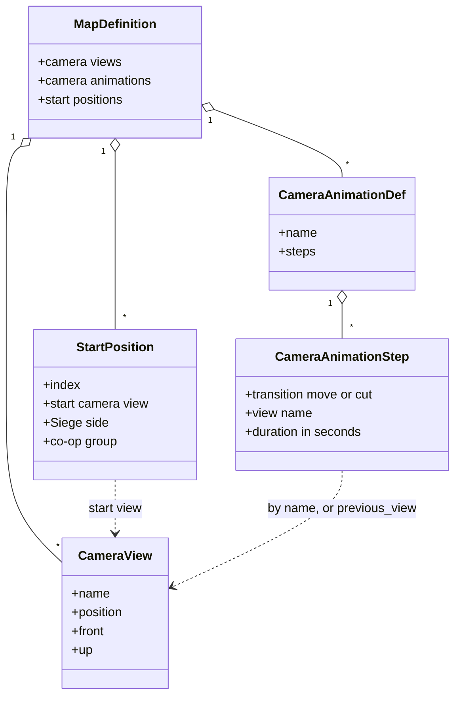
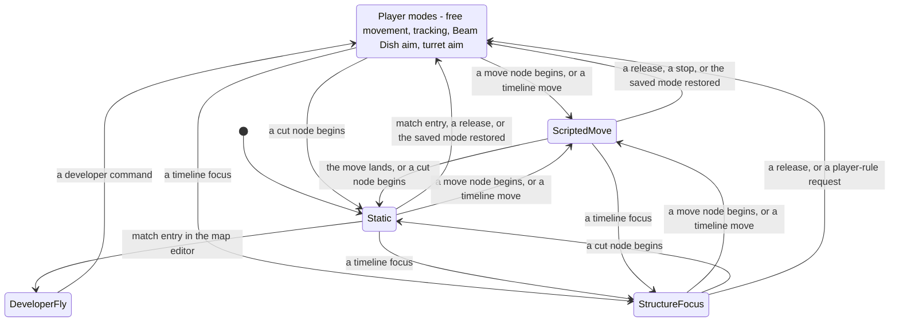
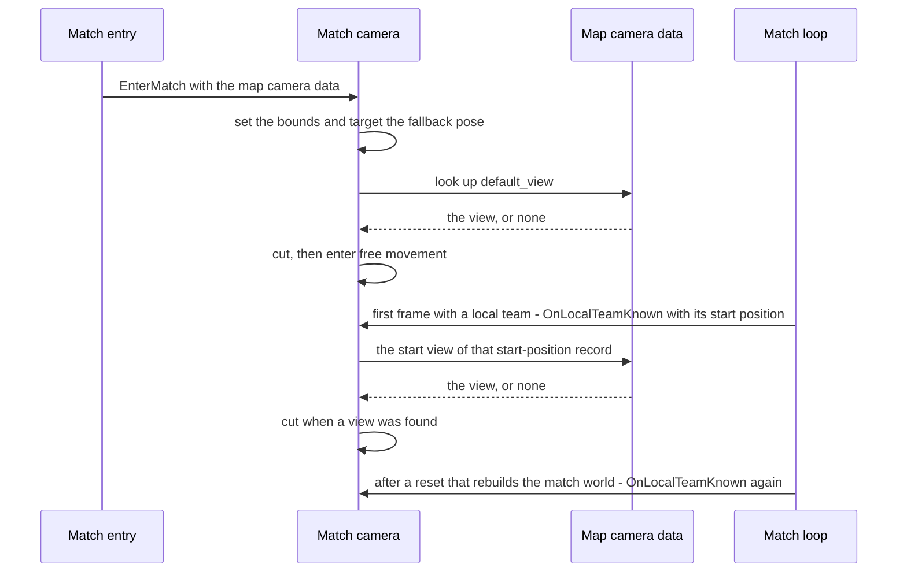
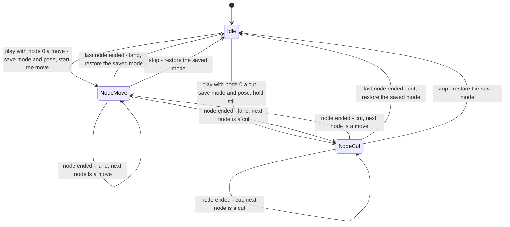

# Camera and sequences

> Status: Engine baseline · Prefix: CAM · ADRs: [ADR-016](../../ADR/ADR-016-view-projection-and-depth-conventions.md) · [ADR-036](../../ADR/ADR-036-effect-events-and-presentation-clock.md) · [ADR-074](../../ADR/ADR-074-platform-clock-with-injectable-time.md) · [ADR-052](../../ADR/ADR-052-cpp23-language-standard.md) · [ADR-056](../../ADR/ADR-056-editions-build-flavours-and-feature-flags.md) · [ADR-059](../../ADR/ADR-059-content-build-and-validators.md) · [ADR-061](../../ADR/ADR-061-data-schemas-and-versioning.md) · [ADR-062](../../ADR/ADR-062-authoring-syntax-and-schema-language.md) · [ADR-063](../../ADR/ADR-063-localisation.md) · [ADR-064](../../ADR/ADR-064-accessibility-baseline-xag.md) · [ADR-067](../../ADR/ADR-067-logging.md) · [ADR-069](../../ADR/ADR-069-test-framework.md) · Related: [Camera rules](../../reference/06_controls_camera_and_commands/camera.md) · [View, lighting and fog](renderer/view_lighting_and_fog.md) · [Map rules and conventions](../../reference/08_maps_and_level_design/rules_and_conventions.md) · [Map editor hooks](../../reference/08_maps_and_level_design/map_editor_hooks.md) · [Tutorial and help](../../reference/11_tutorial_and_help.md) · [Randomness and integrity](../../reference/12_simulation_model/07_randomness_and_integrity.md) · [Animation and VFX](animation_and_vfx/README.md) · [Input](input.md)

This component is the runtime of each participant's match camera (`MatchCamera`) and of the scripted camera sequences built on it. It executes the player-camera rules of [camera rules](../../reference/06_controls_camera_and_commands/camera.md); holds the camera views and camera animations of the loaded map; cuts the camera to the default view and the start view when a match begins; plays camera animations; provides the scripted operations that a sequence needs (the cut, the scripted move that lands exactly on its target, the approach and the structure-focus orbit); runs the developer fly mode of development builds and the map editor; and provides the camera's picking and projection services. It also specifies the presentation-timeline baseline that DEC-051 would build.

**Notation and units.**

- Distances are in world units (`wu`), in the right-handed, +Y-up world frame of ADR-016; world up is (0, 1, 0).
- Camera time is in seconds of the camera clock (CAM-030), a presentation clock. No camera duration is a simulation duration, and no simulation rule reads camera time (DEC-009).
- Fields of view are vertical and in degrees; every other angle is in radians.
- dt is the camera step of the current advance (CAM-030); lerp(a, b, k) = a + (b − a) × k; normalise(v) = v ÷ |v|; vector products are right-handed.
- `ease` is the quadratic ease-in and ease-out curve of [animation and VFX](animation_and_vfx/README.md) VFX-012: ease(f) = 2f² for f < 0.5 and 1 − 2(1 − f)² for 0.5 ≤ f ≤ 1.
- The **level up vector** of a front vector f is normalise((f × world up) × f): the up vector that keeps the view free of roll.

## 1 Responsibilities and boundaries

**CAM-001** (MUST) The component owns:

1. the camera state and the mode machine of the participant's match camera (§3.2, §4.2);
2. the per-frame camera advance, in the order of R-CTRL-456, and the camera clock (§4.1);
3. the camera views and camera animations of the loaded map as runtime data, and their look-up by name (§3.1, §4.3);
4. the start-of-match camera sequence that executes R-CTRL-495 to R-CTRL-497 (§4.7);
5. the scripted camera operations: setting a target, the cut, the scripted move, the approach and the structure focus (§4.3 to §4.6);
6. camera-animation playback (§4.8, DEC-803);
7. the developer fly mode of development builds and the map editor (§4.9);
8. the picking and projection services of the camera (§4.10);
9. the presentation-timeline baseline (§4.12, DEC-051).

**CAM-002** (MUST) The player-camera rules are those of [camera rules](../../reference/06_controls_camera_and_commands/camera.md) R-CTRL-450 to R-CTRL-497, with the `ref.ctrl.camera.*` keys of that document's tuning table: the model and conventions; the zoom, height, shake and cursor-lock components; free movement with its bounds clamp; look around; tracking; Beam Dish aim; turret aim; and the start-of-match views. This component executes those rules as written and never redefines them; where it needs one of their values it cites the key. The corrections that those rules already state are applied: one presentation clock (DEC-024), the horizontal clamp to the map bounds and the floating-point tracking distance (DEC-024, DEC-096).

**CAM-003** (MUST NOT) The camera never writes simulation state, and the simulation never reads the camera (DEC-008, R-SIM-655, R-SIM-660). The camera pose, mode, clock, the views in use and the timeline state are local to one participant: they are never sent, replicated, recorded in a replay or saved with match state, and two participants with different camera poses produce identical simulation states (AC-CTRL-CA-08). The look-around state reaches the simulation only as the `camera_tracking` field of the sender's team command state, which the match input pump fills and converts to world space before it is sent (R-SIM-440, R-SIM-661); no simulation rule reads a local camera.

**CAM-004** (MUST) The camera reads simulation state only through the read-only presentation inputs of the simulation and presentation boundary (DEC-222): the presentation snapshot of the newest tick, the extrapolation time of R-SIM-560, and the presentation events addressed to the participant's own team (R-SIM-666). How Species enforces that boundary is open (DEC-222); whatever the mechanism, the camera module includes no interface that writes simulation state, and the conformance test T18 runs the simulation with the camera and timelines replaced by stubs.

**CAM-005** (MUST NOT) The component neither owns nor changes: the projection, the near and far planes, the field-of-view clamp, the view tests, fog and lighting ([view, lighting and fog](renderer/view_lighting_and_fog.md) RND-208 to RND-236); the shake intensity, its decay and its random draws ([particles, shatter and screen effects](animation_and_vfx/particles_shatter_and_screen_effects.md) VFX-232); the map's camera-view and camera-animation records and their limits ([map rules and conventions](../../reference/08_maps_and_level_design/rules_and_conventions.md) R-MAP-125 to R-MAP-128, [data schemas](data_schemas/README.md)); the action bindings and the pointer ([input](input.md)); the UI windows and their text ([UI framework](ui_framework/README.md)).

**CAM-006** (MUST NOT) The component has no mode, operation or service for: the spherical-world orbit, the world-map focus orbit (which includes the front-end focus mode that R-META-007 names), the scripted world-map orbit, the intro and outro flights, the first-person mode, the entity-follow mode, the replay camera, the debug-advancer grace frames after a mode request, or recording and restoring a camera pose outside a camera animation (DEC-024); a script interpreter (DEC-053); a narrator, and the "best structure in view" query whose only reader is the narrator's help (DEC-052); the intro start sequence (DEC-054); or a reflected camera pose for water reflections (DEC-059).

Table 1-A Neighbours and contracts.

| Neighbour | What the camera receives | What the camera provides | What the camera never does |
|---|---|---|---|
| simulation ([reference/12](../../reference/12_simulation_model/README.md)) | the read-only presentation snapshot, the extrapolation time and the presentation events of the own team (DEC-222, R-SIM-666) | nothing | write a simulation field; feed a value back |
| match input pump and input router ([input](input.md)) | actions, the pointer, the input mode, whether a UI window is open | the control vector and the look-around state (R-CTRL-451, R-CTRL-472, R-CTRL-487); the pointer moves of the cursor lock (`InputRouter::WarpPointer`); pointer confinement while a match mode advances (`InputRouter::ConfinePointer`, R-CTRL-456) | read a device; write the team command state |
| renderer ([view, lighting and fog](renderer/view_lighting_and_fog.md)) | the frame view of the last rendered frame (RND-210 to RND-213), `ProjectToScreen` (RND-216), the fade (RND-085, RND-086) | the camera frame output (CAM-012) | build the frame's matrices; set the planes |
| animation and VFX ([README](animation_and_vfx/README.md)) | the shake rotation offset of the frame (VFX-232) | the view of the frame (VFX-003) | store the shake offset in its pose |
| terrain ([terrain](terrain.md)) | terrain height queries | nothing | change the terrain |
| UI framework ([README](ui_framework/README.md)) | caption drawing; whether a UI window is open | caption requests of a timeline (CAM-110) | lay out widgets |
| audio engine ([audio engine](audio_engine.md)) | nothing | the camera frame output, which the listener reads; the sound events of a timeline (CAM-113) | start a voice directly |
| map data ([map rules and conventions](../../reference/08_maps_and_level_design/rules_and_conventions.md), [data schemas](data_schemas/README.md)) | the validated camera views, camera animations and start-position records (DEC-560) | nothing | write a map; the map editor does (R-MAP-370) |

## 2 Interfaces

### 2.1 Interface sketch

```cpp
namespace species::camera {

enum class CameraMode : std::uint8_t {         // the order carries no meaning
  Static, ScriptedMove, FreeMovement, Tracking, BeamDishAim, TurretAim,
  StructureFocus, DeveloperFly,
};

enum class CameraTransition : std::uint8_t { Move, Cut };   // authoring order only

struct CameraPose { Vec3 position; Vec3 front; Vec3 up; };  // front and up are unit vectors

struct CameraView {                             // a map's camera view record (R-MAP-125)
  std::string name;
  CameraPose pose;                              // front and up normalised at load, not orthogonalised
};

struct CameraAnimationStep {                    // one node of a camera animation (R-MAP-127)
  CameraTransition transition;
  std::string view;                             // a view of the map, or previous_view
  float durationSeconds;                        // camera clock, [0, ref.map.camera.animation_duration_max_s)
};

struct CameraAnimationDef {
  std::string name;
  std::vector<CameraAnimationStep> steps;       // may be empty; an empty animation never plays
};

struct MapCameraData {                          // built once at match entry (CAM-014)
  std::vector<CameraView> views;                // record order
  std::vector<CameraAnimationDef> animations;   // record order
  std::vector<std::optional<std::size_t>> startViews;   // index: start position (DEC-560)
  float worldSizeX;                             // wu
};

struct CameraFrameInputs {
  double realNow;                               // platform clock, seconds (ADR-074)
  const PresentationSnapshot* snapshot;         // DEC-222; null without a match world
  float extrapolationSeconds;                   // R-SIM-560
  const InputRouter* input;                     // actions, pointer, input mode
  bool uiWindowOpen;
  bool editing;                                 // the map-editor loop runs
  const TerrainField* terrain;                  // height queries; null without terrain
};

struct CameraFrameOutput {                      // read by the renderer, the listener and the overlays
  CameraPose pose;                              // the stored pose with the shake offset applied (CAM-012)
  float fovYDegrees;                            // before the renderer's clamp (RND-212)
  Vec3 velocity;                                // wu/s
};

struct PickRay { Vec3 origin; Vec3 direction; };   // origin on the near plane; unit direction

class MatchCamera {
public:
  // Lifecycle (§4.7)
  void EnterMatch(const MapCameraData& map, bool editing);
  void OnLocalTeamKnown(std::uint8_t startPosition);
  void LeaveMatch();

  // Per frame (§4.1): frame thread, once per rendered frame while the window has focus
  void Advance(const CameraFrameInputs& in);
  [[nodiscard]] CameraFrameOutput FrameOutput(const ShakeOffset& shake) const;

  // Targets and scripted operations (§4.3 to §4.6)
  bool SetTargetView(std::string_view name);                  // without regard to case; previous_view
  void SetTargetPose(const Vec3& position, const Vec3& front); // up: the level up vector
  void SetTargetPose(const CameraPose& pose);
  void SetTargetAround(const Vec3& focus, float distance, float height);
  void Cut();
  void StartMove(float durationSeconds);
  void FocusStructure(SimObjectId structure, float range, float height);
  void EnterMode(CameraMode mode);
  void ReleaseToPlayer();                                      // stops an animation, enters free movement
  void SetFieldOfView(float degrees);                          // at once
  void SetTargetFieldOfView(float degrees);                    // eased by the zoom component (R-CTRL-460)

  // Camera animations (§4.8)
  bool PlayCameraAnimation(std::string_view name);
  void StopCameraAnimation();
  [[nodiscard]] bool IsBusy() const;                           // an animation plays or a scripted move runs

  // Picking and projection (§4.10)
  [[nodiscard]] PickRay PickRayAt(Vec2 pointerPx, const render::FrameView& view) const;
  [[nodiscard]] Mat4 ViewProjectionFor(const CameraPose& pose, const render::FrameView& view) const;

  [[nodiscard]] const CameraState& State() const;             // read-only: overlays and tests
};

}  // namespace species::camera

namespace species::sequence {

enum class TimelineOp : std::uint8_t {          // the closed set of table 3.3-A, in its order
  Wait, WaitCamera, WaitFade, WaitCondition,
  CameraCut, CameraMove, CameraApproach, CameraFocus, CameraAnimation, CameraFov, CameraRelease,
  Caption, Fade, Overlay, Sound, PermitAbort,
};

struct TimelineStatement { TimelineOp op; StatementArgs args; SourceLocation where; };
struct PresentationTimeline { std::string id; std::vector<TimelineStatement> statements; };

class TimelinePlayer {
public:
  void Start(const PresentationTimeline& timeline);           // CAM-108
  void Advance(const TimelineFrameInputs& in, camera::MatchCamera& camera);   // before the camera (CAM-103)
  void Abort();                                                // CAM-106
  [[nodiscard]] bool IsRunning() const;
};

}  // namespace species::sequence
```

### 2.2 Threading contract, inputs and outputs

**CAM-010** (MUST) Every call of `MatchCamera` and `TimelinePlayer` runs on the frame thread, which is the main thread of the frame loop (R-SIM-581). The component has no thread, no lock and no asynchronous work. The presentation snapshot, the frame view and the map camera data are read-only for the duration of a call.

**CAM-011** (MUST) An advance reads only its `CameraFrameInputs`, the camera's own state and the map camera data: the platform clock reading, the presentation snapshot (positions, velocities and centres of actors and structures, the local team's selection and current Power), the extrapolation time, the actions and pointer of the participant's input router, the UI-window state, whether the map editor runs, and terrain heights. It reads no other clock, device or global state (ADR-074).

**CAM-012** (MUST) `FrameOutput` returns the stored pose with the frame's shake offset applied and the stored pose itself unchanged: the front is turned by the offset's yaw about the world vertical, the up vector is rolled about the front by the offset's roll, and both are re-orthogonalised (VFX-232, ADR-036). This realises step 5 of R-CTRL-456 and the shake of R-CTRL-463 as the additive view offset of ADR-036; the shake never accumulates in the camera's pose. The field of view is passed unclamped; the renderer clamps it (RND-212) and sets the planes (RND-211).

**CAM-013** (MUST) Camera requests that the player rules attach to simulation events reach the camera as presentation events of the participant's own team, consumed in tick order before the next advance (R-SIM-666, DEC-007): for example, the request to enter turret aim when the own team selects one of its turrets (R-SIM-405 step 6). A request about another participant's team never reaches this camera. Shake requests go to the screen effects of VFX-232, not to the camera.

**CAM-014** (MUST) At match entry the camera receives `MapCameraData`, built once from the validated map definition: the camera views and the camera animations in record order, the camera view of each start-position record by start position (DEC-560, R-MAP-042), and the world size x of the terrain definition. The record schemas are those of [data schemas](data_schemas/README.md) (ADR-061), and the content build has already validated their names, references and durations (ADR-059, DEC-015, DEC-801). The camera never parses authoring text.

**CAM-015** (MUST) In each frame the camera provides its control vector (R-CTRL-451, R-CTRL-487) and its looking-around and tracking state (R-CTRL-472) to the match input pump, which converts every camera-relative quantity to world space before it enters the team command state (R-SIM-440, DEC-008). The camera never writes the team command state.

**CAM-016** (MUST) The camera emits no event to the simulation and no event that changes a game outcome. Its only outputs are the frame output (CAM-012), the values of CAM-015, the pointer requests of Table 1-A and development diagnostics (§6).

## 3 Data model

### 3.1 Camera views and camera animations



Caption: Diagram 3.1-A, the camera records of a map definition and their references (CAM-020 to CAM-022; R-MAP-042, R-MAP-125 to R-MAP-127; DEC-560).

**CAM-020** (MUST) The camera records have the fields and rules of table 3.1-A. Every limit is the map document's key; the content build rejects a record that breaks a rule (DEC-015), so the camera never meets an invalid record at run time.

Table 3.1-A Camera record fields.

| Record | Field | Rule |
|---|---|---|
| camera view | name | at most `ref.map.camera.view_name_max_chars` characters; looked up without regard to case (R-MAP-125) |
| | position | wu, world frame |
| | front, up | normalised at load and not orthogonalised; the camera re-orthonormalises a pose when it adopts it (CAM-034); a zero-length vector is a content-build error |
| camera animation | name | the same length limit as a view name; looked up without regard to case |
| | nodes | ordered; zero or more |
| node | transition | move or cut; any other word is a content-build error |
| | view | a camera view defined in the map before the animation, or `previous_view` (R-MAP-127) |
| | duration | 0 ≤ d < `ref.map.camera.animation_duration_max_s`, in seconds of the camera clock |

**CAM-021** (MUST) The reserved view names are those of R-MAP-126. The camera resolves a start view through the start-position record of the start position (DEC-560), whose content the reserved name `spawn_view_<n>` provides (R-MAP-042); `default_view` by name (CAM-060); and `previous_view` as the pose that the most recent play request saved (CAM-065), which is never a map record.

**CAM-022** (MUST) Every map writer writes every camera view and every camera animation that the map holds, losslessly, including the node order, the transitions, the view names and the durations, so a round trip through the map editor keeps them (DEC-800, R-MAP-388).

### 3.2 Camera state

**CAM-023** (MUST) The camera state is that of table 3.2-A. The fields of the player rules are those of R-CTRL-452; this component adds the clock and the state of the scripted operations.

Table 3.2-A Camera state.

| State | Content | Rules |
|---|---|---|
| pose | position (wu), unit front, unit up | R-CTRL-451, R-CTRL-452, CAM-034 |
| target | target point (wu), target front, target up | CAM-040 to CAM-042 |
| height | the wanted absolute y of free movement and the height parameter of the aim modes | R-CTRL-452, R-CTRL-461, CAM-042 |
| field of view | current and target vertical field of view (degrees) | R-CTRL-460 |
| mode | one of table 4.2-A | CAM-036 |
| velocity | wu/s | R-CTRL-471 |
| bounds | the horizontal clamp of free movement | R-CTRL-471, CAM-060 |
| camera clock | seconds since the camera was created | CAM-030 |
| scripted move | start pose, start time, duration | CAM-045 |
| animation | the current animation or none, node index, node start time, the saved mode and the saved pose | CAM-065 |
| structure focus | structure handle, signed range, height, track vector, request time, last centre | CAM-056 |
| tracking | tracking distance, the last and wanted positions, the 10-sample history, the camera target, the orbit centre, the reset flag | R-CTRL-482 to R-CTRL-488, CAM-038 |
| map camera data | the views, animations and start views of the match, and the name index | CAM-014, CAM-121 |

**CAM-024** (MUST) The match camera lives as long as the process ([match lifecycle](../../reference/12_simulation_model/02_match_lifecycle_and_state_reset.md), the process row of its lifetime table). The map camera data and the scripted-move, animation, structure-focus and timeline state belong to one match: `EnterMatch` replaces them and `LeaveMatch` clears them, so none of them survives a match. The pose, the field of view and the mode persist until something sets them, and the camera clock is never reset.

### 3.3 Presentation timelines

**CAM-025** (MUST) A presentation timeline is a record of its own schema in [data schemas](data_schemas/README.md) (ADR-061): an id and an ordered list of statements, each with a kind of table 3.3-A, its typed arguments and the source location of its authoring line. A timeline names structures by role tag, never by a fixed structure id or team (DEC-103), and names text by string id (ADR-063).

Table 3.3-A Timeline statements. The order is the order of `TimelineOp`; it carries no meaning.

| # | Statement | Arguments | Blocks | Effect |
|---|---|---|---|---|
| 1 | Wait | seconds s ≥ 0 | until s seconds of the camera clock have passed | none (CAM-104) |
| 2 | WaitCamera | — | while the camera is busy (CAM-069) | none |
| 3 | WaitFade | — | until the renderer's fade is complete (RND-086) | none |
| 4 | WaitCondition | condition id | until the condition holds | none |
| 5 | CameraCut | view name | no | target the view and cut (CAM-109) |
| 6 | CameraMove | view name, seconds | no | target the view and start a scripted move |
| 7 | CameraApproach | role tag, distance (wu), height (wu), seconds | no | the approach of CAM-054 |
| 8 | CameraFocus | role tag, signed range (wu), height (wu) | no | the structure focus of CAM-056 |
| 9 | CameraAnimation | animation name | no | play the camera animation (CAM-065) |
| 10 | CameraFov | degrees, immediate flag | no | set the field of view or its target |
| 11 | CameraRelease | — | no | stop the animation and enter free movement |
| 12 | Caption | string id, reveal rate (characters per second), cursor flag, layout id, display seconds | no | show a caption (CAM-110) |
| 13 | Fade | out; or in, with a delay in seconds | no | start the renderer's fade (CAM-111) |
| 14 | Overlay | overlay effect id, on or off | no | switch an overlay effect (CAM-112) |
| 15 | Sound | sound event id | no | raise a sound event (CAM-113) |
| 16 | PermitAbort | on or off | no | allow or forbid the abort (CAM-106) |

## 4 Behaviour and algorithms

### 4.1 Camera clock and the frame advance

**CAM-030** (MUST) The camera clock is the one presentation clock of all camera motion (DEC-024). It starts at 0 when the camera is created and, at the start of each camera advance, advances by the camera step dt: the real time since the previous frame from the platform clock (ADR-074, R-SIM-573), clamped to `ref.sim.frame.delta_clamp`, which is the presentation frame delta of R-SIM-570. Game speed never scales it, and it keeps advancing while the world is held, so the camera stays live during a pause (R-SIM-571). The scripted-move progress, the animation node timers, the structure-focus oscillations and the timeline waits all read this clock; no camera mode keeps a timer of its own, and no camera code reads another clock (R-CTRL-453).

**CAM-031** (MUST) The camera clock advances only when the camera advances. While the window has no focus, or while the camera is not advanced (the front end), neither the clock nor any camera timer moves, and a scripted move, a camera animation or a timeline resumes where it stood. The first step after such a gap is the clamped frame step, never the length of the gap.

**CAM-032** (MUST) `Advance` runs once per rendered frame, only while the application window has focus and, in gamepad mode, while the gamepad is connected (R-CTRL-453): in the match loop at step 11.9 of R-SIM-581, and in the map-editor loop at its camera step (R-MAP-309). The camera is not advanced in the front end (R-CTRL-453): there the backdrop of R-META-210 sets the camera's view directly in every frame, and replaces whatever pose an advance would produce.

**CAM-033** (MUST) Each advance runs the steps of R-CTRL-456 in that order. Within them:

1. step 1, "the scripted camera move, when one is playing", is the animation advance of CAM-067, and runs whenever a camera animation plays;
2. step 2, the zoom component (R-CTRL-460), uses the rate class that table 4.2-A gives for the current mode;
3. step 3, the height component (R-CTRL-461), runs only in the modes that table 4.2-A marks;
4. step 4 runs the advancer of the current mode: the player modes by R-CTRL-470 to R-CTRL-492, the scripted move by CAM-046, the structure focus by CAM-057 and the developer fly mode by CAM-081; the static mode has no advancer; the match modes run only while the terrain exists (R-CTRL-456);
5. step 5, the shake, is applied to the frame output only (CAM-012);
6. step 6 re-orthonormalises front and up (CAM-034), and step 7 recomputes the pointer ground point ([actions and bindings](../../reference/06_controls_camera_and_commands/actions_and_bindings.md) R-CTRL-058).

**CAM-034** (MUST) Re-orthonormalisation: front := normalise(front); right := normalise(front × up); up := right × front. When front × up has zero length, the up vector becomes the level up vector of the front; when the front is also parallel to world up, the previous frame's up vector, re-orthogonalised against the front, is kept.

**CAM-035** (MUST) `EnterMode` sets the mode at once and runs the new mode's entry actions (R-CTRL-470, R-CTRL-482, R-CTRL-490, R-CTRL-491, CAM-045, CAM-056). The new mode's advancer runs first in step 4 of the next advance after the request; a mode entered by the animation advance in step 1 therefore advances in step 4 of the same frame, and a mode entered by a mode advancer in step 4 advances from the next frame (R-CTRL-456).

### 4.2 Modes

**CAM-036** (MUST) The camera modes are those of table 4.2-A. The first six are the live modes of R-CTRL-457, of which free movement, tracking, Beam Dish aim and turret aim are the player modes; this component adds the structure focus and the developer fly mode. The scripted move, the structure focus and the developer fly mode are reachable only as the last column states.

Table 4.2-A Camera modes.

| Mode | Rules | Entered by | Zoom rate class (R-CTRL-460) | Height component | Reachable |
|---|---|---|---|---|---|
| static | no advancer; the camera holds its pose | camera creation (R-CTRL-452); a move that lands (CAM-046); a cut node beginning (CAM-066) | static and scripted move | no | in every match, as R-CTRL-457 states |
| scripted move | CAM-045 to CAM-050 | a move node beginning (CAM-066); a timeline (table 3.3-A rows 6 and 7) | static and scripted move | no | only through a camera animation or a timeline, which no match path starts (DEC-803, DEC-051) |
| free movement | R-CTRL-470 to R-CTRL-473 | table 2.2-A of R-CTRL-457; match entry (CAM-060); a release (CAM-109) | normal | yes | in every match |
| tracking | R-CTRL-480 to R-CTRL-488 | table 2.2-A of R-CTRL-457 | not run | runs without effect on the position | in every match |
| Beam Dish aim | R-CTRL-490 | table 2.2-A of R-CTRL-457 | normal | yes, clamped | in every match |
| turret aim | R-CTRL-491 | table 2.2-A of R-CTRL-457; the turret-aim presentation event (CAM-013) | normal | yes, clamped | in every match |
| structure focus | CAM-056 to CAM-058 | a timeline (table 3.3-A row 8) | static and scripted move | no | only through a timeline (DEC-051) |
| developer fly | CAM-080 to CAM-084 | match entry in the map editor (CAM-060); a developer command | normal | no | development builds and the map editor (CAM-080) |

**CAM-037** (MUST) A mode request that the player rules make outside a mode advancer, such as entering an aim mode on a selection or free movement on a deselect, is applied whatever the current mode, including during a scripted move, a structure focus or a camera animation (CAM-035). A camera animation that plays keeps its node timer, and at its next node end it requests the next node's mode (CAM-067).

**CAM-038** (MUST) Tracking keeps, as camera state, the orbit centre of R-CTRL-485 and R-CTRL-488. When the tracked entity changes from a Strike team to a Leader or a Transport, the centre keeps its last value, which is the last Strike team position or the origin (R-CTRL-488). This is the reference default of DEC-310; its option B recomputes the centre whenever the tracked entity changes and touches only this state.



Caption: Diagram 4.2-A, the camera modes; the transitions among the player modes are those of [camera rules](../../reference/06_controls_camera_and_commands/camera.md) diagram 3-A (CAM-035 to CAM-038).

### 4.3 Targets and cuts

**CAM-040** (MUST) The camera target is a target point (wu), a target front and a target up. `SetTargetView(name)` resolves the name: `previous_view` resolves to the pose saved by the most recent play request (CAM-065), once one has been made; any other name resolves to the first camera view of the match's map, in record order, whose name equals it without regard to case. When the name resolves, the target becomes that pose and the call returns true. Otherwise the target is unchanged and the call returns false; nothing else happens, in particular no error and no mode change.

**CAM-041** (MUST) `SetTargetPose(position, front)` sets the target point to the position, the target front to normalise(front) and the target up to the level up vector of that front. `SetTargetPose(pose)` sets all three from the pose. The fallback pose of match entry uses the first form (CAM-060).

**CAM-042** (MUST) `Cut()` makes the pose the target at once: position := target point, front := target front, up := target up and height := the target point's y; front and up are then re-orthonormalised (CAM-034). A cut changes neither the mode nor the field of view.

### 4.4 Scripted move

**CAM-045** (MUST) `StartMove(T)`, with a duration T ≥ 0 seconds, records the start pose (the current position, front and up), the start time (the camera clock now) and T, and enters the scripted-move mode (CAM-035). The move goes to the target set before the call (CAM-040, CAM-041, CAM-053). `EnterMode(ScriptedMove)` without a duration, as the restoring of a saved mode does (CAM-067, CAM-068), starts a move from the current pose to the current target with the duration that `StartMove` last recorded; `EnterMode(StructureFocus)` keeps the recorded structure, range and height and runs the entry actions of CAM-056 again.

**CAM-046** (MUST) Each advance in the scripted-move mode, with f = (now − start time) ÷ T, or f = 1 when T = 0:

1. when f ≥ 1, the move **lands**: position, front and up become the target exactly, height := the target point's y, front and up are re-orthonormalised (CAM-034), and the mode becomes static (CAM-035);
2. otherwise, with a = ease(f): position := start position + (target point − start position) × a, and the orientation is the spherical interpolation from the start orientation towards the target orientation by a (CAM-048), from which front and up are read.

**CAM-047** (MUST) The move therefore lands exactly on its target and never overshoots (DEC-024): every intermediate position lies on the segment from the start position to the target point, and its distance from the start never decreases. With D = |target point − start position|, the speed along the segment rises linearly from 0 to 2 × D ÷ T at f = 0.5 and falls linearly to 0 at f = 1, which is the triangular speed profile of the reference move. A move of duration 0 lands at its first advance.

**CAM-048** (MUST) Each orientation is the unit quaternion of the orthonormal frame that CAM-034 builds from its front and up. With q0 the start quaternion and q1 the target quaternion, q1 is negated when q0 · q1 < 0, so the shorter rotation is taken. When q0 · q1 > `cam.move.nlerp_threshold` (0.9995), the result is normalise(q0 × (1 − a) + q1 × a); otherwise it is (sin((1 − a) × θ) × q0 + sin(a × θ) × q1) ÷ sin θ, with cos θ = q0 · q1. The roll is interpolated with the rest of the orientation, so the camera lands with the target's up vector.

**CAM-049** (MUST) During a scripted move the zoom component runs at rate 1 of `ref.ctrl.camera.zoom_rates` (R-CTRL-460), so a change of the target field of view made during the move eases with a time constant of 10 s (DEC-024). The move itself does not change the field of view.

**CAM-050** (MUST NOT) The move does not follow the reference move law, which DEC-024 replaces. In the reference law the progress is measured on a clock other than the frame step and is floored at `cam.move.reference_progress_floor` (0.2); the position integrates the triangular speed profile frame by frame from that floored progress and is never snapped, so the camera travels `cam.move.reference_overshoot` (1.04 to 1.08 times) the start-to-target distance along the straight line and stops past the target; the front blends from the start front to a midpoint front, which is the start front rotated about start front × target front by half the length of that product (half the sine of the angle between the fronts, an approximation of half the angle), and from there to the target front, each blend normalised and driven by ease; the up vector is forced to world up in every frame; and at the end only the front is set to the target front, so a move of duration 0 snaps only the orientation.

### 4.5 Approach

**CAM-053** (MUST) `SetTargetAround(focus, d, h)` targets a pose at distance d from the focus on the camera's current bearing, h above the focus and looking at it:

1. dir := normalise(position − focus), the three-dimensional direction from the focus to the camera;
2. target point := focus + dir × d, and then its y := the focus's y + h;
3. target front := normalise(focus − target point);
4. target up := the level up vector of the target front.

The horizontal distance from the focus is therefore d × the horizontal length of dir, which is less than d when the camera is above or below the focus.

**CAM-054** (MUST) The approach to a structure is `SetTargetAround(c, d, h)` with c the structure's centre position from the presentation snapshot at the call, followed by `StartMove(T)`: a scripted move that lands on that pose (table 3.3-A row 7).

### 4.6 Structure focus

**CAM-056** (MUST) `FocusStructure(s, r, h)`, with a structure handle s, a signed range r (wu) and a height h (wu), records s, r, h and the request time (the camera clock now), sets the track vector to the horizontal unit vector from the structure's centre towards the camera position, sets the target field of view to `cam.focus.fov` (60°), and enters the structure-focus mode.

**CAM-057** (MUST) Each advance in the structure-focus mode, with c the structure's centre position, t the camera clock now and τ = t − the request time, runs these steps in this order:

1. the track vector turns about the world y axis by `cam.focus.orbit_rate` × dt (−0.15 rad/s, a negative angle in the right-handed frame);
2. radius := |r| × (1 + 0.3 × sin(0.3 × t)) by `cam.focus.radius_wave`, and orbit height := h × (1 + 0.5 × sin(0.3 × t)) by `cam.focus.height_wave`;
3. goal := c + track vector × radius, and then goal y := c's y + orbit height;
4. m := min(1, τ ÷ `cam.focus.ramp_time`);
5. while τ < `cam.focus.lift_time` (2 s): goal y := max(goal y, min(goal y + `cam.focus.lift_factor` (0.75) × |position − goal| × (`cam.focus.lift_time` − τ), `cam.focus.lift_ceiling` (y = 1000 wu))), a lift that starts high and settles over the first 2 s without ever lowering the goal;
6. position := lerp(position, goal, `cam.focus.position_rate` (0.5) × m × dt);
7. wanted := normalise(c − position); when r < 0, its x and z components are negated, so the camera looks away from the structure;
8. front := normalise(lerp(front, wanted, `cam.focus.front_rate` (1) × m × dt)), and up := the level up vector of the new front;
9. position y := max(position y, the terrain height under the camera + `cam.focus.min_clearance` (10 wu)).

**CAM-058** (MUST) The structure focus never ends on its own. It lasts until another mode is entered: by a timeline statement, a release, a node of a camera animation or a request of the player rules (CAM-037). While it lasts, the zoom component eases the field of view towards `cam.focus.fov` at the rate of the static and scripted-move modes (table 4.2-A).

### 4.7 Start-of-match camera

**CAM-060** (MUST) `EnterMatch` executes the camera part of match entry ([match lifecycle](../../reference/12_simulation_model/02_match_lifecycle_and_state_reset.md) R-SIM-014 steps 8 and 9; R-MAP-048; R-CTRL-496) in this order:

1. the match's map camera data replaces the previous one, and every scripted-move, animation, structure-focus and timeline state is cleared;
2. the bounds become [−`ref.sim.match_entry.camera_border`, world size x + `ref.sim.match_entry.camera_border`] on both horizontal axes, the world size x serving for z as well (DEC-024, DEC-096);
3. the target becomes the fallback pose: `SetTargetPose`((world size x, `ref.sim.match_entry.fallback_camera_height`, world size x), `ref.sim.match_entry.fallback_camera_direction`) (CAM-041);
4. `SetTargetView("default_view")`; without that view the fallback target stays;
5. `Cut()`;
6. outside the map editor, the camera enters free movement (R-SIM-014 step 9); in the map editor it enters the developer fly mode (R-MAP-309, CAM-080).

**CAM-061** (MUST) `OnLocalTeamKnown(n)` runs in the first frame of the match loop in which the local team exists, and again after every reset that rebuilds the match world (R-CTRL-497). It targets the camera view of the start-position record of start position n, the team's start position (DEC-560, R-SIM-418), and cuts to it (CAM-042). The mode is not changed, so free movement continues from the new pose. When the record names no camera view that the map holds, nothing happens, and the camera keeps the default view or the fallback pose. Every match start therefore cuts to the default view and then to the player's own view (DEC-024).

**CAM-062** (MUST) In the map editor the editor loop replaces the match loop (R-MAP-309), so `OnLocalTeamKnown` is never called and no start-view cut happens.

**CAM-063** (MUST) `LeaveMatch` stops any camera animation, scripted move, structure focus and timeline and clears the map camera data. The front end then sets its own view (R-META-007, R-META-210); the camera is not advanced there (CAM-032).



Caption: Diagram 4.7-A, the start-of-match camera sequence (CAM-060 to CAM-062; R-CTRL-495 to R-CTRL-497).

### 4.8 Camera animation playback

**CAM-065** (MUST) `PlayCameraAnimation(name)` looks the animation up: the first camera animation of the match's map, in record order, whose name equals the name without regard to case. An animation that is not found, or that has no nodes, is not played, and the call returns false. Otherwise the camera, in this order: saves its current mode and its current pose (the saved pose is the pose that `previous_view` names); makes the animation the current one, with node index 0 and the node start time set to the camera clock now; and begins node 0 (CAM-066). One camera animation plays at a time (DEC-803): a play request while another animation plays replaces it, and the mode and pose saved are those current at the new request.

**CAM-066** (MUST) Beginning a node: `SetTargetView(the node's view)`, where a view that does not resolve leaves the previous target in place (CAM-040); then, for a move node, `StartMove(the node's duration)`; for a cut node, the static mode, so the camera holds its pose.

**CAM-067** (MUST) In step 1 of each advance, while a camera animation plays, the current node ends when the camera clock now − the node start time is strictly greater than the node's duration. When it ends:

1. if the node is a cut node, `Cut()`: a cut node holds the previous pose for its duration and then jumps to its view; if it is a move node and its move is still the current scripted move, the move lands (CAM-046 step 1);
2. the node index increases by 1;
3. if a node remains, the node start time := now and that node begins (CAM-066); otherwise the saved mode is entered, with its entry actions (CAM-035), and the animation is no longer current.

At most one node ends per advance.

**CAM-068** (MUST) `StopCameraAnimation()`, while an animation plays, enters the saved mode and makes the animation no longer current; a move under way stops where it is, without landing. Without a playing animation it does nothing.

**CAM-069** (MUST) `IsBusy()` is true while a camera animation plays or while the mode is the scripted move. It is the condition that a sequence waiting for the camera waits on (DEC-803, table 3.3-A row 2).

**CAM-070** (MUST) A node's timer restarts at the advance in which the previous node ended, so each node lasts its duration plus at most one camera step, and the excess is not carried into the next node. A move node's move and its timer start together on the same clock, and a move still under way when its node ends lands at that moment (CAM-067 step 1), so every move node ends exactly on its view (DEC-024, DEC-803).

**CAM-071** (MUST) No match path plays a camera animation, and no reference map holds one (R-MAP-127): the capability exists in this component and in the map format with no content that uses it, which is the default of DEC-803. Its callers are a presentation timeline (table 3.3-A row 9, DEC-051) and the map editor's preview and stop operations (R-MAP-371). Under option B of DEC-803, the playback of this section and the animation records are removed together; under option C, a match-start camera sweep plays before the cut of CAM-061.



Caption: Diagram 4.8-A, the camera-animation playback state machine (CAM-065 to CAM-070, DEC-803).

```text
PlayCameraAnimation(name):
    anim := first animation whose name equals name, ignoring case
    if anim is none or anim.steps is empty: return false
    savedMode := mode; savedPose := pose               # what previous_view names
    current := anim; index := 0; nodeStart := clock
    BeginNode(anim.steps[0]); return true

BeginNode(step):
    SetTargetView(step.view)                            # the target is unchanged when it does not resolve
    if step.transition = Move: StartMove(step.durationSeconds)
    else: EnterMode(Static)

AnimationAdvance():                                     # step 1 of every camera advance
    if current is none: return
    step := current.steps[index]
    if clock - nodeStart <= step.durationSeconds: return
    if step.transition = Cut: Cut()
    else if mode = ScriptedMove and the move is this node's: Land()
    index := index + 1
    if index < size(current.steps):
        nodeStart := clock; BeginNode(current.steps[index])
    else:
        EnterMode(savedMode); current := none

StopCameraAnimation():
    if current is not none: EnterMode(savedMode); current := none
```

Caption: Listing 4.8-B, camera-animation playback (CAM-065 to CAM-068).

### 4.9 Developer fly mode

**CAM-080** (MUST) The developer fly mode exists only in builds of the `Debug` and `Development` flavours, which compile in developer commands (ADR-056), and in the map editor, whose session runs the camera in it (R-MAP-309, CAM-060). It is a developer tool, not a player-camera mode: the live modes of R-CTRL-457 are unchanged, and no player build reaches it. It advances only while a match world exists.

**CAM-081** (MUST) Each advance in the developer fly mode moves the camera at the speed v = world size x ÷ `cam.developer.speed_divisor` (30) per second, × `cam.developer.fast_factor` (10) while `action.debug.camera_fast` is held, and × `cam.developer.slow_factor` (0.1) while `action.debug.camera_slow` is held; both factors apply when both actions are held. The six camera movement actions give the direction, only while no UI window is open or while the map editor runs: `action.camera.pan_left` along the camera's left vector, `action.camera.pan_right` along its right vector, `action.camera.raise` along its up vector, `action.camera.lower` against it, `action.camera.pan_forward` along its front and `action.camera.pan_back` against it. The position changes by the sum of the held directions × v × dt.

**CAM-082** (MUST) While `action.debug.camera_rotate` is held, a pointer movement of (dx, dy) pixels in the frame turns the camera by a yaw of −`cam.developer.rotate_rate` × dx about the world vertical and a pitch of −`cam.developer.rotate_rate` × dy about its right vector (0.005 rad per pixel each); front and up are then re-orthonormalised (CAM-034).

**CAM-083** (MUST) In the map editor the developer fly mode sets the target field of view to `cam.developer.editor_fov` (60°) in every advance, and the zoom component eases towards it at its normal rate (R-CTRL-460). The mode applies no height component, no cursor lock and no bounds clamp.

**CAM-084** (MUST) The default bindings of `action.debug.camera_fast`, `action.debug.camera_slow` and `action.debug.camera_rotate` belong to the [input](input.md) component; in the reference the slow-down and the rotation are both on the secondary pointer button.

### 4.10 Picking and projection

**CAM-090** (MUST) `PickRayAt(p, view)` returns the ray from the camera through the pointer position p, in pixels of the 2-D overlay space with its origin at the top-left corner and y growing downwards (RND-215), for the frame view of the last rendered frame (RND-218, ADR-016). With W × H the render size, the pointer maps to the normalised device point x = 2 × pₓ ÷ W − 1 and y = 1 − 2 × (p_y + `cam.pick.row_offset`) ÷ H, so the ray passes through the lower-left corner of the pointer's pixel, as in the reference. The ray's origin is that point unprojected at the near plane (reversed-Z depth 1), and its direction is normalise(the point unprojected at the far plane (depth 0) − the origin), both through the inverse of the frame view's view-projection matrix.

**CAM-091** (MUST) The ray uses the frame view that the renderer last built. When the camera supplied a degenerate front or up vector, the renderer kept the previous valid view ([view, lighting and fog](renderer/view_lighting_and_fog.md) §6, RND-213), and the ray uses that view.

**CAM-092** (MUST) The screen position of a world point is the renderer's `ProjectToScreen` (RND-216), which uses the frame's cached view-projection matrix. Where a rule must project with the camera's pose inside one advance, before and after the camera moves (the cursor lock of R-CTRL-464), it uses `ViewProjectionFor(pose, view)`: the view matrix built from that pose by RND-213 and the projection of the frame view by RND-210 to RND-212, mapped to pixels as RND-216 maps them.

**CAM-093** (MUST) One screen-to-world helper serves the cursor, unit selection and the camera (ADR-016): the pointer ground point of R-CTRL-058, the selection picking of [actions and bindings](../../reference/06_controls_camera_and_commands/actions_and_bindings.md) and the map editor's pick ray (R-MAP-321) all use `PickRayAt`.

### 4.11 Precision and world scale

**CAM-095** (MUST) The camera is specified for arena maps: its positions are world coordinates within the map's extent and the camera border, binary32 is precise enough for them (DEC-247 item 9), and every bound derives from the map's world size (CAM-060). A world larger than an arena (DEC-247) needs camera-relative coordinates for rendering once it extends beyond a few tens of thousands of wu (DEC-247 item 9, DEC-240) and a strategic zoom over a coarse terrain representation (DEC-247 item 12). The reference has neither, and both are design-phase inputs (§8.3).

### 4.12 Presentation timeline baseline

**CAM-100** (MUST) A presentation timeline exists only if the design phase adopts option A of DEC-051. Until then no match path runs a timeline, which is the reference behaviour: the reference has no script, cut-scene or narrator (DEC-053, DEC-052), its tutorials use the start-of-match camera of every match (R-TUT-001), and its only scripted camera operations in a match are the cuts of §4.7. The rules of this section are the baseline that such a timeline follows.

**CAM-101** (MUST NOT) A timeline is presentation, not a gameplay script. It never changes the world, the match rules, a team or an option, and it never issues a player command. An effect that changes the world, such as a tutorial inserting a Supply crate, is a sequenced simulation event at a tick (DEC-103), never a timeline statement (R-SIM-660). Camera moves, captions, fades, overlays and sounds stay local to the participant.

**CAM-102** (MUST) A timeline is data: an ordered list of the typed statements of table 3.3-A, written in the authoring syntax of ADR-062 against the schema of ADR-061. The content build validates every timeline as a whole before it ships (ADR-059, DEC-015): an unknown statement, a missing or mistyped argument, a negative duration, and a reference to a camera view, camera animation, role tag, string id, overlay effect, sound event or condition that the maps and data using the timeline do not hold are build errors that name the file and the line. A runtime loader never parses authoring text and never meets an invalid timeline.

**CAM-103** (MUST) A running timeline advances once per rendered frame, before the camera advance (between steps 11.8 and 11.9 of R-SIM-581), so the camera statements of a frame take effect in that frame's camera advance (CAM-035). In each advance it executes statements in order, from its current statement, until it reaches a wait whose condition does not yet hold, or its end: every statement that does not block runs in the same frame, so the statements between two waits take one frame however many there are.

**CAM-104** (MUST) The waits hold as follows, and a wait whose condition already holds when it is reached does not block:

- Wait(s) holds until s seconds of the camera clock have passed since it was reached;
- WaitCamera holds while the camera is busy (CAM-069);
- WaitFade holds until the renderer's fade is complete (`IsFadeComplete`, RND-086);
- WaitCondition holds until its condition holds: a presentation-side predicate over the presentation snapshot, named by id, whose set is a design-phase input (§8.3).

**CAM-105** (MUST) The skip action `action.sequence.skip` ends a running Wait, WaitCamera or WaitCondition at once, so the timeline continues with the following statements in the same frame. It does not end a WaitFade, and it does not stop a scripted move or a camera animation, which keep running.

**CAM-106** (MUST) A timeline permits the abort from a PermitAbort statement with "on" until one with "off" or its end. A skip while the abort is permitted aborts the timeline instead: the timeline stops, every sound it started stops, a playing camera animation stops (CAM-068), the camera is released to free movement (CAM-109), and the permission clears.

**CAM-107** (MUST) A timeline that reaches its end stops. If it issued a camera statement after its last CameraRelease, the camera is released (CAM-109), so a timeline never leaves the player without a free camera.

**CAM-108** (MUST) One timeline runs at a time. Starting a timeline while another runs aborts the running one as CAM-106 describes, whatever its abort permission, and starts the new one at its first statement, with no wait, no abort permission and no camera claim carried over.

**CAM-109** (MUST) The camera statements map onto the camera operations: CameraCut v is `SetTargetView(v)` and then `Cut()`; CameraMove v T is `SetTargetView(v)` and then `StartMove(T)`; CameraApproach s d h T is the approach of CAM-054 to the structure with role tag s; CameraFocus s r h is `FocusStructure` on the structure with role tag s; CameraAnimation a is `PlayCameraAnimation(a)`; CameraFov f sets the field of view to f at once when its immediate flag is set, and otherwise sets the target field of view, which the zoom component eases (R-CTRL-460, CAM-049); CameraRelease is `ReleaseToPlayer()`, which stops a playing camera animation (CAM-068) and enters free movement (R-CTRL-470). A timeline's camera path is therefore a camera animation or a series of camera statements on camera views; no spline or key-frame camera format is needed.

**CAM-110** (MUST) A Caption statement shows the text of a string id (ADR-063) through the UI framework, revealed character by character at its reveal rate, with a text cursor after the last revealed character when its cursor flag is set, in its layout, for its display time. Captions are the subtitles of a timeline and follow the subtitle and caption guidance of the accessibility baseline (ADR-064). A caption never blocks; a timeline that waits for a caption uses Wait.

**CAM-111** (MUST) A Fade statement starts the renderer's fade: "out" calls `StartFadeOut()` and "in" calls `StartFadeIn(delay)` ([frame graph and passes](renderer/frame_graph_and_passes.md) RND-085), at the fade rate `rnd.fade.rate`; WaitFade waits for it to complete.

**CAM-112** (MUST) An Overlay statement switches a named full-screen overlay effect on or off. The overlay effects, such as the grid or scan-line overlays of an intro, are presentation content of the animation and VFX and UI components, defined in data; their catalogue is a design-phase input.

**CAM-113** (MUST) A Sound statement raises a presentation sound event of the [audio design](../../reference/10_audio_design/README.md) through the [audio engine](audio_engine.md). The timeline keeps the handles of the sounds it starts, so that an abort can stop them (CAM-106).

**CAM-114** (MUST) A camera trigger starts a timeline from the camera's own state: a camera-enter trigger fires when the camera position is inside its volume, and a camera-view trigger fires when its point passes the point-in-view test of RND-234 for the frame view. Camera triggers are polled every `cam.timeline.trigger_poll_s` (1 s) of the camera clock, fire once and are then spent, and are evaluated only on the participant whose camera they test. They never feed the simulation and never issue a command (R-SIM-660). Triggers that test the world, such as objectives or units in a volume, belong to the tutorial step graph and to sequenced simulation events (DEC-103), not to the camera.

**CAM-115** (MUST) Match intro and outro sequences, when the design phase wants them, are timelines in data that combine camera moves on camera views, captions with the typewriter reveal, fades and overlay effects (DEC-051); none of them is code. The reference has none: its match opens with the cuts of §4.7, and no camera sequence marks the end of a match (DEC-803; DEC-054 for the intro start sequence).

### 4.13 Tuning table

This component cites these keys of other documents and defines none of them: `ref.ctrl.camera.zoom_rates` and the other `ref.ctrl.camera.*` keys ([camera rules](../../reference/06_controls_camera_and_commands/camera.md)); `ref.sim.frame.delta_clamp` ([tick timing](../../reference/12_simulation_model/01_tick_timing_and_main_loop.md)); `ref.sim.match_entry.camera_border`, `ref.sim.match_entry.fallback_camera_height` and `ref.sim.match_entry.fallback_camera_direction` ([match lifecycle](../../reference/12_simulation_model/02_match_lifecycle_and_state_reset.md)); `ref.map.camera.view_name_max_chars` and `ref.map.camera.animation_duration_max_s` ([map rules and conventions](../../reference/08_maps_and_level_design/rules_and_conventions.md)); `rnd.view.near_plane`, `rnd.view.far_plane`, `rnd.view.fov_min` and `rnd.view.fov_max` ([view, lighting and fog](renderer/view_lighting_and_fog.md)); `rnd.fade.rate` ([frame graph and passes](renderer/frame_graph_and_passes.md)).

| key | value | unit | range or notes | requirement | DEC |
|---|---|---|---|---|---|
| `cam.move.nlerp_threshold` | 0.9995 | quaternion dot product | above it, the orientation blend is a normalised linear blend | CAM-048 | DEC-024 |
| `cam.move.reference_progress_floor` | 0.2 | fraction of the duration | the reference move law only; Species does not use it | CAM-050 | DEC-024 |
| `cam.move.reference_overshoot` | 1.04 to 1.08 | × the start-to-target distance | the reference move law only, for durations of 0.5 to 30 s at 20 to 144 frames per second; 1.08 is the limit | CAM-050 | DEC-024 |
| `cam.focus.fov` | 60 | degrees | target field of view on entering the structure focus | CAM-056, CAM-058 | — |
| `cam.focus.orbit_rate` | −0.15 | rad/s | turn of the track vector about the world y axis | CAM-057 | — |
| `cam.focus.radius_wave` | amplitude 0.3; angular frequency 0.3 rad/s | — | radius = \|r\| × (1 + 0.3 × sin(0.3 × t)), t the camera clock | CAM-057 | — |
| `cam.focus.height_wave` | amplitude 0.5; angular frequency 0.3 rad/s | — | orbit height = h × (1 + 0.5 × sin(0.3 × t)) | CAM-057 | — |
| `cam.focus.ramp_time` | 1 | s | m = min(1, τ ÷ 1) | CAM-057 | — |
| `cam.focus.lift_time` | 2 | s | the lift applies while τ < 2 s | CAM-057 | — |
| `cam.focus.lift_factor` | 0.75 | × distance per second remaining | lift = 0.75 × \|position − goal\| × (2 − τ) | CAM-057 | — |
| `cam.focus.lift_ceiling` | 1000 | wu | absolute y; the lift never raises the goal above it | CAM-057 | — |
| `cam.focus.position_rate` | 0.5 | per second | × m; first-order easing of the position | CAM-057 | — |
| `cam.focus.front_rate` | 1 | per second | × m; first-order easing of the front | CAM-057 | — |
| `cam.focus.min_clearance` | 10 | wu | above the terrain height under the camera | CAM-057 | — |
| `cam.developer.speed_divisor` | 30 | s | speed = world size x ÷ 30 per second | CAM-081 | — |
| `cam.developer.fast_factor` | 10 | × | while `action.debug.camera_fast` is held | CAM-081 | — |
| `cam.developer.slow_factor` | 0.1 | × | while `action.debug.camera_slow` is held | CAM-081 | — |
| `cam.developer.rotate_rate` | 0.005 | rad per pixel | yaw and pitch, both negative | CAM-082 | — |
| `cam.developer.editor_fov` | 60 | degrees | target field of view in the map editor | CAM-083 | — |
| `cam.pick.row_offset` | 1 | px | the pick ray passes the lower-left corner of the pointer's pixel | CAM-090 | — |
| `cam.timeline.trigger_poll_s` | 1 | s of the camera clock | camera triggers; one-shot | CAM-114 | DEC-051 |
| `cam.budget.advance_ms` | 0.05 | ms per frame | CPU time of one camera advance | CAM-120 | — |
| `cam.budget.timeline_ms` | 0.05 | ms per frame | CPU time of one timeline advance | CAM-120 | DEC-051 |

## 5 Concurrency and performance budget

**CAM-120** (MUST) One camera advance takes at most `cam.budget.advance_ms` (0.05 ms) of CPU time per frame, and one timeline advance at most `cam.budget.timeline_ms` (0.05 ms), measured by test T22. The costliest camera step is the cliff probe of R-CTRL-471 (40 terrain samples) together with the five ground samples. After match entry neither advance allocates memory, except when a timeline starts.

**CAM-121** (MUST) Name look-ups use an index that `EnterMatch` builds: the case-folded name of every camera view and camera animation maps to the first record with that name, so a look-up costs one hash look-up; `previous_view` is a separate slot of the camera state, not an index entry.

**CAM-122** (MUST) The camera never waits on the simulation: it reads the newest snapshot that the frame holds (R-SIM-583). The renderer, the audio listener and the overlays read the frame output by value after the camera advance of the same frame, so the frame that is rendered always shows the pose of that frame's advance.

## 6 Failure modes, diagnostics and telemetry

Table 6-A Failure modes.

| Failure | Behaviour | Requirement |
|---|---|---|
| a view name does not resolve at run time (a start view, a timeline statement or an animation node) | the target is unchanged and the call returns false; in development builds a warning names the view and its caller; a player build shows nothing | CAM-040, CAM-061, CAM-066 |
| `previous_view` is named before any play request has saved a pose | it does not resolve, as above | CAM-040 |
| an animation name does not resolve, or the animation has no nodes | it is not played, and the call returns false | CAM-065 |
| a camera view with a zero-length front or up vector, an unknown transition, a duration outside its range, or a node naming a view defined after the animation | a content-build error with file and line (DEC-015); never met at run time | CAM-020 |
| front and up become parallel after a pose change | up becomes the level up vector of the front; with a vertical front, the previous up re-orthogonalised against the front is kept | CAM-034 |
| the camera stands at the focus of `SetTargetAround` | dir is the negated horizontal front, or (0, 0, 1) when that has zero length | CAM-053 |
| the camera stands directly above the structure when the structure focus begins | the track vector is the negated horizontal front, or (0, 0, 1) when that has zero length | CAM-056 |
| the structure of a focus or an approach no longer resolves | the focus keeps the last centre it read; an approach statement does nothing; development builds warn | CAM-054, CAM-057 |
| a move of duration 0 | it lands at its first advance | CAM-046 |
| the window loses focus during a move, an animation or a timeline | the camera clock stops and everything resumes where it stood | CAM-031 |
| a timeline refers to content that a map or data set lacks | a content-build error with file and line | CAM-102 |

**CAM-125** (MUST) In builds of the `Debug` and `Development` flavours (ADR-056) a camera overlay shows: the mode; the pose; the target; the field of view and its target; the camera clock; the current camera animation with its node index and the remaining node time; the saved mode; and the running timeline with its current statement, its current wait and its abort permission. Warnings and state changes are logged in the `camera` and `sequence` categories (ADR-067).

**CAM-126** (MUST NOT) The camera emits no telemetry: its pose, views, animations and timelines are not part of the telemetry data set (ADR-066).

## 7 Acceptance tests

Tests run under the test framework of ADR-069 with the manual time source of ADR-074, so every camera step is set by the test.

Table 7-A Acceptance tests.

| Test | Kind | Checks | Requirements |
|---|---|---|---|
| T1 cut | unit | after `SetTargetView` and `Cut`, the pose equals the view's pose re-orthonormalised, the height equals the view's y, and the mode and field of view are unchanged | CAM-040, CAM-042 |
| T2 view look-up | unit | look-up ignores case and returns the first match in record order; a missing name returns false and leaves the target; `previous_view` fails before a play request and resolves to the saved pose after one | CAM-021, CAM-040 |
| T3 exact landing | property | for random start and target poses, durations from 0 to 59.9 s and random step sequences of at most 0.25 s, the pose after the landing advance equals the target exactly, no intermediate position leaves the start-to-target segment, and the distance from the start never decreases | CAM-046, CAM-047 |
| T4 speed profile | unit | a move of 400 wu over 4 s at 1,000 steps per second peaks at 200 wu/s at 2 s, within 0.5 %, and its speed rises and falls linearly | CAM-047 |
| T5 orientation | property | interpolated quaternions stay unit length; the shorter rotation is taken; a 179° turn and a roll-only change both land on the target's front and up | CAM-048 |
| T6 field of view during a move | unit | a 30° change of the target field of view during a move at 100 frames per second leaves 36.8 % ± 0.1 % of the difference after 10 s | CAM-049 |
| T7 animation vector | unit | the animation [move to view A over 2 s, cut to view B after 1 s, move to `previous_view` over 1 s] at 50 frames per second: the pose equals A when node 0 ends, holds A during node 1, equals B when node 1 ends, equals the saved pose when node 2 ends, and the saved mode is then restored | CAM-065 to CAM-070 |
| T8 stop and empty | unit | a stop during a move restores the saved mode at once without snapping the pose; an animation without nodes is not played and returns false | CAM-065, CAM-068 |
| T9 busy | unit | `IsBusy` is true while an animation plays and during a scripted move outside an animation, and false after the landing | CAM-069 |
| T10 node timing | unit | with a step of 0.3 s clamped to 0.25 s, a node ends at the first advance whose elapsed time exceeds its duration; at most one node ends per advance; each node of duration 0 takes exactly one advance | CAM-030, CAM-067, CAM-070 |
| T11 match start | integration | on a map with `default_view` and a start view for position 2, the team at position 2 sees a cut to `default_view` at entry, free movement, a cut to its start view in the first frame with its team, and the same cut after a multi-round reset; on a map without views the pose stays at (world size x, 1,000, world size x) | CAM-060, CAM-061 |
| T12 structure focus | golden vector | a recorded 10 s focus at 60 frames per second reproduces a vector set of positions and fronts; the goal never rises above y = 1,000 wu through the lift; the position stays at least 10 wu above the terrain; a negative range looks away from the structure | CAM-056, CAM-057 |
| T13 approach | unit | a camera at (0, 300, 400) approaching a focus at the origin with d = 100 and h = 50 targets the point (0, 50, 80) with the front normalise(0, −50, −80) | CAM-053 |
| T14 developer fly | unit | with a world size x of 3,000 wu the speed is 100 wu/s, 1,000 wu/s with the fast action and 10 wu/s with the slow action; 100 px of pointer movement with the rotate action turns the camera by 0.5 rad; the editor's target field of view is 60° | CAM-081 to CAM-083 |
| T15 pick ray | unit | for a recorded frame view, `PickRayAt` passes through the world points that `ProjectToScreen` maps to (pₓ, p_y + 1); its origin lies on the near plane and its direction has unit length | CAM-090, CAM-092 |
| T16 shake offset | unit | after a frame with shake the stored pose is unchanged, and the frame output differs from it by exactly the yaw and roll of the frame's offset | CAM-012 |
| T17 camera clock | unit | the clock advances only in advances, ignores game speed, advances while the world is held, and never advances by more than 0.25 s per advance | CAM-030, CAM-031 |
| T18 integrity | conformance | a simulation run headless with the camera and timelines replaced by stubs produces the same per-tick state hashes as a full client that plays a timeline, a camera animation and random camera input (DEC-222) | CAM-003, CAM-004, CAM-101 |
| T19 timeline execution | unit | all statements between two waits execute in one frame; each wait holds and releases as CAM-104 states; skip ends Wait, WaitCamera and WaitCondition but not WaitFade; an abort while permitted stops the timeline's sounds and animation and releases the camera; the end of a timeline releases a claimed camera; a new timeline replaces a running one | CAM-103 to CAM-109 |
| T20 camera triggers | unit | a camera-enter and a camera-view trigger are polled once per second of the camera clock, fire once, and emit no command or simulation event | CAM-114 |
| T21 content validation | content-build fixture | an unknown transition, a duration of 60 s, a node naming a view defined after its animation, an unknown timeline statement and a missing string id each fail the content build with file and line | CAM-020, CAM-102 |
| T22 performance | performance | over a recorded 20-minute match the camera advance stays within 0.05 ms per frame and, with a timeline running, the timeline advance within 0.05 ms per frame | CAM-120 |
| T23 map round trip | integration | a map with two camera views and a two-node camera animation reads back identical after a save and a reload | CAM-022 |

## 8 Open decisions

### 8.1 Decisions and architecture records

Table 8.1-A Decisions and records that apply.

| Reference | Status | Where it applies |
|---|---|---|
| DEC-008 | Resolved | the camera is never read by the simulation; look-around reaches it only through the sender's control state (CAM-003, CAM-015) |
| DEC-024 | Resolved | one presentation clock; moves that land exactly with spherical orientation interpolation; the modes not specified (CAM-002, CAM-006, CAM-030, CAM-046 to CAM-050, CAM-061) |
| DEC-051 | Open | the presentation-timeline baseline; the default is no timeline in a match (CAM-100 to CAM-115) |
| DEC-096 | Resolved | the horizontal clamp and the floating-point tracking distance (CAM-002, CAM-060) |
| DEC-222 | Open | the camera reads only presentation inputs; how the boundary is enforced (CAM-004, T18) |
| DEC-247 | Open | arena-scale camera coordinates; the strategic zoom (CAM-095) |
| DEC-310 | Open | the stale orbit centre when tracking a Leader or a Transport is the default (CAM-038) |
| DEC-560 | Resolved | start views come from typed start-position records (CAM-014, CAM-021, CAM-061) |
| DEC-803 | Open | camera-animation playback kept with no content (CAM-065 to CAM-071) |
| DEC-007, DEC-009, DEC-015, DEC-103, DEC-800, DEC-801 | Resolved | presentation events, presentation time, content validation, sequenced tutorial effects, lossless writers, duplicate and over-long values |
| DEC-045, DEC-240 | Open | the map editor (§8.2); the numeric model behind camera-relative coordinates (CAM-095) |
| DEC-052, DEC-053, DEC-054, DEC-059 | Dropped | no narrator, script interpreter, intro start sequence or reflected camera pose (CAM-006) |
| ADR-016 | Proposed | axes, reversed Z, the Hor+ field of view and one picking helper (CAM-090 to CAM-093) |
| ADR-036 | Accepted | the shake as an additive view offset (CAM-012) |
| ADR-074 | Accepted | the camera clock reads the platform clock; tests inject time (CAM-030, §7) |
| ADR-056 | Accepted | the developer fly mode and overlay in the `Debug` and `Development` flavours (CAM-080, CAM-125) |
| ADR-059, ADR-061, ADR-062 | Accepted, Accepted, Proposed | validated camera records and timelines (CAM-014, CAM-020, CAM-102) |
| ADR-063, ADR-064 | Accepted, Proposed | caption text and caption accessibility (CAM-110) |

### 8.2 Map-editor hooks

The map editor is designed fresh by the design phase (DEC-045). These are its hooks on this component, recorded and not designed:

1. the camera-view panel: create appends a camera view from the current camera pose; go to targets a view's pose and cuts to it (`SetTargetPose`, `Cut`); update overwrites a view's pose with the current pose (R-MAP-370);
2. the camera-animation panels, which exist in editor builds and are never opened: create, delete and select animations; arm the adding of nodes; append a node by selecting a camera view or by the previous-view operation; delete the first node that names a view; and preview and stop, which call `PlayCameraAnimation` and `StopCameraAnimation` (R-MAP-371, R-MAP-373);
3. the pick ray of the editor's viewport operations (R-MAP-321, CAM-093);
4. the developer fly camera of the editor session (R-MAP-309, CAM-080 to CAM-083).

### 8.3 Design-phase inputs

1. **Presentation timelines (DEC-051).** Whether Species has them; their statement set beyond table 3.3-A; the condition set of WaitCondition; who may start a timeline (tutorial steps, camera triggers, mode or settlement intros); and whether a running timeline pauses when the world is held, which by CAM-030 it does not.
2. **Camera animations (DEC-803).** Keep them without content, remove them with the timeline, or give them a match use such as a camera sweep before the start-view cut.
3. **Intro and outro sequences.** Whether a match, a settlement visit or a world session opens or closes with a timeline, and its skip and abort rules.
4. **Reduced motion (ADR-064).** Whether a scripted move or a structure focus becomes a cut, or slows, under the motion setting, as the camera shake is scaled (VFX-232).
5. **World scale (DEC-247, DEC-240).** Camera-relative coordinates; the strategic zoom of a large world with its height range and terrain levels of detail; the far plane, which is the renderer's input; and what replaces per-map start views in a persistent world, for example views per settlement or region instead of per start position (DEC-560).
6. **Tracking (DEC-310).** Keep the stale orbit centre, or recompute it when the tracked entity changes.
7. **Simulation and presentation boundary (DEC-222).** The snapshot that the camera reads, and whether interpolation with a one-tick display delay changes the tracking prediction of R-CTRL-483 step 2.
8. **Other cameras.** Which camera a spectator, a replay viewer (DEC-046) or the deputy uses; the reference has none of them.
9. **Bindings.** The default bindings of `action.sequence.skip` and of the three developer actions (CAM-084).
