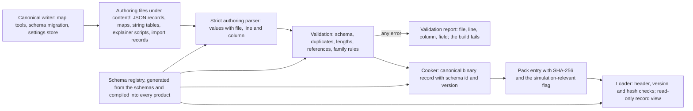
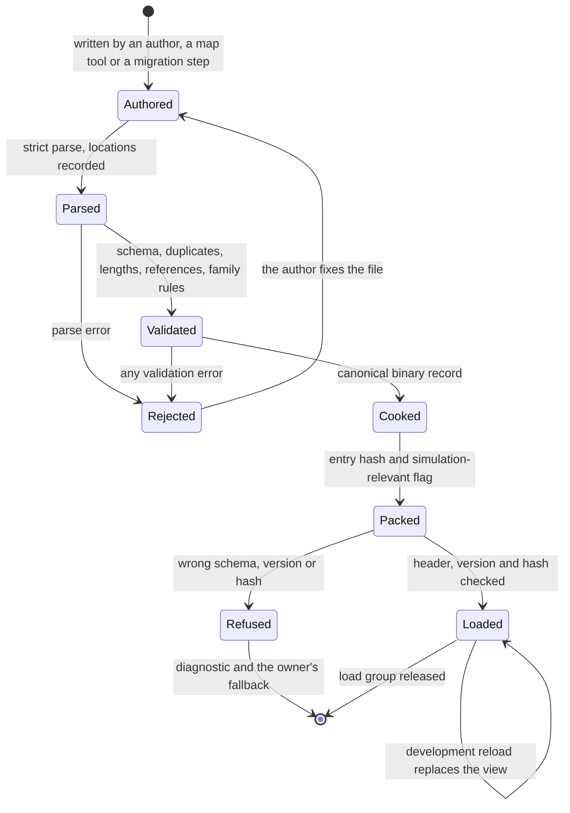

# Data schemas

> Status: Engine baseline · Prefix: DAT · ADRs: [ADR-061](../../../ADR/ADR-061-data-schemas-and-versioning.md) · [ADR-062](../../../ADR/ADR-062-authoring-syntax-and-schema-language.md) · [ADR-059](../../../ADR/ADR-059-content-build-and-validators.md) · [ADR-060](../../../ADR/ADR-060-content-identity-by-hash.md) · [ADR-058](../../../ADR/ADR-058-pack-files-and-mount-policy.md) · [ADR-063](../../../ADR/ADR-063-localisation.md) · [ADR-055](../../../ADR/ADR-055-dependencies-three-nuget-packages.md) · [ADR-056](../../../ADR/ADR-056-products-configurations-and-feature-flags.md) · [ADR-057](../../../ADR/ADR-057-version-identity.md) · [ADR-018](../../../ADR/ADR-018-texture-import-manifest.md) · [ADR-019](../../../ADR/ADR-019-mesh-source-format-and-cooked-meshes.md) · [ADR-021](../../../ADR/ADR-021-mesh-socket-schema.md) · [ADR-029](../../../ADR/ADR-029-input-event-model-and-binding-contract.md) · [ADR-069](../../../ADR/ADR-069-test-framework.md) · [ADR-071](../../../ADR/ADR-071-install-layout-runtime-files-and-user-data.md) · [ADR-076](../../../ADR/ADR-076-screenshot-encoding.md) · Related: [asset pipeline and resources](../asset_pipeline_and_resources.md) · [terrain](../terrain/README.md) · [audio engine](../audio_engine/README.md) · [input](../input/README.md) · [UI framework](../ui_framework/README.md) · [camera and sequences](../camera_and_sequences.md)

This folder specifies the Species data schemas: how every kind of Species content record is defined, authored, validated, cooked, versioned, written back and loaded. A schema here is typed, versioned and validated; it binds every field by name, never by its position in a row or a block; it has no sentinel values; and no authoring mistake, a blank line included, can stop a loader. The meaning of each field stays with the document that owns the mechanic, and the schemas use that document's field names.

## Folder index

| File | Holds | Requirement IDs |
|---|---|---|
| [README.md](README.md) (this file) | responsibilities and boundaries, the record-type registry, the schema language, the logical field types and presence rules, the limit form, cooked records, versioning and migration, the authoring parser, validation, the canonical writer, loaders, diagnostics, the shared tests and the open decisions | DAT-001 to DAT-053 |
| [map_schema.md](map_schema.md) | the map definition: the map header and its match options, the map options and map effects, the terrain records, the map lights, the start positions, the camera views and camera animations, the starting forces, the routes and the primary objectives; the map index; the mode catalogue and the match-option schema; the custom-map container and achievement hooks | DAT-070 to DAT-110 |
| [map_structure_records.md](map_structure_records.md) | the structure records of a map: the base fields with the role tags, the fields of each of the 32 structure kinds that a map may place, the typed links and their validation | DAT-140 to DAT-162 |
| [config_input_and_strings.md](config_input_and_strings.md) | the settings schema and the settings file, the binding sets and the keyboard-layout table, the string tables and their caption markup | DAT-190 to DAT-218 |
| [entity_audio_geometry_and_panel_schemas.md](entity_audio_geometry_and_panel_schemas.md) | the actor stat table, the Supply-crate outcome catalogue, the sound data and the effect-kind table, the cooked mesh, collision and simulation data records, the colour ramps, the screenshot output, the explainer animations, and the component-owned record types | DAT-260 to DAT-290 |
| [import_and_build_records.md](import_and_build_records.md) | the texture, mesh and audio import records, the engine asset table and the edition manifests | DAT-350 to DAT-361 |
| [test_and_telemetry_records.md](test_and_telemetry_records.md) | the soak configuration, the soak report and the telemetry session record | DAT-370 to DAT-386 |



Caption: Figure 0-A, the path of a record from its authoring file to a loaded record view, and the writer that produces authoring files (ADR-059, ADR-061, DEC-800).

## 1 Responsibilities and boundaries

**DAT-001** (MUST) This component owns: the schema language subset and its Species annotations; the logical field types and the presence rules; the registry of record types, with their schema ids, versions, cooked content types and simulation-relevant flags; the strict authoring parser; the schema, duplicate, length and reference validators; the cooked record format and the record loaders; the canonical writer; the migration step of the content build; and the diagnostics of all of these. Each record type has exactly one schema, which the content build, the map editor and the runtime share (ADR-061, ADR-059).

**DAT-002** (MUST) The meaning of a field, its rule and its default value belong to the document that owns the mechanic. A schema of this folder gives the field its key, logical type, unit, presence rule and range, and cites the owner's tuning key for its default instead of defining a second one. A field key is the owner's field name written in lower-case snake_case and, because it generates a C++ field, spelt in American English (`AGENTS.md` R11, CONVENTIONS §8): the owner's "branch colour" is the key `branch_color`; where an owner gives no name, the key chosen here is listed in the field table and is used by every tool.

**DAT-003** (MUST NOT) This component defines no network message format, no transport container and no format for state that a running game writes about a world or a match: saved worlds, replays, achievement progress and the synchronisation of settings are design-phase topics (DEC-207, DEC-250, DEC-251). The runtime-written files this folder specifies are the settings file of [config_input_and_strings.md](config_input_and_strings.md), whose versioning is DEC-250's, and the soak report and the telemetry session record of [test_and_telemetry_records.md](test_and_telemetry_records.md), which are diagnostic output, not match state. The custom-map container ([maps](../../../reference/08_maps_and_level_design/map_editor_hooks.md) R-MAP-391, table 2.14-A: the map definition with up to four embedded RGBA8 images, each with its width, its height and its resource name) is a member of the typed container family that DEC-207 names, and is recorded as a hook only ([map_schema.md](map_schema.md) DAT-101).

**DAT-004** (MUST NOT) No client and no server parses authoring text at run time. Loaders read cooked records only, check their header, version and hash, and never accept text (ADR-061). No reference data file, archive or tool output is imported into Species content (DEC-340).

**DAT-005** (MUST) Loaded records are immutable. A record view holds no simulation, match or session state, so one loaded record set can be shared by every state owner of a process, a skirmish match beside a world region included, and nothing loaded from content is ever reset between matches (DEC-223, DEC-011).

**DAT-006** (MUST) The record types of Species content are those of table 1-A. A file under the content root that holds a record of no registered type, or of a type other than the one its folder holds, is a build error (ADR-059). The folders under `content/` that are not yet listed in [GameAssets §2.1](../../../assets/GameAssets.md#21-content-root-and-folders) are proposed in this table as `content/records/<family>/`.

Table 1-A Record-type registry. "Sim" marks the record types whose cooked entries carry the simulation-relevant flag (AST-098, ADR-060). "Fields" names the document that lists the fields: this folder, or the component that owns them.

| Record type (schema id) | Content | Authoring source | Cooked entry | Sim | Fields |
|---|---|---|---|---|---|
| `maps.definition` | one map: header, terrain, lights, start positions, structures, camera data, starting forces, routes, primary objectives | `content/maps/<map id>.json` (assets `mapfile.spawn_control`, `mapfile.zone_control`, `mapfile.relic_run`, `mapfile.siege`, `mapfile.launch_race`, `mapfile.flag_chain`) | `Map` | yes | [map_schema.md](map_schema.md), [map_structure_records.md](map_structure_records.md) |
| `maps.index` | the map index | generated by the content build | `MapIndex` | yes | [map_schema.md](map_schema.md) |
| `mode.options` | the match-option schema of each mode | `content/records/modes/` | `Record` | yes | [map_schema.md](map_schema.md) |
| `settings.defaults` | the one defaults table of the settings | compiled into every product | none: generated code | no | [config_input_and_strings.md](config_input_and_strings.md) |
| `input.binding_set` | the default binding set and each keyboard-layout layer | `content/records/input/` | `Record` | no | [input](../input/README.md) INP-070 to INP-073; [config_input_and_strings.md](config_input_and_strings.md) |
| `input.keyboard_layouts` | the keyboard-layout table | `content/records/input/` | `Record` | no | [config_input_and_strings.md](config_input_and_strings.md) |
| `text.string_table` | the string table of one language | `content/strings/<tag>.json` (assets `strings.en_gb`, `strings.fr_fr`, `strings.de_de`, `strings.it_it`, `strings.es_es`, `strings.pt_br`, `strings.ru_ru`, `strings.ja_jp`, `strings.ko_kr`) | `StringTable` | no | [config_input_and_strings.md](config_input_and_strings.md) |
| `actor.stats` | the actor stat table | `content/records/actors/` | `Record` | yes | [entity_audio_geometry_and_panel_schemas.md](entity_audio_geometry_and_panel_schemas.md) |
| `crate.outcomes` | the Supply-crate outcome catalogue | `content/records/crates/` | `Record` | yes | [entity_audio_geometry_and_panel_schemas.md](entity_audio_geometry_and_panel_schemas.md) |
| `sound.sources` | the sound-source definitions with their events and layers | `content/records/audio/` | `Record` | no | [entity_audio_geometry_and_panel_schemas.md](entity_audio_geometry_and_panel_schemas.md) |
| `sound.groups` | the member weights of the sample groups | `content/records/audio/` | `Record` | no | [entity_audio_geometry_and_panel_schemas.md](entity_audio_geometry_and_panel_schemas.md) |
| `sound.effect_kinds` | the parameter descriptors of the 14 effect kinds | compiled into the audio engine | none: generated code | no | [entity_audio_geometry_and_panel_schemas.md](entity_audio_geometry_and_panel_schemas.md) |
| `geometry.mesh` | a cooked mesh | glTF source with its import record | `Mesh` | no | [entity_audio_geometry_and_panel_schemas.md](entity_audio_geometry_and_panel_schemas.md) |
| `geometry.collision` | a cooked collision asset | glTF source with its import record | `Collision` | yes | [entity_audio_geometry_and_panel_schemas.md](entity_audio_geometry_and_panel_schemas.md) |
| `geometry.sim_record` | the simulation data record of a mesh asset | generated by the mesh cooker | `SimRecord` | yes | [entity_audio_geometry_and_panel_schemas.md](entity_audio_geometry_and_panel_schemas.md) |
| `panels.explainer` | one explainer animation | `content/ui/explainers/` (asset `anim.explainer`) | `ExplainerScript` | no | [entity_audio_geometry_and_panel_schemas.md](entity_audio_geometry_and_panel_schemas.md) |
| `effects.definition` | one effect definition | `content/records/vfx/` | `Record` | no | [animation and VFX](../animation_and_vfx/README.md) VFX-013 |
| `camera.timeline` | one presentation timeline | `content/records/timelines/` | `Record` | no | [camera and sequences](../camera_and_sequences.md) CAM-025, CAM-102 |
| `interface.page_layout`, `interface.palette`, `interface.text_style`, `interface.font_roles` | page and options-screen layouts, palettes, text styles, the font-role map | `content/records/ui/` | `Record` | no | [UI framework](../ui_framework/layout_rendering_input_and_localisation.md) §3; [pages and screen recipes](../ui_framework/pages_and_screen_recipes.md) UI-313 |
| `import.texture`, `import.mesh`, `import.audio` | the import record beside each source | beside the source, sharing its stem | none: build input | no | [import_and_build_records.md](import_and_build_records.md) |
| `assets.engine_table` | the asset-id constants and enumeration-to-asset tables of the code | generated from the code by the content build | none: build input | no | [import_and_build_records.md](import_and_build_records.md) |
| `edition.manifest` | one edition: what it ships and its runtime feature flags | `content/records/editions/` | build input; the feature flags as a `Record` | the feature flags that change simulation behaviour | [import_and_build_records.md](import_and_build_records.md) |
| `test.soak_configuration` | one soak configuration: progression, sequence, test maps, session name, termination tick | `content/records/test/`, selected only into the `development` and `soak` editions | `Record` | no | [test_and_telemetry_records.md](test_and_telemetry_records.md) |
| `test.soak_report` | the report of one soak pass: the match table and the pass summary | written by the soak runner; a CI artefact | none: diagnostic output | no | [test_and_telemetry_records.md](test_and_telemetry_records.md) |
| `telemetry.session` | one telemetry session record, exactly the data set of DBG-181 | formed by the client, only with consent | none: diagnostic output | no | [test_and_telemetry_records.md](test_and_telemetry_records.md) |

## 2 Interfaces

The interface below is a C++23 declaration sketch, not an implementation (ADR-052). The schema registry, the record types and their loaders are generated from the schemas by the Species code generator of the content build tool, a development tool of the tools solution under `Tools/` (ADR-062, ADR-059); generated files are build outputs and are never edited. The generated C++ follows the naming of `AGENTS.md` §1: a record type is a PascalCase aggregate whose fields are the schema keys in camelCase, spelt in American English (the key `color_role` generates the field `colorRole`); a record type that names a game concept is generated into namespace `Species`, every other into `Engine`; schema ids, keys and enumerator strings are data names and keep their spelling. The generated files are committed source in the owning project folder, regenerated by a developer whenever a schema changes and checked in CI for drift (owner decision O28, ADR-062).

```cpp
namespace Engine
{

// ---- logical field types (§3.1); the order carries no meaning -------------------
enum class FieldType : std::uint8_t
{
  Boolean,
  Integer,
  Count,
  Ticks,
  SimDecimal,
  PresentationDecimal,
  Text,
  StableId,
  StringId,
  AssetRef,
  AssetMember,
  RecordRef,
  Enum,
  EnumSet,
  Vec3Value,
  Direction,
  ColorRgba8,
  ColorMultiplier,
  Limit,
  List,
  Object
};
enum class SimPrecision : std::uint8_t
{
  Binary32Rounded,
  Binary64
}; // DAT-010, DEC-241
enum class Presence : std::uint8_t
{
  Required,
  Defaulted,
  AbsenceMeaningful,
  Derived
};

// DAT-017
struct SchemaVersion
{
  std::uint16_t major;
  std::uint16_t minor;
};

struct FieldSpec
{
  std::string_view key; // lower-case snake_case (DAT-002)
  FieldType type;
  Presence presence;
  std::string_view unit;         // "wu", "ticks", "s", "mode s", "dB", "" ...
  std::optional<double> minimum; // inclusive unless the field says otherwise
  std::optional<double> maximum;
  std::uint32_t maxChars = 0;            // text and id fields (DAT-009)
  std::optional<SimPrecision> precision; // SimDecimal only
  std::string_view refKind;              // record type or asset category of a reference
  bool orderCarriesMeaning = false;      // List and EnumSet (DAT-013)
  std::string_view defaultKey;           // the owner's tuning key of the default, if any
};

struct RecordSchema
{
  std::string_view id; // the schema id of table 1-A, for example "maps.definition"
  SchemaVersion version;
  std::span<const FieldSpec> fields; // schema order = canonical write order (DAT-042)
  bool simulationRelevant;
  ContentType cookedAs; // the pack content type (ADR-058)
};

// Generated, compiled into every program.
class SchemaRegistry
{
public:
  static const SchemaRegistry& Instance() noexcept;
  const RecordSchema* Find(std::string_view _schemaId) const noexcept;
  std::span<const RecordSchema> All() const noexcept;
};

// ---- diagnostics (§6) ------------------------------------------------------------
struct SourceLocation
{
  std::string file;
  std::uint32_t line;
  std::uint32_t column;
  std::string fieldPath;
};
enum class Severity : std::uint8_t
{
  Error,
  Warning,
  Information
};
struct Diagnostic
{
  DiagnosticClass diagnosticClass; // table 6-A
  Severity severity;
  SourceLocation at;
  std::optional<SourceLocation> also; // the other occurrence of a duplicate (DAT-025)
  std::string message;                // literal text, never a format string (DEC-800)
};

// ---- content build tool (tools solution) ----------------------------------------
// DAT-019 to DAT-023
class AuthoringParser
{
public:
  std::expected<JsonDocument, std::vector<Diagnostic>> Parse(std::span<const std::byte> _bytes, std::string_view _file) const;
};
// DAT-024 to DAT-032
class RecordValidator
{
public:
  std::vector<Diagnostic> Validate(const JsonDocument& _document, const RecordSchema& _schema, const ReferenceIndex& _references) const;
};
// DAT-033 to DAT-035
class RecordCooker
{
public:
  CookedRecord Cook(const JsonDocument& _validated, const RecordSchema& _schema) const;
};
// DAT-040 to DAT-044, DEC-800
class CanonicalWriter
{
public:
  std::string Write(const RecordValue& _value, const RecordSchema& _schema) const;
  std::expected<void, Diagnostic> ReplaceFileAtomically(const std::filesystem::path& _target, std::string_view _content) const;
};
// DAT-045, DAT-046
class SchemaMigration
{
public:
  std::expected<RecordValue, std::vector<Diagnostic>> Migrate(const JsonDocument& _older, SchemaVersion _from,
                                                              const RecordSchema& _to) const;
};

// ---- runtime (client, server and content build tool) ----------------------------
template <class T> class RecordView; // read-only view of a cooked record (DAT-005)
enum class LoadError : std::uint8_t
{
  WrongSchema,
  WrongVersion,
  HashMismatch,
  Truncated,
  Malformed
};
// DAT-036 to DAT-039
class RecordLoader
{
public:
  template <class T> std::expected<RecordView<T>, LoadError> Load(const PackEntry& _entry) const;
};

} // namespace Engine
```

**Events.** The component raises no gameplay or presentation events. In Debug builds a changed record reloads through the asset cache's `AssetReloaded` notification ([asset pipeline](../asset_pipeline_and_resources.md) §2.2), and the reader of the record type decides whether it can take the new version while a match runs.

**Data contracts.** A cooked record entry is the header of DAT-014 followed by the generated payload of its schema version. The pack table of contents carries the schema id and version of every data entry (ADR-058). The content manifest lists every entry with its hash and its simulation-relevant flag (ADR-060).

**Threading contract.** The parser, the validator and the cooker run on the content build's worker threads, one authoring file per task; their output does not depend on the number of threads or on task order (DAT-048). Loaders run on the loading thread (DEC-226); a loaded record view is read-only and may be read from any thread without a lock. The canonical writer of a running program, the map editor's or the settings store's, runs on the thread that owns the edited data and writes the file from a worker without blocking a frame.

## 3 Data model

### 3.1 Logical field types

**DAT-007** (MUST) Every field of every schema has one logical type of table 3.1-A. The type decides the JSON form that an authoring file must use, the checks of the validator and the cooked representation. A value in any other JSON form is a build error: a field typed boolean rejects 0 and 1, a field typed integer rejects 2.0 and 2e0, and a numeric field rejects a number written as a string.

Table 3.1-A Logical field types.

| Type | JSON form | Rules |
|---|---|---|
| boolean | `true` or `false` | the flag fields of the reference, written as 0 and 1, are booleans |
| integer | a number without fraction or exponent | the field's declared range; values beyond the signed 64-bit range are rejected, never wrapped |
| count | an integer of at least 0 | as integer |
| ticks | an integer of at least 0 | a simulation duration in ticks of `ref.sim.tick_period` ([reference/12](../../../reference/12_simulation_model/01_tick_timing_and_main_loop.md)) |
| simulation decimal | a number | a value that feeds the simulation: converted once, at cook time, to its declared precision (DAT-010) |
| presentation decimal | a number | a value read only by presentation, the audio engine or tools; cooked as binary64 |
| text | a string | UTF-8; at most the field's declared number of characters, counted as Unicode code points (DAT-009); stored and written literally (DEC-800 item 4) |
| stable id | a string | lower-case ASCII letters, digits, `_` and `.`; at most `dat.id.max_chars` (64) characters unless the field declares another maximum; compared exactly |
| string id | a string | a Species string id (CONVENTIONS §8); it must exist in the base language's string table (DAT-030) |
| asset reference | a string | an asset id of [assets/asset_manifest.csv](../../../assets/asset_manifest.csv), of the category the field declares (AST-089) |
| asset member | an integer of at least 1 | the number of a member of the asset that the field names, in the order of the manifest's `variants` column (AST-016) |
| record reference | a string | the stable id of a record of the type the field declares (DAT-029) |
| enumeration | a string | one enumerator of the field's closed enumeration, matched exactly |
| enumeration set | an array of strings | distinct enumerators; cooked in enumeration order |
| vector | an array of 3 numbers | x, y, z |
| direction | an array of 3 numbers, not all 0 | normalised at cook time to unit length |
| RGBA8 colour | an array of 4 integers, each 0 to 255 | red, green, blue, alpha, straight alpha |
| colour multiplier | an array of 3 numbers of at least 0 | red, green, blue; unclamped, so values above 1 brighten |
| limit | absent, `0`, an integer above 0, or the string `"unlimited"` | DAT-008 |
| list | an array | ordered or unordered as the field declares (DAT-013); at most a declared number of items where the owner states one |
| object | an object | a nested record with its own field table |

**DAT-008** (MUST) A per-map limit and every other field that the owning document gives the limit form has four distinct values (DEC-120): **absent**, which applies the lobby default or the typed default of the mode; **0**, which means none is allowed; a positive integer, which is that limit; and the explicit value `"unlimited"`. Unlimited is never encoded as 0 or as a negative number, and no field of any schema uses a negative number, a zero or an out-of-range value as a marker for "absent", "none", "default" or "unlimited". Where the reference marks absence with −1, the Species schema uses absence.

**DAT-009** (MUST) Every text field and every id has a maximum length that its schema declares; the validator enforces it with the file, line, column and field, and refuses a longer value instead of truncating it (DEC-801 item 5). The maxima are the owning documents' where they state one, for example `ref.map.header.name_max_chars` and `ref.map.camera.view_name_max_chars` of [maps](../../../reference/08_maps_and_level_design/rules_and_conventions.md) and `ui.lang.max_id_length` of the [UI framework](../ui_framework/layout_rendering_input_and_localisation.md); otherwise `dat.id.max_chars` (64) for ids and `dat.text.max_chars` (1,024) for text. Content keys are bounded by `ast.pack.max_key_bytes` of the [asset pipeline](../asset_pipeline_and_resources.md) (AST-014). No cooked or loaded structure holds content text in a fixed-size buffer.

**DAT-010** (MUST) A simulation decimal declares its precision. Until the design phase decides the numeric model (DEC-240), the precision is that of the reference semantics of DEC-241: a simulation-feeding decimal is parsed to binary64 by one platform-independent, correctly rounded conversion, rounded once to binary32 and widened back, and a few fields keep the full binary64 value, each marked "binary64" in its field table (for example the Control Zone size and the bot navigation node's priority modifier). The rounding happens once, in the content build; clients and servers never parse content numbers, so every process reads the same bits (ADR-061, DEC-241 item 12).

### 3.2 Presence and defaults

**DAT-011** (MUST) Every field has one presence rule:

| Presence | Authoring file | Cooked record |
|---|---|---|
| required | must hold the field | the value |
| defaulted | may omit the field | the value, or the declared default of the schema when omitted |
| absence-meaningful | may omit the field | the value, or an explicit "absent" state that the reader interprets (the limit form of DAT-008, an unset map option) |
| derived | must not hold the field | computed by the cooker from other fields, for example the derived header sets of [map_schema.md](map_schema.md) |

**DAT-012** (MUST) A defaulted field that the authoring file omits takes the declared default of its schema, and only that value: no loader substitutes 0, an empty value or the caller's own fallback for an omitted field (DEC-567, DEC-073). Each record type has one defaults table, generated from its schema, whose values are the owners' tuning keys named in the field tables; an effect binding that omits a DSP parameter takes that parameter's declared default (see DEC-567). The settings defaults are compiled into every program, so they exist before any pack is mounted (DEC-100).

**DAT-013** (MUST) A list field declares whether its order carries meaning. An ordered list is cooked in authored order and keeps it, as the structure records of a map do (R-MAP-104) and the keys of an explainer object do (R-META-226). An unordered list, and every keyed collection of records, is cooked in byte-wise order of its keys, so reordering it in the authoring file changes no cooked byte (ADR-061). An enumeration whose order carries meaning, such as the outcome order of [reference/04](../../../reference/04_supply_crates_powers_and_weapons/README.md) R-CRATE-007 or the effect-kind order of [reference/10](../../../reference/10_audio_design/event_model_and_sound_data.md) R-AUD-077, declares that order in its schema, never through the order of records in a file.

### 3.3 Schemas, annotations and the authoring syntax

**DAT-014** (MUST) A cooked record entry starts with a header that holds: the schema id of table 1-A as a length-prefixed UTF-8 string; the schema version (major, minor); the payload length in bytes; and the number of records in the payload. Every multi-byte value of a cooked record is little-endian; the payload holds no pointer and no host-dependent value, only offsets relative to the payload, so the same bytes are valid on every platform that reads the packs (ADR-058, DEC-240 item 10). No cooked record carries a magic number of its own: the pack header carries the format identity (ADR-058).

**DAT-015** (MUST) Each record type is defined by one JSON Schema document in the restricted subset of ADR-062 (object, array, string, integer, number, boolean, enumeration and reference), with the `$schema` keyword pinned to the draft `dat.schema.draft` (2020-12). Species annotations use the prefix `x-species-` and are, exactly: `x-species-type` (the logical type of table 3.1-A), `x-species-unit`, `x-species-precision` (`binary32-rounded` or `binary64`), `x-species-presence`, `x-species-ref` (the record type or asset category of a reference), `x-species-order` (`meaningful` or `none`), `x-species-max-chars`, `x-species-default-key` (the owner's tuning key) and `x-species-sim` (the simulation-relevant flag of the record type). The code generator rejects a schema that uses any other keyword or annotation (ADR-062).

**DAT-016** (MUST) Authoring files are UTF-8 JSON (ADR-062), one record or one keyed collection of records per file, in the folders of table 1-A. The top-level object of every authoring file starts with two fields: `schema`, the schema id of table 1-A, and `version`, the schema version as the text `"<major>.<minor>"`; a file without them, or whose schema id does not match its folder, is a build error. Every object of every record type may carry a `notes` field, a text of at most `dat.notes.max_chars` (2,000) characters that tools keep and the cooker drops; JSON has no comments, and no other field holds author commentary.

**DAT-017** (MUST) The schema version of a record type starts at major 1, minor 0 (`dat.schema.initial_version`). Adding an optional field with a default raises the minor version. Removing, renaming or re-typing a field, changing a default, tightening a range or changing what a field means raises the major version and needs a migration step (DAT-045). Cooked content and binaries are released together, so a loader accepts exactly the schema versions it was generated with (ADR-061).

### 3.4 Ownership and lifetimes

**DAT-018** (MUST) The objects of this component have these owners and lifetimes:

| Object | Owner | Lifetime |
|---|---|---|
| `SchemaRegistry`, the generated record types, loaders and defaults tables | generated code in every product | process |
| `JsonDocument`, diagnostics, `CookedRecord` | the content build task of one file | one task |
| `RecordView<T>` | the asset cache ([asset pipeline](../asset_pipeline_and_resources.md) §4.12) | the load group of the entry; read-only throughout |
| the settings defaults | generated code | process |
| a map tool's or the settings store's in-memory record values | their owner | until written back by the canonical writer |

## 4 Behaviour and algorithms

### 4.1 The authoring parser

**DAT-019** (MUST) The authoring parser is a strict JSON parser of the Species content build (RFC 8259), with the restrictions of I-JSON (RFC 7493): the text is UTF-8, a single leading byte-order mark is accepted and ignored, invalid UTF-8 and unpaired surrogate escapes are errors, every number lies within the binary64 range, and no object holds a key twice. The parser and the validator are Species code generated with the schemas (ADR-062), so the duplicate-key rule and the location of every value do not depend on a third-party parser mode; the published JSON Schema documents serve authors' editors only.

**DAT-020** (MUST) The parser records the file, line and column of every value and every key, so every diagnostic names the exact location (ADR-062). Whitespace, blank lines and line endings carry no meaning anywhere, so a blank line, a missing final line break, a carriage return or an unterminated last line can never change, truncate or stop a load (DEC-015).

**DAT-021** (MUST) Malformed input is an error with a location, never a hang, a crash or a silently shortened record: an unterminated string, array or object, a missing value, a stray character after the top-level value and a nesting deeper than `dat.parse.max_depth` (64) levels are each reported and end the parse of that file only. The build sets no limit on line length or file size other than the declared maximums of the schemas (DEC-801 item 5).

**DAT-022** (MUST) A key that appears twice in one object is a build error that names both locations; the parser never keeps the first or the last occurrence (DEC-801 item 1). A field holds one value, and a list is an explicit array, never assembled from repeated keys (DEC-801 item 3).

**DAT-023** (MUST) Numbers are converted with one correctly rounded decimal-to-binary64 conversion (round to nearest, ties to even), the same on every build host; the baseline implementation is the C++ standard library's `std::from_chars`, checked by the conversion corpus of test T5. A simulation decimal is then rounded to its declared precision once (DAT-010). An integer field takes the decimal digits exactly; no conversion stops at the first non-digit, gives 0 for an unparsable token or wraps an overflow (DEC-241 item 12).

### 4.2 Validation

**DAT-024** (MUST) The validator checks every authoring file in this order, and reports every error it finds in a file, not only the first: (1) the parse of DAT-019 to DAT-023; (2) the schema: unknown fields, missing required fields, derived fields that the file holds, types, ranges and the declared maximum lengths; (3) duplicates (DAT-025); (4) references (DAT-028 to DAT-030); (5) the rules of the record family stated in this folder and in the owning documents, such as the per-mode map rules; (6) the rules across record types, such as the completeness of the actor stat table. An error of any step fails the build (ADR-059, DEC-015).

**DAT-025** (MUST) Two records of one record type with the same stable id are a build error that names both locations, within one file and across all the files of a content set: two maps with the same map id, two structure records with the same structure id in one map, two string-table entries with the same id in one language, two sound sources with the same source id, two sample-group entries with the same group, and two actor stat records for one actor kind are examples (DEC-801 item 2). A value that deliberately replaces another is an explicit, typed override field, such as a map's value for a match option, never a repeated key or a second record (DEC-801 item 4).

**DAT-026** (MUST) An unknown field, an unknown enumerator, an unknown record type and a value of the wrong JSON form are build errors; nothing that the schema does not declare is ignored, skipped or read as a default (ADR-059, DEC-802). Field keys and enumerators are compared exactly, in their lower-case form; no comparison ignores case, so one spelling of a name has one meaning in every tool (DEC-045).

**DAT-027** (MUST) No record binds a value by its position in a row, a block or a file. A table whose rows describe the members of an enumeration names the member in each row, and the validator checks that the table holds exactly one row per member: a missing member and a member outside the enumeration are build errors, so a table with fewer or more rows than members can never shift its values onto the wrong members (DEC-019). Where a cooked layout stores values by position, for example the parameters of an effect binding in its kind's order, the authoring file still names each value, and the cooker places it ([entity_audio_geometry_and_panel_schemas.md](entity_audio_geometry_and_panel_schemas.md) DAT-272).

**DAT-028** (MUST) Every asset reference resolves to an existing asset id of the expected category, member and variant ([asset pipeline](../asset_pipeline_and_resources.md) AST-089); a missing or wrong-kind reference is a build error naming the file, line and field (DEC-015).

**DAT-029** (MUST) Every record reference resolves to an existing record of the declared type within its scope: a structure link within its map, an event's sample group within the asset manifest, an alias within the binding set, an embedded string id within the language. A reference to a record of another type is a build error, and at run time a missing or mismatched target counts as no reference, never as a reinterpretation of another kind (DEC-457). A reference chain that loops back on itself, where the record type forbids loops, is a build error.

**DAT-030** (MUST) Every string id that a record names, a map's display name and description, a mode's option labels and help texts, an explainer caption, exists in the base language's string table (`ref.meta.lang.base` of [reference/09](../../../reference/09_front_end_and_match_flow/options_localisation_and_hooks.md)); a missing one is a build error, so no screen shows a placeholder name or a raw id (DEC-802, ADR-063).

**DAT-031** (MUST) Each validator class of table 6-A has a failing fixture in the content build's test suite that triggers exactly that class, and the fixture asserts the class, the file, the line, the column and the field of the diagnostic; the duplicate cases of DEC-801 items 1 and 2 each have their own fixture: a key twice in one object, two records with one id in one file, and two records with one id in two files (ADR-059, ADR-069).

**DAT-032** (MUST) The content build reports, as warnings that do not fail the build, the conditions that the owning documents declare as warnings: an asset that nothing references in an edition not marked for release (AST-090), a terrain tile with fewer generator levels than its guide grid (TER-111), a terrain tile outside the grid (TER-124), and a sample group that no event names (R-AUD-068). Every other content condition named in this folder is an error.

### 4.3 Cooking

**DAT-033** (MUST) The cooker writes each validated record in the generated binary layout of its schema version: every field in schema order, every defaulted field with its value or its declared default, every absence-meaningful field with an explicit present flag, and every derived field computed. The cooked bytes are a pure function of the validated values and the schema version, with no timestamp, host path, thread order or memory address, so the same content gives the same entry hash on every build machine (ADR-059, ADR-060).

**DAT-034** (MUST) A direction is normalised at cook time; a direction whose three components are 0 is a build error, so no loader normalises a zero vector or substitutes a default for it. Every simulation decimal is finite: a value that rounds to an infinity or that is not a number is a build error (DEC-653).

**DAT-035** (MUST) The cooker marks the entry simulation-relevant when its record type is marked "Sim" in table 1-A (AST-098). The simulation content identity covers every such entry (ADR-060); a record type that the simulation reads and that is not marked is a defect that the registry test of T8 detects.

### 4.4 Loading

**DAT-036** (MUST) A loader checks, before it reads any field, that the entry's schema id is the one it expects and that the schema version is one it was generated with, and checks the entry's hash for every simulation-relevant entry ([asset pipeline](../asset_pipeline_and_resources.md) §4.11, ADR-058). A mismatch refuses the entry with a diagnostic that names the record type, the key and both versions (ADR-061).

**DAT-037** (MUST) A loader never fails fatally. A refused, truncated or malformed entry is a diagnostic, and the reader of the record type takes the fallback that its owning document states: a map that cannot be loaded is not offered and its match does not start, a missing string table falls back to the base language, a missing sound definition plays nothing, a missing explainer gives no panel (DEC-015). A loader reads every count and offset against the entry's length before it uses it, and never reads past the entry.

**DAT-038** (MUST) A map header is readable on its own: the cooked map stores its header as the first section of the entry, with its own length, so the map catalogue reads every map header without reading or decoding the terrain or any other block (ADR-061, DEC-045). One loader reads the header for the catalogue and the whole map for a match, with the same field names and rules (DEC-045).

**DAT-039** (MUST) Every loader is fuzz-tested in CI with truncated, extended and bit-flipped entries, and must end every input with a record view or a load error, within a bounded time and without reading outside the entry (DEC-015, ADR-069).

### 4.5 The canonical writer

**DAT-040** (MUST) Every Species program that writes content or settings uses the canonical writer: a map tool (DEC-045), the migration step of the content build (DAT-045) and the settings store, whose file form is [config_input_and_strings.md](config_input_and_strings.md)'s (DEC-800).

**DAT-041** (MUST) **Lossless round trip.** Loading a file and saving it again reproduces every value exactly. A number is written in the shortest decimal form that reads back to the same binary64 value, the baseline being `std::to_chars` without a precision argument, never at a fixed number of decimals. A save writes every record that the loaded data holds. A field is omitted only when it is defaulted and its value equals the schema default, so that a load reads back the same value; a 0 is written whenever the default is not 0, and an absence-meaningful field that is absent stays absent (DEC-800 item 1, DEC-120).

**DAT-042** (MUST) **Canonical output.** Each field is written once, in schema order, in UTF-8 without a byte-order mark, with line feeds as line endings, `dat.writer.indent_spaces` (2) spaces of indentation per level and a final line feed, so that saving unchanged data gives the same bytes and the same content hash (DEC-800 item 2, ADR-060).

**DAT-043** (MUST) **Atomic replacement.** The writer writes a complete new file beside the old one, flushes it to the device and then replaces the old file in one operation. A write that fails at any step leaves the previous file intact, and the failure is reported to the player or author and in the log; it is never skipped silently (DEC-800 item 3).

**DAT-044** (MUST) **Values are data.** A text value is written exactly as held, with only the escapes that JSON requires; no character in it, a percent sign or a brace included, is interpreted as a formatting directive by the writer, a loader or a diagnostic (DEC-800 item 4).

### 4.6 Migration

**DAT-045** (MUST) A change of major version ships with a migration step in the content build: a pure function from the authoring values of the previous major version to those of the new one. The content build runs it over the authoring files of the repository and writes the results with the canonical writer (DAT-041 to DAT-044), so the repository always holds files of the current version, and the change is reviewed as a text diff (ADR-061).

**DAT-046** (MUST) A file whose schema version is newer than the content build knows is a build error; a file of an older major version without a migration step is a build error; and no loader ever migrates cooked records at run time (ADR-061). The migration of runtime-written data, the settings file included, is DEC-250's and DEC-251's.

### 4.7 Content identity

**DAT-047** (MUST) The identity of a record is the SHA-256 of its cooked entry (ADR-060), so an edit that changes only the formatting, the order of an unordered collection or the line endings of an authoring file changes no identity, and an edit of any value does. Lists of maps are keyed by the stable map id together with the map's content hash, and no list identifies a record by its file bytes or its file name alone (DEC-204).

### 4.8 The life of a record



Caption: Figure 4-A, the states of a record from authoring to loading (DAT-019 to DAT-039).

## 5 Concurrency and performance budget

**DAT-048** (MUST) The content build parses, validates and cooks files in parallel, one file per task, and merges the per-file results in byte-wise order of the file keys; cross-file checks (DAT-025, DAT-029, DAT-030) run after every file of a content set has been validated. The output and the diagnostics are identical for every thread count, which the reproducibility job of ADR-059 confirms.

**DAT-049** (MUST) Validation and cooking are incremental: a record is rebuilt when its authoring file, its schema version or a record that it references changes (ADR-059). Changing one record of a family rebuilds that record and its dependants, never the whole content set.

**DAT-050** (MUST) Loading a cooked record does no parsing: a loader validates the header and the counts and returns a view onto the entry's bytes. These budgets are starting values that the performance tests confirm on the reference test machine of the [diagnostics](../diagnostics_test_and_performance/README.md) component: reading the headers of `ref.map.reference.map_count` (49) maps for the map catalogue in at most `dat.perf.catalogue_ms` (20 ms); loading every non-map record type of an edition in at most `dat.perf.records_ms` (50 ms); and validating and cooking a full edition from a clean state in at most `dat.perf.full_build_s` (120 s), with incremental rebuilds of one record in at most `dat.perf.incremental_s` (5 s).

## 6 Failure modes, diagnostics and telemetry

**DAT-051** (MUST) Every diagnostic carries its class of table 6-A, its severity, the file, line, column and field path of the value, and for a duplicate the location of the other occurrence. The validation report of the content build lists every diagnostic of a run, grouped by file, and CI fails a change on any error (ADR-059).

Table 6-A Diagnostic classes.

| Class | Raised when | Severity | Requirement |
|---|---|---|---|
| `syntax` | the text is not valid JSON, or is truncated | error | DAT-019, DAT-021 |
| `encoding` | invalid UTF-8 or an unpaired surrogate | error | DAT-019 |
| `depth` | nesting deeper than `dat.parse.max_depth` | error | DAT-021 |
| `duplicate_key` | a key twice in one object | error | DAT-022 |
| `duplicate_id` | two records of one type with one stable id | error | DAT-025 |
| `unknown_field` | a field the schema does not declare | error | DAT-026 |
| `unknown_value` | an enumerator, record type, mode, kind or link target outside its set | error | DAT-026, DAT-029 |
| `missing_field` | a required field is absent | error | DAT-011 |
| `derived_field` | an authoring file holds a derived field | error | DAT-011 |
| `wrong_type` | a value of the wrong JSON form | error | DAT-007 |
| `out_of_range` | a value outside its declared range, or not finite | error | DAT-007, DAT-034 |
| `too_long` | a text or id beyond its declared maximum | error | DAT-009 |
| `zero_direction` | a direction of length 0 | error | DAT-034 |
| `positional_table` | a member of an enumeration with no row, or a row for no member | error | DAT-027 |
| `missing_asset` | an asset reference that does not resolve | error | DAT-028 |
| `missing_record` | a record reference that does not resolve, or resolves to the wrong type | error | DAT-029 |
| `missing_string` | a string id absent from the base language | error | DAT-030 |
| `reference_cycle` | a reference chain that loops where loops are forbidden | error | DAT-029 |
| `family_rule` | a rule of the record family fails, with the rule's own name | error | DAT-024 |
| `version` | an unknown, newer or unmigrated schema version | error | DAT-046 |
| `content_warning` | a condition that an owning document declares as a warning | warning | DAT-032 |

**DAT-052** (MUST) At run time a refused or malformed entry raises one diagnostic in the content log category ([logging](../../../ADR/ADR-067-logging.md)) with the record type, the key, the load error and, for a version mismatch, both versions; the same entry is reported once per load. In Debug builds, the only builds that mount loose content files (AST-105), the validation of those files runs the same validators and shows their diagnostics in the development overlay of the [diagnostics](../diagnostics_test_and_performance/README.md) component; Release builds have neither the loose files nor the overlay (ADR-056).

**DAT-053** (MUST) The content build records, per run, the number of files, records and diagnostics per record type and the time spent per stage, so that the budgets of DAT-050 can be tracked in CI.

## 7 Acceptance tests

| Test | Kind | Checks | Requirements |
|---|---|---|---|
| T1 parser strictness | unit | every case of table 6-A's `syntax`, `encoding`, `depth` and `duplicate_key` classes fails with the right location; a file of only whitespace and blank lines between values parses as the same document as its compact form; a missing final line break changes nothing | DAT-019 to DAT-022 |
| T2 schema fixtures | unit | one failing fixture per diagnostic class of table 6-A, each asserting class, file, line, column and field | DAT-024 to DAT-031, DAT-051 |
| T3 duplicate fixtures | unit | a key twice in one object; two records with one id in one file; two records with one id in two files; each names both locations | DAT-022, DAT-025, DAT-031 |
| T4 reorder invariance | property | random reorderings of every unordered collection give byte-identical cooked entries; reordering an ordered list changes them | DAT-013, DAT-033 |
| T5 number conversion | unit | a corpus of decimal strings, including halfway cases, subnormals and the binary32 rounding midpoints, converts to the same bits on every CI host; integer fields reject fractions, exponents and overflow | DAT-010, DAT-023 |
| T6 writer round trip | property | records generated from every schema are written by the canonical writer, read back and compared equal; a second write gives the same bytes; zeros, absent fields and `"unlimited"` keep their forms | DAT-008, DAT-041, DAT-042 |
| T7 atomic write | integration | a write interrupted at each step leaves the previous file intact and reports the failure | DAT-043 |
| T8 registry | unit | every cooked record type loads and its schema id and version match the loader table; every record type that simulation code reads is marked "Sim" | DAT-006, DAT-035, DAT-036 |
| T9 version refusal | integration | a pack built with a mismatched schema version is refused with a diagnostic naming the record type | DAT-036, DAT-046 |
| T10 loader fuzzing | fuzz | truncated, extended and bit-flipped entries of every record type end in a view or a load error, never a crash or an out-of-bounds read | DAT-037, DAT-039 |
| T11 header only | integration | the map catalogue reads all map headers without touching the terrain section, measured by the bytes read | DAT-038 |
| T12 identity | integration | a whitespace-only edit of an authoring file leaves the entry hash unchanged; a changed value changes it | DAT-047 |
| T13 migration | integration | a major-version fixture migrates, is written canonically and cooks to the same entry as a file authored at the new version | DAT-045, DAT-046 |
| T14 budgets | performance | the budgets of DAT-050 on the reference test machine | DAT-050 |
| T15 thread invariance | integration | the content build with 1 thread and with all hardware threads gives identical packs and reports | DAT-048 |

## 8 Open decisions

### 8.1 Decisions and architecture records

| Reference | Status | Where it applies |
|---|---|---|
| DEC-015 | Resolved | validation at build time, fault-tolerant and fuzzed loaders (DAT-020, DAT-024, DAT-037, DAT-039) |
| DEC-019 | Resolved | typed entries per member, no positional tables (DAT-027) |
| DEC-073 | Resolved | typed defaults per record type (DAT-012) |
| DEC-100 | Resolved | one defaults table, compiled in (DAT-012) |
| DEC-120 | Resolved | absent, 0, a number and unlimited are distinct (DAT-008, DAT-041) |
| DEC-204 | Open | content identity by hash; lists keyed by id and hash (DAT-047) |
| DEC-207 | Open | no network message format, transport container or custom-map container format here (DAT-003, DAT-101) |
| DEC-223 | Open | loaded records are immutable and shared by every state owner (DAT-005) |
| DEC-240 | Open | the numeric model: simulation decimals keep their declared precision until it is decided (DAT-010) |
| DEC-241 | Open | the reference parsing and rounding semantics as the default (DAT-010, DAT-023) |
| DEC-250 | Open | the settings file's versioning and migration (DAT-003, DAT-046) |
| DEC-251 | Open | world-state persistence is not a schema of this folder (DAT-003, DAT-046) |
| DEC-340 | Dropped | no reference data format, archive or tool output is imported (DAT-004) |
| DEC-567 | Open | an omitted field takes its declared default (DAT-012) |
| DEC-653 | Resolved | no non-finite simulation value (DAT-034) |
| DEC-800 | Resolved | the canonical, lossless, atomic writer (DAT-040 to DAT-044) |
| DEC-801 | Resolved | duplicate keys and ids, repeated fields and over-long values are build errors (DAT-009, DAT-021, DAT-022, DAT-025, DAT-031) |
| DEC-802 | Open | unknown content is an error, never ignored (DAT-026, DAT-030) |
| ADR-061 | Accepted | one schema per record type, text authoring, versioned binary at run time (§3, §4) |
| ADR-062 | Proposed | JSON with a restricted JSON Schema subset and a Species code generator; this folder pins the draft, the annotations and a Species-owned parser (DAT-015, DAT-019) |
| ADR-059, ADR-060, ADR-058 | Accepted | the validating content build, content identity by SHA-256, the pack format (§4) |

### 8.2 Design-phase inputs

1. **Settings persistence** (DEC-250): the schema version, forward migration and optional synchronisation of the settings file, and whether unknown keys are kept.
2. **World persistence** (DEC-251): the record format of a persistent world, which this folder does not define; whether world records reuse the logical types of §3.1 and the canonical writer.
3. **Numeric model** (DEC-240, DEC-241): the cooked representation of simulation decimals (binary32-rounded binary64, strict binary64 or fixed point); the precision column of every field table is the input to that choice.
4. **Network messages** (DEC-207): whether network messages reuse the schema language and code generator of this folder, with hard limits on every count, length and depth.
5. **Modding** (vision §7): whether players may author records, which would make the authoring parser and validators part of a player tool, and how such records are identified (DEC-204).
6. **A second authoring syntax** (ADR-062 revisit trigger): whether flat tables may also be written in a syntax with comments, validated against the same schemas.
7. **Custom-map container** (DEC-207, DEC-204): the Species format of the container of R-MAP-391 (table 2.14-A), as a member of the typed container family, with its identity, listing and transfer ([map_schema.md](map_schema.md) DAT-101, §8.2 item 3).

## 9 Tuning table

### 9.1 Keys owned by this document

| key | value | unit | range or notes | requirement | DEC |
|---|---|---|---|---|---|
| `dat.id.max_chars` | 64 | characters | stable ids without an owner maximum | DAT-009 | DEC-801 |
| `dat.text.max_chars` | 1,024 | characters | text fields without an owner maximum | DAT-009 | DEC-801 |
| `dat.notes.max_chars` | 2,000 | characters | the `notes` field of any object | DAT-016 | DEC-801 |
| `dat.schema.draft` | 2020-12 | JSON Schema draft | pinned by `$schema` | DAT-015 | — |
| `dat.schema.initial_version` | 1.0 | major.minor | first version of every record type | DAT-017 | — |
| `dat.parse.max_depth` | 64 | nesting levels | deeper input is an error | DAT-021 | DEC-801 |
| `dat.writer.indent_spaces` | 2 | spaces per level | canonical output | DAT-042 | DEC-800 |
| `dat.perf.catalogue_ms` | 20 | ms | starting value; all map headers of the reference map set | DAT-050 | — |
| `dat.perf.records_ms` | 50 | ms | starting value; every non-map record type of an edition | DAT-050 | — |
| `dat.perf.full_build_s` | 120 | s | starting value; clean validation and cooking of an edition | DAT-050 | — |
| `dat.perf.incremental_s` | 5 | s | starting value; one changed record | DAT-050 | — |

### 9.2 Keys cited here and defined elsewhere

| owner | keys cited |
|---|---|
| [reference/12 tick timing](../../../reference/12_simulation_model/01_tick_timing_and_main_loop.md) | `ref.sim.tick_period` |
| [maps: rules and conventions](../../../reference/08_maps_and_level_design/rules_and_conventions.md) | `ref.map.header.name_max_chars`, `ref.map.camera.view_name_max_chars`, `ref.map.reference.map_count` |
| [reference/09 options](../../../reference/09_front_end_and_match_flow/options_localisation_and_hooks.md) | `ref.meta.lang.base` |
| [UI layout and localisation](../ui_framework/layout_rendering_input_and_localisation.md) | `ui.lang.max_id_length` |
| [asset pipeline](../asset_pipeline_and_resources.md) | `ast.pack.max_key_bytes` |
