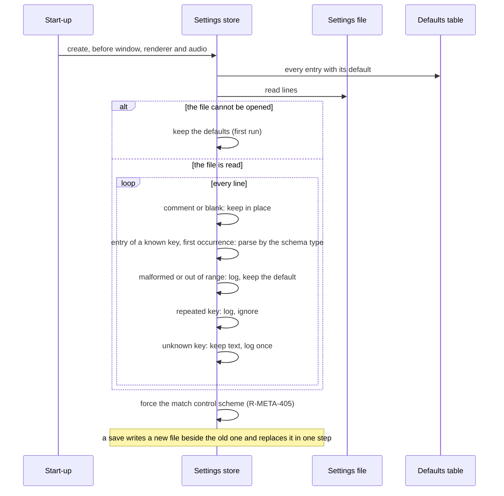
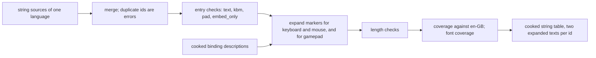

# Settings, input bindings and string tables

> Status: Engine baseline · Prefix: DAT · ADRs: [ADR-0061](../../../adr/0061-data-schemas-and-versioning.md) · [ADR-0062](../../../adr/0062-authoring-syntax-and-schema-language.md) · [ADR-0063](../../../adr/0063-localisation.md) · [ADR-0029](../../../adr/0029-input-event-model-and-binding-contract.md) · [ADR-0071](../../../adr/0071-install-layout-runtime-files-and-user-data.md) · [ADR-0059](../../../adr/0059-content-build-and-validators.md) · Folder: [data schemas](README.md) · Related: [options, localisation and hooks](../../../reference/09_front_end_and_match_flow/options_localisation_and_hooks.md) · [input](../input.md) · [UI layout, rendering, input and localisation](../ui_framework/layout_rendering_input_and_localisation.md) · [renderer options](../renderer/options_and_budgets.md) · [audio engine](../audio_engine.md) · [actions and bindings](../../../reference/06_controls_camera_and_commands/actions_and_bindings.md)

This document specifies three schema families of configuration and text: the settings schema, which is the one defaults table of the settings (DEC-100), together with the text form of the settings file that the settings store reads and writes; the binding-set schema of the input bindings and the keyboard-layout table; and the string tables with their input-mode variants and their caption markup. Which settings exist, what they do and where they are shown belong to [reference/09](../../../reference/09_front_end_and_match_flow/options_localisation_and_hooks.md) and to the components that read them; what a binding means belongs to [input](../input.md); how strings are looked up, fall back and are drawn belongs to the [UI framework](../ui_framework/layout_rendering_input_and_localisation.md) and ADR-0063.

## 1 Responsibilities and boundaries

**DAT-190** (MUST) This document owns: the record type `settings.defaults` and its setting keys; the text form of the settings file, its reader rules and its writer rules; the record types `input.binding_set` and `input.keyboard_layouts`, with the field layout that [input](../input.md) INP-070 to INP-073 defines; and the record type `text.string_table` with the caption-markup syntax that [UI framework](../ui_framework/layout_rendering_input_and_localisation.md) UI-224 and [reference/09](../../../reference/09_front_end_and_match_flow/options_localisation_and_hooks.md) R-META-468 leave to the data schemas.

**DAT-191** (MUST NOT) This document does not define what a setting does, which page shows it or its default value (the owners of table 3.1-A do); the settings store, its notifications and its file location (the [platform layer](../platform_layer.md), ADR-0071); the meaning of a binding node (INP-060); or the look-up, fallback and language selection of strings (UI-218 to UI-222, R-META-465, ADR-0063).

**DAT-192** (MUST NOT) No setting is a simulation input. No simulation rule reads a setting, and a value that would change simulation results exists only as a match option of the match setup (DEC-010, R-META-401).

## 2 Interfaces

The interface below is a C++23 declaration sketch, not an implementation.

```cpp
namespace species::data::settings {

enum class SettingType : std::uint8_t { Boolean, Integer, Decimal, Text, Enum, BindingNode };
enum class ApplyScope : std::uint8_t { Immediate, Renderer, AudioRestart, None };   // UI-441; None: inert entry

struct SettingSpec {                                   // one row of table 3.1-A
  std::string_view key;                                // lower-case dotted
  SettingType type;
  std::optional<double> minimum, maximum;
  std::span<const std::string_view> enumerators;
  DefaultValue defaultValue;                           // a value, or Absent
  ApplyScope scope;
  bool inert;                                          // stored and kept; read by nothing
};

class SettingsDefaults {                               // generated; available before any pack is mounted (DEC-100)
public:
  static std::span<const SettingSpec> All() noexcept;
  static const SettingSpec* Find(std::string_view key) noexcept;   // exact; user binding keys by prefix
};

struct SettingsFileContent;                            // lines in order: comments, blanks, entries
class SettingsFile {                                   // used by the settings store (platform layer)
public:
  static SettingsFileContent Read(std::u8string_view text, std::vector<Diagnostic>& log);    // never fails
  static std::u8string Write(const SettingsFileContent& loaded, const ValueMap& current);   // DAT-201
};

}  // namespace species::data::settings

namespace species::data::strings {

enum class InputMode : std::uint8_t { KeyboardMouse, Gamepad };

class StringTableBuilder {                             // content build: merge, validate, expand (DAT-217)
public:
  std::vector<Diagnostic> Add(const JsonDocument& source);
  std::expected<CookedStringTable, std::vector<Diagnostic>> Build(const BindingDescriptions& bindings) const;
};

class StringTableView {                                // runtime, read-only (UI-221)
public:
  std::u8string_view Lookup(std::string_view id, InputMode mode) const noexcept;
  bool Exists(std::string_view id) const noexcept;
  std::string_view Language() const noexcept;          // BCP 47 tag
};

}  // namespace species::data::strings
```

**Data contracts.** The settings store reads the settings file with `SettingsFile::Read` and the defaults with `SettingsDefaults`, and writes the file with `SettingsFile::Write` through the canonical writer's atomic replacement (README DAT-043). The input router reads the cooked binding sets and the keyboard-layout table (INP-162 to INP-164) and the user layer from the settings store (INP-070). The UI framework reads the cooked string tables (UI-218).

**Threading contract.** The settings file is read on the main thread at start-up, before the window, the renderer and the audio engine are created (R-META-402), and written from a worker after the store has copied its values. String tables and binding sets are loaded on the loading thread and handed to the main thread read-only (UI framework threading contract).

## 3 Data model

### 3.1 The settings schema

**DAT-193** (MUST) The settings schema is the one defaults table of DEC-100: one entry per stored setting, each with its key, its type, its range or its enumerators, its default and its apply scope (UI-441). It is compiled into every product, so every default exists before any pack file is mounted, and installed and development builds start with the same defaults (DEC-100, R-META-402). Where two readers of one setting have different defaults, the table holds the value the runtime reader uses, and a page's own copy is the owning page's fallback, not a second default ([reference/09](../../../reference/09_front_end_and_match_flow/options_localisation_and_hooks.md) §5 item 1).

**DAT-194** (MUST) The settings schema holds exactly the entries of table 3.1-A, one for every row of the settings register of [reference/09](../../../reference/09_front_end_and_match_flow/options_localisation_and_hooks.md) §4.2 and every renderer and audio setting that its owner stores. Each type is the setting's type for every reader, whatever the shape of the stored text (DEC-800 item 5). An entry marked "inert" is stored, kept and written back, and no Species rule reads it (R-META-456).

Table 3.1-A Settings (`settings.defaults`). Scope: "renderer" is a renderer reconfiguration, "audio restart" a restart of the audio engine (R-META-437), "immediate" a change that its readers take at once (UI-441).

| Setting | Key | Type and range | Default | Scope | Owner |
|---|---|---|---|---|---|
| render width, render height | `render.render_width`, `render.render_height` | integer, px | `rnd.option.render_size.default`, the desktop size on first run | renderer | [renderer options](../renderer/options_and_budgets.md) RND-440 |
| window mode, shown as "play in a window" | `render.window_mode` | enumeration `windowed`, `borderless_full_screen` | `rnd.option.window_mode.default`; the page's reference value is `ref.meta.options.screen.windowed_default` | renderer | RND-440; R-META-414 |
| present mode, frame-rate cap, low latency, anti-aliasing, HDR, HDR highlight limit, brightness | `render.present_mode`, `render.frame_rate_cap`, `render.low_latency`, `render.anti_aliasing`, `render.hdr`, `render.hdr_highlight_limit`, `render.brightness` | the types and ranges of RND-440 | `rnd.option.present_mode.default`, `rnd.option.frame_rate_cap.default`, `rnd.option.low_latency.default`, `rnd.option.anti_aliasing.default`, `rnd.option.hdr.default`, `rnd.option.hdr_highlight_limit.default`, `rnd.option.brightness.default` | renderer | RND-440 |
| refresh rate | `screen.refresh_rate` | integer, Hz | the renderer reader's value, which the platform layer keys; page copy `ref.meta.options.screen.refresh_default` | renderer | R-META-414 to R-META-420; platform layer |
| colour bits | `screen.colour_bits` | integer, one of `ref.meta.options.screen.colour_choices` | the renderer reader's value, which the platform layer keys; page copy `ref.meta.options.screen.colour_default` | renderer | R-META-414 to R-META-420; platform layer |
| depth bits | `screen.depth_bits` | integer, one of `ref.meta.options.screen.depth_choices` | `ref.meta.options.screen.depth_default` | renderer | R-META-414 to R-META-420 |
| vertical-sync request, overscan | `screen.vsync_request`, `screen.overscan` | integer | none: inert | none | R-META-456 |
| sea, sky, structure and unit detail | `render.sea_detail`, `render.sky_detail`, `render.structure_detail`, `render.entity_detail` | integer detail level | `rnd.option.sea_detail.default`, `rnd.option.sky_detail.default`, `rnd.option.structure_detail.default`, `rnd.option.entity_detail.default` | renderer | RND-440 |
| terrain detail, pixel effect | `render.terrain_detail`, `render.pixel_effect` | integer | none: inert | none | R-META-456, RND-443 |
| tree detail, special lighting, screenshot tile factor, inverted style, Worker distance scale factor | `render.tree_detail`, `render.special_lighting`, `render.poster_resolution`, `render.inverted_style`, `render.worker_scale_factor` | the types of RND-440: integer, boolean, integer tiles per side, boolean, decimal | `rnd.option.tree_detail.default`, `rnd.option.special_lighting.default`, `rnd.option.poster_resolution.default`, `rnd.option.inverted_style.default`, `rnd.option.worker_scale_factor.default` | renderer | RND-440, R-META-453 |
| audio output | `audio.output` | text, the name of an audio back end | `aen.settings.output_default` | audio restart | [audio engine](../audio_engine.md) AEN-076 |
| mixing rate | `audio.mix_rate` | integer, Hz, one of `ref.meta.options.sound.mix_rate_choices` | `aen.settings.mix_rate_reader_default`; page copy `ref.meta.options.sound.mix_rate_default` | audio restart | AEN-076, R-META-431 |
| master volume | `audio.master_volume` | integer, 0 to `ref.meta.options.sound.volume_max` | `aen.settings.volume_default` | immediate, on release of the slider | AEN-076, R-META-433 |
| bus volumes | `audio.bus_volume.ui`, `audio.bus_volume.announcer`, `audio.bus_volume.voice`, `audio.bus_volume.world`, `audio.bus_volume.ambience`, `audio.bus_volume.music` | integer, 0 to `ref.meta.options.sound.volume_max`; one per bus of R-AUD-221 | `aen.settings.volume_default`; the bus's mix level is `ref.aud.bus.<bus>.level`, not a setting | immediate, on release | AEN-076, R-META-434 |
| voices | `audio.voices` | integer, one of `ref.meta.options.sound.voice_choices` | `aen.settings.voices_default`; page copy `ref.meta.options.sound.voices_page_default` | audio restart | AEN-076, R-META-436 |
| swap left and right | `audio.swap_stereo` | boolean | `aen.settings.swap_stereo_default` | immediate | AEN-076 |
| sample-memory level | `audio.sample_memory_level` | integer | `aen.settings.sample_memory_level_default`; read and ignored (AEN-077) | audio restart | AEN-076 |
| effects switch | `audio.effects` | boolean | `aen.settings.effects_default` | audio restart | AEN-076, DEC-567 |
| output buffer length | `audio.output_buffer` | integer | `aen.settings.output_buffer_first_run`; readers `aen.settings.output_buffer_reader_default`; no Species effect | audio restart | AEN-076 |
| hardware positioning | `audio.hardware_positioning` | boolean | none: inert | none | AEN-076 |
| in-match tips | `interface.tips` | boolean | `ref.meta.settings.tips.default` | immediate | R-META-441 |
| use forwarded port | `network.port_forwarding` | boolean | `ref.meta.settings.port_forwarding.default` | immediate | R-META-443 |
| hosting port, joining port | `network.host_port`, `network.join_port` | integer, `ref.meta.settings.port_min` to `ref.meta.settings.port_max`; `ref.meta.settings.port_any` asks for any free port (R-META-445) | `ref.meta.settings.host_port.default`, `ref.meta.settings.join_port.default` | immediate | R-META-443 to R-META-445 |
| text language | `interface.language` | text, a BCP 47 tag | absent: `ref.meta.settings.language.default`, so start-up chooses (R-META-465) | immediate, with a rebuild of every window (R-META-466) | R-META-465, R-META-466 |
| control help, difficulty | `interface.control_help`, `interface.difficulty` | boolean; integer | `ref.meta.settings.control_help.default`, `ref.meta.settings.difficulty.default`; inert | none | R-META-449, R-META-456 |
| large menus | `interface.large_menus` | boolean | `ref.meta.settings.large_menus.default` | immediate | R-META-449 |
| automatic camera | `camera.automatic` | as [camera](../../../reference/06_controls_camera_and_commands/camera.md) states | `ref.ctrl.camera.automatic_setting` | immediate | reference/06 |
| seasonal theme | `interface.seasonal_theme` | integer | none: inert | none | R-META-449, R-META-456 |
| player name | `player.name` | text, at most the length its owner states | the text of `ui.player.default_name` | immediate | [screen flow](../../../reference/09_front_end_and_match_flow/screen_flow_and_match_setup.md) R-META-008 |
| preferred colour | `player.preferred_colour` | integer, a team colour | absent: `ref.meta.settings.preferred_colour.default`, no preference | immediate | R-META-451 |
| session name | `network.session_name` | text | absent: the player name, then `ui.settings.default_session_name` | immediate | R-META-451, DEC-245 |
| browser filters | `browser.show_incompatible`, `browser.show_full`, `browser.show_password`, `browser.show_custom_maps` | boolean | `ref.meta.settings.browser_filter.default` | immediate | R-META-452, DEC-245 |
| manual session entries | `browser.session.<n>.host`, `browser.session.<n>.port`, `browser.session.<n>.name`, for n from 1 to `ref.meta.settings.manual_sessions` | text; integer port; text | absent: no entry; an entry without a port uses the hosting port | immediate | R-META-452, R-META-443 |
| control scheme | `input.control_scheme` | enumeration of the control schemes of reference/06 | set to the match control scheme after every load (R-META-405, DEC-056) | immediate | [actions and bindings](../../../reference/06_controls_camera_and_commands/actions_and_bindings.md) |
| keyboard layout | `input.keyboard_layout` | text, a layout tag (BCP 47) | absent: the operating system's layout through the keyboard-layout table (INP-164) | immediate, with a binding rebuild (INP-166) | INP-164, R-META-455 |
| mouse-button count | `input.mouse_buttons` | integer | `ref.meta.settings.mouse_buttons.default` | immediate | R-META-455 |
| selection lock | `input.selection_lock` | boolean | absent: selection unrestricted (R-META-455 item 3) | immediate | reference/06 |
| language test | `debug.language_test` | boolean | `ref.meta.settings.language_test.default` | immediate | R-META-473 |
| command-history record, replay, bot-information overlay | `debug.command_record`, `debug.replay`, `debug.bot_overlay`, `debug.bot_overlay_team` | boolean, boolean, boolean, integer team slot | off, off, off, absent | immediate | R-META-457, [reference/12](../../../reference/12_simulation_model/07_randomness_and_integrity.md), [diagnostics](../diagnostics_test_and_performance.md) |
| user bindings | `binding.<action id>`, one per action of INP-067 | binding node in canonical form (INP-072) | absent: the action keeps the bindings of the earlier layers | immediate, with a binding rebuild | INP-070, INP-171 |

**DAT-195** (MUST) A setting key is lower-case ASCII letters, digits, `_` and `.`, at most `dat.id.max_chars` characters, and unique in the schema. A setting that a binding node names with `setting` must be a key of this schema; the content build rejects a binding that names any other key (INP-060, R-META-455 item 4).

### 3.2 The settings file

**DAT-196** (MUST) The settings file holds the player's stored settings in the `settings\` folder of the per-user data folder (ADR-0071, R-META-400); the platform layer names the file. Until DEC-250 is decided its text form is that of table 3.2-A: UTF-8 without a byte-order mark, one line per entry, comment or blank line, with line feeds as line endings. The file carries no schema version and is never migrated (R-META-409); its versioning, migration and synchronisation are DEC-250's, and DEC-800 item 5 applies whatever DEC-250 decides.

Table 3.2-A Lines of the settings file.

| Line | Form | Rule |
|---|---|---|
| entry | `<key> = <value>` | the key as DAT-195 defines it, one space, `=`, one space, then the value to the end of the line |
| comment | `#` followed by any text | kept in its place on save (R-META-404, R-META-407) |
| blank | empty, or blanks only | kept in its place on save |

**DAT-197** (MUST) A value is written in the form of its schema type: a boolean as `true` or `false`; an integer in decimal digits with an optional minus sign; a decimal in its shortest round-trip form (README DAT-041); a text literally, with no quoting, escape or formatting directive (DEC-800 item 4); an enumerator by its name; a binding node as its canonical JSON form on one line (INP-072). A text value cannot hold a line break; a value that would need one is refused by the store with a diagnostic.

**DAT-198** (MUST) The reader types each entry by the schema, never by the shape of its text. An entry whose value does not parse as its type, or lies outside its range or its enumerators, is written to the log with its line and key and takes its default; every other entry keeps its stored value (DEC-800 item 5, R-META-404). A decimal setting written as a whole number reads as that decimal, and an integer setting written with a decimal point is malformed and takes its default.

**DAT-199** (MUST) When a key occurs more than once, the first occurrence is used and every later one is written to the log and ignored (R-META-404); the file is runtime data, so this is not the build error of DEC-801, which applies to authoring files. A key that the schema does not hold is kept with its text and written back unchanged, and logged once at information level, so that a setting of a newer or older build survives (DEC-250). A line that is neither an entry, a comment nor a blank line is logged and kept as it is.

**DAT-200** (MUST) No content of the file can stop the reader: a missing file starts the store from the defaults table (R-META-403); an unreadable byte sequence, a missing `=`, an over-long line and a truncated last line each make only the affected line malformed. No property of the first line, or of any one line, causes the reader to discard the file.

**DAT-201** (MUST) A save writes the file losslessly and atomically (DEC-800 items 1, 3 and 4; R-META-407): every comment, blank and unrecognised line of the loaded file in its place; each loaded key once, at the line of its first occurrence, with its current value; the later occurrences of a repeated key not at all; and then every key that the loaded file did not hold and whose value differs from its default, in byte-wise key order. A save that fails leaves the previous file in place, is written to the log and is reported to the player (`ui.dialog.settings_save_failed`).

### 3.3 The binding-set schema

**DAT-202** (MUST) The default binding set and each keyboard-layout layer are records of the record type `input.binding_set`, with the fields of INP-070 in table 3.3-A; their binding nodes are the JSON nodes of INP-071, each an object with exactly one node-kind property (INP-073). The user layer is the `binding.<action id>` entries of the settings file (DAT-194).

Table 3.3-A Fields of a binding set.

| Field | Key | Type | Presence | Rules |
|---|---|---|---|---|
| layer kind | `layer` | enumeration `default`, `layout` | required | exactly one record of kind `default` per content set |
| layout tag | `layout` | text, a BCP 47 tag | required for `layout`, absent for `default` | unique among the layout layers |
| entries | `entries` | list of entries | required | ordered: the default set appends in entry order (INP-162) |
| entry action | `action` | an action id of INP-067 | required | at most one entry per action in one record (DEC-801 item 2) |
| entry bindings | `bindings` | ordered list of binding nodes (INP-071) | required | exactly one in a layout layer (INP-070); index 0 is the primary binding (INP-065) |
| entry glyph | `glyph` | asset reference to an input glyph | defaulted: none | one glyph per action; it replaces every list of glyph lines (INP-070) |

**DAT-203** (MUST) The content build validates every binding set with the schema and the rules of INP-170 and INP-172: an unknown device word, control name, condition word, node property, action id or setting key is an error naming the record, the action, the path of the node and the word; a condition that the control does not accept is an error (DEC-553, DEC-554); an alias chain that leads back to its own action is an error (DEC-554). Nothing falls back to a default condition (DEC-096), and a binding line that binds nothing has no Species form (DEC-553).

**DAT-204** (MUST) Within one record an action has at most one entry; a second entry for one action is a build error that names both (DEC-801 item 2). The replacing layers of INP-162 therefore never meet two entries for one action from content; the last-wins rule of INP-163 applies only where a run-time layer could hold two, which the keyed form of the user layer (one settings entry per action) also excludes.

### 3.4 The keyboard-layout table

**DAT-205** (MUST) The keyboard-layout table (`input.keyboard_layouts`) maps the language of the operating system's keyboard layout to a layout tag; its rows are those of INP table 4.13-A. Each row holds `system_layout`, the BCP 47 tag of the operating system's keyboard-layout language, and `layout`, the layout tag whose layer applies; a system layout listed twice is a build error, where the reference keeps the first. Operating-system numeric language identifiers do not appear in content: the platform layer reports the active layout as a BCP 47 tag (INP-164), and a tag that the table does not list, or whose layer does not exist, gives no layout layer.

### 3.5 String tables

**DAT-206** (MUST) A string table (`text.string_table`) is the text of one language: its authoring file holds the field `language`, the language's BCP 47 tag, which must match the file name of [GameAssets §2.2](../../../assets/GameAssets.md#22-file-names) (`en_gb.json` for `en-GB`), and the field `strings`, an object keyed by string id. The content build merges every string source of one language into one cooked table, one per asset `strings.en_gb`, `strings.fr_fr`, `strings.de_de`, `strings.it_it`, `strings.es_es`, `strings.pt_br`, `strings.ru_ru`, `strings.ja_jp` and `strings.ko_kr` (UI-222).

**DAT-207** (MUST) A string id is a Species string id (CONVENTIONS §8): lower-case, dotted, at most `ui.lang.max_id_length` (96) characters, compared exactly. Two entries with one id in one language, in one source or in two sources of the language, are a build error (DEC-801 item 2, UI-222); no source overrides another by load order.

**DAT-208** (MUST) An entry is either a JSON string, its plain text, or an object with the fields of table 3.5-A. Text is UTF-8 in ICU MessageFormat syntax (ADR-0063), so a value inserted at run time is a named argument such as `{seconds}`, never a placeholder letter, and no character of a text or of an inserted value is a formatting directive (R-META-469, UI-227). A line break is the JSON escape `\n`; no other escape exists beyond JSON's, and the characters `#`, `:`, `,`, leading blanks and single square brackets are ordinary text.

Table 3.5-A Fields of a string entry.

| Field | Key | Type | Presence | Rule |
|---|---|---|---|---|
| plain text | `text` | text | defaulted: none | shown in an input mode that has no variant |
| keyboard-and-mouse variant | `kbm` | text | defaulted: none | replaces the plain text while the player uses keyboard and mouse |
| gamepad variant | `pad` | text | defaulted: none | replaces the plain text while the player uses a gamepad |
| embed only | `embed_only` | boolean | defaulted: false | the entry can only be embedded in another string (DAT-211) and is never looked up directly |

**DAT-209** (MUST) An entry holds at least one of `text`, `kbm` and `pad`. In each input mode the cooked table holds, for each id, the text of table 3.5-B (UI-223, R-META-468).

Table 3.5-B The text of an entry in input mode M.

| The entry holds | Text in mode M |
|---|---|
| plain text only | the plain text |
| plain text and the variant of M | the variant of M |
| the variant of M, with or without the other variant | the variant of M |
| plain text and the other variant only | the plain text |
| the other variant only | the empty text: the caption disappears in mode M |

**DAT-210** (MUST) The base language is `ref.meta.lang.base` (en-GB), the source language of every string (ADR-0063). The content build reports, for every other language, the ids that it lacks and the ids that the base language lacks, and fails on an id that is missing from the base language (UI-219, R-META-462, R-META-473, DEC-099).

### 3.6 Caption markup

**DAT-211** (MUST) A text may contain the caption markers of table 3.6-A (UI-224, R-META-468). A marker starts with `[[` and ends with `]]`; the two characters `[[` always start a marker, and a literal `[[` is written as the marker `[[open]]`. Every other character, a single square bracket included, is text.

Table 3.6-A Caption markers.

| Marker | Expands to | Rules |
|---|---|---|
| `[[binding:<action id>]]` | the binding argument: the noun of the action's current binding (INP-178), shown as the key's name or inline as its glyph (UI-224) | the action id must exist (INP-067); an action whose bindings have no description expands to the empty text |
| `[[kbm]]` passage `[[end]]` | the passage in keyboard-and-mouse mode, nothing in gamepad mode | — |
| `[[pad]]` passage `[[end]]` | the passage in gamepad mode, nothing in keyboard-and-mouse mode | — |
| `[[kbm]]` passage `[[pad]]` alternative `[[end]]`, or `[[pad]]` passage `[[kbm]]` alternative `[[end]]` | the passage in its mode, the alternative in the other | a mode passage does not contain another mode passage |
| `[[string:<string id>]]` | the text of that string in the same input mode, with its own markers expanded | the id must exist in the same language or the base language; a chain of embedded ids that comes back to an id already being expanded is a build error |
| `[[open]]` | the two characters `[[` | — |

**DAT-212** (MUST) A marker that is not one of table 3.6-A, an unterminated marker, a marker longer than `ui.lang.max_marker_length` (64) characters, a mode passage without `[[end]]` and an `[[end]]` without a passage are build errors with the file, the id and the character position; expansion never loops, never re-reads a marker and never truncates silently (DEC-015). An expanded text longer than `ui.lang.max_expanded_length` (1,024) characters is a build error (UI-225, DEC-801 item 5).

**DAT-213** (MUST) Markers are expanded when the table is built, once per input mode, and again whenever the bindings change (UI-224); an expanded binding argument or embedded string is quoted for ICU MessageFormat, so that no character of it is read as message syntax (DEC-800 item 4). ICU formatting of named arguments happens after expansion, at display time (ADR-0063).

### 3.7 Ids that code builds

**DAT-214** (MUST) Code and data build string ids only from the fixed patterns that the owning documents state, among them `map.<map id>.name` (R-MAP-020), `match.options.<option>` and `ui.advanced_options.help.<option>.<mode>` ([map_schema.md](map_schema.md) DAT-099), `<prefix>.name` for a structure kind (R-BLDG-012) and `mode.<mode>.name` (R-MODE-029); every id of a pattern that content can reach must exist in the base language (README DAT-030). A count that comes from data, such as the help pages of a mode or the lines of the credits page, is decided by `Exists` (UI-220, R-META-471), never by a look-up that returns its id.

## 4 Behaviour and algorithms

### 4.1 Loading and saving the settings



Caption: Figure 4.1-A, loading the settings file (DAT-193 to DAT-201; R-META-402 to R-META-407; DEC-800).

**DAT-215** (MUST) The store writes the settings file only on the events of R-META-406, with the writer of DAT-201.

### 4.2 Building the bindings

**DAT-216** (MUST) The input router builds the action bindings from the cooked default set, the cooked layout layer of the active layout and the user entries of the settings file, in that order (INP-162). A user entry is validated at run time by the rules that the content build applies to the cooked layers; a rejected entry is logged with its key and skipped, and never stops loading (INP-171, DEC-015).

### 4.3 Building a string table

**DAT-217** (MUST) The content build builds each language's table in these steps, and fails the language on any error: merge the sources of the language and reject duplicate ids (DAT-207); validate every entry (DAT-208, DAT-209); resolve and expand the markers per input mode (DAT-211 to DAT-213); check the lengths (DAT-212); compare the ids with the base language and write the coverage report (DAT-210); check the glyph coverage of the bundled fonts for the language (AST-088). The cooked table holds, for each id, its expanded text in each input mode, and a flag for embed-only entries, which `Lookup` never returns.



Caption: Figure 4.3-A, building one language's string table (DAT-217; UI-222 to UI-225).

## 5 Concurrency and performance budget

**DAT-218** (MUST) Reading and writing the settings file costs one pass over its lines and does not depend on the size of any pack. Building a string table is linear in the size of its text plus the expanded length of its embedded strings, which the length limits of DAT-212 bound. Re-expanding the markers after a binding change touches only the entries that contain a binding argument, which the cooked table lists.

## 6 Failure modes, diagnostics and telemetry

| Condition | Result | Requirement |
|---|---|---|
| a settings entry that does not parse or is out of range | logged; the default applies; other entries keep their values | DAT-198 |
| a repeated settings key | logged; the first occurrence applies | DAT-199 |
| an unknown settings key or line | logged once; kept and written back | DAT-199 |
| a failed settings save | logged and reported; the previous file stays | DAT-201 |
| a binding set with an unknown word, a refused condition, an alias loop or two entries for one action | build error | DAT-203, DAT-204 |
| a user binding that fails validation | logged; skipped | DAT-216 |
| a duplicate keyboard layout row | build error | DAT-205 |
| a duplicate string id, an id missing from the base language, an empty entry | build error | DAT-207, DAT-209, DAT-210 |
| an unknown, unterminated or over-long marker; an embedding cycle; an over-long expanded text | build error | DAT-211, DAT-212 |

## 7 Acceptance tests

| Test | Kind | Checks | Requirements |
|---|---|---|---|
| T40 settings table | unit | every row of the settings register of reference/09 §4.2 has an entry; every default equals its owner key's value | DAT-193, DAT-194 |
| T41 settings round trip | property | a file of random comments, blanks, known, unknown and repeated keys reads and saves with every comment, blank and unknown line in place, each known key once and the later repeats dropped; a second save gives the same bytes | DAT-196 to DAT-201 |
| T42 typed reading | unit | a decimal stored as `2` reads as 2.0; an integer stored as `1.0` takes its default with a log line; a first line that starts with a digit discards nothing | DAT-198, DAT-200 |
| T43 values are data | unit | a player name holding `%s`, `{0}` and `#` is written and read back unchanged | DAT-197 |
| T44 binding fixtures | unit | one failing fixture per rule of DAT-203 and DAT-204; the default set and both layout layers of INP table 4.13-B validate | DAT-202 to DAT-204 |
| T45 variants | unit | each row of table 3.5-B gives its text in both modes | DAT-209 |
| T46 markup | unit | every marker of table 3.6-A expands as stated; `[[open]]` gives `[[`; a single `[` stays; an unterminated marker and an embedding cycle fail with their position | DAT-211, DAT-212 |
| T47 ICU quoting | unit | a binding noun or embedded string containing `{`, `}` or an apostrophe is shown literally after formatting | DAT-213 |

## 8 Open decisions

### 8.1 Decisions and architecture records

| Reference | Status | Where it applies |
|---|---|---|
| DEC-100 | Resolved | one compiled defaults table (DAT-193) |
| DEC-800 | Resolved | typed settings, lossless and atomic writes, values as data (DAT-197 to DAT-201, DAT-213) |
| DEC-801 | Resolved | duplicate actions and string ids are build errors; declared lengths (DAT-204, DAT-207, DAT-212) |
| DEC-250 | Open | the settings file's version, migration and synchronisation; unknown keys kept (DAT-196, DAT-199) |
| DEC-099 | Resolved | coverage against the base language (DAT-210) |
| DEC-096, DEC-553, DEC-554 | Resolved | strict binding validation (DAT-203) |
| DEC-010, DEC-056 | Resolved, Dropped | no setting feeds the simulation; one control scheme (DAT-192, table 3.1-A) |
| DEC-245 | Open | the session-browser settings are stored for the browser's use (table 3.1-A) |
| DEC-567 | Open | the effects switch defaults to off (table 3.1-A) |
| ADR-0063 | Accepted | UTF-8 string tables, BCP 47 tags, ICU MessageFormat, per-key fallback |
| ADR-0029 | Accepted | the binding contract and its canonical form |

### 8.2 Design-phase inputs

1. **Settings file** (DEC-250): a schema version per stored file, forward migration, keeping unknown keys, synchronisation through a platform service, and whether the text form of table 3.2-A or a JSON form is kept.
2. **Rebinding** (DEC-050): whether players rebind controls; the user layer's keys already have one entry per action.
3. **Voice localisation** (DEC-317): whether string tables gain voice-line entries or audio gains per-language member sets ([import_and_build_records.md](import_and_build_records.md)).
4. **Translator tools**: whether translators edit the JSON string tables directly or a translation-memory format that the content build converts.

## 9 Tuning table

This document owns no tuning key.

| owner | keys cited |
|---|---|
| [renderer options](../renderer/options_and_budgets.md) | `rnd.option.render_size.default`, `rnd.option.window_mode.default`, `rnd.option.present_mode.default`, `rnd.option.frame_rate_cap.default`, `rnd.option.low_latency.default`, `rnd.option.anti_aliasing.default`, `rnd.option.hdr.default`, `rnd.option.hdr_highlight_limit.default`, `rnd.option.brightness.default`, `rnd.option.sea_detail.default`, `rnd.option.sky_detail.default`, `rnd.option.structure_detail.default`, `rnd.option.entity_detail.default`, `rnd.option.tree_detail.default`, `rnd.option.special_lighting.default`, `rnd.option.poster_resolution.default`, `rnd.option.inverted_style.default`, `rnd.option.worker_scale_factor.default` |
| [audio engine](../audio_engine.md) | `aen.settings.output_default`, `aen.settings.mix_rate_reader_default`, `aen.settings.volume_default`, `aen.settings.voices_default`, `aen.settings.swap_stereo_default`, `aen.settings.sample_memory_level_default`, `aen.settings.effects_default`, `aen.settings.output_buffer_first_run`, `aen.settings.output_buffer_reader_default` |
| [reference/09 options](../../../reference/09_front_end_and_match_flow/options_localisation_and_hooks.md) | `ref.meta.options.screen.windowed_default`, `ref.meta.options.screen.refresh_default`, `ref.meta.options.screen.colour_choices`, `ref.meta.options.screen.colour_default`, `ref.meta.options.screen.depth_choices`, `ref.meta.options.screen.depth_default`, `ref.meta.options.sound.mix_rate_choices`, `ref.meta.options.sound.mix_rate_default`, `ref.meta.options.sound.volume_max`, `ref.meta.options.sound.voice_choices`, `ref.meta.options.sound.voices_page_default`, `ref.meta.settings.tips.default`, `ref.meta.settings.port_forwarding.default`, `ref.meta.settings.port_min`, `ref.meta.settings.port_max`, `ref.meta.settings.port_any`, `ref.meta.settings.host_port.default`, `ref.meta.settings.join_port.default`, `ref.meta.settings.language.default`, `ref.meta.settings.control_help.default`, `ref.meta.settings.difficulty.default`, `ref.meta.settings.large_menus.default`, `ref.meta.settings.preferred_colour.default`, `ref.meta.settings.browser_filter.default`, `ref.meta.settings.manual_sessions`, `ref.meta.settings.mouse_buttons.default`, `ref.meta.settings.language_test.default`, `ref.meta.lang.base` |
| [camera](../../../reference/06_controls_camera_and_commands/camera.md) | `ref.ctrl.camera.automatic_setting` |
| [audio mix](../../../reference/10_audio_design/positional_priorities_and_mix.md) | `ref.aud.bus.ui.level` and the other bus levels of R-AUD-221 |
| [UI layout and localisation](../ui_framework/layout_rendering_input_and_localisation.md) | `ui.lang.max_id_length`, `ui.lang.max_marker_length`, `ui.lang.max_expanded_length` |
| [data schemas](README.md) | `dat.id.max_chars` |
