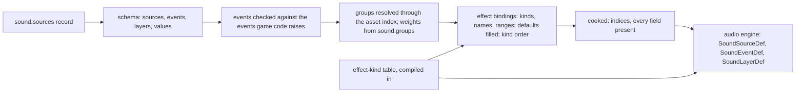

# Actor, audio, geometry and panel schemas

> Status: Engine baseline · Prefix: DAT · ADRs: [ADR-0061](../../../adr/0061-data-schemas-and-versioning.md) · [ADR-0062](../../../adr/0062-authoring-syntax-and-schema-language.md) · [ADR-0019](../../../adr/0019-mesh-source-format-and-cooked-meshes.md) · [ADR-0020](../../../adr/0020-flat-shading-and-team-tint.md) · [ADR-0021](../../../adr/0021-mesh-socket-schema.md) · [ADR-0024](../../../adr/0024-audio-buses-and-per-bus-effects.md) · [ADR-0025](../../../adr/0025-audio-formats-codecs-and-residency.md) · [ADR-0035](../../../adr/0035-procedural-animation-runtime.md) · [ADR-0076](../../../adr/0076-screenshot-encoding.md) · [ADR-0059](../../../adr/0059-content-build-and-validators.md) · Folder: [data schemas](README.md) · Related: [units](../../../reference/02_units/README.md) · [Supply crates](../../../reference/04_supply_crates_powers_and_weapons/README.md) · [event model and sound data](../../../reference/10_audio_design/event_model_and_sound_data.md) · [audio engine](../audio_engine.md) · [asset pipeline and resources](../asset_pipeline_and_resources.md) · [terrain](../terrain.md) · [front-end presentation](../../../reference/09_front_end_and_match_flow/front_end_presentation.md) · [explainers](../animation_and_vfx/explainers_sprites_and_procedural_animation.md)

This document specifies the schemas of the actor stat table, the Supply-crate outcome catalogue, the sound data (sound sources, their events and layers, modulatable values, effect bindings and sample-group weights) with the effect-kind table, the cooked mesh, collision and simulation data records, the image conventions of the terrain colour ramps, the screenshot output, and the explainer animations. The meaning of each field is the owning document's: [reference/02](../../../reference/02_units/README.md) for actor stats, [reference/04](../../../reference/04_supply_crates_powers_and_weapons/README.md) for the outcome catalogue, [event model and sound data](../../../reference/10_audio_design/event_model_and_sound_data.md) and the [audio engine](../audio_engine.md) for sound, the [asset pipeline](../asset_pipeline_and_resources.md) with ADR-0019 to ADR-0021 for meshes, [terrain](../terrain.md) for the ramps and [front-end presentation](../../../reference/09_front_end_and_match_flow/front_end_presentation.md) for the explainer animations.

## 1 Responsibilities and boundaries

**DAT-260** (MUST) This document owns the record types `actor.stats`, `crate.outcomes`, `sound.sources`, `sound.groups`, `sound.effect_kinds`, `geometry.mesh`, `geometry.collision`, `geometry.sim_record` and `panels.explainer`: their keys, types, presence rules, ranges and checks, and the conventions by which the content build reads the terrain colour ramps.

**DAT-261** (MUST NOT) This document sets no stat value, outcome rule, sound design value, mesh cooking step or animation rule. The values come from the owners' tuning keys; the cooking of meshes and audio is the [asset pipeline](../asset_pipeline_and_resources.md)'s (AST-076 to AST-081); the playback of sound is the [audio engine](../audio_engine.md)'s; the playback of explainer animations is [animation and VFX](../animation_and_vfx/explainers_sprites_and_procedural_animation.md)'s (VFX-103 to VFX-110).

## 2 Interfaces

The interface below is a C++23 declaration sketch, not an implementation. The record types are generated from the schemas (ADR-0062).

```cpp
namespace species::data {

struct ActorStats { ActorKind kind; double health, speed, rate; std::optional<double> actorRate; };   // table 3.1-A

struct CrateOutcomeEntry {                      // table 3.2-A
  CrateOutcome outcome; OutcomeClass cls; bool good, bad, start; std::uint8_t comebackWeight; Delivery delivery;
};

enum class ParamKind : std::uint8_t { Fixed, Random, Linked };
enum class ParamUpdate : std::uint8_t { Continuous, PerNote };
enum class ParamLink : std::uint8_t {           // R-AUD-052
  None, Height, PosX, Altitude, PosZ, Speed, CameraDistance, ObjectAge, TeamsNearby, TimeRemaining, UnitCount };
struct SoundParam {                             // one modulatable value (DAT-268)
  ParamKind kind; double value, lo, hi, inLo, inHi, outLo, outHi, smoothing; ParamLink link; ParamUpdate update;
};
enum class EffectKind : std::uint8_t {          // R-AUD-077 order; the order carries meaning
  Chorus, Compressor, Distortion, StereoEcho, Flanger, StandardGargle, RoomReverb,
  ParametricEqualiser, StudioReverb, ResonantLowPass, BitCrusher, Gargle, Echo, SimpleReverb };
struct EffectBinding { EffectKind kind; std::array<SoundParam, 13> params; std::uint8_t count; };  // kind order
struct SoundLayerDef;                           // table 3.3-B
struct SoundEventDef { std::string fullId; std::optional<double> cooldownSeconds; std::span<const SoundLayerDef> layers; };
struct SoundSourceDef { std::string source; std::span<const SoundEventDef> events; };
struct DspParamDesc { std::string_view name; double minimum, maximum, declaredDefault, schemaDefault; bool integer; };
struct DspFilterDef { EffectKind kind; std::span<const DspParamDesc> params; };   // generated, compiled in

struct ExplainerKey;                            // table 3.7-B
struct ExplainerAnimation { MatchMode mode; std::uint32_t width, height; double loopStart, loopEnd;
                            std::span<const std::span<const ExplainerKey>> objects; };

}  // namespace species::data
```

**Data contracts.** The simulation reads `actor.stats`, `crate.outcomes`, `geometry.collision` and `geometry.sim_record` (simulation-relevant, README table 1-A). The audio engine reads `sound.sources`, `sound.groups` and the compiled effect-kind table (AEN-060). The renderer reads `geometry.mesh` (ADR-0019). The terrain component and the sea renderer read the colour ramps as CPU tables (TER-040, TER-041). The explainer player reads `panels.explainer` (VFX-103).

**Threading contract.** All of these records are loaded on the loading thread and are read-only afterwards (README DAT-005).

## 3 Data model

### 3.1 The actor stat table

**DAT-262** (MUST) The actor stat table (`ActorStatTable`, `actor.stats`) holds one record per actor kind of [reference/02](../../../reference/02_units/README.md) table 2.1-A, each naming its kind, with the fields of table 3.1-A. Records bind by kind, never by row position: a kind without a record and a record for a kind outside the table are build errors, so a table can never leave a kind's stats at 0 or shift one kind's stats onto another (DEC-019, AC-UNIT-01).

Table 3.1-A Fields of an actor stat record.

| Field | Key | Type and precision | Presence | Range and rules |
|---|---|---|---|---|
| actor kind | `kind` | enumeration: `worker`, `leader`, `trooper`, `transport`, `collector`, `builder`, `bomber`, `barrage_missile`, `meteor`, `abductor`, `crawler`, `crawler_egg`, `brood_drifter`, `centipede`, `spider`, `ant`, `reaper_serpent`, `seed_pod`, `bot_controller` | required | one record per kind (DEC-801) |
| health | `health` | simulation decimal, binary32-rounded, health points | required | 0 to `ref.unit.health_max` |
| speed | `speed` | simulation decimal, binary32-rounded, wu/s of game time | required | 0 or more; the value of difficulty level 0 (DEC-010) |
| rate | `rate` | simulation decimal, binary32-rounded, s between shots | required | 0 or more; scheduled in ticks by the unit documents (R-UNIT-011) |
| actor rate | `actor_rate` | simulation decimal, binary32-rounded, s | defaulted: the record's `rate` | 0 or more; the per-actor reload rate where it differs from the table rate, which the Trooper record sets (R-UNIT-014) |

**DAT-263** (MUST) The values of the records are the reference tuning of [reference/02](../../../reference/02_units/README.md) §4.1, the keys `ref.unit.<kind>.health`, `ref.unit.<kind>.speed` and `ref.unit.<kind>.rate` with `ref.unit.trooper.actor_rate`, `ref.unit.abductor.speed` and `ref.unit.meteor.speed`. Stats are floating-point values for every reader: no reader stores a stat in an 8-bit integer, so no stat is truncated or wrapped (DEC-090), and the validator rejects a value outside the declared range instead of storing it (DEC-241 item 2).

### 3.2 The Supply-crate outcome catalogue

**DAT-264** (MUST) The outcome catalogue (`crate.outcomes`) holds one entry per Supply-crate outcome of [reference/04](../../../reference/04_supply_crates_powers_and_weapons/README.md) table 2.2-A, keyed by its identifier, with the fields of table 3.2-A, whose names are that table's columns. The canonical outcome order of R-CRATE-007 is the enumeration order of the `outcome` field, declared in the schema; the order of the entries in the file carries no meaning (README DAT-013). The validity rules that decide whether an outcome may drop (R-CRATE-125, R-CRATE-126) are rules, not data.

Table 3.2-A Fields of an outcome entry.

| Field | Key | Type | Presence | Rules |
|---|---|---|---|---|
| outcome | `outcome` | enumeration of the 31 `CrateOutcome` identifiers, in snake_case | required | one entry per outcome (DEC-801) |
| class | `class` | enumeration `basic`, `advanced` | required | exactly `ref.crate.outcome.basic_count` basic outcomes (R-CRATE-008) |
| good pool | `good` | boolean | required | R-CRATE-124 |
| bad pool | `bad` | boolean | required | R-CRATE-126 |
| starting-powers pool | `start` | boolean | required | R-ECON-110 |
| Comeback pool | `comeback` | count, the number of times the outcome is listed in the Comeback pool | defaulted: 0 | the airstrike is listed twice (R-CRATE-007 table, DEC-452) |
| delivery as a good outcome | `delivery` | enumeration `power`, `at_crate`, `global`, `opening_team`, `none` | required | the delivery column of table 2.2-A |

### 3.3 Sound data

**DAT-265** (MUST) The sound data (`sound.sources`) holds one record per sound source: an actor kind, a structure kind or one of the eleven non-object sources of [event catalogue](../../../reference/10_audio_design/event_catalogue.md) R-AUD-121, named by its lower-case snake_case source id (R-AUD-022). A record holds the source's events; an event holds its layers. Table 3.3-A gives the fields of a source and an event, table 3.3-B those of a layer.

Table 3.3-A Fields of a sound source and of an event.

| Field | Key | Type | Presence | Rules |
|---|---|---|---|---|
| source | `source` | a source id | required | an actor kind, a structure kind or a non-object source; one record per source (DEC-801) |
| events | `events` | list of events | required | unordered: keyed by event id |
| event id | `event` | lower-case snake_case | required | one of the events that game code raises for the source (R-AUD-022); unique within the source; the full id is `<source>.<event>` (R-AUD-028) |
| cool-down | `cooldown` | presentation decimal, s of real time | absence-meaningful: none | the per-event cool-down that replaces a fixed rate limit of game code (R-AUD-220, DEC-570) |
| layers | `layers` | ordered list of layers | required | at least one layer; each layer plays when its audience accepts the event (R-AUD-023) |

Table 3.3-B Fields of a layer, in schema order: the fields of R-AUD-049 and the engine fields of AEN-062. A modulatable value is DAT-268's.

| Field | Key | Type | Default | Range and rules |
|---|---|---|---|---|
| sample group | `group` | asset reference to a sample group (`sfx.*`, `amb.*`, `music.*`) | required | resolved through the asset index (AST-049); a single sample is a group of one (R-AUD-045) |
| position | `position` | enumeration `2d`, `fix`, `att` | `att` | R-AUD-049 |
| sharing | `sharing` | enumeration `poly`, `share-rnd`, `share-near` | `poly` | R-AUD-029 |
| loop | `loop` | enumeration `once`, `loop`, `note` | `once` | R-AUD-056 to R-AUD-062 |
| audience | `audience` | enumeration `all`, `own`, `enemy`, `none` | `all` | R-AUD-024, R-AUD-025 |
| minimum distance | `min_distance` | presentation decimal, wu | `ref.aud.layer.min_distance_default` | within `ref.aud.layer.min_distance_range` |
| bus | `bus` | enumeration `ui`, `announcer`, `voice`, `world`, `ambience`, `music` | the routing of the event's source (R-AUD-222) | R-AUD-221 |
| level | `level` | modulatable value, dB | `ref.aud.layer.level_default` | authored in decibels (DEC-042) |
| pitch | `pitch` | modulatable value, × the sample rate | `ref.aud.layer.pitch_default` | within `ref.aud.layer.pitch_range` |
| attack | `attack` | modulatable value, s | `ref.aud.layer.envelope_default` | at most `ref.aud.layer.attack_max` |
| sustain | `sustain` | modulatable value, s | `ref.aud.layer.envelope_default` | at most `ref.aud.layer.sustain_max` |
| release | `release` | modulatable value, s | `ref.aud.layer.envelope_default` | at most `ref.aud.layer.release_max` |
| loop delay | `loop_delay` | modulatable value, s | `ref.aud.layer.envelope_default` | at most `ref.aud.layer.loop_delay_max` |
| effects | `effects` | list of effect bindings (DAT-270) | none | at most one binding of each effect kind (R-AUD-080) |
| copy decay | `copy_decay` | presentation decimal, × per louder copy | `ref.aud.rank.copy_decay` | AEN-062, AEN-063 |
| patience window | `patience` | presentation decimal, s | `ref.aud.layer.one_shot_patience_updates` × `ref.sim.frame.audio_update_period` | AEN-062, AEN-146 |
| real-voice cap | `voice_cap` | count | absence-meaningful: the bus default of AEN-143 | AEN-062 |
| maximum distance | `max_distance` | presentation decimal, wu | `aen.spatial.max_distance_default` | AEN-062, AEN-202 |
| Doppler factor | `doppler_factor` | presentation decimal | `aen.spatial.doppler_factor_default` | AEN-207 |
| distance-filter factor | `filter_factor` | presentation decimal | `aen.spatial.filter_factor_default` | AEN-207 |
| distance-reverb factor | `reverb_factor` | presentation decimal | `aen.spatial.reverb_factor_default` | AEN-207 |

**DAT-266** (MUST) A layer has no priority field: the reference's priority field carries no value, and a Species layer's priority is its bus's priority class (R-AUD-049, DEC-570); a `priority` key is an unknown field. A layer has no sample-or-group switch, because every layer names a group, and no editor-only position kind, because only the three positions of table 3.3-B exist.

**DAT-267** (MUST) A source listed twice, an unknown source id, an event id that game code never raises for its source, an event listed twice within its source, a layer without a group and a group that does not resolve are build errors (R-AUD-022, R-AUD-046, DEC-801, DEC-015). An event that game code raises and that the data does not define is valid and plays nothing; the content build lists every such event (R-AUD-027).

### 3.4 Modulatable values

**DAT-268** (MUST) A modulatable value (`SoundParam`, R-AUD-051 to R-AUD-054) is written in one of the three forms of table 3.4-A. The update mode defaults to `continuous` (R-AUD-053), and the smoothing lies in [0, `ref.aud.param.smoothing_max`] with the default 0. A value that names an unknown link, has the wrong number of bounds or mixes the fields of two forms is a build error; no form is chosen from the count of numbers that follow a word.

Table 3.4-A Forms of a modulatable value.

| Kind | Form | Fields |
|---|---|---|
| fixed | a JSON number | the value |
| random | `{"random": [lo, hi], "smoothing": s, "update": u}` | lo, hi; the smoothing and the update mode are optional |
| linked | `{"linked": link, "input": [inLo, inHi], "output": [outLo, outHi], "smoothing": s, "update": u}` | the link is one of `none`, `height`, `pos_x`, `altitude`, `pos_z`, `speed`, `camera_distance`, `object_age`, `teams_nearby`, `time_remaining`, `unit_count` (R-AUD-052; DEC-568); the update mode is `continuous` or `per_note` |

**DAT-269** (MUST) The values of a modulatable value are written exactly and cooked as binary64; no writer rounds them to a fixed number of decimals (DEC-800). A level is in decibels; no value uses the reference's ten-step volume scale (DEC-042).

### 3.5 Effect bindings and the effect-kind table

**DAT-270** (MUST) An effect binding is an object with the field `kind`, an effect kind of table 3.5-A, and one field per parameter it sets, named as table 3.5-A names it, each a modulatable value (R-AUD-080). A parameter name that the kind does not have, a second binding of one kind on one layer and a value outside the parameter's range are build errors (R-AUD-080, AEN-071).

**DAT-271** (MUST) A parameter that a binding omits takes its schema default, which is the parameter's declared default of R-AUD-077 (AEN-071). The reference reads an omitted parameter as 0.0 (R-AUD-050, R-AUD-078); Species chooses the declared default deliberately, as DEC-567 requires the choice to be made, because 21 of the 63 parameters have ranges that exclude 0.0 and every reference binding states all its parameters (AEN-071).

**DAT-272** (MUST) The cooker writes each binding's parameters in its kind's parameter order of table 3.5-A, the positions by which the audio engine reads them (R-AUD-050, AEN-070); the authoring file still names every parameter, so its order in the file carries no meaning (README DAT-027). An integer parameter is cooked as a decimal and truncated toward zero by the engine when evaluated (AEN-070).

Table 3.5-A Effect kinds and parameter names, in the order of R-AUD-077; ranges and declared defaults are R-AUD-077's ("i" marks an integer parameter).

| # | Kind | Parameters, in order |
|---|---|---|
| 0 | `chorus` | `wet_dry_mix`, `depth`, `feedback`, `frequency`, `waveform` (i), `delay`, `phase` (i) |
| 1 | `compressor` | `gain`, `attack`, `release`, `threshold`, `ratio`, `pre_delay` |
| 2 | `distortion` | `gain`, `edge`, `post_eq_centre`, `post_eq_bandwidth`, `pre_low_pass_cutoff` |
| 3 | `stereo_echo` | `wet_dry_mix`, `feedback`, `left_delay`, `right_delay`, `pan_delay` (i) |
| 4 | `flanger` | `wet_dry_mix`, `depth`, `feedback`, `frequency`, `waveform` (i), `delay`, `phase` (i) |
| 5 | `standard_gargle` | `rate` (i), `wave_shape` (i) |
| 6 | `room_reverb` | `room` (i), `room_high_frequency` (i), `room_roll_off_factor`, `decay_time`, `decay_high_frequency_ratio`, `reflections` (i), `reflections_delay`, `reverb` (i), `reverb_delay`, `diffusion`, `density`, `high_frequency_reference`, `quality` (i) |
| 7 | `parametric_equaliser` | `centre`, `bandwidth`, `gain` |
| 8 | `studio_reverb` | `input_gain`, `reverb_mix`, `reverb_time`, `high_frequency_time_ratio` |
| 9 | `resonant_low_pass` | `cutoff_control`, `resonance_control`, `gain` |
| 10 | `bit_crusher` | `bits` |
| 11 | `gargle` | `wet_dry_mix`, `rate`, `wave_shape` (i) |
| 12 | `echo` | `wet_dry_mix`, `delay`, `attenuation` |
| 13 | `simple_reverb` | `wet_dry_mix` |

**DAT-273** (MUST) The effect-kind table (`sound.effect_kinds`, `DspFilterDef`) holds, for each kind in the order of table 3.5-A, each parameter's name, minimum, maximum, declared default, integer flag and schema default (AEN-070). It is a schema-defined record that the code generator compiles into the audio engine and that the content build's validator reads, so the engine and the validator share one definition (AEN-060, ADR-0061). The kind order is the processing order of a chain's own-algorithm effects (R-AUD-080); a kind is identified by its name, never by its position in a file, so a table of another length or order cannot re-bind the kinds.

**DAT-274** (MUST) The minimum and maximum of a parameter are enforced ranges: the validator rejects a fixed value, a random bound or a linked output bound outside them (AEN-071). The table holds no data type code: an integer parameter is marked by its flag, and a parameter of any other type does not exist.

### 3.6 Sample-group weights

**DAT-275** (MUST) A sample group's members are the members of its asset in the order of the manifest's `variants` column (AST-016, AST-049). The record type `sound.groups` holds, for each group whose members are not equally weighted, the field `group`, the group's asset id, and the field `weights`, one positive decimal per member in member order; a group without an entry has equal weights (R-AUD-063, DEC-568). A group listed twice is a build error (R-AUD-068, DEC-801 item 2); a weights list whose length differs from the member count is a build error; a group that no event names is reported as a warning (R-AUD-068).

### 3.7 Meshes, collision assets and simulation data records

**DAT-276** (MUST) The cooked mesh (`MeshAsset`, schema `geometry.mesh`) holds the data of table 3.7-A, which the mesh cooker writes (ADR-0019, AST-076, AST-052). Its source is binary glTF with its import record ([import_and_build_records.md](import_and_build_records.md)); no runtime reads the source.

Table 3.7-A Content of a cooked mesh.

| Part | Fields | Rules |
|---|---|---|
| node table | for each mesh node (`MeshNode`): its name; the index of its parent node, or none for a root node; its rest transform; its draw range; its axis-aligned bounding box; its vertical extent; its bounding sphere | node names are unique within the mesh (AST-045); every parent exists, so no node is left unattached; at most `rnd.mesh.max_nodes` nodes (AST-076) |
| vertex stream | for each triangle corner: position, facet colour, facet normal, tint weight, barycentric corner | the facet colour is the triangle's colour attenuated by `rnd.mesh.colour_attenuation` at cook time (AST-076); the facet normal is computed at cook time for a faceted primitive (ADR-0020); the tint weight is explicit, never inferred from a colour (AST-034) |
| socket table | for each socket kind of AST table 3.8-A in table order, the sockets in index order, each with its parent node, its transform relative to that node and its chain of nodes up to the root | at most `rnd.mesh.max_sockets` sockets; the socket kinds are the closed enumeration of AST-039 (ADR-0021) |
| bounding sphere of a node | centre: the centre of its bounding box; radius: the largest distance from that centre to a vertex of the node | AST-076 |

**DAT-277** (MUST) Code addresses a socket by its kind and index only (ADR-0021): no reader scans socket or node names by prefix, by a text pattern or without regard to case, and no socket is found by a name that code assembles at run time. Socket kinds that no rule reads are kept as DEC-330's default states (AST-041).

**DAT-278** (MUST) A collision asset (schema `geometry.collision`) holds, per node, its triangles in world units relative to the asset origin and its bounding sphere; it is simulation-relevant and is cooked from its own source, never from render geometry (AST-044, AST-077, DEC-012). A triangle index outside its node's vertex count, and a node whose attribute counts differ, are build errors (AST-045).

**DAT-279** (MUST) A simulation data record (`SimRecord`, schema `geometry.sim_record`) holds, for each simulation-relevant socket kind, the socket transforms in index order with the rest transforms of their node chains, in world units; the asset's member order where the simulation draws a member, as for `mesh.relic.variant`; and the bounding sphere of each collision asset (AST-043, AST-046, AST-016). The simulation reads this record and never the render mesh (ADR-0021).

### 3.8 Terrain colour ramps and the sea tile

**DAT-280** (MUST) The land colour ramps (`terrain.ramp`) and the shore-wave gradients (`terrain.shore_wave_gradient`) are cooked as CPU tables and the sea tiles (`terrain.sea_tile`) as textures, with the import records of [import_and_build_records.md](import_and_build_records.md) (AST table 3.2-A). A map selects each by its member number ([map_schema.md](map_schema.md) table 3.4-A); member 1 is the map default (R-MAP-086).

**DAT-281** (MUST) A cooked CPU table stores the image's rows from the top row as the image is viewed to the bottom row. A reader whose rule counts rows from the bottom row as viewed, as the land ramp's height axis (TER-040) and the wave table row `rnd.sea.wave_table_row` (TER-041, RND-144) do, converts its index i to the stored row (height − 1 − i), so the stored order of the source file format never changes which row is read. The land ramp's columns run from flat ground (column 0) to vertical (the last column) (TER-040).

**DAT-282** (MUST) The content build rejects a land colour ramp whose size is not `ter.colour.ramp_size` × `ter.colour.ramp_size` (TER-040); it accepts a shore-wave gradient of any width, which gives the number of wave colours, and of at least two rows (TER-041). While the match's seasonal state is active, the seasonal members replace the map's choice (TER-042, DEC-118); the replacement is a rule of the renderer, not a field of the map.

### 3.9 Screenshot output

**DAT-283** (MUST) The client writes screenshots as PNG, 8-bit sRGB RGBA, encoded off the render thread with the in-box image encoder, under the file name and in the folder that ADR-0076 and ADR-0071 give; a poster render assembles `render.poster_resolution` × `render.poster_resolution` tiles of the frame ([config_input_and_strings.md](config_input_and_strings.md) table 3.1-A, default `rnd.option.poster_resolution.default`). Screenshots are output only: the game never reads one, and no schema of this folder describes their content.

### 3.10 Explainer animations

**DAT-284** (MUST) An explainer animation (`ExplainerAnimation`, schema `panels.explainer`) is one authoring file under `content/ui/explainers/`, a member of the asset `anim.explainer`, with the fields of table 3.10-A; its objects and keys have the fields of table 3.10-B (R-META-226). The field `mode` names the mode whose explainer panel plays it (R-META-221), so the animation of a mode is found by its mode, never by its member number; two animations for one mode are a build error (DEC-801 item 2).

Table 3.10-A Fields of an explainer animation.

| Field | Key | Type | Presence and default | Rules |
|---|---|---|---|---|
| mode | `mode` | mode enumerator of R-MODE-029 | required | one animation per mode |
| canvas | `canvas` | object: `width`, `height`, integers in canvas units | defaulted: `ref.meta.explainer.default_canvas` | above 0 |
| loop | `loop` | object: `start`, `end`, presentation decimals in s | defaulted: `ref.meta.explainer.default_loop` | 0 ≤ start < end |
| objects | `objects` | ordered list of objects; the list order is the draw order | required | each object holds `keys`, an ordered list of keys in authored order, which playback never sorts (R-META-226) |

Table 3.10-B Fields of a key; their defaults are `ref.meta.explainer.key_defaults` (R-META-226).

| Field | Key | Type | Rules |
|---|---|---|---|
| time | `time` | presentation decimal, s | 0 or more |
| picture | `picture` | asset member of `help.explainer_picture` | a member the manifest holds |
| x, y | `x`, `y` | presentation decimals, canvas units | the picture's centre; y grows downwards |
| colour role | `colour_role` | enumeration `none`, `friendly`, `enemy`, `invisible` | resolved at draw time (R-META-227, ADR-0035) |
| scale | `scale` | presentation decimal, × the picture's pixel size | 0 or more |
| angle | `angle` | presentation decimal, degrees | any finite value; values beyond one turn make spins when interpolated |
| horizontal flip | `flip` | boolean | — |
| alpha | `alpha` | integer | 0 to 255 |

**DAT-285** (MUST) Every key field is independent, and a key that omits a field takes that field's default of `ref.meta.explainer.key_defaults`; a canvas or loop field set twice is a duplicate key (README DAT-022), so no "last line wins" rule exists. A key whose time lies after the loop end is valid and is never reached, as R-META-229 states; this is the reference default of DEC-750, whose option B would make the content build warn about such keys.

## 4 Behaviour and algorithms

### 4.1 Sound data from authoring to the engine

**DAT-286** (MUST) The content build resolves every source id, event id, group asset id, bus and effect kind of the sound data to an index when it cooks the record, so the engine never compares strings at run time (AEN-064). It cooks each layer with every field present: an omitted field takes its default of table 3.3-B, an omitted effect parameter its schema default (DAT-271).

**DAT-287** (MUST) A layer that names a group whose member file is missing is a build error; if such a layer reaches a development build through loose content, it plays nothing and raises a diagnostic, never a fatal stop (R-AUD-046, DEC-015).



Caption: Figure 4.1-A, the sound data from its authoring file to the audio engine (DAT-265 to DAT-287).

### 4.2 Stats, outcomes and meshes

**DAT-288** (MUST) The actor stat table and the outcome catalogue are validated for completeness against their enumerations (README DAT-027), and their entries are cooked in enumeration order, so a reader indexes them by kind or outcome with no search.

**DAT-289** (MUST) A mesh, a collision asset and a simulation data record are cooked in one run of the mesh cooker from the same validated source (AST-078), and each carries the schema id and version of its record type (AST-046, ADR-0061).

## 5 Concurrency and performance budget

**DAT-290** (MUST) The records of this document are loaded once per process or per load group (AEN-074, AST-114) and read by index thereafter; the audio engine reads no layer field by name or by string comparison while it runs (AEN-064). The sound data of the reference event set, about 220 layers ([event model](../../../reference/10_audio_design/event_model_and_sound_data.md) R-AUD-023), and the actor and outcome tables load within the records budget `dat.perf.records_ms` of the [README](README.md).

## 6 Failure modes, diagnostics and telemetry

| Condition | Result | Requirement |
|---|---|---|
| an actor kind or outcome without a record, or a record for no kind | build error | DAT-262, DAT-264 |
| a stat outside its range | build error | DAT-263 |
| a source twice, an unknown source, an event game code never raises, an event twice, a layer without a group | build error | DAT-267 |
| a `priority` field or any other unknown layer field | build error | DAT-266 |
| a malformed modulatable value | build error | DAT-268 |
| an unknown effect parameter, a second binding of one kind, a value out of range | build error | DAT-270, DAT-274 |
| a weights list of the wrong length, a group twice | build error | DAT-275 |
| a group that no event names | warning | DAT-275 |
| duplicate node names, an unattached node, too many nodes or sockets, an index out of range | build error | DAT-276, DAT-278 |
| a land ramp of the wrong size | build error | DAT-282 |
| two explainer animations for one mode, a loop with start at or after end | build error | DAT-284, DAT-285 |
| a missing group member at run time | diagnostic; the layer is silent | DAT-287 |

## 7 Acceptance tests

| Test | Kind | Checks | Requirements |
|---|---|---|---|
| T50 stat completeness | unit | the actor stat table has exactly one record per kind of table 2.1-A; removing one and adding one for an unknown kind each fail; every cooked value equals its `ref.unit.*` key | DAT-262, DAT-263, DAT-288 |
| T51 outcome catalogue | unit | 31 entries in canonical order; 7 basic; the airstrike's Comeback count is 2 | DAT-264 |
| T52 layer defaults | unit | a layer with only a group cooks every field of table 3.3-B with its default key's value | DAT-265, DAT-286 |
| T53 parameter forms | unit | the three forms of table 3.4-A parse; a random value with three bounds and a linked value with an unknown link fail | DAT-268 |
| T54 effect bindings | unit | every binding FX-01 to FX-15 of R-AUD-082 cooks with its parameters in kind order; an omitted parameter takes its declared default; an out-of-range value fails | DAT-270 to DAT-274 |
| T55 effect table | unit | the compiled table and the validator's table are the same generated object; 14 kinds and 63 parameters | DAT-273 |
| T56 weights | unit | a group of 4 members with weights 1, 1, 2, 4 cooks those weights; a list of 3 fails | DAT-275 |
| T57 sockets by kind | unit | every socket of every manifest mesh is reachable by kind and index; a lint rule rejects socket look-ups by name text in code | DAT-277 |
| T58 ramp rows | unit | a ramp whose bottom row as viewed is red reads red at height index 0 (highest terrain) through the conversion of DAT-281 | DAT-281 |
| T59 explainers | unit | each of the six explainer animations is found by its mode; a second animation for one mode fails; a key after the loop end is accepted | DAT-284, DAT-285 |

## 8 Open decisions

### 8.1 Decisions and architecture records

| Reference | Status | Where it applies |
|---|---|---|
| DEC-019 | Resolved | actor kinds as typed entries (DAT-262) |
| DEC-090 | Resolved | floating-point stats (DAT-263) |
| DEC-241 | Open | stat width and range rejected in validation (DAT-263) |
| DEC-567 | Open | omitted effect parameters take their declared default (DAT-271) |
| DEC-568, DEC-570, DEC-042 | Resolved | weighted groups and new links; buses and per-event data; decibel levels (DAT-268, DAT-269, DAT-275) |
| DEC-330 | Open | socket kinds without a confirmed consumer (DAT-277) |
| DEC-012 | Resolved | collision from its own source (DAT-278) |
| DEC-750 | Open | keys after the loop end (DAT-285) |
| DEC-452 | Open | the Comeback pool's membership (DAT-264) |
| DEC-118 | Resolved | seasonal ramps (DAT-282) |
| ADR-0019, ADR-0020, ADR-0021 | Accepted | the cooked mesh, facets and tint, sockets (DAT-276, DAT-277) |
| ADR-0024, ADR-0025 | Accepted | effects on buses; resident and streamed groups |
| ADR-0076 | Proposed | screenshot encoding (DAT-283) |

### 8.2 Design-phase inputs

1. **Stats at world scale**: whether actor stats vary by settlement, research or season in the world game, which would make the stat table a set of records keyed by more than the kind.
2. **Effect model** (DEC-567): the bus effect chains that the design adopts, and whether per-layer effect bindings remain authoring data or become bus routing only (R-AUD-081).
3. **Explainer authoring**: whether explainer animations are authored in a timeline tool that writes this schema, and whether the presentation timeline of [camera and sequences](../camera_and_sequences.md) CAM-025 absorbs them.
4. **Supply-crate tables**: whether the world game keeps the catalogue as one record or splits pools per region or mode.

## 9 Tuning table

This document owns no tuning key.

| owner | keys cited |
|---|---|
| [reference/02](../../../reference/02_units/README.md) | `ref.unit.health_max`, `ref.unit.trooper.actor_rate`, `ref.unit.abductor.speed`, `ref.unit.meteor.speed`, and `ref.unit.<kind>.health`, `ref.unit.<kind>.speed`, `ref.unit.<kind>.rate` of §4.1 |
| [reference/04](../../../reference/04_supply_crates_powers_and_weapons/README.md) | `ref.crate.outcome.basic_count` |
| [event model and sound data](../../../reference/10_audio_design/event_model_and_sound_data.md) | `ref.aud.layer.min_distance_default`, `ref.aud.layer.min_distance_range`, `ref.aud.layer.level_default`, `ref.aud.layer.pitch_default`, `ref.aud.layer.pitch_range`, `ref.aud.layer.envelope_default`, `ref.aud.layer.attack_max`, `ref.aud.layer.sustain_max`, `ref.aud.layer.release_max`, `ref.aud.layer.loop_delay_max`, `ref.aud.param.smoothing_max`, `ref.aud.layer.one_shot_patience_updates` |
| [audio mix](../../../reference/10_audio_design/positional_priorities_and_mix.md) | `ref.aud.rank.copy_decay` |
| [audio engine](../audio_engine.md) | `aen.spatial.max_distance_default`, `aen.spatial.doppler_factor_default`, `aen.spatial.filter_factor_default`, `aen.spatial.reverb_factor_default` |
| [reference/12 tick timing](../../../reference/12_simulation_model/01_tick_timing_and_main_loop.md) | `ref.sim.frame.audio_update_period` |
| [renderer](../renderer/README.md) | `rnd.mesh.colour_attenuation`, `rnd.mesh.max_nodes`, `rnd.mesh.max_sockets`, `rnd.sea.wave_table_row`, `rnd.option.poster_resolution.default` |
| [terrain](../terrain.md) | `ter.colour.ramp_size` |
| [front-end presentation](../../../reference/09_front_end_and_match_flow/front_end_presentation.md) | `ref.meta.explainer.default_canvas`, `ref.meta.explainer.default_loop`, `ref.meta.explainer.key_defaults` |
| [data schemas](README.md) | `dat.perf.records_ms` |
