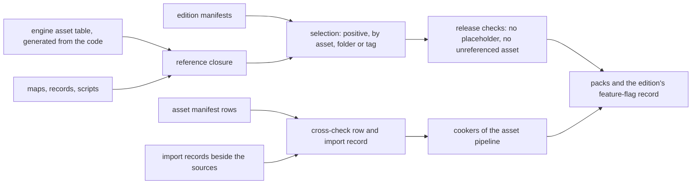

# Import records and build records

> Status: Engine baseline · Prefix: DAT · ADRs: [ADR-0018](../../../adr/0018-texture-import-manifest.md) · [ADR-0019](../../../adr/0019-mesh-source-format-and-cooked-meshes.md) · [ADR-0020](../../../adr/0020-flat-shading-and-team-tint.md) · [ADR-0025](../../../adr/0025-audio-formats-codecs-and-residency.md) · [ADR-0056](../../../adr/0056-editions-build-flavours-and-feature-flags.md) · [ADR-0059](../../../adr/0059-content-build-and-validators.md) · [ADR-0061](../../../adr/0061-data-schemas-and-versioning.md) · [ADR-0062](../../../adr/0062-authoring-syntax-and-schema-language.md) · Folder: [data schemas](README.md) · Related: [asset pipeline and resources](../asset_pipeline_and_resources.md) · [build tooling and distribution](../build_tooling_and_distribution.md) · [asset manifest](../../../assets/asset_manifest.csv)

This document specifies the schemas of the records that the content build reads and that no runtime loads as such: the import record beside each texture, mesh and audio source, the engine asset table that the code contributes, and the edition manifests. The meaning of every field belongs to the [asset pipeline](../asset_pipeline_and_resources.md) for the import records and the engine asset table, and to [build tooling and distribution](../build_tooling_and_distribution.md) for the edition manifests; this document gives the fields their keys, types, presence rules and checks.

## 1 Responsibilities and boundaries

**DAT-350** (MUST) This document owns the record types `import.texture`, `import.mesh`, `import.audio`, `assets.engine_table` and `edition.manifest` (README table 1-A): their keys, logical types, presence rules, ranges and the checks that the content build applies to them.

**DAT-351** (MUST NOT) This document defines no cooking step, no texture or audio format, no edition and no feature flag: those are the [asset pipeline](../asset_pipeline_and_resources.md)'s (AST-018 to AST-050), the texture and audio ADRs' (ADR-0017, ADR-0018, ADR-0025) and [build tooling and distribution](../build_tooling_and_distribution.md)'s (BLD-015 to BLD-018).

## 2 Interfaces

The interface below is a C++23 declaration sketch, not an implementation. The record types are generated from the schemas (ADR-0062).

```cpp
namespace species::data::build {

enum class TextureKind : std::uint8_t { Colour, Ui, Normal, Mask, ExactData, CpuTable };   // AST table 3.3-A
enum class ColourSpace : std::uint8_t { Srgb, Linear };
enum class AlphaMode : std::uint8_t { Opaque, Straight, Premultiplied, Additive, Cutout };
enum class MipPolicy : std::uint8_t { Full, None };
enum class SamplerKind : std::uint8_t { LinearClamp, LinearWrap, PointClamp };             // ADR-0018
enum class TintMarking : std::uint8_t { None, VertexWeight, MaterialFlag };                // AST-034
enum class MeshRole : std::uint8_t { Render, Collision };

struct TextureImportRecord;                     // table 3.1-A
struct MeshImportRecord;                        // table 3.2-A
struct AudioImportRecord;                       // table 3.3-A
struct EngineAssetTable;                        // table 3.4-A, generated from the code
struct EditionManifest;                         // table 3.5-A

class ImportRecordReader {                      // content build only
public:
  std::expected<TextureImportRecord, std::vector<Diagnostic>> ReadTexture(const JsonDocument&) const;
  std::expected<MeshImportRecord, std::vector<Diagnostic>> ReadMesh(const JsonDocument&) const;
  std::expected<AudioImportRecord, std::vector<Diagnostic>> ReadAudio(const JsonDocument&) const;
};

}  // namespace species::data::build
```

**Data contracts.** The cookers of the [asset pipeline](../asset_pipeline_and_resources.md) read the import records (AST-018); the content build's selection and validation steps read the engine asset table and the edition manifests (AST-017, AST-089, AST-090, BLD-049). The runtime reads none of these records, except the feature flags of an edition, which the content build writes into the packs as a record (BLD-016).

**Threading contract.** The records are read by the content build's worker threads, one record per task (README DAT-048).

## 3 Data model

### 3.1 The texture import record

**DAT-352** (MUST) Every texture source has one import record beside it, sharing its stem, with the fields of table 3.1-A, whose meanings and closed value sets are AST table 3.3-A, ADR-0018 and AST-025 to AST-031. The content tools create the record from the source's manifest row and the defaults per kind; an author edits only the fields that the row leaves open (AST-018). A texture without an import record is a build error (ADR-0018).

Table 3.1-A Fields of a texture import record.

| Field | Key | Type | Presence and default | Rules |
|---|---|---|---|---|
| kind | `kind` | enumeration `colour`, `ui`, `normal`, `mask`, `exact_data`, `cpu_table` | defaulted: from the row's `target_format` (AST table 3.3-B) | must agree with the row (AST-012) |
| colour space | `colour_space` | enumeration `srgb`, `linear` | defaulted: from the row's `colour_space` | must agree with the row |
| alpha mode | `alpha_mode` | enumeration `opaque`, `straight`, `premultiplied`, `additive`, `cutout` | defaulted: from the row's `alpha_mode` through AST table 3.3-C | must agree with the row |
| cut-out threshold | `cutout_threshold` | integer alpha value | required with `cutout`, absent otherwise | the threshold of the pipeline-state entry that draws the art (AST-019) |
| mip policy | `mip_policy` | enumeration `full`, `none` | defaulted: from the row's `target_format` | — |
| sampler | `sampler` | enumeration `linear_clamp`, `linear_wrap`, `point_clamp` | defaulted: `linear_clamp`; `linear_wrap` where the row says "wrap repeat"; `point_clamp` when pixel-exact | the closed set of ADR-0018 |
| tint mask | `tint_mask` | asset reference to a single-channel mask | absence-meaningful: none | ADR-0020 |
| pixel-exact | `pixel_exact` | boolean | defaulted: false | — |
| authoring scale | `authoring_scale` | integer: 1 or `ast.texture.ui_authoring_scale` | defaulted: `ast.texture.ui_authoring_scale` where the row says "author at 2x", otherwise 1 | — |
| derived variants | `derived_variants` | list of objects: `variant` (stable id), `derivation` (enumeration `blurred_shadow`, `stacked_copies`, `greyscale`, `to_colour`, `replace_colour`), `parameters` (object of the derivation's parameters of AST table 3.5-A) | defaulted: none | variant ids unique within the record; each variant has its own manifest row (AST-028) |
| views | `views` | list of objects: `variant` (stable id), `first_level` (count), `level_count` (count of at least 1), `sampler` (as above) | defaulted: none | variant ids unique within the record, and distinct from the derived variants (AST-026) |

**DAT-353** (MUST) An unknown kind, alpha mode, sampler, derivation, derivation parameter or variant is a build error (AST-019). A field that the row fixes and the record contradicts is a build error that names the asset id, the member and the column (AST-012); a record never overrides its row.

### 3.2 The mesh import record

**DAT-354** (MUST) Every mesh source, and every collision source, has one import record beside it with the fields of table 3.2-A (AST-033, ADR-0019).

Table 3.2-A Fields of a mesh import record.

| Field | Key | Type | Presence and default | Rules |
|---|---|---|---|---|
| asset | `asset` | asset reference | required | must equal the asset id of the source's manifest row |
| member | `member` | asset member | required | must equal the source's member number in its row |
| role | `role` | enumeration `render`, `collision` | defaulted: `render` | a collision source is cooked into `geometry.collision` (AST-044) |
| asset class | `asset_class` | stable id | required for `render` | selects the socket schema of the row's `spec` (AST-040) |
| unit scale | `unit_scale` | presentation decimal, wu per glTF metre | required | above 0; applied once at cook time (ADR-0016) |
| tint marking | `tint_marking` | enumeration `none`, `vertex_weight`, `material_flag` | defaulted: `none` | AST-034, AST-035 |
| smooth primitives | `smooth_primitives` | list of objects: `node` (the glTF node name), `primitive` (count) | defaulted: none | each names a primitive that carries normals (AST-036) |
| collision asset | `collision` | asset reference to a collision asset | required for a collidable render mesh, absent otherwise | AST-044; DEC-012 |

### 3.3 The audio import record

**DAT-355** (MUST) An audio source has an import record only where the source cannot state what the cooker needs, with the fields of table 3.3-A (AST-050); a source without a record takes the defaults. Looping, gain, pitch and envelopes are sound data ([entity_audio_geometry_and_panel_schemas.md](entity_audio_geometry_and_panel_schemas.md)), never import-record fields (AST table 3.10-A).

Table 3.3-A Fields of an audio import record.

| Field | Key | Type | Presence and default | Rules |
|---|---|---|---|---|
| positional | `positional` | boolean | defaulted: from the layers that name the group | true makes mono mandatory (AST-050, AST-079) |
| loop start | `loop_start` | count, sample frames | defaulted: 0 | streamed members only |
| loop end | `loop_end` | count, sample frames | absence-meaningful: the end of the file | after the loop start; streamed members only |

**DAT-356** (MUST) Audio is language-neutral: an audio import record has no per-language field. If the voice decision gives spoken lines one recording set per language (DEC-317), each set becomes a member list keyed by its BCP 47 tag, with a minor version of this record type (README DAT-017; AST-050).

### 3.4 The engine asset table

**DAT-357** (MUST) The engine asset table (`assets.engine_table`) is generated by the engine build from the code's declarations, never written by hand, and holds the fields of table 3.4-A (AST-017). The content build reads it as a source of references: every constant and every enumerator of a table must map to an existing asset id of the expected category, and every enumerator of a table's enumeration must have a row (AST-017, README DAT-027).

Table 3.4-A Fields of the engine asset table.

| Field | Key | Type | Rules |
|---|---|---|---|
| constants | `constants` | list of objects: `name` (the code constant's stable id), `asset` (asset reference), `category` (the expected manifest category) | names unique |
| tables | `tables` | list of objects: `table` (stable id), `enumeration` (the enumeration's name), `category`, `entries` (list of objects: `enumerator`, `asset`) | one entry per enumerator; enumerators unique within a table |

### 3.5 Edition manifests

**DAT-358** (MUST) An edition manifest (`edition.manifest`) is authored under `content/records/editions/` with the fields of table 3.5-A, whose meanings are [build tooling and distribution](../build_tooling_and_distribution.md) table 3.2-A and table 3.2-B (BLD-015, BLD-016).

Table 3.5-A Field types of an edition manifest.

| Field | Key | Type | Presence and default | Rules |
|---|---|---|---|---|
| edition id | `id` | stable id | required | unique among the edition manifests (DEC-801) |
| product | `product` | enumeration `client`, `server` | required | exactly one (BLD-050) |
| release flag | `release` | boolean | defaulted: false | an edition with the flag set contains no placeholder and no unreferenced asset (AST-085, AST-090) |
| server edition | `server_edition` | record reference to an edition manifest of product `server` | required for a client edition, absent for a server edition | BLD-051 |
| languages | `languages` | list of BCP 47 tags, or one language-group name of BLD table 4.7-A | defaulted: the base language only | the base language `ref.meta.lang.base` is always included (BLD-078) |
| selection | `select` | list of selectors, each an object with exactly one of `asset` (asset reference), `folder` (a folder under the content root) or `tag` (an asset tag, among them the manifest's `priority` values) | required | positive selection only (BLD-049) |
| maps | `maps` | the string `"all"`, or a list of map ids | defaulted: `"all"` | each listed map must exist (BLD-053) |
| feature flags | `features` | object with one field per flag of BLD table 3.2-B, each of the type that table gives (a list of mode enumerators, a set of outcome classes, or `on` and `off`) | required: every flag named | an unknown flag is a build error (ADR-0056) |

**DAT-359** (MUST) The content build writes the feature flags of each edition into its packs as a record, which the client and the server read once at start-up (BLD-016); the flags marked simulation-relevant in BLD table 3.2-B are part of that record's simulation-relevant entry and of the simulation content identity (ADR-0056, ADR-0060).

## 4 Behaviour and algorithms

**DAT-360** (MUST) The content build reads the manifest rows, the edition manifests, the engine asset table and every import record before any cooker runs (AST §4.1 step 1), validates each record with README DAT-024 and the checks of this document, and fails before cooking on any error, so that no cooker runs on a record that contradicts its row.



Caption: Figure 4-A, how the build records feed the content build (DAT-352 to DAT-360; AST-012, AST-089, AST-090, BLD-049).

## 5 Concurrency and performance budget

**DAT-361** (MUST) Import records and build records are small and are read once per content-build run; their validation is part of the content-build budgets `dat.perf.full_build_s` and `dat.perf.incremental_s` of the [README](README.md), and a change to one import record rebuilds only the entries of its source (ADR-0059).

## 6 Failure modes, diagnostics and telemetry

| Condition | Result | Requirement |
|---|---|---|
| a texture source without an import record | build error | DAT-352 |
| an import record that contradicts its manifest row | build error naming asset, member and column | DAT-353 |
| an unknown kind, alpha mode, sampler, derivation, parameter or variant | build error | DAT-353 |
| a mesh record whose asset or member differs from its row; a collidable mesh without a collision asset | build error | DAT-354 |
| a loop end before its loop start | build error | DAT-355 |
| an engine-asset-table entry that maps to no asset, or to the wrong category; an enumerator without a row | build error | DAT-357 |
| an edition with an unknown flag, a missing flag, a duplicate id or a client edition without a server edition | build error | DAT-358 |

## 7 Acceptance tests

| Test | Kind | Checks | Requirements |
|---|---|---|---|
| T60 texture records | unit | a record created from each manifest category's defaults validates; each closed value set rejects an unknown value; a record contradicting its row fails | DAT-352, DAT-353 |
| T61 mesh records | unit | asset and member mismatches fail; a collidable mesh without `collision` fails | DAT-354 |
| T62 audio records | unit | loop points out of order fail; a record with a per-language field fails until the record type gains one | DAT-355, DAT-356 |
| T63 engine table | unit | removing an enumerator's row and pointing a constant at an asset of another category each fail | DAT-357 |
| T64 editions | unit | the baseline editions of BLD table 3.2-D validate; an unknown flag fails; the feature-flag record of `full` holds every flag of BLD table 3.2-B | DAT-358, DAT-359 |

## 8 Open decisions

### 8.1 Decisions and architecture records

| Reference | Status | Where it applies |
|---|---|---|
| DEC-012 | Resolved | collision assets named by the mesh import record (DAT-354) |
| DEC-317 | Open | per-language audio sets (DAT-356) |
| DEC-801 | Resolved | unique ids, variant ids and edition ids (DAT-352, DAT-358) |
| ADR-0018, ADR-0019, ADR-0020, ADR-0025 | Accepted | the import manifests of textures, meshes and audio |
| ADR-0056, ADR-0059 | Accepted | editions, feature flags and the validating content build |

### 8.2 Design-phase inputs

1. **Editions of the world game**: the editions, products and feature flags beyond the baseline of BLD table 3.2-D, and whether a server edition carries per-region content selections.
2. **Voice localisation** (DEC-317): the per-language member lists of DAT-356.

## 9 Tuning table

This document owns no tuning key.

| owner | keys cited |
|---|---|
| [asset pipeline](../asset_pipeline_and_resources.md) | `ast.texture.ui_authoring_scale` |
| [reference/09 options](../../../reference/09_front_end_and_match_flow/options_localisation_and_hooks.md) | `ref.meta.lang.base` |
| [data schemas](README.md) | `dat.perf.full_build_s`, `dat.perf.incremental_s` |
