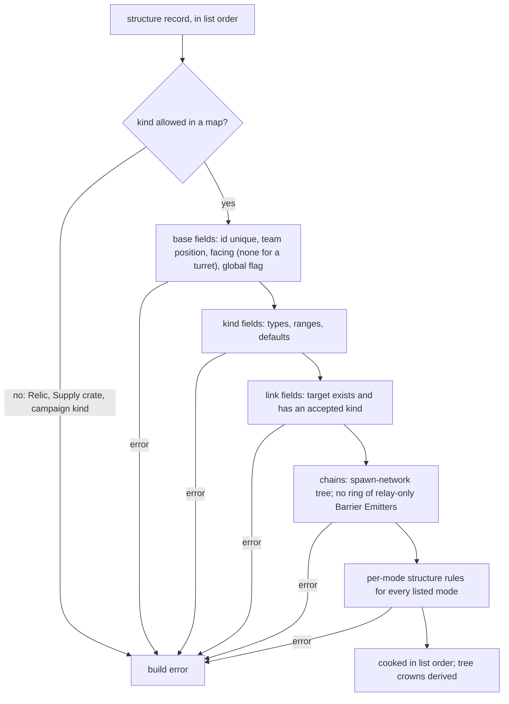

# Map structure records

> Status: Engine baseline · Prefix: DAT · ADRs: [ADR-061](../../../ADR/ADR-061-data-schemas-and-versioning.md) · [ADR-062](../../../ADR/ADR-062-authoring-syntax-and-schema-language.md) · [ADR-059](../../../ADR/ADR-059-content-build-and-validators.md) · Folder: [data schemas](README.md) · Related: [map definition](map_schema.md) · [buildings and world objects](../../../reference/03_buildings_and_world_objects/README.md) · [economy and spawn objects](../../../reference/03_buildings_and_world_objects/economy_and_spawn_objects.md) · [mode objects](../../../reference/03_buildings_and_world_objects/mode_objects.md) · [defences and props](../../../reference/03_buildings_and_world_objects/defences_and_props.md) · [trees and crate structures](../../../reference/03_buildings_and_world_objects/trees_and_crate_structures.md) · [bots](../../../reference/07_bots/README.md) · [maps: rules and conventions](../../../reference/08_maps_and_level_design/rules_and_conventions.md)

This document specifies the structure records of a map definition: the base fields every record holds, the fields of each structure kind that a map may place, the typed links between records and their validation. The meaning and the default value of every field belong to [reference/03](../../../reference/03_buildings_and_world_objects/README.md) and, for the bot structures, to [reference/07](../../../reference/07_bots/README.md); this document gives each field its key, its type, its presence rule and its checks.

## 1 Responsibilities and boundaries

**DAT-140** (MUST) This document owns the schema of the `structures` block of a map definition ([map_schema.md](map_schema.md) table 3.1-A): the base fields, the kind-specific fields of the 32 structure kinds of table 3.2-A, the expected target kinds of every link field and the structure rules of the map validation (DEC-456, DEC-457).

**DAT-141** (MUST NOT) No structure record holds a field that only campaign or debug content reads, and no record names a kind that only rules create: the Relic and the Supply crate are rejected (R-BLDG-011, R-CRATE-101), and every kind of campaign or debug content is an unknown kind (DEC-052, DEC-466, DEC-802). A structure record carries no height: the structure is placed on the terrain at match-world initialisation (R-MAP-102).

**DAT-142** (MUST) No map record is scaled by a difficulty and no record makes a random draw when it is read; every map-placed structure is created once, from its record, at match-world initialisation (R-MAP-041, R-MAP-105, R-BLDG-028).

## 2 Interfaces

The interface below is a C++23 declaration sketch, not an implementation. The record types are generated from the schema (ADR-062).

```cpp
namespace Species
{

// Reference/03 table 2.4-A, without Relic and Supply crate in map records.
enum class StructureKind : std::uint8_t;

// The base fields, table 3.1-A.
struct StructureRecord
{
  StructureKind kind;
  std::uint32_t id; // unique within the map
  double x;         // wu, binary32-rounded (README DAT-010)
  double z;
  std::optional<std::uint8_t> team;            // a start position 0..5; empty: no team
  std::optional<std::array<double, 2>> facing; // x and z; empty for a turret (DAT-156)
  bool global;
  std::optional<std::string> roleTag; // DAT-162
  KindFields fields;                  // one alternative per kind, table 3.2-A
};

// Every link field of every kind (DAT-147).
struct StructureLink
{
  std::uint32_t target;                    // a structure id of the same map
  std::span<const StructureKind> expected; // the kinds the field accepts
};

} // namespace Species
```

**Data contracts.** The simulation creates each map-placed structure from its record at match-world initialisation step 7, in list order, and remaps its start position to a team ([reference/12](../../../reference/12_simulation_model/02_match_lifecycle_and_state_reset.md); R-MAP-044, R-MAP-104). The bot rules read the bot structures ([reference/07](../../../reference/07_bots/README.md)). The renderer and the map editor read the same records.

**Threading contract.** As for the map definition ([map_schema.md](map_schema.md) §2).

## 3 Data model

### 3.1 Base fields

**DAT-143** (MUST) Every structure record holds the base fields of table 3.1-A (R-MAP-100, R-BLDG-050), followed in schema order by the fields of its kind (table 3.2-A). The record list is ordered: its order is the structure order of the match (R-MAP-104).

Table 3.1-A Base fields of a structure record.

| Field | Key | Type and precision | Presence and default | Range and rules |
|---|---|---|---|---|
| structure kind | `kind` | enumeration of table 3.2-A | required | an unknown kind, the Relic, the Supply crate and every campaign kind are build errors |
| structure id | `id` | integer | required | 0 to 2^31 − 1; unique within the map (R-MAP-047, DEC-801); the target of every link field |
| x, z | `x`, `z` | simulation decimals, binary32-rounded, wu | required | finite |
| team | `team` | integer, a start position | absence-meaningful: absent, no team | 0 to `ref.sim.team.visitor_slot` (5); remapped to a team at load, and a position at or above the player count, 4 and 5 included, becomes no team (R-MAP-044) |
| facing | `facing` | x and z, simulation decimals, binary32-rounded | defaulted: (1, 0), the front of R-BLDG-014 | normalised by initialisation with y = 0 (R-BLDG-014), with the degenerate result of DEC-241 for a zero vector; a turret record holds none (DAT-156) |
| global flag | `global` | boolean | defaulted: false | required and `true` on every Beam Dish and Transit Gate record (R-BLDG-015, R-MAP-103) |
| role tag | `role_tag` | stable id | absence-meaningful: no role | unique within the map; read only by a tutorial (DAT-162) |

**DAT-144** (MUST) The global flag changes no match rule; on a Source Node it selects only how the Source Node is drawn (R-BLDG-015). This is the reference default of DEC-309, whose recommendation removes the flag from Species map data and expresses a visual variant as an explicit asset choice.

**DAT-145** (MUST) No structure field uses a marker value: a team of "no team" is an absent `team`, a link of "none" is an absent link field or an empty list, and a field that the reference marks as unset with −1 is absent (DEC-120, README DAT-008).

### 3.2 Fields of each structure kind

**DAT-146** (MUST) Each structure kind that a map may place holds the fields of table 3.2-A after the base fields. Every field is named, so an optional field never depends on the presence of the field before it, and a list is an explicit array, never the rest of a line (DEC-801 item 3). The meaning and the default of each field are the owner's requirement named in the last column; where the owner keys the default, the table cites the key.

Table 3.2-A Kind-specific fields. "Ref" marks a record reference to a structure id of the same map, with its expected kinds (DAT-147).

| Kind (key) | Field | Key | Type and precision | Presence and default | Range and rules | Owner |
|---|---|---|---|---|---|---|
| Spawn Node (`spawn_node`), Source Node (`source_node`), Relay (`relay`) | links | `links` | ordered list of Ref: Spawn Node, Relay | defaulted: empty, no edge | distinct; the targets of the outgoing edges | R-BLDG-108, R-BLDG-115, R-BLDG-121, R-BLDG-132 |
| Population Limiter (`population_limiter`) | search radius | `search_radius` | simulation decimal, binary32-rounded, wu | defaulted: `ref.econ.population_limiter.search_radius_wu` | 0 or more | R-BLDG-138 |
| | maximum population | `max_population` | count | defaulted: `ref.econ.population_limiter.max_population` | — | R-BLDG-138 |
| Transit Gate (`transit_gate`) | — | — | base fields only, with `global` set | — | — | R-BLDG-145 |
| Beam Dish (`beam_dish`) | force-connection flag | `force_connection` | boolean | defaulted: false | — | R-BLDG-166 |
| | auto-connect flag | `auto_connect` | boolean | defaulted: false | — | R-BLDG-166 |
| | valid receivers | `valid_receivers` | ordered list of Ref: Beam Dish | defaulted: empty | distinct | R-BLDG-166 |
| Solar Array (`solar_array`), grid pylon (`grid_pylon`) | grid link | `grid_link` | Ref: Solar Array, grid pylon, grid terminal, grid splitter | required | — | R-BLDG-174, R-BLDG-184, R-BLDG-185 |
| grid terminal (`grid_terminal`) | grid link | `grid_link` | Ref: fuel pump, Barrier Emitter | required | the kinds a terminal delivers to (R-BLDG-186) | R-BLDG-174, R-BLDG-186 |
| grid splitter (`grid_splitter`) | grid link | `grid_link` | Ref: Solar Array, grid pylon, grid terminal, grid splitter | required | read and unused (R-BLDG-188) | R-BLDG-189 |
| | candidates | `candidates` | ordered list of Ref: grid pylon | defaulted: empty | distinct; the first matching candidate wins (R-BLDG-188) | R-BLDG-189 |
| fuel pump (`fuel_pump`), fuel line (`fuel_line`) | fuel link | `fuel_link` | Ref: fuel line, fuel depot, Launch Vessel | required | — | R-BLDG-196 |
| fuel depot (`fuel_depot`) | fuel link | `fuel_link` | Ref: Launch Vessel | required | its team's Launch Vessel | R-BLDG-206 |
| Launch Vessel (`launch_vessel`) | fuel link | `fuel_link` | Ref: fuel line, fuel depot, Launch Vessel | absence-meaningful: none | unused for the vessel | R-BLDG-340 |
| | starting fuel | `starting_fuel` | simulation decimal, binary32-rounded | defaulted: 0 (R-BLDG-340) | 0 to the fuel range of R-BLDG-320 | R-BLDG-340 |
| | starting passengers | `starting_passengers` | count | defaulted: 0 (R-BLDG-340) | 0 to the passenger range of R-BLDG-320 | R-BLDG-340 |
| | spawn structure | `spawn_structure` | Ref: any structure kind of table 3.2-A | absence-meaningful: none | read and unused: no match rule reads it, and the vessel's state of R-BLDG-320 holds no such field; validated as a link and written back by a map tool (DEC-800) | R-BLDG-340 |
| | spawn completed | `spawn_completed` | boolean | defaulted: false | read and unused, as the spawn structure | R-BLDG-340 |
| Command Console (`command_console`) | controlled structure | `controlled_structure` | Ref: any structure kind of table 3.2-A | absence-meaningful: none | the reference maps name Beam Dishes only (R-BLDG-298) | R-BLDG-304 |
| Core Device (`core_device`) | countdown | `countdown` | simulation decimal, binary32-rounded, mode seconds | defaulted: 0 (R-BLDG-317) | 0 or more | R-BLDG-317 |
| | linked consoles | `consoles` | ordered list of Ref: Command Console | defaulted: empty | distinct | R-BLDG-317 |
| Control Zone (`control_zone`): also the Relic Base, the Relic Spawn Zone, the Flag post and the Home post | size | `size` | simulation decimal, **binary64**, wu | defaulted: `ref.bldg.control_zone.default_size_wu` | above 0 | R-BLDG-255 |
| | Flag post links | `flag_links` | ordered list of Ref: Control Zone | defaulted: empty | distinct; made two-way at Flag Chain initialisation (R-BLDG-269) | R-BLDG-255 |
| Breach Charge (`breach_charge`) | — | — | base fields only | — | — | R-BLDG-295 |
| turret (`turret`) | turret type | `turret_type` | enumeration `gun`, `rocket`, `mortar`, `flame`, `convert`, in the order of R-BLDG-406 | defaulted: `gun` | — | R-BLDG-406, R-BLDG-407 |
| | mortar target | `mortar` | object of four fields: `target_x`, `target_z`, `target_radius`, `force`, simulation decimals, binary32-rounded | absence-meaningful: absent, each of the four is `ref.bldg.turret.default_mortar_value` | the four are given together or not at all, which the object makes structural | R-BLDG-407 |
| Barrier Emitter (`barrier_emitter`) | link | `link` | Ref: Barrier Emitter | absence-meaningful: none, which ends the chain | — | R-BLDG-433 |
| | scale | `scale` | simulation decimal, binary32-rounded | defaulted: `ref.bldg.barrier_emitter.default_scale` | above 0 | R-BLDG-433 |
| | initial mode | `initial_mode` | enumeration `lowered`, `raising`, `raised`, `lowering`, `relay_only`, `always_raised` (`BarrierMode`) | defaulted: `lowered` | — | R-BLDG-433, R-BLDG-435 |
| wall (`wall`) | — | — | base fields only | — | — | R-BLDG-450 |
| tree (`tree`) | height | `height` | simulation decimal, binary32-rounded, wu | defaulted: `ref.bldg.tree.default_height` | the input range of R-BLDG-601 | R-BLDG-601 |
| | leaf width | `leaf_width` | simulation decimal, binary32-rounded | defaulted: `ref.bldg.tree.default_leaf_width` | as R-BLDG-601 | R-BLDG-601 |
| | push out | `push_out` | simulation decimal, binary32-rounded | defaulted: `ref.bldg.tree.default_push` | as R-BLDG-601 | R-BLDG-601 |
| | push up | `push_up` | simulation decimal, binary32-rounded | defaulted: `ref.bldg.tree.default_push` | as R-BLDG-601 | R-BLDG-601 |
| | iterations | `iterations` | integer | defaulted: `ref.bldg.tree.default_iterations` | as R-BLDG-601 | R-BLDG-601 |
| | seed | `seed` | integer | defaulted: 0 (R-BLDG-601) | as R-BLDG-601 | R-BLDG-601 |
| | branch colour | `branch_color` | RGBA8 colour | defaulted: opaque white (R-BLDG-601) | — | R-BLDG-601 |
| | leaf colour | `leaf_color` | RGBA8 colour | defaulted: opaque white (R-BLDG-601) | — | R-BLDG-601 |
| | leaf drop rate | `leaf_drop_rate` | integer | defaulted: 0, off (R-BLDG-601) | as R-BLDG-601 | R-BLDG-601, R-BLDG-615 |
| | essence drop rate | `essence_drop_rate` | integer | defaulted: 0 (R-BLDG-601) | as R-BLDG-601 | R-BLDG-601, R-BLDG-616 |
| | blight flag | `blight` | boolean | defaulted: false | — | R-BLDG-601, R-BLDG-624 |
| scenery mesh (`scenery_mesh`) | scale | `scale` | simulation decimal, binary32-rounded | defaulted: `ref.bldg.scenery_mesh.default_scale` | above 0 | R-BLDG-459 |
| | mesh | `mesh` | asset member of `mesh.scenery.prop` | absence-meaningful: none | a member the manifest holds (DEC-015) | R-BLDG-459 |
| exclusion zone (`exclusion_zone`) | size | `size` | simulation decimal, binary32-rounded, wu | defaulted: `ref.bldg.exclusion_zone.default_size` | 0 or more | R-BLDG-462 |
| | power flag | `blocks_powers` | boolean | defaulted: false | — | R-BLDG-462 |
| jump pad (`jump_pad`) | force | `force` | simulation decimal, binary32-rounded, wu/s | defaulted: `ref.bldg.jump_pad.default_value` | — | R-BLDG-473 |
| | angle | `angle` | simulation decimal, binary32-rounded, rad | defaulted: `ref.bldg.jump_pad.default_value` | — | R-BLDG-473 |
| smoke column (`smoke_column`), volcano vent (`volcano_vent`) | — | — | base fields only | — | — | R-BLDG-466, R-BLDG-469 |
| Hive (`hive`) | ants inside | `ants_inside` | count | defaulted: 0 (R-BLDG-633) | 0 to `ref.bldg.hive.map_ants_max` (DAT-159) | R-BLDG-633 |
| Spitter Plant (`spitter_plant`) | size | `size` | simulation decimal, binary32-rounded | defaulted: `ref.bldg.spitter_plant.default_size` | — | R-BLDG-644 |
| | pitch | `pitch` | simulation decimal, binary32-rounded | defaulted: `ref.bldg.spitter_plant.default_pitch` | — | R-BLDG-644 |
| | force | `force` | simulation decimal, binary32-rounded | defaulted: `ref.bldg.spitter_plant.default_force` | — | R-BLDG-644 |
| | variance | `variance` | simulation decimal, binary32-rounded | defaulted: `ref.bldg.spitter_plant.default_variance` | — | R-BLDG-644 |
| | reload | `reload` | ticks | defaulted: `ref.bldg.spitter_plant.default_reload_ticks` | large enough that the first-deadline draw of R-BLDG-645 has at least one value, ⌊reload × `ref.sim.tick_period`⌋ ≥ 1 (see DEC-968 item 4) | R-BLDG-644, R-BLDG-645 |
| | trigger flag | `trigger` | boolean | defaulted: false | — | R-BLDG-644 |
| | trigger offset | `trigger_x`, `trigger_z` | simulation decimals, binary32-rounded, wu | defaulted: 0 (R-BLDG-644) | — | R-BLDG-644 |
| | trigger radius | `trigger_radius` | simulation decimal, binary32-rounded, wu | defaulted: `ref.bldg.spitter_plant.default_trigger_radius` | 0 or more | R-BLDG-644 |
| | enabled Seed Pod kinds | `pod_kinds` | enumeration set: `crawlers`, `centipede`, `spider`, `essence_orbs`, `crawler_eggs`, `seed_pods`, `ants`, `brood_drifter`, `reaper_serpent`, `workers` | defaulted: none enabled | cooked in the kind order of [creatures](../../../reference/02_units/creatures.md) R-UNIT-519, which the launch indexes | R-BLDG-644, R-BLDG-648 |
| bot navigation node (`bot_nav_node`) | manual link | `manual_link` | Ref: bot navigation node | absence-meaningful: none | — | R-BOT-027 |
| | priority modifier | `priority_modifier` | simulation decimal, **binary64** | defaulted: 0.0 (R-BOT-027) | finite | R-BOT-027 |
| | check-cliffs flag | `check_cliffs` | boolean | defaulted: true | — | R-BOT-027 |
| bot objective (`bot_objective`) | next objective | `next_objective` | Ref: bot objective | absence-meaningful: none, a chain end | — | R-BOT-128 |
| bot objective marker (`bot_objective_marker`) | scan range | `scan_range` | simulation decimal, binary32-rounded, wu | required | 0 or more | R-BOT-128 |
| | objective | `objective` | Ref: bot objective | absence-meaningful: none, as on every Launch Race marker | — | R-BOT-128 |
| | Transport-objective flag | `transport_objective` | boolean | defaulted: false | — | R-BOT-128 |
| | pickup | `pickup` | enumeration `normal`, `pickup_only`, `never_pickup` | defaulted: `normal` | the three values of the pickup-only flag of R-BOT-128 (0, 1 and −1), named | R-BOT-128 |

### 3.3 Links

**DAT-147** (MUST) Every link field names structure ids of the same map and declares the kinds it accepts, as table 3.2-A lists. The content build rejects a link that names no structure of the map, or a structure of a kind the field does not accept (DEC-457, DEC-015). At run time a missing or mismatched target counts as no link; no rule treats a structure of one kind as a structure of another (DEC-457).

**DAT-148** (MUST) A list of links holds each target at most once, and a structure never links to itself; a repeated target or a self-link is a build error naming the record and the field.

**DAT-149** (MUST) The spawn-network links of a map form a tree: a map that places Spawn Nodes places exactly one Source Node, whose links reach every Spawn Node through Relays and Spawn Nodes, and the content build rejects a spawn network whose links contain a cycle or leave a Spawn Node unreached (R-MAP-108, DEC-456). The run-time walk over the links still keeps a visited set, so it ends on any graph (DEC-456).

**DAT-150** (MUST) The other chains may end with an absent link or close into a loop: a ring of Barrier Emitters, a loop of grid links, of fuel links or of bot objectives is valid data, because each step of these chains is bounded per tick by its owner's rules. One loop is unbounded and is a build error, the `reference_cycle` diagnostic of README table 6-A: a ring of Barrier Emitters whose every emitter starts in `relay_only` mode, because each of them forwards every request at once and a forwarded request would circle the ring without end (R-BLDG-435, DEC-014; see DEC-968 item 2). Flag post links form a graph, which the Flag Chain rule of R-MAP-176 requires to be connected.

## 4 Behaviour and algorithms

### 4.1 Structure rules of the map validation

**DAT-151** (MUST) The content build checks, for every map, in addition to the field checks of table 3.1-A and table 3.2-A: unique structure ids (R-MAP-047); the global flag on every Beam Dish and Transit Gate (R-BLDG-015); the kinds that a map may place (R-MAP-101); every link (DAT-147 to DAT-150); and, for every mode the map lists, the structure parts of the per-mode rules of DEC-561 ([map_schema.md](map_schema.md) DAT-103): one Relic Base per start position and at least one Relic Spawn Zone (Relic Run, R-MAP-161); one Home post per start position and a connected Flag post graph (Flag Chain, R-MAP-176); one Core Device owned by a defending start position, at least three linked Command Consoles, a countdown equal to the match time limit, and every defence bot objective marker with a scan range bound to a structure (Siege, R-MAP-166); one Launch Vessel, three fuel depots and one Transit Gate for each start position (Launch Race, R-MAP-170).

**DAT-152** (MUST) A record of a structure kind that the reference maps never place, the Hive and the Spitter Plant, is valid (R-MAP-101). A record whose kind no match creates and that only campaign content uses is an unknown kind and a build error (DEC-802).

### 4.2 Reading a record at initialisation

**DAT-153** (MUST) Initialisation copies the base fields and the kind's fields from the record, with the presence rules of table 3.2-A, and never reads a value that the record does not hold: an absent optional field is its declared default or its explicit "absent" state, never a missing value passed on (DEC-015). Records are read in list order, which is the structure order (R-MAP-104), and every participant reads the same records in the same order (R-SIM-017).

**DAT-154** (MUST) The team of a record is a start position; at load it is replaced by the team that holds that position, or by no team (R-MAP-044). The kinds whose owner the reference recomputes from their ports or their rules keep the record's team only until their first recount (R-BLDG-027); the bot navigation node ignores it (R-BOT-027).

**DAT-155** (MUST) A Control Zone's size and a bot navigation node's priority modifier keep the full binary64 value of their decimal; every other simulation decimal of a structure record is binary32-rounded at cook time (README DAT-010, DEC-241).

**DAT-156** (MUST) A turret record holds no facing: a turret's initial facing does not come from map data, and initialisation sets its up to (0, 1, 0) and its front to (0, 0, 1) (R-BLDG-407, R-MAP-106). A turret record that gives a `facing` is a build error, because no rule would read it. This is the reference default of DEC-462, whose option B would add a facing field that sets the initial facing.

**DAT-157** (MUST) A Barrier Emitter's initial mode, a turret's type and a bot objective marker's pickup value are named enumerators; the record never holds the decimal or the signed number by which the reference encodes them, and an unknown name is a build error (DEC-015).

**DAT-158** (MUST) A tree's colours are RGBA8 values written as four integers; the record never holds a packed colour in a signed integer. The baked crown data of a map-placed tree is derived from the tree record by the content build ([map_schema.md](map_schema.md) DAT-096; DEC-012).

**DAT-159** (MUST) A Hive's ants-inside value outside [0, `ref.bldg.hive.map_ants_max`] is a build error (see DEC-968 item 3). The run-time replacement of such a value by 0 that R-BLDG-633 states therefore never meets validated content; it remains the rule for any other creator.

**DAT-162** (MUST) Any structure record, a bot navigation node included, may carry a role tag (`role_tag`, table 3.1-A): a stable name such as `final_dish`, `centre_zone` or `bot_gate_node` from the role tables 2.9-A and 2.10-A of [reference/11](../../../reference/11_tutorial_and_help.md). A role tag is unique within its map. The content build checks every tutorial map against the roles of its tutorial's table: a tutorial map that lacks a role, or whose role is carried by a record of another kind than the table names, is a build error that names the map and the role (R-TUT-052, DEC-015). The tutorial director, the bots and the overrides find the objects they name through their role tags at match start (DEC-103); no other rule reads a role tag.

**DAT-160** (MUST) A smoke column that a map places is an obstacle that blocks movement, as [defences and props](../../../reference/03_buildings_and_world_objects/defences_and_props.md) specifies; this is the reference default of DEC-089, whose recommendation would add a field marking the obstacle as wanted (R-MAP-107).



Caption: Figure 4-A, the checks of one structure record and of the structures of a map (DAT-143 to DAT-159).

## 5 Concurrency and performance budget

**DAT-161** (MUST) Link validation is linear in the number of records and links of a map: the validator indexes the records by id once and resolves every link through the index, and the tree and cycle checks visit each record at most once per chain. The reference maps hold at most a few thousand structure records each ([maps](../../../reference/08_maps_and_level_design/rules_and_conventions.md) table 2.11-A), well inside the per-map share of `dat.perf.full_build_s`.

## 6 Failure modes, diagnostics and telemetry

| Condition | Result | Requirement |
|---|---|---|
| an unknown kind, a Relic or Supply crate record, a campaign kind | build error | DAT-141, DAT-152 |
| a repeated structure id | build error naming both records | DAT-143 |
| a Beam Dish or Transit Gate without the global flag | build error | DAT-143 |
| a turret record with a facing | build error | DAT-156 |
| a link to no structure or to a structure of a kind the field does not accept | build error | DAT-147 |
| a repeated target in a list, a self-link | build error | DAT-148 |
| a spawn-network cycle, an unreached Spawn Node, no or two Source Nodes | build error | DAT-149 |
| a ring of Barrier Emitters that all start in `relay_only` mode | build error | DAT-150 |
| a value outside its range, an unknown enumerator | build error | DAT-146, DAT-157, DAT-159 |
| a per-mode structure rule that fails | build error naming the mode and the rule | DAT-151 |
| a role tag used twice in one map; a tutorial map that lacks a role of its tutorial, or carries it on a record of another kind | build error naming the map and the role | DAT-162 |

Every diagnostic names the map, the record's id and kind, its list index, the field and the file location.

## 7 Acceptance tests

| Test | Kind | Checks | Requirements |
|---|---|---|---|
| T30 kind fixtures | unit | one valid record of each of the 32 kinds cooks and loads with every default taken from its owner key; one failing fixture per row of the table of §6 | DAT-143 to DAT-159 |
| T31 link kinds | property | for every link field, a target of each kind of table 3.2-A is accepted exactly when the field lists that kind | DAT-147 |
| T32 spawn tree | unit | a tree passes; a cycle, a second Source Node and an unreached Spawn Node each fail | DAT-149 |
| T33 precision | unit | a Control Zone size and a priority modifier keep their binary64 value; a structure x of 0.1 cooks to the binary32-rounded value | DAT-155 |
| T34 order | integration | the cooked structure order equals the list order, and two loads give the same structure order and ids | DAT-143, DAT-153 |
| T35 mortar object | unit | a turret with all four mortar fields loads them; a turret with three is a schema error; a turret without the object takes `ref.bldg.turret.default_mortar_value` for all four | DAT-146 |
| T36 role tags | unit | a tutorial map with every role of table 2.9-A validates; removing one role, repeating one, or moving it to a record of another kind each fail with the map and the role named; a non-tutorial map with role tags validates | DAT-162 |

## 8 Open decisions

### 8.1 Decisions and architecture records

| Reference | Status | Where it applies |
|---|---|---|
| DEC-309 | Open | the global flag on Source Nodes (DAT-144) |
| DEC-462 | Open | turret facing from map data; no facing field by default (DAT-156) |
| DEC-089 | Open | the smoke-column obstacle (DAT-160) |
| DEC-456 | Resolved | spawn-network trees (DAT-149) |
| DEC-457 | Resolved | typed links (DAT-147) |
| DEC-561 | Resolved | the per-mode structure rules (DAT-151) |
| DEC-012 | Resolved | baked tree crowns (DAT-158) |
| DEC-241 | Open | the precision of each simulation decimal (DAT-155) |
| DEC-052, DEC-466, DEC-802 | Dropped, Dropped, Open | campaign kinds and fields have no schema; unknown kinds are errors (DAT-141, DAT-152) |

### 8.2 Design-phase inputs

1. **Player-placed structures**: if the world game lets players place structures, which of these records become world state, whether the turret facing field of DEC-462 option B is added, and how placed records are validated outside the content build.
2. **Structure ids at world scale**: the structure id range and its uniqueness across the regions of a world (DEC-223).
3. **The Source Node flag** (DEC-309): removing `global` and expressing a visual variant as an asset member.

## 9 Tuning table

This document owns no tuning key; the defaults and limits of its fields are the owners' keys below.

| owner | keys cited |
|---|---|
| [reference/12 teams](../../../reference/12_simulation_model/06_teams_and_player_commands.md) | `ref.sim.team.visitor_slot` |
| [reference/12 tick timing](../../../reference/12_simulation_model/01_tick_timing_and_main_loop.md) | `ref.sim.tick_period` |
| [reference/05](../../../reference/05_population_flow.md) | `ref.econ.population_limiter.search_radius_wu`, `ref.econ.population_limiter.max_population` |
| [mode objects](../../../reference/03_buildings_and_world_objects/mode_objects.md) | `ref.bldg.control_zone.default_size_wu` |
| [defences and props](../../../reference/03_buildings_and_world_objects/defences_and_props.md) | `ref.bldg.turret.default_mortar_value`, `ref.bldg.barrier_emitter.default_scale`, `ref.bldg.scenery_mesh.default_scale`, `ref.bldg.exclusion_zone.default_size`, `ref.bldg.jump_pad.default_value` |
| [trees and crate structures](../../../reference/03_buildings_and_world_objects/trees_and_crate_structures.md) | `ref.bldg.tree.default_height`, `ref.bldg.tree.default_leaf_width`, `ref.bldg.tree.default_push`, `ref.bldg.tree.default_iterations`, `ref.bldg.hive.map_ants_max`, `ref.bldg.spitter_plant.default_size`, `ref.bldg.spitter_plant.default_pitch`, `ref.bldg.spitter_plant.default_force`, `ref.bldg.spitter_plant.default_variance`, `ref.bldg.spitter_plant.default_reload_ticks`, `ref.bldg.spitter_plant.default_trigger_radius` |
| [data schemas](README.md) | `dat.perf.full_build_s` |
