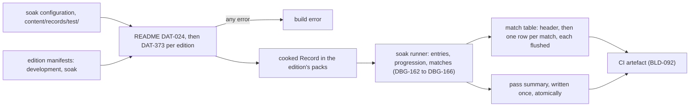

# Test and telemetry records

> Status: Engine baseline · Prefix: DAT · ADRs: [ADR-057](../../../ADR/ADR-057-version-identity.md) · [ADR-060](../../../ADR/ADR-060-content-identity-by-hash.md) · [ADR-061](../../../ADR/ADR-061-data-schemas-and-versioning.md) · [ADR-062](../../../ADR/ADR-062-authoring-syntax-and-schema-language.md) · [ADR-066](../../../ADR/ADR-066-telemetry-with-consent.md) · [ADR-070](../../../ADR/ADR-070-continuous-integration.md) · Folder: [data schemas](README.md) · Related: [diagnostics, test and performance](../diagnostics_test_and_performance/README.md) · [build tooling and distribution](../build_tooling_and_distribution.md) · [platform layer](../platform_layer.md)

This document specifies the schemas of the three record types of the soak test and of telemetry: the soak configuration, which an author writes and the soak runner reads; the soak report, which the soak runner writes as a CI artefact; and the telemetry session record, which the client forms once per session and sends only with the player's consent. The meaning of every field, the soak procedure and the telemetry rules belong to [diagnostics, test and performance](../diagnostics_test_and_performance/README.md) (DBG-025, DBG-026, DBG-160 to DBG-167, DBG-180 to DBG-183); this document gives the fields their keys, types, presence rules and checks.

## 1 Responsibilities and boundaries

**DAT-370** (MUST) This document owns the record types `test.soak_configuration`, `test.soak_report` and `telemetry.session` (README table 1-A): their keys, logical types, presence rules, ranges, their written forms and the checks that the content build, the soak runner and the client apply to them.

**DAT-371** (MUST NOT) This document defines no soak procedure, no soak timing, no telemetry consent rule, no sampling or reduction rule, no transport and no collection service: those are DBG-160 to DBG-167, DBG-180 to DBG-183 and ADR-066, and the collection endpoint, its batch envelope, storage and retention are design-phase decisions (ADR-066). The soak report and the telemetry session record are diagnostic output, not match state, so DAT-003 of the [README](README.md) does not exclude them.

## 2 Interfaces

The interface below is a C++23 declaration sketch, not an implementation. The record types and their readers and writers are generated from the schemas (ADR-062).

```cpp
namespace species::data::diag {

enum class SoakProgressionKind : std::uint8_t { Linear, Random, Sequence };   // DBG-162
enum class SoakEntryFailure : std::uint8_t { ContentHashMismatch };          // DBG-161
enum class SoakParticipantRole : std::uint8_t { Host, Client };

struct SoakSequenceItem;           // table 3.1-B; seed is std::optional, absence keeps the authority's seed
struct SoakTestMap;                // table 3.1-C
struct SoakConfigurationRecord;    // table 3.1-A, the cooked record the soak runner reads
struct SoakMatchRow;               // table 3.2-A; absent cells are std::optional
struct SoakPassSummary;            // table 3.2-B
struct TelemetrySession;           // table 3.3-A, exactly the data set of DBG-181

class SoakMatchTableWriter {       // owned by the SoakRunner (DBG-161)
public:
  std::expected<void, Diagnostic> WriteHeader();                  // DAT-376
  std::expected<void, Diagnostic> AppendRow(const SoakMatchRow&); // one write, then flush (DAT-383)
};

std::expected<std::string, std::vector<Diagnostic>> WriteTelemetrySession(const TelemetrySession&);  // DAT-380
std::expected<TelemetrySession, std::vector<Diagnostic>> ReadQueuedTelemetrySession(std::string_view); // DAT-385

}  // namespace species::data::diag
```

**Data contracts.** The soak runner of the [diagnostics](../diagnostics_test_and_performance/README.md) component reads the cooked soak configuration and writes the soak report; CI publishes the report as an artefact (BLD-092, ADR-070). The diagnostics component forms the telemetry session record and hands it to the platform layer's HTTP client (DBG-182). No simulation rule reads any of these records.

**Threading contract.** The soak runner writes its report from its own thread, outside every simulation tick (DBG-030). The telemetry session record is formed and serialised on the main thread at the end of a session; only the send runs on the HTTP client's thread (DBG-182).

## 3 Data model

### 3.1 The soak configuration

**DAT-372** (MUST) A soak configuration (`test.soak_configuration`) is authored under `content/records/test/` with the fields of table 3.1-A and the top-level `schema` and `version` fields of README DAT-016. It is selected by the test tag into the `development` and `soak` editions, as the test maps are, and never into a player edition (BLD-057, DBG-148, DEC-802). It is cooked as a `Record` (README table 1-A), so the soak runner reads it as a cooked record and never parses its text (README DAT-004); the runner is given the configuration's id (DBG-160).

Table 3.1-A Fields of a soak configuration.

| Field | Key | Type | Presence and default | Rules |
|---|---|---|---|---|
| configuration id | `id` | stable id | required | unique among the soak configurations (DEC-801) |
| progression | `progression` | enumeration `linear`, `random`, `sequence` | defaulted: `linear` | the orders of DBG-162 |
| progression seed | `progression_seed` | integer, 0 to 2^64 − 1 | required with `random`, absent otherwise | the seed of the permutation, which the runner logs (DBG-162); here 0 is an ordinary seed |
| sequence | `sequence` | ordered list of objects of table 3.1-B | required with `sequence`, absent otherwise; at least one item | the pass's entries in the listed order (DBG-162) |
| test maps | `test_maps` | list of objects of table 3.1-C | defaulted: none | the test maps that the pass adds to the entries of the edition (DBG-148, DBG-162) |
| session name | `session_name` | text, at most `dat.id.max_chars` characters | absence-meaningful: the setting `debug.soak_session_name` keeps its value | replaces that setting for the pass (DBG-162; [config_input_and_strings.md](config_input_and_strings.md) table 3.1-A) |
| termination tick | `termination_tick` | ticks, at least 1 | absence-meaningful: no termination tick, so a match ends only by game over or a divergence | the tick at which every match of the pass ends (DBG-162, DBG-165 item 3) |
| clients | `clients` | count, at least 1 | defaulted: the smallest number that, with the host, reaches `dbg.soak.min_participants` | the client participants the runner starts (DBG-160, DBG-163) |
| rendering | `rendering` | boolean | defaulted: false | true starts the clients rendered; soak participants otherwise start with rendering and sound off (DBG-167) |

Table 3.1-B Fields of a sequence item.

| Field | Key | Type | Presence and default | Rules |
|---|---|---|---|---|
| map | `map` | record reference to a map, by map id | required | with `mode`, names one entry of the pass (DAT-373) |
| mode | `mode` | mode enumerator: `spawn_control`, `zone_control`, `relic_run`, `siege`, `launch_race`, `flag_chain` | required | the edition enables the mode (ADR-056) |
| forced seed | `seed` | integer, 1 to 2^64 − 1 | absence-meaningful: the authority's own seed stays in place (DBG-162, DBG-163) | the seed the authority takes before the entry runs |

Table 3.1-C Fields of a test-map item.

| Field | Key | Type | Presence and default | Rules |
|---|---|---|---|---|
| map | `map` | record reference to a map, by map id | required | a map selected by the test tag into every edition that selects this configuration (BLD-057) |
| mode | `mode` | mode enumerator, as in table 3.1-B | required | the mode the entry runs, whether or not the map's mode list holds it (DAT-104 of [map_schema.md](map_schema.md)) |
| bot teams | `bot_teams` | count, 1 to the map's player count | required | the bot teams of the entry (DBG-161) |

**DAT-373** (MUST) The content build checks a soak configuration against every edition that selects it, after README DAT-024: each sequence item's pair of map and mode must be an entry of the pass in that edition, that is, a mode the edition enables with a map that match setup lists for it, or a pair of `test_maps` (DBG-162); a pair listed twice in `sequence`, or twice in `test_maps`, is a build error, because a pass runs every entry exactly once (DEC-804 item 2); and every map named must be a map of that edition (BLD-053). Each failure is a build error that names the configuration, the edition, the item and the field.

**DAT-374** (MUST) The configuration holds no marker value: a seed that the authority keeps is an absent `seed`, never 0, and a pass without a termination tick has no `termination_tick`, never 0 (README DAT-011). Because the in-memory entry of DBG Listing 2.1-A still reads a seed of 0 as "keep the authority's seed", a forced seed of 0 cannot be authored; the range of `seed` widens to include 0 in a minor version once the entry holds an optional seed (README DAT-017).

### 3.2 The soak report

**DAT-375** (MUST) The soak report of a pass (`test.soak_report`, DBG-025) has two parts, written by the soak runner into the report folder that its caller names (BLD-092): the match table of table 3.2-A, one row per match (DBG-166), and the pass summary of table 3.2-B, which holds the pass totals and names the crash dumps and the failed checks. Both are UTF-8 without a byte-order mark.

**DAT-376** (MUST) The match table is a comma-separated text table in the form of RFC 4180: one header row that holds the column keys of table 3.2-A in that order, then one row per match, every row holding every column; line ends are CR LF, and a cell is quoted with double quotes only when it holds a comma, a double quote or a line break, a double quote inside it written twice. Every cell is written in the form of its type: an integer, count or tick in decimal digits; a time in RFC 3339 form in UTC with the suffix `Z`, to whole seconds; an enumerator, a map id or a text literally (README DAT-044).

Table 3.2-A Columns of the soak match table, in order (DBG-166).

| Column (DBG-166) | Key | Type | Presence | Rules |
|---|---|---|---|---|
| UTC date and time | `utc_time` | time, UTC | required | the time the row is written (DBG-165) |
| divergence count | `divergence_count` | count | required | the pass's divergences so far, this match included |
| mode | `mode` | mode enumerator, as in table 3.1-B | required | — |
| map id | `map_id` | map id | required | — |
| entry index | `entry_index` | count | required | the entry's position in the pass's entry list before ordering, counted from 0 (DBG-162) |
| seed | `seed` | integer, 0 to 2^64 − 1 | required | the seed the match ran with, whether forced or the authority's own, so the match can be replayed (DBG-161); 0 is an ordinary value here |
| previous entry index | `previous_entry_index` | count | absence-meaningful: an empty cell for the first match of the pass | the entry index of the match run just before |
| match time | `match_ticks` | ticks | required | — |
| first divergence | `first_divergence_tick` | ticks | absence-meaningful: an empty cell when the match did not diverge | the tick of the first divergence (DEC-206) |
| content hash | `content_hash` | text, the map's full SHA-256 entry hash as 64 lower-case hexadecimal digits | required | the hash checked against the content manifest (ADR-060, DBG-161) |
| build identity | `build_identity` | text, the full identity text of BLD-061 | required | ADR-057, BLD-062 |
| crashes | `crashes` | count | required | participants of the match that crashed (DBG-167) |
| failed checks | `failed_checks` | count | required | assertion failures of the match (DBG-025) |
| update-time percentiles | `sim_update_us_p<n>`, one column for each n of `dbg.telemetry.percentiles` in its order | count, microseconds, rounded to nearest | required | the simulation update-time percentiles of the match (DBG-166, ADR-070) |
| peak population | `peak_population` | count | required | ADR-070 |

**DAT-377** (MUST) No cell of the match table holds a marker value: a value that does not exist is an empty cell, never −1 or 0. The empty first-divergence cell is the column that DBG-166 writes as −1, and the empty previous-entry cell is the first match's.

**DAT-378** (MUST) The pass summary is a JSON document of the schema `test.soak_report` with the top-level `schema` and `version` fields of README DAT-016 and the fields of table 3.2-B, written once at the end of the pass by the canonical writer (README DAT-040 to DAT-044), with atomic replacement (DEC-800 item 3). A pass that ends in a crash of the runner itself leaves no summary, and its match table stays readable (DAT-383).

Table 3.2-B Fields of the pass summary.

| Field | Key | Type | Presence and default | Rules |
|---|---|---|---|---|
| configuration | `configuration` | record reference to a soak configuration | required | — |
| edition | `edition` | record reference to an edition manifest | required | the edition the pass ran (DBG-160) |
| build identity | `build_identity` | text, as in table 3.2-A | required | — |
| progression | `progression` | enumeration, as in table 3.1-A | required | — |
| progression seed | `progression_seed` | integer, 0 to 2^64 − 1 | required with `random`, absent otherwise | the logged seed (DBG-162) |
| start and end | `started_utc`, `ended_utc` | time, UTC, as in DAT-376 | required | — |
| entries | `entries` | count | required | the entries of the pass |
| matches | `matches` | count | required | the rows of the match table |
| divergences | `divergences` | count | required | the pass's divergence count |
| match table | `match_table` | text, the match table's path relative to the report folder | required | DAT-375 |
| failed entries | `failed_entries` | list of objects: `entry_index` (count), `map_id` (map id), `reason` (enumeration `content_hash_mismatch`) | defaulted: none | an entry that failed before its match ran (DBG-161) |
| crashes | `crashes` | list of objects: `entry_index` (count), `role` (enumeration `host`, `client`), `client` (count, required with `client`), `dump` (text, the dump's path relative to the report folder; absence-meaningful: no dump was collected) | defaulted: none | DBG-167 |
| failed checks | `failed_check_list` | list of objects: `entry_index` (count), `message` (text, at most `dat.text.max_chars` characters) | defaulted: none | the assertion failures of the pass (DBG-025) |

### 3.3 The telemetry session record

**DAT-379** (MUST) A telemetry session record (`telemetry.session`) is one JSON document per session with the top-level `schema` and `version` fields of README DAT-016 and exactly the fields of table 3.3-A, which are the data set of DBG-181 and the identifiers of DBG-182 (DBG-026, ADR-066). The `schema` and `version` fields name the record's form and are not data; the `notes` field that README DAT-016 allows elsewhere is not accepted in this record type.

Table 3.3-A Fields of a telemetry session record.

| Field | Key | Type | Presence | Rules |
|---|---|---|---|---|
| installation id | `installation_id` | text, 32 lower-case hexadecimal digits | required | DAT-381 |
| build identity | `build_identity` | text, as in table 3.2-A | required | ADR-057, DBG-182 |
| frame time | `frame_time_us` | object with one field `p<n>` for each n of `dbg.telemetry.percentiles`, each a count of microseconds rounded to nearest | required | frame-time percentiles, not a frame rate (DBG-181) |
| simulation update time | `sim_update_time_us` | object, as `frame_time_us` | absence-meaningful: the session ran no simulation tick | DBG-181 |
| entity counts | `entity_count` | object: `peak` (count), `mean` (presentation decimal) | required | DBG-181 |
| network traffic | `network` | object: `bytes_in_per_s`, `bytes_out_per_s`, `round_trip_ms`, each an object with one field `p<n>` for each n of `dbg.telemetry.percentiles`, each a presentation decimal | absence-meaningful: the session had no network connection | the samples of `dbg.telemetry.sample_period_ms` reduced to percentiles (DBG-181) |
| renderer | `renderer` | object: `preset` (enumeration `high`, `medium`, `low`, `custom`, RND-450), `settings` (object with one field for each `render.` setting of [config_input_and_strings.md](config_input_and_strings.md) table 3.1-A that RND-440 stores, keyed by the part of the setting key after `render.`, each with its settings type) | required | the active settings and preset (RND-457) |
| graphics adapter | `adapter` | object: `description` (text), `driver_version` (text) | required | the adapter the renderer chose, from the system summary ([platform layer](../platform_layer.md) table 3.6-A) |
| processor | `processor` | object: `logical_processors` (count), `physical_cores` (count), `architecture` (text), `brand` (text) | required | the processors group of PLT table 3.6-A |
| memory | `memory` | object: `physical_total` (count, in units of `plt.sysinfo.memory_unit`) | required | from the memory group of PLT table 3.6-A |
| display mode | `display` | object: `width`, `height` (counts, px), `refresh_rate_hz` (count) | required | the mode of the window's monitor (PLT-027) |

**DAT-380** (MUST) The writer of a telemetry session record is generated from table 3.3-A and cannot write any other field. Before a record is queued, the schema check of README DAT-024 and DAT-026 runs on the serialised record; a field outside table 3.3-A, a missing required field or an over-long text rejects the record, which is logged and never queued (DBG-026, ADR-066). Every text field holds at most `dat.text.max_chars` characters, and no field holds a player name, a chat text, an account id, an IP address, a Windows user name or a path (DBG-181, PLT-035).

**DAT-381** (MUST) The installation id is 128 random bits from the operating system's cryptographic generator, written as 32 lower-case hexadecimal digits, and stored as the setting `telemetry.installation_id` ([config_input_and_strings.md](config_input_and_strings.md) table 3.1-A). It is created when consent is first given, replaced when the player resets it, and is not the run id of PLT-036 (DBG-182).

## 4 Behaviour and algorithms

**DAT-382** (MUST) The content build validates a soak configuration with README DAT-024, then per selecting edition with DAT-373, and cooks it into that edition's packs; a configuration that fails for one edition fails the build. The entries themselves are built by the soak runner at the start of a pass (DBG-162); the schema guarantees only that each sequence item and each test-map item resolves to exactly one entry.



Caption: Figure 4-A, from the soak configuration to the soak report (DAT-372 to DAT-378, DAT-382, DAT-383).

**DAT-383** (MUST) The runner writes the header row before the first match, and each row in one write that it flushes before the next match starts, so a crash leaves every earlier row intact; after a crashed participant the runner's new process (DBG-167) appends to the same table and writes no second header. A reader of the match table never fails on its content: a blank line is skipped with a diagnostic, a last line without its line end is reported as truncated and the rows before it are read, and a row with another number of cells than the header is reported with its line number and skipped.

**DAT-384** (MUST) The percentile keys `p<n>` and the columns `sim_update_us_p<n>` follow `dbg.telemetry.percentiles` in its order, with n written as its decimal digits. A change of that key is a change of the soak report and the telemetry session record and takes a new version of each (README DAT-017).

**DAT-385** (MUST) The diagnostics component forms one telemetry session record at the end of a session from the reduced samples (DBG-181), only while `telemetry.consent` is on; with consent off no record is formed and nothing is queued (DBG-180). A queued record has the form of table 3.3-A. A queued record that the client reads back, if the queue is kept across runs, is read with the strict parser of README DAT-019 to DAT-023 and the schema check of DAT-380; a record that fails either is deleted and logged, never sent, and never stops the client.

## 5 Concurrency and performance budget

**DAT-386** (MUST) No record of this document is read or written inside a simulation tick. A soak configuration is a small record read once per pass, within the record budget `dat.perf.records_ms` of the [README](README.md); a match-table row is one write and one flush per match; a telemetry session record is formed once per session. None of them sets a budget of its own.

## 6 Failure modes, diagnostics and telemetry

| Condition | Result | Requirement |
|---|---|---|
| a sequence item or test map that names no entry of an edition, a pair listed twice, or a map outside the edition | build error naming configuration, edition, item and field | DAT-373 |
| `progression_seed` missing with `random`, or `sequence` missing or empty with `sequence` | build error | DAT-372 |
| a forced seed of 0, a termination tick of 0 | build error: out of range | DAT-374 |
| a crash during a pass | earlier rows intact; the table continues in the new process | DAT-383 |
| a blank, truncated or short row in a match table | reported with its line; the other rows are read | DAT-383 |
| a telemetry record with a field outside table 3.3-A, a missing field or an over-long text | rejected, logged, never queued | DAT-380 |
| a queued telemetry record that does not parse or fails its check | deleted and logged | DAT-385 |

## 7 Acceptance tests

| Test | Kind | Checks | Requirements |
|---|---|---|---|
| T70 configuration fixtures | unit | a linear, a random and a sequence configuration validate against the `soak` edition; one failing fixture each for a missing `progression_seed`, an empty `sequence`, a pair listed twice, a pair outside the edition, a forced seed of 0 and a termination tick of 0 | DAT-372 to DAT-374 |
| T71 match table form | unit | a table with a diverged and an undiverged match has the header of table 3.2-A, empty first-divergence and first previous-entry cells and no −1; a map id holding a comma is quoted and reads back unchanged | DAT-376, DAT-377 |
| T72 crash-safe rows | integration | killing the runner after the second match leaves two complete rows; the new process appends the third without a second header; a reader given a truncated last line and a blank line reads the complete rows | DAT-383 |
| T73 pass summary | unit | a pass with one hash mismatch and one client crash writes `failed_entries` and `crashes` as table 3.2-B states; saving the summary twice gives the same bytes | DAT-378 |
| T74 telemetry fields | unit | a record with every field of table 3.3-A validates; adding any other field, at any depth, rejects it; with consent off no record is formed | DAT-379, DAT-380, DAT-385 |
| T75 percentile keys | unit | with `dbg.telemetry.percentiles` at 50, 95, 99, the record holds `p50`, `p95`, `p99` and the table the columns `sim_update_us_p50`, `sim_update_us_p95`, `sim_update_us_p99`, in that order | DAT-384 |

## 8 Open decisions

### 8.1 Decisions and architecture records

| Reference | Status | Where it applies |
|---|---|---|
| DEC-206 | Open | the divergence whose first tick the match table records (table 3.2-A) |
| DEC-250 | Open | whether the telemetry queue is kept across runs (DAT-385) |
| DEC-801 | Resolved | unique configuration ids (table 3.1-A) |
| DEC-802 | Open | test maps and configurations outside player editions (DAT-372) |
| DEC-804 | Resolved | every entry runs once; maps by map id and hash (DAT-373) |
| ADR-057, ADR-060, ADR-066, ADR-070 | Accepted | build identity, content hash, the telemetry data set and the soak artefacts |

### 8.2 Design-phase inputs

1. **Telemetry collection service** (ADR-066): the endpoint, the batch envelope that carries the records of table 3.3-A, storage and retention.
2. **Forced seed 0**: once the soak entry of DBG Listing 2.1-A holds an optional seed, the range of `seed` in table 3.1-B widens to include 0 (DAT-374).

## 9 Tuning table

This document owns no tuning key.

| owner | keys cited |
|---|---|
| [diagnostics](../diagnostics_test_and_performance/README.md) | `dbg.telemetry.percentiles`, `dbg.telemetry.sample_period_ms`, `dbg.soak.min_participants` |
| [platform layer](../platform_layer.md) | `plt.sysinfo.memory_unit` |
| [data schemas](README.md) | `dat.id.max_chars`, `dat.text.max_chars`, `dat.notes.max_chars`, `dat.perf.records_ms` |
