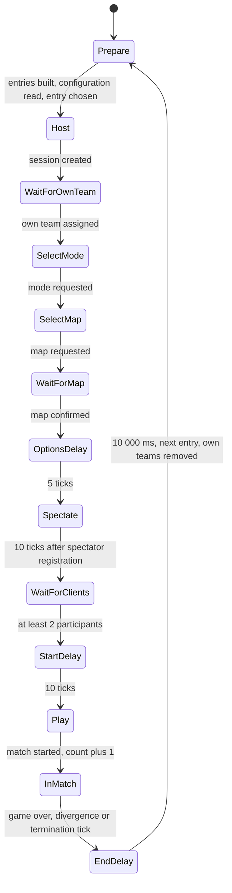
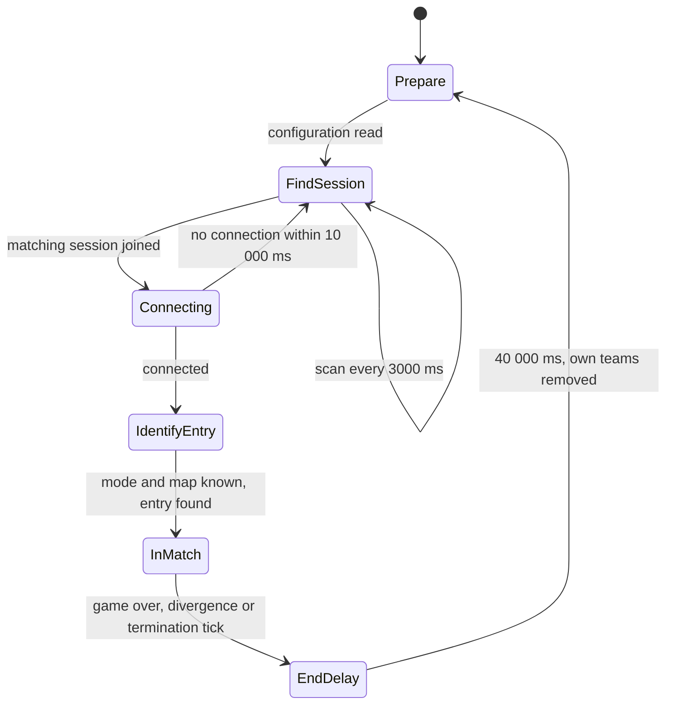

# Diagnostics, test and performance

> Status: Engine baseline · Prefix: DBG · ADRs: [ADR-0067](../../adr/0067-logging.md) · [ADR-0068](../../adr/0068-profiling-and-gpu-timing.md) · [ADR-0069](../../adr/0069-test-framework.md) · [ADR-0070](../../adr/0070-continuous-integration.md) · [ADR-0066](../../adr/0066-telemetry-with-consent.md) · [ADR-0065](../../adr/0065-crash-reporting.md) · [ADR-0056](../../adr/0056-editions-build-flavours-and-feature-flags.md) · [ADR-0057](../../adr/0057-version-identity.md) · [ADR-0074](../../adr/0074-platform-clock-with-injectable-time.md) · [ADR-0059](../../adr/0059-content-build-and-validators.md) · [ADR-0060](../../adr/0060-content-identity-by-hash.md) · [ADR-0001](../../adr/0001-direct3d-12-renderer-on-the-agility-sdk.md) · [ADR-0008](../../adr/0008-gpu-memory-uploads-and-device-removal.md) · Related: [tick timing and main loop](../../reference/12_simulation_model/01_tick_timing_and_main_loop.md) · [randomness and integrity](../../reference/12_simulation_model/07_randomness_and_integrity.md) · [platform layer](platform_layer.md) · [build tooling and distribution](build_tooling_and_distribution.md) · [renderer options and budgets](renderer/options_and_budgets.md)

This component is the Species engine's developer and quality infrastructure. It specifies the logging system, the assertion levels and the black-box record, the profiling layer and its in-game views, the development overlay, the development windows and debug commands that the engine keeps, the development drawing queue, the test harness with its headless simulation tests, the headless soak test and the opt-in telemetry data set. It also holds the **reference performance figures**: the population per map, the frame and tick structure, the hotspot catalogue, the stress populations and the budgets that the Species design phase starts from.

**Notation and units.**

- **Costs** (frame time, tick cost, call cost) are real time on the platform clock (ADR-0074), in milliseconds (ms), microseconds (µs) or nanoseconds (ns), measured on the reference test machine (§5.5).
- **Simulation durations** are in ticks at the reference tick rate, one tick per `ref.sim.tick_period` (0.1 s) of [reference/12](../../reference/12_simulation_model/01_tick_timing_and_main_loop.md); a duration in seconds next to a tick count is a derived display value. Delays of developer tools that run while no match world exists are counted in milliseconds of the platform clock, never accumulated from frame-time differences (DEC-804).
- **Distances** are in world units (`wu`). Positions and sizes of developer windows and overlays are in pixels of the 2-D overlay space, origin at the top-left corner and y growing downwards (RND-215), before the UI scale of UI-166; W × H is the render size.
- **Colours** are RGBA8 tuples (red, green, blue, alpha), or RGB triples when the alpha is 255.
- **Development builds** are the `Debug` and `Development` flavours of ADR-0056. **Test builds** are the development builds and every CI test configuration that runs the test harness (ADR-0070).

## 1 Responsibilities and boundaries

**DBG-001** (MUST) The diagnostics component owns:

1. the logging system: its API, categories, levels, pipeline, sinks and drop policy (§4.1);
2. the check macros, the black-box ring and what a failed check records before the platform layer's fatal path takes over (§4.2);
3. the profiling layer: the marker macros, the collection of GPU timestamps, the profile tree and its view (§4.3), and the marker catalogue (§3.4);
4. the development overlay, its pages and the counter-provider contract through which other components publish counters into it (§2.3, §4.4);
5. the development windows: the network statistics window (§4.5) and the debug-command window (§4.6);
6. the debug commands and their classification by effect on simulation state (§4.6, DBG-221);
7. the development drawing queue, its primitives and the development overlay layers drawn with them, among them the bot overlay (§4.7);
8. the hidden development settings that switch these facilities (§3.2);
9. the test harness: unit, property, golden-hash, golden-image, fuzz and performance tests, the headless simulation tests and the per-tick test-build checks (§4.8);
10. the headless soak test (§4.9);
11. the assembly of the opt-in telemetry data set (§4.10);
12. the reference performance figures, the Species budget baseline, the stress populations and the reference test machine (§5).

**DBG-002** (MUST NOT) No diagnostic facility changes a simulation result. Overlays, windows, the profile tree and logging read presentation state, counters and the immutable simulation snapshot only (DEC-007, DEC-222). A debug command that changes simulation state does so only as a sequenced command (DBG-118). Instrumentation never changes arithmetic, the number of simulation draws or a drawn value ([randomness and integrity](../../reference/12_simulation_model/07_randomness_and_integrity.md) R-SIM-613). A check that inspects simulation state after a tick never writes it. Test T7 confirms that a match played with every diagnostic facility on gives the same per-tick simulation hashes as the same match played with every facility off.

**DBG-003** (MUST) The neighbouring components own these parts, and this component cites them and never restates their rules:

| Part | Owner |
|---|---|
| crash capture: no top-level exception filter, the terminate, invalid-parameter and pure-call handlers, fail-fast termination, the files and memory blocks registered with Windows Error Reporting, thread naming and dump contents | [platform layer](platform_layer.md), ADR-0065 |
| the symbol store, the CI pipeline definitions, binary checks, the edition manifests and the dedicated-server build | [build tooling and distribution](build_tooling_and_distribution.md), ADR-0070, ADR-0056 |
| drawing of the development drawing pass (pass 24) and the text overlays (pass 29); the development sphere | [frame graph and passes](renderer/frame_graph_and_passes.md) RND-076; [entity and overlay renderers](renderer/entity_and_overlay_renderers.md) RND-330 |
| the bot overlay's pass (pass 16) | [entity and overlay renderers](renderer/entity_and_overlay_renderers.md) RND-359 |
| tool-window chrome, close box, inset panel and layout | [UI framework](ui_framework/README.md) UI-001, [core and widgets](ui_framework/core_and_widgets.md) UI-060, UI-061, [layout](ui_framework/layout_rendering_input_and_localisation.md) UI-166 |
| each component's own markers, counters and development pages | renderer RND-041, RND-386, RND-454; audio engine AEN-322, AEN-323, AEN-325; asset pipeline AST-126; input INP-241; UI core and layout (their §6); animation and VFX (its §6); terrain TER-254; camera (its §6) and the developer fly mode CAM-080 |
| the renderer's budgets and reference caps | [renderer options and budgets](renderer/options_and_budgets.md) RND-453 to RND-457 |
| the language test | [options and hooks](../../reference/09_front_end_and_match_flow/options_localisation_and_hooks.md) R-META-473 |
| the command-history recording hook | [randomness and integrity](../../reference/12_simulation_model/07_randomness_and_integrity.md) R-SIM-740 to R-SIM-742 |
| tick timing, update slices and catch-up | [tick timing and main loop](../../reference/12_simulation_model/01_tick_timing_and_main_loop.md) |
| the networking metric set and the link simulator | DEC-208 (design phase) |
| run-time divergence detection | DEC-206 (design phase) |

This component composes those parts into one developer view and one test harness.

**DBG-004** (MUST) Each facility exists in these build flavours (ADR-0056); a facility marked "no" is absent from the binary, not merely disabled:

| Facility | `Debug` | `Development` | `Profile` | `Shipping` |
|---|---|---|---|---|
| log file and ETW sinks, info level and above | yes | yes | yes | yes |
| debug-level records, per-category trace records, debugger output sink | yes | yes | no | no |
| development checks (`SPECIES_ASSERT`, PLT-122) | yes | yes | no | no |
| release checks and container bounds checks | yes | yes | yes | yes |
| black-box record | yes | yes | yes | yes |
| PIX markers and GPU timestamps | yes | yes | yes | no |
| development overlay: performance pages (frame-time graph, pass and subsystem times, entity counts) and the profile view | yes | yes | yes | no |
| development overlay: every other page; development windows; debug commands; development drawing; hidden development settings | yes | yes | no | no |
| test hooks and the per-tick test-build checks | yes | yes | no | no |
| opt-in telemetry | yes | yes | yes | yes |

**DBG-005** (MUST) The reference player build contains these diagnostics, reached as stated; this is the reference that the Species facilities replace:

| Facility | Present in the reference player build | How it is reached | Species counterpart |
|---|---|---|---|
| network statistics window | yes | a key opens it in menus, the lobby and a match (DBG-020) | development builds (DBG-105) |
| debug log | yes | always written to the profile folder, truncated at start-up | the logging system, every flavour (§4.1) |
| release assertions and the assertion record | yes | any failed release assertion or container bounds check | release checks and the black box (§4.2) |
| crash log and minidump | yes | any unhandled exception on the main thread | crash capture on every thread ([platform layer](platform_layer.md), ADR-0065) |
| world-state dump on divergence | yes | the first divergence notice | design phase (DEC-206) |
| development drawing | compiled in; only the bot overlay is drawn | a hidden setting (§3.2) | development builds (§4.7) |
| profile tree | compiled in; not reachable | — | the profile view (§4.3) |
| frame-rate and entity-count overlay | compiled in; forced off | — | the development overlay (§4.4) |
| hidden development settings | yes | the settings file | development builds (§3.2) |
| debug-command window | compiled in; empty | — | development builds (§4.6) |

**DBG-006** (MUST) The Species debug and test baseline is:

1. **Debug commands.** Every developer cheat that changes simulation state is a sequenced debug command, which the authority accepts only in a session created with cheats enabled and every participant applies on the same tick; such a session carries a session-wide cheats-used marker (§4.6, DEC-041, DEC-202).
2. **Replay as the regression tool.** When the design phase gives Species reproducible replays (DEC-046), every match records its seed and command stream into a local ring buffer, the headless runner replays it at maximum speed, the end-of-match state hash must match, and a recorded match serves as the repeatable performance scene of ADR-0066 (§8.2).
3. **Headless soak test.** Bot teams play complete matches on every mode and map in CI, with no user interface driven (§4.9, DEC-804, ADR-0070).
4. **Profiling.** Scoped CPU markers that PIX and ETW traces show, GPU timestamps per pass, and an in-game overlay with a frame-time graph and per-system budgets; every marker is safe to use from any thread (§4.3, ADR-0068).
5. **Development console and overlays,** reachable in development builds: frame time, entity counts per type, network statistics with correct units, per-client lag in ticks and gaps in the incoming frame queue, bot overlays, and actor-grid and obstacle-grid visualisers (§4.4 to §4.7).
6. **Logging and crash reporting.** An asynchronous, buffered, categorised log; crash capture on every thread and through the terminate path; dumps with every thread; a symbol store for every build; no stack walk that depends on frame pointers; no credentials in a binary or a report (§4.1, §4.2, ADR-0065, ADR-0067).
7. **Telemetry with consent** (§4.10, ADR-0066).
8. **Validators in the content build** instead of run-time-only checks: the language completeness test and the content checks run in the content build (ADR-0059, R-META-473).

Run-time state hashing for divergence detection is DEC-206; the per-tick state hash of the test harness (DBG-144) is a test tool.

## 2 Interfaces

### 2.1 Interface sketch

```cpp
namespace species::diag {

// Logging (ADR-0067). LogLevel is in severity order; LogCategory is fixed and extended only in code.
enum class LogLevel : std::uint8_t { Trace, Debug, Info, Warning, Error, Fatal };
enum class LogCategory : std::uint8_t { Platform, Render, Audio, Input, Ui, Content, Simulation, Network, Tools, Diagnostics, Test };
template <class... Args> void Log(LogCategory, LogLevel, std::format_string<Args...>, Args&&...);
void LogHexDump(LogCategory, LogLevel, std::span<const std::byte>);          // DBG-063
void LogValueDump(LogCategory, LogLevel, std::span<const std::int32_t>);     // DBG-063
void SetCategoryLevel(LogCategory, LogLevel minimum);                         // development builds
struct LogStats { std::uint64_t written, dropped_trace, dropped_debug; };
LogStats GetLogStats();
void FlushLogSynchronously();                                                 // fatal path only (DBG-073)

// Checks and the black box (§4.2, ADR-0065)
#define SPECIES_ASSERT(condition)            /* development check: Debug and Development (PLT-122) */
#define SPECIES_CHECK(condition, fmt, ...)   /* release check: every flavour, fatal */
#define SPECIES_CHECK_INDEX(index, size)     /* container bounds check: every flavour, fatal */
[[noreturn]] void CheckFailed(std::source_location, std::string_view condition, std::string_view message);
class BlackBox {                                       // one per process, owned by the composition root
public:
  void NoteFrame(std::uint64_t frame_index);  void NoteTick(std::uint64_t tick);
  void NoteMarker(std::string_view marker);   void NoteLocation(std::string_view map_or_region_id);
  void NoteCheck(std::string_view message);
  std::span<const std::byte> MemoryBlock() const;      // registered by the platform layer
};

// Profiling (ADR-0068)
#define SPECIES_PROFILE_SCOPE(name)                   /* CPU marker; nothing in Shipping */
#define SPECIES_PROFILE_GPU_SCOPE(command_list, name) /* GPU marker and a timestamp pair */
struct ProfileNodeStats {
  std::uint32_t calls_current, calls_last, history_periods, history_calls;
  double ms_current, ms_last, ms_history, shortest_ms, longest_ms;
};
class ProfileTree {                                    // one per thread that carries markers
public:
  ProfileNodeId Root() const;
  std::span<const ProfileNodeId> ChildrenByName(ProfileNodeId) const;
  const ProfileNodeStats& Stats(ProfileNodeId) const;
  std::optional<ProfileNodeId> Lookup(std::string_view path) const;
  void ResetHistory();  double MaxChildTime(ProfileNodeId) const;            // DBG-084
};
std::span<const float> RecentFrameTimesMs();                                  // newest first, DBG-085

// Development overlay counters (§2.3)
class CounterSink {
public:
  virtual void Count(std::string_view name, std::int64_t value) = 0;
  virtual void Gauge(std::string_view name, double value, std::string_view unit) = 0;
  virtual void Budget(std::string_view name, double used, double budget, std::string_view unit) = 0;
};
class CounterProvider {
public:
  virtual std::string_view Page() const = 0;                 // overlay page id, for example "audio"
  virtual void Publish(CounterSink&) const = 0;              // presentation thread, start of frame
  virtual ~CounterProvider() = default;
};
void RegisterCounterProvider(CounterProvider&);  void UnregisterCounterProvider(CounterProvider&);

// Development drawing (§4.7): one function per primitive of DBG-130, and the persistent queue
class DevDrawQueue {
public:
  void Add(DevDrawItem, std::string_view label, std::uint32_t life_frames);  // 0 = until removed
  void RemoveByLabelPrefix(std::string_view prefix);                         // case-insensitive
  std::optional<DevDrawItemId> FindByLabelPrefix(std::string_view prefix) const;
  void Render();                                                             // pass 24, once per frame
};

// Debug commands (§4.6); the enumerator order is the window's button order
enum class DebugCommandKind : std::uint8_t { KillAllEnemies, SpawnWorkers, SpawnTransport, SpawnCrawlers,
  SpawnEssenceOrbs, AllowArbitraryPlacement, SpawnAtStructurePorts, SpawnSupplyCrate };
struct DebugCommand { DebugCommandKind kind; std::uint8_t team_slot; Vec3 point; std::int16_t forced_outcome; };  // −1 = normal choice

// Soak test (§4.9)
enum class SoakProgression : std::uint8_t { Linear, Random, Sequence };
struct SoakEntry { MapId map; MatchMode mode; std::uint8_t bot_teams; std::uint64_t seed; };   // seed 0 = authority's own
struct SoakConfig { SoakProgression progression; std::vector<SoakEntry> entries; std::uint64_t progression_seed;
                    std::string session_name; std::uint64_t terminate_at_tick; std::uint8_t clients; bool rendering; };
class SoakRunner { public: explicit SoakRunner(SoakConfig); SoakReport Run(); };  // owns all soak state

// Telemetry (ADR-0066)
struct TelemetrySessionRecord;                                // the data set of DBG-181
void SubmitTelemetry(const TelemetrySessionRecord&);         // queued; sent only with consent

}  // namespace species::diag
```

Caption: Listing 2.1-A, the diagnostics interface (declarations only). `ProfileNodeId`, `DevDrawItem`, `DevDrawItemId` and `SoakReport` are opaque handles and records of this component.

### 2.2 Debug entry points and development bindings

**DBG-020** (MUST) Development builds add a development binding set on top of the default binding set of the [input](input.md) component (INP-009), which binds no developer key other than `action.debug.network_stats`. The debug actions and their default bindings are:

| Action | Default binding | Context and conditions | Effect | Flavours |
|---|---|---|---|---|
| `action.debug.network_stats` | `key:f9:down` | the front end, the lobby and a match: the action is polled by the front-end loop and the match loop | opens the network statistics window when it is not open; it never closes it, the window's close box does (UI-060); in `Profile` and `Shipping` builds it does nothing | every flavour binds it; development builds act on it |
| `action.debug.command_window` | `key:f11:down` | only while no UI window is open | opens the debug-command window (§4.6) | development |
| `action.debug.drop_packet` | `key:f:held` | a participant connected to a host | discards every incoming network message while held, as a manual packet-loss test (DEC-208) | development |
| `action.debug.special_lighting_on`, `action.debug.special_lighting_off` | `key:l:held`, `key:k:held` | a match | sets the renderer's special-lighting setting on, or off (RND-442); `key:l` also drives `action.view.chat_log`, and both act | development |
| `action.debug.soak_rendering` | `key:r:down` | a soak participant (§4.9) | toggles the participant's rendering and sound together | development |
| `action.debug.overlay` | `key:f5:down` | any | shows or hides the development overlay (§4.4) | `Debug`, `Development`, `Profile` |
| `action.debug.profile_view` | `key:f10:down` | any | shows or hides the profile view (§4.3) | `Debug`, `Development`, `Profile` |
| `action.debug.camera_fast`, `action.debug.camera_slow`, `action.debug.camera_rotate` | the [input](input.md) component's development bindings (CAM-084) | the developer fly mode | CAM-081, CAM-082 | development |

**DBG-021** (MUST) The screenshot action (`action.view.screenshot`) is a player action of [reference/06](../../reference/06_controls_camera_and_commands/actions_and_bindings.md) row A10 and the renderer, not a debug action.

**DBG-022** (MUST NOT) No binding exists for: a second editor toggle on the network statistics key; a gamepad binding of the debug-command window; a debug quit action; a key that resets the campaign world camera; or a key that multiplies campaign production rates. The reference holds these only as inert or campaign-only bindings.

### 2.3 Events and data contracts

**DBG-023** (MUST) **Counter providers.** A component publishes its development counters through one `CounterProvider` per overlay page. `Publish` runs on the presentation thread at the start of each frame while the page is shown, reads only the component's own counters, and allocates no memory. The pages and their providers are:

| Page | Provider | Content |
|---|---|---|
| frame | this component | the frame-time graph, frame rate, entity counts per type (DBG-095, DBG-097) |
| render | renderer | per-pass GPU times against the pass-group budgets (RND-041, RND-454), compacted instance counts per instance type (RND-386), the input-mode box flag (RND-076) |
| simulation | this component, from the profile tree | per-subsystem CPU times of the marker catalogue (§3.4) against their budgets (§5.4) |
| audio | audio engine | the counters of AEN-323 and the per-entry-kind and per-event costs of AEN-322 |
| assets | asset pipeline | resident bytes per load group and content type, cache entries per load state, the override list, the placeholder count (AST-126) |
| input | input | events per frame (latest and maximum), dropped events, reconciliations, the age of the oldest event (INP-241) |
| ui | UI framework | panels, widgets, clicks and cancelled presses per frame; draws, vertices, batches and glyphs rasterised per frame; glyph-cache evictions (UI core and layout §6) |
| vfx | animation and VFX | live and dropped particles per type and class, live explosions and shards, the shake scalar, flash onsets and effect events per tick (animation and VFX §6) |
| log | this component | records written and dropped per category and level (DBG-062) |
| network | the networking model | the metric set of DEC-208 |

**DBG-024** (MUST) **Debug commands** travel as player commands of the command catalogue ([teams and player commands](../../reference/12_simulation_model/06_teams_and_player_commands.md)) with the payload of `DebugCommand`: the sender's team, the command kind, the target team slot, the target point and the forced outcome. Who may send one and how it is validated is DBG-118 and DEC-202.

**DBG-025** (MUST) **Soak artefacts.** Each soak pass produces one soak report: one row per match (DBG-166) plus the pass totals, the crash dumps of the pass ([platform layer](platform_layer.md)), the assertion failures, the simulation update-time percentiles and the peak population per match. The report is a CI artefact (ADR-0070).

**DBG-026** (MUST) **Telemetry record.** One `TelemetrySessionRecord` per session holds exactly the data set of DBG-181; a schema check rejects any field outside it (ADR-0066).

### 2.4 Threading contract

**DBG-027** (MUST) Every logging, marker and black-box call is safe from any thread and never blocks on I/O: logging writes into a per-thread buffer (DBG-061), a CPU marker pushes and pops a per-thread marker stack, and the black box is written with atomic stores into a fixed-size block.

**DBG-028** (MUST) Each thread that carries markers has its own profile tree; the profile view merges the trees of the threads it shows, by thread name, at the start of a frame. No marker call takes a lock that another marker call holds.

**DBG-029** (MUST) The development overlay, the development windows and the development drawing queue run on the presentation thread. The drawing queue is filled and drawn on that thread only; a simulation-side check that wants a visual queues a presentation event, never a draw call (DEC-007).

**DBG-030** (MUST) Debug commands enter the simulation only through the command path, at a tick boundary, like every other command (R-SIM-670); no diagnostic code runs inside a tick except the markers and the per-tick test-build checks, which run after the tick's last step and read only.

**DBG-031** (MUST) The soak runner, the headless simulation tests and the telemetry sender each run on threads they own and stop and join before their owner is destroyed (DEC-224).

## 3 Data model

### 3.1 Types, ownership and lifetimes

**DBG-040** (MUST) Every diagnostic object has one owner and an explicit lifetime; none is reached through a process-wide global, and none is static storage of a UI module (DEC-804):

| Object | Owner | Lifetime |
|---|---|---|
| logger, its per-thread buffers and its sinks | the composition root of each program (client, server, tools) | process; the logging thread starts first and stops last |
| black box | the composition root; its memory block is registered by the platform layer | process |
| profile trees, frame-time history | the profiling service | process; history reset on request (DBG-084) |
| counter providers | the component that registers them | the component; unregistered before it is destroyed |
| development overlay, profile view, development windows | the client's UI core (UI-005) | while shown |
| development drawing queue | the renderer's frame context | per match world; emptied at every match start and end |
| soak runner and its state | the test run that creates it | one soak pass |
| telemetry queue | the telemetry service | process; persisted between runs only as DEC-250 decides |

### 3.2 Hidden development settings

**DBG-041** (MUST) Development builds read these settings from the settings store (`SettingsStore`). Players never see them (R-META-457), and `Profile` and `Shipping` builds do not contain them (DBG-004):

| Setting | Default | Values and effect | Specified in |
|---|---|---|---|
| `dev.bot_overlay` | `dbg.setting.bot_overlay.default` (0) | 0: off; 1: the bot priority text for one team and the link arrows; any other non-zero value: the link arrows only | DBG-135 |
| `dev.bot_overlay_team` | `dbg.setting.bot_overlay_team.default` (1) | the lobby position (not the team slot) whose priorities the overlay shows | DBG-135 |
| `dev.command_history` | `dbg.setting.command_history.default` (0) | 0: off; 1: record; 2: play back (R-SIM-740) | DBG-241 |
| `dev.capture_frame_rate` | `dbg.replay.capture_frame_rate` (25) | presentation frames per second of the fixed step that command-history modes 1 and 2 use | DBG-241 |
| language test | off | [reference/09](../../reference/09_front_end_and_match_flow/options_localisation_and_hooks.md) R-META-473 | reference/09 |
| special lighting | off | toggled by the debug actions of DBG-020 | RND-442 |
| poster resolution | 1 | screenshots as N × N tiles | RND-110, RND-442 |
| `dev.soak_session_name` | empty | the session name a soak host advertises and soak clients look for; a soak configuration's name replaces it | DBG-162 |

**DBG-042** (MUST) The reference's terrain storage-mode setting has no Species meaning (RND-443), and its campaign test-harness switch is not specified (DEC-052). The reference start-up switches with a diagnostic role belong to the platform layer: writing the build identity to a file and exiting (PLT-023, ADR-0057), and moving every log and user file out of the profile folder (PLT-024).

### 3.3 Log records and categories

**DBG-043** (MUST) A log record holds: the platform-clock time (ADR-0074) and the UTC calendar time used only for display; the thread name; the category; the level; and the message, formatted from a compile-time format string with arguments. Categories are the fixed set of Listing 2.1-A: the nine of ADR-0067 plus `Diagnostics` (this component) and `Test` (the test harness and the soak runner). Levels are ordered trace < debug < info < warning < error < fatal.

**DBG-044** (MUST) A log file starts with a header that holds the full build identity (ADR-0057), the OS build, the adapter description and the date and time of the start of the run (ADR-0067). This replaces the reference header line of product name, version and build date.

### 3.4 Profile marker catalogue

**DBG-045** (MUST) Every engine subsystem update, every frame-graph pass (RND-041) and every content-loading stage carries a marker (ADR-0068). The catalogue below is the Species marker set for the systems that the reference instruments; a row's "per kind" marker is one marker per actor kind or structure kind, named by the kind's identifier. Markers nest by call order on their thread.

| Area | Species markers (the reference section each replaces is implied by the name) |
|---|---|
| frame and loop | `frame.match_loop` (the whole simulation advance of a frame, around the world step); `render.frame`; `render.clear`; `render.present` |
| camera and input | `camera.advance`; `input.advance`; `render.match_input` |
| sky | `render.sky`; `render.sky.blobby_layers`; `render.sky.flat_layers`; `render.sky.advance`; `render.clouds` |
| terrain and sea | `render.terrain.surface`; `render.terrain.wire_overlay`; `render.sea`; `render.sea.advance`; `render.sea.wave_build` (the coastline wave mesh, built on the GPU in Species, ADR-0011) |
| simulation, world step | `sim.laser_bolts.advance`; `sim.effects.advance`; `sim.structures.advance` with one marker per structure kind; `sim.essence_orbs.advance`; `sim.teams.advance_group_members`; `sim.teams.advance_groups`; `sim.teams.advance_ungrouped` with one marker per actor kind; `sim.actor_group.advance` with one marker per actor kind |
| Workers | `sim.worker.task_search`; `sim.worker.search.threats` with `.projectiles`, `.trees`, `.hives`, `.bot_nodes`, `.enemies`; `sim.worker.search.ports`; `sim.worker.search.carryables`; `sim.worker.search.supply_crates`; `sim.worker.search.transports`; `sim.worker.search.flags`; `sim.worker.search.leaders`; `sim.worker.search.random_position`; `sim.worker.combat`; `sim.worker.throw_grenade`; `sim.worker.move_to_target`; `sim.worker.push.sea`; `sim.worker.push.structures` |
| creatures | `sim.crawler.record_trail`; `sim.crawler.move_to_target`; `sim.crawler.idle`; `sim.crawler.attacking`; `sim.crawler.to_essence_orb`; `sim.crawler.to_egg`; `sim.crawler.search.enemies`; `sim.crawler.search.essence_orbs`; `sim.crawler.search.eggs`; `sim.crawler.search.idle_direction`; `sim.centipede.search_essence_orbs`; `sim.spider.search_essence_orbs` |
| structures and objects | `sim.spawn_node.evaluate`; `sim.spawn_node.spawn_workers`; `sim.structure.push_actors`; `sim.essence_orb.push_from_structures`; `sim.spitter_plant.check_trigger`; `sim.bomber.update_position` |
| network | `net.host.advance`; `net.host.update_clients`; `net.host.send`; `net.host.advertise`; the Species networking markers follow DEC-200 |
| effects | `effects.particles.advance`; `effects.particles.render`; `effects.shatter.advance`; `effects.shatter.render` |
| world rendering | `render.structures` and `render.structures.transparent`, each with one marker per structure kind; `render.structures.transparent_sort`; `render.structure_ports`; `render.essence_orbs`; `render.weapons`; `render.actor_groups` with one marker per actor kind; `render.ungrouped_actors` with one marker per actor kind; `render.crawlers`; `render.workers`; `render.cloth_flags`; `render.beam_dish.beam`; `render.transit_gate.destination`; `render.transit_gate.surface_advance`; `render.transit_gate.surface`; `render.routes` |
| overlays and UI | `render.world_cursor`; `render.world_markers`; `render.centre_message`; `render.mode_hud`; `render.hint_overlay`; `render.power_slots_panel`; `devtools.profile_view.render` |
| audio | `audio.update` and one marker per update step of AEN-123, `audio.decode`, `audio.bank_load` (AEN-322); the reference's instance-start sections map onto `audio.instance.start`, `audio.instance.open_stream`, `audio.instance.set_parameters`, `audio.instance.set_frequency_volume_position` and `audio.instance.setup_effects`, and its effect sections onto `audio.effect.resonant_low_pass`, `audio.effect.gargle` and `audio.effect.echo` |

**DBG-046** (MUST NOT) The catalogue has no marker for campaign-only systems (DEC-052), for the pixelation, deform and reflection effects (DEC-059), for the gesture and icon Power interfaces (DEC-055), or for the reference's device-buffer locking in audio output, which the Species audio engine does not have (ADR-0022). The reference instruments 186 call sites in its compiled code; the rows above keep every one whose system Species specifies.

### 3.5 Black-box contents

**DBG-047** (MUST) The black box is a fixed-size block of `dbg.blackbox.block_bytes` (4096 bytes) registered with Windows Error Reporting by the platform layer (ADR-0065). It holds:

1. a fixed marker text, so that the block can be found in a dump;
2. the full build identity (ADR-0057);
3. the UTC date and time of the start of the run, and of the failure when one is recorded;
4. the most recent `dbg.blackbox.recent_markers` (16) frame and tick markers, each with its frame index or tick;
5. the current map id, or the world region id once the design phase defines regions;
6. the most recent `dbg.blackbox.recent_checks` (8) failed-check and warning messages;
7. for a failed release check: the black-box record of PLT-123 (product name, build identity, UTC date and time, the message truncated to `plt.crash.check_message_max_chars`), and the condition text, the source file and line, and the thread name.

It never holds chat text, account tokens or the names of other players (ADR-0065, ADR-0067).

**DBG-048** (MUST) The reference's assertion record is a text report with a banner, the product name, version and build date, the date as hour and minute and as day, month and year, the error message, and a stack trace of return addresses that a frame-pointer walk collects and an offline script resolves through a linker map; the walk stops at a misaligned, non-increasing or unreadable frame and is short or wrong in optimised builds. Species keeps the content (identity, time, message, stack) and takes the stack from the dump, symbolised through the symbol store of every build ([build tooling and distribution](build_tooling_and_distribution.md), ADR-0065); no Species code walks frame pointers.

### 3.6 Diagnostic outputs

**DBG-049** (MUST) Every diagnostic output of a Species client, with its writer:

| Output | Writer | Content | Flavours |
|---|---|---|---|
| log files in the logs folder (ADR-0071), one per run, the last `dbg.log.files_kept` (10) kept | logging system (§4.1) | the log | every flavour |
| ETW events of the Species TraceLogging provider | logging system | the same records | every flavour |
| black-box block | this component and the platform layer | DBG-047 | every flavour |
| crash report and dump; on test machines also a local dump in the `crashes` folder (PLT-118) | platform layer, through WER (ADR-0065) | dump of every thread, registered files, the black box and the crash-context record (PLT-120) | every flavour |
| language completeness report, in the `diagnostics` folder (PLT) | the client's language test (R-META-473) | three lists per language | development |
| command-history recording, in the `diagnostics` folder | the replay hook (§8.2) | the command frames of a match | development |
| soak report | the soak runner (DBG-166) | one row per match and the pass totals | CI |
| telemetry queue | the telemetry service (§4.10) | unsent session records | every flavour, with consent |
| PIX captures and ETW traces | PIX and Windows Performance Analyzer | captures taken by a developer | `Debug`, `Development`, `Profile` |
| test reports and performance results | the test harness | CI artefacts (ADR-0070) | test builds |

Key-binding parse errors go to the log ([input](input.md)). The world-state dump on divergence is DEC-206. The version file is the platform layer's (PLT-023).

## 4 Behaviour and algorithms

### 4.1 Logging

**DBG-060** (MUST) Logging follows ADR-0067: `Log(category, level, format, arguments)` with a compile-time format string, so text from content, players or the network is always an argument and is logged verbatim, a percent sign or a brace included. No log call formats into a fixed-size buffer; a long message is logged whole.

**DBG-061** (MUST) A log call writes its record into the calling thread's lock-free buffer of `dbg.log.thread_buffer_kib` (256 KiB) and returns; one logging thread drains every buffer to the sinks. When a buffer is full, trace records are dropped first, then debug records; warnings, errors and fatal records are never dropped, and the caller waits only when its buffer holds nothing but such records. The cost on the calling thread stays within `dbg.budget.log_call_us` (DBG-206).

**DBG-062** (MUST) Dropped records are counted per category and level. The counts appear on the log page of the development overlay, and a warning record states the counts since the previous such warning whenever a drain finds new drops.

**DBG-063** (MUST) `LogHexDump` writes `dbg.log.hex_bytes_per_line` (16) bytes per line in hexadecimal; `LogValueDump` writes 32-bit integers in decimal, `dbg.log.hex_bytes_per_line` ÷ 4 values per line.

**DBG-064** (MUST) Sinks and levels per flavour are those of ADR-0067: the rotating UTF-8 file (DBG-049), the TraceLogging provider, and the debugger output in `Debug` and `Development` builds. `Shipping` and `Profile` builds record info and above; development builds record debug and above, with trace enabled per category at run time. If the log file cannot be opened, records go to the remaining sinks, and the failure is reported once, with the path, on those sinks.

**DBG-065** (MUST) The log records at least the content that the reference debug log carries, as categorised records: the start-up header (DBG-044); content mounting with entry counts and durations, and every missing resource ([asset pipeline and resources](asset_pipeline_and_resources.md) AST-126); every settings entry that fails to parse or is out of range (DEC-800); network connection, divergence and disconnection events (DEC-206); audio readiness, bank loads and device changes (AEN-324); key-binding parse outcomes ([input](input.md)); and a memory report every `ref.sim.frame.memory_log_interval` (60 s, [tick timing](../../reference/12_simulation_model/01_tick_timing_and_main_loop.md)) giving the available physical memory, the process's committed memory and working set, and the audio engine's memory summary (AEN-324).

**DBG-066** (MUST NOT) No record holds chat text, account tokens, passwords, or an identifier of another player other than a session-local number (ADR-0067). No diagnostic is formatted while its level is disabled: a disabled record costs the level test only. In the reference a state line is formatted before and after every body and structure update even where the log discards it (DEC-206).

### 4.2 Checks, the black box and the fatal path

**DBG-070** (MUST) Species has these check levels; the reference level each replaces is named in the second column:

| Species level | Reference counterpart | Flavours | On failure |
|---|---|---|---|
| development check `SPECIES_ASSERT(c)` | debug assertion, with no effect outside debug builds | `Debug`, `Development` (PLT-122) | breaks into an attached debugger, otherwise takes the release-check path (PLT-124) |
| release check `SPECIES_CHECK(c, message)` | release assertion with a formatted message | every flavour (PLT-122) | DBG-073 and PLT-123 |
| plain release check (no message) | assertion that reports the condition text, file and line | every flavour | as a release check; the message is the condition text, file and line |
| container bounds check `SPECIES_CHECK_INDEX(i, n)` | the assertion with arguments that every container bounds check uses | every flavour | as a release check: an out-of-range container access is a fatal, reported error in every build |
| abort | release assertion that is always false, with a message | every flavour | as a release check |
| fatal exit | logged exit with a message dialog and the assertion record | every flavour | the platform layer's `FatalExit` (PLT-042), for failures of the environment that are not defects; DBG-074 |

**DBG-071** (MUST) Content errors never reach a check: the content build rejects them (DEC-015, ADR-0059), and a load path reports and recovers. A check states a program invariant; a failed check is a defect.

**DBG-072** (MUST) The test builds' simulation checks of §4.8 are development checks that the test harness turns into test failures; they never run in `Profile` or `Shipping` builds.

**DBG-073** (MUST) A failed release check takes the path of [platform layer](platform_layer.md) PLT-123. This component's part comes first: it writes the check's condition text, source location and thread name next to the black-box record of PLT-123 (DBG-047 item 7), and the full message as a fatal log record, which it flushes synchronously (ADR-0067), so the registered log file holds it. The platform layer then breaks into an attached debugger, or shows `ui.error.internal` unless the run is headless, and ends the process with a fail-fast exception, which Windows Error Reporting captures with the registered files and the black box (ADR-0065). The terminate, invalid-parameter and pure-call handlers take the same path (PLT-114). In the reference a failed release assertion shows its own message in a fatal-error message box, writes the assertion record and ends through the runtime's terminate path; whether its crash handler also runs is a property of its runtime library (DEC-341).

**DBG-074** (MUST) Before the platform layer's `FatalExit` ends the process with `plt.lifecycle.exit_code.fatal` (PLT-042), this component writes the exit's string id and arguments to the black box and as a fatal log record and flushes the log; no dump is written.

**DBG-075** (MUST) The black box is updated as the program runs: the frame loop notes each frame index and the tick clock notes each tick (`NoteFrame`, `NoteTick`); the outermost markers of a frame and a tick are noted as markers; loading a map or entering a region notes its id; each warning and each failed development check is noted as a check message. Updates are atomic stores into the ring slots, never allocations.

### 4.3 Profiling

**DBG-080** (MUST) The profiling layer is ADR-0068's: `SPECIES_PROFILE_SCOPE` and its GPU counterpart emit PIX events through WinPixEventRuntime in `Debug`, `Development` and `Profile` builds and expand to nothing in `Shipping` builds; a GPU scope also writes a timestamp query pair, resolved into a readback buffer and read `dbg.profile.gpu_readback_latency` (2) or more frames later, so the CPU never waits for the GPU to measure it. System-wide problems are captured as ETW traces with the TraceLogging provider of DBG-064.

**DBG-081** (MUST) The same markers feed the profile tree. Each thread's tree is rooted at a root node. Entering a marker finds or creates the child of the current node with the marker's name and starts its timer; leaving it adds one call and the elapsed time to the node, updates the node's shortest and longest call, and makes the parent current again. Nesting follows call order only; a leave whose name differs from the current node's is a debug assertion. The trees exist whenever markers are compiled in; the reference creates its tree only while its profile window is open. Every node is timed whether or not the view shows it; the reference times a node only while its parent is expanded in the view, so a collapsed subtree costs a look-up per call and shows no time.

**DBG-082** (MUST) Once every `dbg.profile.rollup_period_ms` (1000 ms) of the platform clock, checked once per frame, the profiling service rolls every node over: the current period's calls and time become the last period's, the last period's are added to the history (one more history period), and the current period restarts; the length of the period just ended is recorded as now − (end of period − `dbg.profile.rollup_period_ms`), and the next period ends `dbg.profile.rollup_period_ms` after now. The roll-over runs in every frame loop, the front-end loop included; the reference rolls over only in its match loops.

**DBG-083** (MUST) Each node keeps the fields of `ProfileNodeStats`: calls and time of the current and last periods, time, periods and calls since the last history reset, and the shortest and longest call since that reset. The shortest call starts at the largest representable value and the longest at 0.

**DBG-084** (MUST) `ResetHistory` clears the history, shortest and longest of every node of every tree. `MaxChildTime(node)` is the largest child history time divided by the history periods of the node's first child in name order. A node is looked up by its path of names from the root.

**DBG-085** (MUST) After every frame the frame time in milliseconds is pushed to the front of the frame-time history, which keeps the newest `dbg.profile.frame_history` (200) frames.

**DBG-086** (MUST) The **profile view** is a tool window of `dbg.profile.view.width` × `dbg.profile.view.height` (570 × 600 px) at (W − `dbg.profile.view.offset_x`, `dbg.profile.view.y`) = (W − 590, 30). It has two buttons on the row at y = `dbg.profile.view.button_y` (18): reset history at x = `dbg.profile.view.reset_x` (190), which calls `ResetHistory`, and the statistic choice at x = `dbg.profile.view.statistic_x` (330), whose caption cycles minimum → average → maximum → minimum. A column header (`ui.dev.profile.header`) is right-aligned at x + `dbg.profile.view.statistic_x`.

**DBG-087** (MUST) The view lists the children of each expanded node in name order, depth first from the root, which is always expanded, and skips a node whose history average (history time ÷ history periods) is 0. Each row shows: an indent of one step per depth; a marker that reads "+" for a collapsed node with children, "−" for an expanded one and a blank for a leaf; the name padded to `dbg.profile.view.name_width` (24) characters minus the indent; the last period's calls; the time per call in ms with one decimal; the last period's total time in ms with no decimals; the chosen statistic (shortest call, history average per period or longest call) in ms with one decimal; and, for a node of a frame-graph pass, its GPU time from the timestamps. The reference computes the chosen statistic but never shows it, and prints its two decimal columns as unreadable text; the Species view shows all of them.

**DBG-088** (MUST) Each row is `dbg.profile.view.row_height` (12 px) high. Its brightness is `dbg.profile.view.brightness_min` + `dbg.profile.view.brightness_range` × time ÷ largest time among the rows, clamped to [`dbg.profile.view.brightness_min`, `dbg.profile.view.brightness_min` + `dbg.profile.view.brightness_range`] = [105, 255]. A bar starts at x + `dbg.profile.view.bar_x` (340), is √(time in ms) × `dbg.profile.view.bar_scale` (10) px long and `dbg.profile.view.bar_height` (11 px) high, in `dbg.profile.view.bar_rgb` (150, 150, 250) with the row's brightness as alpha, drawn as an outline when the node is expanded and filled when it is collapsed. A primary press inside a row's band toggles that node's expansion. The window grows by one row height for every row past its height.

**DBG-089** (MUST) The bottom `dbg.profile.view.graph_height` (100 px) of the view hold the frame-time graph: guide lines at the frame times of `dbg.profile.view.graph_marks_ms` (200, 100 and 50 ms, that is 5, 10 and 20 frames per second), each labelled with its time and rate; one red vertical line per frame of the frame-time history, newest at the right, of height `dbg.profile.view.graph_height` × frame time ÷ `dbg.profile.view.graph_full_ms` (200 ms), that is 0.5 px per ms, so a 200 ms frame fills the graph.

**DBG-090** (MUST) Subsystem profilers belong to their subsystems: the audio engine brackets its update, update steps, decode task and bank loads, and counts the cost of triggers per entry kind and of decoding per event (AEN-322); the profile view and the audio page show them.

### 4.4 Development overlay

**DBG-095** (MUST) The **frame-rate line** of the overlay is drawn in pass 29 (RND-076) in the body text role ([layout](ui_framework/layout_rendering_input_and_localisation.md) §4), right-aligned at (W − `dbg.overlay.frame_rate_right` (10), H − `dbg.overlay.frame_rate_bottom` (40)), and only while the interface is shown. While a match world exists it shows the frame rate and the number of live simulated objects (`ui.dev.overlay.frame_rate_entities`); elsewhere it shows the frame rate alone (`ui.dev.overlay.frame_rate`). The frame rate is the renderer's counter of frames completed in the last `ref.sim.frame.fps_window` (RND-011, R-SIM-576). Its visibility is the renderer's frame-rate overlay flag of RND-011, off by default and absent from `Shipping` builds; in the reference player build the line exists but is forced off and nothing can show it.

**DBG-096** (MUST) The **frame page** shows, besides the frame-rate line: the frame-time graph of DBG-089; the percentiles `dbg.telemetry.percentiles` (50th, 95th and 99th) of the frame-time history; the CPU share of each root profile node, as its last-period time × 100 ÷ the length of the last period, in percent; and the live entity counts per actor kind and per structure kind, with the counts of Essence orbs, laser bolts, effects and particles.

**DBG-097** (MUST) A **budget row** shows a measured value against its budget (`CounterSink::Budget`); a value above its budget is drawn in the warning colour `dbg.overlay.warning_rgb` (255, 64, 64), and nothing else changes. The `audio.update` share of the frame page is drawn in the warning colour above `dbg.overlay.audio_share_warning` (15 %) of the frame.

**DBG-098** (MUST) The overlay shows one page at a time; `action.debug.overlay` shows and hides it, and the page list of DBG-023 is stepped with the menu actions while the overlay holds the focus. In `Profile` builds only the frame, render and simulation pages exist (DBG-004).

**DBG-099** (MUST) The **world layers** of the overlay are drawn with the development drawing primitives of §4.7, each switched on separately in development builds: the bot overlay (DBG-135); hit volumes of structures, trees and actors; route nodes and routes; the actor grid, the obstacle grid and the actor-grid cache, each as cell outlines with their counts; the spider foot homes, targets and states, the cloth-flag bounding spheres and the Crawler trail samples ([animation and VFX](animation_and_vfx/explainers_sprites_and_procedural_animation.md) §6); Transport waypoint and attack-target arrows; airstrike approach and exit arrows; and Hive health and occupancy text. The reference has drawing functions for each of these that no player-build path calls.

### 4.5 Network statistics window

**DBG-105** (MUST) The network statistics window is a tool window (UI-166) of development builds (DEC-041). It shows the reference metric set of DBG-106 to DBG-110, in correct units, until the design phase defines the Species networking metrics (DEC-208), whose per-client and per-server metrics then replace the rows; its captions use `ui.dev.netstats.*` string ids (§4.11).

**DBG-106** (MUST) The window is `dbg.netstats.width` × `dbg.netstats.height` (600 × 200 px). On a host its height is `dbg.netstats.host_height_base` + (`dbg.netstats.max_client_rows` × `dbg.netstats.row_pitch` + `dbg.netstats.table_padding`) = 170 + (6 × 20 + 15) = 305 px, and an inset panel (UI-061) at (`dbg.netstats.inset_x`, `dbg.netstats.inset_y`) = (10, 110), as wide as the window less 2 × `dbg.netstats.margin` (10 px) and `dbg.netstats.inset_height` (135 px) high, holds the participant table. The window is placed at (`dbg.netstats.margin`, H − its height) = (10, H − h). Text uses the body role, and text lines are `dbg.netstats.line_pitch` (15 px) apart, the first one line pitch below the window top.

**DBG-107** (MUST) **Host block** (only on the host), text size `dbg.netstats.host_text_size` (12) at the window's x + `dbg.netstats.margin`: the number of the last command frame issued; the send rate; the receive rate. A horizontal rule follows, then a header row (text size `dbg.netstats.header_text_size`, 14) with the columns id, address, last frame, name and status at the offsets `dbg.netstats.columns` (0, 60, 200, 260 and 410 px) from x + `dbg.netstats.column_origin` (20 px), and the divergence column at offset `dbg.netstats.divergence_column` (500 px).

**DBG-108** (MUST) Up to `dbg.netstats.max_client_rows` (6) participant rows follow, `dbg.netstats.row_pitch` (20 px) apart; slots from the seventh on are not shown (DEC-208 item 7). For each connected participant: its id, in `dbg.netstats.id_rgba` (200, 200, 255, 200); its address and port; its last acknowledged frame; the name of the team kind (`TeamKind`) of the lobby team whose participant id matches, in that team's colour; and its status:

1. when more than `dbg.netstats.lost_after_ms` (2000 ms) have passed since its last message: the lost text with the whole seconds since that message, in red;
2. otherwise, while it has not caught up: the catching-up text with 100 × its last acknowledged frame ÷ the host's last frame, in percent, in `dbg.netstats.catching_up_rgb` (200, 200, 30);
3. otherwise: its latency, estimated as (host's last frame − its last acknowledged frame) × the tick period in ms, in the colour red = min(255, `dbg.netstats.lag_red_step` (20) × the frame lag), green = 255 − red, blue 0.

The divergence column shows the diverged text in red while the participant has a recorded divergence frame. An empty slot shows the empty text at alpha `dbg.netstats.empty_alpha` (50).

**DBG-109** (MUST) **Participant block** (whenever the process is connected to a host): when at least one frame has been processed, a caption (text size `dbg.netstats.queue_caption_size`, 13) at the window bottom − `dbg.netstats.queue_caption_rise` (50 px) states that the ideal queue holds 0 or 1 frames with no gaps; below it a label with the last processed frame number at the bottom − `dbg.netstats.queue_label_rise` (25 px), and a strip starting at the bottom − `dbg.netstats.strip_rise` (30 px) of `dbg.netstats.strip_boxes` (10) boxes for the frames last + 1 to last + 10, each (window width − `dbg.netstats.strip_side_space` (120 px)) ÷ 10 = 48 px wide less a `dbg.netstats.strip_gap` (20 %) gap and `dbg.netstats.strip_box_height` (20 px) high, with the background `dbg.netstats.strip_background_rgb` (20, 20, 50), filled `dbg.netstats.strip_fill_rgb` (0, 255, 0) when that frame is in the participant's incoming queue, and outlined `dbg.netstats.strip_outline_rgba` (255, 255, 255, 100). A participant that is not the host also shows the last host frame it knows, the host frame it estimates, and its estimated latency in seconds with one decimal, centred, at text size `dbg.netstats.latency_text_size` (15). A right column at x + `dbg.netstats.right_column_x` (250 px) from the top shows the last valid frame received from the host and the participant's send and receive rates.

**DBG-110** (MUST) Every rate is in bytes per second averaged over windows of `dbg.netstats.rate_window_ms` (5000 ms): when more than one window has passed since the window start, the rate becomes the bytes counted ÷ the time since the window start and the count restarts. The window shows rates in KiB/s with one decimal and states whether protocol headers are counted (DEC-208 item 3). The reference updates a rate only when traffic is counted and prints every rate and the latency through a format that yields unreadable numbers; the Species window updates each rate every window and prints it correctly, and measures the round trip directly once the transport provides it (DEC-208 item 2).

### 4.6 Debug commands and the debug-command window

**DBG-115** (MUST) The debug-command window exists in development builds only. `action.debug.command_window` opens it while no other UI window is open. It is a tool window of `dbg.commands.window_size` (200 × 200 px) at `dbg.commands.window_pos` (250, 50); buttons that do not fit grow it (UI-025). Buttons start at y = `dbg.commands.first_row_y` (25) with a row pitch of `dbg.commands.row_pitch` (20 px). With m = `dbg.commands.margin` (10 px) and g = `dbg.commands.pair_gap` (5 px): a full-width button is at x = m and the window width − 2m = 180 px wide; a pair of buttons is each (window width − 2m − g) ÷ 2 = 87 px wide, the second at x = m + 87 + g = 102; the Supply crate row has its button at x = m, the window width ÷ 2 − 2m = 80 px wide, and the outcome drop-down at x = the window width ÷ 2 = 100, the window width ÷ 2 − m = 90 px wide. Every button is in the window's navigation order, so a gamepad reaches it (UI-032). Captions are `ui.dev.command.*` string ids.

**DBG-116** (MUST) Every spawn command targets the point P where the pick ray through the screen centre (W ÷ 2, H ÷ 2) meets the terrain ([camera](camera_and_sequences.md) CAM-090, [terrain](terrain.md)); without a hit, no command is sent.

**DBG-117** (MUST) The window offers these commands, in this order; "sequenced" commands change simulation state and follow DBG-118:

| # | Command | Effect when it executes | Kind |
|---|---|---|---|
| 1 | kill all enemies | for every team that is not a friend of the sender's team: every actor of every actor group and every ungrouped actor takes a health change of −`dbg.commands.kill_health_factor` (2) × its health stat; then every Hive and every Spitter Plant of any team takes `dbg.commands.kill_structure_damage` (999) damage | sequenced |
| 2–7 | spawn Workers, one button each for team slots 0, 1, 2 and 3, the Rogue faction and the Visitor faction | `dbg.commands.spawn_workers` (20) Workers of that team at P, at zero velocity, scattered within `dbg.commands.spawn_spread` (30 wu) by the spawn-position search ([space, routing and physics](../../reference/12_simulation_model/05_space_routing_and_physics.md)) | sequenced |
| 8 | spawn a Transport | one Transport of team slot `dbg.commands.vehicle_team_slot` (2) at P, scatter 0 | sequenced |
| 9 | spawn Crawlers | `dbg.commands.spawn_crawlers` (20) Crawlers of the Rogue faction at P, scatter 0, with a roam range of `dbg.commands.crawler_range` (1000 wu) | sequenced |
| 10 | spawn Essence orbs | `dbg.commands.spawn_orbs` (10) Essence orbs of team slot 2, each at P + (`SimRng::NextSigned(dbg.commands.orb_jitter)`, 0, `SimRng::NextSigned(dbg.commands.orb_jitter)`) with `dbg.commands.orb_jitter` = 20 wu, that is ±10 wu, x drawn before z: 20 simulation draws | sequenced |
| 11 | allow arbitrary placement | turns off the sender team's verify-targeting flag, so the target-area test of [selection and Power slots](../../reference/06_controls_camera_and_commands/selection_and_power_slots.md) R-CTRL-192 passes at its step 2 for that team's commands on every participant | sequenced |
| 12 | spawn at structure ports | for every structure and every one of its ports: `dbg.commands.port_workers` (3) Workers of team slot 0 at the port position, scattered within `dbg.commands.spawn_spread` (30 wu); only while a match world exists | sequenced |
| 13 | spawn a Supply crate, with an outcome drop-down | creates a Supply crate at (P.x, `dbg.commands.crate_height` (300 wu), P.z) at render detail 1, with a new structure id and its world marker; the drop-down lists every outcome of the catalogue in catalogue order ([crates and powers](../../reference/04_supply_crates_powers_and_weapons/crates_and_powers.md)) after the default entry, normal choice; a chosen outcome is forced, so the crate's capture roll is skipped (R-SIM-624); offered only while a match world exists | sequenced |
| 14 | profile view | opens the profile view (§4.3) | local |
| 15 | network statistics | opens the network statistics window (§4.5) | local |
| 16 | reset render resources | releases and rebuilds every GPU resource through the device-removal path (ADR-0008); trees rebuild their geometry from the same per-tree seed, and their hit volumes are baked data (R-SIM-651), so nothing in the simulation changes | local |
| 17–22 | crash tests | a fault on the main thread, a fault on a worker thread, a call of the terminate handler, an invalid parameter, a pure call, and a hang of the main thread, for the crash-capture tests of ADR-0065 and the platform layer | local |

**DBG-118** (MUST) A sequenced debug command is a player command (DBG-024) that the authority accepts only in a session created with cheats enabled, and only from a participant authorised to send it; until DEC-202 is decided, the host's own participant is the only authorised sender. The authority validates the team slot, that P lies on the map and that a forced outcome is in the catalogue; a rejected command is dropped, logged and counted. An accepted command executes on its tick on every participant, like any command (R-SIM-670). The first accepted debug command sets the session's cheats-used marker, which the lobby and the match results show (`ui.match.cheats_used`) and which the match statistics carry ([reference/09](../../reference/09_front_end_and_match_flow/README.md) hooks).

**DBG-119** (MUST) Local commands (rows 14 to 22) and the special-lighting actions of DBG-020 never travel as commands and never touch simulation state.

**DBG-120** (MUST NOT) The window has no campaign command (enabling campaign world buildings or opening campaign locations, DEC-052), no command that grants research, because match start fixes the research levels and such a command has no effect in a match (DEC-041, DEC-115), no narrator portrait command, and no sound-editor or sound-statistics window, whose content the audio page of the overlay shows (AEN-323).

**DBG-121** (MUST) In the reference every cheat changes the local copy of the simulation directly and sends nothing; a cheat that changes simulation state is therefore a divergence in any session with two or more participants, and a session with one human participant and bot teams, which has nobody to compare with, never reports one. Species removes that behaviour: DBG-221 lists the classification.

### 4.7 Development drawing

**DBG-130** (MUST) The development drawing primitives are drawn in pass 24 (RND-076), in development builds only, unlit:

| Primitive | Drawing |
|---|---|
| 2-D square | a square in its own orthographic projection, depth test off |
| cube | the edges as line loops, `dbg.draw.cube_line_width` (2 px) wide |
| sphere rings | three orthogonal circles of `dbg.draw.ring_segments` (20) segments |
| sphere | the development sphere of RND-330 (80 triangles), as lines or filled |
| vertical cylinder | `dbg.draw.cylinder_edges` (16) side edges |
| arrow | a line whose width is the given width ÷ the distance to the camera × the arrow length, plus two head lines of `dbg.draw.arrow_head_fraction` (20 %) of its length |
| point marker | an arrow from the point + `dbg.draw.point_marker_offset` (20, 20, 20) wu to the point, and its label as 3-D text of size `dbg.draw.point_marker_text_size` (3) |
| matrix | written to the log, at most `dbg.draw.matrix_log_limit` (10) times per process |

**DBG-131** (MUST) The persistent drawing queue holds 2-D squares, point markers, spheres and arrows, starting with room for `dbg.draw.queue_initial` (100) items and growing as needed. Each item has a label of at most `dbg.draw.label_max` (63) characters; look-up and removal match a case-insensitive label prefix. Each item has a life in frames: 0 keeps it until it is removed; otherwise each drawing decrements it, and an item whose life is 1 is removed after it is drawn. The queue is drawn every frame and emptied at every match start and end; no engine path fills it except a developer's own code, so it is normally empty. Every item stores its label; in the reference the sphere and arrow items store none, so a prefix search can match a stale item.

**DBG-132** (MUST NOT) Divergence markers (an arrow down to each object that differs between two states, with its name and a description as 3-D text) are not specified here; how a divergence is shown is DEC-206. The red divergence banner and the lost-connection banner are player-facing presentation hooks of the networking model (RND-076, DEC-200).

**DBG-135** (MUST) **Bot overlay.** While `dev.bot_overlay` is 1, every bot navigation node (`BotNavNode`, [navigation graph](../../reference/07_bots/01_navigation_graph.md) R-BOT-025) draws the priority of one team as text with two decimals, outlined, in that team's colour, `dbg.bot_overlay.text_height` (60 wu) + `dbg.bot_overlay.text_step` (15 wu) × the team slot above the node; the team is the one at lobby position `dev.bot_overlay_team`. While `dev.bot_overlay` is not 0, every node also draws an arrow along each of its links, `dbg.bot_overlay.arrow_length_factor` (0.5) × the link length long and `dbg.bot_overlay.arrow_width` (3) wide, in grey when the node has no owning team and in its owning team's colour otherwise. The overlay is drawn in pass 16 (RND-359); priorities exist for human teams too (R-BOT-044).

**DBG-136** (MUST) The map editor's development drawing is a hook of [map editor hooks](../../reference/08_maps_and_level_design/map_editor_hooks.md) (DEC-045), not of this component: bot objectives as spheres (red, blue for a defence objective, flashing white while active); bot objective markers with their sphere, scan circle and an arrow to their bound structure; the bot controller's sphere with its team counts; the link-range sphere of `ref.bot.link.range` (600 wu); structure facing arrows; the requirement and link arrows of grid structures and Beam Dishes; and the spheres of Control Zones, exclusion zones, jump pads, volcano vents and Population Limiters.

### 4.8 Test harness

**DBG-140** (MUST) Tests use GoogleTest through CTest (ADR-0069). Every test case name starts with the requirement id it verifies (for example `DBG_143_FiniteStateAfterTick`), and a lint step rejects a name whose prefix is not an existing requirement id; a test executable that registers no test case fails CI.

**DBG-141** (MUST) The test kinds are:

| Kind | Rule |
|---|---|
| unit | fixtures and mocks per library; deterministic time through the manual clock source (ADR-0074) |
| property | parameterised over seeded generators; a failing seed is printed and added as a permanent regression case |
| golden-hash | output hashes compared with checked-in expectations: the content build (ADR-0059, ADR-0060) and the simulation (DBG-145) |
| golden-image | fixed scenes rendered on the pinned reference configuration and compared with per-test tolerances; reference images are reviewed on change (ADR-0069) |
| fuzz | harnesses for the pack-file reader, every binary record loader and the authoring parser, run nightly in a sanitiser configuration |
| performance | fixed scenes on the reference test machine against the budgets of the component specifications; results are CI artefacts (§5.4) |
| headless simulation | DBG-142 |

**DBG-142** (MUST) A **headless simulation test** runs the simulation step with the transport, renderer, audio and UI replaced by stubs (R-SIM-673), in the headless server product (DEC-220), from a match setup, a seed and a command stream, on the fixed-step or manual clock source (ADR-0074), at maximum speed. The same runner serves the soak test (§4.9), replay validation (DEC-046) and the performance scenes of §5.4.

**DBG-143** (MUST) In test builds, after every tick, the harness runs these checks and fails the test with the tick, the object handle and the field on the first violation: no simulation field holds NaN or an infinity (R-SIM-107, R-SIM-717, DEC-653); every actor-grid entry names a live actor whose recorded cell set contains that cell (DEC-650); every handle lies within `ref.sim.handle.max_slots` and `ref.sim.handle.max_group_slots` (R-SIM-131, R-SIM-144); every pool received its slices in ascending order (R-SIM-214); no grid look-up was outside its grid (R-SIM-306).

**DBG-144** (MUST) The **simulation state hash** of a tick is a 64-bit hash of one canonical serialisation of all simulation state: every field of every simulation object, the generator state, the teams, the match rules and the tick clock, in container order. Test builds compute it after every tick. When two runs differ, the harness compares the two states field by field at the first differing tick and names the first differing object and field. Whether Species also hashes state at run time, and what it does on a mismatch, is DEC-206; which builds must produce identical hashes is DEC-240.

**DBG-145** (MUST) The golden-hash targets of the simulation are the integrity acceptance criteria of [randomness and integrity](../../reference/12_simulation_model/07_randomness_and_integrity.md): A3 (same setup, seed and frames give the same per-tick hashes), A4 (presentation changes leave the hashes unchanged), A6 (constructing objects outside a step leaves the stream unchanged), A8 (presentation fields changed between ticks), A9 (rendering never writes simulation state), A10 (local state, preferences and clocks change nothing), A11 (no state survives between matches), A12 (tree hit volumes), A13 (no non-finite values), A14 (draw tracking changes no draw), A15 (one command per Leader toggle), A16 (seasonal state from the match setup), A17 (the command-history hook) and A18 (bot inputs and draws). The determinism corpus starts with the areas of R-SIM-708: terrain heights and trees, Barrier Emitters, Relics, the dust vortex, and Leaders that direct Workers into Beam Dishes.

**DBG-146** (MUST) A draw-tracking test build records every simulation draw with its call site and a running count and keeps the most recent `dbg.trace.draw_log_capacity` (100 000); its draw values equal those of an untracked build (R-SIM-613). When two runs' hashes differ, the harness reports the first differing draw. The generator algorithm and stream derivation are DEC-242; the harness treats the generator as opaque.

**DBG-147** (MUST) A golden hash changes only with a reviewed change that names the rule it implements. Until DEC-240 fixes the determinism scope, the golden hashes must agree across the CI agents of one build; the cross-machine corpus run of DEC-240 item 9 (two CPU generations of two x64 vendors, and every server build) is a design-phase input (§8.3).

**DBG-148** (MUST) Soak and stress maps are test maps: loadable in development builds and CI and never listed in match setup or packed into a player edition (DEC-802, ADR-0056). The reference's own sandbox, benchmark and stress maps are not reproduced (DEC-334); Species test maps are authored new.

**DBG-149** (MUST) When the design phase defines persisted data (DEC-250, DEC-251), the harness checks that saving and reloading a state reproduces its simulation state hash, and that a settings file round-trips losslessly (DEC-800).

**DBG-150** (MUST) A nightly client pass runs with the Direct3D 12 debug layer and GPU-based validation (ADR-0001, ADR-0068); `D3D12SDKLayers.dll` is never distributed.

### 4.9 Soak test

**DBG-160** (MUST) The soak test is an unattended test of complete matches between bot teams (DEC-041, DEC-804, ADR-0070). One host and any number of client participants take part; the host walks through the soak entries, every participant takes part as a spectator, so bot teams play every match to its end, and divergences, crashes and failed checks are counted and logged per match. CI runs it nightly on the headless server product at maximum speed, on every mode and map of each edition (DEC-220 item 3); a developer can also run rendered clients. The reference runs the same procedure by pressing the front-end buttons of every machine; Species drives the session and lobby interfaces directly, with no UI (DEC-804 item 3 applies wherever a soak drives a UI).

**DBG-161** (MUST) A soak pass follows the rules of DEC-804: each entry names a map by stable map id, a mode, its bot teams and a seed, and the map's content hash is checked against the content manifest before the match runs (ADR-0060); a pass runs every entry exactly once, from the first to the last; delays and timeouts are counted in ticks or in integer milliseconds of the platform clock; the soak state belongs to the `SoakRunner`, which creates and resets it; and each match logs its seed, map id, content hash and build identity, so a failing match can be replayed.

**DBG-162** (MUST) The entries are built from the edition: one entry for every pair of a mode the edition enables (ADR-0056) and a map that match setup lists for it, plus the test maps the soak configuration names (DBG-148). The progression orders them: `Linear` in declared order; `Random` as a permutation drawn from `progression_seed`, which is logged; `Sequence` as the configuration's explicit list, each item naming an entry and a forced seed. A seed of 0 leaves the authority's own seed in place. The configuration also names the soak session name, which replaces `dev.soak_session_name`, and a termination tick (0 = off) at which every match ends. The reference builds the entries from every map list of its mode menu except one list that has no mode button, and its linear progression skips the first entry and reads past the last; DEC-804 fixes both.

**DBG-163** (MUST) Before every step of the host, the authority's seed is set to the current entry's seed when that seed is not 0, and every participant sets its team name to the soak session name. The host then runs:

1. **Prepare**: reset the step timer and the participant count.
2. **Host**: create a session under the soak session name.
3. **Wait for own team**: until the host's participant has a team.
4. **Select mode** and **select map**: request the entry's mode, then its map.
5. **Wait for map**: until the session confirms the requested map; remember the current tick.
6. **Options delay**: wait `dbg.soak.options_delay_ticks` (5 ticks, 0.5 s).
7. **Spectate**: register the host's participant as a spectator; then wait `dbg.soak.spectator_delay_ticks` (10 ticks).
8. **Wait for clients**: until at least `dbg.soak.min_participants` (2) participants are connected; then wait `dbg.soak.start_delay_ticks` (10 ticks).
9. **Play**: start the match; the ready checks of the lobby do not apply to a soak session; when the match starts, the match count rises by 1.
10. **In match**: until DBG-165 ends the match.
11. **End delay**: wait `dbg.soak.host_end_delay_ms` (10 000 ms); then advance to the next entry, remove the host's teams, clear its spectator state and return to Prepare.



Caption: Diagram 4.9-A, the soak host (DBG-163).

**DBG-164** (MUST) A soak client runs:

1. **Prepare**: reset its timers.
2. **Find session**: every `dbg.soak.discovery_period_ms` (3000 ms), scan the session list for the first session whose name equals the soak session name and whose map is known; join it and raise the match count by 1. A full session does not refuse a soak client, and the host registers every soak client as a spectator when it joins.
3. **Connecting**: when no connection is established within `dbg.soak.connect_timeout_ms` (10 000 ms) of the start of the attempt, return to Find session.
4. **Identify entry**: once the session's mode and map are known, find the matching entry index.
5. **In match**: until DBG-165 ends the match.
6. **End delay**: wait `dbg.soak.client_end_delay_ms` (40 000 ms); then remove its teams, clear its spectator state and return to Prepare.

A disconnection by the host returns the client to Prepare at any step.



Caption: Diagram 4.9-B, the soak client (DBG-164).

**DBG-165** (MUST) In a soak match, each participant:

1. sends its ready command on every tick of the grace period while its team is not ready;
2. when a divergence is detected (DEC-206): leaves the match, raises the pass's divergence count unless it is already in its end delay, writes a report row and enters its end delay;
3. when the termination tick is set and reached: leaves the match, writes a report row and enters its end delay;
4. at game over: leaves the match, writes a report row unless it is already in its end delay, and enters its end delay.

**DBG-166** (MUST) The soak report has one row per match, after a header row, with these columns in this order: the UTC date and time; the pass's divergence count so far; the mode; the map id; the entry index; the seed; the previous entry index; the match time in ticks; the tick of the first divergence, or −1; then the content hash and the build identity (DEC-804); the crashes and the failed checks of the match; the simulation update-time percentiles of `dbg.telemetry.percentiles`; and the peak population (ADR-0070). The reference log has the first nine columns and writes the date in local time.

**DBG-167** (MUST) A crashed participant's dump is collected ([platform layer](platform_layer.md)), its row records the crash, and the runner continues with the next entry in a new process. Soak participants start with rendering and sound off; a rendered client toggles them with `action.debug.soak_rendering`. Once the transport exists, the soak runs with the link simulator of DEC-208 at the soak target that DEC-208 names.

### 4.10 Telemetry

**DBG-180** (MUST) Telemetry is opt-in and off by default (ADR-0066): the first-run screen and the options screen ask, the choice is stored in the settings and can be withdrawn at any time, and withdrawing deletes the unsent records. With consent off, no request is made and nothing is queued.

**DBG-181** (MUST) The data set per session is fixed (ADR-0066): frame-time percentiles (`dbg.telemetry.percentiles`: 50th, 95th and 99th) rather than a frame-rate integer; simulation update-time percentiles; peak and mean entity counts; network bytes in and out per second and the round-trip latency; the build identity (ADR-0057); the active renderer settings and preset (RND-457); and a hardware summary read in-process (the adapter description and driver version, the processor and memory information of the operating system, and the display mode). Samples are taken every `dbg.telemetry.sample_period_ms` (1000 ms) and reduced to the percentiles at the end of the session. No player name, chat, account id or IP address is part of the data set.

**DBG-182** (MUST) Records are sent over HTTPS through the platform layer's HTTP client, batched and retried with back-off; at most `dbg.telemetry.queue_max_records` (16) unsent records are kept, the oldest dropped first. The client embeds no credential: a record carries the build identity and a random per-installation id that the player can reset. The collection service is a design-phase decision.

**DBG-183** (MUST) The repeatable performance scene of ADR-0066 is a recorded match that the client runs headless or rendered and that reports the data set of DBG-181. Until the replay decision (DEC-046) gives Species recorded command streams, the scene is a bot-only match from a fixed match setup and seed on a test map.

### 4.11 Tuning table

A value whose notes say "Species" is a Species engine-baseline value; every other value is the reference tool's value, kept as the starting value (DEC-004).

| key | value | unit | range or notes | requirement | DEC |
|---|---|---|---|---|---|
| `dbg.log.files_kept` | 10 | log files | Species; one per run, oldest deleted | DBG-049 | — |
| `dbg.log.thread_buffer_kib` | 256 | KiB | Species; per thread that logs | DBG-061 | — |
| `dbg.log.hex_bytes_per_line` | 16 | bytes | | DBG-063 | — |
| `dbg.blackbox.block_bytes` | 4096 | bytes | Species; registered with WER | DBG-047 | — |
| `dbg.blackbox.recent_markers` | 16 | markers | Species; frame and tick markers | DBG-047, DBG-075 | — |
| `dbg.blackbox.recent_checks` | 8 | messages | Species; warnings and failed checks | DBG-047, DBG-075 | — |
| `dbg.profile.gpu_readback_latency` | 2 | frames | Species; minimum delay before reading timestamps | DBG-080 | — |
| `dbg.profile.rollup_period_ms` | 1000 | ms | reference: one second | DBG-082 | — |
| `dbg.profile.frame_history` | 200 | frames | | DBG-085, DBG-089 | — |
| `dbg.profile.view.width` | 570 | px | | DBG-086 | — |
| `dbg.profile.view.height` | 600 | px | reference; grows with rows | DBG-086, DBG-088 | — |
| `dbg.profile.view.offset_x` | 590 | px | x = W − 590 | DBG-086 | — |
| `dbg.profile.view.y` | 30 | px | | DBG-086 | — |
| `dbg.profile.view.button_y` | 18 | px | | DBG-086 | — |
| `dbg.profile.view.reset_x` | 190 | px | | DBG-086 | — |
| `dbg.profile.view.statistic_x` | 330 | px | also the header's right edge | DBG-086 | — |
| `dbg.profile.view.name_width` | 24 | characters | minus the indent | DBG-087 | — |
| `dbg.profile.view.row_height` | 12 | px | | DBG-088 | — |
| `dbg.profile.view.brightness_min` | 105 | alpha | | DBG-088 | — |
| `dbg.profile.view.brightness_range` | 150 | alpha | maximum 255 | DBG-088 | — |
| `dbg.profile.view.bar_x` | 340 | px | | DBG-088 | — |
| `dbg.profile.view.bar_scale` | 10 | px per √ms | | DBG-088 | — |
| `dbg.profile.view.bar_height` | 11 | px | | DBG-088 | — |
| `dbg.profile.view.bar_rgb` | (150, 150, 250) | RGB | | DBG-088 | — |
| `dbg.profile.view.graph_height` | 100 | px | | DBG-089 | — |
| `dbg.profile.view.graph_marks_ms` | 200, 100, 50 | ms | 5, 10 and 20 frames per second | DBG-089 | DEC-225 |
| `dbg.profile.view.graph_full_ms` | 200 | ms | frame time at full graph height | DBG-089 | — |
| `dbg.overlay.frame_rate_right` | 10 | px | from the right edge | DBG-095 | — |
| `dbg.overlay.frame_rate_bottom` | 40 | px | from the bottom edge | DBG-095 | — |
| `dbg.overlay.warning_rgb` | (255, 64, 64) | RGB | Species; over-budget rows | DBG-097 | — |
| `dbg.overlay.audio_share_warning` | 15 | % of the frame | | DBG-097 | — |
| `dbg.netstats.width` | 600 | px | | DBG-106 | DEC-208 |
| `dbg.netstats.height` | 200 | px | participant without host block | DBG-106 | DEC-208 |
| `dbg.netstats.host_height_base` | 170 | px | host height = 170 + (6 × 20 + 15) = 305 | DBG-106 | DEC-208 |
| `dbg.netstats.max_client_rows` | 6 | rows | reference; DEC-208 item 7 | DBG-106, DBG-108 | DEC-208 |
| `dbg.netstats.row_pitch` | 20 | px | | DBG-106, DBG-108 | — |
| `dbg.netstats.table_padding` | 15 | px | | DBG-106 | — |
| `dbg.netstats.inset_x` | 10 | px | | DBG-106 | — |
| `dbg.netstats.inset_y` | 110 | px | | DBG-106 | — |
| `dbg.netstats.inset_height` | 135 | px | | DBG-106 | — |
| `dbg.netstats.margin` | 10 | px | window position and text indent | DBG-106, DBG-107 | — |
| `dbg.netstats.line_pitch` | 15 | px | | DBG-106 | — |
| `dbg.netstats.host_text_size` | 12 | px | | DBG-107 | — |
| `dbg.netstats.header_text_size` | 14 | px | | DBG-107 | — |
| `dbg.netstats.column_origin` | 20 | px | from the window's x | DBG-107 | — |
| `dbg.netstats.columns` | 0, 60, 200, 260, 410 | px | id, address, last frame, name, status | DBG-107 | — |
| `dbg.netstats.divergence_column` | 500 | px | | DBG-107 | DEC-206 |
| `dbg.netstats.id_rgba` | (200, 200, 255, 200) | RGBA | | DBG-108 | — |
| `dbg.netstats.lost_after_ms` | 2000 | ms | | DBG-108 | DEC-208 |
| `dbg.netstats.catching_up_rgb` | (200, 200, 30) | RGB | | DBG-108 | — |
| `dbg.netstats.lag_red_step` | 20 | red per frame of lag | capped at 255 | DBG-108 | — |
| `dbg.netstats.empty_alpha` | 50 | alpha | | DBG-108 | — |
| `dbg.netstats.queue_caption_size` | 13 | px | | DBG-109 | — |
| `dbg.netstats.queue_caption_rise` | 50 | px | above the window bottom | DBG-109 | — |
| `dbg.netstats.queue_label_rise` | 25 | px | | DBG-109 | — |
| `dbg.netstats.strip_rise` | 30 | px | | DBG-109 | — |
| `dbg.netstats.strip_boxes` | 10 | boxes | | DBG-109 | — |
| `dbg.netstats.strip_side_space` | 120 | px | box width = (window width − 120) ÷ 10 | DBG-109 | — |
| `dbg.netstats.strip_gap` | 20 | % of a box | | DBG-109 | — |
| `dbg.netstats.strip_box_height` | 20 | px | | DBG-109 | — |
| `dbg.netstats.strip_background_rgb` | (20, 20, 50) | RGB | | DBG-109 | — |
| `dbg.netstats.strip_fill_rgb` | (0, 255, 0) | RGB | | DBG-109 | — |
| `dbg.netstats.strip_outline_rgba` | (255, 255, 255, 100) | RGBA | | DBG-109 | — |
| `dbg.netstats.right_column_x` | 250 | px | | DBG-109 | — |
| `dbg.netstats.latency_text_size` | 15 | px | | DBG-109 | — |
| `dbg.netstats.rate_window_ms` | 5000 | ms | reference averaging window | DBG-110 | DEC-208 |
| `dbg.commands.window_size` | 200 × 200 | px | | DBG-115 | — |
| `dbg.commands.window_pos` | (250, 50) | px | | DBG-115 | — |
| `dbg.commands.first_row_y` | 25 | px | | DBG-115 | — |
| `dbg.commands.row_pitch` | 20 | px | | DBG-115 | — |
| `dbg.commands.margin` | 10 | px | | DBG-115 | — |
| `dbg.commands.pair_gap` | 5 | px | | DBG-115 | — |
| `dbg.commands.kill_health_factor` | 2 | × health stat | health change −2 × the stat | DBG-117 | DEC-202 |
| `dbg.commands.kill_structure_damage` | 999 | damage | every Hive and Spitter Plant | DBG-117 | DEC-202 |
| `dbg.commands.spawn_workers` | 20 | Workers | per button | DBG-117 | DEC-202 |
| `dbg.commands.spawn_spread` | 30 | wu | | DBG-117 | — |
| `dbg.commands.vehicle_team_slot` | 2 | team slot | the Transport and Essence orb commands | DBG-117 | — |
| `dbg.commands.spawn_crawlers` | 20 | Crawlers | | DBG-117 | DEC-202 |
| `dbg.commands.crawler_range` | 1000 | wu | roam range | DBG-117 | — |
| `dbg.commands.spawn_orbs` | 10 | Essence orbs | 2 simulation draws each | DBG-117 | DEC-202 |
| `dbg.commands.orb_jitter` | 20 | wu | `NextSigned` range: ±10 wu | DBG-117 | DEC-013 |
| `dbg.commands.port_workers` | 3 | Workers per port | | DBG-117 | DEC-202 |
| `dbg.commands.crate_height` | 300 | wu | creation height of the Supply crate | DBG-117 | — |
| `dbg.draw.cube_line_width` | 2 | px | | DBG-130 | — |
| `dbg.draw.ring_segments` | 20 | segments | | DBG-130 | — |
| `dbg.draw.cylinder_edges` | 16 | edges | | DBG-130 | — |
| `dbg.draw.arrow_head_fraction` | 0.2 | of the arrow length | | DBG-130 | — |
| `dbg.draw.point_marker_offset` | (20, 20, 20) | wu | | DBG-130 | — |
| `dbg.draw.point_marker_text_size` | 3 | wu | | DBG-130 | — |
| `dbg.draw.matrix_log_limit` | 10 | log writes per process | | DBG-130 | — |
| `dbg.draw.queue_initial` | 100 | items | grows as needed | DBG-131 | — |
| `dbg.draw.label_max` | 63 | characters | | DBG-131 | — |
| `dbg.bot_overlay.text_height` | 60 | wu | above the node | DBG-135 | — |
| `dbg.bot_overlay.text_step` | 15 | wu per team slot | | DBG-135 | — |
| `dbg.bot_overlay.arrow_length_factor` | 0.5 | of the link length | | DBG-135 | — |
| `dbg.bot_overlay.arrow_width` | 3 | arrow width | | DBG-135 | — |
| `dbg.setting.bot_overlay.default` | 0 | setting value | off | DBG-041 | — |
| `dbg.setting.bot_overlay_team.default` | 1 | lobby position | | DBG-041 | — |
| `dbg.setting.command_history.default` | 0 | setting value | off | DBG-041 | DEC-046 |
| `dbg.replay.capture_frame_rate` | 25 | frames per second | fixed presentation step of the command-history modes | DBG-041, DBG-241 | DEC-046 |
| `dbg.trace.draw_log_capacity` | 100 000 | draws | | DBG-146 | DEC-206, DEC-242 |
| `dbg.soak.options_delay_ticks` | 5 | ticks | 0.5 s | DBG-163 | DEC-804 |
| `dbg.soak.spectator_delay_ticks` | 10 | ticks | 1.0 s | DBG-163 | DEC-804 |
| `dbg.soak.min_participants` | 2 | participants | reference: more than one connected | DBG-163 | DEC-804 |
| `dbg.soak.start_delay_ticks` | 10 | ticks | 1.0 s | DBG-163 | DEC-804 |
| `dbg.soak.host_end_delay_ms` | 10 000 | ms | | DBG-163 | DEC-804 |
| `dbg.soak.discovery_period_ms` | 3000 | ms | | DBG-164 | DEC-804 |
| `dbg.soak.connect_timeout_ms` | 10 000 | ms | | DBG-164 | DEC-804 |
| `dbg.soak.client_end_delay_ms` | 40 000 | ms | | DBG-164 | DEC-804 |
| `dbg.telemetry.percentiles` | 50, 95, 99 | percentiles | Species; ADR-0066 | DBG-096, DBG-166, DBG-181 | — |
| `dbg.telemetry.sample_period_ms` | 1000 | ms | reference: one sample per second | DBG-181 | — |
| `dbg.telemetry.queue_max_records` | 16 | session records | Species; oldest dropped | DBG-182 | DEC-250 |
| `dbg.budget.log_call_us` | 1 | µs per call | Species; calling-thread cost, reference test machine | DBG-061, DBG-206 | — |
| `dbg.budget.log_flood_frame_ms` | 0.5 | ms | Species; frame-time increase while 8 threads log 10⁶ debug records | DBG-206 | — |
| `dbg.budget.markers_frame_ms` | 0.2 | ms per frame | Species; every marker of a frame, `Profile` build | DBG-206 | — |
| `dbg.budget.overlay_ms` | 0.5 | ms per frame | Species; presentation-thread cost of the shown overlay page | DBG-206 | — |
| `dbg.budget.tick_share_guidance` | 0.25 | share of a frame | reference guidance: 25 % of a 16.7 ms frame, about 4.2 ms per tick; design-phase input | DBG-205 | DEC-228 |
| `dbg.stress.design_population` | 2000 | units per map | reference peak, plus Essence orbs and projectiles | DBG-204, DBG-205 | DEC-228, DEC-106 |
| `dbg.stress.population` | 4000 | units | twice the design population; design-phase input | DBG-204 | DEC-228 |
| `dbg.stress.teams` | 4 | teams | stress map | DBG-204 | DEC-228 |
| `dbg.stress.start_units` | 150 | units per team | stress map starting forces | DBG-204 | DEC-228 |
| `dbg.stress.spawn_nodes` | 24 | Spawn Nodes | stress map | DBG-204 | DEC-228 |

Keys cited here and defined elsewhere: `ref.sim.tick_period`, `ref.sim.frame.fps_window` and `ref.sim.frame.memory_log_interval` in [tick timing](../../reference/12_simulation_model/01_tick_timing_and_main_loop.md); `ref.sim.handle.max_slots` and `ref.sim.handle.max_group_slots` in [entity model](../../reference/12_simulation_model/03_entity_model_and_identity.md); `ref.bot.link.range` in [navigation graph](../../reference/07_bots/01_navigation_graph.md); `rnd.budget.target_frame_rate` in [renderer options and budgets](renderer/options_and_budgets.md).

**Development text.** Development captions are developer-facing, in the base language only, and live in a development string table that no player edition contains (ADR-0056). New text, keyed as follows; arguments are ICU MessageFormat arguments (ADR-0063):

| String id | Text |
|---|---|
| `ui.dev.overlay.frame_rate` | {fps} fps |
| `ui.dev.overlay.frame_rate_entities` | {fps} fps · {count} objects |
| `ui.dev.profile.title` | Profile |
| `ui.dev.profile.header` | calls × ms per call = ms |
| `ui.dev.profile.reset` | Clear history |
| `ui.dev.profile.statistic.minimum`, `.average`, `.maximum` | Shortest · Mean · Longest |
| `ui.dev.netstats.title` | Network statistics |
| `ui.dev.netstats.host_frame`, `.send`, `.receive` | Host frame {n} · Sent {rate} KiB/s · Received {rate} KiB/s |
| `ui.dev.netstats.col.id`, `.address`, `.frame`, `.name`, `.status` | Id · Address · Frame · Team · State |
| `ui.dev.netstats.lost` | No messages for {seconds} s |
| `ui.dev.netstats.catching_up` | Catching up {percent} % |
| `ui.dev.netstats.latency` | Lag {ms} ms |
| `ui.dev.netstats.diverged` | Diverged |
| `ui.dev.netstats.empty` | Free slot |
| `ui.dev.netstats.queue_hint` | Incoming frames: best is zero or one waiting, none missing |
| `ui.dev.netstats.queue_label` | Frame {n} |
| `ui.dev.netstats.host_known`, `.host_estimated`, `.latency_estimate` | Host frame known {n} · Host frame estimated {n} · Estimated lag {seconds} s |
| `ui.dev.netstats.client_frame` | Own frame {n} |
| `ui.dev.command.title` | Debug commands |
| `ui.dev.command.kill_all`, `.spawn_workers`, `.spawn_transport`, `.spawn_crawlers`, `.spawn_orbs`, `.arbitrary_placement`, `.spawn_at_ports`, `.spawn_crate`, `.crate_normal` | Defeat enemies · Add Workers ({team}) · Add Transport · Add Crawlers · Add Essence orbs · Free placement · Fill structure ports · Drop Supply crate · Random outcome |
| `ui.dev.command.profile_view`, `.network_stats`, `.reset_render` | Profile · Network · Rebuild GPU resources |
| `ui.dev.command.crash_main`, `.crash_worker`, `.crash_terminate`, `.crash_invalid_parameter`, `.crash_pure_call`, `.hang_main` | Fault: main thread · Fault: worker thread · Fault: terminate · Fault: invalid parameter · Fault: pure call · Hang: main thread |
| `ui.match.cheats_used` | Debug commands were used in this session |

## 5 Concurrency and performance budget

### 5.1 Diagnostics and concurrency

**DBG-200** (MUST) Diagnostics stay outside the simulation budget (DEC-228 item 9): logging is asynchronous and buffered (DEC-224 item 12), markers cost a timer read and a per-thread stack operation, and the per-tick checks exist in test builds only. Diagnostic threads take no fixed processor affinity (DEC-224 item 5); the reference pins its main thread, which runs the simulation, rendering and every network send, to the odd-numbered processors 1, 3, 5 and 7, and loads levels on one worker thread.

### 5.2 Frame and tick structure of the reference

**DBG-201** (MUST) The reference frame and tick structure, which the reference performance figures assume, is specified in [tick timing and main loop](../../reference/12_simulation_model/01_tick_timing_and_main_loop.md) and summarised here:

| Quantity | Reference value | Key |
|---|---|---|
| simulation tick | 10 per second | `ref.sim.tick_period` |
| team control state send period | one tick period | `ref.sim.frame.control_send_period` |
| update slices per tick | 10, so a render frame runs part of a tick | `ref.sim.update_slices` |
| slices per render frame | ⌊0.3 × pending slices⌋ clamped to 0–20, plus the rest of a tick in progress; 1 to 3 pending slices advance nothing | `ref.sim.pacing.gain`, `ref.sim.pacing.max_slices_per_frame` |
| catch-up | more than 20 frames behind: 20 slices per iteration until caught up or 0.3 s of real time is spent in the frame | `ref.sim.pacing.catch_up_threshold`, `ref.sim.pacing.catch_up_slices`, `ref.sim.pacing.catch_up_budget` |
| presentation frame delta | at most 0.25 s | `ref.sim.frame.delta_clamp` |
| slow frames | below 15 frames per second the audio logic advances a second time after rendering | `ref.sim.frame.low_fps_audio_threshold` |
| deferred work | one deferred job per loop iteration | `ref.sim.frame.deferred_jobs_per_iteration` |
| memory report | every 60 s to the log | `ref.sim.frame.memory_log_interval` |
| frame-time range inspected | 50, 100 and 200 ms per frame | `dbg.profile.view.graph_marks_ms` |

The cost of one tick must fit, spread over its 10 slices, into the render frames of one tick period. When it does not, the participant falls behind, catch-up spends up to 0.3 s of each frame simulating, and the frame rate falls further: a spiral bounded only by that cap. Species bounds catch-up in ticks per frame and shows a catching-up state instead (DEC-225).

### 5.3 Reference performance figures

**DBG-202** (MUST) No measured frame time, tick cost, draw count, particle count or per-system cost exists for the reference (DEC-106). The reference figures are its limits and the structure of its work:

| Figure | Reference value |
|---|---|
| bodies per map | a population cap per map ([map rules and conventions](../../reference/08_maps_and_level_design/rules_and_conventions.md)): of the 49 standard maps, 1 has 1,400, 9 have 1,500, 2 have 1,600, 15 have 1,800 and 20 have 2,000; the 2 four-player co-op maps with fixed groups are uncapped |
| bodies per team | the map cap ÷ the player count: 350 to 1,000 bodies; Transit Gate waves, Supply crates and Collectors can take a team over its cap ([population flow](../../reference/05_population_flow.md)) |
| engine population limit | none: only the map and mode options limit the population; the live simulated-object count is kept for display |
| Essence orbs | one per death, none for the Rogue faction; each is collectable for `ref.econ.orb.floating_ticks` (30 to 50 s) and then ascends for `ref.econ.orb.ascent_ticks` (90 s), so thousands exist after a large battle |
| laser bolts | every Worker shot is a simulated object; with a 3 s reload, 2,000 Workers in combat create up to about 670 laser bolts per second |
| Worker task searches | every Worker searches every `ref.unit.worker.retarget_ticks` (11 to 20 ticks), staggered: about 1,000 to 2,000 full searches per second at 2,000 Workers ([Worker](../../reference/02_units/worker.md)) |
| simulated objects at peak | about 2,000 to 6,000: units, Essence orbs, laser bolts, effects and structures |
| network traffic | commands only; independent of the population (DEC-201) |
| minimum hardware | a 2.0 GHz processor, 512 MB of memory, 120 MB of disk and an entry-level graphics card of its time (the GeForce 6200 or Radeon 9600 class) |

**DBG-203** (MUST) The reference hotspots, which the Species budgets and the performance scenes cover; "marker" means the system has its own marker in §3.4:

| # | Hotspot | Mechanism and figures | Evidence |
|---|---|---|---|
| H1 | population | Workers dominate the object count; no engine cap; caps per map as DBG-202 | markers per actor kind; the reference's own notes name large battles, many stuck Workers in a Siege match, and one map whose cap was lowered for performance |
| H2 | Worker task searches | each Worker re-runs its task search every 11 to 20 ticks: threats, ports, carryable structures, Supply crates, Transports, flags, Leaders and a random position, with per-tick movement and pushes away from the sea and structures | 16 Worker markers |
| H3 | spatial queries | actor-grid cells of 32 wu; obstacle-grid cells of 32 wu in a match and 64 wu outside; a grid cache re-uses recent query results, and its staleness and range shortcuts change results (DEC-094); neighbour results go into shared arrays | threat and enemy markers |
| H4 | Essence orbs | a sliced container stored by value, initial size and growth step 100; every death adds one; collection is the only sink | orb markers; the reference's notes name orbs as the cause of slowdown after large battles |
| H5 | laser bolts and effects | containers with a growth step of 100; every Worker shot is a laser bolt | laser-bolt and effect markers; noted as optimised |
| H6 | particles | 1,500 initial slots, growth 200, no cap; all particles advance in slice 0 of a tick; creation is refused only while the match is paused; tree fire particles ÷ the structure detail | particle markers; the reference's notes name particle density as a cause of lag |
| H7 | shatter effects | up to about 501 source triangles scanned per fragment; fragments with a perimeter below 6 skipped ([animation and VFX](animation_and_vfx/README.md)) | shatter markers |
| H8 | draw submission | one draw submission per Worker, with a high-detail factor 1 − d² ÷ D², D = 99,999.9, 1,000 or 500 wu for entity detail 1, 2 or 3; structures drawn one by one; transparent structures sorted by depth every frame | Worker, structure and sort markers |
| H9 | terrain | one full mesh with no level of detail, drawn in two passes (surface and wire overlay) | terrain markers (RND-453) |
| H10 | sea | the coastline wave mesh rebuilt on the CPU every frame; sea detail 1 to 3 sets its resolution, 0 draws the flat layer only | sea markers |
| H11 | structures | one marker per structure kind for advance and draw; decorative counts by structure detail (a Spawn Node draws 20, 10 or 3 glow blobs) | per-kind markers |
| H12 | Crawlers and creatures | a trail-sample history per Crawler; per-state searches | 10 Crawler markers |
| H13 | bot placement loops | several bot target-area loops draw positions until one is valid, with no iteration limit: deterministic, but a frame hitch, or a hang on every participant, when an area has few or no valid points; DEC-014 bounds them | — |
| H14 | audio | a 20 Hz logic update with sort and priority passes, run twice per frame below 15 frames per second | 15 audio markers |
| H15 | log output | the reference opens and closes its log file on every line under a lock, and writes one line per frame in some states | — (ADR-0067 removes it) |
| H16 | network | no bandwidth limiting or adaptation; messages above about 1,500 bytes are probably dropped on receipt and resent without end (DEC-207) | host markers |

### 5.4 Species budget baseline

**DBG-204** (MUST) The design population is `dbg.stress.design_population` (2,000 units per map, plus Essence orbs and projectiles); the stress population is `dbg.stress.population` (4,000 units), tested on an uncapped stress test map (DBG-148) with `dbg.stress.teams` (4) teams × `dbg.stress.start_units` (150) starting units and `dbg.stress.spawn_nodes` (24) Spawn Nodes. The population cap is a hard engine limit, not only a map option. These are the defaults of DEC-228 and design-phase inputs: the design phase confirms or replaces both populations.

**DBG-205** (MUST) The per-tick CPU budget is a design-phase input (DEC-227, DEC-228). The reference guidance is a hard budget at the design population on minimum-specification hardware of `dbg.budget.tick_share_guidance` (25 %) of a frame at `rnd.budget.target_frame_rate` (16.7 ms), about 4.2 ms, split into per-system budgets for the hotspots H1 to H6; the design phase states whether the figure is the cost of a whole tick or a per-frame share of it (DEC-228 item 1), and a server budget per region on a named community-host specification (DEC-228 item 7). Measurement precedes commitment: the first simulation-core milestone measures the tick cost of a synthetic 2,000-unit match (DEC-106, DEC-229), the per-system budgets are then recorded in this section, and the nightly soak reports the tick-cost percentiles and the peak population (DBG-166).

**DBG-206** (MUST) The diagnostics budgets, on the reference test machine: a log call costs at most `dbg.budget.log_call_us` (1 µs) on the calling thread, and eight threads logging 10⁶ debug records raise the frame time by at most `dbg.budget.log_flood_frame_ms` (0.5 ms); all markers of a frame cost at most `dbg.budget.markers_frame_ms` (0.2 ms) in a `Profile` build; the shown overlay page costs at most `dbg.budget.overlay_ms` (0.5 ms) of presentation-thread time.

**DBG-207** (MUST) The Species budget baseline per area, each owned where stated:

| Area | Baseline | Owner |
|---|---|---|
| simulation tick | a fixed tick counted in ticks, 20 to 30 per second recommended (DEC-227), with the budget of DBG-205 | design phase |
| population | DBG-204 | design phase (DEC-228) |
| searches and grids | keep the staggered 11-to-20-tick task search; spatial queries exact, with no cache shortcut that changes a result, data-oriented (structure of arrays, vectorised over cell lists), with a query budget per tick | [space, routing and physics](../../reference/12_simulation_model/05_space_routing_and_physics.md), DEC-094 |
| particles and visual effects | fixed-capacity pools with a hard cap and graceful level of detail, wholly outside the simulation | [animation and VFX](animation_and_vfx/README.md), ADR-0010 |
| rendering | instanced drawing, a fixed number of calls per instance type and pass, a per-frame budget; 60 frames per second at the design population on minimum-specification hardware | RND-454, RND-455, RND-456 |
| catch-up | bounded in ticks per frame and shown to the player as a catching-up state | DEC-225 |
| logging | asynchronous and buffered, per-category levels, no file opened per line | ADR-0067, §4.1 |

**DBG-208** (MUST) Performance tests run on the reference test machine as nightly CI jobs (ADR-0070) and report against these budgets: the design-population scene (a 2,000-unit bot-only Spawn Control match, rendered and headless) against DBG-205 and RND-454; the stress scene against DBG-204 and RND-456; the logging and marker tests of DBG-206; and the components' own budgets: the asset budgets of table 5-A (AST-125), the audio update (AEN-303, test T27), the UI budgets (UI-240), the input budgets (INP-200), the camera budgets (CAM-120) and the data budgets (DAT-050). A result above its budget fails the nightly job and never changes run-time behaviour.

### 5.5 Reference test machine

**DBG-209** (MUST) The reference test machine is one pinned and recorded configuration: a processor, memory size, graphics adapter, driver version, display mode and OS build at the minimum of ADR-0050 and ADR-0002. Every performance budget of the component specifications refers to it, and a change of the machine re-baselines every recorded result. Its exact hardware is a design-phase input (DEC-228 items 6 and 7); until it is chosen, CI records the hardware of the agent that ran each performance job with the result.

## 6 Failure modes, diagnostics and telemetry

**DBG-220** (MUST) Failures of this component and their handling; none of them changes a simulation result:

| Failure | Behaviour | Requirement |
|---|---|---|
| a thread's log buffer is full | trace, then debug records dropped and counted; warnings and above kept | DBG-061, DBG-062 |
| the log file cannot be opened | the other sinks continue; reported once | DBG-064 |
| a failed release check or bounds check | black box, flushed fatal record, platform fatal path, dump | DBG-073 |
| a failed development check | debugger break, otherwise the release-check path | DBG-070, PLT-124 |
| a marker left with a different name | debug assertion; the tree pops the current node | DBG-081 |
| GPU timestamps not ready | the previous values are shown; the CPU never waits | DBG-080 |
| a debug command in a session without cheats, from an unauthorised sender or with an invalid argument | dropped, logged, counted | DBG-118 |
| a debug command with no terrain hit at the screen centre | not sent | DBG-116 |
| a soak map whose content hash does not match the manifest | the entry fails and is reported; the pass continues | DBG-161 |
| a soak participant crashes | dump collected, row records the crash, next entry in a new process | DBG-167 |
| a per-tick test-build check fails | the test fails with tick, handle and field | DBG-143 |
| telemetry cannot be sent | retried with back-off; the oldest record dropped beyond the queue bound | DBG-182 |


**DBG-221** (MUST) The classification of every reference cheat (DEC-202 item 8) and its Species form:

| Reference cheat | Changes simulation state | With two or more participants in the reference | Species |
|---|---|---|---|
| kill all enemies | yes: the health of every enemy actor, Hives and Spitter Plants | divergence | sequenced command (DBG-117 row 1) |
| spawn Workers for one of six team slots | yes: 20 actors, object ids, population counts | divergence | sequenced (rows 2 to 7) |
| spawn a Transport | yes | divergence | sequenced (row 8) |
| spawn Crawlers | yes | divergence | sequenced (row 9) |
| spawn Essence orbs | yes, and 20 simulation draws on one participant only | divergence, also visible in a generator-position check | sequenced (row 10) |
| allow arbitrary placement | the local copy of the team's verify-targeting flag; the target command, executed everywhere, repeats the test | divergence at the first placement that is otherwise invalid | sequenced session rule (row 11) |
| campaign world cheats (three) | campaign world state only, never read by match rules | none | not specified (DBG-120) |
| grant all research | no change in a match | none | not specified (DBG-120) |
| reset render resources | GPU resources only; trees rebuild from the same seed | none | local (row 16) |
| spawn at structure ports | yes | divergence | sequenced (row 12) |
| spawn a Supply crate | yes: a new structure; the structure-id counter advances | divergence | sequenced (row 13) |
| profile view, sound editor, sound statistics, network statistics | no; audio is outside the simulation | none | local, or the audio overlay page (rows 14, 15) |
| narrator portrait in the sky | no: sky drawing only, on a real-time timer | none | not specified (DBG-120) |

**DBG-222** (MUST) Crash capture is the platform layer's ([platform layer](platform_layer.md) PLT-113 to PLT-121, ADR-0065): this component supplies the black box (DBG-047) and the registered log file (DBG-049), and the CI-provided local-dump setting on test machines collects soak and test crashes (DBG-167). The dedicated-server crash path is a design-phase decision (ADR-0065).

**DBG-223** (MUST) This component sends no telemetry other than the data set of DBG-181, and it sends that only with consent; component counters reach telemetry only through that data set (AEN-325, AST-126).

## 7 Acceptance tests

| # | Kind | Test | Requirements |
|---|---|---|---|
| T1 | unit | A string holding format specifiers and braces, logged as an argument, appears verbatim in the file and ETW sinks. | DBG-060 |
| T2 | performance | Eight threads log 10⁶ debug records; the per-call cost and the frame-time increase stay within their budgets; warnings logged during the flood all arrive. | DBG-061, DBG-206 |
| T3 | unit | A full buffer drops trace before debug records, never warnings; the drop counts appear in the next drain warning. | DBG-061, DBG-062 |
| T4 | unit | A 20-byte hex dump gives two lines of 16 and 4 bytes. | DBG-063 |
| T5 | crash | A failed release check on the main thread, on a worker thread and through the terminate path each produce a dump with the registered log ending in the fatal record and a black box holding the message, condition, file and line; the six crash-test commands each produce a report (platform layer T22). | DBG-047, DBG-073, DBG-117 |
| T6 | unit | A captured dump and log of a session with a seeded chat message and account token contain neither string. | DBG-047, DBG-066 |
| T7 | golden-hash | A recorded match replayed with every diagnostic facility on and with every facility off gives identical per-tick simulation hashes. | DBG-002 |
| T8 | unit | With the manual clock, nested markers of known durations give the expected calls, current, last and history times, shortest and longest; after `ResetHistory` the history is empty. | DBG-081 to DBG-084 |
| T9 | unit | With the manual clock, a roll-over 1.2 s after the previous one records a period of 1.2 s and schedules the next end 1 s later; it also runs in the front-end loop. | DBG-082 |
| T10 | performance | All markers of the design-population frame cost at most the marker budget in a `Profile` build. | DBG-206 |
| T11 | binary check | A `Shipping` binary imports no PIX runtime and contains no marker names, no development text and no debug-command code. | DBG-004, DBG-080 |
| T12 | unit | GPU timestamps are read with no fence wait on the current frame. | DBG-080 |
| T13 | golden-image | The profile view with a fixed tree shows rows, bars of √ms × 10 px, brightness 105 to 255 and a 100 px graph where a 200 ms frame fills the height. | DBG-086 to DBG-089 |
| T14 | unit | The network statistics window on a host is 305 px high; a participant 3 frames behind shows a latency of 300 ms in red 60, green 195; one silent for 2.1 s shows the lost text; rates over a 5 s window print in KiB/s with one decimal. | DBG-106 to DBG-110 |
| T15 | integration | In a two-participant session with cheats enabled, every sequenced command of DBG-117 gives identical per-tick hashes on both participants; in a session without cheats each is rejected and counted; the first accepted one sets the cheats-used marker. | DBG-117, DBG-118 |
| T16 | unit | The Essence orb command consumes exactly 20 simulation draws, x before z. | DBG-117 |
| T17 | unit | A forced-outcome Supply crate skips the capture roll; the normal choice draws it. | DBG-117 |
| T18 | unit | The drawing queue removes a life-1 item after one drawing, keeps a life-0 item, and a label-prefix search never matches a removed item. | DBG-131 |
| T19 | golden-image | With the bot overlay at 1 and team position 1, every navigation node shows that team's priority with two decimals at 60 + 15 × slot wu and half-length link arrows; at 2 only the arrows. | DBG-135 |
| T20 | unit | A test whose name has no requirement-id prefix fails the lint step; an executable with no test case fails CI. | DBG-140 |
| T21 | integration | The per-tick checks report a NaN written into a test field, a stale actor-grid entry, a handle beyond the slot bound and a skipped slice, each with tick, handle and field. | DBG-143 |
| T22 | golden-hash | Every target of DBG-145 passes in CI; a seeded difference in one field is named by the field-level diff at its first tick. | DBG-144, DBG-145 |
| T23 | unit | A draw-tracking build and an untracked build give identical draw values for a recorded match; a seeded extra draw is reported as the first differing draw. | DBG-146 |
| T24 | integration | A soak pass over a linear sequence of 5 entries runs each entry once in order; a random pass with a logged seed runs each once in the logged order; a sequence entry runs with its forced seed. | DBG-161, DBG-162 |
| T25 | integration | A soak map whose content hash differs from the manifest fails its entry and the pass continues. | DBG-161 |
| T26 | integration | The soak host reaches Play only with 2 participants connected and after 5 + 10 + 10 ticks of delay; a client that cannot connect retries after 10 000 ms. | DBG-163, DBG-164 |
| T27 | integration | A soak match ended by the termination tick, by game over and by an injected divergence each writes exactly one report row with every column of DBG-166. | DBG-165, DBG-166 |
| T28 | unit | With consent off no telemetry request is made and nothing is queued; withdrawing consent deletes the queue; a record with a field outside the data set is rejected. | DBG-180 to DBG-182 |
| T29 | performance | The design-population scene and the stress scene report frame and tick percentiles and peak population on the reference test machine; the component budget tests of DBG-208 run nightly. | DBG-204, DBG-205, DBG-208 |
| T30 | unit | A settings file and, once defined, a persisted state round-trip with an unchanged hash. | DBG-149 |

## 8 Open decisions

### 8.1 Decisions and architecture records

| Decision | Status | Default in this document |
|---|---|---|
| DEC-041 | Resolved | the diagnostics concepts are rebuilt as specified here |
| DEC-046 | Open | replay: the command-history hook only (§8.2) |
| DEC-060 | Dropped | no benchmark recorder, no upload of it and no in-game video capture; consented telemetry (§4.10) and external capture tools replace them |
| DEC-106 | Open | the reference caps; measured on the first prototype (DBG-205) |
| DEC-201 | Open | no network budget stated (DBG-202) |
| DEC-202 | Open | debug commands accepted only in cheat-enabled sessions from the host's participant (DBG-118) |
| DEC-206 | Open | no run-time divergence check; the test-harness hash only (DBG-144) |
| DEC-208 | Open | the reference metric set in the network statistics window (DBG-105) |
| DEC-220 | Open | the headless server product runs the tests and the soak (DBG-142, DBG-160) |
| DEC-224 | Open | diagnostics on their own threads, no fixed affinity (DBG-031, DBG-200) |
| DEC-225 | Open | the reference pacing figures (DBG-201) |
| DEC-227, DEC-228 | Open | tick budget guidance and stress populations as design-phase inputs (DBG-204, DBG-205) |
| DEC-229 | Open | tick cost measured at the first simulation-core milestone (DBG-205) |
| DEC-240, DEC-242 | Open | golden hashes agree across the CI agents of one build; the generator is opaque to the harness (DBG-146, DBG-147) |
| DEC-250, DEC-251 | Open | round-trip tests once persistence is defined (DBG-149) |
| DEC-334 | Dropped | the reference's sandbox, benchmark and stress maps are not reproduced (DBG-148) |
| DEC-341 | Dropped | the reference runtime library's assertion and debug-build details are not specified (DBG-073) |
| DEC-650, DEC-653 | Resolved | the per-tick grid and finiteness checks (DBG-143) |
| DEC-802 | Open | soak and stress maps are test maps (DBG-148) |
| DEC-804 | Resolved | the soak rules (DBG-161) |

### 8.2 Replay hooks

**DBG-240** (MUST) No player-facing replay exists in the reference. Its development hook is the command-history recording of [randomness and integrity](../../reference/12_simulation_model/07_randomness_and_integrity.md) R-SIM-740 to R-SIM-742, switched by `dev.command_history` (DBG-041): mode 1 saves, when a match hosted on this machine shuts down, a file holding the number of command frames and then every frame in sequence order, lobby commands and match start included; mode 2 loads such a file after a map has loaded and replaces the host's history, which the normal sending path then streams to the participants. The file has no version header and plays back only with identical code and data, the same team and participant layout, the same seed and no conflicting live commands; it holds no seed, so it does not reproduce a match (R-SIM-741). Species defines its own recording format with the replay decision (DEC-046).

**DBG-241** (MUST) While `dev.command_history` is 1 or 2, every presentation frame advances by 1 ÷ `dbg.replay.capture_frame_rate` (1 ÷ 25 s) through the fixed-step clock source of ADR-0074, and the match is not held by pause. In the reference the fixed step also advances an unused fake clock while match time still reads the real clock; with the fixed-step source both read one time. Late joining by re-simulating the command stream from its first frame belongs to the networking model (DEC-200); the reference's other recording mechanisms (video capture, input-event logs, gesture recordings and the per-second performance recorder) are not specified (DEC-060).

### 8.3 Design-phase inputs

1. **Tick budget and stress population** (DEC-227, DEC-228): the per-tick CPU budget, per system and per region, its client and server forms, and the design and stress populations of DBG-204.
2. **Performance envelope** (DEC-106): the measured cost at the population cap on the prototype, and whether the reference caps stand.
3. **Reference test machine and server specification** (DBG-209): the client minimum-specification hardware and the named community-host specification.
4. **Replays** (DEC-046): a formal replay file with build identity, content hashes, seed, team layout, command stream and periodic snapshots; the replay corpus as nightly regression tests (ADR-0070); its storage (DEC-250).
5. **Divergence detection** (DEC-206) and **determinism scope** (DEC-240): whether the state hash of DBG-144 also runs in released builds, and which builds must agree bit for bit.
6. **Network diagnostics** (DEC-208, DEC-201): the Species metric set, a view for many participants, the link simulator, and whether community operators receive the metrics as live telemetry.
7. **Debug-command authority** (DEC-202): who may send a debug command in a world or skirmish session.
8. **Process roles and threading** (DEC-220, DEC-224, DEC-225): the headless runner's process form, the job model whose task groups receive markers (ADR-0068), and catch-up pacing.
9. **Field captures**: whether PIX markers stay in `Shipping` builds (ADR-0068, ADR-0056); the dedicated-server crash path (ADR-0065).
10. **Build order** (DEC-229): QA and performance work from the simulation core onward, with the nightly soak and the replay corpus as its first milestone.
11. **Test maps** (DEC-802): the visibility field that keeps soak and stress maps out of player editions.
12. **World persistence** (DEC-251): round-trip and migration tests of the world database.
