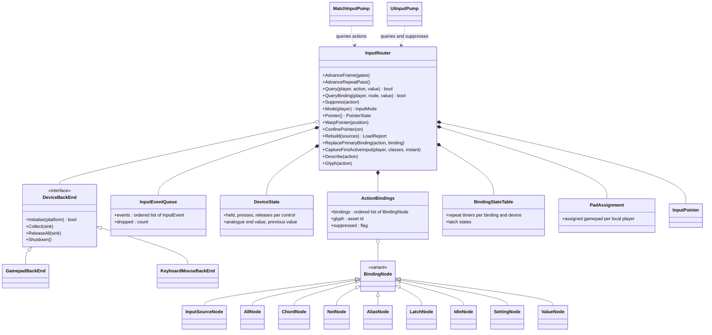
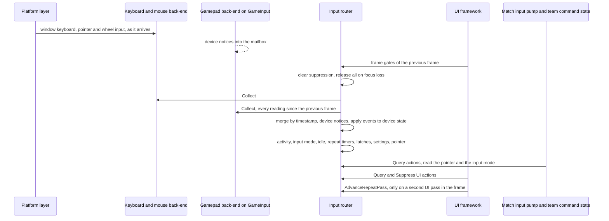
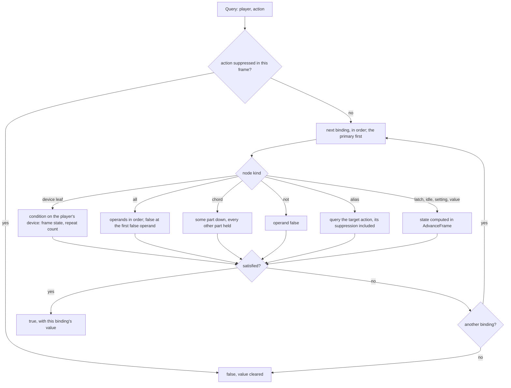
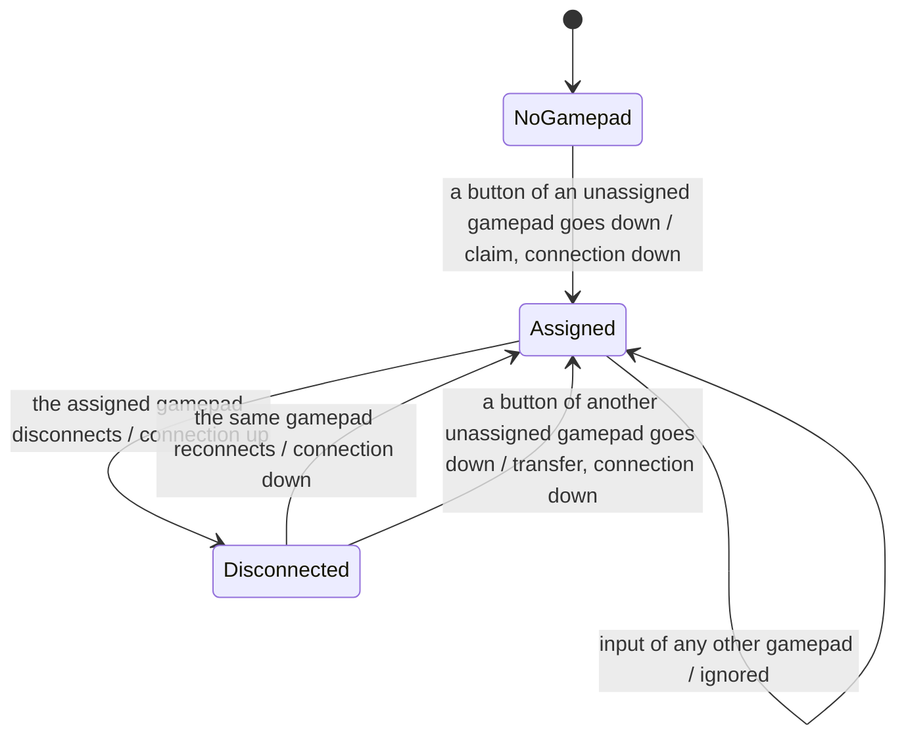
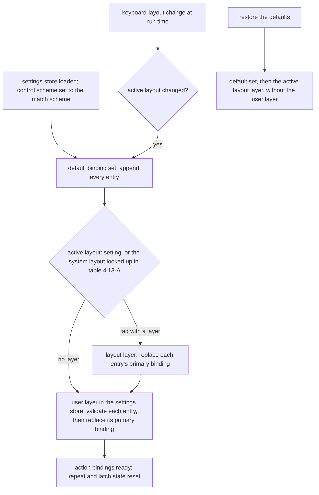
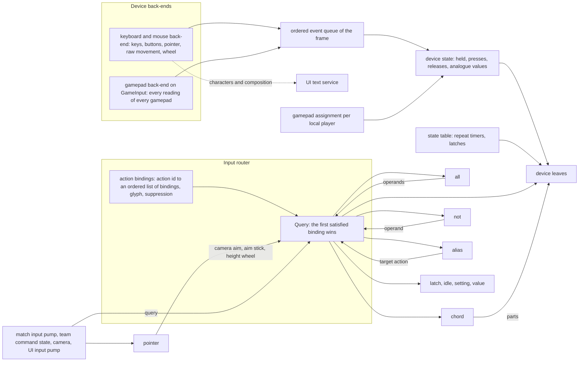

# Input

> Status: Engine baseline · Prefix: INP · ADRs: [ADR-028](../../ADR/ADR-028-input-device-back-ends.md) · [ADR-029](../../ADR/ADR-029-input-event-model-and-binding-contract.md) · [ADR-032](../../ADR/ADR-032-ui-focus-graph-page-stack-and-input.md) · [ADR-064](../../ADR/ADR-064-accessibility-baseline-xag.md) · [ADR-074](../../ADR/ADR-074-platform-clock-with-injectable-time.md) · [ADR-075](../../ADR/ADR-075-application-window-and-dpi-awareness.md) · [ADR-059](../../ADR/ADR-059-content-build-and-validators.md) · [ADR-061](../../ADR/ADR-061-data-schemas-and-versioning.md) · [ADR-062](../../ADR/ADR-062-authoring-syntax-and-schema-language.md) · [ADR-063](../../ADR/ADR-063-localisation.md) · [ADR-067](../../ADR/ADR-067-logging.md) · [ADR-069](../../ADR/ADR-069-test-framework.md) · Related: [Controls, camera and commands](../../reference/06_controls_camera_and_commands/README.md) · [Actions and bindings](../../reference/06_controls_camera_and_commands/actions_and_bindings.md) · [Camera](../../reference/06_controls_camera_and_commands/camera.md) · [Teams and player commands](../../reference/12_simulation_model/06_teams_and_player_commands.md) · [UI framework](ui_framework/README.md) · [Platform layer](platform_layer.md) · [Data schemas](data_schemas/README.md)

This component turns device input into Species actions. It owns the device back-ends, the ordered event queue, the device state of each frame, the assignment of gamepads to local players, the binding graph that maps device conditions to action ids, the binding sets and their layers, the name table of every bindable control, the pointer, the input mode and the idle time. It answers one question for the rest of the client: did action *X* fire in this frame, and with which value. What each action means, and which player command it produces, is specified by [actions and bindings](../../reference/06_controls_camera_and_commands/actions_and_bindings.md); this component never defines a second list of match actions.

Notation used throughout:

- A **frame** is one rendered frame of the client loop. Input timings (repeat, idle) are seconds of real time read from the platform clock (ADR-074): they are presentation timings, never simulation durations, and they keep running while a match is paused (R-CTRL-006).
- **Binding notation.** This document writes a device condition as `device:control:condition`, for example `key:a:held`, `mouse:primary:down` or `pad:stick_left:position`, and composite bindings as `all(x, y)`, `chord(key:control, key:c)`, `not(x)`, `alias(<action id>)` and `latch(on: x, off: y)`, where x and y stand for operand bindings. Bindings of one action are listed in order and separated by `·`; the first is the **primary** binding. §3.5 maps the notation one to one onto the binding-set schema.
- **Stick units** are the unit of stick payloads after the response curve (§4.6); pushing a stick forward gives a negative y.

## 1 Responsibilities and boundaries

**INP-001** (MUST) The input component owns: the gamepad back-end on GameInput and the keyboard and mouse back-end (ADR-028, §4.2); the per-frame ordered event queue (ADR-029, §4.3); the device state derived from it (§4.4); the local players and their gamepad assignment (§4.10); the binding graph, its node kinds and their evaluation (§3.3, §4.5 to §4.9); the action bindings (`ActionBindings`) of every action, with their glyph overrides and suppression flags (§3.4); the name table of every bindable key, mouse control and gamepad control (§3.2); the binding layers and the keyboard-layout table (§4.13); the pointer (§4.12); the input mode and the idle time (§4.11); and the rebinding services that the rebinding hook uses (§4.15).

**INP-002** (MUST) Game code never reads a device. It asks the input router (`InputRouter`) whether an action fired in the current frame and may receive the action's value: its kind, its axis values and the device that produced it. Every answer comes from the state that the router built at the start of the frame; asking is free of side effects (DEC-554).

**INP-003** (MUST) The match actions are exactly the action ids of [actions and bindings](../../reference/06_controls_camera_and_commands/actions_and_bindings.md) table 2.1-A (R-CTRL-030). This component binds them (table 3.6-A). The UI navigation actions are those that the UI framework defines, with their keyboard defaults ([layout, rendering, input and localisation](ui_framework/layout_rendering_input_and_localisation.md) UI-203, UI-204; R-CTRL-035); this component binds them in table 3.6-B and defines no menu action of its own, except the five leaderboard hook-page actions that no UI requirement lists (INP-077). Action ids are the stable names that bindings, rebinding and saved settings use (ADR-029).

**INP-004** (MUST) Player commands originate only in the input layer. The match input pump (`MatchInputPump`) and the sampler of the team command state (`TeamCommandState`) turn actions into members of `PlayerCommand` and into fields of the team command state, by the rules of [actions and bindings](../../reference/06_controls_camera_and_commands/actions_and_bindings.md) (DEC-023); the router itself produces actions, never commands. Simulation code links no input interface, never queries an action, never reads the pointer, a device, the input mode or the camera, and never issues a player command (DEC-008, DEC-119, R-CTRL-003, R-CTRL-004). One click therefore yields one command on the sender and one effect on every participant.

**INP-005** (MUST NOT) The input component never writes simulation state, never reads it, and never changes a Power, a selection or a unit locally. Local feedback (sounds, previews, camera modes) is the consumers' business (R-CTRL-022, DEC-007).

**INP-006** (MUST) Text entry does not pass through the binding graph. Text characters and input-method composition go to the focused text field through the UI framework's text service, with the modifier state of each character (ADR-028, ADR-032).

**INP-007** (MUST) The headless server links neither GameInput nor any input back-end (ADR-028). Bots issue no input actions (R-CTRL-005).

**INP-008** (MUST) The neighbours of this component own: the window, its focus, its close request and the system cursor's visibility over the client area ([platform layer](platform_layer.md), ADR-075); widget focus, page navigation, UI repeat timers and input-mode captions ([UI framework](ui_framework/README.md), ADR-032); the meaning, context and command of every match action (reference/06); the file format of the binding sets ([data schemas](data_schemas/README.md), ADR-061, ADR-062); and the settings store (`SettingsStore`) that holds the user layer (DEC-250).

**INP-009** (MUST) The default binding set binds only the actions of tables 3.6-A and 3.6-B, that is the actions of reference/06 table 2.1-A, those of UI-203 and the leaderboard hook-page actions. It holds the one match control scheme (`ControlScheme`, R-CTRL-002): no alternative scheme (DEC-056), no gesture input and no icon Power bar (DEC-055), no loader mini-programs or attract mode (DEC-054), and no developer key other than `action.debug.network_stats`.

**INP-010** (MUST) Every device class is remapped through the same binding graph, and the graph offers a latch node for hold-or-toggle options (§4.8), so remapping and toggle options are done once for every device (ADR-064).

## 2 Interfaces

### 2.1 Interface sketch

```cpp
namespace species::input {

enum class DeviceClass : std::uint8_t { KeyboardMouse, Gamepad };
enum class InputMode   : std::uint8_t { KeyboardMouse, Gamepad };            // INP-150
enum class ValueKind   : std::uint8_t { Boolean, Axis1, Axis2 };             // INP-050
enum class Condition   : std::uint8_t { Down, Up, Held, Repeat,               // Boolean conditions
                                        Position, Move, Release, Zero, Read }; // analogue conditions, INP-051

struct DeviceId      { std::uint64_t value; };    // stable identity from a back-end (INP-115)
struct LocalPlayerId { std::uint8_t index; };     // player 0 owns the keyboard and the mouse (INP-145)
struct ActionId      { std::uint16_t index; };    // interned from the action id string when bindings load

enum class KeyCode      : std::uint16_t;           // table 3.2-A
enum class MouseControl : std::uint8_t { Primary, Secondary, Middle, Motion, RawMotion, Wheel };  // table 3.2-B
enum class PadControl   : std::uint8_t;            // table 3.2-C

struct InputEvent {                                // INP-115
  enum class Kind : std::uint8_t { Press, Release, Axis, Connect, Disconnect };
  Kind          kind;
  bool          os_repeat;                         // keyboard auto-repeat; never a new press (INP-053)
  DeviceClass   device_class;
  DeviceId      device;
  std::uint16_t control;                           // a KeyCode, MouseControl or PadControl value
  std::int64_t  timestamp_ns;                      // platform clock (ADR-074)
  float         x, y;                              // Axis: a sample (stick, trigger) or a delta (motion, wheel)
};

struct ActionValue {                               // INP-090
  ValueKind               kind = ValueKind::Boolean;
  float                   x = 0.0f, y = 0.0f;
  std::optional<DeviceId> device;
};

struct FrameGates {                                // INP-156, supplied by the UI framework and the platform layer
  bool ui_window_open;                             // as the UI left it at the end of the previous frame
  bool text_entry_open;                            // chat input or a focused text field
  bool window_focused;
};

struct PointerState {                              // INP-155
  Vec2  position_px;                               // client-area pixels
  float wheel_z;                                   // accumulated wheel notches
  Vec2  delta_px;                                  // this frame's movement
  float delta_z;
  bool  moved;                                     // delta_px is not zero
};

class InputRouter {
public:
  // Frame lifecycle (INP-101, INP-102). Main thread only.
  void AdvanceFrame(const FrameGates& gates);
  void AdvanceRepeatPass();

  // Queries: const and free of side effects (INP-002).
  bool Query(LocalPlayerId, ActionId, ActionValue* value = nullptr) const;
  bool QueryBinding(LocalPlayerId, const BindingNode&, ActionValue* value = nullptr) const;
  void Suppress(ActionId);                         // false for the rest of the frame (INP-093)
  InputMode Mode(LocalPlayerId) const;
  bool   IsIdle() const;
  double IdleSeconds() const;
  const PointerState& Pointer() const;
  void   WarpPointer(Vec2 position_px);            // moves the pointer without a motion delta (INP-158)
  void   ConfinePointer(bool on);                  // holds the system pointer inside the client area (INP-159)
  std::optional<DeviceId> AssignedGamepad(LocalPlayerId) const;
  bool   AssignedGamepadConnected(LocalPlayerId) const;
  std::string_view ActiveLayout() const;           // keyboard-layout tag (INP-164)

  // Binding sets (INP-162 to INP-179).
  LoadReport Rebuild(const BindingSources& sources);   // default set, layout layer, user layer
  std::expected<void, LoadDiagnostic> ReplacePrimaryBinding(ActionId, const BindingNode& binding);
  std::optional<BindingNode> CaptureFirstActiveInput(LocalPlayerId, DeviceClassMask, bool instant) const;
  std::optional<BindingDescription> Describe(ActionId) const;
  std::optional<AssetId> Glyph(ActionId) const;
  void ClearBindings();                            // keeps glyph overrides
  void DumpBindings(LogSink&) const;               // diagnostics (INP-242)

  // Notifications, raised inside AdvanceFrame.
  Signal<LocalPlayerId, InputMode> on_mode_changed;
  Signal<std::string_view>         on_layout_changed;
};

class DeviceBackEnd {                              // INP-105
public:
  virtual ~DeviceBackEnd() = default;
  virtual bool Initialise(PlatformServices&) = 0;
  virtual void Collect(EventSink&) = 0;            // every event since the last call, in order
  virtual void ReleaseAll(EventSink&) = 0;         // release events for everything held (INP-111)
  virtual void Shutdown() = 0;
};

}  // namespace species::input
```

### 2.2 Router operations

**INP-020** (MUST) The router's operations behave as follows:

| Operation | Behaviour |
|---|---|
| `Query(player, action, value)` | false if the action is suppressed in this frame; otherwise the action's bindings are evaluated **in order** for that player, and the result is true at the **first** binding that is satisfied, whose value is returned. An action is the logical OR of its bindings, and its value comes from the first satisfied binding. When no binding is satisfied, the value is cleared (kind Boolean, axes 0, no device) |
| `QueryBinding(player, node, value)` | evaluates one binding node; composite nodes use it for their operands (§4.8) |
| `Suppress(action)` | the action answers false until the next `AdvanceFrame`; an alias of it answers false as well (INP-093) |
| `Rebuild(sources)` | clears every binding and rebuilds the action bindings from the default set, the active layout layer and the user layer, in that order (§4.13), and returns every diagnostic (§6.1) |
| `ReplacePrimaryBinding(action, binding)` | validates the binding (§4.14) and, when it is accepted, replaces the action's primary binding, or appends it when the action has none; a rejected binding returns its diagnostic and changes nothing |
| `CaptureFirstActiveInput(player, classes, instant)` | the first control of the allowed device classes, in name-table order, that went down in this frame, as a leaf binding with the condition `down` when `instant` is set and `held` otherwise (§4.15) |
| `Describe(action)` | the display description of the first binding of the action that has one (§4.15) |
| `Glyph(action)` | the action's glyph override, if the binding set gives one (§3.7) |
| `IsIdle()`, `IdleSeconds()`, `Mode(player)` | §4.11 |
| `ClearBindings()` | removes every binding of every action; glyph overrides stay |
| `DumpBindings(sink)` | writes every action with its bindings in canonical form and the count of bindings (§6.4) |

### 2.3 Events and data contracts

**INP-021** (MUST) The router's inputs are: the device events of the back-ends (§4.2, §4.3); the frame gates, which the UI framework and the platform layer supply before `AdvanceFrame`; the values of the settings that setting nodes and the keyboard-layout setting name (§4.8, §4.13); and the layout-change and focus-change notices of the keyboard and mouse back-end.

**INP-022** (MUST) The router's outputs are: action results and values (by query); the pointer state; the input mode of each local player and its change notice; the idle state; the active keyboard layout and its change notice; the assignment and connection state of each local player's gamepad; and text events, which it forwards unchanged to the UI framework's text service (INP-006).

**INP-023** (MUST) The default binding set and the layout layers are content: authored as JSON records, validated by the content build and loaded as cooked records (ADR-059, ADR-061, ADR-062, DEC-015). The user layer is a run-time settings file in the settings store (DEC-250) and is validated by the router when it loads (§4.14).

**INP-024** (MUST) Every display text of input (key names, control names, condition words, the chord separator) is a string id of the string table with its fallback (ADR-063, DEC-099), never a name that the parser accepts, and display text is never fed back into parsing (ADR-029).

### 2.4 Threading contract

**INP-025** (MUST) The router lives on the main thread, which runs the platform layer's window and event loop (ADR-075). `AdvanceFrame`, `AdvanceRepeatPass`, every query, `Suppress`, `WarpPointer`, `ConfinePointer` and every binding operation run on the main thread only. Between two `AdvanceFrame` calls the router's frame state is immutable.

**INP-026** (MUST) The keyboard and mouse back-end receives its input on the main thread, forwarded by the platform layer (ADR-075). The gamepad back-end reads gamepad readings on the main thread inside `AdvanceFrame`; GameInput's device notices may arrive on another thread and are written into a single-producer, single-consumer mailbox that `AdvanceFrame` drains. No other thread touches router state.

**INP-027** (MUST) Events that arrive while the main thread is busy (a loading view, a long frame) stay in their back-end's buffer until the next `AdvanceFrame`; the platform layer keeps pumping the window during loading views, so no event is lost while a frame is not running.

### 2.5 Helper abstractions

**INP-028** (MUST) The component provides these helpers on top of `Query`; none of them holds state between frames:

| Helper | Behaviour |
|---|---|
| `ActionAxis` | composes up to six Boolean actions (a positive and a negative action per axis x, y and z) into a vector: each component is (positive − negative) × a sensitivity |
| `StickAxis` | the value of an `Axis2` action × a sensitivity, or zero when the action did not fire |
| `PriorityAxis` | the value of a first source unless it is zero, otherwise the value of a second source |
| `ActionTrigger` | a callable that queries one action for one player; the UI framework's keyboard shortcuts are built on it |

No match rule of reference/06 uses the three axis helpers; the stateful hold-or-toggle helper is the latch node of §4.8.

## 3 Data model

### 3.1 Value kinds and conditions

**INP-050** (MUST) Every action, binding and device condition has one value kind:

| Kind | Meaning | Value |
|---|---|---|
| `Boolean` | button-like | none beyond the result; a Boolean action fed by an analogue binding carries that binding's value (INP-061) |
| `Axis1` | one axis | x: a trigger, the wheel, the idle time |
| `Axis2` | two axes | x and y: pointer motion, a stick |

**INP-051** (MUST) A device leaf tests one condition on one control. The conditions are:

| Condition | Applies to | True in a frame when | Value |
|---|---|---|---|
| `down` | a Boolean view (table 3.2-D) | a press event of the control occurred in this frame | — |
| `up` | a Boolean view | a release event of the control occurred in this frame | — |
| `held` | a Boolean view | the control is pressed after the frame's last event | — |
| `repeat` | a Boolean view | the control went down in this frame, or it is held and at least one repeat instant falls in this frame (§4.7) | x = the number of firings in this frame |
| `position` | an analogue control | the control is outside its rest zone at the end of the frame | the processed value (§4.6) |
| `move` | an analogue control | the value changed since the end of the previous frame by more than the control's move threshold (table 3.2-D) | the change |
| `release` | an analogue control | the control is at rest at the end of the frame, and it was away from rest at the end of the previous frame or at some sample of this frame | — |
| `zero` | an analogue control | the control is at rest at the end of the frame | — |
| `read` | an analogue control | always | the current value |

**INP-052** (MUST) A press and a release of one control within one frame make both `down` and `up` true for that frame, and `held` false, so a press shorter than a frame is never lost (ADR-029, DEC-096, R-CTRL-010). Two presses within one frame make `down` true once; the router keeps the count of presses for diagnostics.

**INP-053** (MUST) An event that the operating system's keyboard auto-repeat produces never satisfies `down`, never creates a new press and never changes `held`; the `repeat` condition uses the router's own timers (§4.7, ADR-029).

### 3.2 Device controls and the name table

**INP-055** (MUST) One name table maps every bindable control to exactly one canonical name, and every name to exactly one control; the binding parser, the binding writer, display and saving all use it (DEC-554, ADR-029). Names are lower case. The parser matches control names without regard to case, and the writer always writes the canonical name, so a binding written and read back is the same binding.

**INP-056** (MUST) Keys are identified by the key the active keyboard layout reports, so letter and punctuation keys follow the labels of the active layout; the keyboard-layout layer (§4.13) restores the reference key positions for camera control. Each modifier name covers both of its keys (`shift`, `control`, `alt`). The keyboard names are those of table 3.2-A; a key outside the table has no name, cannot be bound and produces no event.

Table 3.2-A Keyboard names (display text `ui.input.key.<name>`).

| Group | Canonical names |
|---|---|
| letters | `a` to `z` |
| digits | `0` to `9` (top row) |
| function keys | `f1` to `f24`; `f10` is an ordinary key (DEC-096) |
| editing and navigation | `backspace`, `tab`, `enter`, `space`, `escape`, `insert`, `delete`, `home`, `end`, `page_up`, `page_down`, `left`, `up`, `right`, `down` |
| modifiers and locks | `shift`, `control`, `alt`, `meta`, `caps_lock`, `num_lock`, `scroll_lock` |
| system | `pause`, `print_screen`, `application` |
| numeric pad | `num_0` to `num_9`, `num_multiply`, `num_plus`, `num_separator`, `num_minus`, `num_decimal`, `num_divide` |
| punctuation | `semicolon`, `equals`, `comma`, `minus`, `period`, `slash`, `backquote`, `bracket_left`, `backslash`, `bracket_right`, `quote`, `oem_8` |

The numeric-pad minus key and the separator key have their own names and codes, and `meta` resolves to its own key code (DEC-554).

Table 3.2-B Mouse controls (display text `ui.input.mouse.<name>`).

| Name | Kind | Conditions | Value |
|---|---|---|---|
| `primary`, `secondary`, `middle` | Boolean | `down`, `up`, `held`, `repeat` | — |
| `motion` | Axis2 | `move`, `read` | the pointer's movement since the previous frame, in client pixels, y positive downwards |
| `raw_motion` | Axis2 | `move`, `read` | the unaccelerated device movement since the previous frame, in device counts (ADR-028) |
| `wheel` | Axis1 | `move`, `read` | wheel notches since the previous frame, forward positive, fractional for fine-resolution wheels (`inp.mouse.wheel_units_per_notch`) |

Table 3.2-C Gamepad controls, named by position (display text `ui.input.pad.<name>`).

| Name | Kind | Boolean view | Analogue conditions | Sensitivity option |
|---|---|---|---|---|
| `face_south`, `face_east`, `face_west`, `face_north` | Boolean | the button | — | no |
| `shoulder_left`, `shoulder_right` | Boolean | the button | — | no |
| `dpad_left`, `dpad_right`, `dpad_up`, `dpad_down` | Boolean | the direction | — | no |
| `menu`, `view` | Boolean | the button | — | no |
| `trigger_left`, `trigger_right` | Axis1 | the trigger above its threshold | `position`, `move`, `release`, `zero`, `read` | yes |
| `stick_left`, `stick_right` | Axis2 | the stick's press | `position`, `move`, `release`, `zero`, `read` | yes |
| `stick_left_left`, `stick_left_right`, `stick_left_up`, `stick_left_down`, `stick_right_left`, `stick_right_right`, `stick_right_up`, `stick_right_down` | Boolean | the stick deflected in that direction beyond `inp.pad.stick_button.threshold` | — | no |
| `connection` | Boolean | the local player's gamepad is connected (§4.10) | — | no |

Table 3.2-D Conditions accepted per control kind, and thresholds.

| Control | Boolean conditions | Analogue conditions | Rest zone | Move threshold |
|---|---|---|---|---|
| key, mouse button, gamepad button, d-pad, stick direction | `down`, `up`, `held`, `repeat` | none | — | — |
| `connection` | `down`, `up`, `held` | none | — | — |
| `trigger_left`, `trigger_right` | `down`, `up`, `held`, `repeat` | all five | below `inp.pad.trigger.threshold` | any change |
| `stick_left`, `stick_right` | `down`, `up`, `held`, `repeat` (the press) | all five | inside the radial dead zone (§4.6) | `inp.pad.stick.move_threshold` on either axis |
| `motion`, `raw_motion`, `wheel` | none | `move`, `read` | — | any change |

A condition that a control does not accept is rejected when the binding loads (DEC-553, DEC-554).

### 3.3 Binding nodes

**INP-060** (MUST) A binding is a tree of nodes of these kinds:

| Node | Operands | Result kind | Rules |
|---|---|---|---|
| device leaf (`InputSourceNode`) | a device (`key`, `mouse` or `pad`), a control, a condition and, on sticks and triggers only, a sensitivity | `Boolean` for a Boolean condition; the control's kind for an analogue condition | the condition must be one the control accepts (table 3.2-D); the sensitivity is a whole percentage within the range of `inp.binding.sensitivity`, default 100 |
| `all` | two or more operands of any kind except `all` | the kind of its analogue operand, otherwise `Boolean` | at most one operand may be analogue |
| `chord` | two or more parts, each a key, mouse button or gamepad button without a condition | `Boolean` | true when every part is held and at least one part went down in this frame (INP-137) |
| `not` | one `Boolean` operand: a device leaf, `not`, `alias`, `latch`, `idle` (reaches or no longer), `setting` or `value` | `Boolean` | the operand must be `Boolean` |
| `alias` | an action id | `Boolean` | true when that action fires; an alias chain that leads back to its own action is rejected (DEC-554) |
| `latch` | an `on` operand and an `off` operand, both `Boolean` and neither a `latch` | `Boolean` | §4.8 |
| `idle` | `at_least` N, `reaches` N or `no_longer`; N a whole number of seconds of at least 1 | `Axis1` for `at_least` (x = the idle time), otherwise `Boolean` | §4.8 |
| `setting` | a setting name and an optional negation | `Boolean` | the setting must exist in the settings store or its defaults when the binding loads; it can be negated once |
| `value` | `AlwaysTrue` or `FeatureFlagX` | `Boolean` | `AlwaysTrue` is always true; `FeatureFlagX` is true while the feature flag `FeatureFlagX` is above 0 |

**INP-061** (MUST) An action accepts a binding by the action's kind:

| Action kind | Accepts |
|---|---|
| `Boolean` | `Boolean` bindings; and analogue bindings, which are true while their condition holds and pass their value on |
| `Axis1` | analogue bindings; an `Axis2` binding gives its x |
| `Axis2` | analogue bindings; an `Axis1` binding gives its x, with y = 0 |

A `Boolean` binding on an `Axis1` or `Axis2` action is rejected when it loads (§6.1).

### 3.4 Action bindings

**INP-065** (MUST) For each action the router holds an ordered list of bindings, an optional glyph override and a suppression flag. The order of the list is the order in which bindings were accepted; index 0 is the **primary** binding, which the layout layer, the user layer and rebinding replace. Binding an entry appends it to the list; replacing removes the primary and puts the new binding at index 0, or appends it when the list is empty.

**INP-066** (MUST) The router owns the action bindings. `Rebuild` creates them at start-up and recreates them on a keyboard-layout change, on restoring the defaults and after the user layer changes; binding nodes are immutable after loading. The run-time state of a binding (repeat timers per device, latch states) lives in a state table owned by the router, indexed by node, and `Rebuild` resets it.

**INP-067** (MUST) The action id table is built from tables 3.6-A and 3.6-B when bindings load; every action id is interned once. An entry that names an action id outside the table is rejected (§6.1).

### 3.5 Binding-set schema

**INP-070** (MUST) The default binding set and each layout layer are records of one binding-set schema ([data schemas](data_schemas/README.md), ADR-061, ADR-062) with these fields: the schema version; the layer kind (`default` or `layout`); for a layout layer, its layout tag (§4.13); and a list of entries, each with an action id, a list of binding nodes and an optional glyph asset id. A layout-layer entry holds exactly one binding, which replaces the action's primary binding. The user layer is a group of settings-store entries, one per action, whose value is one binding node in canonical form (DEC-250).

**INP-071** (MUST) Each node is a JSON object with exactly one node-kind property; the notation of this document maps onto it one to one:

| Notation | JSON node |
|---|---|
| `key:a:held` | `{"key": "a", "when": "held"}` |
| `mouse:primary:down` | `{"mouse": "primary", "when": "down"}` |
| `pad:stick_left:position`, sensitivity 150 | `{"pad": "stick_left", "when": "position", "sensitivity": 150}` |
| `all(x, y)` | `{"all": [x, y]}` |
| `chord(key:control, key:c)` | `{"chord": [{"key": "control"}, {"key": "c"}]}` |
| `not(x)` | `{"not": x}` |
| `alias(action.ui.show_cursor)` | `{"alias": "action.ui.show_cursor"}` |
| `latch(on: x, off: y)` | `{"latch": {"on": x, "off": y}}` |
| `idle:at_least:60`, `idle:reaches:60`, `idle:no_longer` | `{"idle": "at_least", "seconds": 60}`, `{"idle": "reaches", "seconds": 60}`, `{"idle": "no_longer"}` |
| `setting:Name`, `setting:not:Name` | `{"setting": "Name"}`, `{"setting": "Name", "negate": true}` |
| `value:AlwaysTrue`, `value:FeatureFlagX` | `{"value": "AlwaysTrue"}`, `{"value": "FeatureFlagX"}` |

**INP-072** (MUST) The canonical writer writes the properties in the order of the table, the canonical control names, and the sensitivity only when it differs from the default. Writing a binding and parsing it back yields the same binding (ADR-029, DEC-800).

**INP-073** (MUST) A node with an unknown property, with no or with two node-kind properties, or without a required property is rejected (§6.1); nothing falls back to a default condition (DEC-096).

### 3.6 Control catalogue: the default binding set

**INP-075** (MUST) The default binding set of the match actions is table 3.6-A, keyed by the action ids of reference/06 table 2.1-A. Each binding is stated with its effective meaning (DEC-553). In every entry of tables 3.6-A and 3.6-B the keyboard and mouse bindings come before the gamepad bindings, so the first keyboard or mouse binding is the primary binding; an action with gamepad bindings only has its first gamepad binding as primary. The "Kind" column is the action's value kind (INP-050).

Table 3.6-A Default bindings of the match actions.

| # | Action id | Kind | Keyboard and mouse | Gamepad | Glyph override | reference/06 row |
|---|---|---|---|---|---|---|
| 1 | `action.camera.pan_left` | Boolean | `key:a:held` · `key:left:held` | — | — | A1 |
| 2 | `action.camera.pan_right` | Boolean | `key:d:held` · `key:right:held` | — | — | A1 |
| 3 | `action.camera.pan_forward` | Boolean | `key:w:held` · `key:up:held` | — | — | A1 |
| 4 | `action.camera.pan_back` | Boolean | `key:s:held` · `key:down:held` | — | — | A1 |
| 5 | `action.camera.pan_stick` | Axis2 | — | `pad:stick_left:position` | left stick (no asset) | A1 |
| 6 | `action.camera.fast_pan` | Boolean | `key:shift:held` | `pad:stick_left:held` | — | A2 |
| 7 | `action.camera.raise` | Boolean | `key:q:held` | `pad:trigger_right:position` | left stick (no asset) | A3 |
| 8 | `action.camera.lower` | Boolean | `key:e:held` | `pad:trigger_left:position` | right stick (no asset) | A3 |
| 9 | `action.camera.height_wheel` | Axis1 | `mouse:wheel:move` | — | — | A3 |
| 10 | `action.camera.aim` | Axis2 | `mouse:motion:move` | — | right stick (no asset) | A4 |
| 11 | `action.camera.aim_stick` | Axis2 | — | `pad:stick_right:position` | — | A4 |
| 12 | `action.camera.zoom` | Boolean | `key:z:held` · `mouse:middle:held` | `pad:stick_right:held` | — | A5 |
| 13 | `action.camera.zoom_out` | Boolean | `key:c:held` | — | — | A11 |
| 14 | `action.camera.look_around` | Boolean | `key:f2:held` | `pad:stick_right:held` | — | A6 |
| 15 | `action.camera.track_closer` | Boolean | — | `pad:dpad_up:held` | — | A7 |
| 16 | `action.camera.track_farther` | Boolean | — | `pad:dpad_down:held` | — | A7 |
| 17 | `action.view.chat_log` | Boolean | `key:l:held` | — | — | A8 |
| 18 | `action.view.hide_interface` | Boolean | `all(key:alt:held, key:x:down)` | — | — | A9 |
| 19 | `action.view.screenshot` | Boolean | `key:p:down` | — | — | A10 |
| 20 | `action.select.pick` | Boolean | `mouse:primary:down` | `pad:face_south:down` | `glyph.pad.face_south` | S1, O10 |
| 21 | `action.select.pick_idle` | Boolean | `mouse:primary:down` | `pad:face_south:down` | — | S1 |
| 22 | `action.select.clear` | Boolean | `key:space:down` | `pad:face_east:down` | `glyph.pad.face_east` | S3 |
| 23 | `action.select.circle_begin` | Boolean | `mouse:primary:down` | `pad:face_south:down` | — | S4 |
| 24 | `action.select.circle_grow` | Boolean | `mouse:primary:held` | `pad:face_south:held` | — | S5 |
| 25 | `action.select.circle_end` | Boolean | `mouse:primary:up` | `pad:face_south:up` | — | S6 |
| 26 | `action.power.next` | Boolean | `key:bracket_right:down` · `key:tab:down` | `pad:shoulder_right:down` | `glyph.pad.shoulder_right` | S7 |
| 27 | `action.power.previous` | Boolean | `key:bracket_left:down` | `pad:shoulder_left:down` | `glyph.pad.shoulder_left` | S8 |
| 28 | `action.power.slot_1` | Boolean | `key:1:down` | — | — | S9 |
| 29 | `action.power.slot_2` | Boolean | `key:2:down` | — | — | S9 |
| 30 | `action.power.slot_3` | Boolean | `key:3:down` | — | — | S9 |
| 31 | `action.power.slot_4` | Boolean | `key:4:down` | — | — | S9 |
| 32 | `action.power.slot_5` | Boolean | `key:5:down` | — | — | S9 |
| 33 | `action.power.slot_6` | Boolean | `key:6:down` | — | — | S9 |
| 34 | `action.power.slot_7` | Boolean | `key:7:down` | — | — | S9 |
| 35 | `action.power.slot_8` | Boolean | `key:8:down` | — | — | S9 |
| 36 | `action.power.slot_9` | Boolean | `key:9:down` | — | — | S9 |
| 37 | `action.power.activate_slot` | Boolean | `mouse:primary:up` · `key:enter:down` | `pad:face_south:up` | — | S11 |
| 38 | `action.power.place` | Boolean | `mouse:primary:down` | `pad:face_south:down` | — | T1 |
| 39 | `action.power.cancel` | Boolean | `key:c:down` | `pad:face_north:down` | `glyph.pad.face_north` | T3, T6 |
| 40 | `action.power.end_current` | Boolean | — | — | — | T7 |
| 41 | `action.power.panel_show` | Boolean | `key:tab:down` | `pad:view:down` | `glyph.pad.face_west` | T8 |
| 42 | `action.power.panel_hide` | Boolean | `key:tab:up` | `pad:view:down` · `pad:face_east:down` | — | T8 |
| 43 | `action.order.crowd` | Boolean | `mouse:secondary:down` | `pad:face_west:down` | — | O1 |
| 44 | `action.order.straight_route` | Boolean | `key:control:held` | — | — | O1, O6 |
| 45 | `action.order.promote` | Boolean | `mouse:secondary:down` | `pad:face_west:down` | — | O2 to O5 |
| 46 | `action.order.special` | Boolean | `mouse:secondary:down` | `pad:face_south:down` | — | O6 to O9, T2 |
| 47 | `action.order.move_modifier` | Boolean | `key:shift:held` | `pad:face_west:down` | — | O6 to O9 |
| 48 | `action.order.demote` | Boolean | `key:c:down` | `pad:face_north:down` | — | T5 |
| 49 | `action.order.scrap` | Boolean | `key:c:down` | `pad:face_north:down` | — | T4 |
| 50 | `action.direct.move_hold` | Boolean | `mouse:primary:held` | — | — | D1 |
| 51 | `action.direct.move_stick` | Axis2 | — | `pad:stick_left:position` | left stick (no asset) | D1 |
| 52 | `action.direct.fire` | Boolean | `mouse:secondary:held` | `pad:trigger_right:held` | — | D2, D5 |
| 53 | `action.direct.secondary_fire` | Boolean | `all(mouse:primary:down, mouse:secondary:held)` | `pad:trigger_left:down` | — | D3 |
| 54 | `action.direct.aim_stick` | Axis2 | — | `pad:stick_right:position` | — | D2 |
| 55 | `action.direct.secondary_fire_directed` | Axis2 | — | — | `glyph.pad.trigger_left` | D3 |
| 56 | `action.direct.set_target` | Boolean | `mouse:secondary:held` | `pad:face_west:held` | `glyph.pad.face_west` | D4, D5 |
| 57 | `action.direct.set_target_end` | Boolean | `mouse:secondary:up` | `pad:face_west:up` | — | D1 |
| 58 | `action.direct.move_direction_change` | Axis2 | — | `pad:stick_left:move` | — | camera R-CTRL-487 |
| 59 | `action.match.ready` | Boolean | `key:space:down` | `pad:face_south:down` · `pad:face_east:down` | — | M1 |
| 60 | `action.match.chat` | Boolean | `key:enter:down` | — | — | M2 |
| 61 | `action.match.pause` | Boolean | `key:pause:down` | — | — | M3 |
| 62 | `action.match.menu` | Boolean | `key:escape:down` | `pad:menu:down` | — | M4 |
| 63 | `action.debug.network_stats` | Boolean | `key:f9:down` | — | — | M5 |
| 64 | `action.ui.pointer_down` | Boolean | `mouse:primary:down` | `all(alias(action.ui.show_cursor), pad:face_south:down)` | — | M6 |
| 65 | `action.ui.pointer_held` | Boolean | `mouse:primary:held` | `all(alias(action.ui.show_cursor), pad:face_south:held)` | — | M6 |
| 66 | `action.ui.alt_pointer_down` | Boolean | `mouse:secondary:down` | — | — | M6 |
| 67 | `action.ui.show_cursor` | Boolean | — | `pad:shoulder_left:held` | — | M6 |
| 68 | `action.device.pad_disconnected` | Boolean | — | `pad:connection:up` | — | M7 |
| 69 | `action.device.pad_connected` | Boolean | — | `pad:connection:down` | — | M7 |

**INP-076** (MUST) `action.app.quit` has no binding. The platform layer raises it when the window receives a close request, which Alt+F4 also produces (ADR-028, ADR-075, R-CTRL-047 row M8). The key events of Alt and F4 still reach the router as ordinary events.

**INP-077** (MUST) The UI navigation actions, their meanings, their context rules and their default bindings are defined by the UI framework ([layout, rendering, input and localisation](ui_framework/layout_rendering_input_and_localisation.md) UI-203 and UI-204, ADR-032, ADR-064): `action.menu.up`, `action.menu.down`, `action.menu.left`, `action.menu.right`, `action.menu.activate`, `action.menu.front_end_activate`, `action.menu.close`, `action.menu.dismiss` and `action.menu.scroll_speedup`. Rows 1 to 9 of table 3.6-B state those defaults as binding nodes, with their order and their primary binding, and add nothing to them; the keyboard bindings are the Species baseline of UI-204, and the UI framework applies the Escape binding of `action.menu.close` only outside a match, where Escape is `action.match.menu` (R-META-014). Rows 10 to 14 bind the leaderboard hook page, which no UI requirement lists: `action.menu.cycle_up` (`PadMenuCycleUp`) and `action.menu.cycle_down` (`PadMenuCycleDown`) on the shoulder buttons with repeat, the view selector on the trigger presses and the period toggle on the north face button (DEC-047, DEC-553, R-META-500 to R-META-502). The match actions `action.match.menu`, `action.ui.pointer_down`, `action.ui.pointer_held` and `action.ui.alt_pointer_down` also act on UI windows (R-CTRL-047 rows M4 and M6).

Table 3.6-B Default bindings of the UI navigation actions of UI-203 and UI-204, and of the leaderboard hook-page actions.

| # | Action id | Kind | Keyboard and mouse | Gamepad | Glyph override | Defined by |
|---|---|---|---|---|---|---|
| 1 | `action.menu.left` | Boolean | `key:left:repeat` | `pad:dpad_left:repeat` · `pad:stick_left_left:repeat` · `pad:stick_right_left:repeat` | d-pad left and right (no asset) | UI-203, UI-204 |
| 2 | `action.menu.right` | Boolean | `key:right:repeat` | `pad:dpad_right:repeat` · `pad:stick_left_right:repeat` · `pad:stick_right_right:repeat` | — | UI-203, UI-204 |
| 3 | `action.menu.up` | Boolean | `key:up:repeat` | `pad:dpad_up:repeat` · `pad:stick_left_up:repeat` · `pad:stick_right_up:repeat` | — | UI-203, UI-204 |
| 4 | `action.menu.down` | Boolean | `key:down:repeat` | `pad:dpad_down:repeat` · `pad:stick_left_down:repeat` · `pad:stick_right_down:repeat` | — | UI-203, UI-204 |
| 5 | `action.menu.activate` | Boolean | `key:enter:down` | `pad:face_south:down` | `glyph.pad.face_south` | UI-203, UI-204 |
| 6 | `action.menu.front_end_activate` | Boolean | — | `pad:menu:down` | — | UI-203, UI-204 |
| 7 | `action.menu.close` | Boolean | `key:escape:down` | `pad:view:down` · `pad:face_east:down` | — | UI-203, UI-204 |
| 8 | `action.menu.dismiss` | Boolean | `mouse:primary:down` · `key:space:down` · `key:enter:down` · `key:escape:down` | `pad:face_south:down` | — | UI-203, UI-204 |
| 9 | `action.menu.scroll_speedup` | Boolean | `key:shift:held` | — | — | UI-203, UI-204 |
| 10 | `action.menu.cycle_up` | Boolean | — | `pad:shoulder_left:repeat` | — | R-META-500 (`PadMenuCycleUp`) |
| 11 | `action.menu.cycle_down` | Boolean | — | `pad:shoulder_right:repeat` | — | R-META-500 (`PadMenuCycleDown`) |
| 12 | `action.menu.select_previous` | Boolean | — | `pad:trigger_left:down` | — | R-META-501 |
| 13 | `action.menu.select_next` | Boolean | — | `pad:trigger_right:down` | — | R-META-501 |
| 14 | `action.menu.toggle_period` | Boolean | — | `pad:face_north:down` | — | R-META-502 |

**INP-078** (MUST) `action.power.end_current` and `action.direct.secondary_fire_directed` have no default binding. They are queried like every other action and fire only when the user layer binds them.

**INP-079** (MUST) Three default bindings are trigger press bindings, which fire once when the trigger goes down: `pad:trigger_left:down` of `action.direct.secondary_fire`, and the trigger bindings of `action.menu.select_previous` and `action.menu.select_next` (DEC-553). The gamepad bindings of `action.ui.pointer_down` and `action.ui.pointer_held` are conjunctions with an alias of `action.ui.show_cursor`: while the left shoulder is held, the south face button acts as the UI pointer button (DEC-553, R-CTRL-047 row M6).

### 3.7 Glyphs

**INP-080** (MUST) A control's glyph is looked up by its control in table 3.7-A; the UI framework draws the darkening shadow first and the glyph on top. A control without a row has no glyph asset, and the UI shows its display text instead.

Table 3.7-A Glyph assets by control.

| Control | Glyph | Shadow |
|---|---|---|
| `pad:face_south` | `glyph.pad.face_south` | `glyph.pad.face_shadow` |
| `pad:face_east` | `glyph.pad.face_east` | `glyph.pad.face_shadow` |
| `pad:face_west` | `glyph.pad.face_west` | `glyph.pad.face_shadow` |
| `pad:face_north` | `glyph.pad.face_north` | `glyph.pad.face_shadow` |
| `pad:shoulder_left` | `glyph.pad.shoulder_left` | `glyph.pad.shoulder_left_shadow` |
| `pad:shoulder_right` | `glyph.pad.shoulder_right` | `glyph.pad.shoulder_right_shadow` |
| `pad:trigger_left` | `glyph.pad.trigger_left` | `glyph.pad.trigger_shadow` |
| `pad:trigger_right` | `glyph.pad.trigger_right` | `glyph.pad.trigger_shadow` |
| `key:tab` | `glyph.key.tab` | none |

**INP-081** (MUST) An action may carry one glyph override in the binding set (the "Glyph override" columns of tables 3.6-A and 3.6-B); when an action has several glyph entries, the last one wins. `Glyph(action)` returns the override. The overrides that name a stick or d-pad glyph need glyph assets that the asset manifest does not hold yet; until they exist, the content build leaves those overrides out of the cooked set (INP-222), and the UI shows the display text of the action's primary gamepad control.

**INP-082** (MUST) The glyph overrides of `action.camera.raise` (the left-stick glyph) and `action.camera.lower` (the right-stick glyph) are part of the default set as table 3.6-A states, although both actions are bound to triggers on the gamepad.

### 3.8 Reverse index

**INP-085** (MUST) Several actions share one physical input. The router never resolves the overlap: one press satisfies every action bound to it, and the consumers' context rules decide which action applies, for the secondary button and the west and south face buttons by the resolver of reference/06 (R-CTRL-050). Table 3.8-A lists, for every physical input of the default set, the actions bound to it; an operand of a conjunction is marked.

Table 3.8-A Physical input to actions, default binding set.

| Physical input | Actions (condition) | Count |
|---|---|---|
| `key:1` | `action.power.slot_1` (down) | 1 |
| `key:2` | `action.power.slot_2` (down) | 1 |
| `key:3` | `action.power.slot_3` (down) | 1 |
| `key:4` | `action.power.slot_4` (down) | 1 |
| `key:5` | `action.power.slot_5` (down) | 1 |
| `key:6` | `action.power.slot_6` (down) | 1 |
| `key:7` | `action.power.slot_7` (down) | 1 |
| `key:8` | `action.power.slot_8` (down) | 1 |
| `key:9` | `action.power.slot_9` (down) | 1 |
| `key:a` | `action.camera.pan_left` (held) | 1 |
| `key:alt` | `action.view.hide_interface` (held, operand of all) | 1 |
| `key:bracket_left` | `action.power.previous` (down) | 1 |
| `key:bracket_right` | `action.power.next` (down) | 1 |
| `key:c` | `action.camera.zoom_out` (held), `action.power.cancel` (down), `action.order.demote` (down), `action.order.scrap` (down) | 4 |
| `key:control` | `action.order.straight_route` (held) | 1 |
| `key:d` | `action.camera.pan_right` (held) | 1 |
| `key:down` | `action.camera.pan_back` (held), `action.menu.down` (repeat) | 2 |
| `key:e` | `action.camera.lower` (held) | 1 |
| `key:enter` | `action.power.activate_slot` (down), `action.match.chat` (down), `action.menu.activate` (down), `action.menu.dismiss` (down) | 4 |
| `key:escape` | `action.match.menu` (down), `action.menu.close` (down), `action.menu.dismiss` (down) | 3 |
| `key:f2` | `action.camera.look_around` (held) | 1 |
| `key:f9` | `action.debug.network_stats` (down) | 1 |
| `key:l` | `action.view.chat_log` (held) | 1 |
| `key:left` | `action.camera.pan_left` (held), `action.menu.left` (repeat) | 2 |
| `key:p` | `action.view.screenshot` (down) | 1 |
| `key:pause` | `action.match.pause` (down) | 1 |
| `key:q` | `action.camera.raise` (held) | 1 |
| `key:right` | `action.camera.pan_right` (held), `action.menu.right` (repeat) | 2 |
| `key:s` | `action.camera.pan_back` (held) | 1 |
| `key:shift` | `action.camera.fast_pan` (held), `action.order.move_modifier` (held), `action.menu.scroll_speedup` (held) | 3 |
| `key:space` | `action.select.clear` (down), `action.match.ready` (down), `action.menu.dismiss` (down) | 3 |
| `key:tab` | `action.power.next` (down), `action.power.panel_show` (down), `action.power.panel_hide` (up) | 3 |
| `key:up` | `action.camera.pan_forward` (held), `action.menu.up` (repeat) | 2 |
| `key:w` | `action.camera.pan_forward` (held) | 1 |
| `key:x` | `action.view.hide_interface` (down, operand of all) | 1 |
| `key:z` | `action.camera.zoom` (held) | 1 |
| `mouse:middle` | `action.camera.zoom` (held) | 1 |
| `mouse:motion` | `action.camera.aim` (move) | 1 |
| `mouse:primary` | `action.select.pick` (down), `action.select.pick_idle` (down), `action.select.circle_begin` (down), `action.select.circle_grow` (held), `action.select.circle_end` (up), `action.power.activate_slot` (up), `action.power.place` (down), `action.direct.move_hold` (held), `action.direct.secondary_fire` (down, operand of all), `action.ui.pointer_down` (down), `action.ui.pointer_held` (held), `action.menu.dismiss` (down) | 12 |
| `mouse:secondary` | `action.order.crowd` (down), `action.order.promote` (down), `action.order.special` (down), `action.direct.fire` (held), `action.direct.secondary_fire` (held, operand of all), `action.direct.set_target` (held), `action.direct.set_target_end` (up), `action.ui.alt_pointer_down` (down) | 8 |
| `mouse:wheel` | `action.camera.height_wheel` (move) | 1 |
| `pad:connection` | `action.device.pad_disconnected` (up), `action.device.pad_connected` (down) | 2 |
| `pad:dpad_down` | `action.camera.track_farther` (held), `action.menu.down` (repeat) | 2 |
| `pad:dpad_left` | `action.menu.left` (repeat) | 1 |
| `pad:dpad_right` | `action.menu.right` (repeat) | 1 |
| `pad:dpad_up` | `action.camera.track_closer` (held), `action.menu.up` (repeat) | 2 |
| `pad:face_east` | `action.select.clear` (down), `action.power.panel_hide` (down), `action.match.ready` (down), `action.menu.close` (down) | 4 |
| `pad:face_north` | `action.power.cancel` (down), `action.order.demote` (down), `action.order.scrap` (down), `action.menu.toggle_period` (down) | 4 |
| `pad:face_south` | `action.select.pick` (down), `action.select.pick_idle` (down), `action.select.circle_begin` (down), `action.select.circle_grow` (held), `action.select.circle_end` (up), `action.power.activate_slot` (up), `action.power.place` (down), `action.order.special` (down), `action.match.ready` (down), `action.ui.pointer_down` (down, operand of all), `action.ui.pointer_held` (held, operand of all), `action.menu.activate` (down), `action.menu.dismiss` (down) | 13 |
| `pad:face_west` | `action.order.crowd` (down), `action.order.promote` (down), `action.order.move_modifier` (down), `action.direct.set_target` (held), `action.direct.set_target_end` (up) | 5 |
| `pad:menu` | `action.match.menu` (down), `action.menu.front_end_activate` (down) | 2 |
| `pad:shoulder_left` | `action.power.previous` (down), `action.ui.show_cursor` (held), `action.menu.cycle_up` (repeat) | 3 |
| `pad:shoulder_right` | `action.power.next` (down), `action.menu.cycle_down` (repeat) | 2 |
| `pad:stick_left` | `action.camera.pan_stick` (position), `action.camera.fast_pan` (held), `action.direct.move_stick` (position), `action.direct.move_direction_change` (move) | 4 |
| `pad:stick_left_down` | `action.menu.down` (repeat) | 1 |
| `pad:stick_left_left` | `action.menu.left` (repeat) | 1 |
| `pad:stick_left_right` | `action.menu.right` (repeat) | 1 |
| `pad:stick_left_up` | `action.menu.up` (repeat) | 1 |
| `pad:stick_right` | `action.camera.aim_stick` (position), `action.camera.zoom` (held), `action.camera.look_around` (held), `action.direct.aim_stick` (position) | 4 |
| `pad:stick_right_down` | `action.menu.down` (repeat) | 1 |
| `pad:stick_right_left` | `action.menu.left` (repeat) | 1 |
| `pad:stick_right_right` | `action.menu.right` (repeat) | 1 |
| `pad:stick_right_up` | `action.menu.up` (repeat) | 1 |
| `pad:trigger_left` | `action.camera.lower` (position), `action.direct.secondary_fire` (down), `action.menu.select_previous` (down) | 3 |
| `pad:trigger_right` | `action.camera.raise` (position), `action.direct.fire` (held), `action.menu.select_next` (down) | 3 |
| `pad:view` | `action.power.panel_show` (down), `action.power.panel_hide` (down), `action.menu.close` (down) | 3 |
| `alias:action.ui.show_cursor` | `action.ui.pointer_down` (operand of all), `action.ui.pointer_held` (operand of all) | 2 |

### 3.9 Action values and suppression

**INP-090** (MUST) An action value (`ActionValue`) holds the value kind, the x and y components and the device that produced it. The value of a fired action is the value of its first satisfied binding (INP-020): a device leaf gives its control's value under its condition (INP-051); `all` gives its first operand's value, replaced by its analogue operand's value when it has one; `alias` gives the target action's value; the other composite nodes give no axis value.

**INP-091** (MUST) Values are floating-point and never truncated or rounded (ADR-029). A Boolean action fed by an analogue binding carries that binding's value; an `Axis1` action reads x; an `Axis2` action fed by an `Axis1` binding has y = 0 (INP-061).

**INP-092** (MUST) A value carries the identity of the device that produced it; a gamepad value always names the player's assigned gamepad (§4.10), and a keyboard or mouse value names the keyboard or the mouse.

**INP-093** (MUST) `Suppress(action)` makes the action answer false, with a cleared value, for the rest of the frame; an `alias` of a suppressed action is false as well. `AdvanceFrame` clears every suppression flag first. The UI input pump suppresses the match's use of a primary press that lands on a UI window, so that the press is withheld from the match actions for the rest of the frame (R-CTRL-047 row M6).

### 3.10 Class diagram



Caption: Diagram 3.10-A, the input component's types: two back-ends feed one event queue, the router derives the device state, and consumers query actions through the binding nodes (INP-001, INP-060, INP-065).

## 4 Behaviour and algorithms

### 4.1 Lifecycle and frame order

**INP-100** (MUST) Start-up runs in this order:

1. The platform layer creates the window and begins forwarding its keyboard, pointer and wheel input to the keyboard and mouse back-end (ADR-075).
2. The router is created. It registers its node kinds in this fixed order, which is also the enumeration order of node kinds in cooked binding records: `all`, `chord`, `not`, `idle`, keyboard and mouse leaves, gamepad leaves, `setting`, `value`, `alias`, `latch`. A node contains only nodes of later kinds, with three exceptions: a `not` may contain a `not`; a `chord` contains only condition-free parts; and a `latch` may contain any `Boolean` node except a `latch`. So `all` is the outermost operator, a chord sits inside a conjunction, and a negation applies to a single operand.
3. The gamepad back-end creates its GameInput instance and registers for device notices (INP-106); a failure is handled by INP-107.
4. The settings store loads (DEC-250), and the control-scheme setting is set to the match control scheme (INP-168).
5. `Rebuild` builds the action bindings from the default set, the layout layer of the active keyboard layout and the user layer, in that order (§4.13).
6. The pointer is created at the system pointer's position in the client area (§4.12).

**INP-101** (MUST) `AdvanceFrame` runs as the first input step of every rendered frame (R-CTRL-020 step 1) and performs, in this order:

1. clear every suppression flag (INP-093);
2. if the window lost focus since the previous frame, take `ReleaseAll` from both back-ends (INP-111);
3. collect the events of both back-ends into the frame's queue (INP-105, INP-115);
4. apply device notices: connections, disconnections, gamepad claims and transfers (§4.10);
5. apply the queued events in order to the device state (§4.4);
6. compute each device's activity, each local player's input mode and the idle time (§4.11);
7. advance every binding's repeat timers (§4.7), then every latch, in binding order (INP-140);
8. read the values of the settings that setting nodes name (INP-142);
9. advance the pointer (§4.12);
10. raise the mode-change and layout-change notices.

Every query of the frame is then answered from this state.

**INP-102** (MUST) `AdvanceFrame` runs exactly once per rendered frame, and every event is applied in exactly one advance, so no press is lost and none is seen twice (DEC-096). On a frame in which `action.match.menu` makes the UI input pump run a second time (R-CTRL-047 row M4), `AdvanceRepeatPass` runs before that second pass. It behaves as an `AdvanceFrame` whose frame starts where the first one ended: it clears suppression and applies only the events that arrived since, so the edges of the first pass are false in the second unless a new event makes them true, and held states and analogue values carry over.

**INP-103** (MUST) A loading view renders frames and runs `AdvanceFrame` in each of them, so held states stay current and the loading view's actions work. Events that arrive while no frame runs wait in their back-end (INP-027).



Caption: Diagram 4.1-A, one frame of input: the back-ends deliver ordered events, the router builds the frame state once, and the consumers query it (INP-101, INP-102, R-CTRL-020).

### 4.2 Device back-ends

**INP-105** (MUST) Two back-ends feed the router: the keyboard and mouse back-end and the gamepad back-end (ADR-028). Each implements `DeviceBackEnd`: `Collect` appends every event since its previous call, in the order the events happened, each with its device identity and a platform-clock timestamp; `ReleaseAll` appends a release event for every control the back-end holds pressed and a rest sample for every analogue control away from rest. The router collects from the keyboard and mouse back-end first and from the gamepad back-end second, then orders the frame's events by timestamp, keeping that back-end order for equal timestamps. Each back-end keeps the pressed state of its controls, so that `ReleaseAll` and the reconciliation of INP-117 can use it.

**INP-106** (MUST) The gamepad back-end uses GameInput, built against the pinned package and API namespace of ADR-028 (3.5.283 with `GameInput::v3`, moving to the 4.0 line after its first point release); the installer carries the redistributable of the same version or newer (ADR-028, ADR-071). It creates its GameInput instance during initialisation and registers for device connection and disconnection notices. In each `AdvanceFrame` it reads every reading since the previous frame, in order, for every connected gamepad, compares each reading with the gamepad's previous reading, and emits a press or a release event for every button whose state changed and an axis sample for every stick or trigger whose value changed, so a transition between two frames is never lost. It maps the gamepad reading by position: the south, east, west and north face buttons; the left and right shoulder buttons; the four d-pad directions; the menu and view buttons; the two stick presses; the two triggers, in 0 to 1; and the two sticks, in −1 to 1 per axis with y positive upwards. It tracks every connected gamepad, with no fixed device count, and each gamepad keeps its GameInput device identity while it is connected and when it reconnects.

**INP-107** (MUST) If GameInput cannot be created, the client runs without gamepads: the gamepad back-end reports no device and logs one error (§6.4), every gamepad binding still loads, and none is ever satisfied. Whether a binding is valid never depends on which devices are present.

**INP-108** (MUST) The keyboard and mouse back-end receives the window's keyboard, pointer and wheel input that the platform layer forwards (ADR-075), and the raw, unaccelerated mouse movement that ADR-028 specifies. It turns them into press and release events of keys and mouse buttons, pointer-movement and raw-movement samples and wheel samples, with the keyboard's or the mouse's device identity. Characters and input-method composition go to the UI framework's text service (INP-112).

**INP-109** (MUST) Keyboard rules (DEC-096, ADR-028):

1. Every key of table 3.2-A, including `alt`, `f10` and the numeric-pad keys, produces a press event when it goes down and a release event when it goes up, whether or not another key is held; keys pressed and released while Alt is held produce their events like every other key.
2. Auto-repeat of a held key produces events marked as repeats (INP-053), which never produce a press: holding Alt and X fires `action.view.hide_interface` once.
3. Alt+F4 produces the close request of INP-076 through the platform layer; Alt and F4 still reach the router as ordinary events.
4. The router never captures Alt+Tab: switching to another application is a focus loss (INP-111).
5. A change of the keyboard layout is reported to the router, which applies INP-166.

**INP-110** (MUST) Mouse rules (ADR-028):

1. Pressing a mouse button captures the pointer to the window, and releasing the last held button ends the capture, so a release outside the window still arrives.
2. A click shorter than one frame produces both its press and its release event (INP-052).
3. Wheel input is accumulated in the platform's fine wheel units and converted to notches by dividing by `inp.mouse.wheel_units_per_notch`, without rounding, so a fine-resolution wheel keeps its resolution.
4. `motion` is the pointer movement that the platform reports, in client pixels; `raw_motion` is the device movement, which no default binding uses.
5. Three buttons are bindable, primary, secondary and middle, following the system's assignment of the physical buttons.

**INP-111** (MUST) When the window loses focus, both back-ends emit release events for every held key and button and rest samples for every analogue control (ADR-028), so nothing stays held, including an Alt held through Alt+Tab. While the window has no focus, the back-ends deliver no presses and no analogue samples away from rest; device connection and disconnection notices still apply. When focus returns, a control that is physically held produces no press until it is released and pressed again.

**INP-112** (MUST) Text characters and input-method composition never enter the event queue and never satisfy a binding; the router forwards them to the UI framework's text service with the modifier state of each character (ADR-032). A key that produces a character produces its key events as well, and the consumers' gates decide whether a match action applies while text is being entered (R-CTRL-012, R-CTRL-047 row M2).

### 4.3 Event queue

**INP-115** (MUST) The router keeps one ordered event queue per frame (ADR-029). An event is a press, a release (keyboard events carry the auto-repeat flag), an axis sample (a stick, a trigger, pointer movement, raw movement or the wheel), or a device connection or disconnection; every event carries its device identity and its timestamp. Events are applied in queue order.

**INP-116** (MUST) The queue holds at most `inp.queue.capacity` events per frame. When it is full, a new axis sample merges into the newest queued sample of the same control on the same device: a stick or trigger sample replaces its value, and a movement or wheel sample adds its delta, so no motion is lost. A press, release, connection or disconnection that does not fit is counted and dropped.

**INP-117** (MUST) After a frame in which events were dropped, the router reconciles every Boolean control with its back-end's pressed state: a control that the back-end holds released but the router holds pressed gets a release, and the reverse gets a press, so no control stays wrongly held or wrongly released after an overflow. The drop count is logged and counted (§6.2).

### 4.4 Device state

**INP-118** (MUST) For every control of every device the router keeps, for the current frame: whether it is held after the frame's last event; the number of presses and releases in the frame; for a stick or trigger, its processed value at the end of the frame (§4.6), its value at the end of the previous frame, and whether any sample of the frame was away from rest; and for pointer movement, raw movement and the wheel, the sum of the frame's deltas.

**INP-119** (MUST) A device leaf reads the devices of the querying local player (§4.10): keyboard and mouse leaves read the keyboard and the mouse, which belong to player 0; gamepad leaves read the player's assigned gamepad.

### 4.5 Condition evaluation per control

**INP-120** (MUST) The Boolean views of table 3.2-C behave as follows:

1. **Buttons, keys, the d-pad and the stick presses**: `down`, `up` and `held` follow INP-051 from the button's press and release events; `repeat` follows §4.7.
2. **Trigger Boolean view**: a sample that takes the trigger above `inp.pad.trigger.threshold` from at or below it is a press, and a sample that takes it back to or below the threshold is a release; the transitions follow the order of the samples.
3. **Stick directions**: the directional value is −x for left, x for right, −y for up and y for down, on the stick-unit scale of §4.6 at sensitivity 100; a direction is held while its value exceeds `inp.pad.stick_button.threshold`, the same threshold for both sticks, and its transitions follow the order of the samples.

**INP-121** (MUST) Pointer movement, raw movement and the wheel: `move` is true when the frame's summed delta is not zero, with the delta as its value; `read` is always true, with the delta, which may be zero.

**INP-122** (MUST) Sticks: `position` is true when the stick is outside its dead zone at the end of the frame, with the processed value × the sensitivity factor; `move` is true when either component of the change since the end of the previous frame, × the sensitivity factor, exceeds `inp.pad.stick.move_threshold` in absolute value, with that change as its value; `zero`, `release` and `read` follow INP-051.

**INP-123** (MUST) Triggers: `position` is true when the trigger is above its threshold at the end of the frame, with the processed value × the sensitivity factor; `move` is true when the processed value changed, with the change × the sensitivity factor; `zero`, `release` and `read` follow INP-051. Trigger values cover the trigger's whole travel, so a binding may use trigger magnitude; no default binding does (DEC-554, R-CTRL-032).

**INP-124** (MUST) `connection`: `down` is true in the frame in which the player's assigned gamepad reconnects or a gamepad becomes assigned to the player, `up` in the frame in which the assigned gamepad disconnects, and `held` while it is connected (INP-148). It is evaluated even while no gamepad is connected.

**INP-125** (MUST) Every other gamepad leaf of a player with no assigned gamepad, or whose assigned gamepad is disconnected, is false.

### 4.6 Analogue processing

**INP-128** (MUST) Each stick sample (x, y), as the gamepad back-end reports it, is processed in floating point as follows (ADR-029):

1. m = the length of (x, y), limited to 1;
2. with d the stick's dead zone (`inp.pad.stick_left.dead_zone` or `inp.pad.stick_right.dead_zone`), the stick is at rest when m ≤ d, and its processed value is (0, 0);
3. otherwise m′ = (m − d) ÷ (1 − d), and c = m′ raised to `inp.pad.curve.exponent`;
4. the processed value is (x ÷ m × c × S, −y ÷ m × c × S), with S the stick's output scale (`inp.pad.stick_left.scale` or `inp.pad.stick_right.scale`), in stick units.

The dead zone is radial and rescaled, so the value is continuous at the dead-zone edge and equal at equal deflection in every direction; y is negated, so pushing a stick forward gives a negative y; at full deflection the left stick gives `inp.pad.stick_left.scale` stick units and the right stick `inp.pad.stick_right.scale`.

**INP-129** (MUST) Each trigger sample t in 0 to 1 is processed as follows: the trigger is at rest when t ≤ `inp.pad.trigger.threshold`, with processed value 0; otherwise its processed value is ((t − threshold) ÷ (1 − threshold)) raised to `inp.pad.trigger.curve_exponent`, in 0 to 1.

**INP-130** (MUST) The sensitivity of a stick or trigger leaf multiplies its `position`, `move` and `read` values by the sensitivity ÷ 100 (INP-122, INP-123); it is accepted on the Boolean conditions of those controls, where it has no effect. Stick-direction controls use sensitivity 100 and take no option.

**INP-131** (MUST) The dead zones, thresholds, curve exponents and output scales are data: the binding-set schema carries one gamepad profile record whose defaults are the tuning values of §4.18, so a changed response needs no code change (ADR-029).

### 4.7 Repeat timers

**INP-133** (MUST) Each `repeat` leaf keeps its own timer for each device it reads; no timer is shared between bindings, controls or devices, and a query never changes a timer (DEC-554, ADR-029). In `AdvanceFrame`, for each `repeat` leaf and device:

1. if the control went down in this frame, the leaf fires once, and its next due time is the press's timestamp + `inp.repeat.initial_delay`;
2. otherwise, if the control is held, the leaf fires once for every due time at or before the frame's time, and each firing moves the next due time on by `inp.repeat.period`;
3. if the control is not held at the end of the frame, its timer is cleared.

A press and a release within one frame therefore fire once, by step 1.

**INP-134** (MUST) The number of firings in the frame is the leaf's value x (INP-051). A consumer that steps once per firing steps at the same rate at every frame rate. A UI widget's own hold-to-repeat behaviour is the UI framework's (ADR-032).

### 4.8 Composite and environment nodes

**INP-136** (MUST) `all` evaluates its operands in order and is false at the first false operand; its value follows INP-090.

**INP-137** (MUST) A `chord` of the parts p₁ to pₙ is true when, for some part k, pₖ went down in this frame and every other part is held at the end of the frame. It is the logical OR of n conjunctions, the k-th of which tests pₖ `down` and every other part `held`, so the parts may go down in any order and the chord fires on the frame in which the last of them goes down. Its display text joins the parts' display texts with a hyphen (INP-178).

**INP-138** (MUST) `not` is true when its operand is false.

**INP-139** (MUST) `alias` is the query of its target action for the same player, including the target's suppression (INP-093), and carries the target's value.

**INP-140** (MUST) A `latch` keeps one Boolean state per binding and player, updated once per frame in `AdvanceFrame` (INP-101 step 7) as state := (state ∧ ¬off) ∨ (¬state ∧ on), and evaluates to that state. It starts false, `Rebuild` resets it, and a query never changes it. It implements the hold-or-toggle option of ADR-064 for any held action; no default binding uses it.

**INP-141** (MUST) `idle` reads the idle time of INP-153: `at_least` N is true when the idle time is N seconds or more, with the idle time as its value; `reaches` N is true in the frame in which the idle time passes N, that is when the previous frame's idle time is below N and this frame's is above N; `no_longer` is true in every frame in which the idle time is 0, not only on the frame in which input resumes. No default binding uses it.

**INP-142** (MUST) `setting` is true when the integer value of the named setting is above 0, and `setting:not` when it is not; the router reads the values of the named settings once per frame (INP-101 step 8). A setting that neither the settings store nor its defaults table holds when the binding loads is a load error (§6.1), and a doubled negation is rejected. No default binding uses it (R-META-455).

**INP-143** (MUST) `value:AlwaysTrue` is always true; `value:FeatureFlagX` is true while the feature flag `FeatureFlagX`, a setting, is above 0. Both are `Boolean`. No default binding uses them.

### 4.9 Evaluating a query

**INP-144** (MUST) `Query(player, action)` follows diagram 4.9-A: suppression first, then the bindings in order, each evaluated by its node kind against the frame state of that player's devices; the first satisfied binding gives the result and the value. Evaluation reads only frame state, so the same query asked twice in one frame gives the same answer.



Caption: Diagram 4.9-A, evaluating one action query: the logical OR of the action's bindings, the first satisfied binding giving the value (INP-020, INP-090, INP-144).

### 4.10 Local players and gamepad assignment

**INP-145** (MUST) Local players are numbered from 0. The reference has one local player per client, player 0, who owns the keyboard and the mouse. Each local player has at most one assigned gamepad, and a gamepad drives only the local player it is assigned to (DEC-554, R-CTRL-033).

**INP-146** (MUST) In `AdvanceFrame`, when a button of a connected gamepad that is assigned to no player goes down, the gamepad is assigned to the lowest-numbered local player that has no assigned gamepad or whose assigned gamepad is disconnected (a transfer); the press that claims the gamepad counts as that player's input in the same frame. When no player can take it, the gamepad stays unassigned and drives nothing. Stick or trigger movement alone never claims a gamepad.

**INP-147** (MUST) An assigned gamepad stays assigned while it is connected and after it disconnects; when the same device reconnects while still assigned, it resumes driving its player. A transfer ends the previous assignment.

**INP-148** (MUST) The player's `connection` control goes down when its assigned gamepad reconnects or when a gamepad becomes assigned to the player by a claim or a transfer, and goes up when its assigned gamepad disconnects; a gamepad assigned to no player produces no connection action. So `action.device.pad_disconnected` opens the gamepad-disconnected dialog once for each disconnection of the player's own gamepad, and `action.device.pad_connected` closes it (R-CTRL-047 row M7); the dialog belongs to the [front end](../../reference/09_front_end_and_match_flow/README.md).

**INP-149** (MUST) `AssignedGamepadConnected(player)` is false while the player's assigned gamepad is disconnected. While it is false and the player's input mode is gamepad, the application treats itself as unfocused, so the camera does not advance (R-CTRL-047 row M7).



Caption: Diagram 4.10-A, a local player's gamepad slot: assignment by the first press, keeping the assignment through a disconnection, and transfer to another gamepad (INP-146 to INP-148).

### 4.11 Input mode and idle

**INP-150** (MUST) Each local player has an input mode, the class of its last active device: `KeyboardMouse` or `Gamepad` (ADR-029, R-CTRL-011). In `AdvanceFrame`, the mode becomes `Gamepad` when the player's assigned gamepad was active in the frame, otherwise `KeyboardMouse` when the keyboard or the mouse was active (player 0 only), and otherwise stays as it was; when both were active in one frame, `Gamepad` wins. The initial mode is `KeyboardMouse`. A change raises `on_mode_changed`.

**INP-151** (MUST) A device is active in a frame when: for the keyboard, a key is held or had an event; for the mouse, a button is held or had an event, or the pointer, the raw movement or the wheel moved; for a gamepad, a button is held or had an event, a stick is outside its dead zone or a trigger is above its threshold.

**INP-152** (MUST) The input mode is read by: the UI framework's input-mode captions and string variants (ADR-032); the automatic camera tracking and the gamepad rules of the Strike team and of Leader and Transport orders (reference/06, R-CTRL-043); the availability of the chat input (R-CTRL-047 row M2); the `gamepad` field of the team command state (R-CTRL-101); and the Power slots panel, whose variant is re-created when the mode changes while the panel is hidden ([UI framework](ui_framework/README.md)).

**INP-153** (MUST) The client is idle in a frame when no connected device was active. The idle time grows by the frame's elapsed real time when the previous frame was idle, and is 0 otherwise; the idle leaf reads it (INP-141), and `IsIdle()` reports the current frame.

### 4.12 The pointer

**INP-155** (MUST) The pointer (`InputPointer`) is the single source of the pointer position for game and UI code: a position in client pixels, an accumulated wheel value in notches, this frame's deltas, and a moved flag (`PointerState`). It belongs to player 0. The world cursor (`WorldCursor`) and the pointer ground point are derived from it (reference/06, R-CTRL-058).

**INP-156** (MUST) In `AdvanceFrame` (INP-101 step 9), with the frame gates as the UI and the platform layer left them at the end of the previous frame:

1. when `action.camera.aim` fires, its value (pointer movement, in pixels) is added to the position;
2. otherwise, when no UI window is open, the value of `action.camera.aim_stick` (stick units) is added to the position as pixels;
3. when no UI window and no text entry is open, the value of `action.camera.height_wheel` is added to the wheel value;
4. the deltas are this frame's changes, and the moved flag is set when the position changed;
5. the position is clamped to the client area, and when it differs from the system pointer's position the system pointer is moved there without producing a movement event.

**INP-157** (MUST) The aiming stick moves the pointer by its stick-unit value in every frame, so the stick's pointer speed in pixels per second is proportional to the frame rate.

**INP-158** (MUST) `WarpPointer(position)` sets the position, clamped to the client area, and moves the system pointer there without producing a movement event or a delta. The camera's cursor lock uses it to keep the pointer on its ground point while the camera moves (R-CTRL-464).

**INP-159** (MUST) While `ConfinePointer` is on, the platform layer holds the system pointer inside the client area; the camera turns it on while a match camera mode advances and off otherwise (R-CTRL-456). A focus loss suspends the confinement until focus returns.

**INP-160** (MUST) The moved flag is the input of the camera-moved hint condition, which the hint logic records while the camera is in free movement ([Tutorial and help](../../reference/11_tutorial_and_help.md)).

### 4.13 Binding layers, keyboard layouts and locales

**INP-162** (MUST) `Rebuild` builds the bindings from three layers in this order: the default binding set, whose entries are appended in entry order; the layout layer of the active keyboard layout, each of whose entries replaces the action's primary binding; and the user layer, each of whose entries replaces the action's primary binding (INP-065).

**INP-163** (MUST) Within a replacing layer, several entries for one action overwrite each other, the last one winning, and never add a binding; each overwrite is logged as a warning naming the action. An entry for an action that has no binding becomes its only binding.

**INP-164** (MUST) The active keyboard layout is a layout tag: the value of the keyboard-layout setting when it is set (R-META-455), otherwise the language tag (BCP 47, ADR-063) of the operating system's active keyboard layout, looked up in table 4.13-A. A tag that the table does not list, or one whose layer does not exist, gives no layout layer and is logged at information level; the default bindings then apply unchanged.

Table 4.13-A Keyboard-layout table.

| Operating-system layout language | Layout tag | Layout layer |
|---|---|---|
| German (Germany) | `de-DE` | yes, table 4.13-B |
| English (United States) | `en-US` | none |
| French (France) | `fr-FR` | yes, table 4.13-B |
| English (United Kingdom) | `en-GB` | none |
| English (Canada) | `en-CA` | none |

**INP-165** (MUST) The layout layers replace the primary bindings of table 4.13-B and nothing else; the arrow-key, middle-button and gamepad bindings of the same actions stay.

Table 4.13-B Layout layers (primary bindings).

| Action | `de-DE` | `fr-FR` |
|---|---|---|
| `action.camera.pan_left` | `key:a:held` | `key:q:held` |
| `action.camera.pan_right` | `key:d:held` | `key:d:held` |
| `action.camera.pan_forward` | `key:w:held` | `key:z:held` |
| `action.camera.pan_back` | `key:s:held` | `key:s:held` |
| `action.camera.raise` | `key:q:held` | `key:a:held` |
| `action.camera.lower` | `key:e:held` | `key:e:held` |
| `action.camera.zoom` | `key:y:held` | `key:w:held` |
| `action.camera.zoom_out` | `key:c:held` | `key:c:held` |

**INP-166** (MUST) When the operating system reports a keyboard-layout change at run time, the router determines the active layout again; when it changed, the router runs `Rebuild` and raises `on_layout_changed` (DEC-554). The help system shows the camera-help variant of the active layout ([Tutorial and help](../../reference/11_tutorial_and_help.md)).

**INP-167** (MUST) Restoring the default bindings rebuilds them from the default set and the active layout layer, without the user layer (DEC-554). Whether the user layer's entries are then removed from the settings store is decided by the rebinding hook's apply step (DEC-050).

**INP-168** (MUST) After every load of the settings store, and before the first `Rebuild`, the control-scheme setting is set to the match control scheme (R-META-405, DEC-056). There is one default binding set.



Caption: Diagram 4.13-A, building the action bindings from their layers, and rebuilding them on a layout change or a restore (INP-162 to INP-168).

### 4.14 Loading and validation

**INP-170** (MUST) The content build validates the default set and every layout layer against the binding-set schema and the rules of §3, and fails with a diagnostic that names the layer, the action, the path of the node inside the binding and the offending word (ADR-059, DEC-015). A default binding that relies on an unknown word therefore never reaches a build.

**INP-171** (MUST) At run time the router validates each user-layer entry by the same rules. A rejected entry is skipped with a warning that names the settings key, the offending word and the diagnostic class (§6.1), and the action keeps the bindings of the earlier layers. A bad entry never stops loading and never stops the client from starting (DEC-015).

**INP-172** (MUST) Validation never falls back to a default: an unknown device word, control name, condition word, node property, action id or setting is an error naming the word and the binding (ADR-029, DEC-096, DEC-553), and no validation step reads past a table, leaves a field unset or throws (DEC-554).

### 4.15 Rebinding hook services

**INP-175** (MUST) The rebinding page is a hook that no player can reach (DEC-050, R-CTRL-034). The router provides the services it needs; bindings otherwise change only through the user layer of the settings store.

**INP-176** (MUST) `CaptureFirstActiveInput(player, classes, instant)` returns the first control of the allowed device classes, in the order of tables 3.2-A, 3.2-B and 3.2-C, that went down in this frame, as `device:control:down` when `instant` is set and `device:control:held` otherwise. Every key of table 3.2-A can be captured. The reference rebinding page captures keyboard keys only; capturing mouse buttons and gamepad buttons is available to it.

**INP-177** (MUST) The page applies a captured binding with `ReplacePrimaryBinding` and writes its canonical form to the user layer, so a binding of any key, including `control`, `insert`, the punctuation keys and the numeric-pad keys, reads back as the same binding (DEC-554, INP-072). A rejected binding returns its diagnostic to the page and changes nothing.

**INP-178** (MUST) `Describe(action)` gives a noun and a verb, both string ids, for the first binding of the action that has a description: for a device leaf, the control's display text and the condition's display text (`ui.input.condition.<condition>`); for `all`, the description of its operand of the highest kind (analogue before `Boolean`, the first among equals); for `chord`, the parts' nouns joined with a hyphen, with the verb of `down`; for `not`, the operand's description with the verb preceded by `ui.input.not`. `alias`, `latch`, `idle`, `setting` and `value` have no description. The rebinding page shows the noun.

**INP-179** (MUST) The rebinding page offers these actions, each with its primary binding: `action.camera.pan_left`, `action.camera.pan_right`, `action.camera.pan_forward`, `action.camera.pan_back`, `action.camera.raise`, `action.camera.lower`, `action.camera.zoom`, `action.select.clear`, `action.view.chat_log`, `action.power.panel_show` and `action.power.cancel`. Changing `action.power.panel_show` also sets the primary binding of `action.power.panel_hide` to the `up` condition of the same control.

### 4.16 Notes on the default scheme

**INP-181** (MUST) The default set overlaps heavily on a few inputs (table 3.8-A): the south face button feeds 13 actions, the primary mouse button 12, the secondary mouse button 8 and the west face button 5. The consumers' context decides the meaning of each press: one secondary press means promote, toggle, order, fire or move by the resolver of reference/06 (R-CTRL-050), and never more than one of them.

**INP-182** (MUST) 16 actions have gamepad bindings only: the stick actions (`action.camera.pan_stick`, `action.camera.aim_stick`, `action.direct.move_stick`, `action.direct.aim_stick`, `action.direct.move_direction_change`), the tracking distance actions, `action.ui.show_cursor`, the two connection actions, `action.menu.front_end_activate` and the five leaderboard actions. The analogue camera and unit controls have key and button equivalents. 26 actions have keyboard and mouse bindings only and 39 have both (tables 3.6-A and 3.6-B).

**INP-183** (MUST) Value conventions of the default set: `action.camera.pan_stick`, `action.camera.aim_stick`, `action.direct.move_stick`, `action.direct.aim_stick` and `action.direct.move_direction_change` carry stick units, x positive to the right and y negative forward, up to `inp.pad.stick_left.scale` for the left stick and `inp.pad.stick_right.scale` for the right stick at sensitivity 100; `action.camera.aim` carries client pixels per frame; `action.camera.height_wheel` carries wheel notches per frame, forward positive; `action.camera.raise` and `action.camera.lower` are `Boolean` actions fed by trigger `position` bindings, true while the trigger is above its threshold. The camera's stick gain `ref.ctrl.camera.stick_gain` ([camera](../../reference/06_controls_camera_and_commands/camera.md)) and the movement and aiming vectors of the team command state (R-SIM-440, R-CTRL-101) are defined on these units.

**INP-184** (MUST) The input system reads these settings (R-META-455): the keyboard layout (INP-164); the mouse-button count, `ref.meta.settings.mouse_buttons.default` in [options and hooks](../../reference/09_front_end_and_match_flow/options_localisation_and_hooks.md), which the client reads when it sends the team command state and on which no binding depends; the settings that setting nodes name, none in the default set; and the feature flag `FeatureFlagX`.

**INP-185** (MUST) The input-layer values that the consumers' rules use are owned by their documents and are not repeated here: `ref.ctrl.select.circle_growth`, `ref.ctrl.select.circle_max_radius`, `ref.ctrl.order.crowd_interval_ticks`, `ref.ctrl.select.sound_interval`, `ref.ctrl.order.breach_charge_fraction` ([selection and Power slots](../../reference/06_controls_camera_and_commands/selection_and_power_slots.md)); `ref.ctrl.promote_radius` ([actions and bindings](../../reference/06_controls_camera_and_commands/actions_and_bindings.md)); `ref.unit.worker.order_transport_radius` ([Worker](../../reference/02_units/worker.md)); `ref.unit.leader.formation_toggle_radius` ([Leader and formations](../../reference/02_units/leader_and_formations.md)); `ref.unit.transport.deploy_min_distance` and `ref.unit.transport.arrival_distance` ([Transport](../../reference/02_units/transport.md)); and the send period of the team command state, `ref.sim.command.control_state_period` ([Teams and player commands](../../reference/12_simulation_model/06_teams_and_player_commands.md)).

### 4.17 Binding graph



Caption: Diagram 4.17-A, the binding graph: device events become frame state, leaves test it, and composite nodes recurse into the router, which is what makes the bindings a graph (INP-001, INP-060, INP-144).

### 4.18 Tuning table

Input timings are seconds of real time and never simulation durations (R-CTRL-006). The dead zones and the trigger threshold are Species baseline values (DEC-338); the stick scales and thresholds are the reference values adopted as the baseline (DEC-004). Values owned by other documents are cited by their keys in INP-183 to INP-185.

| key | value | unit | range or notes | requirement | DEC |
|---|---|---|---|---|---|
| `inp.queue.capacity` | 1024 | events per frame | beyond it axis samples merge and transitions are counted and dropped | INP-116 | — |
| `inp.repeat.initial_delay` | 0.3 | s of real time | from the press to the first repeat | INP-133 | DEC-554 |
| `inp.repeat.period` | 0.3 | s of real time | between later repeats | INP-133 | DEC-554 |
| `inp.pad.stick_left.dead_zone` | 0.24 | fraction of full deflection | radial, rescaled | INP-128 | DEC-338 |
| `inp.pad.stick_right.dead_zone` | 0.265 | fraction of full deflection | radial, rescaled | INP-128 | DEC-338 |
| `inp.pad.trigger.threshold` | 0.12 | fraction of full travel | rest at or below; also the Boolean view's threshold | INP-120, INP-129 | DEC-338 |
| `inp.pad.curve.exponent` | 3 | — | cubic stick response | INP-128 | — |
| `inp.pad.trigger.curve_exponent` | 1 | — | linear trigger response | INP-129 | — |
| `inp.pad.stick_left.scale` | 39.304 | stick units | 3.4³ at full deflection | INP-128, INP-183 | DEC-004 |
| `inp.pad.stick_right.scale` | 19.683 | stick units | 2.7³ at full deflection | INP-128, INP-183 | DEC-004 |
| `inp.pad.stick.move_threshold` | 3.4 | stick units | strict, on either axis | INP-122 | DEC-004 |
| `inp.pad.stick_button.threshold` | 3.4 | stick units | strict; the same for both sticks | INP-120 | DEC-004 |
| `inp.binding.sensitivity` | 100 | % | default; whole numbers from 1 to 200 | INP-060, INP-130 | — |
| `inp.mouse.wheel_units_per_notch` | 120 | fine wheel units | the platform's notch | INP-110 | — |
| `inp.budget.typical_events` | 64 | events per frame | the typical-load case | INP-200 | — |
| `inp.budget.advance_typical_ms` | 0.2 | ms | `AdvanceFrame` at the typical load, minimum CPU | INP-200 | — |
| `inp.budget.advance_full_ms` | 1.0 | ms | `AdvanceFrame` with a full queue, and one `Rebuild` | INP-200 | — |
| `inp.budget.memory_kib` | 256 | KiB | router state, binding nodes, state tables and the queue | INP-201 | — |

## 5 Concurrency and performance budget

**INP-200** (MUST) On the minimum CPU, `AdvanceFrame` takes at most `inp.budget.advance_typical_ms` with up to `inp.budget.typical_events` events and at most `inp.budget.advance_full_ms` with a full queue; one `Rebuild` of the default set and both other layers also fits in `inp.budget.advance_full_ms`, so a layout change during a match costs one frame. A query takes time proportional to the nodes of the action's bindings and of the actions they alias, and never allocates.

**INP-201** (MUST) The router allocates its queue at `inp.queue.capacity` and its state tables in `Rebuild`, and performs no heap allocation in `AdvanceFrame` or in a query. Its whole state stays within `inp.budget.memory_kib`.

**INP-202** (MUST) An event that a back-end receives before `AdvanceFrame` starts is visible to the queries of that frame, so the router adds no frame of latency; gamepad readings are read inside `AdvanceFrame`. Event timestamps are kept, so a later command model can stamp commands with the time of the input that caused them. The delay between a command and its execution, and the coalescing of continuous control, are the Open DEC-203; the router keeps every one-shot transition, and the team command state combines one-shot flags between sends (R-CTRL-021, R-SIM-441).

**INP-203** (MUST) The threading contract of §2.4 holds: one main-thread owner, an immutable frame state between advances, and a single-producer mailbox for GameInput's device notices. No file or network I/O runs inside `AdvanceFrame`; the settings store and the binding sets are read in `Rebuild`, which runs at start-up, on a layout change and on a binding change.

## 6 Failure modes, diagnostics and telemetry

### 6.1 Load diagnostics and binding parse outcomes

**INP-220** (MUST) Every load diagnostic names its class (table 6.1-A), the layer, the action, the path of the node inside the binding, the offending word, and its location: line and column in an authoring file (ADR-062), the settings key in the user layer.

Table 6.1-A Load diagnostic classes.

| Class | Raised when |
|---|---|
| `UnknownAction` | an entry names an action id outside tables 3.6-A and 3.6-B |
| `MissingAssignment` | an entry has no action id or no binding list, or an element declares a kind but assigns nothing |
| `UnknownNodeKind` | a node has no node-kind property, two of them, or a device word that no back-end serves |
| `UnknownControl` | a control name is not in the name table (`any` included) |
| `BadCondition` | a condition word is unknown or not accepted by the control (table 3.2-D) |
| `BadOption` | an unknown property, a sensitivity outside its range or on another control, an idle time below 1 s |
| `ConjunctionShape` | an `all` with fewer than two operands, a nested `all`, or more than one analogue operand |
| `ChordShape` | a chord with fewer than two parts, a part with a condition, or a part that is not a button or key |
| `NotOperand` | the operand of `not` is not `Boolean` |
| `KindNotAccepted` | the binding's kind is not accepted by the action's kind (INP-061) |
| `AliasCycle` | an alias chain leads back to an action already on the chain |
| `UnknownSetting` | a setting node names a setting that does not exist, or negates twice |
| `UnknownGlyph` | a glyph override names an asset id that is not in the asset manifest |
| `DuplicateEntry` | a warning: a replacing layer sets one action twice (INP-163) |

**INP-221** (MUST) The default set states every binding with its effective meaning, so no default binding depends on lenient parsing (DEC-553): the trigger press bindings and the aliases of INP-079 are explicit. These inputs of the reference default set bind nothing and are not part of it: bindings for a three-dimensional mouse device on `action.select.clear`, `action.power.next` and `action.match.ready` (two); a glyph entry for an action that does not exist; and an entry that declares a value kind without an assignment. The gesture bindings, among them one with a misspelt condition word and a two-key chord, are not specified (DEC-055). Authored as entries, each of these cases fails the content build with its class of table 6.1-A (T6, T31).

**INP-222** (MUST) The content build checks every glyph override and every glyph of table 3.7-A against the asset manifest (ADR-059), so the input layer never asks for a texture that does not exist.

### 6.2 Run-time failure modes

**INP-225** (MUST) The router handles these run-time failures without stopping, and each is logged (§6.4):

| Failure | Handling |
|---|---|
| queue overflow | merge, drop and reconcile (INP-116, INP-117); a warning with the drop count, once per frame in which it happens |
| GameInput not available | no gamepads; one error (INP-107) |
| a gamepad disconnects while buttons are held | release events for its held buttons and rest samples for its sticks and triggers in the same frame; the player's `connection` goes up (INP-148) |
| focus loss | release everything; no presses until focus returns (INP-111) |
| a rejected user-layer entry | skipped, earlier layers kept (INP-171) |
| a back-end event older than the previous frame | applied in this frame, in arrival order; a debug message |
| the cooked default set missing or unreadable | the client starts with the bindings it could read, logs an error, and stays usable through the UI pointer (DEC-015) |

### 6.3 Input-layer defects stated as fixed rules

**INP-230** (MUST) The input layer upholds the rules of table 6.3-A. Each row names the failure mode the rule excludes, where the rule is specified, its decision and its test.

Table 6.3-A Fixed rules of the input layer.

| # | Failure mode excluded | Rule | DEC | Test |
|---|---|---|---|---|
| 1 | a simulation rule reading the local camera or local input (desync) | INP-004; R-CTRL-024, R-CTRL-103 | DEC-008 | T20 |
| 2 | a click toggling a world object locally, without a command | INP-004, INP-005 | DEC-007, DEC-008 | T20 |
| 3 | route previews taking entries or ids from simulation route storage | R-CTRL-023 | DEC-095 | — |
| 4 | presentation code writing the state of the selected structure | INP-005 | DEC-007 | — |
| 5 | simulation code calling into the UI, the cursor or the camera | presentation events | DEC-007 | — |
| 6 | the UI writing a replicated field of a team's Powers | INP-005 | DEC-007 | — |
| 7 | real-time values held inside replicated objects | simulation time from ticks | DEC-009 | — |
| 8 | a Power ended locally, without a command | R-CTRL-044 row T7 | DEC-008 | — |
| 9 | one click becoming one command per participant | INP-004; R-CTRL-004 | DEC-119 | T21 |
| 10 | Power ids aliasing beyond eight bits | R-SIM-449 | DEC-083 | — |
| 11 | a participant commanding another team | open: command validation | DEC-202 | — |
| 12 | an integer, frame-rate-dependent tracking distance | camera R-CTRL-484 | DEC-024, DEC-096 | — |
| 13 | an unknown condition word read as a press | INP-172, INP-221 | DEC-096, DEC-553 | T6, T31 |
| 14 | trigger magnitude overflowing | INP-123 | DEC-554 | T12 |
| 15 | a rebound key written in a form that cannot be read back | INP-072, INP-177 | DEC-554 | T7, T28 |
| 16 | a lost sub-frame press or click, missing Alt edges, no release under Alt, Alt+key auto-repeat firing again, an unbindable F10 | INP-052, INP-053, INP-109, INP-110 | DEC-096 | T1, T2, T3 |
| 17 | a key name binding another key; a key outside the name look-up | INP-055, table 3.2-A | DEC-554 | T7 |
| 18 | node kinds that read past a table, leave a field unset, throw while parsing or recurse without bound | INP-060, INP-172 | DEC-554 | T6 |
| 19 | one repeat timer shared by gamepads and bindings and changed by queries | INP-133 | DEC-554 | T10 |
| 20 | every gamepad driving the one local player | INP-145 to INP-148 | DEC-554 | T17 |
| 21 | a power bar that ignores the pointer | R-CTRL-226 | DEC-083 | — |
| 22 | an unbounded move-marker list | R-CTRL-104 | DEC-096 | — |
| 23 | a crowd order for an emptied group creating a non-finite route | R-SIM-455 | DEC-555 | — |
| 24 | one click with nothing selected issuing two selections | R-CTRL-048 | DEC-096, DEC-119 | T21 |
| 25 | a debug camera advancer running after a mode change | R-CTRL-456 | DEC-024 | — |
| 26 | an unclamped camera | camera | DEC-024, DEC-096 | — |
| 27 | a layout change ignored at run time; restoring defaults without the layout layer | INP-166, INP-167 | DEC-554 | T15 |
| 28 | interface sounds for every team's selection | R-CTRL-154 | DEC-564 | — |
| 29 | control help computed but never shown | hook only | DEC-050 | — |
| 30 | an input-layer texture that does not exist | INP-222 | DEC-015 | T14 |

### 6.4 Diagnostics and telemetry

**INP-240** (MUST) The router logs in the input category (ADR-067): at information level, the load summary of each layer (entries, bindings, warnings), the active layout and its changes, and each gamepad connection, disconnection, claim and transfer; at debug level, input-mode changes; warnings for rejected user entries, duplicate entries and dropped events; and an error when GameInput is not available.

**INP-241** (MUST) The router keeps counters for the diagnostics overlay ([diagnostics, test and performance](diagnostics_test_and_performance.md)): events per frame (latest and maximum), dropped events, reconciliations, and the age of the oldest event at `AdvanceFrame`.

**INP-242** (MUST) `DumpBindings` writes every action with its bindings in canonical form, its glyph override and the total number of bindings; development builds expose it as a console command.

**INP-243** (MUST) Test builds can record every frame's events and every query result, and replay the recorded events through `AdvanceFrame` with the platform clock's fixed-step source (ADR-074), so input tests are exact and repeatable. Match replays record commands, not device events (DEC-046).

**INP-244** (MUST NOT) The input component sends no telemetry of its own and never records key presses, text or pointer positions in telemetry; its counters can enter the consented performance telemetry as aggregates only (ADR-066).

## 7 Acceptance tests

Tests run under the test framework of ADR-069 with recorded or synthetic events (INP-243) and an injected clock (ADR-074).

| Test | Kind | Checks | Requirements |
|---|---|---|---|
| T1 sub-frame press | unit | a press and a release within one frame, for a key, a mouse button and a gamepad button: `down` and `up` true, `held` false, and the action bound to `down` fires | INP-052, INP-106, INP-109, INP-110 |
| T2 Alt and F10 | unit | Alt alone gives `down` and `up`; Alt+X held with auto-repeat fires `action.view.hide_interface` once; a key released while Alt is held gives `up`; `key:f10:down` binds and fires | INP-109 |
| T3 auto-repeat | unit | auto-repeat events never satisfy `down` and leave `held` unchanged | INP-053 |
| T4 focus loss | unit | with W and the south face button held, a focus loss releases both; after focus returns, the still-held W gives no press | INP-111 |
| T5 overflow | unit | twice `inp.queue.capacity` events in one frame: summed motion preserved, transitions counted and dropped, and no control stays wrongly held after reconciliation | INP-116, INP-117 |
| T6 strict validation | unit | each class of table 6.1-A, including an unknown device word, a misspelt condition word, `key:any`, `mouse:wheel:held`, sensitivity 0 and 201, two analogue operands in `all`, `not` of an analogue leaf, a `Boolean` binding on an `Axis2` action, alias cycles of length 1 and 3 and an unknown setting, is rejected with a diagnostic naming the word | INP-060, INP-061, INP-073, INP-172, INP-220 |
| T7 round trip | property | random bindings generated from the schema, and one leaf for every name of tables 3.2-A to 3.2-C, are written by the canonical writer, parsed back and compared equal | INP-055, INP-071, INP-072 |
| T8 chord | unit | `chord(key:control, key:c)` fires once for Control then C, for C then Control, and for both in one frame; it does not fire again while both stay held | INP-137 |
| T9 conjunction value | unit | `all(key:shift:held, mouse:wheel:move)` carries the wheel value and is false once Shift is released | INP-090, INP-136 |
| T10 repeat | unit | a control held for 1.0 s fires at 0, 0.3, 0.6 and 0.9 s at 60 and at 20 frames per second with equal totals; two bindings of one control and the same binding on two players' gamepads keep separate timers; queries change no timer | INP-133, INP-134 |
| T11 stick response | unit | continuity at the dead-zone edge; equal magnitude at equal deflection in eight directions; full deflection gives `inp.pad.stick_left.scale` and `inp.pad.stick_right.scale`; forward gives a negative y | INP-128 |
| T12 trigger | unit | rest at or below the threshold, 1.0 at full travel with no overflow, Boolean-view transitions in sample order | INP-120, INP-123, INP-129 |
| T13 stick directions | unit | each direction holds above `inp.pad.stick_button.threshold`; menu repeat runs per binding | INP-120, INP-133 |
| T14 default set | golden | the cooked default set equals tables 3.6-A and 3.6-B with their order and primaries, the reverse index equals table 3.8-A, and every glyph exists in the manifest | INP-075, INP-077, INP-085, INP-222 |
| T15 layouts | unit | `de-DE`: zoom's primary is Y and the middle-button and stick-press bindings remain; `fr-FR`: table 4.13-B; `en-GB`: no change; a run-time layout change rebuilds; restoring the defaults re-applies the layout layer | INP-162 to INP-167 |
| T16 user layer | unit | an entry replaces the primary; two entries for one action: the last wins with a warning; an invalid entry is skipped and the earlier bindings stay | INP-163, INP-171 |
| T17 gamepad assignment | unit | of two gamepads, the first to press claims player 0 and the other drives nothing; a disconnection fires `action.device.pad_disconnected` once; the same gamepad reconnecting fires `action.device.pad_connected`; a press on the other gamepad while disconnected transfers the assignment | INP-145 to INP-149 |
| T18 hot-plug | integration | two gamepads connect and disconnect during a match: device identities stay stable and nothing stays held | INP-106, INP-147, INP-225 |
| T19 input mode | unit | the mode starts as keyboard and mouse; a gamepad press sets gamepad; keyboard and gamepad active in one frame give gamepad; stick movement of an unassigned gamepad changes nothing | INP-150, INP-151 |
| T20 commands only | integration | the simulation library has no dependency on the input library; two participants, one with a tracking camera and look-around held, have identical states after the same command batches | INP-004, INP-007 |
| T21 one click, one command | integration | a click on empty ground with nothing selected, and a toggle of a Leader, each produce exactly one command from the sender | INP-004 |
| T22 pointer | unit | mouse movement moves the pointer; the aiming stick moves it only with no UI window open; the wheel is ignored during text entry; `WarpPointer` produces no delta; the position stays in the client area | INP-156, INP-158 |
| T23 idle | unit | `idle:reaches:5` fires in one frame only; `idle:no_longer` is true in every active frame; `idle:at_least:5` carries the idle time | INP-141, INP-153 |
| T24 latch | unit | a latch toggles once per press however many times it is queried | INP-140 |
| T25 suppression | unit | a suppressed action and an alias of it are false for the rest of the frame and fire again in the next | INP-093 |
| T26 repeat pass | unit | an Escape press is true in the first pass and false in the repeat pass; an event that arrives between the passes is seen in the repeat pass only | INP-102 |
| T27 no GameInput | integration | with GameInput unavailable the client starts, gamepad bindings load, the mode stays keyboard and mouse, and one error is logged | INP-107 |
| T28 capture and describe | unit | capture returns `key:f10:down`, `key:num_minus:down` and `key:control:held` as asked; their descriptions use string ids; a chord's noun joins the parts with a hyphen; changing `action.power.panel_show` sets `action.power.panel_hide` | INP-176 to INP-179 |
| T29 performance | performance | `AdvanceFrame` within `inp.budget.advance_typical_ms` and `inp.budget.advance_full_ms` on the minimum CPU; no heap allocation in a frame | INP-200, INP-201 |
| T30 text entry | integration | text entered with a CJK input method reaches the focused text field; no action fires from composition | INP-006, INP-112 |
| T31 reference cases | unit | the cases of INP-221, authored as entries, fail the content build with their classes | INP-221 |

## 8 Open decisions

### 8.1 Decisions and architecture records

| Reference | Status | Where it applies |
|---|---|---|
| DEC-203 | Open | input timing, coalescing and latency: the router keeps timestamps and every transition (INP-202) |
| DEC-250 | Open | the user layer in the client-local settings store and its versioning (INP-023, INP-070, INP-171) |
| DEC-050 | Open | the rebinding page and the control-help panel are hooks (INP-167, §4.15) |
| DEC-047 | Open | the leaderboard page served by three actions of table 3.6-B (INP-077) |
| DEC-202 | Open | command validation and authority (table 6.3-A row 11) |
| DEC-046 | Open | replays record commands, not device events (INP-243) |
| DEC-008, DEC-023, DEC-119 | Resolved | input produces actions, the input layer produces commands, and simulation code never issues or reads input (INP-004) |
| DEC-096, DEC-553, DEC-554 | Resolved | the input corrections, stated as the rules of table 6.3-A |
| DEC-004, DEC-007, DEC-009, DEC-015, DEC-024, DEC-083, DEC-095, DEC-555, DEC-564, DEC-800 | Resolved | reference values as baseline; presentation never writes simulation state; tick time; build-time validation; the camera; Power ids and the power bar; route previews; empty crowd orders; local selection sounds; lossless writers |
| DEC-338 | Dropped | the reference's dead zones, thresholds and input-implementation details; Species defines its own (§4.18) |
| DEC-054, DEC-055, DEC-056 | Dropped | attract mode and loader mini-programs, gesture input and the icon Power bar, the alternative control scheme (INP-009) |
| ADR-028 | Proposed | GameInput for gamepads; the keyboard and mouse back-end and text path (INP-105 to INP-112) |
| ADR-029 | Accepted | ordered events, event-by-event evaluation, one name table, strict parsing, float analogue processing (§3, §4) |
| ADR-032, ADR-064, ADR-074, ADR-075 | Accepted, Proposed, Accepted, Accepted | UI input in the update phase; remapping and hold-or-toggle; the platform clock; the window |
| ADR-059, ADR-061, ADR-062, ADR-063, ADR-066, ADR-067, ADR-069 | — | validation, schemas, authoring syntax, string ids, telemetry, logging, tests |

Three rules have no register entry yet and keep the behaviour stated: the glyph overrides of the camera height actions (INP-082); the frame-rate-dependent pointer speed of the aiming stick (INP-157); and the assignment of a gamepad by its first button press (INP-146).

### 8.2 Design-phase inputs

1. **Local players.** How many local players a Species client has, and how a player chooses or changes a gamepad; the baseline has one local player and assigns by first press (INP-145, INP-146).
2. **Command timing** (DEC-203): the delay buffer, whether commands carry input timestamps, and the coalescing of continuous control on a server-run world.
3. **Keyboard navigation of the front end** (ADR-064, XAG 112): whether the baseline keyboard bindings of the menu actions (INP-077) are enough for keyboard-only play, and which keys the leaderboard actions get.
4. **Rebinding** (DEC-050, ADR-064, XAG 107): a reachable rebinding page for every device, conflicts between actions that share an input (INP-181), hold-or-toggle options through latches, and whether the gamepad response (dead zones, curve, sensitivity, inversion) becomes a player option (DEC-044, R-META-458).
5. **Stored bindings** (DEC-250): the user layer's schema version, migration and whether bindings follow the player across devices.
6. **Devices** (ADR-028): extra mouse buttons, other game controllers through GameInput, and whether keyboard and mouse move onto GameInput as well.
7. **Glyphs:** stick, d-pad and keyboard glyphs in the platform-neutral set, and the glyphs of the camera height actions (INP-081, INP-082).
