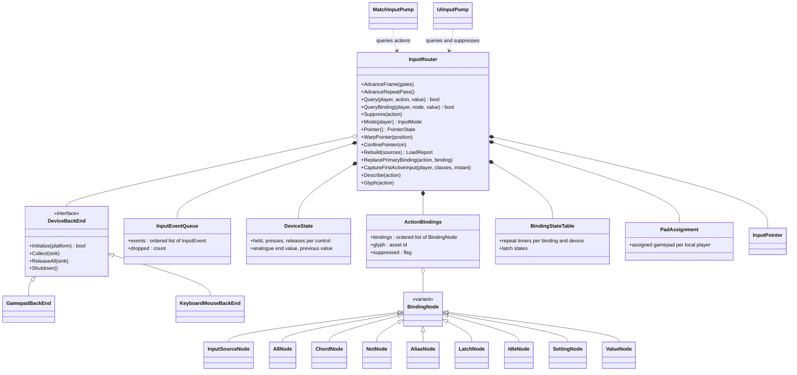

# Input

> Status: Engine baseline · Prefix: INP · ADRs: [ADR-028](../../../ADR/ADR-028-input-device-back-ends.md) · [ADR-029](../../../ADR/ADR-029-input-event-model-and-binding-contract.md) · [ADR-032](../../../ADR/ADR-032-ui-focus-graph-page-stack-and-input.md) · [ADR-064](../../../ADR/ADR-064-accessibility-baseline-xag.md) · [ADR-074](../../../ADR/ADR-074-platform-clock-with-injectable-time.md) · [ADR-056](../../../ADR/ADR-056-products-configurations-and-feature-flags.md) · [ADR-075](../../../ADR/ADR-075-application-window-and-dpi-awareness.md) · [ADR-059](../../../ADR/ADR-059-content-build-and-validators.md) · [ADR-061](../../../ADR/ADR-061-data-schemas-and-versioning.md) · [ADR-062](../../../ADR/ADR-062-authoring-syntax-and-schema-language.md) · [ADR-063](../../../ADR/ADR-063-localisation.md) · [ADR-067](../../../ADR/ADR-067-logging.md) · [ADR-069](../../../ADR/ADR-069-test-framework.md) · Related: [Controls, camera and commands](../../../reference/06_controls_camera_and_commands/README.md) · [Actions and bindings](../../../reference/06_controls_camera_and_commands/actions_and_bindings.md) · [Camera](../../../reference/06_controls_camera_and_commands/camera.md) · [Teams and player commands](../../../reference/12_simulation_model/06_teams_and_player_commands.md) · [UI framework](../ui_framework/README.md) · [Platform layer](../platform_layer.md) · [Data schemas](../data_schemas/README.md)

This component turns device input into Species actions. It owns the device back-ends, the ordered event queue, the device state of each frame, the assignment of gamepads to local players, the binding graph that maps device conditions to action ids, the binding sets and their layers, the name table of every bindable control, the pointer, the input mode and the idle time. It answers one question for the rest of the client: did action *X* fire in this frame, and with which value. What each action means, and which player command it produces, is specified by [actions and bindings](../../../reference/06_controls_camera_and_commands/actions_and_bindings.md); this component never defines a second list of match actions.

## Folder index

| File | Holds | Requirement IDs |
|---|---|---|
| [README.md](README.md) (this file) | responsibilities and boundaries; the interface sketch, the router operations, the contracts and the helpers; value kinds and conditions, binding nodes, action bindings, the binding-set schema, action values and suppression and the class diagram; the tuning table; budgets, failure modes, acceptance tests and open decisions | INP-001 to INP-053, INP-060 to INP-073, INP-090 to INP-093, INP-200 to INP-244 |
| [controls_and_default_bindings.md](controls_and_default_bindings.md) | §3.2, §3.6 to §3.8, §3.11 and §4.16: the name table of every bindable control, the default binding set, the glyphs, the reverse index, the development binding layer and the conditional actions, and the notes on the default scheme | INP-055, INP-056, INP-075 to INP-085, INP-094 to INP-097, INP-181 to INP-185 |
| [devices_frames_and_queries.md](devices_frames_and_queries.md) | §4.1 to §4.12: the lifecycle and the frame order, the device back-ends, the event queue, the device state, condition evaluation, analogue processing, repeat timers, composite and environment nodes, query evaluation, local players and gamepad assignment, the input mode and idle time, and the pointer | INP-100 to INP-160 |
| [binding_layers_and_rebinding.md](binding_layers_and_rebinding.md) | §4.13 to §4.15 and §4.17: the binding layers, keyboard layouts and locales, loading and validation, the rebinding hook services and the binding graph | INP-162 to INP-179 |

Section numbers are shared by the four files of this folder, so a reference such as §4.7 or table 3.6-B names one section or table of the folder.

Notation used throughout:

- A **frame** is one rendered frame of the client loop. Input timings (repeat, idle) are seconds of real time read from the platform clock (ADR-074): they are presentation timings, never simulation durations, and they keep running while a match is paused (R-CTRL-006).
- **Binding notation.** This document writes a device condition as `device:control:condition`, for example `key:a:held`, `mouse:primary:down` or `pad:stick_left:position`, and composite bindings as `all(x, y)`, `chord(key:control, key:c)`, `not(x)`, `alias(<action id>)` and `latch(on: x, off: y)`, where x and y stand for operand bindings. Bindings of one action are listed in order and separated by `·`; the first is the **primary** binding. §3.5 maps the notation one to one onto the binding-set schema.
- **Stick units** are the unit of stick payloads after the response curve (§4.6); pushing a stick forward gives a negative y.

## 1 Responsibilities and boundaries

**INP-001** (MUST) The input component owns: the gamepad back-end on GameInput and the keyboard and mouse back-end (ADR-028, §4.2); the per-frame ordered event queue (ADR-029, §4.3); the device state derived from it (§4.4); the local players and their gamepad assignment (§4.10); the binding graph, its node kinds and their evaluation (§3.3, §4.5 to §4.9); the action bindings (`ActionBindings`) of every action, with their glyph overrides and suppression flags (§3.4); the name table of every bindable key, mouse control and gamepad control (§3.2); the binding layers and the keyboard-layout table (§4.13); the pointer (§4.12); the input mode and the idle time (§4.11); and the rebinding services that the rebinding hook uses (§4.15).

**INP-002** (MUST) Game code never reads a device. It asks the input router (`InputRouter`) whether an action fired in the current frame and may receive the action's value: its kind, its axis values and the device that produced it. Every answer comes from the state that the router built at the start of the frame; asking is free of side effects (DEC-554).

**INP-003** (MUST) The match actions are exactly the action ids of [actions and bindings](../../../reference/06_controls_camera_and_commands/actions_and_bindings.md) table 2.1-A (R-CTRL-030). This component binds them (table 3.6-A). The UI navigation actions, their meanings and their context rules are those that the UI framework defines ([layout, rendering, input and localisation](../ui_framework/layout_rendering_input_and_localisation.md) UI-203, UI-204; R-CTRL-035); their bindings are owned here: table 3.6-B is the one binding table of every `action.menu.*` action, which the UI framework cites (INP-077). This component defines no menu action of its own, except the five leaderboard hook-page actions that no UI requirement lists. The developer actions of the development binding layer exist in Debug builds only (INP-094). Action ids are the stable names that bindings, rebinding and saved settings use (ADR-029).

**INP-004** (MUST) Player commands originate only in the input layer. The match input pump (`MatchInputPump`) and the sampler of the team command state (`TeamCommandState`) turn actions into members of `PlayerCommand` and into fields of the team command state, by the rules of [actions and bindings](../../../reference/06_controls_camera_and_commands/actions_and_bindings.md) (DEC-023); the router itself produces actions, never commands. Simulation code links no input interface, never queries an action, never reads the pointer, a device, the input mode or the camera, and never issues a player command (DEC-008, DEC-119, R-CTRL-003, R-CTRL-004). One click therefore yields one command on the sender and one effect on every participant.

**INP-005** (MUST NOT) The input component never writes simulation state, never reads it, and never changes a Power, a selection or a unit locally. Local feedback (sounds, previews, camera modes) is the consumers' business (R-CTRL-022, DEC-007).

**INP-006** (MUST) Text entry does not pass through the binding graph. Text characters and input-method composition go to the focused text field through the UI framework's text service, with the modifier state of each character (ADR-028, ADR-032).

**INP-007** (MUST) The headless server links neither GameInput nor any input back-end (ADR-028). Bots issue no input actions (R-CTRL-005).

**INP-008** (MUST) The neighbours of this component own: the window, its focus, its close request and the system cursor's visibility over the client area ([platform layer](../platform_layer.md), ADR-075); widget focus, page navigation, UI repeat timers and input-mode captions ([UI framework](../ui_framework/README.md), ADR-032); the meaning, context and command of every match action (reference/06); the file format of the binding sets ([data schemas](../data_schemas/README.md), ADR-061, ADR-062); and the settings store (`SettingsStore`) that holds the user layer (DEC-250).

**INP-009** (MUST) The default binding set binds only the actions of tables 3.6-A and 3.6-B, that is the actions of reference/06 table 2.1-A, those of UI-203 and the leaderboard hook-page actions. It holds the one match control scheme (`ControlScheme`, R-CTRL-002): no alternative scheme (DEC-056), no gesture input and no icon Power bar (DEC-055), no loader mini-programs or attract mode (DEC-054), and no developer key other than `action.debug.network_stats`. The developer keys of DBG-020 are the development binding layer of table 3.11-A, which only Debug builds read (INP-094); this rule holds for the default set in every build.

**INP-010** (MUST) Every device class is remapped through the same binding graph, and the graph offers a latch node for hold-or-toggle options (§4.8), so remapping and toggle options are done once for every device (ADR-064).

## 2 Interfaces

### 2.1 Interface sketch

```cpp
namespace Engine
{

enum class DeviceClass : std::uint8_t
{
  KeyboardMouse,
  Gamepad
};
enum class InputMode : std::uint8_t // INP-150
{
  KeyboardMouse,
  Gamepad
};
enum class ValueKind : std::uint8_t // INP-050
{
  Boolean,
  Axis1,
  Axis2
};
enum class Condition : std::uint8_t // INP-051
{
  Down, // Boolean conditions
  Up,
  Held,
  Repeat,
  Position, // analogue conditions
  Move,
  Release,
  Zero,
  Read
};

struct DeviceId // stable identity from a back-end (INP-115)
{
  std::uint64_t value;
};
struct LocalPlayerId // player 0 owns the keyboard and the mouse (INP-145)
{
  std::uint8_t index;
};
struct ActionId // interned from the action id string when bindings load
{
  std::uint16_t index;
};

enum class KeyCode : std::uint16_t;    // table 3.2-A
enum class MouseControl : std::uint8_t // table 3.2-B
{
  Primary,
  Secondary,
  Middle,
  Motion,
  RawMotion,
  Wheel
};
enum class PadControl : std::uint8_t; // table 3.2-C

struct InputEvent // INP-115
{
  enum class Kind : std::uint8_t
  {
    Press,
    Release,
    Axis,
    Connect,
    Disconnect
  };
  Kind kind;
  bool osRepeat; // keyboard auto-repeat; never a new press (INP-053)
  DeviceClass deviceClass;
  DeviceId device;
  std::uint16_t control;             // a KeyCode, MouseControl or PadControl value
  std::int64_t timestampNanoseconds; // platform clock (ADR-074)
  float x;                           // Axis: a sample (stick, trigger) or a delta (motion, wheel)
  float y;
};

struct ActionValue // INP-090
{
  ValueKind kind = ValueKind::Boolean;
  float x = 0.0f;
  float y = 0.0f;
  std::optional<DeviceId> device;
};

struct FrameGates // INP-156, supplied by the UI framework and the platform layer
{
  bool uiWindowOpen;  // as the UI left it at the end of the previous frame
  bool textEntryOpen; // chat input or a focused text field
  bool windowFocused;
};

struct PointerState // INP-155
{
  Vec2 positionPixels; // client-area pixels
  float wheelNotches;  // accumulated wheel notches
  Vec2 deltaPixels;    // this frame's movement
  float wheelDeltaNotches;
  bool moved; // deltaPixels is not zero
};

class InputRouter
{
public:
  // Frame lifecycle (INP-101, INP-102). Main thread only.
  void AdvanceFrame(const FrameGates& _gates);
  void AdvanceRepeatPass();

  // Queries: const and free of side effects (INP-002).
  bool Query(LocalPlayerId _player, ActionId _action, ActionValue* _value = nullptr) const;
  bool QueryBinding(LocalPlayerId _player, const BindingNode& _node, ActionValue* _value = nullptr) const;
  void Suppress(ActionId _action); // false for the rest of the frame (INP-093)
  InputMode Mode(LocalPlayerId _player) const;
  bool IsIdle() const;
  double IdleSeconds() const;
  const PointerState& Pointer() const;
  void WarpPointer(Vec2 _positionPixels); // moves the pointer without a motion delta (INP-158)
  void ConfinePointer(bool _on);          // holds the system pointer inside the client area (INP-159)
  std::optional<DeviceId> AssignedGamepad(LocalPlayerId _player) const;
  bool AssignedGamepadConnected(LocalPlayerId _player) const;
  std::string_view ActiveLayout() const; // keyboard-layout tag (INP-164)

  // Binding sets (INP-162 to INP-179).
  LoadReport Rebuild(const BindingSources& _sources); // default set, development layer (Debug), layout layer, user layer
  std::expected<void, LoadDiagnostic> ReplacePrimaryBinding(ActionId _action, const BindingNode& _binding);
  std::optional<BindingNode> CaptureFirstActiveInput(LocalPlayerId _player, DeviceClassMask _classes, bool _instant) const;
  std::optional<BindingDescription> Describe(ActionId _action) const;
  std::optional<AssetId> Glyph(ActionId _action) const;
  void ClearBindings();                    // keeps glyph overrides
  void DumpBindings(LogSink& _sink) const; // diagnostics (INP-242)

  // Notifications, raised inside AdvanceFrame.
  Signal<LocalPlayerId, InputMode> onModeChanged;
  Signal<std::string_view> onLayoutChanged;
};

class DeviceBackEnd // INP-105
{
public:
  virtual ~DeviceBackEnd() = default;
  virtual bool Initialize(PlatformServices& _platform) = 0;
  virtual void Collect(EventSink& _sink) = 0;    // every event since the last call, in order
  virtual void ReleaseAll(EventSink& _sink) = 0; // release events for everything held (INP-111)
  virtual void Shutdown() = 0;
};

} // namespace Engine
```

### 2.2 Router operations

**INP-020** (MUST) The router's operations behave as follows:

| Operation | Behaviour |
|---|---|
| `Query(player, action, value)` | false if the action is suppressed in this frame; otherwise the action's bindings are evaluated **in order** for that player, and the result is true at the **first** binding that is satisfied, whose value is returned. An action is the logical OR of its bindings, and its value comes from the first satisfied binding. When no binding is satisfied, the value is cleared (kind Boolean, axes 0, no device) |
| `QueryBinding(player, node, value)` | evaluates one binding node; composite nodes use it for their operands (§4.8) |
| `Suppress(action)` | the action answers false until the next `AdvanceFrame`; an alias of it answers false as well (INP-093) |
| `Rebuild(sources)` | clears every binding and rebuilds the action bindings from the default set, the development layer in Debug builds, the active layout layer and the user layer, in that order (§4.13), and returns every diagnostic (§6.1) |
| `ReplacePrimaryBinding(action, binding)` | validates the binding (§4.14) and, when it is accepted, replaces the action's primary binding, or appends it when the action has none; a rejected binding returns its diagnostic and changes nothing |
| `CaptureFirstActiveInput(player, classes, instant)` | the first control of the allowed device classes, in name-table order, that went down in this frame, as a leaf binding with the condition `down` when `instant` is set and `held` otherwise (§4.15) |
| `Describe(action)` | the display description of the first binding of the action that has one (§4.15) |
| `Glyph(action)` | the action's glyph override, if the binding set gives one (§3.7) |
| `IsIdle()`, `IdleSeconds()`, `Mode(player)` | §4.11 |
| `ClearBindings()` | removes every binding of every action; glyph overrides stay |
| `DumpBindings(sink)` | writes every action with its bindings in canonical form and the count of bindings (§6.4) |

### 2.3 Events and data contracts

**INP-021** (MUST) The router's inputs are: the device events of the back-ends (§4.2, §4.3); the frame gates, which the UI framework and the platform layer supply before `AdvanceFrame`; the values of the settings that setting nodes and the keyboard-layout setting name (§4.8, §4.13); and the layout-change and focus-change notices of the keyboard and mouse back-end.

**INP-022** (MUST) The router's outputs are: action results and values (by query); the pointer state; the input mode of each local player and its change notice; the idle state; the active keyboard layout and its change notice; the assignment and connection state of each local player's gamepad; and text events, which it forwards unchanged to the UI framework's text service (INP-006).

**INP-023** (MUST) The default binding set and the layout layers are content: authored as JSON records, validated by the content build and loaded as cooked records (ADR-059, ADR-061, ADR-062, DEC-015). The user layer is a run-time settings file in the settings store (DEC-250) and is validated by the router when it loads (§4.14).

**INP-024** (MUST) Every display text of input (key names, control names, condition words, the chord separator) is a string id of the string table with its fallback (ADR-063, DEC-099), never a name that the parser accepts, and display text is never fed back into parsing (ADR-029).

### 2.4 Threading contract

**INP-025** (MUST) The router lives on the main thread, which runs the platform layer's window and event loop (ADR-075). `AdvanceFrame`, `AdvanceRepeatPass`, every query, `Suppress`, `WarpPointer`, `ConfinePointer` and every binding operation run on the main thread only. Between two `AdvanceFrame` calls the router's frame state is immutable.

**INP-026** (MUST) The keyboard and mouse back-end receives its input on the main thread, forwarded by the platform layer (ADR-075). The gamepad back-end reads gamepad readings on the main thread inside `AdvanceFrame`; GameInput's device notices may arrive on another thread and are written into a single-producer, single-consumer mailbox that `AdvanceFrame` drains. No other thread touches router state.

**INP-027** (MUST) Events that arrive while the main thread is busy (a loading view, a long frame) stay in their back-end's buffer until the next `AdvanceFrame`; the platform layer keeps pumping the window during loading views, so no event is lost while a frame is not running.

### 2.5 Helper abstractions

**INP-028** (MUST) The component provides these helpers on top of `Query`; none of them holds state between frames:

| Helper | Behaviour |
|---|---|
| `ActionAxis` | composes up to six Boolean actions (a positive and a negative action per axis x, y and z) into a vector: each component is (positive − negative) × a sensitivity |
| `StickAxis` | the value of an `Axis2` action × a sensitivity, or zero when the action did not fire |
| `PriorityAxis` | the value of a first source unless it is zero, otherwise the value of a second source |
| `ActionTrigger` | a callable that queries one action for one player; the UI framework's keyboard shortcuts are built on it |

No match rule of reference/06 uses the three axis helpers; the stateful hold-or-toggle helper is the latch node of §4.8.

## 3 Data model

### 3.1 Value kinds and conditions

**INP-050** (MUST) Every action, binding and device condition has one value kind:

| Kind | Meaning | Value |
|---|---|---|
| `Boolean` | button-like | none beyond the result; a Boolean action fed by an analogue binding carries that binding's value (INP-061) |
| `Axis1` | one axis | x: a trigger, the wheel, the idle time |
| `Axis2` | two axes | x and y: pointer motion, a stick |

**INP-051** (MUST) A device leaf tests one condition on one control. The conditions are:

| Condition | Applies to | True in a frame when | Value |
|---|---|---|---|
| `down` | a Boolean view (table 3.2-D) | a press event of the control occurred in this frame | — |
| `up` | a Boolean view | a release event of the control occurred in this frame | — |
| `held` | a Boolean view | the control is pressed after the frame's last event | — |
| `repeat` | a Boolean view | the control went down in this frame, or it is held and at least one repeat instant falls in this frame (§4.7) | x = the number of firings in this frame |
| `position` | an analogue control | the control is outside its rest zone at the end of the frame | the processed value (§4.6) |
| `move` | an analogue control | the value changed since the end of the previous frame by more than the control's move threshold (table 3.2-D) | the change |
| `release` | an analogue control | the control is at rest at the end of the frame, and it was away from rest at the end of the previous frame or at some sample of this frame | — |
| `zero` | an analogue control | the control is at rest at the end of the frame | — |
| `read` | an analogue control | always | the current value |

**INP-052** (MUST) A press and a release of one control within one frame make both `down` and `up` true for that frame, and `held` false, so a press shorter than a frame is never lost (ADR-029, DEC-096, R-CTRL-010). Two presses within one frame make `down` true once; the router keeps the count of presses for diagnostics.

**INP-053** (MUST) An event that the operating system's keyboard auto-repeat produces never satisfies `down`, never creates a new press and never changes `held`; the `repeat` condition uses the router's own timers (§4.7, ADR-029).

§3.2 is in [controls_and_default_bindings.md](controls_and_default_bindings.md).

### 3.3 Binding nodes

**INP-060** (MUST) A binding is a tree of nodes of these kinds:

| Node | Operands | Result kind | Rules |
|---|---|---|---|
| device leaf (`InputSourceNode`) | a device (`key`, `mouse` or `pad`), a control, a condition and, on sticks and triggers only, a sensitivity | `Boolean` for a Boolean condition; the control's kind for an analogue condition | the condition must be one the control accepts (table 3.2-D); the sensitivity is a whole percentage within the range of `inp.binding.sensitivity`, default 100 |
| `all` | two or more operands of any kind except `all` | the kind of its analogue operand, otherwise `Boolean` | at most one operand may be analogue |
| `chord` | two or more parts, each a key, mouse button or gamepad button without a condition | `Boolean` | true when every part is held and at least one part went down in this frame (INP-137) |
| `not` | one `Boolean` operand: a device leaf, `not`, `alias`, `latch`, `idle` (reaches or no longer), `setting` or `value` | `Boolean` | the operand must be `Boolean` |
| `alias` | an action id | `Boolean` | true when that action fires; an alias chain that leads back to its own action is rejected (DEC-554) |
| `latch` | an `on` operand and an `off` operand, both `Boolean` and neither a `latch` | `Boolean` | §4.8 |
| `idle` | `at_least` N, `reaches` N or `no_longer`; N a whole number of seconds of at least 1 | `Axis1` for `at_least` (x = the idle time), otherwise `Boolean` | §4.8 |
| `setting` | a setting name and an optional negation | `Boolean` | the setting must exist in the settings store or its defaults when the binding loads; it can be negated once |
| `value` | `AlwaysTrue` or `FeatureFlagX` | `Boolean` | `AlwaysTrue` is always true; `FeatureFlagX` is true while the feature flag `FeatureFlagX` is above 0 |

**INP-061** (MUST) An action accepts a binding by the action's kind:

| Action kind | Accepts |
|---|---|
| `Boolean` | `Boolean` bindings; and analogue bindings, which are true while their condition holds and pass their value on |
| `Axis1` | analogue bindings; an `Axis2` binding gives its x |
| `Axis2` | analogue bindings; an `Axis1` binding gives its x, with y = 0 |

A `Boolean` binding on an `Axis1` or `Axis2` action is rejected when it loads (§6.1).

### 3.4 Action bindings

**INP-065** (MUST) For each action the router holds an ordered list of bindings, an optional glyph override and a suppression flag. The order of the list is the order in which bindings were accepted; index 0 is the **primary** binding, which the layout layer, the user layer and rebinding replace. Binding an entry appends it to the list; replacing removes the primary and puts the new binding at index 0, or appends it when the list is empty.

**INP-066** (MUST) The router owns the action bindings. `Rebuild` creates them at start-up and recreates them on a keyboard-layout change, on restoring the defaults and after the user layer changes; binding nodes are immutable after loading. The run-time state of a binding (repeat timers per device, latch states) lives in a state table owned by the router, indexed by node, and `Rebuild` resets it.

**INP-067** (MUST) The action id table is built from tables 3.6-A and 3.6-B, and in Debug builds table 3.11-A, when bindings load; every action id is interned once. An entry that names an action id outside the table is rejected (§6.1).

### 3.5 Binding-set schema

**INP-070** (MUST) The default binding set and each layout layer are records of one binding-set schema ([data schemas](../data_schemas/README.md), ADR-061, ADR-062) with these fields: the schema version; the layer kind (`default`, `development` or `layout`); for a layout layer, its layout tag (§4.13); and a list of entries, each with an action id, a list of binding nodes and an optional glyph asset id. Their authoring files open with the top-level fields `schema` (`input.binding_set`) and `version` (DAT-016, DAT-202). A layout-layer entry holds exactly one binding, which replaces the action's primary binding. The user layer is a group of settings-store entries, one per action, under the setting key `binding.<action id>`, whose value is one binding node in canonical form (DAT-202, DEC-250).

**INP-071** (MUST) Each node is a JSON object with exactly one node-kind property; the notation of this document maps onto it one to one:

| Notation | JSON node |
|---|---|
| `key:a:held` | `{"key": "a", "when": "held"}` |
| `mouse:primary:down` | `{"mouse": "primary", "when": "down"}` |
| `pad:stick_left:position`, sensitivity 150 | `{"pad": "stick_left", "when": "position", "sensitivity": 150}` |
| `all(x, y)` | `{"all": [x, y]}` |
| `chord(key:control, key:c)` | `{"chord": [{"key": "control"}, {"key": "c"}]}` |
| `not(x)` | `{"not": x}` |
| `alias(action.ui.show_cursor)` | `{"alias": "action.ui.show_cursor"}` |
| `latch(on: x, off: y)` | `{"latch": {"on": x, "off": y}}` |
| `idle:at_least:60`, `idle:reaches:60`, `idle:no_longer` | `{"idle": "at_least", "seconds": 60}`, `{"idle": "reaches", "seconds": 60}`, `{"idle": "no_longer"}` |
| `setting:Name`, `setting:not:Name` | `{"setting": "Name"}`, `{"setting": "Name", "negate": true}` |
| `value:AlwaysTrue`, `value:FeatureFlagX` | `{"value": "AlwaysTrue"}`, `{"value": "FeatureFlagX"}` |

**INP-072** (MUST) The canonical writer writes the properties in the order of the table, the canonical control names, and the sensitivity only when it differs from the default. Writing a binding and parsing it back yields the same binding (ADR-029, DEC-800).

**INP-073** (MUST) A node with an unknown property, with no or with two node-kind properties, or without a required property is rejected (§6.1); nothing falls back to a default condition (DEC-096).

§3.6 to §3.8 and §3.11 are in [controls_and_default_bindings.md](controls_and_default_bindings.md).

### 3.9 Action values and suppression

**INP-090** (MUST) An action value (`ActionValue`) holds the value kind, the x and y components and the device that produced it. The value of a fired action is the value of its first satisfied binding (INP-020): a device leaf gives its control's value under its condition (INP-051); `all` gives its first operand's value, replaced by its analogue operand's value when it has one; `alias` gives the target action's value; the other composite nodes give no axis value.

**INP-091** (MUST) Values are floating-point and never truncated or rounded (ADR-029). A Boolean action fed by an analogue binding carries that binding's value; an `Axis1` action reads x; an `Axis2` action fed by an `Axis1` binding has y = 0 (INP-061).

**INP-092** (MUST) A value carries the identity of the device that produced it; a gamepad value always names the player's assigned gamepad (§4.10), and a keyboard or mouse value names the keyboard or the mouse.

**INP-093** (MUST) `Suppress(action)` makes the action answer false, with a cleared value, for the rest of the frame; an `alias` of a suppressed action is false as well. `AdvanceFrame` clears every suppression flag first. The UI input pump suppresses the match's use of a primary press that lands on a UI window, so that the press is withheld from the match actions for the rest of the frame (R-CTRL-047 row M6).

### 3.10 Class diagram



Caption: Diagram 3.10-A, the input component's types: two back-ends feed one event queue, the router derives the device state, and consumers query actions through the binding nodes (INP-001, INP-060, INP-065).

## 4 Behaviour and algorithms

§4.1 to §4.12 are in [devices_frames_and_queries.md](devices_frames_and_queries.md), §4.13 to §4.15 and §4.17 in [binding_layers_and_rebinding.md](binding_layers_and_rebinding.md), and §4.16 in [controls_and_default_bindings.md](controls_and_default_bindings.md).

### 4.18 Tuning table

Input timings are seconds of real time and never simulation durations (R-CTRL-006). The dead zones and the trigger threshold are Species baseline values (DEC-338); the stick scales and thresholds are the reference values adopted as the baseline (DEC-004). Values owned by other documents are cited by their keys in INP-183 to INP-185.

| key | value | unit | range or notes | requirement | DEC |
|---|---|---|---|---|---|
| `inp.queue.capacity` | 1024 | events per frame | beyond it axis samples merge and transitions are counted and dropped | INP-116 | — |
| `inp.repeat.initial_delay` | 0.3 | s of real time | from the press to the first repeat | INP-133 | DEC-554 |
| `inp.repeat.period` | 0.3 | s of real time | between later repeats | INP-133 | DEC-554 |
| `inp.pad.stick_left.dead_zone` | 0.24 | fraction of full deflection | radial, rescaled | INP-128 | DEC-338 |
| `inp.pad.stick_right.dead_zone` | 0.265 | fraction of full deflection | radial, rescaled | INP-128 | DEC-338 |
| `inp.pad.trigger.threshold` | 0.12 | fraction of full travel | rest at or below; also the Boolean view's threshold | INP-120, INP-129 | DEC-338 |
| `inp.pad.curve.exponent` | 3 | — | cubic stick response | INP-128 | — |
| `inp.pad.trigger.curve_exponent` | 1 | — | linear trigger response | INP-129 | — |
| `inp.pad.stick_left.scale` | 39.304 | stick units | 3.4³ at full deflection | INP-128, INP-183 | DEC-004 |
| `inp.pad.stick_right.scale` | 19.683 | stick units | 2.7³ at full deflection | INP-128, INP-183 | DEC-004 |
| `inp.pad.stick.move_threshold` | 3.4 | stick units | strict, on either axis | INP-122 | DEC-004 |
| `inp.pad.stick_button.threshold` | 3.4 | stick units | strict; the same for both sticks | INP-120 | DEC-004 |
| `inp.binding.sensitivity` | 100 | % | default; whole numbers from 1 to 200 | INP-060, INP-130 | — |
| `inp.mouse.wheel_units_per_notch` | 120 | fine wheel units | the platform's notch | INP-110 | — |
| `inp.budget.typical_events` | 64 | events per frame | the typical-load case | INP-200 | — |
| `inp.budget.advance_typical_ms` | 0.2 | ms | `AdvanceFrame` at the typical load, minimum CPU | INP-200 | — |
| `inp.budget.advance_full_ms` | 1.0 | ms | `AdvanceFrame` with a full queue, and one `Rebuild` | INP-200 | — |
| `inp.budget.memory_kib` | 256 | KiB | router state, binding nodes, state tables and the queue | INP-201 | — |

## 5 Concurrency and performance budget

**INP-200** (MUST) On the minimum CPU, `AdvanceFrame` takes at most `inp.budget.advance_typical_ms` with up to `inp.budget.typical_events` events and at most `inp.budget.advance_full_ms` with a full queue; one `Rebuild` of the default set and every other layer also fits in `inp.budget.advance_full_ms`, so a layout change during a match costs one frame. A query takes time proportional to the nodes of the action's bindings and of the actions they alias, and never allocates.

**INP-201** (MUST) The router allocates its queue at `inp.queue.capacity` and its state tables in `Rebuild`, and performs no heap allocation in `AdvanceFrame` or in a query. Its whole state stays within `inp.budget.memory_kib`.

**INP-202** (MUST) An event that a back-end receives before `AdvanceFrame` starts is visible to the queries of that frame, so the router adds no frame of latency; gamepad readings are read inside `AdvanceFrame`. Event timestamps are kept, so a later command model can stamp commands with the time of the input that caused them. The delay between a command and its execution, and the coalescing of continuous control, are the Open DEC-203; the router keeps every one-shot transition, and the team command state combines one-shot flags between sends (R-CTRL-021, R-SIM-441).

**INP-203** (MUST) The threading contract of §2.4 holds: one main-thread owner, an immutable frame state between advances, and a single-producer mailbox for GameInput's device notices. No file or network I/O runs inside `AdvanceFrame`; the settings store and the binding sets are read in `Rebuild`, which runs at start-up, on a layout change and on a binding change.

## 6 Failure modes, diagnostics and telemetry

### 6.1 Load diagnostics and binding parse outcomes

**INP-220** (MUST) Every load diagnostic names its class (table 6.1-A), the layer, the action, the path of the node inside the binding, the offending word, and its location: line and column in an authoring file (ADR-062), the settings key in the user layer.

Table 6.1-A Load diagnostic classes.

| Class | Raised when |
|---|---|
| `UnknownAction` | an entry names an action id outside the action id table (INP-067): outside tables 3.6-A and 3.6-B, and in a Debug build table 3.11-A |
| `MissingAssignment` | an entry has no action id or no binding list, or an element declares a kind but assigns nothing |
| `UnknownNodeKind` | a node has no node-kind property, two of them, or a device word that no back-end serves |
| `UnknownControl` | a control name is not in the name table (`any` included) |
| `BadCondition` | a condition word is unknown or not accepted by the control (table 3.2-D) |
| `BadOption` | an unknown property, a sensitivity outside its range or on another control, an idle time below 1 s |
| `ConjunctionShape` | an `all` with fewer than two operands, a nested `all`, or more than one analogue operand |
| `ChordShape` | a chord with fewer than two parts, a part with a condition, or a part that is not a button or key |
| `NotOperand` | the operand of `not` is not `Boolean` |
| `KindNotAccepted` | the binding's kind is not accepted by the action's kind (INP-061) |
| `AliasCycle` | an alias chain leads back to an action already on the chain |
| `UnknownSetting` | a setting node names a setting that does not exist, or negates twice |
| `UnknownGlyph` | a glyph override names an asset id that is not in the asset manifest |
| `DuplicateEntry` | a warning: a replacing layer sets one action twice (INP-163) |

**INP-221** (MUST) The default set states every binding with its effective meaning, so no default binding depends on lenient parsing (DEC-553): the trigger press bindings and the aliases of INP-079 are explicit. These inputs of the reference default set bind nothing and are not part of it: bindings for a three-dimensional mouse device on `action.select.clear`, `action.power.next` and `action.match.ready` (two); a glyph entry for an action that does not exist; and an entry that declares a value kind without an assignment. The gesture bindings, among them one with a misspelt condition word and a two-key chord, are not specified (DEC-055). Authored as entries, each of these cases fails the content build with its class of table 6.1-A (T6, T31).

**INP-222** (MUST) The content build checks every glyph override and every glyph of table 3.7-A against the asset manifest (ADR-059), so the input layer never asks for a texture that does not exist.

### 6.2 Run-time failure modes

**INP-225** (MUST) The router handles these run-time failures without stopping, and each is logged (§6.4):

| Failure | Handling |
|---|---|
| queue overflow | merge, drop and reconcile (INP-116, INP-117); a warning with the drop count, once per frame in which it happens |
| GameInput not available | no gamepads; one error (INP-107) |
| a gamepad disconnects while buttons are held | release events for its held buttons and rest samples for its sticks and triggers in the same frame; the player's `connection` goes up (INP-148) |
| focus loss | release everything; no presses until focus returns (INP-111) |
| a rejected user-layer entry | skipped, earlier layers kept (INP-171) |
| a back-end event older than the previous frame | applied in this frame, in arrival order; a debug message |
| the cooked default set missing or unreadable | the client starts with the bindings it could read, logs an error, and stays usable through the UI pointer (DEC-015) |

### 6.3 Input-layer defects stated as fixed rules

**INP-230** (MUST) The input layer upholds the rules of table 6.3-A. Each row names the failure mode the rule excludes, where the rule is specified, its decision and its test.

Table 6.3-A Fixed rules of the input layer.

| # | Failure mode excluded | Rule | DEC | Test |
|---|---|---|---|---|
| 1 | a simulation rule reading the local camera or local input (desync) | INP-004; R-CTRL-024, R-CTRL-103 | DEC-008 | T20 |
| 2 | a click toggling a world object locally, without a command | INP-004, INP-005 | DEC-007, DEC-008 | T20 |
| 3 | route previews taking entries or ids from simulation route storage | R-CTRL-023 | DEC-095 | — |
| 4 | presentation code writing the state of the selected structure | INP-005 | DEC-007 | — |
| 5 | simulation code calling into the UI, the cursor or the camera | presentation events | DEC-007 | — |
| 6 | the UI writing a replicated field of a team's Powers | INP-005 | DEC-007 | — |
| 7 | real-time values held inside replicated objects | simulation time from ticks | DEC-009 | — |
| 8 | a Power ended locally, without a command | R-CTRL-044 row T7 | DEC-008 | — |
| 9 | one click becoming one command per participant | INP-004; R-CTRL-004 | DEC-119 | T21 |
| 10 | Power ids aliasing beyond eight bits | R-SIM-449 | DEC-083 | — |
| 11 | a participant commanding another team | open: command validation | DEC-202 | — |
| 12 | an integer, frame-rate-dependent tracking distance | camera R-CTRL-484 | DEC-024, DEC-096 | — |
| 13 | an unknown condition word read as a press | INP-172, INP-221 | DEC-096, DEC-553 | T6, T31 |
| 14 | trigger magnitude overflowing | INP-123 | DEC-554 | T12 |
| 15 | a rebound key written in a form that cannot be read back | INP-072, INP-177 | DEC-554 | T7, T28 |
| 16 | a lost sub-frame press or click, missing Alt edges, no release under Alt, Alt+key auto-repeat firing again, an unbindable F10 | INP-052, INP-053, INP-109, INP-110 | DEC-096 | T1, T2, T3 |
| 17 | a key name binding another key; a key outside the name look-up | INP-055, table 3.2-A | DEC-554 | T7 |
| 18 | node kinds that read past a table, leave a field unset, throw while parsing or recurse without bound | INP-060, INP-172 | DEC-554 | T6 |
| 19 | one repeat timer shared by gamepads and bindings and changed by queries | INP-133 | DEC-554 | T10 |
| 20 | every gamepad driving the one local player | INP-145 to INP-148 | DEC-554 | T17 |
| 21 | a power bar that ignores the pointer | R-CTRL-226 | DEC-083 | — |
| 22 | an unbounded move-marker list | R-CTRL-104 | DEC-096 | — |
| 23 | a crowd order for an emptied group creating a non-finite route | R-SIM-455 | DEC-555 | — |
| 24 | one click with nothing selected issuing two selections | R-CTRL-048 | DEC-096, DEC-119 | T21 |
| 25 | a debug camera advancer running after a mode change | R-CTRL-456 | DEC-024 | — |
| 26 | an unclamped camera | camera | DEC-024, DEC-096 | — |
| 27 | a layout change ignored at run time; restoring defaults without the layout layer | INP-166, INP-167 | DEC-554 | T15 |
| 28 | interface sounds for every team's selection | R-CTRL-154 | DEC-564 | — |
| 29 | control help computed but never shown | hook only | DEC-050 | — |
| 30 | an input-layer texture that does not exist | INP-222 | DEC-015 | T14 |

### 6.4 Diagnostics and telemetry

**INP-240** (MUST) The router logs in the input category (ADR-067): at information level, the load summary of each layer (entries, bindings, warnings), the active layout and its changes, and each gamepad connection, disconnection, claim and transfer; at debug level, input-mode changes; warnings for rejected user entries, duplicate entries and dropped events; and an error when GameInput is not available.

**INP-241** (MUST) The router keeps counters for the diagnostics overlay ([diagnostics, test and performance](../diagnostics_test_and_performance/README.md)): events per frame (latest and maximum), dropped events, reconciliations, and the age of the oldest event at `AdvanceFrame`.

**INP-242** (MUST) `DumpBindings` writes every action with its bindings in canonical form, its glyph override and the total number of bindings; Debug builds expose it as a debug command (ADR-056).

**INP-243** (MUST) Debug builds and the test projects (ADR-056, ADR-069) can record every frame's events and every query result, and replay the recorded events through `AdvanceFrame` with the platform clock's fixed-step source (ADR-074), so input tests are exact and repeatable. Match replays record commands, not device events (DEC-046).

**INP-244** (MUST NOT) The input component sends no telemetry of its own and never records key presses, text or pointer positions in telemetry; its counters can enter the consented performance telemetry as aggregates only (ADR-066).

## 7 Acceptance tests

Tests run under the test framework of ADR-069 with recorded or synthetic events (INP-243) and an injected clock (ADR-074).

| Test | Kind | Checks | Requirements |
|---|---|---|---|
| T1 sub-frame press | unit | a press and a release within one frame, for a key, a mouse button and a gamepad button: `down` and `up` true, `held` false, and the action bound to `down` fires | INP-052, INP-106, INP-109, INP-110 |
| T2 Alt and F10 | unit | Alt alone gives `down` and `up`; Alt+X held with auto-repeat fires `action.view.hide_interface` once; a key released while Alt is held gives `up`; `key:f10:down` binds and fires | INP-109 |
| T3 auto-repeat | unit | auto-repeat events never satisfy `down` and leave `held` unchanged | INP-053 |
| T4 focus loss | unit | with W and the south face button held, a focus loss releases both; after focus returns, the still-held W gives no press | INP-111 |
| T5 overflow | unit | twice `inp.queue.capacity` events in one frame: summed motion preserved, transitions counted and dropped, and no control stays wrongly held after reconciliation | INP-116, INP-117 |
| T6 strict validation | unit | each class of table 6.1-A, including an unknown device word, a misspelt condition word, `key:any`, `mouse:wheel:held`, sensitivity 0 and 201, two analogue operands in `all`, `not` of an analogue leaf, a `Boolean` binding on an `Axis2` action, alias cycles of length 1 and 3 and an unknown setting, is rejected with a diagnostic naming the word | INP-060, INP-061, INP-073, INP-172, INP-220 |
| T7 round trip | property | random bindings generated from the schema, and one leaf for every name of tables 3.2-A to 3.2-C, are written by the canonical writer, parsed back and compared equal | INP-055, INP-071, INP-072 |
| T8 chord | unit | `chord(key:control, key:c)` fires once for Control then C, for C then Control, and for both in one frame; it does not fire again while both stay held | INP-137 |
| T9 conjunction value | unit | `all(key:shift:held, mouse:wheel:move)` carries the wheel value and is false once Shift is released | INP-090, INP-136 |
| T10 repeat | unit | a control held for 1.0 s fires at 0, 0.3, 0.6 and 0.9 s at 60 and at 20 frames per second with equal totals; two bindings of one control and the same binding on two players' gamepads keep separate timers; queries change no timer | INP-133, INP-134 |
| T11 stick response | unit | continuity at the dead-zone edge; equal magnitude at equal deflection in eight directions; full deflection gives `inp.pad.stick_left.scale` and `inp.pad.stick_right.scale`; forward gives a negative y | INP-128 |
| T12 trigger | unit | rest at or below the threshold, 1.0 at full travel with no overflow, Boolean-view transitions in sample order | INP-120, INP-123, INP-129 |
| T13 stick directions | unit | each direction holds above `inp.pad.stick_button.threshold`; menu repeat runs per binding | INP-120, INP-133 |
| T14 default set | golden | the cooked default set equals tables 3.6-A and 3.6-B with their order and primaries, the reverse index equals table 3.8-A, and every glyph exists in the manifest | INP-075, INP-077, INP-085, INP-222 |
| T15 layouts | unit | `de-DE`: zoom's primary is Y and the middle-button and stick-press bindings remain; `fr-FR`: table 4.13-B; `en-GB`: no change; a run-time layout change rebuilds; restoring the defaults re-applies the layout layer | INP-162 to INP-167 |
| T16 user layer | unit | an entry replaces the primary; two entries for one action: the last wins with a warning; an invalid entry is skipped and the earlier bindings stay | INP-163, INP-171 |
| T17 gamepad assignment | unit | of two gamepads, the first to press claims player 0 and the other drives nothing; a disconnection fires `action.device.pad_disconnected` once; the same gamepad reconnecting fires `action.device.pad_connected`; a press on the other gamepad while disconnected transfers the assignment | INP-145 to INP-149 |
| T18 hot-plug | integration | two gamepads connect and disconnect during a match: device identities stay stable and nothing stays held | INP-106, INP-147, INP-225 |
| T19 input mode | unit | the mode starts as keyboard and mouse; a gamepad press sets gamepad; keyboard and gamepad active in one frame give gamepad; stick movement of an unassigned gamepad changes nothing | INP-150, INP-151 |
| T20 commands only | integration | the simulation library has no dependency on the input library; two participants, one with a tracking camera and look-around held, have identical states after the same command batches | INP-004, INP-007 |
| T21 one click, one command | integration | a click on empty ground with nothing selected, and a toggle of a Leader, each produce exactly one command from the sender | INP-004 |
| T22 pointer | unit | mouse movement moves the pointer; the aiming stick moves it only with no UI window open; the wheel is ignored during text entry; `WarpPointer` produces no delta; the position stays in the client area | INP-156, INP-158 |
| T23 idle | unit | `idle:reaches:5` fires in one frame only; `idle:no_longer` is true in every active frame; `idle:at_least:5` carries the idle time | INP-141, INP-153 |
| T24 latch | unit | a latch toggles once per press however many times it is queried | INP-140 |
| T25 suppression | unit | a suppressed action and an alias of it are false for the rest of the frame and fire again in the next | INP-093 |
| T26 repeat pass | unit | an Escape press is true in the first pass and false in the repeat pass; an event that arrives between the passes is seen in the repeat pass only | INP-102 |
| T27 no GameInput | integration | with GameInput unavailable the client starts, gamepad bindings load, the mode stays keyboard and mouse, and one error is logged | INP-107 |
| T28 capture and describe | unit | capture returns `key:f10:down`, `key:num_minus:down` and `key:control:held` as asked; their descriptions use string ids; a chord's noun joins the parts with a hyphen; changing `action.power.panel_show` sets `action.power.panel_hide` | INP-176 to INP-179 |
| T29 performance | performance | `AdvanceFrame` within `inp.budget.advance_typical_ms` and `inp.budget.advance_full_ms` on the minimum CPU; no heap allocation in a frame | INP-200, INP-201 |
| T30 text entry | integration | text entered with a CJK input method reaches the focused text field; no action fires from composition | INP-006, INP-112 |
| T31 reference cases | unit | the cases of INP-221, authored as entries, fail the content build with their classes | INP-221 |
| T32 development layer | unit | in a Debug build the cooked development layer equals table 3.11-A and is appended after the default set; `key:f10:down` fires `action.debug.profile_view`; `key:l` fires `action.view.chat_log` and `action.debug.special_lighting_on`; in a Release build the layer is not read, and user-layer entries for `action.debug.overlay` and `action.sequence.skip` are skipped as `UnknownAction` | INP-094 to INP-097, INP-162 |

## 8 Open decisions

### 8.1 Decisions and architecture records

| Reference | Status | Where it applies |
|---|---|---|
| DEC-203 | Open | input timing, coalescing and latency: the router keeps timestamps and every transition (INP-202) |
| DEC-250 | Open | the user layer in the client-local settings store and its versioning (INP-023, INP-070, INP-171) |
| DEC-050 | Open | the rebinding page and the control-help panel are hooks (INP-167, §4.15) |
| DEC-047 | Open | the leaderboard page served by three actions of table 3.6-B (INP-077) |
| DEC-202 | Open | command validation and authority (table 6.3-A row 11) |
| DEC-046 | Open | replays record commands, not device events (INP-243) |
| DEC-008, DEC-023, DEC-119 | Resolved | input produces actions, the input layer produces commands, and simulation code never issues or reads input (INP-004) |
| DEC-096, DEC-553, DEC-554 | Resolved | the input corrections, stated as the rules of table 6.3-A |
| DEC-950 | Resolved | the keyboard defaults of the menu actions in table 3.6-B (INP-077) |
| DEC-951 | Resolved | repeat timers on real time, with due times that do not depend on the frame rate (INP-133) |
| DEC-953 | Resolved | gamepad assignment by the first press, no device input while unfocused, the binding extensions (INP-111, INP-133, INP-146) |
| DEC-954 | Open | the aiming-stick pointer speed and the camera height glyphs kept as defaults (INP-082, INP-157) |
| DEC-854 | Open | the Strike team's use of the direct-control vectors that the sender scales (INP-183) |
| DEC-051 | Open | `action.sequence.skip` exists only with presentation timelines (INP-097) |
| DEC-004, DEC-007, DEC-009, DEC-015, DEC-024, DEC-083, DEC-095, DEC-555, DEC-564, DEC-800 | Resolved | reference values as baseline; presentation never writes simulation state; tick time; build-time validation; the camera; Power ids and the power bar; route previews; empty crowd orders; local selection sounds; lossless writers |
| DEC-338 | Dropped | the reference's dead zones, thresholds and input-implementation details; Species defines its own (§4.18) |
| DEC-054, DEC-055, DEC-056 | Dropped | attract mode and loader mini-programs, gesture input and the icon Power bar, the alternative control scheme (INP-009) |
| ADR-028 | Proposed | GameInput for gamepads; the keyboard and mouse back-end and text path (INP-105 to INP-113) |
| ADR-056 | Accepted | the development binding layer exists in Debug builds only (INP-094) |
| ADR-029 | Accepted | ordered events, event-by-event evaluation, one name table, strict parsing, float analogue processing (§3, §4) |
| ADR-032, ADR-064, ADR-074, ADR-075 | Accepted, Proposed, Accepted, Accepted | UI input in the update phase; remapping and hold-or-toggle; the platform clock; the window |
| ADR-059, ADR-061, ADR-062, ADR-063, ADR-066, ADR-067, ADR-069 | — | validation, schemas, authoring syntax, string ids, telemetry, logging, tests |

### 8.2 Design-phase inputs

1. **Local players.** How many local players a Species client has, and how a player chooses or changes a gamepad; the baseline has one local player and assigns by first press (INP-145, INP-146).
2. **Command timing** (DEC-203): the delay buffer, whether commands carry input timestamps, and the coalescing of continuous control on a server-run world.
3. **Keyboard navigation of the front end** (ADR-064, XAG 112): whether the baseline keyboard bindings of the menu actions (INP-077) are enough for keyboard-only play, and which keys the leaderboard actions get.
4. **Rebinding** (DEC-050, ADR-064, XAG 107): a reachable rebinding page for every device, conflicts between actions that share an input (INP-181), hold-or-toggle options through latches, and whether the gamepad response (dead zones, curve, sensitivity, inversion) becomes a player option (DEC-044, R-META-458).
5. **Stored bindings** (DEC-250): the user layer's schema version, migration and whether bindings follow the player across devices.
6. **Devices** (ADR-028): extra mouse buttons, other game controllers through GameInput, and whether keyboard and mouse move onto GameInput as well.
7. **Glyphs:** keyboard glyphs beyond `glyph.key.tab` in the platform-neutral set, and the glyphs of the camera height actions (INP-081, INP-082, DEC-954).
8. **Development and sequence bindings** (CAM-084, DBG-020): the fast key of the developer fly mode (INP-095), and the bindings of `action.sequence.skip` if DEC-051 adopts presentation timelines (INP-097).
