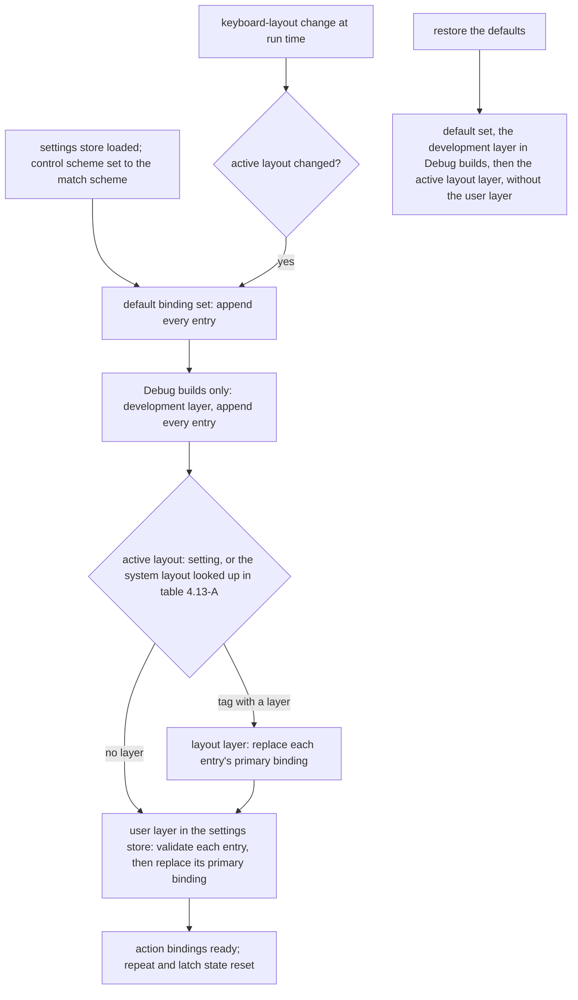
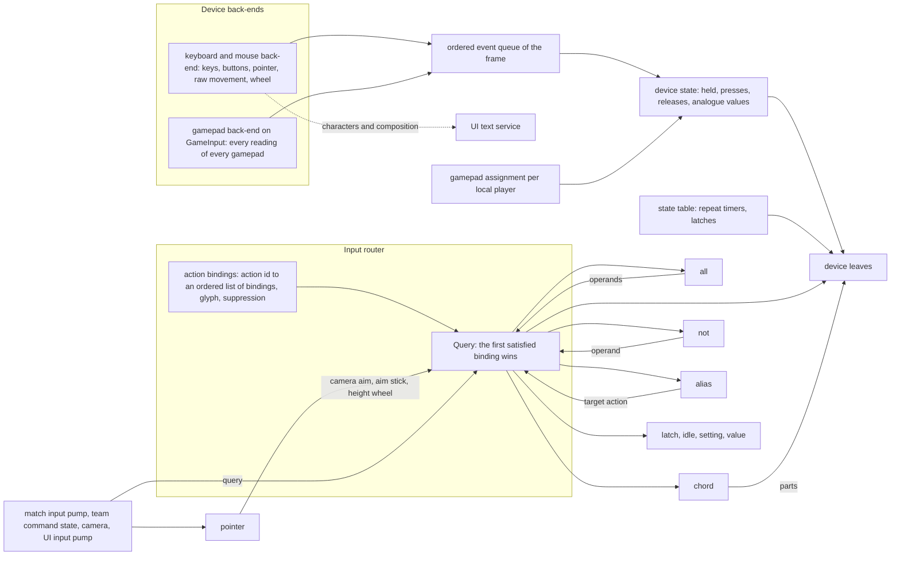

# Input: binding layers and rebinding

> Status: Engine baseline · Prefix: INP · ADRs: [ADR-028](../../../ADR/ADR-028-input-device-back-ends.md) · [ADR-029](../../../ADR/ADR-029-input-event-model-and-binding-contract.md) · [ADR-074](../../../ADR/ADR-074-platform-clock-with-injectable-time.md) · Folder: [Input](README.md)

This document specifies how the input router builds its action bindings from their layers: the binding layers, keyboard layouts and locales, loading and validation, the services of the rebinding hook, and the binding graph. Section numbers are shared by the files of this folder, and the notation is that of the [README](README.md).

## 1 Responsibilities and boundaries

The responsibilities and boundaries of the input component are [README](README.md) §1 (INP-001 to INP-010).

## 2 Interfaces

The interface sketch and the router operations are [README](README.md) §2.

## 3 Data model

The binding-set schema is [README](README.md) §3.5; the default binding set is [controls_and_default_bindings.md](controls_and_default_bindings.md) §3.6.

## 4 Behaviour and algorithms

### 4.13 Binding layers, keyboard layouts and locales

**INP-162** (MUST) `Rebuild` builds the bindings from these layers in this order: the default binding set, whose entries are appended in entry order; in Debug builds, the development layer, whose entries are appended in the same way (INP-095); the layout layer of the active keyboard layout, each of whose entries replaces the action's primary binding; and the user layer, each of whose entries replaces the action's primary binding (INP-065).

**INP-163** (MUST) Within a replacing layer, several entries for one action overwrite each other, the last one winning, and never add a binding; each overwrite is logged as a warning naming the action. Validated content never meets this rule: two entries for one action in one binding-set record are a content-build error (DAT-204, DEC-801), and the user layer is keyed, one settings entry `binding.<action id>` per action, whose repeated keys the settings reader already drops (DAT-199, DAT-202). An entry for an action that has no binding becomes its only binding.

**INP-164** (MUST) The active keyboard layout is a layout tag: the value of the keyboard-layout setting when it is set (R-META-455), otherwise the language tag (BCP 47, ADR-063) of the operating system's active keyboard layout, looked up in table 4.13-A. A tag that the table does not list, or one whose layer does not exist, gives no layout layer and is logged at information level; the default bindings then apply unchanged.

Table 4.13-A Keyboard-layout table.

| Operating-system layout language | Layout tag | Layout layer |
|---|---|---|
| German (Germany) | `de-DE` | yes, table 4.13-B |
| English (United States) | `en-US` | none |
| French (France) | `fr-FR` | yes, table 4.13-B |
| English (United Kingdom) | `en-GB` | none |
| English (Canada) | `en-CA` | none |

**INP-165** (MUST) The layout layers replace the primary bindings of table 4.13-B and nothing else; the arrow-key, middle-button and gamepad bindings of the same actions stay.

Table 4.13-B Layout layers (primary bindings).

| Action | `de-DE` | `fr-FR` |
|---|---|---|
| `action.camera.pan_left` | `key:a:held` | `key:q:held` |
| `action.camera.pan_right` | `key:d:held` | `key:d:held` |
| `action.camera.pan_forward` | `key:w:held` | `key:z:held` |
| `action.camera.pan_back` | `key:s:held` | `key:s:held` |
| `action.camera.raise` | `key:q:held` | `key:a:held` |
| `action.camera.lower` | `key:e:held` | `key:e:held` |
| `action.camera.zoom` | `key:y:held` | `key:w:held` |
| `action.camera.zoom_out` | `key:c:held` | `key:c:held` |

**INP-166** (MUST) When the operating system reports a keyboard-layout change at run time, the router determines the active layout again; when it changed, the router runs `Rebuild` and raises `onLayoutChanged` (DEC-554). The help system shows the camera-help variant of the active layout ([Tutorial and help](../../../reference/11_tutorial_and_help.md)).

**INP-167** (MUST) Restoring the default bindings rebuilds them from the default set, the development layer in Debug builds and the active layout layer, without the user layer (DEC-554). Whether the user layer's entries are then removed from the settings store is decided by the rebinding hook's apply step (DEC-050).

**INP-168** (MUST) After every load of the settings store, and before the first `Rebuild`, the control-scheme setting is set to the match control scheme (R-META-405, DEC-056). There is one default binding set.

Caption: Diagram 4.13-A, building the action bindings from their layers, and rebuilding them on a layout change or a restore (INP-162 to INP-168).

### 4.14 Loading and validation

**INP-170** (MUST) The content build validates the default set and every layout layer against the binding-set schema and the rules of §3, and fails with a diagnostic that names the layer, the action, the path of the node inside the binding and the offending word (ADR-059, DEC-015). A default binding that relies on an unknown word therefore never reaches a build.

**INP-171** (MUST) At run time the router validates each user-layer entry by the same rules. A rejected entry is skipped with a warning that names the settings key, the offending word and the diagnostic class (§6.1), and the action keeps the bindings of the earlier layers. A bad entry never stops loading and never stops the client from starting (DEC-015).

**INP-172** (MUST) Validation never falls back to a default: an unknown device word, control name, condition word, node property, action id or setting is an error naming the word and the binding (ADR-029, DEC-096, DEC-553), and no validation step reads past a table, leaves a field unset or throws (DEC-554).

### 4.15 Rebinding hook services

**INP-175** (MUST) The rebinding page is a hook that no player can reach (DEC-050, R-CTRL-034). The router provides the services it needs; bindings otherwise change only through the user layer of the settings store.

**INP-176** (MUST) `CaptureFirstActiveInput(player, classes, instant)` returns the first control of the allowed device classes, in the order of tables 3.2-A, 3.2-B and 3.2-C, that went down in this frame, as `device:control:down` when `instant` is set and `device:control:held` otherwise. Every key of table 3.2-A can be captured. The reference rebinding page captures keyboard keys only; capturing mouse buttons and gamepad buttons is available to it.

**INP-177** (MUST) The page applies a captured binding with `ReplacePrimaryBinding` and writes its canonical form to the user layer, so a binding of any key, including `control`, `insert`, the punctuation keys and the numeric-pad keys, reads back as the same binding (DEC-554, INP-072). A rejected binding returns its diagnostic to the page and changes nothing.

**INP-178** (MUST) `Describe(action)` gives a noun and a verb, both string ids, for the first binding of the action that has a description: for a device leaf, the control's display text and the condition's display text (`ui.input.condition.<condition>`); for `all`, the description of its operand of the highest kind (analogue before `Boolean`, the first among equals); for `chord`, the parts' nouns joined with a hyphen, with the verb of `down`; for `not`, the operand's description with the verb preceded by `ui.input.not`. `alias`, `latch`, `idle`, `setting` and `value` have no description. The rebinding page shows the noun.

**INP-179** (MUST) The rebinding page offers these actions, each with its primary binding: `action.camera.pan_left`, `action.camera.pan_right`, `action.camera.pan_forward`, `action.camera.pan_back`, `action.camera.raise`, `action.camera.lower`, `action.camera.zoom`, `action.select.clear`, `action.view.chat_log`, `action.power.panel_show` and `action.power.cancel`. Changing `action.power.panel_show` also sets the primary binding of `action.power.panel_hide` to the `up` condition of the same control.

### 4.17 Binding graph

Caption: Diagram 4.17-A, the binding graph: device events become frame state, leaves test it, and composite nodes recurse into the router, which is what makes the bindings a graph (INP-001, INP-060, INP-144).

## 5 Concurrency and performance budget

The budget is [README](README.md) §5.

## 6 Failure modes, diagnostics and telemetry

Failure modes and diagnostics are [README](README.md) §6.

## 7 Acceptance tests

The acceptance tests are [README](README.md) §7.

## 8 Open decisions

The open decisions and design-phase inputs are [README](README.md) §8.
