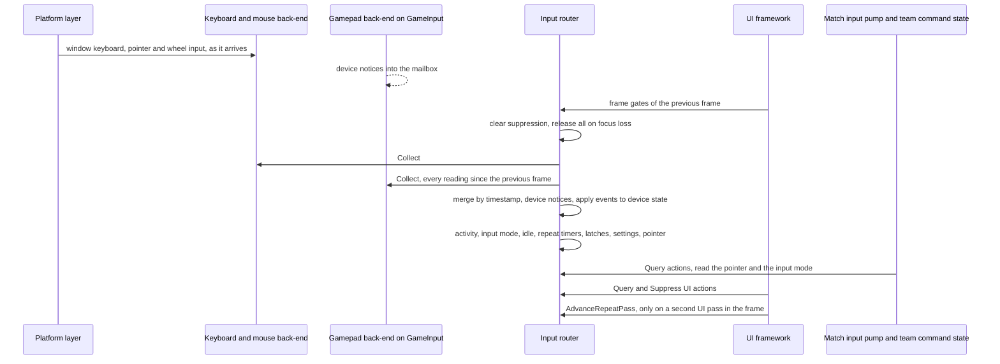
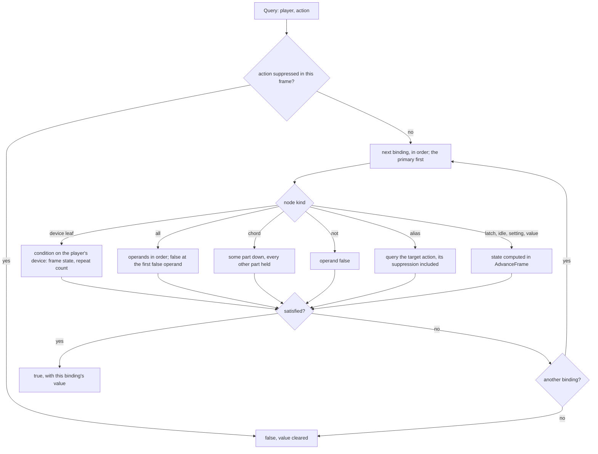
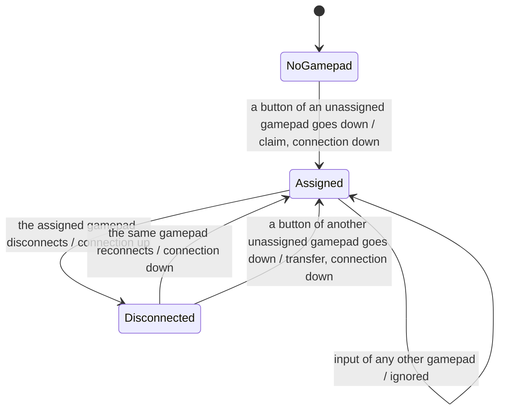

# Input: devices, frames and queries

> Status: Engine baseline · Prefix: INP · ADRs: [ADR-028](../../../ADR/ADR-028-input-device-back-ends.md) · [ADR-029](../../../ADR/ADR-029-input-event-model-and-binding-contract.md) · [ADR-074](../../../ADR/ADR-074-platform-clock-with-injectable-time.md) · Folder: [Input](README.md)

This document specifies how the input router builds the state of each frame and answers queries from it: the lifecycle and the frame order, the device back-ends, the event queue, the device state, the evaluation of conditions, analogue processing, repeat timers, composite and environment nodes, query evaluation, local players and gamepad assignment, the input mode and idle time, and the pointer. Section numbers are shared by the files of this folder, and the notation is that of the [README](README.md).

## 1 Responsibilities and boundaries

The responsibilities and boundaries of the input component are [README](README.md) §1 (INP-001 to INP-010).

## 2 Interfaces

The interface sketch and the router operations are [README](README.md) §2.

## 3 Data model

The data model is [README](README.md) §3 and, for the controls and the default bindings, [controls_and_default_bindings.md](controls_and_default_bindings.md).

## 4 Behaviour and algorithms

### 4.1 Lifecycle and frame order

**INP-100** (MUST) Start-up runs in this order:

1. The platform layer creates the window and begins forwarding its keyboard, pointer and wheel input to the keyboard and mouse back-end (ADR-075).
2. The router is created. It registers its node kinds in this fixed order, which is also the enumeration order of node kinds in cooked binding records: `all`, `chord`, `not`, `idle`, keyboard and mouse leaves, gamepad leaves, `setting`, `value`, `alias`, `latch`. A node contains only nodes of later kinds, with three exceptions: a `not` may contain a `not`; a `chord` contains only condition-free parts; and a `latch` may contain any `Boolean` node except a `latch`. So `all` is the outermost operator, a chord sits inside a conjunction, and a negation applies to a single operand.
3. The gamepad back-end creates its GameInput instance and registers for device notices (INP-106); a failure is handled by INP-107.
4. The router reads its settings from the settings store, which the platform layer has already loaded at start-up, before the window exists ([platform layer](../platform_layer.md) PLT-038), and the control-scheme setting is set to the match control scheme (INP-168).
5. `Rebuild` builds the action bindings from the default set, the development layer in Debug builds, the layout layer of the active keyboard layout and the user layer, in that order (§4.13).
6. The pointer is created at the system pointer's position in the client area (§4.12).

**INP-101** (MUST) `AdvanceFrame` runs as the first input step of every rendered frame (R-CTRL-020 step 1) and performs, in this order:

1. clear every suppression flag (INP-093);
2. if the window lost focus since the previous frame, take `ReleaseAll` from both back-ends (INP-111);
3. collect the events of both back-ends into the frame's queue (INP-105, INP-115);
4. apply device notices: connections, disconnections, gamepad claims and transfers (§4.10);
5. apply the queued events in order to the device state (§4.4);
6. compute each device's activity, each local player's input mode and the idle time (§4.11);
7. advance every binding's repeat timers (§4.7), then every latch, in binding order (INP-140);
8. read the values of the settings that setting nodes name (INP-142);
9. advance the pointer (§4.12);
10. raise the mode-change and layout-change notices.

Every query of the frame is then answered from this state.

**INP-102** (MUST) `AdvanceFrame` runs exactly once per rendered frame, and every event is applied in exactly one advance, so no press is lost and none is seen twice (DEC-096). On a frame in which `action.match.menu` makes the UI input pump run a second time (R-CTRL-047 row M4), `AdvanceRepeatPass` runs before that second pass. It behaves as an `AdvanceFrame` whose frame starts where the first one ended: it clears suppression and applies only the events that arrived since, so the edges of the first pass are false in the second unless a new event makes them true, and held states and analogue values carry over.

**INP-103** (MUST) A loading view renders frames and runs `AdvanceFrame` in each of them, so held states stay current and the loading view's actions work. Events that arrive while no frame runs wait in their back-end (INP-027).

Caption: Diagram 4.1-A, one frame of input: the back-ends deliver ordered events, the router builds the frame state once, and the consumers query it (INP-101, INP-102, R-CTRL-020).

### 4.2 Device back-ends

**INP-105** (MUST) Two back-ends feed the router: the keyboard and mouse back-end and the gamepad back-end (ADR-028). Each implements `DeviceBackEnd`: `Collect` appends every event since its previous call, in the order the events happened, each with its device identity and a platform-clock timestamp; `ReleaseAll` appends a release event for every control the back-end holds pressed and a rest sample for every analogue control away from rest. The router collects from the keyboard and mouse back-end first and from the gamepad back-end second, then orders the frame's events by timestamp, keeping that back-end order for equal timestamps. Each back-end keeps the pressed state of its controls, so that `ReleaseAll` and the reconciliation of INP-117 can use it.

**INP-106** (MUST) The gamepad back-end uses GameInput, built against the pinned package and API namespace of ADR-028 (3.5.283 with `GameInput::v3`, moving to the 4.0 line after its first point release); the installer carries the redistributable of the same version or newer (ADR-028, ADR-071). It creates its GameInput instance during initialisation and registers for device connection and disconnection notices. In each `AdvanceFrame` it reads every reading since the previous frame, in order, for every connected gamepad, compares each reading with the gamepad's previous reading, and emits a press or a release event for every button whose state changed and an axis sample for every stick or trigger whose value changed, so a transition between two frames is never lost. It maps the gamepad reading by position: the south, east, west and north face buttons; the left and right shoulder buttons; the four d-pad directions; the menu and view buttons; the two stick presses; the two triggers, in 0 to 1; and the two sticks, in −1 to 1 per axis with y positive upwards. It tracks every connected gamepad, with no fixed device count, and each gamepad keeps its GameInput device identity while it is connected and when it reconnects.

**INP-107** (MUST) If GameInput cannot be created, the client runs without gamepads: the gamepad back-end reports no device and logs one error (§6.4), every gamepad binding still loads, and none is ever satisfied. Whether a binding is valid never depends on which devices are present.

**INP-108** (MUST) The keyboard and mouse back-end receives the window's keyboard, pointer and wheel input that the platform layer forwards (ADR-075), and the raw, unaccelerated mouse movement that ADR-028 specifies. It turns them into press and release events of keys and mouse buttons, pointer-movement and raw-movement samples and wheel samples, with the keyboard's or the mouse's device identity. Characters and input-method composition go to the UI framework's text service (INP-112).

**INP-109** (MUST) Keyboard rules (DEC-096, ADR-028):

1. Every key of table 3.2-A, including `alt`, `f10` and the numeric-pad keys, produces a press event when it goes down and a release event when it goes up, whether or not another key is held; keys pressed and released while Alt is held produce their events like every other key.
2. Auto-repeat of a held key produces events marked as repeats (INP-053), which never produce a press: holding Alt and X fires `action.view.hide_interface` once.
3. Alt+F4 produces the close request of INP-076 through the platform layer; Alt and F4 still reach the router as ordinary events.
4. The router never captures Alt+Tab: switching to another application is a focus loss (INP-111).
5. A change of the keyboard layout is reported to the router, which applies INP-166.

**INP-110** (MUST) Mouse rules (ADR-028):

1. Pressing a mouse button captures the pointer to the window, and releasing the last held button ends the capture, so a release outside the window still arrives.
2. A click shorter than one frame produces both its press and its release event (INP-052).
3. Wheel input is accumulated in the platform's fine wheel units and converted to notches by dividing by `inp.mouse.wheel_units_per_notch`, without rounding, so a fine-resolution wheel keeps its resolution.
4. `motion` is the pointer movement that the platform reports, in client pixels; `raw_motion` is the device movement, which no default binding uses.
5. Three buttons are bindable, primary, secondary and middle, following the system's assignment of the physical buttons.

**INP-111** (MUST) When the window loses focus, both back-ends emit release events for every held key and button and rest samples for every analogue control (ADR-028), so nothing stays held, including an Alt held through Alt+Tab. While the window has no focus, the back-ends deliver no presses and no analogue samples away from rest; device connection and disconnection notices still apply. When focus returns, a control that is physically held produces no press until it is released and pressed again (see DEC-953).

**INP-112** (MUST) Text characters and input-method composition never enter the event queue and never satisfy a binding; the router forwards them to the UI framework's text service with the modifier state of each character (ADR-032). A key that produces a character produces its key events as well, and the consumers' gates decide whether a match action applies while text is being entered (R-CTRL-012, R-CTRL-047 row M2).

**INP-113** (MUST) The router forwards the editing keys to the UI framework's text service as editing commands (`EditCommand`, [core_and_widgets](../ui_framework/core_and_widgets.md) UI-038, UI-067), in the order of their key events among the characters and with the modifier state: `left` and `right` move the caret (`CaretLeft`, `CaretRight`), `home` and `end` move it to the start and the end (`CaretHome`, `CaretEnd`), `delete` deletes forward (`DeleteForward`), and Ctrl with `a`, `c`, `x` or `v` gives `SelectAll`, `Copy`, `Cut` or `Paste`. A held editing key repeats with the operating system's auto-repeat, as characters do; Backspace, Enter and Escape arrive as characters (UI-066). The UI core routes the commands only to a text-edit target (UI-038), and the key events of these keys still enter the event queue (INP-112).

### 4.3 Event queue

**INP-115** (MUST) The router keeps one ordered event queue per frame (ADR-029). An event is a press, a release (keyboard events carry the auto-repeat flag), an axis sample (a stick, a trigger, pointer movement, raw movement or the wheel), or a device connection or disconnection; every event carries its device identity and its timestamp. Events are applied in queue order.

**INP-116** (MUST) The queue holds at most `inp.queue.capacity` events per frame. When it is full, a new axis sample merges into the newest queued sample of the same control on the same device: a stick or trigger sample replaces its value, and a movement or wheel sample adds its delta, so no motion is lost. A press, release, connection or disconnection that does not fit is counted and dropped.

**INP-117** (MUST) After a frame in which events were dropped, the router reconciles every Boolean control with its back-end's pressed state: a control that the back-end holds released but the router holds pressed gets a release, and the reverse gets a press, so no control stays wrongly held or wrongly released after an overflow. The drop count is logged and counted (§6.2).

### 4.4 Device state

**INP-118** (MUST) For every control of every device the router keeps, for the current frame: whether it is held after the frame's last event; the number of presses and releases in the frame; for a stick or trigger, its processed value at the end of the frame (§4.6), its value at the end of the previous frame, and whether any sample of the frame was away from rest; and for pointer movement, raw movement and the wheel, the sum of the frame's deltas.

**INP-119** (MUST) A device leaf reads the devices of the querying local player (§4.10): keyboard and mouse leaves read the keyboard and the mouse, which belong to player 0; gamepad leaves read the player's assigned gamepad.

### 4.5 Condition evaluation per control

**INP-120** (MUST) The Boolean views of table 3.2-C behave as follows:

1. **Buttons, keys, the d-pad and the stick presses**: `down`, `up` and `held` follow INP-051 from the button's press and release events; `repeat` follows §4.7.
2. **Trigger Boolean view**: a sample that takes the trigger above `inp.pad.trigger.threshold` from at or below it is a press, and a sample that takes it back to or below the threshold is a release; the transitions follow the order of the samples.
3. **Stick directions**: the directional value is −x for left, x for right, −y for up and y for down, on the stick-unit scale of §4.6 at sensitivity 100; a direction is held while its value exceeds `inp.pad.stick_button.threshold`, the same threshold for both sticks, and its transitions follow the order of the samples.

**INP-121** (MUST) Pointer movement, raw movement and the wheel: `move` is true when the frame's summed delta is not zero, with the delta as its value; `read` is always true, with the delta, which may be zero.

**INP-122** (MUST) Sticks: `position` is true when the stick is outside its dead zone at the end of the frame, with the processed value × the sensitivity factor; `move` is true when either component of the change since the end of the previous frame, × the sensitivity factor, exceeds `inp.pad.stick.move_threshold` in absolute value, with that change as its value; `zero`, `release` and `read` follow INP-051.

**INP-123** (MUST) Triggers: `position` is true when the trigger is above its threshold at the end of the frame, with the processed value × the sensitivity factor; `move` is true when the processed value changed, with the change × the sensitivity factor; `zero`, `release` and `read` follow INP-051. Trigger values cover the trigger's whole travel, so a binding may use trigger magnitude; no default binding does (DEC-554, R-CTRL-032).

**INP-124** (MUST) `connection`: `down` is true in the frame in which the player's assigned gamepad reconnects or a gamepad becomes assigned to the player, `up` in the frame in which the assigned gamepad disconnects, and `held` while it is connected (INP-148). It is evaluated even while no gamepad is connected.

**INP-125** (MUST) Every other gamepad leaf of a player with no assigned gamepad, or whose assigned gamepad is disconnected, is false.

### 4.6 Analogue processing

**INP-128** (MUST) Each stick sample (x, y), as the gamepad back-end reports it, is processed in floating point as follows (ADR-029):

1. m = the length of (x, y), limited to 1;
2. with d the stick's dead zone (`inp.pad.stick_left.dead_zone` or `inp.pad.stick_right.dead_zone`), the stick is at rest when m ≤ d, and its processed value is (0, 0);
3. otherwise m′ = (m − d) ÷ (1 − d), and c = m′ raised to `inp.pad.curve.exponent`;
4. the processed value is (x ÷ m × c × S, −y ÷ m × c × S), with S the stick's output scale (`inp.pad.stick_left.scale` or `inp.pad.stick_right.scale`), in stick units.

The dead zone is radial and rescaled, so the value is continuous at the dead-zone edge and equal at equal deflection in every direction; y is negated, so pushing a stick forward gives a negative y; at full deflection the left stick gives `inp.pad.stick_left.scale` stick units and the right stick `inp.pad.stick_right.scale`.

**INP-129** (MUST) Each trigger sample t in 0 to 1 is processed as follows: the trigger is at rest when t ≤ `inp.pad.trigger.threshold`, with processed value 0; otherwise its processed value is ((t − threshold) ÷ (1 − threshold)) raised to `inp.pad.trigger.curve_exponent`, in 0 to 1.

**INP-130** (MUST) The sensitivity of a stick or trigger leaf multiplies its `position`, `move` and `read` values by the sensitivity ÷ 100 (INP-122, INP-123); it is accepted on the Boolean conditions of those controls, where it has no effect. Stick-direction controls use sensitivity 100 and take no option.

**INP-131** (MUST) The dead zones, thresholds, curve exponents and output scales are data: the binding-set schema carries one gamepad profile record whose defaults are the tuning values of §4.18, so a changed response needs no code change (ADR-029).

### 4.7 Repeat timers

**INP-133** (MUST) Each `repeat` leaf keeps its own timer for each device it reads; no timer is shared between bindings, controls or devices, and a query never changes a timer (DEC-554, ADR-029). `repeat` is accepted on every Boolean view: keys, mouse buttons, triggers and stick directions as well as gamepad buttons (see DEC-953). The timers run on real time from the platform clock (ADR-074), so menus repeat at the same rate while a match is paused and at every game speed (see DEC-951). In `AdvanceFrame`, for each `repeat` leaf and device:

1. if the control went down in this frame, the leaf fires once, and its next due time is the press's timestamp + `inp.repeat.initial_delay`;
2. otherwise, if the control is held, the leaf fires once for every due time at or before the frame's time, and each firing moves the next due time on by `inp.repeat.period`;
3. if the control is not held at the end of the frame, its timer is cleared.

A press and a release within one frame therefore fire once, by step 1.

**INP-134** (MUST) The number of firings in the frame is the leaf's value x (INP-051). A consumer that steps once per firing steps at the same rate at every frame rate. A UI widget's own hold-to-repeat behaviour is the UI framework's (ADR-032).

### 4.8 Composite and environment nodes

**INP-136** (MUST) `all` evaluates its operands in order and is false at the first false operand; its value follows INP-090.

**INP-137** (MUST) A `chord` of the parts p₁ to pₙ is true when, for some part k, pₖ went down in this frame and every other part is held at the end of the frame. It is the logical OR of n conjunctions, the k-th of which tests pₖ `down` and every other part `held`, so the parts may go down in any order and the chord fires on the frame in which the last of them goes down. Its display text joins the parts' display texts with a hyphen (INP-178).

**INP-138** (MUST) `not` is true when its operand is false.

**INP-139** (MUST) `alias` is the query of its target action for the same player, including the target's suppression (INP-093), and carries the target's value.

**INP-140** (MUST) A `latch` keeps one Boolean state per binding and player, updated once per frame in `AdvanceFrame` (INP-101 step 7) as state := (state ∧ ¬off) ∨ (¬state ∧ on), and evaluates to that state. It starts false, `Rebuild` resets it, and a query never changes it. It implements the hold-or-toggle option of ADR-064 for any held action; no default binding uses it.

**INP-141** (MUST) `idle` reads the idle time of INP-153: `at_least` N is true when the idle time is N seconds or more, with the idle time as its value; `reaches` N is true in the frame in which the idle time passes N, that is when the previous frame's idle time is below N and this frame's is above N; `no_longer` is true in every frame in which the idle time is 0, not only on the frame in which input resumes. No default binding uses it.

**INP-142** (MUST) `setting` is true when the integer value of the named setting is above 0, and `setting:not` when it is not; the router reads the values of the named settings once per frame (INP-101 step 8). A setting that neither the settings store nor its defaults table holds when the binding loads is a load error (§6.1); the content build checks the setting nodes of every binding set against the keys of `settings.defaults` (DAT-195), and a doubled negation is rejected. No default binding uses it (R-META-455).

**INP-143** (MUST) `value:always_true` is always true; `value:feature:<flag>` is true while the edition sets the runtime feature flag `<flag>` `on`, an on/off flag of [build tooling](../build_tooling_and_distribution.md) table 3.2-B. The router reads the flags from the edition's flag record when it loads the bindings; they never change while the process runs (BLD-016, ADR-056), so the node's result is fixed for the session. Both are `Boolean`. No default binding uses them.

### 4.9 Evaluating a query

**INP-144** (MUST) `Query(player, action)` follows diagram 4.9-A: suppression first, then the bindings in order, each evaluated by its node kind against the frame state of that player's devices; the first satisfied binding gives the result and the value. Evaluation reads only frame state, so the same query asked twice in one frame gives the same answer.

Caption: Diagram 4.9-A, evaluating one action query: the logical OR of the action's bindings, the first satisfied binding giving the value (INP-020, INP-090, INP-144).

### 4.10 Local players and gamepad assignment

**INP-145** (MUST) Local players are numbered from 0. The reference has one local player per client, player 0, who owns the keyboard and the mouse. Each local player has at most one assigned gamepad, and a gamepad drives only the local player it is assigned to (DEC-554, R-CTRL-033).

**INP-146** (MUST) In `AdvanceFrame`, when a button of a connected gamepad that is assigned to no player goes down, the gamepad is assigned to the lowest-numbered local player that has no assigned gamepad or whose assigned gamepad is disconnected (a transfer); the press that claims the gamepad counts as that player's input in the same frame. When no player can take it, the gamepad stays unassigned and drives nothing. Stick or trigger movement alone never claims a gamepad (see DEC-953).

**INP-147** (MUST) An assigned gamepad stays assigned while it is connected and after it disconnects; when the same device reconnects while still assigned, it resumes driving its player. A transfer ends the previous assignment.

**INP-148** (MUST) The player's `connection` control goes down when its assigned gamepad reconnects or when a gamepad becomes assigned to the player by a claim or a transfer, and goes up when its assigned gamepad disconnects; a gamepad assigned to no player produces no connection action. So `action.device.pad_disconnected` opens the gamepad-disconnected dialog once for each disconnection of the player's own gamepad, and `action.device.pad_connected` closes it, as the dismiss action `action.menu.dismiss` and `action.match.menu` also do (R-CTRL-047 row M7, R-META-066); the dialog belongs to the [front end](../../../reference/09_front_end_and_match_flow/README.md).

**INP-149** (MUST) `AssignedGamepadConnected(player)` is false while the player's assigned gamepad is disconnected. While it is false and the player's input mode is gamepad, the application treats itself as unfocused, so the camera does not advance (R-CTRL-047 row M7).

Caption: Diagram 4.10-A, a local player's gamepad slot: assignment by the first press, keeping the assignment through a disconnection, and transfer to another gamepad (INP-146 to INP-148).

### 4.11 Input mode and idle

**INP-150** (MUST) Each local player has an input mode, the class of its last active device: `KeyboardMouse` or `Gamepad` (ADR-029, R-CTRL-011). In `AdvanceFrame`, the mode becomes `Gamepad` when the player's assigned gamepad was active in the frame, otherwise `KeyboardMouse` when the keyboard or the mouse was active (player 0 only), and otherwise stays as it was; when both were active in one frame, `Gamepad` wins. The initial mode is `KeyboardMouse`. A change calls the mode listeners (`AddModeListener`).

**INP-151** (MUST) A device is active in a frame when: for the keyboard, a key is held or had an event; for the mouse, a button is held or had an event, or the pointer, the raw movement or the wheel moved; for a gamepad, a button is held or had an event, a stick is outside its dead zone or a trigger is above its threshold.

**INP-152** (MUST) The input mode is read by: the UI framework's input-mode captions and string variants (ADR-032); the automatic camera tracking and the gamepad rules of the Strike team and of Leader and Transport orders (reference/06, R-CTRL-043); the availability of the chat input (R-CTRL-047 row M2); the `gamepad` field of the team command state (R-CTRL-101); and the Power slots panel, whose variant is re-created when the mode changes while the panel is hidden ([UI framework](../ui_framework/README.md)).

**INP-153** (MUST) The client is idle in a frame when no connected device was active. The idle time grows by the frame's elapsed real time when the previous frame was idle, and is 0 otherwise; the idle leaf reads it (INP-141), and `IsIdle()` reports the current frame.

### 4.12 The pointer

**INP-155** (MUST) The pointer (`InputPointer`) is the single source of the pointer position for game and UI code: a position in client pixels, an accumulated wheel value in notches, this frame's deltas, and a moved flag (`PointerState`). It belongs to player 0. The world cursor (`WorldCursor`) and the pointer ground point are derived from it (reference/06, R-CTRL-058).

**INP-156** (MUST) In `AdvanceFrame` (INP-101 step 9), with the frame gates as the UI and the platform layer left them at the end of the previous frame:

1. when `action.camera.aim` fires, its value (pointer movement, in pixels) is added to the position;
2. otherwise, when no UI window is open, the value of `action.camera.aim_stick` (stick units) is added to the position as pixels;
3. when no UI window and no text entry is open, the value of `action.camera.height_wheel` is added to the wheel value;
4. the deltas are this frame's changes, and the moved flag is set when the position changed;
5. the position is clamped to the client area, and when it differs from the system pointer's position the system pointer is moved there without producing a movement event.

**INP-157** (MUST) The aiming stick moves the pointer by its stick-unit value in every frame, so the stick's pointer speed in pixels per second is proportional to the frame rate (see DEC-954).

**INP-158** (MUST) `WarpPointer(position)` sets the position, clamped to the client area, and moves the system pointer there without producing a movement event or a delta. The camera's cursor lock uses it to keep the pointer on its ground point while the camera moves (R-CTRL-464).

**INP-159** (MUST) While `ConfinePointer` is on, the platform layer holds the system pointer inside the client area; the camera turns it on while a match camera mode advances and off otherwise (R-CTRL-456). A focus loss suspends the confinement until focus returns.

**INP-160** (MUST) The moved flag is the input of the camera-moved hint condition, which the hint logic records while the camera is in free movement ([Tutorial and help](../../../reference/11_tutorial_and_help.md)).

## 5 Concurrency and performance budget

The budget is [README](README.md) §5.

## 6 Failure modes, diagnostics and telemetry

Failure modes and diagnostics are [README](README.md) §6.

## 7 Acceptance tests

The acceptance tests are [README](README.md) §7.

## 8 Open decisions

The open decisions and design-phase inputs are [README](README.md) §8.
