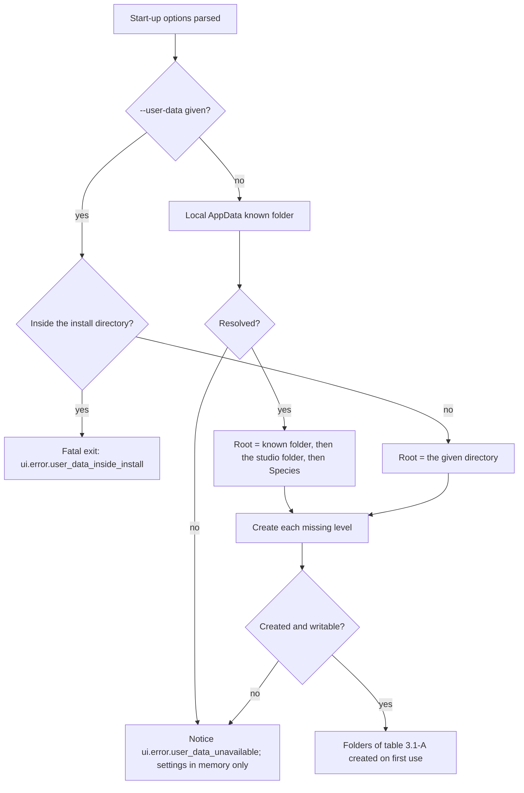
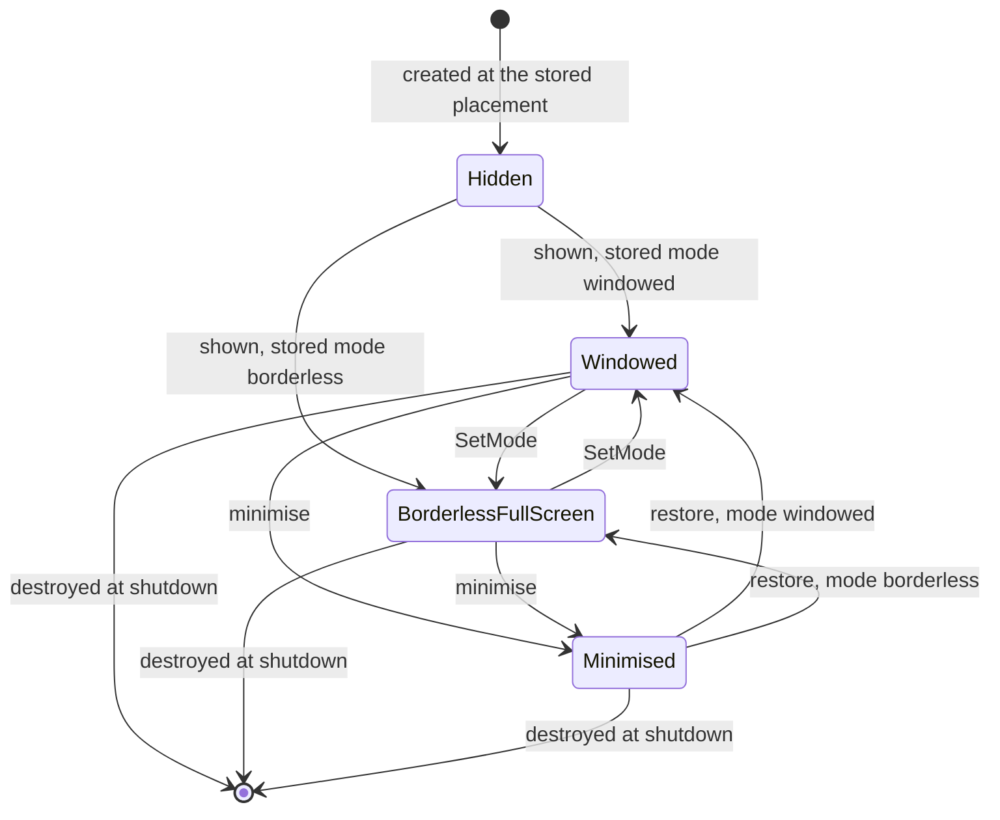
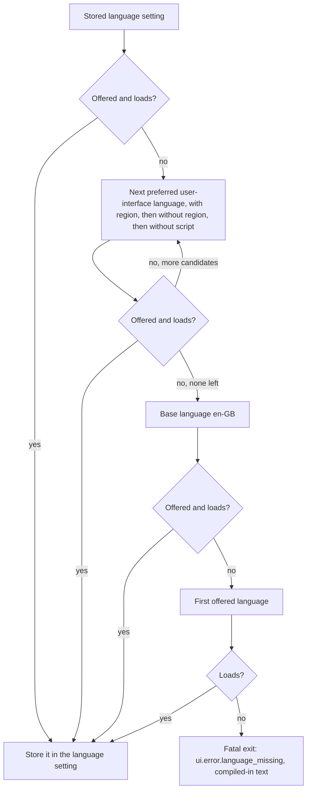
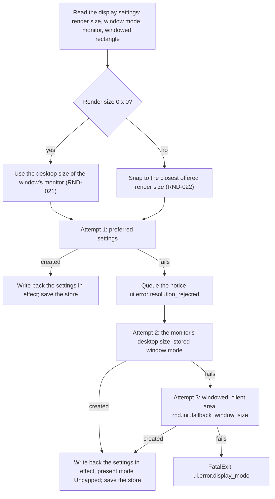
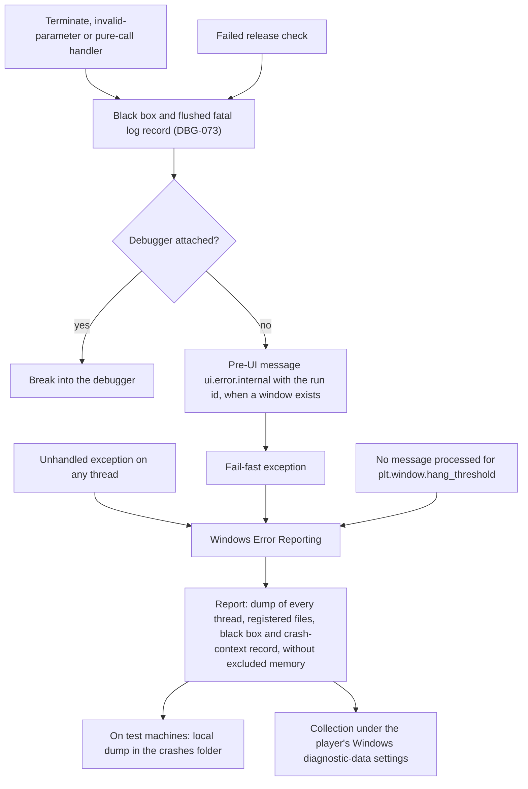

# Platform layer

> Status: Engine baseline · Prefix: PLT · ADRs: [ADR-0050](../../adr/0050-client-platform-and-minimum-os.md) · [ADR-0074](../../adr/0074-platform-clock-with-injectable-time.md) · [ADR-0075](../../adr/0075-application-window-and-dpi-awareness.md) · [ADR-0071](../../adr/0071-install-layout-runtime-files-and-user-data.md) · [ADR-0065](../../adr/0065-crash-reporting.md) · [ADR-0066](../../adr/0066-telemetry-with-consent.md) · [ADR-0057](../../adr/0057-version-identity.md) · [ADR-0056](../../adr/0056-editions-build-flavours-and-feature-flags.md) · [ADR-0076](../../adr/0076-screenshot-encoding.md) · [ADR-0012](../../adr/0012-swap-chain-presentation-and-frame-pacing.md) · [ADR-0028](../../adr/0028-input-device-back-ends.md) · [ADR-0033](../../adr/0033-ui-layout-scaling-and-dpi.md) · [ADR-0063](../../adr/0063-localisation.md) · [ADR-0067](../../adr/0067-logging.md) · [ADR-0008](../../adr/0008-gpu-memory-uploads-and-device-removal.md) · Related: [renderer](renderer/README.md) · [input](input.md) · [UI framework](ui_framework/README.md) · [data schemas](data_schemas/README.md) · [build tooling](build_tooling_and_distribution.md) · [diagnostics](diagnostics_test_and_performance.md) · [tick timing](../../reference/12_simulation_model/01_tick_timing_and_main_loop.md) · [options and localisation](../../reference/09_front_end_and_match_flow/options_localisation_and_hooks.md)

This component is the Species engine's contact with Windows 11. It owns the application window and its message loop, the display information, the platform clock, the process lifecycle from entry to exit, the install directory and the user-data folders, the settings store and its file, threads and the floating-point environment of each thread, the crash-context registration with Windows Error Reporting, system information, the start-up options, the HTTPS client, the clipboard, web-address opening, audio-endpoint notices and the screenshot file output. Every other component reaches the operating system through it.

Notation used throughout:

- **Platform time** is a reading of the platform clock: a signed 64-bit count of nanoseconds since the clock origin, shown in seconds where that reads better. It is presentation and scheduling time. Simulation durations are ticks, defined in [tick timing and main loop](../../reference/12_simulation_model/01_tick_timing_and_main_loop.md), and never platform time.
- **Pixels** are physical pixels of the window's client area unless a rule says otherwise; "desktop coordinates" are the virtual-desktop coordinates of Windows.
- `<Studio>` is the publisher-name parameter (CONVENTIONS §8.11) and `Species` is the product name `kProductName`. The user-data root is `%LOCALAPPDATA%\<Studio>\Species\`.
- A **pre-UI message** is a message box that the platform layer shows itself, before the UI framework exists or when it cannot draw (§4.1).

## 1 Responsibilities and boundaries

**PLT-001** (MUST) The platform layer provides exactly the services of table 1-A. Each row names the decision that fixes its technology and the section that specifies it.

Table 1-A: platform services.

| # | Service | Decided in | Specified in |
|---|---|---|---|
| 1 | platform clock: one process-relative monotonic clock behind an injectable time source; high-resolution waits; calendar time | ADR-0074 | §4.2 |
| 2 | application window and message loop: per-monitor DPI awareness v2, windowed and borderless full screen | ADR-0075 | §4.3 |
| 3 | input event source: the window's input messages, forwarded to the keyboard and mouse back-end of [input](input.md) | ADR-0028 | §2.2, §4.3 |
| 4 | display information: monitors, DPI, desktop modes and mode sizes; the display mode is never changed | ADR-0075, ADR-0012 | §4.4 |
| 5 | threads and job queues, and the floating-point environment of every thread | ADR-0065, DEC-224, DEC-240 | §4.8 |
| 6 | diagnostic output for the logger of [diagnostics](diagnostics_test_and_performance.md) | ADR-0067 | §6.5 |
| 7 | crash handling: no crash-swallowing filter, the fatal handlers, the fatal path and the crash-context registration | ADR-0065 | §6.3 |
| 8 | install and user-data locations | ADR-0071 | §3.1 |
| 9 | files: whole-file reads, read-only mapping, atomic replacement, UTF-8 and UTF-16 conversion | ADR-0071, ADR-0063, DEC-800 | §4.9 |
| 10 | settings store | DEC-100, DEC-800, DEC-250 | §3.5, §4.7 |
| 11 | system information | ADR-0066, ADR-0067 | §3.6, §4.10 |
| 12 | start-up options | ADR-0056, ADR-0057 | §3.3 |
| 13 | language detection: the preferred user-interface languages as BCP 47 tags | ADR-0063 | §4.6 |
| 14 | pre-UI messages | ADR-0050 | §4.1 |
| 15 | HTTPS client | ADR-0066 | §4.12 |
| 16 | clipboard text and web-address opening | ADR-0032 | §4.13 |
| 17 | audio-endpoint notices | ADR-0022 | §4.14 |
| 18 | screenshot and poster output | ADR-0076 | §4.11 |
| 19 | process lifecycle hooks: start-up, quit, end of session, shutdown, exit codes | DEC-221 | §4.1 |

**PLT-002** (MUST NOT) The platform layer never steps the simulation and never reads or writes simulation state. It gives simulation code no clock: the simulation reads time only as tick counts from the tick clock (`TickClock`), never from the platform clock, the calendar or a render-frame clock (DEC-009; [randomness and integrity](../../reference/12_simulation_model/07_randomness_and_integrity.md) R-SIM-660). The platform clock drives only the scheduling of ticks and presentation (ADR-0074).

**PLT-003** (MUST NOT) No other component calls an operating-system service of table 1-A directly. A lint rule rejects direct calls to the performance counter, the tick-count and multimedia timers and the standard library's clocks outside the platform layer (ADR-0074), and the same rule covers window creation, known-folder look-ups, crash registration and thread creation.

**PLT-004** (MUST NOT) The platform layer does not own: the swap chain, presentation and the frame-rate cap's policy ([renderer](renderer/README.md), ADR-0012); input decoding, bindings and gamepads ([input](input.md), ADR-0028, ADR-0029); layout, DPI-scaled sizes and text ([UI framework](ui_framework/README.md), ADR-0033); the logger, the black-box contents, profiling and telemetry ([diagnostics](diagnostics_test_and_performance.md), ADR-0065 to ADR-0068); the symbol store, the crash-data collection programme, the version resource and packaging ([build tooling](build_tooling_and_distribution.md), ADR-0057, ADR-0065, ADR-0071, ADR-0072); the preferences schema, the settings-file grammar and the content of the defaults table ([data schemas](data_schemas/README.md), DEC-100); which settings exist and what the options pages show ([options, localisation and hooks](../../reference/09_front_end_and_match_flow/options_localisation_and_hooks.md)); pack files and mounting ([asset pipeline](asset_pipeline_and_resources.md), ADR-0058). Section 2 states what each neighbour receives.

**PLT-005** (MUST) The headless server product (`server`, ADR-0056) uses only the portable platform services: the clock, threads and job queues, the floating-point environment, files and text conversion, the system summary without its display and audio parts, its own start-up options and the HTTPS client. It links no window, display, input-forwarding, clipboard, screenshot or audio-endpoint code. Its process roles, data locations and crash path are design-phase decisions (DEC-220, ADR-0065, §8.2).

**PLT-006** (MUST) The baseline covers the platform facts of the reference as table 1-C states.

Table 1-C: platform facts of the reference and where the baseline covers them.

| # | Reference fact | Species rule |
|---|---|---|
| 1 | product variants are chosen by editing one compile-time definition | [build tooling](build_tooling_and_distribution.md), ADR-0056 |
| 2 | a second graphics back-end does not build | not specified: one Direct3D 12 renderer (ADR-0001) |
| 3 | builds differ in floating-point code generation while sessions compare only a version string | DEC-240, DEC-204; PLT-086 |
| 4 | a loose file overrides the packed entry of the same name; later packs override earlier ones | [asset pipeline](asset_pipeline_and_resources.md), ADR-0058 |
| 5 | first-run defaults come from code only in packaged installs, because the defaults file is read before its pack is mounted | DEC-100, PLT-079 |
| 6 | map identity is a checksum generated in a pre-build step | [build tooling](build_tooling_and_distribution.md), ADR-0060 |
| 7 | crash handling covers the main thread only, with a crash log, a dump, an upload tool and a fatal-check report | §6.3, ADR-0065 |
| 8 | user data lives under the studio and product names in the local application-data folder; a switch moves it to the working directory | §3.1, §3.3, ADR-0071; credential files: DEC-333 |
| 9 | a process-relative performance-counter clock with injectable time; no frame cap, so pacing is the driver's default | §4.2, ADR-0074, ADR-0012 |
| 10 | targets for other operating systems | not specified: Windows 11 x64 only (ADR-0050) |

## 2 Interfaces

### 2.1 Interface sketch

The sketch is a C++23 declaration outline, not an implementation. Every type is in `species::platform`; strings are UTF-8 and converted to UTF-16 only inside the platform layer (ADR-0063).

```cpp
namespace species::platform {

enum class PlatformError : std::uint8_t { Unsupported, AccessDenied, NotFound, Other };

// ---- Platform clock (ADR-0074) ----
using Nanoseconds = std::chrono::duration<std::int64_t, std::nano>;  // since the clock origin
enum class TimeSourceKind : std::uint8_t { Real, FixedStep, Manual };
class TimeSource {
 public:
  virtual ~TimeSource() = default;
  [[nodiscard]] virtual Nanoseconds Now() const noexcept = 0;
  virtual void FrameBoundary() noexcept {}  // the fixed-step source advances here
};
class ManualTimeSource final : public TimeSource {  // tests only
 public:
  void Advance(Nanoseconds step) noexcept;  // step >= 0
  [[nodiscard]] Nanoseconds Now() const noexcept override;
};
class PlatformClock {
 public:
  [[nodiscard]] Nanoseconds Now() const noexcept;  // any thread; lock-free; never decreases
  [[nodiscard]] Nanoseconds Resolution() const noexcept;
  [[nodiscard]] TimeSourceKind SourceKind() const noexcept;
  void FrameBoundary() noexcept;  // the frame loop, once per rendered frame
  void WaitUntil(Nanoseconds deadline) const;  // returns at once under an injected source
  [[nodiscard]] std::chrono::system_clock::time_point CalendarUtc() const;  // logs, reports, display
  [[nodiscard]] std::chrono::minutes LocalUtcOffset() const;  // display only
  void ReplaceSource(std::unique_ptr<TimeSource> source);  // start-up and Debug or Development tests only
};

// ---- Window and displays (ADR-0075) ----
using NativeWindowHandle = struct HWND__*;
struct PointPx { std::int32_t x = 0, y = 0; };
struct SizePx  { std::uint32_t width = 0, height = 0; };
struct RectPx  { std::int32_t left = 0, top = 0, right = 0, bottom = 0; };
enum class WindowMode : std::uint8_t { Windowed, BorderlessFullScreen };
enum class Permanence : std::uint8_t { Permanent, Temporary };
struct DesktopMode { std::uint32_t width, height, bitsPerPixel, refreshHz; };
struct ModeSize    { std::uint32_t width, height; std::vector<std::uint32_t> refreshRatesHz; };
struct MonitorInfo {  // §3.4
  std::string deviceName;
  RectPx bounds, workArea;  // desktop coordinates
  std::uint32_t dpi;
  float dpiScale;
  bool primary;
  DesktopMode desktop;
  std::vector<ModeSize> modeSizes;  // filtered, merged, in reported order
};
[[nodiscard]] std::vector<MonitorInfo> EnumerateMonitors();

struct WindowPlacement { WindowMode mode; std::string monitorDeviceName; std::optional<RectPx> windowedClientRect; };
struct WindowMessage { std::uint32_t id; std::uintptr_t wParam; std::intptr_t lParam; Nanoseconds time; };
class WindowInputSink {  // the keyboard and mouse back-end of input
 public:
  virtual ~WindowInputSink() = default;
  virtual void OnWindowMessage(const WindowMessage& message) = 0;  // main thread
};
struct Resized { SizePx client; };
struct DpiChanged { float dpiScale; RectPx suggestedWindowRect; };
struct FocusChanged { bool hasFocus; };
struct Minimised {};
struct Restored {};
struct ModeChanged { WindowMode mode; };
struct MonitorChanged { std::string deviceName; };
struct DisplayConfigurationChanged {};
struct KeyboardLayoutChanged { std::string languageTag; };  // BCP 47
struct EndOfSession {};
using WindowEvent = std::variant<Resized, DpiChanged, FocusChanged, Minimised, Restored, ModeChanged,
                                 MonitorChanged, DisplayConfigurationChanged, KeyboardLayoutChanged, EndOfSession>;

class AppWindow {
 public:
  [[nodiscard]] static std::expected<AppWindow, PlatformError> Create(const WindowPlacement& placement, SizePx renderSize);
  [[nodiscard]] NativeWindowHandle Native() const noexcept;  // swap-chain creation only
  [[nodiscard]] SizePx ClientSize() const noexcept;
  [[nodiscard]] float DpiScale() const noexcept;
  [[nodiscard]] bool HasFocus() const noexcept;
  [[nodiscard]] bool IsMinimised() const noexcept;
  [[nodiscard]] const MonitorInfo& Monitor() const noexcept;
  [[nodiscard]] WindowPlacement Placement() const;
  [[nodiscard]] std::string ActiveKeyboardLayoutTag() const;  // BCP 47
  void Show();
  void SetMode(WindowMode mode, Permanence permanence);
  void PumpMessages();  // once per frame; never blocks
  void ConfinePointer(bool on);  // INP-159
  void WarpPointer(PointPx clientPosition);  // INP-158; no movement event
  void SetInputSink(WindowInputSink* sink);
  void AddListener(std::function<void(const WindowEvent&)> listener);
};

// ---- Locations, files and settings (ADR-0071, DEC-100, DEC-800) ----
enum class UserFolder : std::uint8_t { Root, Settings, Logs, Crashes, Maps, Diagnostics };
class PlatformPaths {
 public:
  [[nodiscard]] const std::filesystem::path& InstallDirectory() const noexcept;
  [[nodiscard]] const std::filesystem::path& Folder(UserFolder folder) const noexcept;
  [[nodiscard]] const std::filesystem::path& ScreenshotFolder() const noexcept;
  [[nodiscard]] bool UserDataAvailable() const noexcept;
};
enum class FileError : std::uint8_t { NotFound, AccessDenied, DiskFull, Other };
class MappedFile;  // read-only view, for pack files
[[nodiscard]] std::expected<std::vector<std::byte>, FileError> ReadWholeFile(const std::filesystem::path& path);
[[nodiscard]] std::expected<MappedFile, FileError> MapReadOnly(const std::filesystem::path& path);
[[nodiscard]] std::expected<void, FileError> ReplaceFileAtomically(const std::filesystem::path& path,
                                                                 std::span<const std::byte> bytes);
[[nodiscard]] std::wstring ToUtf16(std::string_view utf8);  // operating-system boundary only
[[nodiscard]] std::string ToUtf8(std::wstring_view utf16);

using SettingValue = std::variant<bool, std::int64_t, double, std::string>;
class SettingsStore {
 public:
  [[nodiscard]] SettingValue Get(std::string_view key) const;  // the schema type; the default when unset
  template <class T> [[nodiscard]] T GetAs(std::string_view key) const;
  void Set(std::string_view key, SettingValue value);  // checked against the schema
  void Subscribe(std::string_view keyPrefix, std::function<void(std::string_view key)> onChange);
  std::future<std::expected<void, FileError>> Save();  // the save events of R-META-406 only
  [[nodiscard]] bool LoadedFromFile() const noexcept;  // false on the first run
};

// ---- Start-up options, lifecycle and messages ----
struct StartupOptions {  // table 3.3-A
  std::optional<std::filesystem::path> writeBuildIdentity, userDataRoot, looseContentDirectory;
  std::optional<std::uint32_t> fixedStepFramesPerSecond;
  bool verifyContent = false;
  std::vector<std::string> ignoredArguments;
};
[[nodiscard]] StartupOptions ParseCommandLine();
enum class MessageSeverity : std::uint8_t { Notice, Error, Fatal };
struct MessageArgument { std::string_view name; std::string value; };
void ShowPlatformMessage(std::string_view stringId, std::span<const MessageArgument> arguments, MessageSeverity severity);
class LifecycleHooks {  // implemented by the application (DEC-221)
 public:
  virtual ~LifecycleHooks() = default;
  virtual void OnQuitRequested() = 0;
  virtual void OnFocusChanged(bool hasFocus) = 0;
  virtual void OnMinimisedChanged(bool minimised) = 0;
};
[[noreturn]] void ExitAfterTeardown(int exitCode);
[[noreturn]] void EndWithMessage(std::string_view stringId, std::span<const MessageArgument> arguments);  // FatalExit, DBG-074
[[noreturn]] void FailFast(std::string_view reason);  // fatal path, DBG-073

// ---- Threads and the floating-point environment (ADR-0065, DEC-224, DEC-240) ----
class PlatformThread {  // requests stop and joins on destruction
 public:
  template <class Body> static PlatformThread Start(std::string_view name, Body&& body);  // body(std::stop_token)
  void RequestStop() noexcept;
  void Join();
};
class JobQueue {  // one serial first-in-first-out worker
 public:
  explicit JobQueue(std::string_view threadName);
  template <class Job> auto Post(Job&& job) -> std::future<std::invoke_result_t<Job>>;
  void Stop();
};
[[nodiscard]] bool IsDefaultFloatEnvironment() noexcept;
void ApplyDefaultFloatEnvironment() noexcept;

// ---- Crash context (ADR-0065) ----
enum class CrashFileKind : std::uint8_t { CurrentLog, Settings, DeviceRemovalData };
class CrashContext {
 public:
  void RegisterFile(const std::filesystem::path& path, CrashFileKind kind);
  void RegisterMemoryBlock(std::span<const std::byte> block);  // the black box, the crash-context record
  void ExcludeMemoryBlock(std::span<const std::byte> block);  // any thread; personal data
  void RemoveExclusion(std::span<const std::byte> block);
};

// ---- System information and services ----
struct SystemSummary;  // table 3.6-A
[[nodiscard]] const SystemSummary& System() noexcept;  // immutable after collection
struct HttpsRequest { std::string url, contentType; std::vector<std::byte> body; Nanoseconds timeout; };
struct HttpsResponse { std::uint16_t status; std::vector<std::byte> body; };
enum class HttpsError : std::uint8_t { NotHttps, Offline, Timeout, CertificateRejected, Other };
class HttpsClient {
 public:
  [[nodiscard]] std::future<std::expected<HttpsResponse, HttpsError>> Post(HttpsRequest request);
};
[[nodiscard]] std::optional<std::string> ClipboardText();
void SetClipboardText(std::string_view text);
[[nodiscard]] bool OpenWebAddress(std::string_view httpsAddress);
enum class AudioEndpointChange : std::uint8_t { DefaultChanged, Added, Removed, StateChanged };
void SetAudioEndpointListener(std::function<void(AudioEndpointChange)> listener);  // main thread
struct ScreenshotImage { SizePx size; std::span<const std::byte> rgba8TopDown; std::size_t rowPitch; };
class ScreenshotWriter {  // PNG through WIC (ADR-0076)
 public:
  [[nodiscard]] std::future<std::expected<std::filesystem::path, FileError>> Save(ScreenshotImage image);
  void BeginPoster(SizePx size);  // then one tile row at a time
  void AppendPosterRows(std::span<const std::byte> rgba8TopDown, std::uint32_t rowCount, std::size_t rowPitch);
  [[nodiscard]] std::future<std::expected<std::filesystem::path, FileError>> FinishPoster();
};

}  // namespace species::platform
```

### 2.2 Events and data contracts

**PLT-007** (MUST) The window raises the events of the `WindowEvent` set on the main thread, inside `PumpMessages`, in the order of the messages that cause them, to its listeners in registration order. The renderer, the UI framework, the input router and the application are its listeners; a listener never re-enters `PumpMessages`.

**PLT-008** (MUST) Every keyboard, system-key, pointer, button, wheel, raw-mouse, character and input-method message reaches the keyboard and mouse back-end as a `WindowMessage`, in arrival order, stamped with the platform time at which the pump retrieved it (ADR-0028; [input](input.md) INP-105, INP-108). Characters and input-method composition travel the same path; the input router hands them to the UI framework's text service (INP-112). The platform layer interprets none of these messages except for pointer capture (PLT-068) and the close request (PLT-009).

**PLT-009** (MUST) A close request of the window, which Alt+F4 also produces, raises `action.app.quit` through the input router (INP-076; [actions and bindings](../../reference/06_controls_camera_and_commands/actions_and_bindings.md) R-CTRL-047 row M8). The window is not destroyed and the process does not end: the application runs its teardown (PLT-042).

**PLT-010** (MUST) The keyboard-layout notice carries the BCP 47 language tag of the newly active keyboard layout (ADR-0063), and `ActiveKeyboardLayoutTag` gives the tag of the layout active at window creation, so the input router can choose its layout layer (INP-164, INP-166).

**PLT-011** (MUST) Audio-endpoint notices reach the audio engine's listener on the main thread, once per frame, in arrival order (PLT-102). The operating system's notification thread only places them in a single-producer, single-consumer mailbox and touches nothing else.

### 2.3 Threading contract

**PLT-012** (MUST) These run on the main thread only: start-up and shutdown; window creation, `PumpMessages`, `SetMode`, `Show` and the pointer services; the clipboard and web-address opening; the settings store; pre-UI messages; the delivery of window events and audio-endpoint notices. The main thread is the thread that enters the process.

**PLT-013** (MUST) These are safe on any thread: `PlatformClock::Now`, `Resolution`, `SourceKind`, `WaitUntil` and `CalendarUtc`; thread creation and `JobQueue::Post`; `ReadWholeFile`, `MapReadOnly` and `ReplaceFileAtomically` for distinct files; reading the system summary, which is immutable once collected; `CrashContext::ExcludeMemoryBlock` and `RemoveExclusion`; `HttpsClient::Post`; `ScreenshotWriter::Save`. `PlatformClock::FrameBoundary` is called by the frame loop only, and `ReplaceSource` only as PLT-049 and PLT-051 allow.

**PLT-014** (MUST) The platform layer runs these threads of its own: one HTTPS worker, which performs requests and completes their futures; one file writer, which writes the settings file for the store (PLT-080); one screenshot encoder, which maps read-back images after their fences and encodes them (ADR-0076); and the operating system's audio-notification thread, which only fills the mailbox of PLT-011. Each is created through `PlatformThread` and stopped and joined at shutdown (PLT-043).

## 3 Data model

### 3.1 Install directory and user-data folders

**PLT-015** (MUST) The install directory is the directory of the running executable, resolved from the executable's own module path, never from the working directory. It holds `species.exe`, the first-party libraries, `D3D12\`, `packs\` and the licence notices (ADR-0071). Content opens relative to it, so the working directory has no effect on the client. Nothing is written to the install directory or to the registry at run time, and the client runs as a standard user (ADR-0071).

**PLT-016** (MUST) The user-data root is `%LOCALAPPDATA%\<Studio>\Species\`: the Local AppData known folder, from `SHGetKnownFolderPath` with `FOLDERID_LocalAppData`, then the folder `<Studio>`, the publisher name compiled into the build, then the folder `Species`, the product name `kProductName` (ADR-0071). Each level is created when it is missing. Every build flavour uses the same root; only the start-up option `--user-data` replaces it (PLT-025). No flavour and no option writes user files to the working directory or beside the executable.

**PLT-017** (MUST) The user-data root holds the folders of table 3.1-A, each created on first use, except `crashes\`, which is created at start-up (PLT-120). Screenshots go to the Pictures known folder (`FOLDERID_Pictures`) under `Species\` (ADR-0071, ADR-0076).

Table 3.1-A: user-data folders.

| Folder | Holds | Written by | Specified by |
|---|---|---|---|
| `settings\` | the settings file | the settings store | §3.5, §4.7; DEC-250 |
| `logs\` | one log file per run, rotated | the logger | ADR-0067 |
| `crashes\` | local dumps on development and test machines; device-removal data | Windows Error Reporting under the local-dump settings that CI provides; the renderer | ADR-0065, ADR-0008, [renderer](renderer/README.md) RND-034 |
| `maps\` | the player's map folder: custom maps | the map editor hooks | [map editor hooks](../../reference/08_maps_and_level_design/map_editor_hooks.md) R-MAP-391 |
| `diagnostics\` | development outputs: command-history recordings, language-test reports, divergence dumps and binding dumps | development features, in `Debug` and `Development` builds only | [randomness and integrity](../../reference/12_simulation_model/07_randomness_and_integrity.md) R-SIM-740; [options, localisation and hooks](../../reference/09_front_end_and_match_flow/options_localisation_and_hooks.md) R-META-473; DEC-206; [input](input.md) INP-242 |
| Pictures `Species\` | screenshots and posters | the screenshot writer | ADR-0076, §4.11 |

**PLT-018** (MUST) When the Local AppData known folder cannot be resolved, or the user-data root cannot be created or written, the client shows the pre-UI notice `ui.error.user_data_unavailable` with the folder's path, logs to the debugger and the ETW sink only (ADR-0067), keeps its settings in memory, and continues; `UserDataAvailable` reports `false`, and every save reports its failure (R-META-407).

**PLT-019** (MUST) Uninstalling removes the install directory only; the user-data root stays until the player deletes it (ADR-0071). Saved worlds and replays, when the design phase specifies them, follow the same rule: never in the install directory (DEC-251, DEC-046).

**PLT-020** (MUST NOT) No credential, entitlement key or identity token is ever written to a user-data file; identity tokens belong in the operating system's credential store (DEC-248, DEC-250). Trial gating and credential files are not specified (DEC-333).



Diagram 3-A: resolution of the user-data root (PLT-016, PLT-018, PLT-025).

### 3.2 Runtime files

**PLT-021** (MUST) Table 3.2-A lists every kind of file that the reference client writes, or reads outside its content, with the Species rule for it. A row marked "not specified" has no Species counterpart in the baseline.

Table 3.2-A: runtime files.

| # | Reference file (by role) | Species rule |
|---|---|---|
| 1 | the preferences file of typed settings | the settings file in `settings\`, UTF-8 (ADR-0063), handled by the settings store (§4.7) |
| 2 | the player's key bindings | the user layer of the binding sets, kept as settings-store entries ([input](input.md) INP-023) |
| 3 | two credential-key files: one read at start-up, one written by key entry or by paste | not specified (DEC-333, DEC-248) |
| 4 | divergence dumps named by date, client and team | `diagnostics\`; their content is DEC-206 |
| 5 | the full debug log, truncated at each start and opened and closed for every line | `logs\`: one asynchronous log file per run, rotated ([diagnostics](diagnostics_test_and_performance.md) DBG-049, ADR-0067); no file is opened and closed per line (DEC-224) |
| 6 | the report of a failed fatal check, with a frame-pointer stack walk | the black box and the fatal log record ([diagnostics](diagnostics_test_and_performance.md) DBG-047, DBG-048, DBG-073); stacks come from the dump |
| 7 | the crash log and the dump, overwritten at each crash | the Windows Error Reporting report; local dumps in `crashes\` on test machines ([build tooling](build_tooling_and_distribution.md) BLD-113, ADR-0065) |
| 8 | a support tool's system report and its compressed crash bundle | not specified: no support tool exists; Windows Error Reporting collects (ADR-0065) |
| 9 | screenshots and posters, numbered | Pictures `Species\`, named by UTC date and time (ADR-0076, §4.11) |
| 10 | campaign profiles and saves | not specified: outside the reference |
| 11 | a mod search folder | not specified (DEC-061) |
| 12 | custom maps | `maps\` ([map editor hooks](../../reference/08_maps_and_level_design/map_editor_hooks.md) R-MAP-391) |
| 13 | the command-history recording, in the working directory | `diagnostics\` ([randomness and integrity](../../reference/12_simulation_model/07_randomness_and_integrity.md) R-SIM-740; DEC-046) |
| 14 | a distributor tag read from the working directory and sent to the online directory | the channel tag, read from `channel_tag.txt` in the install directory ([build tooling](build_tooling_and_distribution.md) BLD-021) into the system summary and the log header; it reaches no online service (DEC-249) |
| 15 | a version file written by a start-up switch, for packaging | the build-identity option `--write-build-identity` (PLT-023, ADR-0057) |
| 16 | the language-test report, in the working directory | `diagnostics\` (R-META-473) |
| 17 | a diagnostics file of rejected binding lines | log records of the input category (INP-240); the binding dump goes to `diagnostics\` (INP-242) |
| 18 | a benchmark system report and benchmark results | not specified (DEC-060); consented telemetry instead (ADR-0066) |
| 19 | a sound-error report, gesture training data, test-bed and trace logs, a rich saved-game header | not specified: development tools or unreachable features |
| 20 | an achievement record | not written: achievements are hooks only ([options, localisation and hooks](../../reference/09_front_end_and_match_flow/options_localisation_and_hooks.md) R-META-480) |

### 3.3 Start-up options

**PLT-022** (MUST) The command line is split into arguments by the Windows rules (`CommandLineToArgvW`). An option is recognised only as a whole argument, in any position and in any combination with the others; an option that takes a value takes the next argument. An unknown argument is written to the log and ignored. Table 3.3-A lists every option.

Table 3.3-A: start-up options.

| Option | Effect | Builds | Owner |
|---|---|---|---|
| `--write-build-identity <file>` | writes the generated build identity (ADR-0057) to the file and exits with `plt.lifecycle.exit_code.normal`, before any other initialisation (PLT-023, BLD-063) | every flavour | [build tooling](build_tooling_and_distribution.md) |
| `--user-data <directory>` | replaces the user-data root (PLT-025) | every flavour | platform layer |
| `--fixed-step [<frames per second>]` | selects the fixed-step time source; the rate defaults to `dbg.replay.capture_frame_rate` (25, [diagnostics](diagnostics_test_and_performance.md) DBG-041) (PLT-049) | every flavour | platform layer |
| `--verify-content` | runs the repair check of the install's packs and exits ([build tooling](build_tooling_and_distribution.md) BLD-103) | every flavour | build tooling |
| `--loose-content <directory>` | mounts a loose-content directory last ([asset pipeline](asset_pipeline_and_resources.md) AST-105) | `Debug`, `Development` | asset pipeline |

**PLT-023** (MUST) `--write-build-identity` is handled before the clock, the user-data root, the logger or any other service is created: the process writes the file in the form of [build tooling](build_tooling_and_distribution.md) BLD-063, ends with `plt.lifecycle.exit_code.normal` (0) and leaves no log file, window or user-data folder behind. A failed write ends the process with `plt.lifecycle.exit_code.fatal`.

**PLT-024** (MUST) `--verify-content` runs start-up steps 1 to 10 of PLT-038 unchanged, then hands over to the repair check of [build tooling](build_tooling_and_distribution.md) BLD-103 instead of steps 11 to 17: the packs are mounted for checking only, so a damaged pack does not stop the start-up as AST-102 would, and no window, renderer, audio engine or UI is created. The platform layer shows the result as a pre-UI message, `ui.repair.passed` or `ui.repair.failed` with the names of the failed packs (BLD table 4.10-B), using their compiled-in text when no string table could be loaded, and the process ends with BLD-103's exit code.

**PLT-025** (MUST) `--user-data <directory>` makes the given directory the user-data root for every user file: settings, logs, custom maps and development outputs. Every consumer, the crash-context registration included, reads the root only after the command line has been parsed, so all of them follow the option. A directory inside the install directory is refused with the fatal message `ui.error.user_data_inside_install` (ADR-0071). Screenshots still go to the Pictures folder, and local dumps still go to the folder that the registry file of [build tooling](build_tooling_and_distribution.md) BLD-113 names.

**PLT-026** (MUST) In `Profile` and `Shipping` builds the `--loose-content` option is not compiled in (ADR-0056, AST-105, AST-006) and is therefore an unknown argument. No start-up option selects a product, a flavour or a feature flag: those are fixed by the build and the edition manifest (ADR-0056).

### 3.4 Display data and display settings

**PLT-027** (MUST) A monitor record (`MonitorInfo`) holds: the monitor's device name, which identifies it in the window-placement setting; its bounds and its work area in desktop coordinates; its DPI and DPI scale (PLT-060); whether it is the primary monitor; its desktop mode, which is its current width, height, bits per pixel and refresh rate; and its mode sizes (PLT-070).

**PLT-028** (MUST) The window placement is kept in the settings store as three settings: the window mode `render.window_mode`, whose default is the renderer's `rnd.option.window_mode.default` (borderless full screen; [renderer options](renderer/options_and_budgets.md) RND-442); and two platform settings, the monitor's device name `window.monitor`, absent by default (the primary monitor), and the windowed client rectangle `window.client_rect`, four integers in desktop coordinates, absent by default. The platform layer sets the monitor and the rectangle whenever the window settles in a new place, and they are saved with the next save event of R-META-406.

**PLT-029** (MUST) The reference reads the display preferences of table 3.4-A when it creates its window and renderer, with the reader defaults shown. The options page has its own defaults for a missing setting (`ref.meta.options.screen.colour_default`, 16; `ref.meta.options.screen.refresh_default`, 60 Hz; [options, localisation and hooks](../../reference/09_front_end_and_match_flow/options_localisation_and_hooks.md) R-META-418, R-META-419), which never apply after the first run, because the renderer's start-up writes every screen setting back and saves the store (R-META-424).

Table 3.4-A: reference display preferences and their Species counterparts.

| Reference preference | Reader default | Species counterpart |
|---|---|---|
| render width and height | `rnd.option.render_size.default` (0 × 0: the desktop size) | the render size ([renderer options](renderer/options_and_budgets.md) RND-442) |
| play in a window | `plt.display.reference.reader_windowed` (off: full screen) | the window mode (RND-442); borderless full screen is the default (ADR-0075) |
| colour bits | `plt.display.reference.reader_colour_bits` (32) | none (RND-443) |
| refresh rate | `plt.display.reference.reader_refresh` (75 Hz) | none (RND-443) |
| depth-buffer bits | `plt.display.reference.reader_depth_bits` (24) | none: the depth format is fixed (RND-443) |
| vertical-sync request | `plt.display.reference.reader_vsync_request` (on) | none: it has no effect (R-META-456); the present mode is RND-442 |
| overscan | always written as `plt.display.reference.overscan` (0) and never read | none |
| terrain storage mode | automatic | none (RND-443) |
| power-of-two texture rescale | off | none (RND-443) |

### 3.5 Settings store

**PLT-030** (MUST) Each client process has one settings store (`SettingsStore`). It is created after the start-up options and the user-data root and before the window, the renderer and the audio engine (R-META-402), and it is destroyed after every reader at shutdown (PLT-043). It holds named, typed values. Keys, types, ranges and defaults are the preferences schema's ([data schemas](data_schemas/README.md)); the defaults come from the one defaults table, compiled into the executable and available before any pack is mounted (DEC-100).

**PLT-031** (MUST) The store is backed by one settings file, `settings\settings.txt` in the user-data root, in the text form of [data schemas](data_schemas/config_input_and_strings.md) DAT-198 (UTF-8, one line per entry, comment or blank line). The file carries no schema version and is never migrated (R-META-409); versioning, forward migration and synchronisation are DEC-250.

**PLT-032** (MUST NOT) No simulation rule reads the settings store, and the simulation library has no access to it: settings are presentation and process state, and a setting that would change simulation results exists only as a match option (DEC-010; R-META-401).

**PLT-033** (MUST) A value is read with the type that the schema declares; `GetAs` with another type is a defect that a debug assertion reports ([diagnostics](diagnostics_test_and_performance.md) DBG-070). A stored value is data: no character of a text value, a percent sign included, is ever read as a formatting directive (DEC-800 items 4 and 5).

**PLT-034** (MUST) `Set` changes the value in memory at once and then calls, on the main thread, every subscriber whose key prefix matches the key, in subscription order; a value equal to the stored one notifies nobody. Each setting's apply scope, which says what its readers do on a change, is the data schemas' ([data schemas](data_schemas/config_input_and_strings.md) table 3.1-A; [UI framework](ui_framework/pages_and_screen_recipes.md) UI-441).

### 3.6 System summary and crash-context record

**PLT-035** (MUST) The system summary (`SystemSummary`) holds the fields of table 3.6-A. It never holds the Windows user name, and every path in it is written relative to the install directory or the user-data root, with the root itself shown as a placeholder, so no account name appears (PLT-123).

Table 3.6-A: system summary.

| Group | Fields | Source |
|---|---|---|
| operating system | name, display version, and major, minor, build and update revision numbers | the version information that the manifest's supported-OS entries make accurate (ADR-0050) |
| processors | logical processor count, physical core count, architecture, brand string | `GetSystemInfo`, `GetLogicalProcessorInformationEx`, the processor identification instruction |
| memory | memory load in per cent; physical, page-file and virtual totals and free amounts, each in units of `plt.sysinfo.memory_unit`, rounded up | `GlobalMemoryStatusEx` |
| displays | the monitor records of PLT-027; the window's monitor | §4.4 |
| graphics adapters | for every adapter: description, vendor and device ids, driver version, dedicated video memory | DXGI adapter enumeration, without creating a device |
| audio | the number of active audio output endpoints and the default endpoint's friendly name | the audio endpoint enumerator |
| languages | the preferred user-interface languages in order, and the user locale, each as a BCP 47 tag | `GetUserPreferredUILanguages`, `GetUserDefaultLocaleName` (ADR-0063) |
| process | the run id, the process start in UTC, the product and flavour, the build identity (ADR-0057), the channel tag (BLD-021), whether user data is available | §4.1, §4.15 |

**PLT-036** (MUST) The run id is a 64-bit random value drawn from the operating system's cryptographic generator at start-up and written as 16 hexadecimal digits. It names the run's log file and appears in the crash-context record and in the message of a failed release check, so a player's report, a log and a dump can be matched. It is not an installation id and identifies no player.

**PLT-037** (MUST) The crash-context record is a memory block registered with Windows Error Reporting (PLT-117) that holds the process group of the system summary, the operating-system and processor groups, the memory group as read at start-up, and the description of the adapter that the renderer chose. The black box that sits beside it is the diagnostics component's (ADR-0065).

## 4 Behaviour and algorithms

### 4.1 Process lifecycle

**PLT-038** (MUST) Client start-up runs these steps in this order. No step uses a service that a later step creates.

1. **Process entry.** The application manifest has already applied per-monitor DPI awareness v2, the UTF-8 process code page and the supported-OS entries (ADR-0075, ADR-0063, ADR-0050); no call changes the DPI awareness at run time. The platform layer installs the terminate, invalid-parameter and pure-call handlers of PLT-116 before anything else, so every later failure is captured.
2. **Start-up options.** The command line is parsed (PLT-022). `--write-build-identity` ends the process here (PLT-023, [build tooling](build_tooling_and_distribution.md) BLD-063); `--verify-content` replaces steps 11 to 17 by the repair check (PLT-024).
3. **Platform clock.** The clock is created with the time source that the options select (PLT-049); its origin is latched here (PLT-046).
4. **Floating-point environment.** The main thread takes the default floating-point environment (PLT-086).
5. **Locations.** The install directory and the user-data root are resolved, and the root is created (PLT-015, PLT-016).
6. **Run id and system summary.** The run id is drawn (PLT-036), the channel tag is read (PLT-105) and the system summary is collected (PLT-091).
7. **Logger.** The logger of the diagnostics component opens this run's file in `logs\`; its header holds the build identity, the channel tag, the operating-system build and the adapter description from the summary (ADR-0067; [diagnostics](diagnostics_test_and_performance.md) DBG-044).
8. **Operating-system check** (PLT-040).
9. **Crash-context registration** (PLT-117).
10. **Settings store.** The store is created and loads the settings file (§4.7); where PLT-049 says so, the fixed-step source replaces the real one.
11. **Packs.** The asset pipeline mounts the packs; a missing or damaged pack stops the start-up through the pre-UI message path ([asset pipeline](asset_pipeline_and_resources.md) AST-102), and the loose-content option is applied where it exists (AST-105). The full build identity is then composed and checked (PLT-104).
12. **Language.** The language is chosen and its string table loaded (§4.6).
13. **Window and renderer.** The window is created hidden with the stored placement (PLT-057); the renderer creates its device and swap chain at the window's client size ([renderer](renderer/README.md) RND-020), through the fallback chain of §6.1; the window is then shown. From window creation on, keyboard and pointer messages are forwarded to the keyboard and mouse back-end ([input](input.md) INP-100 step 1).
14. **Audio.** The platform layer registers for audio-endpoint notices (PLT-102) and the audio engine is created.
15. **Input router** ([input](input.md) INP-100 steps 2 to 6).
16. **UI framework**, created with the client size and the DPI scale ([UI framework](ui_framework/README.md) UI-009).
17. **Application.** The application enters its first state, the front end, and the frame loop starts. The composition of the application and its state machine are DEC-221.

**PLT-039** (MUST) A pre-UI message is a modal task dialog owned by the window when it exists, or by no window before it. Its text is the string table's text for the string id when the table is loaded, and otherwise the base-language text of that id compiled into the executable; table 6.4-A marks the ids that need compiled-in text. The system pointer is visible while a pre-UI message is open, and every pre-UI message is also written to the log. A `Notice` lets start-up continue, an `Error` lets the caller decide, and a `Fatal` message is followed by the end of the process (PLT-044). A headless or test run with no interactive desktop writes the message to the log only.

**PLT-040** (MUST) At start-up the platform layer reads the operating-system build number. Below `plt.os.minimum_build` (26100) it shows the pre-UI notice `ui.error.os_unsupported` with the build found and the minimum, logs it and continues: hard failures come only from the capability checks of the renderer (ADR-0050; [renderer](renderer/README.md) RND-020).

**PLT-041** (MUST) The client makes no single-instance check: several clients may run at once on one machine and share the user-data root. Atomic replacement (PLT-088) keeps every shared file whole, the last save wins, and each run writes its own log file, named with its run id, so two runs never share a log file.

**PLT-042** (MUST) Every way of leaving the process runs one teardown. A close request raises `action.app.quit` (PLT-009); an end-of-session notice from Windows (the user signs out or shuts down) calls `LifecycleHooks::OnQuitRequested` directly, because no further frame may run. The application accepts a quit in every state, runs its teardown (DEC-221) and then calls `ExitAfterTeardown`, which runs the platform part of PLT-043 and ends the process with the given exit code.

**PLT-043** (MUST) Shutdown runs in the reverse order of start-up: the application's teardown (it ends or leaves the match and stops and joins every thread it owns, DEC-221); the UI framework; the input router; the audio engine, after which the audio-endpoint registration is removed; the renderer, which releases its swap chain and device; the window, which is destroyed only after the renderer has released the swap chain; the packs; the settings store, which does not save (it saves only on the events of R-META-406); the platform's own threads (PLT-014); the crash-context registrations; and last the logger, which flushes. Platform services are created first and destroyed last, so no subsystem outlives the services it uses. Every wait during teardown has a bound stated by its owner (DEC-221).

**PLT-044** (MUST) The process ends with `plt.lifecycle.exit_code.normal` (0) after a quit, and with `plt.lifecycle.exit_code.fatal` (−1) after a fatal exit. A fatal exit (`FatalExit`, [diagnostics](diagnostics_test_and_performance.md) DBG-074) serves failures of the environment, which are not defects: no supported display mode, no loadable language, a missing or damaged pack, an unsupported graphics adapter, a refused `--user-data` directory. The diagnostics component writes the black box and the log; the platform layer's part, `EndWithMessage`, shows the message as a pre-UI message and ends the process with the fatal exit code, without a crash report. Defects end through the fatal path instead (PLT-125).

**PLT-045** (MUST) The platform layer calls the application's lifecycle hooks on the main thread: `OnQuitRequested` (PLT-042), `OnFocusChanged` on every focus change (PLT-064) and `OnMinimisedChanged` on minimise and restore (PLT-063). The application combines window focus with its own state into the focus that its rules read; for example, it treats itself as unfocused while the gamepad is disconnected in gamepad mode ([actions and bindings](../../reference/06_controls_camera_and_commands/actions_and_bindings.md) R-CTRL-047 row M7).

### 4.2 Platform clock

**PLT-046** (MUST) The real time source reads the Windows performance counter (`QueryPerformanceCounter`, with the frequency from `QueryPerformanceFrequency`). The clock latches the counter value *c₀* when it is created (PLT-038 step 3), so platform time starts at 0 and no reading exists before the clock does. A reading converts the elapsed count to nanoseconds with integer arithmetic that neither overflows nor loses precision:

```
elapsed = counter_now − c₀                               // 64-bit, never negative
whole   = elapsed ÷ frequency                              // integer division
rest    = elapsed mod frequency
now_ns  = whole × 1 000 000 000 + (rest × 1 000 000 000) ÷ frequency
now_ns  = max(now_ns, last_returned_ns)                    // atomic maximum: readings never decrease
last_returned_ns = now_ns
```

The term *rest* × 1 000 000 000 stays below *frequency* × 10⁹, which fits a signed 64-bit integer for every counter frequency up to 9.2 GHz. The 64-bit count of nanoseconds covers centuries of uptime, so no run wraps or loses resolution.

**PLT-047** (MUST) `Resolution` returns one counter period, 10⁹ ÷ *frequency* nanoseconds rounded up. The atomic maximum of PLT-046 makes readings monotonic on every thread even if the counter misbehaves; a reading that the maximum corrects is counted, and the count is written to the log at shutdown.

**PLT-048** (MUST) Two injectable sources replace the real source (ADR-0074):

- the **fixed-step source** advances by one step at every `FrameBoundary` and stands still between two frame boundaries; its step is 10⁹ ÷ *rate* nanoseconds, rounded to the nearest nanosecond, where *rate* is the frames per second of `--fixed-step` or of the development setting `dev.capture_frame_rate`, by default `dbg.replay.capture_frame_rate` (25, a step of 40 ms; [diagnostics](diagnostics_test_and_performance.md) DBG-041);
- the **manual source** advances only when a test calls `Advance`.

**PLT-049** (MUST) The platform layer selects the time source at start-up: the fixed-step source when `--fixed-step` is given, otherwise the real source; tests create the manual source in-process. In `Debug` and `Development` builds, when the development setting `dev.command_history` is 1 or 2 (record or play back), the platform layer replaces the real source by the fixed-step source right after the settings store has loaded (PLT-038 step 10), with the continuity of PLT-051 ([diagnostics](diagnostics_test_and_performance.md) DBG-241). Components receive time only through the platform clock and never know which source runs (ADR-0074).

**PLT-050** (MUST) Under the fixed-step source every reader sees platform time advance by exactly one step per rendered frame, whatever the real duration of the frame. Every schedule that reads the platform clock follows it, including the tick schedule, the control-state send schedule, UI timers and audio envelopes, so a capture or replay run produces the same frame times on every machine (ADR-0074; [tick timing and main loop](../../reference/12_simulation_model/01_tick_timing_and_main_loop.md) R-SIM-573). In the reference only the presentation frame delta follows the capture rate while the real clock stays real (R-SIM-740); with one platform clock the two coincide. Video capture is done by external tools on the fixed-step source (ADR-0076).

**PLT-051** (MUST) `ReplaceSource` swaps the source while the process runs: at start-up for PLT-049, and in tests of `Debug` and `Development` builds. The clock adds a fixed offset to the new source so that its first reading equals the last reading of the old source, and time never jumps backwards.

**PLT-052** (MUST) `WaitUntil(deadline)` under the real source sleeps on a high-resolution waitable timer (`CreateWaitableTimerExW` with `CREATE_WAITABLE_TIMER_HIGH_RESOLUTION`) until the platform time reaches the deadline, and returns at once when the deadline has passed. It never changes the system-wide timer resolution. Under an injected source it returns at once, because time advances only as the source says. The frame-rate cap of ADR-0012 and the loading view's frame period (`ref.sim.frame.loading_frame_period`, 1/60 s; R-SIM-570) wait through it.

**PLT-053** (MUST) Calendar time is UTC from the operating system. It serves log and report timestamps, screenshot names and display, and the local offset serves only display (for example the date of the seasonal theme); calendar time never feeds a timing decision (ADR-0074).

**PLT-054** (MUST) The platform clock never clamps, pauses or scales. The presentation frame delta and its clamp `ref.sim.frame.delta_clamp` (0.25 s), the rules while the world is held and the game speed belong to the frame loop and the tick clock ([tick timing and main loop](../../reference/12_simulation_model/01_tick_timing_and_main_loop.md) R-SIM-570 to R-SIM-573).

**PLT-055** (MUST) The simulation never reads the platform clock, the calendar or any per-participant time: simulation time is the tick count alone (DEC-009, R-SIM-660, PLT-002). The scheduling of ticks reads the platform clock; how ticks are scheduled, and whether the client frame and the server tick are decoupled, are DEC-225.

**PLT-056** (MUST) The platform layer gives the frame loop explicit pacing tools and no implicit pacing: client frames are paced by the swap chain's present interval and the optional frame-rate cap of ADR-0012, which waits through `WaitUntil`. The reference game loops have no frame cap and leave the swap interval to the display driver ([tick timing and main loop](../../reference/12_simulation_model/01_tick_timing_and_main_loop.md) R-SIM-575); only its loading views wait for their frame period. How the Species frame loop and the server tick loop are structured is DEC-225.

### 4.3 Application window

**PLT-057** (MUST) The platform layer registers one window class with the wide-character Win32 API and creates one window from it on the main thread (ADR-0075). The class has no background brush, because the renderer fills the client area, and no class pointer, because the system pointer is hidden over the client area (PLT-068). The window's title is the product name `kProductName` and its icon is the executable's icon resource. The window is created hidden, at the stored placement (PLT-059), and is shown once the renderer has created its swap chain (PLT-038 step 13). When it is created, the platform layer registers it for raw mouse input (`RegisterRawInputDevices`, ADR-0028).

**PLT-058** (MUST) The window has two modes (ADR-0075, ADR-0012):

- **windowed**: a captioned window with a system menu, minimise and maximise boxes and a sizing frame;
- **borderless full screen**: a pop-up window without border or caption covering the full bounds of one monitor, not the work area only; it is not a top-most window.

The default is the renderer's `rnd.option.window_mode.default` (borderless full screen). The display mode is never changed in either mode: a lower rendering resolution comes from the render size, which the renderer scales to the client area ([renderer](renderer/README.md) RND-025). Exclusive full screen does not exist (ADR-0012).

**PLT-059** (MUST) The window opens on the stored monitor when a monitor with that device name exists, otherwise on the primary monitor, in the stored mode (ADR-0075). In windowed mode it takes the stored windowed client rectangle when one exists; otherwise its client area is the render size, clamped to the monitor's work area, centred on the monitor ([renderer](renderer/README.md) RND-029). A restored window larger than the work area is clamped to it (ADR-0075). The client area of a windowed window is never smaller than `rnd.init.min_render_width` × `rnd.init.min_render_height` (640 × 480; RND-026).

**PLT-060** (MUST) The window is per-monitor DPI aware v2 (ADR-0075). Its DPI scale is the window's DPI divided by `plt.window.dpi_base` (96 DPI, the 100 % scale of Windows). Window rectangles are converted to and from client rectangles at the window's DPI (`AdjustWindowRectExForDpi`). When Windows reports a DPI change (`WM_DPICHANGED`), the window takes the suggested rectangle and raises `DpiChanged`; the UI framework combines the new DPI scale with the player's scale settings ([UI framework](ui_framework/README.md) UI-009, ADR-0033), and the renderer receives the resulting size change as a resize.

**PLT-061** (MUST) `SetMode(mode, permanence)` does nothing when the window is already in that mode. Otherwise it changes the window's style and rectangle in place, on the same monitor, and raises `ModeChanged` and a resize; the renderer resizes its swap chain and size-dependent targets without re-creating its device or reloading content ([renderer](renderer/README.md) RND-030, ADR-0012, ADR-0075). A permanent change writes the window-mode setting and saves the store; a temporary change leaves the stored setting unchanged, so the next start-up uses the stored mode. The window, the renderer and every GPU resource survive every mode change.

**PLT-062** (MUST) Size changes are coalesced: the window raises at most one `Resized` event per `PumpMessages` call, carrying the latest client size, and raises none while the window is minimised. While the player drags or sizes the window, Windows runs its own message loop and no frame runs; the next frame receives the final size as one resize.

**PLT-063** (MUST) Minimising the window raises `Minimised` and restoring it raises `Restored`. While it is minimised, the renderer stops rendering and polls at a low rate ([renderer](renderer/README.md) RND-032), the frame loop keeps pumping messages, and the simulation is unaffected (ADR-0012).

**PLT-064** (MUST) The window has focus while it is the foreground window. The platform layer evaluates this on every activation and focus message and raises `FocusChanged` on every change. On a focus loss the input back-ends release every held key and button, including an Alt key held through Alt+Tab ([input](input.md) INP-111); the pointer confinement is suspended until focus returns (INP-159); and the match camera stops advancing ([camera](../../reference/06_controls_camera_and_commands/camera.md) R-CTRL-453). Focus never pauses a match or holds the world ([randomness and integrity](../../reference/12_simulation_model/07_randomness_and_integrity.md) R-SIM-675).

**PLT-065** (MUST) The platform layer never captures Alt+Tab: it registers no hot key, so switching to another application is an ordinary focus loss (INP-109 item 4). Alt+F4 produces the close request of PLT-009. Alt and F10 never open the window menu: the platform layer consumes the window-menu activation by keyboard (`WM_SYSCOMMAND` with `SC_KEYMENU`), so both keys reach the input router as ordinary keys (INP-109 item 1) and the frame loop never stops in a menu loop.

**PLT-066** (MUST) The window procedure handles the messages of table 4.3-A as stated; every other message goes to the default window procedure.

Table 4.3-A: window messages.

| Message | Handling |
|---|---|
| activation and focus (`WM_ACTIVATEAPP`, `WM_ACTIVATE`, `WM_SETFOCUS`, `WM_KILLFOCUS`) | evaluate focus and raise `FocusChanged` on a change (PLT-064); default handling |
| `WM_SIZE` | minimised: `Minimised`; restored from minimised: `Restored`; otherwise record the client size for the coalesced `Resized` (PLT-062) |
| `WM_DPICHANGED` | take the suggested rectangle; raise `DpiChanged` (PLT-060) |
| `WM_GETMINMAXINFO` | in windowed mode, the minimum client size of PLT-059 |
| `WM_MOVE`, `WM_WINDOWPOSCHANGED` | update the window's monitor and raise `MonitorChanged` when it changes; re-apply the pointer confinement; record the placement (PLT-028) |
| `WM_SETCURSOR` | over the client area, no system pointer; elsewhere default handling (PLT-068) |
| `WM_SYSCOMMAND` with `SC_KEYMENU` | consumed (PLT-065) |
| `WM_CLOSE` | raise `action.app.quit` (PLT-009); the window stays |
| `WM_QUERYENDSESSION`, `WM_ENDSESSION` | allow the session to end; when it ends, raise `EndOfSession` and request the quit (PLT-042) |
| `WM_INPUTLANGCHANGE` | raise `KeyboardLayoutChanged` with the new layout's BCP 47 tag (PLT-010); log it at information level |
| `WM_DISPLAYCHANGE` | enumerate the monitors again; raise `DisplayConfigurationChanged` (PLT-072) |
| `WM_CANCELMODE` | release the pointer capture and suspend the confinement; default handling |
| `WM_ERASEBKGND` | consumed: the renderer fills the client area |
| keyboard and system-key messages, pointer and button messages, wheel messages, `WM_INPUT`, `WM_CHAR` and input-method messages | forwarded with their timestamps (PLT-008); a button press captures the pointer (PLT-068); default handling where Windows needs it, such as input-method composition and Alt+F4 |

**PLT-067** (MUST) `PumpMessages` retrieves and dispatches every pending message without blocking, translating key messages into character messages, and returns when the queue is empty. The frame loop calls it once per frame, at the frame's platform event-pump step ([tick timing and main loop](../../reference/12_simulation_model/01_tick_timing_and_main_loop.md) R-SIM-581 step 3; DEC-225), and never from inside the input update. Every loading-view frame calls it too, so no input is lost and the window stays responsive while content loads ([input](input.md) INP-027, INP-103). Windows treats a window that processes no message for `plt.window.hang_threshold` (5 s) while the user interacts with it as not responding, and Windows Error Reporting records a hang (ADR-0065); no main-thread step may block that long, and long work runs on worker threads.

**PLT-068** (MUST) The pointer services of the window are:

1. the system pointer is hidden over the client area, where the game draws its own cursors, and shown outside it, while a pre-UI message is open and while a failed release check shows its message;
2. a button press captures the pointer to the window and the release of the last held button ends the capture, so a release outside the window still arrives ([input](input.md) INP-110 item 1);
3. `ConfinePointer(true)` clips the system pointer to the client area, in desktop coordinates; the clip is applied again after every move, resize and return of focus, suspended while the window has no focus and removed by `ConfinePointer(false)` (INP-159);
4. `WarpPointer(position)` clamps the position to the client area and moves the system pointer there; the movement message that the move causes is not forwarded, so the warp produces no movement event and no delta (INP-158).

**PLT-069** (MUST) At window creation and on every keyboard-layout change, the platform layer converts the active keyboard layout's language identifier to its BCP 47 tag and reports it (PLT-010). A layout whose language has no tag is reported as the empty tag, which the input router treats as an unlisted layout (INP-164).



Diagram 4-B: window states (PLT-058, PLT-061, PLT-063). Focus is independent of these states (PLT-064).

### 4.4 Displays

**PLT-070** (MUST) The platform layer enumerates the monitors (`EnumDisplayMonitors`) and, for each monitor, its display modes (`EnumDisplaySettingsExW` with indices from 0 until the call fails, with the mode structure's size field set before every call). It keeps a mode only when it has at least `ref.meta.options.screen.min_colour_bits` (15) bits per pixel, a width of at least `rnd.init.min_render_width` (640) and a height of at least `rnd.init.min_render_height` (480). It merges modes of equal width and height, whatever their bit depth, into one mode size, and gives each mode size the distinct refresh rates of the modes merged into it. Mode sizes keep the order in which the display reports them and are not sorted; the bit depth is not kept per mode size.

**PLT-071** (MUST) A monitor's desktop mode is its current mode (`ENUM_CURRENT_SETTINGS`): width, height, bits per pixel and refresh rate. It gives the first-run render size ([renderer](renderer/README.md) RND-021) and the size of a borderless full-screen window. The display mode is never changed (ADR-0075), so nothing ever restores it.

**PLT-072** (MUST) When the display configuration changes, the platform layer enumerates the monitors again, refreshes the system summary's display group and raises `DisplayConfigurationChanged`; the renderer then recomputes its offered render sizes (RND-026). A window whose monitor no longer exists moves to the primary monitor in its current mode.

### 4.5 Presentation policy

**PLT-073** (MUST) The platform layer applies no presentation policy of its own: the swap chain, the present modes, vertical sync, the frame-rate cap, multisampling and brightness are the renderer's under ADR-0012. Table 4.5-A states the reference behaviour and the Species rule for each.

Table 4.5-A: presentation features.

| Feature | Reference | Species |
|---|---|---|
| vertical sync | never set by the game: the display driver's setting applies (R-SIM-575) | a present-mode setting, vertical sync or uncapped ([renderer options](renderer/options_and_budgets.md) RND-442, ADR-0012) |
| multisampling | none | no multisampled back buffer; anti-aliasing in the scene targets (ADR-0012, ADR-0015) |
| gamma | the system gamma ramp is never changed | a brightness setting applied in the final pass; the system gamma ramp is never changed (ADR-0012) |
| frame cap | none in the game loops; loading views wait for `ref.sim.frame.loading_frame_period` | an optional engine frame-rate cap through `WaitUntil` (PLT-052, ADR-0012) |
| exclusive full screen and display-mode changes | used for full screen | none: borderless full screen and render-size scaling (ADR-0075) |
| options | the options pages expose none of vertical sync, multisampling or gamma | which options Species exposes is DEC-044 |

### 4.6 Language detection at start-up

**PLT-074** (MUST) The platform layer reads the operating system's preferred user-interface languages, in preference order, as BCP 47 tags (`GetUserPreferredUILanguages` with language names), and the user locale's tag (ADR-0063). These replace any language name read from the locale.

**PLT-075** (MUST) At start-up the client chooses the language by trying, in order, until one loads ([options, localisation and hooks](../../reference/09_front_end_and_match_flow/options_localisation_and_hooks.md) R-META-465, DEC-099):

1. the stored language setting, whose first-run value is `ref.meta.settings.language.default` (unset);
2. each preferred user-interface language of PLT-074, falling back along its tag, first without the region and then without the script;
3. the base language `ref.meta.lang.base` (`en-GB`);
4. the first offered language.

A candidate loads only when it is an offered language: one whose string table the mounted packs hold and which is complete (R-META-463, ADR-0063). The language that loads is stored in the language setting. When none loads, start-up ends through a fatal exit with `ui.error.language_missing`, using its compiled-in text (PLT-039).

**PLT-076** (MUST) Only the languages that the edition's packs contain can be chosen, so an edition that contains the base language only always starts in the base language, whatever the operating-system languages are (ADR-0063 release rule).

**PLT-077** (MUST) Case mapping, collation and number formatting use the in-box ICU with the chosen language's locale (ADR-0063); the process-wide C locale is never changed. Changing the language at run time and handing over from one string table to the next are the UI framework's (DEC-099; R-META-466); string overlays for mods are not specified (DEC-061).



Diagram 4-C: language choice at start-up (PLT-075).

### 4.7 Settings store

**PLT-078** (MUST) Loading reads the settings file with the reader of [data schemas](data_schemas/config_input_and_strings.md) DAT-200 to DAT-202 and checks each entry against the settings schema: an entry that does not parse, or whose value lies outside its type or range, is written to the log and takes its default, and every other entry keeps its stored value (DEC-800 item 5); when a key occurs more than once, the first occurrence is used and every later one is written to the log and ignored; comment lines and blank lines are kept in place for the next save (R-META-404). No line, the first included, makes the store discard the file.

**PLT-079** (MUST) When the settings file cannot be opened, which is the first run, the store takes every default from the one defaults table (DEC-100), then the forced value of R-META-405 applies, and the renderer's start-up writes the display settings back and saves the store (R-META-424). The defaults table is compiled into the executable and needs no pack, so a packaged install and a development tree start with the same defaults; there is no separate defaults file that a first run could miss.

**PLT-080** (MUST) The store saves only on the events of R-META-406. `Save` copies the current values on the main thread; the platform's file writer then forms the file with the writer of [data schemas](data_schemas/config_input_and_strings.md) DAT-203 (every comment and blank line in its place, each loaded key once with its current value, then the keys the loaded file did not hold; DEC-800 items 1 and 2) and writes it through atomic replacement (PLT-088). A save that fails leaves the previous file in place, is written to the log, and its result reaches the main thread, which shows `ui.dialog.settings_save_failed` (DEC-800 item 3; R-META-407). Saves are written in the order in which they were requested.

**PLT-081** (MUST) The settings store is used on the main thread only; only the file write of a save runs on the platform's file writer. A component that needs a setting on another thread receives the value from its owner on the main thread.

### 4.8 Threads, job queues and the floating-point environment

**PLT-082** (MUST) Every thread of the client and of the server is created through `PlatformThread`, which names it (`SetThreadDescription`) so that dumps and profilers show thread names (ADR-0065), applies the default floating-point environment as its first action (PLT-086), and requests stop and joins when it is destroyed, so no thread outlives its owner or the objects it uses. A thread's body receives a stop token and returns when stop is requested.

**PLT-083** (MUST) The platform layer sets no processor affinity mask and no thread priority above normal by default. Which threads exist, which work runs on which thread and how simulation work is parallelised are DEC-224; the platform layer provides only the means.

**PLT-084** (MUST) A job queue (`JobQueue`) is one serial first-in-first-out worker on its own named thread. `Post` returns a future that completes when the job has run, so completion is always signalled explicitly and never inferred from an idle queue (DEC-226). `Stop` cancels the jobs not yet started, whose futures report cancellation, lets the running job finish and joins the thread. A job never issues graphics work to another thread through a blocking request (DEC-224).

**PLT-085** (MUST) Synchronisation uses the standard library: mutexes, condition variables, semaphores and atomics with an explicit memory order; the platform layer adds no lock or event type of its own. An object published from one thread to another is published through a completion signal, never through a pointer that the other thread polls (DEC-221).

**PLT-086** (MUST) The default floating-point environment is: rounding to nearest, ties to even; flush-to-zero off; denormals-are-zero off; every floating-point exception masked. On x64 it is the state of the SSE control and status register. `ApplyDefaultFloatEnvironment` sets it, `IsDefaultFloatEnvironment` checks it, and every platform thread starts with it (PLT-082), so every thread that may run simulation arithmetic has the same environment (DEC-224). Which environment the simulation requires, and whether it is asserted at every tick entry and in every simulation worker, is DEC-240; the check of this rule is the tool for it, and it also detects third-party code that changes the environment.

### 4.9 Files and text

**PLT-087** (MUST) Paths are `std::filesystem::path` values. Species strings are UTF-8, and the platform layer converts to UTF-16 only at Win32 calls (ADR-0063); the manifest enables long paths, so no path length below the system maximum is refused.

**PLT-088** (MUST) `ReplaceFileAtomically(path, bytes)` writes the bytes to a new temporary file in the same folder, flushes it to the device, and then replaces the target with it in one step (`ReplaceFileW`, or a write-through move when the target does not exist yet). If any step fails, the target keeps its previous content, the temporary file is deleted and the error is returned; the caller reports it (DEC-800 item 3). Every writer of settings, custom maps and development outputs uses it.

**PLT-089** (MUST) `ReadWholeFile` reads a file into memory and `MapReadOnly` maps one read-only, for the asset pipeline's packs ([asset pipeline](asset_pipeline_and_resources.md)); both are safe for concurrent use on distinct files. No file is opened and closed once per line of output (DEC-224).

**PLT-090** (MUST) The platform layer offers no case-insensitive file look-up. Windows file names are case-insensitive, and content is addressed by pack keys, not by file paths (ADR-0058); the content build rejects keys that differ only in case (ADR-0059).

### 4.10 System information

**PLT-091** (MUST) The platform layer collects the system summary once at start-up (PLT-038 step 6), and again only for its display group when the display configuration changes (PLT-072). It reads everything in-process and launches no external program (ADR-0066). It probes no graphics-runtime version: Direct3D 12 is part of the operating system and the Agility SDK runtime travels beside the executable (ADR-0071), and the renderer's capability checks decide whether the adapter can run Species (RND-020).

**PLT-092** (MUST) A query that fails leaves its field marked unknown and is written to the log; it is never fatal.

**PLT-093** (MUST) The summary reports the audio endpoints and scores none of them: the audio engine plays on the default device (ADR-0022), and the platform layer only reports changes (PLT-102).

**PLT-094** (MUST) The system summary feeds: the log header (ADR-0067); the crash-context record (PLT-037); the hardware summary of telemetry, only with the player's consent ([diagnostics](diagnostics_test_and_performance.md), ADR-0066); the operating-system check (PLT-040); and the language choice (PLT-075). The user locale's region is reported only inside its BCP 47 tag; no consumer reads a country on its own.

### 4.11 Screenshots

**PLT-095** (MUST) The screenshot writer encodes images with the Windows Imaging Component PNG encoder as 8-bit sRGB RGBA (ADR-0076). The renderer delivers the read-back image after the frame's fence has completed ([renderer](renderer/frame_graph_and_passes.md) RND-112), and the writer encodes it on its own thread, so encoding never blocks the main thread or the render thread. An HDR frame is tone-mapped to SDR by the renderer before it reaches the writer (ADR-0076).

**PLT-096** (MUST) A screenshot or poster is written to the Pictures folder under `Species\`, created when missing, as `species_<date>-<time>.png`, where *date* is the UTC date as `YYYYMMDD` and *time* the UTC time as `HHMMSS` (ADR-0076). When a file of that name exists, the writer appends `_2`, then `_3`, counting upwards until the name is free. A write that fails is logged and the image is dropped.

**PLT-097** (MUST) A poster is one PNG of *N* × render width by *N* × render height pixels, written through `PosterWriter` one tile row at a time with the encoder's frame interface, so memory stays bounded by one tile row ([renderer](renderer/frame_graph_and_passes.md) RND-113, RND-114; ADR-0076).

### 4.12 Network services

**PLT-098** (MUST) The HTTPS client sends requests on its own worker thread and completes a future for each. It refuses every address that is not `https`, validates server certificates through the operating system, follows the system proxy settings, enforces the timeout that the caller gives, and embeds no credential, key or token in the binary (ADR-0066). It never blocks the main thread. Its consumers are telemetry, which sends only with the player's consent ([diagnostics](diagnostics_test_and_performance.md), ADR-0066), and the online services that the design phase specifies (DEC-248, DEC-249).

**PLT-099** (MUST) The baseline has no game transport, socket service, session discovery or online-service client: the replication model, the transport, identity and the directory services are DEC-200, DEC-207, DEC-248 and DEC-249. Service endpoints, when they exist, are configuration with separate development and production values, never addresses built into the binary (DEC-249).

### 4.13 Clipboard and web addresses

**PLT-100** (MUST) `ClipboardText` returns the clipboard's Unicode text converted to UTF-8, or nothing when the clipboard holds no text; `SetClipboardText` replaces it. Both run on the main thread for the text fields of the UI framework (ADR-0032), whose fields set the length limits. No credential is ever pasted into a key file (DEC-333).

**PLT-101** (MUST) `OpenWebAddress` opens an `https` address in the default browser through the shell and refuses every other scheme. It never changes the window mode; the focus loss that follows is an ordinary one (PLT-064).

### 4.14 Audio-endpoint notices

**PLT-102** (MUST) Before the audio engine is created, the platform layer registers for audio-endpoint notifications with the system's endpoint enumerator. It turns each notification into an `AudioEndpointChange`: the default output device changed, a device was added, a device was removed, or a device's state changed. It delivers each change to the audio engine's listener on the main thread (PLT-011), and the audio engine rebuilds its graph on the default device when the default changes or a device arrives ([audio engine](audio_engine.md) AEN-259). The registration is removed after the audio engine is destroyed.

### 4.15 Build identity, products and flavours

**PLT-103** (MUST) The platform layer reads the build identity that the build generates (ADR-0057): every field except the content manifest hash comes from the generated header `species_build_identity.h` ([build tooling](build_tooling_and_distribution.md) BLD-020). It places the identity in the crash-context record and the system summary, and the logger writes it at the top of every log (ADR-0067). The platform layer keeps no version number of its own.

**PLT-104** (MUST) Once the packs are mounted (PLT-038 step 11), the platform layer reads the content manifest hash from the mounted content manifest, composes the full build identity with the generated fields, and compares it with `build_identity.json` in the install directory. A mismatch, or a missing or unreadable `build_identity.json`, is logged as a warning that the installation is modified, and start-up continues; the composed identity replaces the earlier one in the crash-context record (BLD-020).

**PLT-105** (MUST) At start-up the platform layer reads the channel tag from the first line of `channel_tag.txt` in the install directory, with the rules and the `unknown` fallback of [build tooling](build_tooling_and_distribution.md) BLD-021, and places it in the system summary's process group, from which the logger writes it into the log header next to the build identity. The tag never changes behaviour.

**PLT-106** (MUST) The platform features that depend on the build flavour are: the `--loose-content` option (PLT-026); the `diagnostics\` outputs and the test use of `ReplaceSource`, present in `Debug` and `Development` builds only; and the check levels of PLT-124. Each is a compile-time switch derived from the flavour (ADR-0056), never a run-time setting.

### 4.16 Tuning table

Platform times are seconds of real time or platform time, never simulation durations. The `plt.display.reference.*` keys record the reference's display-creation values, which [options, localisation and hooks](../../reference/09_front_end_and_match_flow/options_localisation_and_hooks.md) R-META-423 and R-META-424 cite; the Species engine has no colour-depth, refresh-rate, depth-buffer or vertical-sync-request setting (RND-443). Values owned by other documents are cited by their keys in the requirements that use them.

| key | value | unit | range or notes | requirement | DEC |
|---|---|---|---|---|---|
| `plt.os.minimum_build` | 26100 | Windows build number | Windows 11 24H2; below it a notice, not a failure | PLT-040 | — |
| `plt.window.dpi_base` | 96 | DPI | the 100 % scale of Windows | PLT-060 | — |
| `plt.window.hang_threshold` | 5 | s of real time | set by Windows, not by Species; a window that processes no message for this long while the user interacts is not responding | PLT-067 | — |
| `plt.lifecycle.exit_code.normal` | 0 | exit code | after a quit, and after `--write-build-identity` | PLT-044, PLT-023 | — |
| `plt.lifecycle.exit_code.fatal` | −1 | exit code | after `FatalExit` | PLT-044 | — |
| `plt.sysinfo.memory_unit` | 1 048 576 | bytes | one mebibyte; memory amounts are rounded up to whole units | PLT-035 | — |
| `plt.display.reference.reader_windowed` | off | switch | reference reader default: full screen | PLT-029, PLT-112 | DEC-100 |
| `plt.display.reference.reader_colour_bits` | 32 | bits per pixel | reference reader default | PLT-029, PLT-112 | DEC-100 |
| `plt.display.reference.reader_refresh` | 75 | Hz | reference reader default | PLT-029, PLT-112 | DEC-100 |
| `plt.display.reference.reader_depth_bits` | 24 | bits | reference reader default | PLT-029, PLT-112 | — |
| `plt.display.reference.reader_vsync_request` | on | switch | reference reader default; the request has no effect (R-META-456) | PLT-029, PLT-112 | DEC-100 |
| `plt.display.reference.overscan` | 0 | pixels | always written, never read | PLT-029 | — |
| `plt.display.reference.desktop_attempt_depth_bits` | 24 | bits | reference attempt 2, at the desktop's size | PLT-112 | — |
| `plt.display.reference.fallback_vsync_request` | off | switch | reference attempts 2 to 4, and the stored request after any fallback | PLT-112 | — |
| `plt.display.reference.window_attempt_colour_bits` | 16 | bits per pixel | reference attempts 3 and 4 | PLT-112 | — |
| `plt.display.reference.window_attempt_depth_bits` | 16 | bits | reference attempt 3 | PLT-112 | — |
| `plt.display.reference.window_attempt_refresh` | 60 | Hz | reference attempts 3 and 4 | PLT-112 | — |
| `plt.display.reference.last_attempt_depth_bits` | 24 | bits | reference attempt 4 | PLT-112 | — |
| `plt.display.reference.failure_message_position` | 100, 100 | px from the top-left corner | where the reference shows its creation-failure message | PLT-112 | — |

## 5 Concurrency and performance budget

**PLT-107** (MUST) `PlatformClock::Now` costs one counter read, integer arithmetic and one atomic maximum: it takes no lock, allocates nothing and makes no other system call, so any component may read it as often as it needs.

**PLT-108** (MUST) `PumpMessages` does work proportional to the number of pending messages and never blocks. Resize, DPI and mode handling inside it only record state and raise events; the renderer's resize work runs in the renderer's own frame step.

**PLT-109** (MUST) The platform layer's main-thread work outside the frame is limited to: start-up (PLT-038); the settings saves of R-META-406, which are rare and synchronous; monitor enumeration after a display configuration change; and pre-UI messages. Screenshot encoding and HTTPS requests run on the platform's own threads (PLT-014), and no platform service waits for the GPU.

**PLT-110** (MUST) The platform layer has no frame budget of its own in the baseline: its main-thread cost is measured by the profiling markers of ADR-0068 inside the frame budget, and the per-frame and per-tick budgets are DEC-228.

## 6 Failure modes, diagnostics and telemetry

### 6.1 Window and display creation fallback chain

**PLT-111** (MUST) When the window or the swap chain cannot be created with the preferred settings, start-up tries these attempts in order, each with a new window and a new swap chain only where the previous attempt left none ([renderer](renderer/README.md) RND-023):

1. the preferred settings: the stored render size (the desktop size of the window's monitor when it is 0 × 0, `rnd.option.render_size.default`, RND-021), snapped to the closest offered render size (RND-022), the stored window mode and the stored monitor;
2. the desktop size of the window's monitor, in the stored window mode;
3. windowed, with a client area of `rnd.init.fallback_window_size` (800 × 600).

A failed first attempt queues the non-fatal notice `ui.error.resolution_rejected`, which the UI shows once it exists. When every attempt fails, start-up ends through `FatalExit` with `ui.error.display_mode`. After any successful attempt the settings in effect are written back; after a fallback the present-mode setting is written back as `Uncapped` (RND-023); then the store is saved (R-META-424).



Diagram 6-A: window and swap-chain creation fallback chain (PLT-111).

**PLT-112** (MUST) The reference chain, which [options, localisation and hooks](../../reference/09_front_end_and_match_flow/options_localisation_and_hooks.md) R-META-423 and R-META-424 describe, reads its screen settings with the reader defaults of table 3.4-A and tries the attempts of table 6.1-A. A failed first attempt shows `ui.dialog.screen_mode_failed` with the requested size at `plt.display.reference.failure_message_position` (100, 100), once the user interface exists. The second attempt keeps the stored choice of window or full screen. After a successful attempt the store holds the values in effect, including an overscan of `plt.display.reference.overscan`, and is saved; after any fallback the stored vertical-sync request is `plt.display.reference.fallback_vsync_request` (off). When the last attempt fails, start-up stops with a fatal error.

Table 6.1-A: reference creation attempts.

| Attempt | Size | Window | Colour bits | Depth bits | Refresh | Vertical-sync request |
|---|---|---|---|---|---|---|
| 1 | the stored size, snapped to the closest offered mode | stored, `plt.display.reference.reader_windowed` when missing | stored, `plt.display.reference.reader_colour_bits` when missing | stored, `plt.display.reference.reader_depth_bits` when missing | stored, `plt.display.reference.reader_refresh` when missing | stored, `plt.display.reference.reader_vsync_request` when missing |
| 2 | the desktop's size | stored | the desktop's | `plt.display.reference.desktop_attempt_depth_bits` (24) | the desktop's | `plt.display.reference.fallback_vsync_request` (off) |
| 3 | `rnd.init.fallback_window_size` (800 × 600) | windowed | `plt.display.reference.window_attempt_colour_bits` (16) | `plt.display.reference.window_attempt_depth_bits` (16) | `plt.display.reference.window_attempt_refresh` (60 Hz) | off |
| 4 | as attempt 3 | windowed | 16 | `plt.display.reference.last_attempt_depth_bits` (24) | 60 Hz | off |

**PLT-113** (MUST) In Species, the window and the renderer are created once per process; applying the screen options changes the window mode and the render size in place (PLT-061; [renderer](renderer/README.md) RND-030) and never runs the fallback chain again, and no temporary window exists between two modes.

### 6.2 Settings and first-run defaults

**PLT-114** (MUST) First-run defaults never depend on the order in which packs are mounted (DEC-100, PLT-079). In the reference, the settings store is created right after the boot pack is mounted; on a first run, or when the file's first key looks damaged, it adds the defaults from code and then overlays a defaults file, but that file lives in a pack that is mounted later, so a packaged install takes its first-run defaults from code alone while a development tree reads the loose file; the renderer then saves the store at once, and the defaults file is never read again. DEC-100 replaces this with one compiled-in defaults table, and DEC-800 replaces the whole-file discard with the per-entry rule of PLT-078.

### 6.3 Crash handling

**PLT-115** (MUST NOT) The client installs no top-level unhandled-exception filter that handles fatal exceptions: an unhandled exception on any thread, the main thread and every worker alike, reaches Windows Error Reporting (ADR-0065). The reference covers only its main thread with its own handler; Species covers every thread through the operating system.

**PLT-116** (MUST) The terminate handler (`std::set_terminate`), the C runtime's invalid-parameter handler and its pure-call handler each enter the fatal path with their reason: the black box and a flushed fatal log record ([diagnostics](diagnostics_test_and_performance.md) DBG-073 steps 1 and 2), then PLT-125, which ends the process with a fail-fast exception that Windows Error Reporting captures (ADR-0065).

**PLT-117** (MUST) At start-up (PLT-038 step 9) the platform layer registers with Windows Error Reporting: the current log file and the settings file (`WerRegisterFile`); the black box of the diagnostics component and the crash-context record of PLT-037 (`WerRegisterMemoryBlock`) (ADR-0065). Owners of memory that may hold personal data, such as chat text and account tokens, register it as excluded through `CrashContext::ExcludeMemoryBlock` (`WerRegisterExcludedMemoryBlock`). The renderer registers the device-removal data that it writes to `crashes\` ([renderer](renderer/README.md) RND-034, ADR-0008). The registrations are removed at shutdown (PLT-043).

**PLT-118** (MUST) The client uploads no crash data itself and shows no send dialog: collection follows the player's Windows diagnostic-data settings, and reports reach the publisher through the Windows Desktop Application Program, or the Partner Center health report for a Store package (ADR-0065). Any later uploader, for example for a dedicated server, needs explicit opt-in, uses HTTPS only and carries no credential in the binary or the report (ADR-0065).

**PLT-119** (MUST) With a debugger attached, the debugger receives every exception first, and a failed check breaks into it (PLT-125; DBG-070).

**PLT-120** (MUST) On development and test machines, the local-dump settings that CI provides make Windows Error Reporting write a dump of every crash of a Species executable to `crashes\` in the user-data root, as a custom dump with data segments and thread data ([build tooling](build_tooling_and_distribution.md) BLD-113; ADR-0065, ADR-0071). The platform layer creates the `crashes\` folder at start-up so that the dump folder exists.

**PLT-121** (MUST) A window that stops processing messages for `plt.window.hang_threshold` while the user interacts produces a hang report with the same registered context (PLT-067, ADR-0065).

**PLT-122** (MUST) A Species crash report holds at least the items of table 6.3-A. Its stacks are symbolised from the private symbol store, keyed by the build identity, which the build tooling component fills for every distributed binary (ADR-0065, ADR-0057).

Table 6.3-A: crash report contents.

| Reference report part | Species source |
|---|---|
| program, exception description and code, faulting module and address | the exception record and module list of the dump |
| a crash reference code from the current time | the run id in the crash-context record (PLT-036) and the report id of Windows Error Reporting |
| local date and time | the report time; the process start in UTC in the crash-context record |
| program path and Windows user name | the program path from the module list; the user name is never recorded (PLT-123) |
| operating-system name and version | the crash-context record and the dump's system information |
| processor count and type | the crash-context record |
| memory load, and physical, page-file and virtual totals and free amounts | the crash-context record, in units of `plt.sysinfo.memory_unit` |
| the read or write and the address of an access violation | the exception record of the dump |
| registers | the context of every thread in the dump |
| code bytes at the instruction pointer | the binary of that build in the symbol store |
| stack memory from the stack pointer to the stack top | the full stack of every thread, through the dump's thread data |
| module list with path, base, size, checksum, timestamp, file size and time, and version resource | the module list of the dump; every Species binary carries an accurate version resource (ADR-0057) |
| a dump with indirectly referenced memory | the dump itself (ADR-0065) |
| a system report from an external diagnostic program | not collected: no external program runs (PLT-091) |
| the report of a failed fatal check | the black box ([diagnostics](diagnostics_test_and_performance.md) DBG-047, DBG-048) |
| — | in addition: thread names (PLT-082), the current log and settings files, the black-box ring of the diagnostics component, device-removal data (ADR-0008) |

**PLT-123** (MUST NOT) The crash-context record and the system summary never contain the Windows user name, chat text, passwords or account tokens, and the black box follows the same rule (DBG-047); memory that may hold them is excluded from dumps (PLT-117, ADR-0065).

**PLT-124** (MUST) The check levels, the flavours in which each is compiled in, and what a failure records are the diagnostics component's ([diagnostics](diagnostics_test_and_performance.md) DBG-070 to DBG-075). The platform layer provides the last step of the fatal path (DBG-073 step 3) and of a fatal exit (DBG-074), with the pointer and message behaviour of both.

**PLT-125** (MUST) The platform's fatal path (`FailFast`), which a failed release check, a container bounds check, an abort and the handlers of PLT-116 reach after the black box and the flushed fatal log record (DBG-073 steps 1 and 2), runs these steps:

1. if a debugger is attached, break into it;
2. otherwise, when a window exists, show the system pointer and the pre-UI message `ui.error.internal` with the run id; the check's own text is not shown to the player;
3. end the process with a fail-fast exception, which Windows Error Reporting captures with the registered context.

A second entry into the fatal path while one is running fails fast at once.



Diagram 6-B: crash, check-failure and hang handling (PLT-115, PLT-116, PLT-125, PLT-121).

### 6.4 Start-up and run-time failures

**PLT-126** (MUST) The platform layer reacts to the failures of table 6.4-A as stated. "Compiled-in text" marks the messages that can appear before the string table is loaded and therefore carry their base-language text in the executable (PLT-039).

Table 6.4-A: failures.

| Failure | Reaction | Message | Compiled-in text |
|---|---|---|---|
| the operating-system build is below `plt.os.minimum_build` | notice, start-up continues (PLT-040) | `ui.error.os_unsupported` | yes |
| the user-data root is unavailable | notice, settings in memory (PLT-018) | `ui.error.user_data_unavailable` | yes |
| `--user-data` names a directory inside the install directory | `FatalExit` (PLT-025) | `ui.error.user_data_inside_install` | yes |
| the build-identity file cannot be written | exit with `plt.lifecycle.exit_code.fatal`, no message (PLT-023) | — | — |
| a required pack is missing or damaged | `FatalExit` ([asset pipeline](asset_pipeline_and_resources.md) AST-102) | `ui.error.content_missing`, `ui.error.content_damaged` | yes |
| no language loads | `FatalExit` (PLT-075) | `ui.error.language_missing` | yes |
| no graphics adapter passes the capability checks | `FatalExit` ([renderer](renderer/README.md) RND-020) | `ui.error.gpu_unsupported` | no |
| the first window or swap-chain attempt fails | notice, next attempt (PLT-111) | `ui.error.resolution_rejected` | no |
| every window or swap-chain attempt fails | `FatalExit` (PLT-111) | `ui.error.display_mode` | no |
| a settings save fails | previous file kept, logged (PLT-080) | `ui.dialog.settings_save_failed` | no |
| a system-summary query fails | field unknown, logged (PLT-092) | — | — |
| the audio-endpoint registration fails | logged; the audio engine still plays on the default device, without change notices | — | — |
| a screenshot cannot be written | logged, image dropped (PLT-096) | — | — |
| a release check fails | fail fast with a report (PLT-125) | `ui.error.internal` | yes |

### 6.5 Diagnostics and telemetry

**PLT-127** (MUST) The platform layer logs in the `platform` category of ADR-0067: at information level, the start-up options, the operating-system version and the check result, the user-data root and its availability, the monitors and every display configuration change, every window-mode and DPI change, every keyboard-layout change, each attempt of the fallback chain, the chosen language and why each earlier candidate was rejected, and at shutdown the clock's count of corrected readings; at debug level, focus changes, minimise and restore, and the start and end of every platform thread; warnings for ignored start-up arguments, invalid settings entries and repeated keys; errors for failed saves, failed system-summary queries and failed registrations.

**PLT-128** (MUST) The platform layer provides the logger with the `logs\` folder, the run id for the file name and, in `Debug` and `Development` builds, the debugger output (ADR-0067). The logger's file rotation is ADR-0067's.

**PLT-129** (MUST) Telemetry's hardware summary is taken from the system summary and is sent only with the player's consent, through the HTTPS client (ADR-0066). Crash data never travels through telemetry; it uses its own operating-system-consented path (PLT-118).

## 7 Acceptance tests

Tests run under the test framework of ADR-0069; clock tests use the manual time source (ADR-0074).

| Test | Kind | Checks | Requirements |
|---|---|---|---|
| T1 clock monotonicity | unit | the first reading is 0 or more; one million reads on each of eight threads never decrease | PLT-046, PLT-047 |
| T2 clock arithmetic | property | random counts and frequencies from 1 kHz to 9.2 GHz match a 128-bit reference | PLT-046 |
| T3 fixed step | unit | `--fixed-step` without a rate: 100 frame boundaries advance exactly 4 s; `WaitUntil` returns at once; `dev.command_history` 1 selects the source after the settings load | PLT-048, PLT-049, PLT-050, PLT-052 |
| T4 source replacement | unit | a replaced source continues from the last reading | PLT-051 |
| T5 calendar independence | integration | changing the time zone and the calendar time during a run changes no timing decision | PLT-053, PLT-055 |
| T6 clock lint | static | a direct clock call outside the platform layer, or a platform-clock include in the simulation library, fails the build | PLT-002, PLT-003, PLT-055 |
| T7 DPI | integration | moving between a 100 % and a 200 % monitor gives the suggested rectangle, the new scale and no device re-creation | PLT-060, PLT-007 |
| T8 mode switching | integration | 50 toggles log no device re-creation or reload; a temporary change keeps the stored mode, a permanent one saves it | PLT-061, PLT-058, PLT-113 |
| T9 resize coalescing | unit | 50 size messages in one pump give one `Resized` with the last size, none while minimised | PLT-062, PLT-063 |
| T10 focus and keys | integration | Alt held through Alt+Tab is released; Alt or F10 alone opens no window menu; Alt+F4 raises `action.app.quit` and the window stays | PLT-064, PLT-065, PLT-009, PLT-008 |
| T11 pointer | integration | a warp gives no movement event; confinement is suspended without focus; a release outside the window arrives | PLT-068 |
| T12 keyboard layout | integration | a layout switch raises one notice with the BCP 47 tag; the creation tag matches the active layout | PLT-010, PLT-069 |
| T13 display enumeration | unit | a synthetic mode list is filtered, merged by size with its refresh rates, and kept in reported order | PLT-070, PLT-071 |
| T14 display change | integration | removing the window's monitor moves the window to the primary monitor | PLT-072 |
| T15 fallback chain | unit | forced failures give each attempt, the notice, the write-back with `Uncapped`, and the fatal exit | PLT-111 |
| T16 reference chain values | unit | the reference attempts and reader defaults equal tables 6.1-A and 3.4-A | PLT-112, PLT-029 |
| T17 first run | integration | packaged and development layouts start with identical settings from the compiled-in table | PLT-079, PLT-114 |
| T18 settings file | unit | an invalid entry takes its default; a repeated key keeps its first value; comments survive a save; a save interrupted after the temporary write leaves the old file | PLT-078, PLT-080, PLT-088 |
| T19 install and user data | integration | a read-only install run as a standard user writes nothing outside the user-data folders and Pictures; `--user-data` moves every user file, the crash registrations included, and is refused inside the install directory | PLT-015, PLT-016, PLT-017, PLT-025 |
| T20 start-up options | unit | options in any order are recognised and unknown ones logged; `--write-build-identity` exits 0 without a log file; `--verify-content` with a damaged pack creates no window, shows `ui.repair.failed` and exits with BLD-103's failure code; `--loose-content` is unknown in `Profile` and `Shipping` | PLT-022, PLT-023, PLT-024, PLT-026 |
| T21 operating-system check | unit | builds 26099, 26100 and 28000 give the notice, a pass and a pass | PLT-040 |
| T22 crashes | integration | crashes on the main thread, on a worker, through the terminate, invalid-parameter and pure-call handlers, and a hang each give a report with the log, the settings file, the black box, the crash-context record and thread names; seeded chat text and an account token are absent | PLT-115, PLT-116, PLT-117, PLT-121, PLT-122, PLT-123, PLT-082 |
| T23 fatal path and fatal exit | integration | a failed release check breaks into a debugger, or shows `ui.error.internal` and fails fast with a report; a fatal exit ends with −1 without a report | PLT-124, PLT-125, PLT-044 |
| T24 system summary | unit | every field is filled or unknown; no user name; a failing query is not fatal; no process is launched | PLT-035, PLT-091, PLT-092, PLT-036 |
| T25 language choice | unit | synthetic settings, preference lists and offered sets give the language of R-META-465; none offered ends with the compiled-in message | PLT-074, PLT-075, PLT-076, PLT-039 |
| T26 floating-point environment | unit | every `PlatformThread` starts in the default environment; flush-to-zero fails the check | PLT-086, PLT-082 |
| T27 job queue | unit | jobs run in posting order; futures complete; `Stop` cancels unstarted jobs and joins | PLT-084 |
| T28 screenshots | integration | two screenshots in one second get distinct names; a 4 × 4 poster at 4K stays within one tile row of memory; encoding runs off the main thread | PLT-095, PLT-096, PLT-097 |
| T29 HTTPS | unit | an `http` address is refused; a timeout gives `Timeout`; the binary holds no embedded key | PLT-098, PLT-099 |
| T30 audio endpoints | integration | a default-device change reaches the audio engine on the main thread and playback continues (AEN-259) | PLT-102, PLT-011 |
| T31 two clients | integration | concurrent saves never leave a partial file; each client has its own log | PLT-041, PLT-088 |
| T32 lifecycle order | integration | an instrumented run records the steps of start-up and shutdown in order; quits from the front end, loading and a match, and an end of session, run one teardown | PLT-038, PLT-043, PLT-042, PLT-044, PLT-045 |
| T33 message pump | integration | input during a loading view arrives in the next frame; a 10 s load keeps the window responsive | PLT-067 |
| T34 identity and channel tag | integration | a content hash that differs from `build_identity.json` logs the modified-installation warning; a valid, a missing and an invalid tag give the tag, `unknown` and `unknown` | PLT-103, PLT-104, PLT-105 |

## 8 Open decisions

### 8.1 Decisions and architecture records

| Reference | Status | Where it applies |
|---|---|---|
| DEC-009, DEC-010 | Resolved | the simulation reads only tick counts and no setting (PLT-002, PLT-055, PLT-032) |
| DEC-041 | Resolved | the process-relative clock with injectable time for capture and replays (PLT-048, PLT-050) |
| DEC-099 | Resolved | the language choice and per-key fallback (PLT-075, PLT-077) |
| DEC-100 | Resolved | one compiled-in defaults table, available before any pack is mounted (PLT-030, PLT-079, PLT-114) |
| DEC-800 | Resolved | lossless, typed and atomic settings writing (PLT-033, PLT-078, PLT-080, PLT-088) |
| DEC-200, DEC-207 | Open | no replication model or transport in the baseline (PLT-099) |
| DEC-220 | Open | process roles and the headless server's platform subset (PLT-005) |
| DEC-221 | Open | the composition root and application state machine behind the lifecycle hooks (PLT-038, PLT-042, PLT-043, PLT-045, PLT-085) |
| DEC-224 | Open | the threading model on top of the platform threads (PLT-083, PLT-082, PLT-084, PLT-086, PLT-089) |
| DEC-225 | Open | the frame loop, pacing and catch-up (PLT-067, PLT-056, PLT-055) |
| DEC-226 | Open | explicit completion of asynchronous work (PLT-084) |
| DEC-228 | Open | frame and tick budgets (PLT-110) |
| DEC-240 | Open | the floating-point environment that the simulation requires (PLT-086) |
| DEC-248, DEC-249 | Open | identity tokens in the credential store; service endpoints as configuration (PLT-020, PLT-099, PLT-098) |
| DEC-250, DEC-251 | Open | settings-file versioning and the persistence of worlds and replays (PLT-031, PLT-019) |
| DEC-044, DEC-046, DEC-206 | Open | the options set; replays; divergence dumps (PLT-073, PLT-017) |
| DEC-333 | Dropped | trial gating and credential files (PLT-020, PLT-100) |
| DEC-341 | Dropped | the runtime-library, compiler and debug-build details of the reference; Species defines its own checks and crash handling (PLT-124, PLT-115) |
| DEC-060, DEC-061 | Dropped | benchmark upload and in-game video capture; profiles and mods (table 3.2-A) |
| ADR-0050, ADR-0074, ADR-0075, ADR-0071 | Accepted | client platform, clock, window, install layout and user data |
| ADR-0065, ADR-0076, ADR-0028 | Proposed | crash reporting; screenshot encoding; input back-ends (defaults applied as stated) |
| ADR-0012, ADR-0033, ADR-0056, ADR-0057, ADR-0063, ADR-0066, ADR-0067, ADR-0008 | Accepted | presentation, UI scaling, products and flavours, build identity, localisation, telemetry, logging, device removal |

### 8.2 Design-phase inputs

1. **Process roles** (DEC-220): which of the platform services a dedicated server needs, its start-up options and configuration, and whether the client and the integrated server share one process with separate threads (DEC-225).
2. **Dedicated-server host:** the vision recommends a Linux dedicated-server build for community hosts (vision brief §6 item 10). Choosing it requires a second implementation of the portable services of PLT-005: the clock, threads, files, data locations, the system summary and a crash path (ADR-0065). The client stays Windows 11 x64 only (ADR-0050).
3. **Server data locations:** where a dedicated server keeps its world database, configuration, logs and crash data (DEC-251, ADR-0065).
4. **Composition and lifecycle** (DEC-221): the application's state machine, its lifetime scopes and the bounds of each teardown wait, built on the hooks of PLT-045.
5. **Threads** (DEC-224): which threads exist, the job system on top of `PlatformThread`, priorities and affinity.
6. **Frame loop and pacing** (DEC-225): the loop structure, whether loops sleep between frames, and how the integrated server paces its ticks with `WaitUntil`.
7. **Persistence** (DEC-250, DEC-251): a schema version and migration for the settings file, settings synchronisation between devices, and the location of world saves and replays.
8. **Identity and services** (DEC-248, DEC-249, ADR-0072): use of the operating system's credential store, service endpoints and their configuration, and whether a storefront or platform service needs start-up or overlay hooks in the platform layer.
9. **Transport** (DEC-200, DEC-207): sockets, network I/O threads and their place in the platform layer.
10. **Numeric model** (DEC-240): which floating-point environment the simulation requires and where it is asserted.
11. **Power and session behaviour:** whether a client keeps the display awake during a match, and how a client of a persistent world behaves across system sleep and resume.
12. **Several clients on one machine:** whether more than one client may run at once in the world game, and whether they need separate user-data roots by default (PLT-041).
