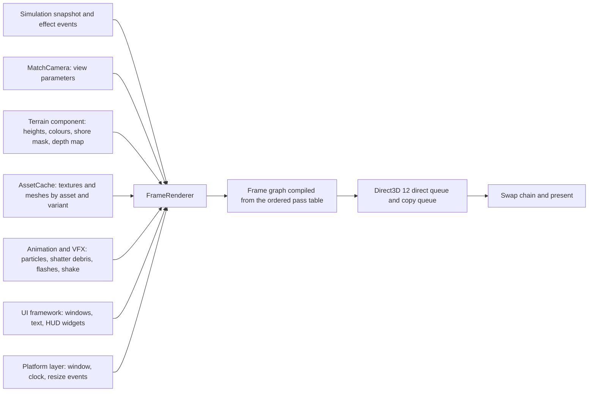

# Renderer

> Status: Engine baseline · Prefix: RND · ADRs: [ADR-001](../../../ADR/ADR-001-direct3d-12-renderer-on-the-agility-sdk.md) · [ADR-002](../../../ADR/ADR-002-minimum-gpu-capability.md) · [ADR-003](../../../ADR/ADR-003-shader-language-compiler-and-material-shaders.md) · [ADR-004](../../../ADR/ADR-004-frame-graph-from-the-ordered-pass-table.md) · [ADR-005](../../../ADR/ADR-005-pipeline-state-catalogue.md) · [ADR-006](../../../ADR/ADR-006-root-signature-and-bindless-resource-access.md) · [ADR-007](../../../ADR/ADR-007-barrier-model.md) · [ADR-008](../../../ADR/ADR-008-gpu-memory-uploads-and-device-removal.md) · [ADR-009](../../../ADR/ADR-009-instanced-crowds-sprite-cards-and-shadows.md) · [ADR-010](../../../ADR/ADR-010-gpu-particles-and-shatter-debris.md) · [ADR-011](../../../ADR/ADR-011-world-surface-rendering.md) · [ADR-012](../../../ADR/ADR-012-swap-chain-presentation-and-frame-pacing.md) · [ADR-013](../../../ADR/ADR-013-working-colour-space-and-blending.md) · [ADR-014](../../../ADR/ADR-014-hdr-output.md) · [ADR-015](../../../ADR/ADR-015-scene-anti-aliasing.md) · [ADR-016](../../../ADR/ADR-016-view-projection-and-depth-conventions.md) · [ADR-018](../../../ADR/ADR-018-texture-import-manifest.md) · [ADR-020](../../../ADR/ADR-020-flat-shading-and-team-tint.md) · [ADR-068](../../../ADR/ADR-068-profiling-and-gpu-timing.md) · [ADR-075](../../../ADR/ADR-075-application-window-and-dpi-awareness.md) · [ADR-076](../../../ADR/ADR-076-screenshot-encoding.md) · [ADR-078](../../../ADR/ADR-078-gpu-resource-factory.md)

This folder specifies the Species renderer: the Direct3D 12 component that turns the presentation state of a match, the front end and the loading view into frames. It states the reference look and behaviour (pass order, blend and depth states, fog, lighting, sort orders, shadow decals) precisely, in the terms of the engine ADRs listed above.

## Folder index

| File | Holds | Requirement IDs |
|---|---|---|
| [README.md](README.md) (this file) | responsibilities and boundaries, interfaces and the GPU resource factory, the renderer object and its data model, the presentation snapshot, initialisation, resolution and aspect handling, device removal, the Direct3D 12 realisation per component | RND-001 to RND-045 |
| [frame_graph_and_passes.md](frame_graph_and_passes.md) | the default pipeline state, the pipeline-state catalogue, the frame types, the ordered pass table of a match frame and its branches, render-time extrapolation, fades, the pause banner, the screen transition, the loading-view frame, screenshots and poster renders | RND-050 to RND-120 |
| [world_renderers.md](world_renderers.md) | terrain, sea, sky and clouds, meshes and team tint, structures (solid and alpha passes, depth sort, lights and ports), trees, Barrier Emitters | RND-130 to RND-205 |
| [view_lighting_and_fog.md](view_lighting_and_fog.md) | projection and view, the depth-bias variants, frustum tests, screen projection, fog, the two-light lighting model, decal shadows, screen-space effects | RND-208 to RND-250 |
| [shaders.md](shaders.md) | the HLSL shader set derived from the pass table, with inputs, outputs, permutation axes, combine modes and the tint function | RND-260 to RND-280 |
| [entity_and_overlay_renderers.md](entity_and_overlay_renderers.md) | actors and crowds, sprite cards and billboards, laser bolts, beams, lightning and blasts, route lines, markers, the world cursor, the Power slots panel and HUD overlays | from RND-300 |
| [visual_language.md](visual_language.md) | the look and feel to keep: palettes, blend modes, glow, the darkening layer, crowd rendering, the camera's sense of scale | from RND-300 |
| [options_and_budgets.md](options_and_budgets.md) | every graphics option, the quality presets and the performance budgets | from RND-300 |

Diagram — the renderer and its neighbours:



Caption: the renderer reads presentation inputs only, builds every frame through the frame graph and presents it; nothing flows back into the simulation.

## 1 Responsibilities and boundaries

**RND-001** (MUST) The renderer owns the Direct3D 12 device, the swap chain, the direct and copy queues, the descriptor heaps, the two global root signatures, the pipeline-state catalogue, the frame graph and the GPU resource factory (`GpuResourceFactory`, RND-009, ADR-078) through which every client GPU resource is created, on the Agility SDK runtime of ADR-001 and the minimum capability of ADR-002. Every frame is assembled by the frame graph from the ordered pass table of [frame_graph_and_passes.md](frame_graph_and_passes.md) (ADR-004), and every draw names exactly one pipeline-state catalogue entry (ADR-005).

**RND-002** (MUST) The renderer MUST NOT write simulation state. It reads an immutable presentation snapshot of the simulation (RND-018) and the extrapolation time of `reference/12_simulation_model/01_tick_timing_and_main_loop.md` (R-SIM-560 to R-SIM-564), and never stores an extrapolated value back (see DEC-007). How the snapshot is produced, and whether Species extrapolates or interpolates between two snapshots, is decided by the design phase (see DEC-222, R-SIM-565); until then the renderer extrapolates as R-SIM-562 specifies.

**RND-003** (MUST) The renderer MUST NOT compute any value that feeds simulation state. GPU work serves presentation only (see DEC-654): rendering, particles, shatter debris and animation.

**RND-004** (MUST) The renderer MUST NOT produce simulation data. Tree crown hit volumes and every other collision or hit volume are baked collision data from the content build (see DEC-012, R-SIM-651); the renderer's tree generator may be shared with the content build as code, but the renderer never writes a hit volume. Mesh hit tests are simulation queries on collision assets (R-SIM-123, R-SIM-327), never renderer calls.

**RND-005** (MUST) Every random draw the renderer makes comes from a presentation generator (`FxRng`) or from a local generator owned by one renderer object, never from the simulation generator (see DEC-013, R-SIM-607, R-SIM-608).

**RND-006** (MUST) A structure whose link names a missing object, or an object of the wrong kind, is drawn as unlinked, and the renderer does not change the link (see DEC-007; DEC-222 item 2). Links are validated when content is built (DEC-015).

**RND-007** (MUST) The renderer depends on its neighbours only through these contracts:

| Neighbour | What the renderer receives | What the renderer never does |
|---|---|---|
| simulation (`reference/12_simulation_model/`) | the presentation snapshot (RND-018), the extrapolation time, the last update slice that the current tick has run, the number of the last command frame taken | write any field; draw from the simulation generator |
| terrain component ([terrain/README.md](../terrain/README.md)) | the height field, the outside height, the cell size, the per-triangle colour-ramp look-up, the sea shore mask, the depth map, the flat-water tile mask, the coastline wave formulae | generate or modify terrain |
| camera component ([camera_and_sequences.md](../camera_and_sequences.md)) | position, front and up vectors and the vertical field of view of the frame, from its `CameraFrameOutput` (§2) | move the camera |
| animation and VFX ([README.md](../animation_and_vfx/README.md)) | the particle pool, shatter debris, camera-shake offsets and full-screen flash requests (ADR-010, ADR-036), in buffers it creates through the GPU resource factory (RND-009) | emit particles on its own from simulation state |
| UI framework ([ui_framework/README.md](../ui_framework/README.md)) | batched UI and glyph draws for the UI pass (ADR-031, ADR-034), on glyph pages it creates through the GPU resource factory (RND-009) | lay out widgets |
| asset pipeline ([asset_pipeline_and_resources.md](../asset_pipeline_and_resources.md)) | cooked meshes and textures, each texture keyed by (asset id, processing variant) (see DEC-098), which the asset cache creates and uploads through the GPU resource factory once it is attached to it (RND-009) | change another requester's texture processing |
| platform layer ([platform_layer.md](../platform_layer.md)) | the window, its client-area size, resize, DPI and focus events, and the platform clock (ADR-074, ADR-075) | create or style the window |

**RND-008** (MUST) The renderer is a client-only module: the dedicated-server project links no renderer code and no Direct3D library (ADR-001, ADR-056).

**RND-009** (MUST) Every GPU resource that a component outside the renderer holds is created, filled, released and rebuilt through the GPU resource factory (`GpuResourceFactory`, §2, ADR-078): the asset cache's textures, meshes and run-time textures ([asset pipeline](../asset_pipeline_and_resources.md) AST-002), the UI framework's glyph pages (ADR-034), the particle pool, particle parameter buffer and shard buffers of the VFX runtime ([animation and VFX](../animation_and_vfx/README.md) VFX-003), and the terrain, sea and tree buffers of the world renderers (RND-017). The renderer's own resources (the swap chain, the frame-graph targets, the upload ring and the pipeline states) are not factory resources. The factory follows these rules:

1. **Creation.** A texture is created from the size, level count and format of its cooked DDS header (ADR-017) or of a run-time texture, a buffer from its size, element stride and whether compute work writes it; each resource gets a default-heap allocation and a shader-visible descriptor in the persistent region of the heap (ADR-006, ADR-008), whose heap index belongs to it for its whole life, device rebuilds included.
2. **Uploads.** `ScheduleUpload` copies the caller's bytes into the factory's staging memory, at most `rnd.resources.staging_budget_mib` (96 MiB) in flight, on the calling thread, and returns the copy-queue fence value of the batch that will carry them; an upload that does not fit is refused at once with `StagingFull` and repeated by its caller on a later frame. The frame thread submits the queued copies to the copy queue once per frame, at the start of the frame, and signals the copy fence; a resource is drawn only after its fence value has completed (ADR-008), and the queues hand it over at that fence in the common layout or state (ADR-007).
3. **Same-frame writes.** A resource whose content changes within a frame, a glyph page that receives new glyphs or a buffer that compute work writes, is written by a frame-graph pass that imports it by name (RND-063), so that the compiled graph derives its barriers (ADR-004).
4. **Release.** `Release` may be called from any thread; the resource and its descriptor slot are freed only after every frame in flight that may use it has completed (ADR-012) and after its last queued upload has completed.
5. **Threading and lifetime.** Every call is safe from any thread and never waits for the frame thread; the factory records each thread's copies into that thread's own copy command list, and only the frame thread submits to the copy queue. `FrameRenderer::Create` creates the factory after the device and before the swap chain, and it is destroyed with the renderer, after every client has released its resources: the asset cache detaches from it (`AssetCache::DetachGpu`) before the renderer is destroyed, and every other client is destroyed before the renderer.
6. **Device rebuild.** RND-035.

## 2 Interfaces

The interface below is a C++23 declaration sketch, not an implementation. Everything in it is engine code in namespace `Engine`. The renderers of game objects, which read the game's presentation snapshot, are game-layer presentation code in `Species` ([world_renderers.md](world_renderers.md) §2, [entity_and_overlay_renderers.md](entity_and_overlay_renderers.md) §2; `AGENTS.md` R9).

```cpp
namespace Engine
{

enum class FrameKind : std::uint8_t
{
  Match,
  MainMenu,
  Loading, // the loading-view frame of RND-118
  Editor   // the match frame with the map editor's overlays (RND-078)
};
enum class PosterState : std::uint8_t
{
  Inactive,
  Tiling
};
enum class TransitionState : std::uint8_t
{
  Finished,
  Waiting,
  InProgress
};
enum class PresentMode : std::uint8_t
{
  VerticalSync,
  Uncapped
};
enum class StartupError : std::uint8_t // RND-020, RND-023
{
  NoCapableAdapter,       // no adapter passes the checks of ADR-002: ui.error.gpu_unsupported
  DeviceCreationFailed,   // the chosen adapter could not create the device
  SwapChainFailed,        // no attempt of the fallback chain created the swap chain: ui.error.display_mode
  PipelineCreationFailed, // a catalogue entry could not be created (ADR-005)
  FrameGraphInvalid       // the pass table failed validation (ADR-004)
};

struct ColorRgba // a presentation colour with straight alpha; channels from 0 to 1 unless a rule allows more
{
  float r = 0.0f;
  float g = 0.0f;
  float b = 0.0f;
  float a = 1.0f;
};

struct RenderConfig // a change triggers Reconfigure (RND-030)
{
  std::uint32_t windowWidth = 0; // client area from the platform layer
  std::uint32_t windowHeight = 0;
  std::uint32_t renderWidth = 0; // scene-target size (RND-025)
  std::uint32_t renderHeight = 0;
  std::uint32_t sampleCount = 1; // set from the anti-aliasing setting, ADR-015
  bool hdr = false;              // ADR-014
  bool lowLatency = false;       // ADR-012
  PresentMode presentMode = PresentMode::VerticalSync;
  std::optional<float> frameRateCap;
  bool invertedStyle = false; // DEC-040, options_and_budgets.md
};

struct ViewParams // filled each frame from the camera component's CameraFrameOutput (camera_and_sequences.md §2.1)
{
  Vec3 position;            // CameraFrameOutput::pose.position
  Vec3 front;               // CameraFrameOutput::pose.front
  Vec3 up;                  // CameraFrameOutput::pose.up
  float fovYDegrees = 0.0f; // CameraFrameOutput::fovYDegrees, clamped by the renderer (RND-212)
};

// The snapshot interface: the engine's read-only handle to the presentation snapshot that the game publishes (RND-018).
// The game's snapshot type implements it, and only the game's pass recorders read its contents (RND-054, AGENTS.md R9).
class SceneSnapshot
{
public:
  virtual ~SceneSnapshot() = default;
};

struct FrameInputs
{
  FrameKind kind = FrameKind::Match;
  const SceneSnapshot* snapshot = nullptr;   // RND-018; null outside a match
  double extrapolationTime = 0.0;            // R-SIM-560, seconds of game time
  std::int32_t extrapolationSliceIndex = -1; // R-SIM-511: the last update slice the current tick has run; -1 = none
  std::uint32_t presentationSequence = 0;    // R-SIM-531: the number of the last command frame taken (RND-167)
  double realNow = 0.0;                      // real clock, R-SIM-570
  double presentationFrameTime = 0.0;        // R-SIM-570
  double smoothPresentationTime = 0.0;       // R-SIM-570
  ViewParams view;
  bool interfaceVisible = true;
  bool anyUiWindowOpen = false;
  bool matchPaused = false; // the sequenced pause of DEC-038
};

// ---- the GPU resources of the client (RND-009, ADR-078) ----
struct GpuResourceId // a slot of the factory's table and its generation; unchanged by a device rebuild
{
  std::uint32_t slot = 0;
  std::uint32_t generation = 0;
  auto operator<=>(const GpuResourceId& _other) const = default;
};

enum class GpuResourceError : std::uint8_t
{
  InvalidDescription,
  OutOfVideoMemory,
  StagingFull,      // the upload is refused at once; the caller repeats it on a later frame
  DeviceRebuilding, // refused while the device is rebuilt; the caller repeats it after DeviceRebuilt
  UnknownResource
};

struct GpuTextureDesc // from a cooked DDS header (ADR-017) or a run-time texture (AST-062)
{
  std::uint32_t width = 0;
  std::uint32_t height = 0;
  std::uint32_t levels = 1;
  DXGI_FORMAT format = DXGI_FORMAT_UNKNOWN;
  std::string debugName; // the asset id or the owner's name, for the allocation record (ADR-008) and PIX
};

struct GpuBufferDesc
{
  std::uint64_t sizeBytes = 0;
  std::uint32_t strideBytes = 0; // structured buffers; 0 for vertex, index and raw data
  bool gpuWritable = false;      // written by compute work in the frame graph (RND-063)
  std::string debugName;
};

struct GpuSubresourceData // one level of a texture, or the whole of a buffer
{
  std::span<const std::byte> bytes;
  std::uint32_t rowPitchBytes = 0; // textures only
};

// Every call is safe from any thread and never waits for the frame thread; the copy queue belongs to the renderer.
class GpuResourceFactory
{
public:
  virtual ~GpuResourceFactory() = default;

  [[nodiscard]] virtual std::expected<GpuResourceId, GpuResourceError> CreateTexture(const GpuTextureDesc& _desc) = 0;
  [[nodiscard]] virtual std::expected<GpuResourceId, GpuResourceError> CreateBuffer(const GpuBufferDesc& _desc) = 0;

  // Copies the bytes into staging memory now and queues the copy; returns the copy-queue fence value after which the
  // resource holds them (RND-009).
  [[nodiscard]] virtual std::expected<std::uint64_t, GpuResourceError>
  ScheduleUpload(GpuResourceId _resource, std::span<const GpuSubresourceData> _subresources) = 0;
  [[nodiscard]] virtual bool IsUploadComplete(std::uint64_t _fenceValue) const = 0;

  [[nodiscard]] virtual std::uint32_t HeapIndex(GpuResourceId _resource) const = 0; // ADR-006; stable across a rebuild
  virtual void Release(GpuResourceId _resource) = 0;                                // destroyed after the frames in flight that may use it
};

class FrameRenderer
{
public:
  static std::expected<std::unique_ptr<FrameRenderer>, StartupError> Create(AppWindow& _window, const RenderConfig& _config);

  [[nodiscard]] GpuResourceFactory& Resources();       // RND-009; lives as long as the renderer
  void SetPalette(std::span<const ColorRgba> _colors); // RND-016; once per match, one entry per colour id
  void Reconfigure(const RenderConfig& _config);       // resize, render size, MSAA, HDR
  void ApplySettings(const RenderSettings& _settings); // options_and_budgets.md RND-447
  void RenderFrame(const FrameInputs& _inputs);        // record, execute, present

  void RequestScreenshot();                                             // RND-110 to RND-114
  void StartFadeOut();                                                  // RND-085
  void StartFadeIn(double _delaySeconds);                               // RND-085
  [[nodiscard]] bool IsFadeComplete() const;                            // RND-086
  void InitializeTransition(double _durationSeconds, float _direction); // RND-095
  void StartTransition();                                               // RND-095

  // RND-216: x, y in pixels of the render target, z = clip-space w; nullopt when w <= 0.
  [[nodiscard]] std::optional<Vec3> ProjectToScreen(const Vec3& _world) const;
  [[nodiscard]] Ray ScreenRay(float _x, float _y) const;                            // RND-218
  [[nodiscard]] ScissorRect ScissorFromWorld(const Vec3& _a, const Vec3& _b) const; // RND-217
  [[nodiscard]] std::uint32_t FramesPerSecond() const;                              // R-SIM-576
};

} // namespace Engine
```

**Events.** The renderer consumes the platform layer's resize, DPI, focus and output-change events (ADR-075) and raises one event of its own, `DeviceRebuilt`, after a device-removal rebuild (ADR-008), once the GPU resource factory has recreated every live resource without its data (RND-035), so that each owner fills its resources again.

**Data contracts.** The presentation snapshot (`PresentationSnapshot`) is the baseline contract of RND-018 and RND-019. It is game code in `Species` and implements the engine's snapshot interface `SceneSnapshot`: the frame renderer hands it on without reading it, and the renderers of game objects, game code too, read it. The camera component's `CameraFrameOutput` fills `ViewParams` each frame: position, front and up from its pose and the vertical field of view as it is; the renderer clamps the field of view (RND-212) and does not read the camera velocity.

**Threading contract.** Every public call of `FrameRenderer` is made from the frame thread. Within `RenderFrame`, passes or groups of adjacent passes may record their own command lists in parallel (ADR-004); which threads record them follows the threading model of the design phase (see DEC-224). The GPU resource factory may be called from any thread, and no loader thread ever blocks on the frame thread: uploads go through the factory to the copy queue, which only the frame thread submits to (RND-009, ADR-008).

## 3 Data model

### 3.1 The renderer object and its lifetime

**RND-010** (MUST) One `FrameRenderer` exists per client process. It is created once at start-up, after the platform window, and lives until shutdown. Applying screen options never destroys it: a change of window size, render size, sample count or HDR output reconfigures it in place (RND-030), and only device removal rebuilds its device objects (RND-034).

**RND-011** (MUST) The renderer object holds this state:

| State | Initial value | Meaning |
|---|---|---|
| frames-per-second counter | `ref.sim.frame.fps_initial` (60) in [reference/12](../../../reference/12_simulation_model/01_tick_timing_and_main_loop.md) | frames completed in the last `ref.sim.frame.fps_window` of real time (R-SIM-576) |
| frame-rate overlay flag | off; exists in Debug builds only (ADR-056) | development overlay of frame rate and entity counts ([developer_tools.md](../diagnostics_test_and_performance/developer_tools.md#44-development-overlay)) |
| input-mode overlay flag | off; exists in Debug builds only (ADR-056) | development box that shows whether keyboard or gamepad input is active |
| poster state | `PosterState::Inactive` | `Inactive` or `Tiling` (RND-110) |
| poster tile index | 0 | the tile being rendered (RND-111) |
| captured-frame target | empty | the image the screen transition samples (RND-095) |
| near and far planes | set at the start of every frame | [view_lighting_and_fog.md](view_lighting_and_fog.md) RND-211 |
| render size | `RenderConfig` | scene-target size in pixels |
| view-projection cache | identity | the frame's view × projection, used by `ProjectToScreen` |
| fade amount, fade rate, fade delay | 0, 0, 0 | full-screen black fade; amount 1 is fully black (RND-085) |
| transition state, start time, duration, direction | `Finished`, 0, 0, 0 | screen transition (RND-095) |

### 3.2 The map light record

**RND-012** (MUST) A map light (`MapLight`) is a plain record, not a simulated object: a colour (three channels, values above 1 allowed) and a direction vector `front`. Every map light is directional, at an infinite distance. A light built without data has the colour `rnd.light.default_colour` (1.3, 1.3, 1.3) and the direction `rnd.light.default_front` (0, 0, 1). Setting a direction from a vector stores it as directional; normalising a light normalises its direction to unit length.

**RND-013** (MUST) Maps supply their lights in their map data ([reference/08_maps_and_level_design/rules_and_conventions.md](../../../reference/08_maps_and_level_design/rules_and_conventions.md), [README.md](../data_schemas/README.md)). At match-world initialisation the renderer copies them, normalising each direction; every frame it passes the first two to the shaders as the two directional lights (RND-226). While the match's seasonal state is active (see DEC-118, DEC-101), every light colour is replaced by `rnd.light.seasonal_colour` (1.3, 1.2, 1.2). Whether maps keep per-map light values or select named lighting presets is decided by the design phase (see DEC-562).

### 3.3 Per-frame and per-draw constants

**RND-014** (MUST) The per-frame constant buffer, bound once per command list through the root constant-buffer view of ADR-006 and declared once in the shared C++ and HLSL header (ADR-003), holds: the view, projection and view-projection matrices (row-major, ADR-016); the camera position and the camera front vector; the fog colour and the fog start and end of the frame (RND-222); the two directional lights, each a world-space direction and a colour (RND-226, RND-227); the real clock, the presentation frame time and the smooth presentation time of the frame; the extrapolation time; and the render-target size in pixels.

**RND-015** (MUST) Per-draw data travels in root constants (ADR-006): a world transform (`Mat3x4`), a tint colour, a team palette index (ADR-020) and the heap indices of the draw's instance buffer, textures and material parameters. Instanced draws keep per-instance transforms, colours and palette indices in a structured buffer and pass only its index (ADR-009).

**RND-016** (MUST) The team palette is one constant buffer with one entry per colour id of the colour table of `reference/12_simulation_model/06_teams_and_player_commands.md` (R-SIM-415, keys `ref.sim.team_colour.*`), written once per match by `FrameRenderer::SetPalette`, whose colours the game layer passes in colour-id order; the engine holds them as palette entries and never knows which team an entry belongs to (`AGENTS.md` R9). The ids 0 to `ref.sim.team.player_colour_count` − 1 are the player colours (green, red, yellow, blue, orange, purple, cyan and pink, in that order), id `ref.sim.team.rogue_colour_id` is the Rogue faction and id `ref.sim.team.visitor_colour_id` the Visitor faction.

### 3.4 GPU resources and their lifetimes

**RND-017** (MUST) The renderer's resources and their lifetimes are:

| Resource | Lifetime | Created from |
|---|---|---|
| static mesh buffers | the asset's residency | the asset cache through the GPU resource factory (RND-009), uploaded on the copy queue (ADR-008) |
| terrain-chunk and wave-mesh buffers | the match | the terrain and sea renderers from the terrain component's field, through the GPU resource factory (RND-009, RND-132, RND-144) |
| tree geometry buffers | the match | generated at map load from each tree's parameters (RND-180), through the GPU resource factory (RND-009) |
| textures and run-time textures | the asset's residency; a run-time texture until its producer unregisters it | the asset cache through the GPU resource factory, one entry per (asset id, processing variant) (see DEC-098, AST-122) |
| glyph pages | the UI framework's glyph cache (ADR-034) | the UI framework through the GPU resource factory; new glyphs are copied in by a frame-graph pass (RND-009 item 3) |
| particle pool, particle parameter buffer, shard buffers | the client process (VFX-015) | the VFX runtime through the GPU resource factory; written by its compute passes (RND-063) |
| per-frame constants, instance buffers, dynamic vertex data | one frame in flight | the upload ring (ADR-008) |
| scene colour and depth targets | the render configuration | the frame graph (ADR-004), sized by the render size and sample count (ADR-015) |
| captured-frame target | from the screen-transition capture to the end of the transition | a copy of the final image (RND-095) |
| screenshot read-back buffer | one frame in flight | the frame graph's read-back pass (RND-112) |

### 3.5 The presentation snapshot

**RND-018** (MUST) The presentation snapshot (`PresentationSnapshot`) is the baseline contract between the simulation and every presentation reader, the default under option A of DEC-222 until the design phase decides the boundary. The game layer produces one snapshot per rendered frame, from simulation state alone, after the update slices that the frame runs (R-SIM-531) and before the frame is rendered, and does not change it afterwards. The frame renderer and the renderers of game objects, the VFX runtime ([animation and VFX](../animation_and_vfx/README.md) §2), the match camera ([camera](../camera_and_sequences.md) CAM-004) and the audio bridge ([audio engine](../audio_engine/README.md) AEN-041) read the snapshot of the frame and keep no reference into it beyond that frame. The game layer owns the storage: the baseline keeps one snapshot and reuses it once the frame that read it has finished recording and the audio update of the frame has read it; a threading model that builds the next snapshot while a frame reads the current one keeps two (DEC-224); interpolation between two ticks keeps the snapshots of the last two ticks (DEC-222, R-SIM-565).

**RND-019** (MUST) The snapshot holds the records of table 3.5-A, and each reader reads only the fields that its documents name.

Table 3.5-A The records of the presentation snapshot.

| Record | Fields | Read by |
|---|---|---|
| match setup (`MatchSetupView`), fixed at match start | the colour id of each team slot (RND-016, R-SIM-415), the local team, the friend relation of the slots to the local team (R-SIM-412), the seasonal state (DEC-118), the world extent (TER-151) | the renderer, the VFX runtime (the explainer colours of VFX-109), the camera, the audio bridge |
| frame | the tick number, the extrapolation time (R-SIM-560), the last update slice that the current tick has run (R-SIM-511), the number of the last command frame taken (R-SIM-531), the game speed, and the world-held, paused and game-over flags | the renderer (`FrameInputs`), the VFX runtime, the camera |
| drawn object | its handle (`SimObjectId`), kind, team colour id, position, velocity, front and up, angular velocity about y, health fraction, state and the flags that select overlays and emitters; for an animated mesh, the velocity and angular velocity of each animated node (RND-159); the kind-specific fields of [world_renderers.md](world_renderers.md), [entity_and_overlay_renderers.md](entity_and_overlay_renderers.md) §2 and [animation and VFX](../animation_and_vfx/README.md) §2 | the renderers of game objects, the VFX runtime, the camera (structure focus) |
| sliced pool | the slots that the current tick has already advanced (R-SIM-562) | the renderers of game objects (RND-082) |
| history | the Crawler trail samples (R-UNIT-535), the Reaper Serpent's tail positions (R-UNIT-594), the centipede links and samples (R-UNIT-549, R-UNIT-551) | the VFX runtime |
| route and world marker | per route its points and end point; per world marker its target, kind, icon, owner, persistence and progress fraction ([entity_and_overlay_renderers.md](entity_and_overlay_renderers.md) §2) | the route-line and world-marker renderers |
| emitter | per tracked emitter its position, velocity, height above the terrain, age and the counts of teams and of actors near it (AEN-041) | the audio bridge |

```cpp
namespace Species
{

struct MatchSetupView // the per-match part of the snapshot, fixed at match start (table 3.5-A)
{
  std::array<std::uint8_t, MAX_TEAMS> teamColorIds{}; // colour id of each team slot (R-SIM-415); 0xFF = an unused slot
  std::uint8_t localTeam = 0;                         // the local participant's team slot
  std::uint32_t friendMask = 0;                       // bit i: slot i is a friend of the local team (R-SIM-412)
  bool seasonalState = false;                         // DEC-118
  float worldSizeX = 0.0f;                            // the world extent of the terrain field (TER-151)
  float worldSizeZ = 0.0f;
};

// The game's snapshot: the only type behind FrameInputs::snapshot (RND-018, RND-054). Its accessors return the records
// of table 3.5-A as read-only spans and views that stay valid until the frame that reads them has finished.
class PresentationSnapshot final : public Engine::SceneSnapshot
{
public:
  [[nodiscard]] const MatchSetupView& Setup() const;
  [[nodiscard]] std::uint32_t Tick() const;
};

} // namespace Species
```

## 4 Behaviour and algorithms

### 4.1 Initialisation

**RND-020** (MUST) Start-up runs in this order: the capability checks and device creation of ADR-002 (an adapter that fails a check is skipped; if none passes, `Create` returns `StartupError::NoCapableAdapter`, and the client shows a localised message `ui.error.gpu_unsupported` naming the missing capability and the adapter, logs it and exits without a swap chain); the GPU resource factory (RND-009); the swap chain of ADR-012 at the window's client-area size; the two root signatures (ADR-006); every pipeline-state catalogue entry, from the pipeline library where it is valid (ADR-005); the frame-graph compilation (ADR-004); then the first frame.

**RND-021** (MUST) The display preferences ([options_and_budgets.md](options_and_budgets.md), [platform_layer.md](../platform_layer.md)) are read before the swap chain is created. When the stored render size is absent (the first run; DAT-008), the renderer uses the current desktop resolution of the window's monitor and writes it back to the preferences.

**RND-022** (MUST) A preferred render size snaps to the closest entry of the offered render-size list (RND-026): an exact match if one exists, otherwise the entry with the smallest |Δw| + |Δh|.

**RND-023** (MUST) The window is borderless at the desktop size of its monitor or windowed at the requested client size, and no display mode is ever set (RND-025, ADR-075). When the window or the swap chain cannot be created at the preferred size, the platform layer's fallback chain applies ([platform_layer.md](../platform_layer.md) PLT-112): the desktop size of the window's monitor, then a windowed client area of `rnd.init.fallback_window_size` (800 × 600). A rejected first attempt shows the non-fatal notice `ui.error.resolution_rejected` and start-up continues with the next attempt; when every attempt fails, start-up ends with `ui.error.display_mode` (`StartupError::SwapChainFailed`); and the size actually used is written back to the preferences.

### 4.2 Resolution and aspect handling

**RND-025** (MUST) The swap chain always matches the window's client area, and the display mode is never changed (ADR-012, ADR-075). The preferred render size sets the size of the scene colour and depth targets; when it is smaller than the client area, the scene is scaled to the client area in the final pass, and the UI is always drawn at the client area's native resolution.

**RND-026** (MUST) The offered render sizes are the display-mode sizes of the window's monitor that are at least `rnd.init.min_render_width` (640) wide and `rnd.init.min_render_height` (480) high and not larger than the monitor, de-duplicated by size.

**RND-027** (MUST) The 3-D aspect ratio is always the render width divided by the render height. The vertical field of view is fixed by the camera and the horizontal field of view widens with the aspect ratio (Hor+, ADR-016); there is no letter-boxing and no fixed virtual resolution.

**RND-028** (MUST) Screen-space layouts scale as follows:

| Element | Rule |
|---|---|
| UI windows and text | pixel-unit orthographic space over the viewport; menu layouts scale by the UI framework's own size rules ([ui_framework/layout_rendering_input_and_localisation.md](../ui_framework/layout_rendering_input_and_localisation.md), ADR-033) |
| Power slots panel and match HUD | an orthographic space `ref.ctrl.panel.canvas_height` (600) units high whose width is 600 × the aspect ratio, independent of resolution ([selection_and_power_slots.md](../../../reference/06_controls_camera_and_commands/selection_and_power_slots.md) R-CTRL-222, ADR-016) |
| match messages (pass 13) | scale = render width ÷ `rnd.hud.message.reference_width` (1280) |
| chat log (pass 21) | the chat scale of [screen_flow_and_match_setup.md](../../../reference/09_front_end_and_match_flow/screen_flow_and_match_setup.md) R-META-099: `ref.meta.chat.scale_tiny` (0.75) when the render width is at most `ref.meta.chat.tiny_screen_width` (640) px; render width ÷ `ref.meta.chat.scale_small_width` (1024) when it is above 640 px and at most `ref.meta.chat.small_screen_width` (800) px; otherwise render width ÷ `ref.meta.chat.scale_reference_width` (1280), which equals the match-message scale |
| world markers and cursors | sizes from the render height and in physical pixels, as [entity_and_overlay_renderers.md](entity_and_overlay_renderers.md) specifies |

**RND-029** (MUST) In windowed mode the window is centred on its monitor when first created; a restored window larger than the monitor's work area is clamped to it (ADR-075).

### 4.3 Reconfiguration

**RND-030** (MUST) A change of window size, render size, sample count or HDR output reconfigures the renderer: it waits for the GPU, releases its back-buffer references, resizes the swap chain (ADR-012), creates the pipeline-state entries whose target formats or sample counts changed behind a loading indicator (ADR-005), and recompiles the frame graph (ADR-004). The device, the asset resources, the terrain and sea buffers, the tree geometry and the remaining catalogue entries survive.

**RND-031** (MUST) A change of the inverted style (see DEC-040) or of a detail option ([options_and_budgets.md](options_and_budgets.md)) rebuilds no terrain, sea or tree geometry: each is a choice of catalogue entry, shader permutation or per-pass constant, and takes effect on the next frame; the terrain height field is never regenerated (see DEC-967 item 2).

**RND-032** (MUST) While the window is minimised, or a present reports the window occluded, the renderer stops rendering and polls at a low rate until the window is visible again; the simulation is unaffected (ADR-012).

### 4.4 Device removal

**RND-034** (MUST) Device removal or reset, however detected, starts the rebuild of ADR-008: the removal reason and the DRED breadcrumb and page-fault data go to the log and the crash-report attachments; every device object is released; a new device (with the checks of RND-020), the GPU resource factory's resources (RND-035), swap chain, root signatures and catalogue are created; static GPU resources are reloaded from the asset system and regenerated from the terrain data and the tree parameters behind a loading indicator; presentation resumes. The simulation keeps running throughout. A second removal during the rebuild, or a failed recreation, ends the client with a report.

**RND-035** (MUST) In the rebuild, the GPU resource factory releases every device object it holds, then recreates every live resource from its stored description on the new device, under the same id and at the same heap index, holding no data; the renderer then raises `DeviceRebuilt`, and each owner fills its resources again from its own source: the asset cache from its pack entries and its run-time texture producers (AST-119), the glyph cache by rasterising again (ADR-034), the VFX runtime by starting its pool and shard buffers empty (VFX-015), and the world renderers from the terrain field and the tree parameters (RND-132, RND-144, RND-180). The factory keeps no copy of any resource's contents (ADR-008). A factory call made while the rebuild runs never waits: it returns `GpuResourceError::DeviceRebuilding`, and its caller repeats it after `DeviceRebuilt`.

## 5 Concurrency and performance budget

**RND-040** (MUST) Per-frame CPU work outside the frame thread's recording is bounded by the frame graph's precompiled pass list (ADR-004); the terrain costs only chunk culling (ADR-011), and crowds cost a fixed number of calls per type and pass (ADR-009). No pipeline state is created during a frame (ADR-005).

**RND-041** (MUST) The renderer's GPU and CPU budgets, its caps and the quality presets are in [options_and_budgets.md](options_and_budgets.md). Every frame-graph pass carries one CPU and GPU marker (`ENGINE_PROFILE_SCOPE` and `ENGINE_PROFILE_GPU_SCOPE`) and one pair of GPU timestamps, in Debug and Release builds (ADR-068), and the development overlay of Debug builds shows per-pass GPU times against those budgets.

**RND-042** (MUST) Loading and streaming follow the asset pipeline component: static uploads go through the copy queue, an asset becomes visible only after its upload fence has completed (ADR-008), and how Species loads and streams world content is decided by the design phase (see DEC-226).

## 6 Failure modes, diagnostics and telemetry

| Failure | Behaviour | Requirement |
|---|---|---|
| no adapter passes the capability checks | `StartupError::NoCapableAdapter`; localised message naming the missing capability and the adapter; log; exit | RND-020 |
| the window or swap chain cannot be created | the fallback chain, then a fatal error (`StartupError::SwapChainFailed`) | RND-023 |
| the factory's staging memory is full | the upload is refused with `StagingFull`; the caller repeats it on a later frame; nothing waits | RND-009 |
| a factory call during a device rebuild | refused with `DeviceRebuilding`; the caller repeats it after `DeviceRebuilt` | RND-035 |
| device removed or reset | the rebuild of ADR-008; log and crash-report attachments | RND-034 |
| a pipeline state is created outside start-up, loading or reconfiguration | an error in Debug builds, a log entry in Release builds | ADR-005 |
| the frame graph fails validation | the renderer stops with a diagnostic naming the pass | ADR-004 |
| a texture or mesh is missing at run time | a diagnostic and the default resource at heap index 0 (ADR-006), never a fatal assertion (DEC-015) | RND-017 |
| an upload-ring segment overflows | a one-off overflow buffer, a log entry, and a larger ring at the next reconfiguration (ADR-008) | RND-017 |

Diagnostics: PIX markers and GPU timestamps per pass, in both configurations (ADR-068); in Debug builds, the development overlay of frame rate and entity counts and the input-mode box (RND-011); the debug layer and GPU-based validation in Debug builds, on developer machines and in the GPU test job of CI (ADR-001, ADR-070). Telemetry, when the player consents, carries the frame-time distribution and the adapter and capability summary (ADR-066).

## 7 Acceptance tests

The golden-image tests of this folder compare with the default tolerance and on the pinned reference configuration of the test harness ([diagnostics, test and performance](../diagnostics_test_and_performance/README.md) §4.8), unless a test states its own tolerance.

| Test | Kind | Checks | Requirements |
|---|---|---|---|
| T1 boundary | checker fixture | a simulation-library source that includes a renderer header fails `Build\CheckProjectFiles.py` ([build tooling](../build_tooling_and_distribution.md) table 4.1-B row 13); the renderer has only const access to the snapshot; the dedicated-server link map has no Direct3D symbol, because the server project references and links none (row 11, BLD-045) | RND-002, RND-003, RND-008 |
| T2 headless conformance | golden-hash | a match run headless and the same match run with the full renderer produce identical per-tick state hashes | RND-002 to RND-006 |
| T3 capability probe | unit | recorded capability results (all pass, each single failure, unknown Shader Model) give the expected adapter choice and message | RND-020 |
| T4 first run | unit | with no stored render size, the desktop resolution is used and written back | RND-021 |
| T5 closest size | property | for random preferred sizes, the chosen entry minimises |Δw| + |Δh| and an exact match always wins | RND-022, RND-026 |
| T6 fallback chain | unit | forced failures of each attempt give the next attempt and the write-back of the size in use; no display mode is set | RND-023 |
| T7 reconfigure | integration | resize, render-size, sample-count and HDR changes during a match keep the device and the terrain buffers, and raise no validation message | RND-030, RND-031 |
| T8 aspect | golden-image | the same scene at 4:3, 16:9 and 21:9 keeps the vertical field of view and HUD positions in HUD units | RND-027, RND-028 |
| T9 lights | unit | a map with one light gives a black second light; the seasonal state replaces both colours; a default light has colour 1.3 and direction (0, 0, 1) | RND-012, RND-013 |
| T10 device removal | integration | forced device removal during a match resumes presentation with the match still running and a DRED report in the log; every factory resource keeps its id and heap index, its owner fills it again, and a golden image taken after the rebuild equals the one taken before it | RND-034, RND-035 |
| T11 resource factory | unit | with the in-memory factory of ADR-078: uploads from several threads return increasing fence values; a full staging budget refuses an upload at once; a release frees the descriptor slot only after the frames in flight; a call during a rebuild is refused with `DeviceRebuilding` | RND-009, RND-035 |

## 8 Open decisions

### 8.1 Decisions

| DEC | Status | Where it applies |
|---|---|---|
| DEC-007 | Resolved | presentation never writes simulation state (RND-002, RND-006) |
| DEC-012 | Resolved | collision volumes are baked data (RND-004) |
| DEC-013 | Resolved | presentation randomness (RND-005) |
| DEC-052 | Dropped | campaign content: its frame types, logo overlays and structures are not specified |
| DEC-059 | Dropped | the pixel effect, the deform effect and the water reflection are not specified |
| DEC-098 | Resolved | the texture cache is keyed by asset and variant (RND-007, RND-017) |
| DEC-222 | Open | how the snapshot is produced, with the baseline contract of RND-018 and RND-019 as the default of option A; extrapolation or interpolation (RND-002) |
| DEC-224 | Open | which threads record passes (§2 threading contract) |
| DEC-226 | Open | loading and streaming of world content (RND-042) |
| DEC-247 | Open | terrain scale and level of detail ([world_renderers.md](world_renderers.md) RND-138) |
| DEC-325 | Open | the one-frame light lag ([view_lighting_and_fog.md](view_lighting_and_fog.md) RND-227) |
| DEC-326 | Open | the terrain grid overlay ([world_renderers.md](world_renderers.md) RND-135) |
| DEC-327 | Open | structure render-detail variants ([world_renderers.md](world_renderers.md) RND-163) |
| DEC-336 | Dropped | other renderers are not specified; Species has one renderer (ADR-001) |
| DEC-337 | Dropped | driver-specific cursor, glyph-atlas and texture-filtering behaviour is not specified |
| DEC-562 | Open | map lighting presets (RND-013) |
| DEC-654 | Resolved | gameplay is CPU-only (RND-003) |
| DEC-967 | Resolved | option changes rebuild presentation data only and never regenerate the height field (RND-031) |

**RND-045** (MUST) The renderer draws exactly the frame types and passes of [frame_graph_and_passes.md](frame_graph_and_passes.md) (RND-067, RND-070) on Direct3D 12 through the Agility SDK (ADR-001), with one code path for every adapter that passes the checks of RND-020 (see DEC-059, DEC-336, DEC-337).

### 8.2 Direct3D 12 realisation per component

| Component | Species realisation | Decided in | Specified in |
|---|---|---|---|
| renderer core | an explicit renderer: per-frame upload ring, batched and instanced draws, one catalogue entry per blend, depth and cull combination of the pass table | ADR-001, ADR-004, ADR-005 | [frame_graph_and_passes.md](frame_graph_and_passes.md) |
| state contract | immutable pipeline states derived from the default state plus per-pass differences; one root signature with per-frame constants (view, projection, fog, two lights) and per-draw root constants (world transform, tint) | ADR-005, ADR-006 | [frame_graph_and_passes.md](frame_graph_and_passes.md) §3 |
| material shading | five material shaders: unlit vertex colour; one texture; two textures with an explicit combine mode; lit by two directional lights with no ambient term; lit with one texture; every material honours its fog colour and alpha | ADR-003 | [shaders.md](shaders.md) |
| flat shading | facet colour and facet normal baked per triangle; no shader depends on a provoking-vertex convention | ADR-020 | [world_renderers.md](world_renderers.md) §4.4 |
| terrain | static vertex and index buffers in a default heap, split into culled chunks; the wire-grid overlay added in the same pass | ADR-011 | [world_renderers.md](world_renderers.md) §4.1 |
| sea | a static flat layer drawn once with two textures; the coastline wave mesh animated on the GPU every frame | ADR-011 | [world_renderers.md](world_renderers.md) §4.2 |
| sky and clouds | one additive instanced draw with fog computed in the shader | ADR-011 | [world_renderers.md](world_renderers.md) §4.3 |
| meshes | static buffers per mesh, per-node transforms in a structured buffer, instancing for repeated structures, team colour from a per-instance palette index | ADR-009, ADR-019, ADR-020 | [world_renderers.md](world_renderers.md) §4.4 |
| trees | geometry generated at map load as data and drawn instanced; crown hit volumes baked by the content build | ADR-009, DEC-012 | [world_renderers.md](world_renderers.md) §4.6 |
| sprites, particles, Essence orbs, Workers | instanced quads expanded in the vertex shader from per-instance data with an orientation mode; additive and darkening catalogue entries | ADR-009, ADR-010 | [entity_and_overlay_renderers.md](entity_and_overlay_renderers.md), [README.md](../animation_and_vfx/README.md) |
| darkening layers | the darkening blend (zero, inverse source colour) | ADR-005 | [frame_graph_and_passes.md](frame_graph_and_passes.md) §3.2 |
| shatter debris | a shard buffer advanced on the GPU, with a barycentric edge mask | ADR-010 | [README.md](../animation_and_vfx/README.md) |
| depth offsets for coplanar layers | depth-biased catalogue variants | ADR-005, ADR-016 | [view_lighting_and_fog.md](view_lighting_and_fog.md) §4.2 |
| text | a glyph cache from licensed fonts with shaping and kerning | ADR-034 | [ui_framework/README.md](../ui_framework/README.md) |
| UI | a batched UI vertex stream with alpha, additive and ink catalogue entries | ADR-031 | [ui_framework/README.md](../ui_framework/README.md) |
| screen effects | full-screen passes that read a declared frame-graph copy of an earlier image | ADR-004 | [frame_graph_and_passes.md](frame_graph_and_passes.md) §4.7 |
| shadows | decal blobs and flattened sprite shadows as instanced, depth-biased darkening quads | ADR-009 | [view_lighting_and_fog.md](view_lighting_and_fog.md) §4.6 |
| screenshots | a read-back pass that copies the final image into a read-back buffer, encoded off the frame thread | ADR-004, ADR-076 | [frame_graph_and_passes.md](frame_graph_and_passes.md) §4.8 |
| client GPU resources | one factory that creates, fills, releases and rebuilds every resource another component holds | ADR-078 | RND-009, RND-035 |
| device removal | full device recreation | ADR-008 | RND-034 |

### 8.3 Design-phase inputs

The Species design phase must answer these questions for the renderer:

1. **Snapshot and smoothing.** Whether the baseline snapshot of RND-018 and RND-019 becomes the simulation–presentation boundary and the replication format, and whether the renderer extrapolates from one snapshot (the reference) or interpolates between two with a one-tick display delay (DEC-222, R-SIM-565, DEC-227).
2. **Threading.** Which threads record the frame's command lists, and how presentation receives snapshots and effect events from the simulation thread or the network (DEC-224).
3. **World scale.** How the terrain, the sea and the sky scale beyond an arena map: chunk streaming, levels of detail for the strategic zoom, camera-relative coordinates beyond a few tens of thousands of wu, and a far plane and fog distance for a world that is larger than `rnd.view.far_plane` (DEC-247, DEC-226, ADR-011).
4. **Lighting.** Whether maps keep per-map lights or select named presets, and whether lights keep the one-frame lag (DEC-562, DEC-325).
5. **Visibility.** How fog of war (the vision brief's equal visibility for players, bots and the deputy) is drawn, which the reference does not have.
6. **Detail levels.** Which structure detail variants Species keeps (DEC-327) and what the terrain grid overlay follows (DEC-326).

## 9 Tuning table

| key | value | unit | range or notes | requirement | DEC |
|---|---|---|---|---|---|
| `rnd.light.default_colour` | 1.3, 1.3, 1.3 | RGB multiplier | colour of a light built without data; values above 1 over-brighten | RND-012 | DEC-562 |
| `rnd.light.default_front` | 0, 0, 1 | unit vector | direction of a light built without data | RND-012 | |
| `rnd.light.seasonal_colour` | 1.3, 1.2, 1.2 | RGB multiplier | replaces every light colour while the seasonal state is active | RND-013 | DEC-101, DEC-118 |
| `rnd.init.fallback_window_size` | 800 × 600 | px | windowed fallback client area | RND-023 | |
| `rnd.resources.staging_budget_mib` | 96 | MiB | staging memory of the GPU resource factory's queued uploads, shared by every client; the asset cache's own share is `ast.load.staging_budget_mib` | RND-009 | DEC-106 |
| `rnd.init.min_render_width` | 640 | px | smallest offered render width | RND-026 | |
| `rnd.init.min_render_height` | 480 | px | smallest offered render height | RND-026 | |
| `rnd.hud.message.reference_width` | 1280 | px | match messages scale by render width ÷ this | RND-028 | |
