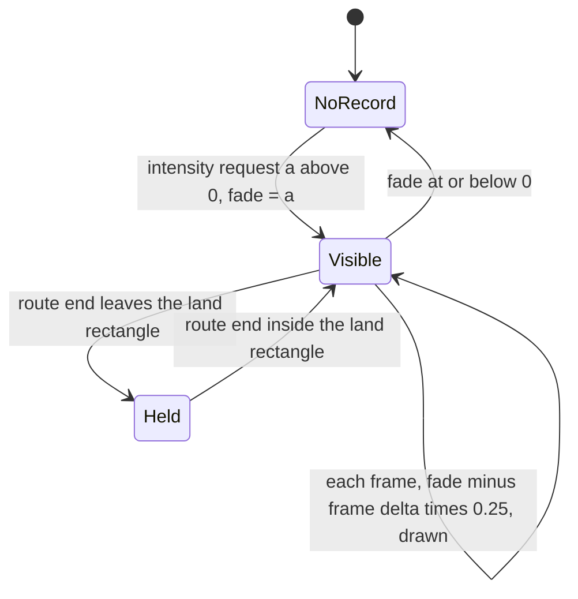

# Entity and overlay renderers

> Status: Engine baseline · Prefix: RND · ADRs: [ADR-005](../../../ADR/ADR-005-pipeline-state-catalogue.md) · [ADR-006](../../../ADR/ADR-006-root-signature-and-bindless-resource-access.md) · [ADR-008](../../../ADR/ADR-008-gpu-memory-uploads-and-device-removal.md) · [ADR-009](../../../ADR/ADR-009-instanced-crowds-sprite-cards-and-shadows.md) · [ADR-010](../../../ADR/ADR-010-gpu-particles-and-shatter-debris.md) · [ADR-013](../../../ADR/ADR-013-working-colour-space-and-blending.md) · [ADR-016](../../../ADR/ADR-016-view-projection-and-depth-conventions.md) · [ADR-018](../../../ADR/ADR-018-texture-import-manifest.md) · [ADR-020](../../../ADR/ADR-020-flat-shading-and-team-tint.md) · [ADR-021](../../../ADR/ADR-021-mesh-socket-schema.md) · [ADR-031](../../../ADR/ADR-031-batched-ui-rendering.md) · [ADR-033](../../../ADR/ADR-033-ui-layout-scaling-and-dpi.md) · [ADR-035](../../../ADR/ADR-035-procedural-animation-runtime.md) · [ADR-036](../../../ADR/ADR-036-effect-events-and-presentation-clock.md) · [ADR-064](../../../ADR/ADR-064-accessibility-baseline-xag.md) · Related: [Renderer](README.md) · [Frame graph and passes](frame_graph_and_passes.md) · [World renderers](world_renderers.md) · [View, lighting and fog](view_lighting_and_fog.md) · [Shaders](shaders.md) · [Visual language](visual_language.md) · [Options and budgets](options_and_budgets.md) · [Animation and VFX](../animation_and_vfx/README.md)

This document specifies how the renderer draws everything that moves or points: the crowds of actors (Workers, Crawlers, Troopers, creatures and vehicles) as instanced sprite cards, billboards and lit meshes; their blob shadows; the effects pass with its shockwave rings and lightning; laser bolts; route lines; world markers; the world cursor with its highlight rings and placement previews; and the Power slots panel and match HUD overlays. It uses the pass numbers, catalogue blend states and depth-bias variants of [frame_graph_and_passes.md](frame_graph_and_passes.md) and [view_lighting_and_fog.md](view_lighting_and_fog.md), and defines the catalogue entries of its own passes (§3.3).

## 1 Responsibilities and boundaries

**RND-300** (MUST) This document's renderers record passes 7a, 7b, 7c, 7d, 10a, 10b, 12, 16, 20, 23 and 28 of the ordered pass table ([frame_graph_and_passes.md](frame_graph_and_passes.md) RND-070), with the catalogue entries of §3.3. Pass 11 (Essence orbs), pass 14 (shatter debris) and pass 15 (particles), and the Worker ground-shadow values of pass 7d, belong to [README.md](../animation_and_vfx/README.md); passes 13, 17, 19 and 21 draw UI-framework content ([ui_framework/README.md](../ui_framework/README.md)).

**RND-301** (MUST) These renderers MUST NOT write simulation state (see DEC-007). Every value that the reference look computes while drawing and keeps from frame to frame is presentation state that the renderer owns, keyed by the object's handle (`SimObjectId`) or the route handle, and never stored in a simulated object (DEC-222 item 2). The values are listed in §3.2: the Worker colour cross-fade after a conversion, the fade value of each drawn route, the walkable flag of the route preview and the Crawler detail level of each group. The world markers' list and timers are the presentation state of the world markers ([cursor_and_markers.md](../../../reference/06_controls_camera_and_commands/cursor_and_markers.md) R-CTRL-380).

**RND-302** (MUST) A renderer draws exactly the state that the presentation snapshot holds and never caps a list that the simulation tracks. In particular the energy-grid and fuel-chain renderers draw every energy surge that a fuel pump tracks; the one limit is `ref.bldg.fuel_pump.max_surges` (20) of [economy_and_spawn_objects.md](../../../reference/03_buildings_and_world_objects/economy_and_spawn_objects.md) R-BLDG-198, used by the simulation and the drawing alike (see DEC-463). When a frame has more instances than an instance buffer holds, the upload-ring overflow rule of the renderer applies (README RND-017, ADR-008); no instance is dropped.

**RND-303** (MUST) Every draw of these passes names one complete catalogue entry (ADR-005, RND-052). The reference look draws the actors of passes 7a and 7b one after another, and an actor that sets no state of its own inherits what the previous actor left; the Species renderer reproduces only the states that §4.4 lists for each actor kind, never a state left by an earlier draw (see DEC-957).

**RND-304** (MUST) Every random choice these renderers make, such as the team colour of an Allegiance Scrambler muzzle flash, draws from the presentation generator (`FxRng`), never from the simulation generator (RND-005, DEC-013).

## 2 Interfaces

The interface below is a C++23 declaration sketch, not an implementation.

```cpp
namespace Engine
{

enum class OrientationMode : std::uint8_t // the quad orientation modes of ADR-009
{
  CameraFacing,  // corners along the camera right and up vectors
  UprightCard,   // turns about the world vertical axis towards the camera
  WorldOriented, // explicit right and up axes, optionally blended into a billboard with distance
  Segment        // between two end points, widened perpendicular to the camera ray
};
enum class QuadAnchor : std::uint8_t
{
  Center,
  BottomCenter
};

struct QuadInstance // shared header layout (shaders.md RND-262), §3.1
{
  Vec3 position;  // center or anchor; first end point for Segment
  Vec3 endPoint;  // Segment only
  Vec3 axisRight; // WorldOriented only
  Vec3 axisUp;
  float halfWidth = 0;
  float halfHeight = 0;
  float blendStart = 0; // WorldOriented: billboard blend; length 0 = never
  float blendLength = 0;
  float rotation = 0; // radians about the view axis (CameraFacing)
  ColorRgba color;
  ColorRgba endColor;             // used by Segment only
  std::uint32_t textureIndex = 0; // descriptor-heap index (ADR-006)
  std::uint32_t uvRect = 0;       // index into the UV-rectangle table (atlas cells, mirrored maps)
  OrientationMode mode = OrientationMode::CameraFacing;
  QuadAnchor anchor = QuadAnchor::Center;
};

struct InstanceType // one per drawn kind and catalogue entry, registered at start-up
{
  CatalogKey entry;                 // §3.3
  float cullRadius = 0;             // sphere-test radius around each instance (RND-234)
  std::optional<float> maxDistance; // per-type distance limit
};

class CrowdRenderer // ADR-009
{
public:
  InstanceTypeId RegisterType(const InstanceType& _type);
  std::span<QuadInstance> BeginInstances(InstanceTypeId _type, std::uint32_t _count); // upload ring
  void RecordCull(PassContext& _pass) const;                                          // InstanceCull
  void RecordDraws(PassContext& _pass, std::span<const InstanceTypeId> _types) const;
};

class ActorRenderer
{
public:
  void RecordGroups(PassContext& _pass, const PresentationSnapshot& _snapshot, double _t) const;   // 7a
  void RecordOthers(PassContext& _pass, const PresentationSnapshot& _snapshot, double _t) const;   // 7b
  void RecordCrawlers(PassContext& _pass, const PresentationSnapshot& _snapshot, double _t) const; // 7c
  void RecordWorkers(PassContext& _pass, const PresentationSnapshot& _snapshot, double _t) const;  // 7d
  void OnTeamChanged(SimObjectId _worker, std::uint8_t _previousColorId, double _realNow);         // RND-317
};

class EffectRenderer
{
public:
  void RecordEffects(PassContext& _pass, const PresentationSnapshot& _snapshot, double _t) const;    // 10a
  void RecordLaserBolts(PassContext& _pass, const PresentationSnapshot& _snapshot, double _t) const; // 10b
};

class RouteLineRenderer
{
public:
  void OnRouteHighlighted(RouteHandle _route, std::uint8_t _team);                // RND-350
  void OnRouteIntensity(RouteHandle _route, float _intensity);                    // RND-351
  void Record(PassContext& _pass, const RoutePreview& _preview, double _realNow); // pass 12
  [[nodiscard]] bool PreviewWalkable() const;                                     // read by the world cursor
};

class WorldMarkerRenderer // pass 16
{
public:
  void Record(PassContext& _pass, const WorldMarkers& _markers);
};
class WorldCursorRenderer // pass 20
{
public:
  void Record(PassContext& _pass, const WorldCursor& _cursor);
};
class PowerSlotsPanelRenderer // pass 23
{
public:
  void Record(PassContext& _pass, const PowerSlotsPanel& _panel);
};
class MatchHudRenderer // pass 28
{
public:
  void Record(PassContext& _pass, const MatchHudView& _hud);
};

struct DevSphereMesh // RND-330
{
  std::array<Vec3, 42> vertices;
  std::array<std::uint16_t, 240> indices;
};
DevSphereMesh BuildDevSphere();

} // namespace Engine
```

**Events.** The renderers consume these presentation events (DEC-007, ADR-036): a Worker's team change (for the colour cross-fade, RND-317); a route highlight and a route intensity request (RND-350, RND-351); the registration and removal of world markers ([reference/06_controls_camera_and_commands/cursor_and_markers.md](../../../reference/06_controls_camera_and_commands/cursor_and_markers.md)). They raise one request of their own: the camera shake of a laser bolt that passes near the camera, which they hand to the VFX screen effects (RND-340).

**Data contracts.** Per drawn actor the snapshot holds the fields of README §2 (position, velocity, front and up, team, kind, health) and the kind-specific fields named in §4.4; per route its points and its end point; per world marker its target, kind, icon, owner, persistence and progress fraction; per effect its kind, position, velocity, age and kind-specific fields.

**Threading contract.** All public calls run on the frame thread. Instance-buffer writes of different instance types MAY run in parallel where the threading model allows (DEC-224). The cull compute pass of every pass that draws instances runs before its draws, on the direct queue, in the same command list.

## 3 Data model

### 3.1 Quad conventions

**RND-305** (MUST) A quad's size in this document is its half-size: its corners lie at its centre ± half-width along its right axis and ± half-height along its up axis, or, with the anchor `BottomCenter`, from its anchor point up to 2 × half-height along its up axis. A quad is two triangles with the index pattern 0, 1, 2, 0, 2, 3 (RND-055), and every quad of this document is expanded in the vertex shader from one `QuadInstance` (ADR-009).

**RND-306** (MUST) The vertex shader builds the four corners of each orientation mode as follows, with *R* and *U* the frame's camera right and up vectors:

```text
CameraFacing:   right = R rotated by rotation about the view axis; up = U rotated likewise
UprightCard:    up = (0, 1, 0); right = normalise(up × (camera position − position))
WorldOriented:  right = axisRight; up = axisUp
                if blendLength > 0 and d > blendStart:          # d = |position − camera position|
                    f = min((d − blendStart) ÷ blendLength, 1)
                    right = lerp(right, R, f); up = lerp(up, U, f)  # linear, not renormalised
Segment:        mid = (position + endPoint) ÷ 2
                side = normalise((mid − camera position) × (mid − endPoint)) × halfWidth
                corners = position − side, position + side, endPoint + side, endPoint − side
                color at position = color; color at endPoint = endColor
```

The corners of the first three modes are centre − right·w − up·h, centre + right·w − up·h, centre + right·w + up·h, centre − right·w + up·h (half-sizes *w*, *h*), and for the anchor `BottomCenter` anchor − right·w, anchor + right·w, anchor + right·w + 2·up·h, anchor − right·w + 2·up·h. The billboard blend of `WorldOriented` mirrors nothing: while the axes blend, the texture keeps its orientation on the quad, so the Worker card (RND-314) is never drawn mirrored.

### 3.2 Presentation state owned by these renderers

| State | Key | Content | Lifetime | Requirement |
|---|---|---|---|---|
| Worker colour cross-fade | `SimObjectId` | previous team colour id, start time on the real clock | from the team-change event until `ref.unit.worker.convert_fade` has passed | RND-317 |
| route fade | route handle | fade value in [0, 1]; under option B of DEC-651 a copy of the route's points | while the value is above 0 | RND-351, RND-352 |
| route-preview walkable flag | — | one flag per frame | one frame | RND-354 |
| Crawler level of detail | Crawler group | the detail level of the frame | one frame | RND-322 |

**RND-307** (MUST) The renderer creates and deletes these records only from presentation events and from the snapshot; a record whose object no longer exists in the snapshot is deleted at the end of the frame, and no record is read by any simulation rule (DEC-007).

### 3.3 Catalogue entries of the actor, effect and overlay passes

**RND-308** (MUST) These passes use exactly the catalogue entries below, each a full pipeline descriptor in the default-plus-differences form of RND-055. Blend states are those of RND-058; depth-bias variants are those of RND-219; "in-shader" depth means the test against `scene_depth_single` of RND-072.

| Entry | Shader ([shaders.md](shaders.md) or §3.4) | Blend | Depth | Cull | Cut-out or bias | Pass | Draws |
|---|---|---|---|---|---|---|---|
| `group_mesh_lit` | `MeshLit` | `Alpha` | `TestWrite` | `Back` | cut-out `rnd.pso.strike_team_cutout` | 7a | centipede segments, Bombers and their bombs, ants of a Hive group |
| `trooper_mesh_lit` | `MeshLit` | `Opaque` | `TestWrite` | `Back` | — | 7a | Troopers |
| `actor_mesh_lit` | `MeshLit` | `Opaque` | `TestWrite` | `Back` | — | 7b | lit actor meshes, with the object lighting or the special lighting chosen per draw (RND-228, RND-229) |
| `actor_flicker_additive` | `MeshLit` | `Additive` (facet alpha 1, so source and destination factors are one and one) | `TestWrite` | `Back` | — | 7a, 7b | the damage-flicker draw |
| `actor_flicker_darkening` | `MeshLit` | `Darkening` | `TestWrite` | `Back` | — | 7b | the spider's damage-flicker draw |
| `actor_strip_lit` | `MeshLit` | `Opaque` | `TestWrite` | `None` | — | 7b | Brood Drifter tail strips |
| `actor_glow` | `UnlitTextured` | `Additive` | `Test` | `None` | — | 7b | Collector bubble, Crawler egg cards, barrage missile and launcher cards |
| `actor_glow_nodepth` | `UnlitTextured` | `Additive` | `None` | `None` | — | 7b | meteor flares, the Reaper Serpent's carried Essence orbs, the barrage ground marker |
| `actor_ink_nodepth` | `UnlitTextured` | `Ink` | `None` | `None` | — | 7b | the shadow under the barrage ground marker |
| `actor_ink` | `UnlitTextured` | `Ink` | `Test` | `None` | — | 7b | the barrage launcher shadow |
| `actor_darkening` | `UnlitTextured` | `Darkening` | `Test` | `None` | — | 7b | the Rogue faction's barrage missile cards |
| `actor_beam_alpha` | `UnlitTextured` | `Alpha` | `Test` | `None` | — | 7b | the Collector's harvesting beam, the Abductor's beam rings |
| `actor_beam_additive` | `UnlitTextured` | `Additive` | `Test` | `None` | — | 7b | barrage missile trails |
| `blob_shadow` | `UnlitTextured` | `Darkening` | `Test` | `None` | `bias_blob_shadow` | 7b | blob shadows (RND-325) |
| `crawler_trail` | `UnlitTextured` | `Additive` | `Test` | `None` | `bias_crawler` | 7c | Crawler worm and glow strips |
| `crawler_trail_rogue` | `UnlitTextured` | `Ink` | `Test` | `None` | `bias_crawler` | 7c | the Rogue faction's Crawler strips |
| `worker_card` | `UnlitTextured`, `CUTOUT` | `Alpha` | `TestWrite` | `None` | cut-out `rnd.pso.worker_cutout` | 7d | Worker cards, side cards, hurt cards, state overlays, seasonal hats |
| `worker_ground_shadow` | `UnlitTextured`, `CUTOUT` | `Alpha` | `Test` | `None` | cut-out `rnd.pso.worker_cutout` | 7d | Worker ground shadows |
| `worker_glow` | `UnlitTextured` | `Additive` | `Test` | `None` | — | 7d | Worker glows and bubbles (R-UNIT-147) |
| `effect_additive` | `UnlitTextured` | `Additive` | `Test` | `None` | — | 10a | the effect batch, the lightning layers, the shockwave blast |
| `effect_additive_nodepth` | `UnlitTextured` | `Additive` | `None` | `None` | — | 10a | muzzle flashes smaller than `ref.weapon.muzzle_flash.depth_test_size` (50) ([particles_shatter_and_screen_effects.md](../animation_and_vfx/particles_shatter_and_screen_effects.md) VFX-222) |
| `effect_gradient_nodepth` | `UnlitVertexColor` | `Additive` | `None` | `None` | — | 10a | the shockwave ground ring |
| `laser_bolt` | `UnlitTextured` | `Additive` | `Test` | `None` | `bias_laser` | 10b | laser bolts |
| `route_line` | `UnlitTextured` | `Alpha` | `None` | `None` | — | 12 | route spots and arrows |
| `overlay_alpha` | `UnlitTextured` | `Alpha` | `None` | `None` | — | 16, 20, 23, 28 | marker and panel shadows, the crosshair, panel art |
| `overlay_additive` | `UnlitTextured` | `Additive` | `None` | `None` | — | 16, 20, 23 | icons, compass arrows, colour discs, cursors |
| `overlay_ink` | `UnlitTextured` | `Ink` | `None` | `None` | — | 20 | blurred cursor and icon shadows, drawn with source alpha 0 |
| `overlay_gradient_alpha` | `UnlitVertexColor` | `Alpha` | `None` | `None` | — | 23 | the pop-up box gradient |
| `cursor_ring` | `WorldOverlay`, `SOURCE` = `VERTEX_COLOR` | `Alpha` | in-shader, with `bias_cursor` | `None` | `bias_cursor` | 16, 20 | highlight rings and the glow cylinder |
| `cursor_area` | `WorldOverlay`, `SOURCE` = `VERTEX_COLOR` | `Alpha` | in-shader | `None` | — | 20 | the area cylinder |
| `cursor_dots` | `WorldOverlay`, `SOURCE` = `TEXTURED` | `Alpha` | in-shader, with `bias_cursor` | `None` | `bias_cursor` | 20 | formation-preview diamonds |
| `cursor_ghost` | `WorldOverlay`, `SOURCE` = `MESH` | `Ghost` | in-shader | `Back` | — | 20 | placement ghost models |

**RND-309** (MUST) An in-shader depth test of the `WorldOverlay` shader keeps a fragment only when its reversed-Z depth, multiplied by the factor *k* of its depth-bias variant (1 without one), is at least the value of `scene_depth_single` at the fragment's scene position; this is the in-shader form of the depth-bias rule of RND-220 and lets these 3-D overlays keep their place after the UI windows (RND-072). None of these entries writes depth.

### 3.4 Shaders owned by this document

**RND-310** (MUST) This document adds two shaders to the set of [shaders.md](shaders.md) RND-263, following its rules (RND-260, RND-261):

| Shader | Stages | Permutation axes | Catalogue entries | Pass |
|---|---|---|---|---|
| `InstanceCull` | CS | none | — (compute) | before the draws of 7a to 7d, 10a, 10b and 11 |
| `WorldOverlay` | VS, PS | `SOURCE` (`VERTEX_COLOR`, `TEXTURED`, `MESH`; VS, PS) | `cursor_ring`, `cursor_area`, `cursor_dots`, `cursor_ghost` | 16, 20 |

Sprite cards, billboards, segments and strips are drawn by `UnlitTextured` and `UnlitVertexColor` with the `QuadInstance` stream; `WorldOverlay` with `SOURCE` = `MESH` draws a cooked mesh's facet colours unlit. Their source files follow RND-261 (`InstanceCullCS.hlsl`; `WorldOverlayVS.hlsl`, `WorldOverlayPS.hlsl`, `WorldOverlayTexturedVS.hlsl` and the other `SOURCE` permutations).

## 4 Behaviour and algorithms

### 4.1 Crowd rendering and instancing

**RND-311** (MUST) Crowds are drawn by GPU-driven instancing (ADR-009). Each frame, for every instance type of a pass, the CPU writes the presentation view of every visible candidate (position, axes or facing, size, colour, team palette index, orientation mode, texture and UV cell) into the type's instance buffer in the upload ring (ADR-008). The `InstanceCull` compute pass then tests each instance against the view frustum with its type's cull radius and distance limit, compacts the survivors with wave operations and writes the indirect arguments, and one `ExecuteIndirect` call draws each type in each pass that draws it. The CPU cost of a crowd is therefore a fixed number of calls per type and pass, whatever the number of figures (RND-040).


Caption: one frame of crowd drawing; the CPU writes instance data, the GPU culls, compacts and draws, and the number of calls depends only on the number of instance types.

**RND-312** (MUST) The GPU cull is conservative (RND-236): it never rejects an instance that the CPU view test of its kind would keep. Each kind's CPU view test is the one RND-234 and RND-235 name; the effect kinds drawn without a view test (RND-331) are written with an infinite cull radius.

**RND-313** (MUST) Instances of one type are drawn in the order the CPU writes them, which is the order of the owning pool, so that a pass that the reference draws in pool order (passes 7a and 7b) keeps that order; additive and darkening instance types are order-independent (RND-058) and MAY be compacted in any order.

### 4.2 Workers (pass 7d)

**RND-314** (MUST) Every in-view Worker is drawn as a card of `sprite.worker.front` with the `worker_card` entry, as a `WorldOriented` quad with the anchor `BottomCenter`, built from the Worker's values in [reference/02_units/worker.md](../../../reference/02_units/worker.md) R-UNIT-142 to R-UNIT-148 by this procedure, where *d* is the camera distance of the Worker's drawn position (RND-081), *E* the entity-detail setting ([options_and_budgets.md](options_and_budgets.md)), *k* the Worker distance scale factor setting and *g* the presentation frame time (R-SIM-570):

```text
D  = rnd.crowd.worker_detail_distance[clamp(E, 1, 3)]    # 99999.9, 1000 or 500 wu
hd = clamp(1 − d² ÷ D², 0, 1)                            # the high-detail factor
s  = ref.unit.worker.card_half_width
     × (1 + ref.unit.worker.card_variation × ((slot index × unit id) mod 10))
if k > 0 and d > ref.unit.worker.card_scale_start:
    s = s × (1 + k × (d − ref.unit.worker.card_scale_start) ÷ ref.unit.worker.card_scale_divisor)
if the Worker has Fury:
    s = s × (1 + |sin g| × rnd.crowd.worker_fury_pulse)
far = ref.unit.worker.card_face_start + ref.unit.worker.card_scale_divisor   # 1300 wu
up = terrain normal under the Worker   if hd > 0 and d < far
     (0, 1, 0)                         otherwise
up = up tilted by the sway or tumble of R-UNIT-143
right = Worker front × up
quad: halfWidth = s, halfHeight = s, axisRight = right, axisUp = up,
      blendStart = ref.unit.worker.card_face_start, blendLength = ref.unit.worker.card_scale_divisor
```

The procedure uses the high-detail distances `rnd.crowd.worker_detail_distance` and the Fury pulse `rnd.crowd.worker_fury_pulse`. The card therefore faces the Worker's own direction near the camera and turns into a camera billboard between 300 wu and 1300 wu (RND-306), and its size grows with distance so crowds stay readable when the camera is far ([visual_language.md](visual_language.md) RND-414).

**RND-315** (MUST) The high-detail factor *hd* gates three things: the terrain-following orientation of RND-314, the hurt cards of R-UNIT-145, which are drawn only while *hd* is above 0, and the Worker's ground shadow, whose alpha is `ref.unit.worker.shadow_alpha` × *hd* (the "detail level" of R-UNIT-147), within `ref.unit.worker.shadow_range` and with the values of [README.md](../animation_and_vfx/README.md) (RND-241, RND-221), drawn with `worker_ground_shadow`.

**RND-316** (MUST) The card texture is chosen per Worker, in this order of precedence: `sprite.visitor.front` for a Visitor faction Worker; `sprite.worker.side` when the card is seen edge-on (R-UNIT-144); `sprite.worker.hurt` variant 04 for a Burning Worker and every Rogue faction Worker, and variants 01 to 03 for the airborne corpses of R-UNIT-145; `sprite.worker.front` otherwise. The state overlay `sprite.worker.state_overlay` and, while the seasonal state is active, `sprite.worker.seasonal_hat` on every third Worker (R-UNIT-148) are further `worker_card` instances; the glows and the Shield bubble of R-UNIT-147 are `worker_glow` instances. The Visitor faction Worker's glow is `fx.glow_round` (R-UNIT-145).

**RND-317** (MUST) A Worker's card colour is the colour of R-UNIT-146: team colour × (`ref.unit.worker.colour_base` + `ref.unit.worker.colour_health_weight` × health fraction); a dead Worker's RGB × `ref.unit.worker.corpse_colour` with alpha `ref.unit.worker.corpse_alpha_per_health` × health. After a team change the renderer starts a cross-fade record (§3.2) on the presentation team-change event and draws the team colour as lerp(previous team colour, new team colour, min(elapsed real time ÷ `ref.unit.worker.convert_fade`, 1)); it deletes the record when the fade completes. The cross-fade never changes a field of the simulated Worker (RND-301).

**RND-318** (MUST) The Worker cards use the team palette through their vertex colour, not the mesh tint of ADR-020: the card art is white or light grey and the instance colour multiplies it ([visual_language.md](visual_language.md) RND-404).

### 4.3 Crawlers (pass 7c)

**RND-319** (MUST) Every in-view Crawler group draws, for each Crawler, a worm strip and a glow strip along its trail samples, with the widths, colours and alphas of [reference/02_units/creatures.md](../../../reference/02_units/creatures.md) R-UNIT-539 and the trail geometry of [README.md](../animation_and_vfx/README.md), as `Segment` instances with a colour at each end. Strips of every team except the Rogue faction use the `crawler_trail` entry; the Rogue faction's strips use `crawler_trail_rogue`, whose worm colour has alpha 0 and so darkens like the `Darkening` blend, while its glow (alpha 50 of 255) darkens in proportion to its alpha (RND-058).

**RND-320** (MUST) The worm strip samples the Crawler trail texture `sprite.crawler.segment.trail`, a derived variant of `sprite.crawler.segment` produced offline by the cooker (ADR-018, [asset_pipeline_and_resources.md](../asset_pipeline_and_resources.md) AST-029): a column `rnd.crawler.trail_column_width` (32 px) wide and `rnd.crawler.trail_column_height` (512 px) tall, cleared to black, holding copies of the segment art stacked from the top, copy *i* (from 0) being (32 − ⌊*i* ÷ 2⌋ × `rnd.crawler.trail_copy_shrink` (1 px)) px square, while the next copy fits in the column; that is 18 copies, 504 px in all. The glow strip samples `fx.glow_round`.

**RND-321** (MUST) The worm and glow strips are drawn with no depth write, no culling and the `bias_crawler` variant (RND-219), so a trail lying on the terrain wins its depth ties against the terrain.

**RND-322** (MUST) A Crawler group's detail level *L*, which R-UNIT-539 maps to the number of drawn samples and to the glow strip, is chosen each frame from the entity-detail setting *E* and the camera distance *d* of the group:

| *E* | *L* = 1 | *L* = 2 | *L* = 3 | *L* = 4 |
|---|---|---|---|---|
| 1 | *d* ≤ `ref.unit.crawler.detail_far` (1000 wu) | *d* > 1000 wu | — | — |
| 2 | *d* ≤ `ref.unit.crawler.detail_near` (500 wu) | 500 < *d* ≤ 1000 wu | *d* > 1000 wu | — |
| 3 | *d* ≤ `rnd.crawler.lod_low_near` (300 wu) | 300 < *d* ≤ `rnd.crawler.lod_low_mid` (600 wu) | 600 < *d* ≤ 1000 wu | *d* > 1000 wu |

A higher level draws fewer samples, and level 4 draws no glow strip.

### 4.4 Actor groups (pass 7a) and other actors (pass 7b)

**RND-323** (MUST) Pass 7a draws, per team, every in-view member of the team's actor groups: the Troopers of its Strike teams, its centipede segments, the Bombers of its airstrike flights and the ants of its Hive groups. Pass 7b draws every other in-view actor of the team, neither Worker nor Crawler, in pool order: first the actors that the current tick has already advanced, then those it has not, with the slice-aware time of RND-082. Both passes draw with fog off.

**RND-324** (MUST) Each actor kind is drawn as the table states. "Object lighting" is RND-228; "special lighting" is RND-229; the tint of each mesh is table 2.12-A of [reference/02_units/README.md](../../../reference/02_units/README.md) (R-UNIT-046) applied by the tint function of RND-271; "flicker" is the damage-flicker draw of R-UNIT-051, which in a frame where the flicker condition holds replaces the body draw by a draw with one axis of the mesh transform scaled ([README.md](../animation_and_vfx/README.md)) and the entry given; "shadow" is a blob shadow (RND-325).

| Actor kind (pass) | Body | Further draws, in order | Entries |
|---|---|---|---|
| Trooper (7a) | `mesh.unit.trooper_figure`, object lighting; flicker | — | `trooper_mesh_lit`; flicker `actor_flicker_additive` |
| centipede segment (7a) | while alive and linked into its chain: `mesh.creature.centipede_head_segment` for a head, `mesh.creature.centipede_segment` otherwise, object lighting, scaled uniformly by the segment's size, with the scaled normals of RND-326 | — | `group_mesh_lit` |
| Bomber (7a) | `mesh.unit.bomber_body`, object lighting, at the scale and colour of [reference/02_units/hazards_and_projectiles.md](../../../reference/02_units/hazards_and_projectiles.md) R-UNIT-720 | while armed: `mesh.projectile.thrown_weapon` below it (R-UNIT-720) | `group_mesh_lit` |
| ant (7a in a Hive group; 7b when spawned on its own) | a variant of `mesh.creature.ant_body` (R-UNIT-569), object lighting, scaled uniformly by the ant's scale | — | `group_mesh_lit` (7a), `actor_mesh_lit` (7b) |
| Leader (7b) | `mesh.unit.leader_figure`, object lighting, renormalised normals; flicker | its banner, a cloth flag with `marker.leader_banner` and the pointer `marker.flag_pointer` ([leader_and_formations.md](../../../reference/02_units/leader_and_formations.md) R-UNIT-191), drawn here only for a Leader of another team or while the interface is hidden; the local team's Leader banners are drawn by the world markers (R-CTRL-388, RND-358) | `actor_mesh_lit`; flicker `actor_flicker_additive`; the banner entries of [README.md](../animation_and_vfx/README.md) |
| Transport (7b) | `mesh.unit.transport_hull`, object lighting; flicker on its right or front axis | — | `actor_mesh_lit`; flicker `actor_flicker_additive` |
| Builder (7b) | `mesh.unit.builder_body`, object lighting | shadow of half-size `rnd.shadow.blob.builder_size` | `actor_mesh_lit`, `blob_shadow` |
| Collector (7b) | `mesh.unit.collector_body`, object lighting | the bubble `fx.bubble_sphere` as a `CameraFacing` card ([collector.md](../../../reference/02_units/collector.md) R-UNIT-444); while Harvesting, its beam (R-UNIT-444); shadow of half-size `rnd.shadow.blob.collector_size` | `actor_mesh_lit`, `actor_glow`, `actor_beam_alpha`, `blob_shadow` |
| spider (7b) | `mesh.creature.spider_body`, object lighting; flicker with the darkening blend | eight legs, each `mesh.creature.spider_thigh` and `mesh.creature.spider_shin`, object lighting, posed by the procedural legs ([creatures.md](../../../reference/02_units/creatures.md) R-UNIT-580, ADR-035) | `actor_mesh_lit`; flicker `actor_flicker_darkening` |
| Brood Drifter (7b) | `mesh.creature.brood_drifter_body`, object lighting; flicker | four team-coloured tail strips with the object lighting and their vertex colours (R-UNIT-547); shadow of half-size `ref.unit.brood_drifter.shadow_size` | `actor_mesh_lit`, `actor_flicker_additive`, `actor_strip_lit`, `blob_shadow` |
| Reaper Serpent (7b) | `mesh.creature.reaper_serpent_head` and its `mesh.creature.reaper_serpent_tail` segments, object lighting, renormalised normals | shadows: the head `ref.unit.reaper_serpent.head_shadow`, each tail segment `ref.unit.reaper_serpent.tail_shadow` (R-UNIT-594); its carried Essence orbs as `CameraFacing` quads with no depth test | `actor_mesh_lit`, `blob_shadow`, `actor_glow_nodepth` |
| Seed Pod (7b) | `mesh.creature.seed_pod`, object lighting, renormalised normals | shadow of half-size the pod's size × `ref.unit.seed_pod.shadow_scale` (R-UNIT-521) | `actor_mesh_lit`, `blob_shadow` |
| Crawler egg (7b) | `sprite.crawler_egg.body` as a `CameraFacing` card (R-UNIT-528) | shadow of half-size `ref.unit.crawler_egg.card_size` ÷ 2 (see DEC-959 item 3) | `actor_glow`, `blob_shadow` |
| barrage missile (7b) | before launch: the ground marker `marker.barrage_target` over its blurred shadow `marker.barrage_target.shadow` (RND-243), with no depth test, and the launcher cards `sprite.missile_barrage.launcher` over `sprite.missile_barrage.launcher_shadow` (R-UNIT-729); in flight: the card `sprite.missile_barrage.missile`, then its trail of `fx.beam_short` | — | marker `actor_ink_nodepth` then `actor_glow_nodepth`; launcher `actor_ink` then `actor_glow`; missile `actor_glow`, Rogue faction `actor_darkening`; trail `actor_beam_additive` |
| meteor (7b) | `mesh.projectile.meteor_rock`, object lighting, renormalised normals | the `fx.starburst` flares of R-UNIT-735, with no depth test | `actor_mesh_lit`, `actor_glow_nodepth` |
| Abductor (7b) | `mesh.creature.abductor_hull`, special lighting | while Abducting or Dropping: its beam rings `fx.abductor_beam_ring` (R-UNIT-710) | `actor_mesh_lit`, `actor_beam_alpha` |
| bot controller (7b) | nothing in a match; the map editor draws its hook ([map_editor_hooks.md](../../../reference/08_maps_and_level_design/map_editor_hooks.md)) | — | — |

The Builder draws no beam in a match: none of its match states (R-UNIT-453) draws one. The Leader and the meteor are drawn with interpolated shading in the reference look; on meshes whose facets carry one normal and one colour at every corner (ADR-020) that gives the image of flat shading, so the Species renderer draws them flat like every mesh.

**RND-325** (MUST) A blob shadow of half-size *s* under a caster at *p* is one quad of `fx.glow_round` whose four corners lie at (*p.x* ± *s*, *y*, *p.z* ± *s*), each at *y* = max(terrain height at the corner + `rnd.shadow.blob.lift` (0.9 wu), `rnd.shadow.blob.min_height` (1.0 wu)), in the colour of [reference/02_units/README.md](../../../reference/02_units/README.md) R-UNIT-050, with the `blob_shadow` entry (RND-242). The shadow is skipped when all four corner heights are above *p.y*.

**RND-326** (MUST) A centipede segment is lit with its mesh transform's uniform scale *σ* left in its normals: in the diffuse term of RND-233 its facet normal *n* is replaced by *n* ÷ *σ*, so a larger segment is lit darker and a smaller one brighter before the clamp (see DEC-958 item 3). Every other scaled actor mesh is lit with unit facet normals (RND-055).

**RND-327** (MUST) An Essence orb whose team is the Rogue faction slot, which no producer creates (R-UNIT-305), would be drawn in `rnd.crowd.rogue_orb_colour` (100, 100, 100, alpha 0) in the first batch of pass 11, which darkens; every other orb is drawn in its team colour, or white with no team, with the sizes, alphas and timing of [essence_orbs.md](../../../reference/02_units/essence_orbs.md) R-UNIT-330 to R-UNIT-332 and the pass-11 drawing of [README.md](../animation_and_vfx/README.md).

**RND-328** (MUST NOT) Passes 7a and 7b draw no actor kind that no match creates (see DEC-062): no Rift tentacle, no Vehicle Duel vehicle, no Summoner, no Tri-walker, and no campaign infantry, drop ship or lander. The Leader draws no shield of carried orbs, which no match shows.

### 4.5 Billboards and render utilities

**RND-329** (MUST) Most billboards (particles, Essence orbs, structure lights and ports, glow quads) are `CameraFacing` quads centred on their position. The bottom-anchored billboard is a `CameraFacing` quad with the anchor `BottomCenter`, of a given width and height, whose texture is mapped upright and mirrored left to right; its users are the dust vortex (`fx.glow_cloudy`) and the snowflake (`fx.starburst`) ([README.md](../animation_and_vfx/README.md)). Its texture is sampled with linear filtering through all mip levels, and it is drawn with no culling, with the blend and colour its user names.

**RND-330** (MUST) The development sphere (`DevSphereMesh`) is an icosahedron of 12 vertices, built from the constants `rnd.sphere.ico_x` (0.5257311121) and `rnd.sphere.ico_z` (0.85065080835) as the twelve points (±*x*, 0, ±*z*), (0, ±*z*, ±*x*) and (±*z*, ±*x*, 0), with its 20 faces, subdivided `rnd.sphere.subdivisions` (1) time: each face becomes four by its edge midpoints pushed out to the unit sphere, which gives 80 triangles. It is built once, scaled and moved per draw, and drawn either as `rnd.sphere.line_width` (1 px) lines along its triangle edges or filled. Its users are the development drawing of pass 24 ([developer_tools.md](../diagnostics_test_and_performance/developer_tools.md#47-development-drawing)) and the sphere hooks of the map editor (RND-174).

### 4.6 Effects (pass 10a)

**RND-331** (MUST) Pass 10a draws every effect object of the match world that passes the point-in-view test of RND-234, in effect-pool order, as one batch with additive blending, no culling and no depth write (`effect_additive`), each effect adding the draws its owner specifies. The Core Device pulse wave, Swarm streaks and lightning strikes are drawn without a view test.

**RND-332** (MUST) The effect kinds of a match, and where their visuals are specified, are:

| Effect kind | Species type | Visuals specified in |
|---|---|---|
| grenade | `GrenadeProjectile` | [weapons_and_projectiles.md](../../../reference/04_supply_crates_powers_and_weapons/weapons_and_projectiles.md), `mesh.projectile.thrown_weapon` |
| airstrike target marker | `AirstrikeTargetMarker` | [weapons_and_projectiles.md](../../../reference/04_supply_crates_powers_and_weapons/weapons_and_projectiles.md) |
| airstrike bomb | a grenade (`GrenadeProjectile`) of the airstrike-bomb kind | [weapons_and_projectiles.md](../../../reference/04_supply_crates_powers_and_weapons/weapons_and_projectiles.md), `mesh.projectile.thrown_weapon` |
| turret round | `TurretRound` | [weapons_and_projectiles.md](../../../reference/04_supply_crates_powers_and_weapons/weapons_and_projectiles.md), `mesh.projectile.turret_round` |
| Swarm streak | `SwarmStreak` | [crates_and_powers.md](../../../reference/04_supply_crates_powers_and_weapons/crates_and_powers.md) |
| snowflake | `SnowFlake` | [README.md](../animation_and_vfx/README.md); the bottom-anchored billboard of RND-329 |
| rocket | `RocketProjectile` | [weapons_and_projectiles.md](../../../reference/04_supply_crates_powers_and_weapons/weapons_and_projectiles.md) |
| shockwave ring | `ShockwaveRing` | this document, RND-333 to RND-335 |
| muzzle flash | `MuzzleFlashEffect` | [README.md](../animation_and_vfx/README.md) |
| order trail mark | `OrderTrailMark` | [leader_and_formations.md](../../../reference/02_units/leader_and_formations.md) R-UNIT-186 |
| Wisp | `Wisp` | [creatures.md](../../../reference/02_units/creatures.md) R-UNIT-597 |
| Allegiance Scrambler effect | `AllegianceScramblerEffect` | [README.md](../animation_and_vfx/README.md) |
| dust vortex | `DustVortex` | [README.md](../animation_and_vfx/README.md); the bottom-anchored billboard of RND-329 |
| lightning strike | `LightningStrike` | this document, RND-336 and RND-337 |
| Core Device pulse wave | `CorePulseWave` | [README.md](../animation_and_vfx/README.md) |
| firebomb canister | `FirebombCanister` | [weapons_and_projectiles.md](../../../reference/04_supply_crates_powers_and_weapons/weapons_and_projectiles.md) |
| shell casing | `ShellCasing` | [weapons_and_projectiles.md](../../../reference/04_supply_crates_powers_and_weapons/weapons_and_projectiles.md), `mesh.projectile.shell_casing` |
| fireball | `FireballProjectile` | [weapons_and_projectiles.md](../../../reference/04_supply_crates_powers_and_weapons/weapons_and_projectiles.md) |

The order of this table carries no meaning. The spawn-network transit beams, the Beam Dish beams and the energy-grid power lines are structure layers of pass 8 ([world_renderers.md](world_renderers.md) RND-169, RND-171, RND-172). The full-screen flash and the camera shake of a shockwave are VFX screen effects (RND-246, [README.md](../animation_and_vfx/README.md)).

**RND-333** (MUST) A shockwave ring (R-CRATE-470, R-CRATE-473) draws, during its whole life, a ground ring: a triangle-fan disc at its height + `ref.weapon.shockwave.disc_lift` (5 wu), of radius `ref.weapon.shockwave.start_radius` (35 wu) + `ref.weapon.shockwave.growth` (40 wu per s) × (size − *λ*), where size is the ring's size in seconds, which is also its life (R-CRATE-470), and *λ* = its remaining life − the extrapolation time *t* (RND-081). The fan's centre vertex has the colour `rnd.shockwave.centre_colour` (1, 1, 0, alpha 0) and its rim vertices `rnd.shockwave.rim_colour` (1, 0.5, 0.5) with alpha `ref.weapon.shockwave.disc_alpha` (0.6) × *λ* ÷ size, interpolated across each triangle, drawn with `effect_gradient_nodepth` (no depth test).

**RND-334** (MUST) During the first `ref.weapon.shockwave.billboard_time` (1 s) of its life, at camera distance *D*, a shockwave ring also draws its blast: `rnd.shockwave.blast_layers` (5) stacked `CameraFacing` quads of `fx.starburst` whose first half-size is size × `rnd.shockwave.blast_star_scale` (500) ÷ √*D* and each further one × `rnd.shockwave.blast_layer_growth` (1.2), in `rnd.shockwave.blast_colour` (1, 0.5, 0.2) with alpha 1 − age in seconds; then 5 stacked quads of `fx.glow_round` whose first half-size is size × `rnd.shockwave.blast_glow_scale` (1000) ÷ √*D*, growing likewise, in the same colour, all with `effect_additive`. Its full-screen flash and camera shake are those of R-CRATE-473, drawn and applied by the VFX screen effects (RND-246).

**RND-335** (MUST) The ring's damaging radius is a simulation rule ([weapons_and_projectiles.md](../../../reference/04_supply_crates_powers_and_weapons/weapons_and_projectiles.md)) and the drawn ring of RND-333 never feeds it; the drawn ring starts at radius 35 wu when the ring is created.

**RND-336** (MUST) A lightning strike (R-CRATE-497) that is not striking draws its cloud glow: one quad of `fx.glow_round` at its position with the half-size `ref.weapon.lightning.glow_size` (200 wu), right axis = the camera right vector and up axis = (0, 1, 0) × right, with alpha |sin(`rnd.lightning.cloud_pulse_rate` (2 rad per s) × *g*)|, *g* the presentation frame time.

**RND-337** (MUST) A striking lightning strike draws `rnd.lightning.bolt_layers` (3) `UprightCard` quads of `fx.lightning_strip` from its position down to the terrain under it (height = its y − the terrain height there), the first `ref.weapon.lightning.bolt_width` (30 wu) wide and each further one × `rnd.lightning.bolt_width_growth` (1.2) wider, the first with alpha |sin(*λ* − *t*)|, where *λ* is the strike's remaining strike life in seconds (`ref.weapon.lightning.strike_life_ticks`) and *t* the extrapolation time, and each further one with the previous alpha × `rnd.lightning.bolt_alpha_falloff` (0.5), all with `effect_additive`. The strike timing and its ground effects are simulation rules (R-CRATE-495, R-CRATE-496).

### 4.7 Laser bolts (pass 10b)

**RND-338** (MUST) Pass 10b draws every laser bolt of the match world as one instanced draw with the `laser_bolt` entry: additive, no culling, no depth write and the `bias_laser` variant (RND-219). Each bolt is drawn as `rnd.laser.layers` (5) identical `Segment` instances, so its additive brightness is five times one layer's before the clamp of RND-058.

**RND-339** (MUST) A bolt's segment (R-CRATE-445) runs from its drawn position *p* (RND-081) to *p* + normalise(velocity) × `ref.weapon.laser.billboard_length` (10 wu), with the half-width `rnd.laser.half_width` (0.8 wu) perpendicular to the camera ray (RND-306), in the team colour of the bolt's source team, or `rnd.laser.rogue_colour` (255, 255, 255) for the Rogue faction. A Convert bolt multiplies the half-width by `ref.weapon.laser.convert_width_factor` (2) and samples `fx.convert_beam`; every other bolt samples `fx.beam_short`. Both textures are read through a view of mip level 0 only, with linear clamp-to-edge filtering, *u* along the bolt and *v* across it.

**RND-340** (MUST) A laser bolt that passes within √`ref.weapon.laser.shake_range_sq` (about 14 wu) of the camera requests a camera shake of `ref.weapon.laser.shake` (0.5) through the VFX screen effects (R-CRATE-445, RND-246), unless the match is over or paused; the request is presentation-only and local, and the renderer issues it while it writes the bolt's instances, never from the simulation.

**RND-341** (MUST) The laser-bolt lifetime, its ricochet and its hits are simulation rules ([reference/02_units/README.md](../../../reference/02_units/README.md) R-UNIT-052, [weapons_and_projectiles.md](../../../reference/04_supply_crates_powers_and_weapons/weapons_and_projectiles.md)); the drawing reads them and never feeds them.

### 4.8 Route lines (pass 12)

**RND-350** (MUST) A route highlight is a presentation event naming a route and a team, raised for the routes that [reference/12_simulation_model/05_space_routing_and_physics.md](../../../reference/12_simulation_model/05_space_routing_and_physics.md) marks as highlighted for display and for the local route preview. On it the renderer emits, at every `rnd.route.highlight_step` (10 wu) along the route, two muzzle-flash particles of sizes `rnd.route.highlight_sizes` (75 and 60) with the velocity (0, `rnd.route.highlight_rise_speed` (10 wu/s), 0), in the team colour + `rnd.route.highlight_colour_offset` (100, 100, 100, alpha 100), each channel capped at 255, through the particle pool of [README.md](../animation_and_vfx/README.md).

**RND-351** (MUST) A route intensity request with the value *a* sets the route's fade value to max(fade, *a*), creating the fade record (§3.2) when the route has none.

**RND-352** (MUST) Each frame, for every route with a fade record whose end point lies inside the land rectangle, the fade value decreases by the presentation frame delta × `rnd.route.fade_rate` (0.25 per s), so a route fades from 1 to 0 in 4 s; at 0 or below, the record is deleted and the route is no longer drawn. A route whose end point lies outside the land rectangle is neither faded nor drawn. The fade is renderer state, never a field of the simulation's route storage (RND-301, R-SIM-357). Under option A of DEC-651, the renderer reads the route's points from the route store by handle while its fade record lives; under option B, the presentation event that announces a route carries a copy of its points, which the fade record keeps, so freeing the route never cuts its fade short.

**RND-353** (MUST) While its fade value is above 0, each leg of a route is drawn as a dotted line of `CameraFacing` spots of `fx.particle_dot`, spot *i* (counted from the route's start) having the half-size |camera position − spot position| ÷ `rnd.route.spot_size_divisor` (100) and placed one spot size after the previous one, with arrow heads `marker.route_arrow` along the leg showing the route's direction, in the colour of its spots (see DEC-959 item 4). Every spot's colour is the local team's colour when the preview is walkable (RND-354), otherwise `rnd.route.blocked_colour` (0, 0, 0, alpha 100 of 255), with `rnd.route.grey_offset` (50) added to each RGB channel and capped at 255; its alpha is that colour's alpha × the fade value × (`rnd.route.pulse_base` (0.5) + `rnd.route.pulse_amplitude` (0.5) × sin(`rnd.route.pulse_rate` (10 rad per s) × *r* + `rnd.route.pulse_phase_step` (0.7 rad) × *i*)), with *r* the real clock.

**RND-354** (MUST) The route preview is walkable when the local team's selected actor is a Transport, a Builder or a Collector, which can cross water, or when every leg of the preview is walkable land ([05_space_routing_and_physics.md](../../../reference/12_simulation_model/05_space_routing_and_physics.md)). The flag is computed once per frame from the preview store (R-SIM-358, DEC-095), and the icon near the pointer reads it to show the unavailable sprite for a route that cannot be followed ([cursor_and_markers.md](../../../reference/06_controls_camera_and_commands/cursor_and_markers.md) R-CTRL-366).

**RND-355** (MUST) Pass 12 draws with the `route_line` entry: alpha blending, no depth test, so a route is always visible over the terrain, and no culling.



Caption: the fade record of one drawn route; a held route keeps its fade value and is not drawn.

### 4.9 World markers (pass 16)

**RND-356** (MUST) Pass 16 draws the world markers (`WorldMarkers`) of [reference/06_controls_camera_and_commands/cursor_and_markers.md](../../../reference/06_controls_camera_and_commands/cursor_and_markers.md) R-CTRL-380 to R-CTRL-388, whose types, screen positions, edge clamping, sort order, alpha, sizes and layers that document specifies, in the 2-D overlay space of RND-215, in the order of R-CTRL-382 (the nearest marker last). "Screen height" in those rules is the height of the overlay target in pixels, which equals the render height at a render scale of 1 (RND-028). The marker list is presentation state of the world markers, never simulation state (RND-301).

**RND-357** (MUST) The marker layers of R-CTRL-386 use these entries: the shadow `marker.team_disc_shadow` and the compass shadow `marker.edge_compass_shadow` with `overlay_alpha`; the compass arrow `marker.edge_compass`, the colour disc `marker.team_disc` and the icon with `overlay_additive`. On screen the compass layer draws the empty compass `marker.edge_compass_empty` instead of the arrow. A layer's alpha is the marker alpha of R-CTRL-384 × the layer's own alpha.

**RND-358** (MUST) The 3-D parts of the markers are drawn in pass 16 with the in-shader depth test of RND-309: the ground highlight of a Transport order marker is the highlight effect of R-CTRL-363 with the `cursor_ring` entry, and a local Leader's marker draws the Leader's banner (R-CTRL-388, R-UNIT-191) with the cloth-flag entries of [README.md](../animation_and_vfx/README.md).

**RND-359** (MUST) The bot priority overlay (per-team target priorities as text and team-coloured arrows) is a development overlay of [developer_tools.md](../diagnostics_test_and_performance/developer_tools.md#47-development-drawing), drawn in pass 16 in Debug builds only, when its development setting is on.

### 4.10 World cursor (pass 20)

**RND-365** (MUST) Pass 20 draws, in the order of [cursor_and_markers.md](../../../reference/06_controls_camera_and_commands/cursor_and_markers.md) R-CTRL-355 to R-CTRL-357, first the world-cursor pass in world space and then the always-on-top pass in the 2-D overlay space. The world-space items use the in-shader depth test of RND-309 and write no depth: the highlight effect of R-CTRL-363 (rings and glow cylinder) and the promotable-Worker ring with `cursor_ring`; the formation previews of R-CTRL-374 with `cursor_dots`; the area cylinder of R-CTRL-366 (row 1c) with `cursor_area`; and the placement ghost model of R-CTRL-366 (row 1b) with `cursor_ghost`, the `Ghost` blend (source factor one, destination factor source colour). The selection-circle particles of R-CTRL-370 belong to the particle pool of [README.md](../animation_and_vfx/README.md) and are drawn in pass 15.

**RND-366** (MUST) Every cursor of table 2.1-A of R-CTRL-350 is a 2-D quad placed and rotated as R-CTRL-352 states; none is drawn as a 3-D object. A shadowed cursor first draws its shadow, the blurred variant of its art produced offline by the cooker (`cursor.world.shadow`, `cursor.highlight.shadow`, `cursor.select.shadow`, `cursor.move_target.shadow`, `cursor.place.shadow`, `cursor.enter.shadow`, `cursor.unavailable.shadow`) with the blur of `ref.ctrl.cursor.shadow_blur` (RND-243, ADR-018), over the same quad in colour (1, 1, 1, alpha 0) with `overlay_ink`, which with alpha 0 darkens the destination by the shadow texel (RND-058); then its art in its colour with `overlay_additive`, or with `overlay_alpha` for the crosshair. The icon near the pointer (R-CTRL-366) and the entering effect (R-CTRL-371) use the marker layers and entries of RND-357.

**RND-367** (MUST) Cursor sizes are physical pixels at every render size: the standard pointer is 35 px (`ref.ctrl.cursor.set`) whatever the resolution. Under per-monitor DPI scaling, a cursor's art is chosen at the source size closest to its final pixel size (ADR-033), and the size itself is not scaled by the render size.

**RND-368** (MUST) The rings and the glow cylinder of the highlight effect are generated each frame as vertex-colour strips from the rule of R-CTRL-363, draped on the terrain heights of `terrain_heights` (RND-063), and drawn with the `bias_cursor` variant factor `ref.ctrl.cursor.depth_bias` applied in the shader (RND-309).

**RND-369** (MUST) The pointer art is drawn by the renderer with the operating system's pointer hidden over the match view, so its transparent texels show the scene; no driver or operating-system property of the pointer is specified (see DEC-337).

### 4.11 Power slots panel and match HUD (passes 23 and 28)

**RND-377** (MUST) The Power slots panel (`PowerSlotsPanel`, pass 23) and the match HUD (pass 28) are drawn in the HUD space of RND-028: an orthographic space `ref.ctrl.panel.canvas_height` (600) units high and 600 × the aspect ratio wide (R-CTRL-222), origin top-left, independent of the render size. Their content and layout are those of [reference/06_controls_camera_and_commands/selection_and_power_slots.md](../../../reference/06_controls_camera_and_commands/selection_and_power_slots.md) R-CTRL-220 to R-CTRL-239 (the power bar, the cycling hint, the placement sparkles, the Power help tooltip, the centre message and the Power-received pop-ups), of [reference/01_skirmish_rules_and_modes/README.md](../../../reference/01_skirmish_rules_and_modes/README.md) (scores, timers and the mode HUD) and of [ui_framework/pages_and_screen_recipes.md](../ui_framework/pages_and_screen_recipes.md); this section states how they are drawn. Neither pass uses depth.

**RND-378** (MUST) The panel's elements are drawn as follows:

| Element | Entry | Art |
|---|---|---|
| bar-slot shadow (R-CTRL-231) | `overlay_alpha` | `marker.team_disc_shadow` |
| bar-slot colour disc (R-CTRL-231) | `overlay_additive` | `marker.team_disc` in the team colour |
| Power icon (R-CTRL-231) | `overlay_additive` | the Power's `icon.power.*` |
| empty slot (R-CTRL-230) | `overlay_additive` | `icon.hud.slot_empty` |
| focus highlight (R-CTRL-226) | `overlay_additive` | `cursor.highlight` |
| slot compass (R-CTRL-233) | shadow `overlay_alpha`, then arrow `overlay_additive` | `marker.edge_compass_shadow`, `marker.edge_compass`, both through a view of mip level 0 only |
| pop-up halo (R-CTRL-238) | `overlay_ink` with source alpha 0, which darkens | `icon.hud.icon_halo` |
| pop-up box and its gradient (R-CTRL-238) | `overlay_alpha`; the gradient `overlay_gradient_alpha`; the Supply crate icon `overlay_additive`, clipped to the box by a scissor rectangle | `marker.supply_crate` |
| placement sparkles (R-CTRL-235) | the particle pool of [README.md](../animation_and_vfx/README.md) | `fx.muzzle_flash` |
| text | the outline style (alpha 0) and then the fill style of the UI framework ([ui_framework/layout_rendering_input_and_localisation.md](../ui_framework/layout_rendering_input_and_localisation.md), ADR-034) | the glyph cache |

**RND-379** (MUST) The match HUD of pass 28 draws its panels with `overlay_alpha`, its gradients with `overlay_gradient_alpha` and its text in the UI framework's text styles, inside the 2-D block of passes 26 to 32 and therefore over the fade of pass 27 (RND-086).

**RND-380** (MUST NOT) The panel draws no gesture trail and no icon power bar (see DEC-055).

## 5 Concurrency and performance budget

**RND-385** (MUST) Per frame, the CPU work of these renderers is proportional to the number of visible candidates whose instance data it writes, and the number of draw and dispatch calls is fixed per instance type and pass (ADR-009); no pipeline state is created during a frame (ADR-005). Instance buffers live in the upload ring for one frame in flight (README RND-017).

**RND-386** (MUST) The frame budgets of these passes (CPU time to write instances, GPU time of `InstanceCull` and of each pass, and the instance counts at the design and stress populations) are the budgets of [options_and_budgets.md](options_and_budgets.md); every pass carries its marker and GPU timestamps (ADR-068), and the development overlay of Debug builds shows the compacted instance count of every instance type (ADR-009).

**RND-387** (MUST) Instance writing for different instance types MAY run on several threads where the threading model allows (DEC-224); the writes of one type keep the pool order of RND-313.

## 6 Failure modes, diagnostics and telemetry

| Failure | Behaviour | Requirement |
|---|---|---|
| an instance type has more instances than its buffer | the upload-ring overflow rule: a one-off buffer, a log entry, a larger ring at the next reconfiguration; no instance is dropped | RND-302, README RND-017 |
| an actor's mesh or card art is missing | the default resource at heap index 0 and a diagnostic (DEC-015); the actor is still drawn | RND-324 |
| a presentation record names an object that no longer exists | the record is deleted at the end of the frame | RND-307 |
| a route's points are no longer available during its fade (option B of DEC-651 not taken and the route freed) | the fade record is deleted and the route is no longer drawn | RND-352 |
| `cursor_ghost` names a mesh that does not exist | the default structure body `mesh.structure.structure_default` and a diagnostic | RND-365 |

Diagnostics: in Debug builds, a development view lists, per instance type, the written and compacted instance counts and the GPU time of its draws; a development toggle draws every actor's cull sphere with the development sphere (RND-330).

## 7 Acceptance tests

| Test | Kind | Checks | Requirements |
|---|---|---|---|
| T1 crowd cost | performance | a stress crowd of the population of [options_and_budgets.md](options_and_budgets.md) on the minimum-capability GPU: the number of draw and dispatch calls is the same for 100 and for 4,000 Workers, and CPU frame time does not grow with the Worker count beyond the instance writes | RND-311, RND-385 |
| T2 conservative cull | property | for recorded camera paths, every instance kept by the CPU view test of its kind is kept by `InstanceCull` | RND-312 |
| T3 Worker card | golden-image | a Worker on a slope at camera distances 50, 300, 800, 1300 and 2000 wu with entity detail 1 and scale factor 2.0: the card faces the Worker's front near the camera, is a billboard from 1300 wu, and its half-size at 2000 wu is 3.0 × (1 + 2 × 1900 ÷ 1000) = 14.4 wu for slot 0 | RND-314 |
| T4 high-detail factor | unit | entity detail 2 (*D* = 1000 wu) gives *hd* = 1, 0.75 and 0 at 0, 500 and 1000 wu; entity detail 3 gives 0 from 500 wu, and the hurt card and ground shadow disappear there | RND-315, RND-316 |
| T5 card choice | unit | the texture precedence of RND-316 for a Visitor, an edge-on, a Burning, a Rogue faction and an ordinary Worker | RND-316 |
| T6 colour cross-fade | unit and golden-hash | after a team change the drawn colour is the midpoint of the two team colours 2 s later and the new colour from 4 s; the per-tick state hash of a match with and without the renderer is identical | RND-301, RND-317 |
| T7 Crawler trail texture | unit | the cooked trail column is 32 × 512 px with 18 copies, copy *i* being 32 − ⌊*i* ÷ 2⌋ px square for *i* from 0 to 17 (32 px down to 24 px), 504 px in all | RND-320 |
| T8 Crawler detail | unit | the level of RND-322 for each entity-detail setting at 250, 450, 550, 700, 900 and 1100 wu | RND-322 |
| T9 actor kinds | golden-image | one reference image per actor kind of RND-324, with and without the flicker draw | RND-323, RND-324 |
| T10 blob shadow | golden-image | a shadow on flat and sloped ground and over the sea (corners at 1.0 wu), and a caster below all four corners whose shadow is skipped | RND-325 |
| T11 scaled centipede | golden-image | centipede segments at scales 0.5, 1 and 2 under one light: the lit colour of a facet at scale 2 is half its scale-1 value before the clamp | RND-326 |
| T12 shockwave ring | unit and golden-image | a ring of size 2.5 has the drawn radius 35 wu when created and 135 wu at the end of its life; its rim alpha is 0.6 at creation; the blast is drawn only in its first second | RND-333, RND-334 |
| T13 lightning | golden-image | the idle cloud glow at *g* = 0 and *g* = π ÷ 4 (alpha 0 and 1) and a strike's three layers with alphas *a*, *a* ÷ 2 and *a* ÷ 4 | RND-336, RND-337 |
| T14 laser bolt | golden-image | a bolt in colour 0.1 over black, with a white texel, reads 0.5; a Convert bolt is twice as wide; a bolt coplanar with the terrain wins its depth tie | RND-338, RND-339 |
| T15 route fade | unit | an intensity request of 1 fades to 0 after 4 s of frames; a second request of 0.5 at 1 s leaves the value at 0.75; a route ending off the land keeps its value and is not drawn | RND-351, RND-352 |
| T16 route colour | unit | the spot colour of a walkable and of a blocked preview, the grey offset, and the pulse of spots 0 and 1 at *r* = 0 | RND-353, RND-354 |
| T17 marker layers | golden-image | a Supply crate marker on screen and off screen: the shadow and compass shadow alpha-blended, the arrow, disc and icon additive, the empty compass art on screen | RND-356, RND-357 |
| T18 marker 3-D parts | golden-image | a Transport order marker's ground highlight partly behind a hill is hidden behind it; a local Leader's banner is drawn by the marker | RND-358 |
| T19 cursor shadow | golden-image | the standard pointer darkens the scene under its offline-blurred shadow and adds its art; the crosshair has no shadow and blends with alpha | RND-366 |
| T20 cursor size | golden-image | the standard pointer is 35 px at 1080 and at 2160 lines, and at render scales 1 and 0.5 | RND-367 |
| T21 highlight effect | golden-image | the rings and glow cylinder of a highlighted Transport, draped near the camera and flat far away, are hidden behind nearer terrain and drawn after the UI windows | RND-365, RND-368 |
| T22 ghost blend | golden-image | a ghost texel of 0.4 over a destination of 0.5 reads 0.6 | RND-365 |
| T23 overlay depth | golden-image | the in-shader test keeps a ring fragment exactly when its depth × 1.03 is at least the scene depth | RND-309 |
| T24 surges | unit | a fuel pump tracking 20 surges draws 20 | RND-302 |

## 8 Open decisions

| Reference | Status | Where it applies |
|---|---|---|
| DEC-007 | Resolved | the renderers never write simulation state (RND-301, RND-317, RND-352) |
| DEC-957 | Resolved | every draw sets its complete pipeline state; no state is inherited from an earlier actor (RND-303, RND-324) |
| DEC-958 | Open | the scaled normals of centipede segments (RND-326) |
| DEC-959 | Open | the Crawler egg shadow and the route-line spot spacing and arrows (RND-324, RND-353) |
| DEC-013 | Resolved | presentation randomness (RND-304) |
| DEC-029 | Resolved | the crowd look: cards that turn into billboards, decal shadows (RND-314, RND-325) |
| DEC-055 | Dropped | no gesture trail or icon power bar (RND-380) |
| DEC-062 | Dropped | actor kinds that no match creates are not drawn (RND-328) |
| DEC-095 | Resolved | the route preview store (RND-354) |
| DEC-222 | Open | presentation records instead of render-side writes (RND-301) |
| DEC-224 | Open | parallel instance writing (RND-387) |
| DEC-337 | Dropped | driver and pointer properties (RND-369) |
| DEC-463 | Resolved | every tracked surge is drawn; one limit (RND-302) |
| DEC-651 | Open | how the route fade gets its points (RND-352) |
| ADR-005 | Accepted | the `Ghost` blend (one, source colour) of RND-365 is a blend state of the renderer's catalogue (RND-058) |
| ADR-009 | Accepted | instancing, orientation modes and decal shadows |

**Design-phase inputs.**

1. **Crowd scale.** The instance budgets and the culling distances for battles at the vision's larger player counts, and whether far crowds need a level of detail beyond the card-to-billboard blend (for example aggregated crowd impostors at the strategic zoom).
2. **Card growth at the strategic zoom.** Whether the card growth of RND-314, which keeps a Worker near a constant screen size at large distances ([visual_language.md](visual_language.md) RND-414), is kept for the world game's camera range.
3. **Markers and fog of war.** Which world markers stay visible for objects hidden by fog of war, and how markers scale for a persistent world with many more objectives.
4. **Route lines.** The spacing of route spots and the art and spacing of the route arrows, which the reference library does not fix, and whether route previews are drawn for other players' orders.
5. **HUD.** The world game's HUD content in the HUD space of RND-377; the techniques of RND-378 and RND-379 carry over.

## 9 Tuning table

| key | value | unit | range or notes | requirement | DEC |
|---|---|---|---|---|---|
| `rnd.crowd.worker_detail_distance` | 99999.9, 1000, 500 | wu | at entity detail 1, 2, 3; high-detail factor 1 − d² ÷ D² | RND-314, RND-315 | DEC-029 |
| `rnd.crowd.worker_fury_pulse` | 0.5 | × \|sin g\| | card size pulse with Fury | RND-314 | |
| `rnd.crowd.rogue_orb_colour` | 100, 100, 100, 0 | of 255 | a Rogue faction orb, darkening batch | RND-327 | |
| `rnd.crawler.trail_column_width` | 32 | px | Crawler trail texture | RND-320 | |
| `rnd.crawler.trail_column_height` | 512 | px | | RND-320 | |
| `rnd.crawler.trail_copy_shrink` | 1 | px per two copies | copy *i* is 32 − ⌊*i* ÷ 2⌋ px square | RND-320 | |
| `rnd.crawler.lod_low_near` | 300 | wu | entity detail 3: level 2 beyond | RND-322 | |
| `rnd.crawler.lod_low_mid` | 600 | wu | entity detail 3: level 3 beyond | RND-322 | |
| `rnd.shadow.blob.lift` | 0.9 | wu | above the terrain at each corner | RND-325 | |
| `rnd.shadow.blob.min_height` | 1.0 | wu | lowest corner height | RND-325 | |
| `rnd.shadow.blob.builder_size` | 10 | wu, half-size | | RND-324 | |
| `rnd.shadow.blob.collector_size` | 10 | wu, half-size | | RND-324 | |
| `rnd.sphere.ico_x` | 0.5257311121 | unit-sphere coordinate | icosahedron | RND-330 | |
| `rnd.sphere.ico_z` | 0.85065080835 | unit-sphere coordinate | icosahedron | RND-330 | |
| `rnd.sphere.subdivisions` | 1 | levels | 80 triangles | RND-330 | |
| `rnd.sphere.line_width` | 1 | px | wire drawing | RND-330 | |
| `rnd.shockwave.centre_colour` | 1, 1, 0, 0 | RGBA | fan centre | RND-333 | |
| `rnd.shockwave.rim_colour` | 1, 0.5, 0.5 | RGB | fan rim | RND-333 | |
| `rnd.shockwave.blast_layers` | 5 | quads | per texture | RND-334 | |
| `rnd.shockwave.blast_star_scale` | 500 | × size ÷ √distance | first star half-size | RND-334 | |
| `rnd.shockwave.blast_glow_scale` | 1000 | × size ÷ √distance | first glow half-size | RND-334 | |
| `rnd.shockwave.blast_layer_growth` | 1.2 | × per layer | | RND-334 | |
| `rnd.shockwave.blast_colour` | 1, 0.5, 0.2 | RGB | alpha 1 − age | RND-334 | |
| `rnd.lightning.cloud_pulse_rate` | 2 | rad per s of presentation frame time | alpha \|sin(2 g)\| | RND-336 | |
| `rnd.lightning.bolt_layers` | 3 | quads | | RND-337 | |
| `rnd.lightning.bolt_width_growth` | 1.2 | × per layer | | RND-337 | |
| `rnd.lightning.bolt_alpha_falloff` | 0.5 | × per layer | | RND-337 | |
| `rnd.laser.layers` | 5 | instances per bolt | five times the brightness | RND-338 | |
| `rnd.laser.half_width` | 0.8 | wu | | RND-339 | |
| `rnd.laser.rogue_colour` | 255, 255, 255 | RGB | Rogue faction bolts | RND-339 | |
| `rnd.route.highlight_step` | 10 | wu | particle spacing along a highlighted route | RND-350 | |
| `rnd.route.highlight_sizes` | 75, 60 | particle size | two particles per step | RND-350 | |
| `rnd.route.highlight_rise_speed` | 10 | wu/s | upward particle velocity | RND-350 | |
| `rnd.route.highlight_colour_offset` | 100, 100, 100, 100 | of 255, added | capped at 255 | RND-350 | |
| `rnd.route.fade_rate` | 0.25 | fade per s of presentation frame delta | 4 s from 1 to 0 | RND-352 | DEC-651 |
| `rnd.route.spot_size_divisor` | 100 | wu per wu of half-size | spot half-size = camera distance ÷ 100 | RND-353 | |
| `rnd.route.blocked_colour` | 0, 0, 0, 100 | of 255 | preview not walkable | RND-353 | |
| `rnd.route.grey_offset` | 50 | of 255, added to RGB | | RND-353 | |
| `rnd.route.pulse_base` | 0.5 | alpha factor | | RND-353 | |
| `rnd.route.pulse_amplitude` | 0.5 | alpha factor | | RND-353 | |
| `rnd.route.pulse_rate` | 10 | rad per s of real time | | RND-353 | |
| `rnd.route.pulse_phase_step` | 0.7 | rad per spot | | RND-353 | |
