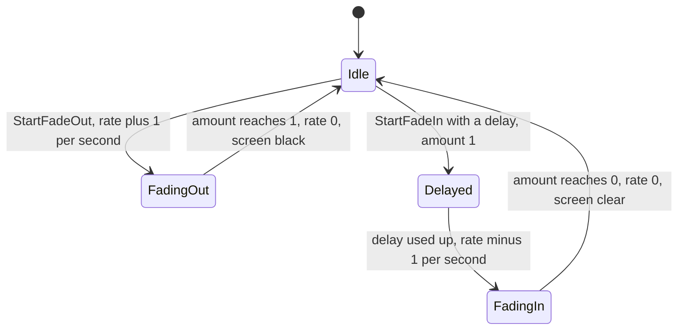
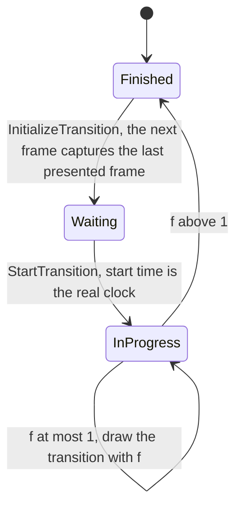
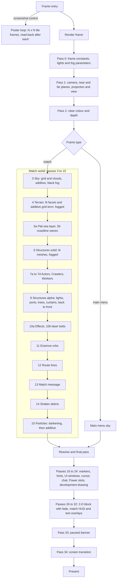

# Frame graph and passes

> Status: Engine baseline · Prefix: RND · ADRs: [ADR-004](../../../ADR/ADR-004-frame-graph-from-the-ordered-pass-table.md) · [ADR-005](../../../ADR/ADR-005-pipeline-state-catalogue.md) · [ADR-006](../../../ADR/ADR-006-root-signature-and-bindless-resource-access.md) · [ADR-007](../../../ADR/ADR-007-barrier-model.md) · [ADR-009](../../../ADR/ADR-009-instanced-crowds-sprite-cards-and-shadows.md) · [ADR-012](../../../ADR/ADR-012-swap-chain-presentation-and-frame-pacing.md) · [ADR-013](../../../ADR/ADR-013-working-colour-space-and-blending.md) · [ADR-015](../../../ADR/ADR-015-scene-anti-aliasing.md) · [ADR-016](../../../ADR/ADR-016-view-projection-and-depth-conventions.md) · [ADR-018](../../../ADR/ADR-018-texture-import-manifest.md) · [ADR-031](../../../ADR/ADR-031-batched-ui-rendering.md) · [ADR-068](../../../ADR/ADR-068-profiling-and-gpu-timing.md) · [ADR-076](../../../ADR/ADR-076-screenshot-encoding.md) · Related: [Renderer](README.md) · [World renderers](world_renderers.md) · [View, lighting and fog](view_lighting_and_fog.md) · [Shaders](shaders.md) · [Entity and overlay renderers](entity_and_overlay_renderers.md)

This document holds the ordered pass table: the single source of truth for the order of the passes of a frame and for the blend, depth, cull and cut-out state of each, from which the frame graph (ADR-004) and the pipeline-state catalogue (ADR-005) are derived. It also specifies the frame types, render-time extrapolation, fades, the pause banner, the screen transition, the loading-view frame and screenshots.

## 1 Responsibilities and boundaries

**RND-050** (MUST) The frame graph is compiled from the ordered pass table of §4.3 at start-up and on every reconfiguration (RND-030). Each table entry names its pass, the catalogue entries it may use, the resources it reads and writes, its sort rule and the setting that enables it (ADR-004).

**RND-051** (MUST) Sub-renderers record draws only. They MUST NOT issue barriers, create pipeline states, change the order of passes or read the back buffer in place: barriers are derived by the compiled graph (ADR-004, ADR-007), pipeline states exist before the first frame (ADR-005), and any pass that samples an earlier image reads a declared frame-graph target.

**RND-052** (MUST) Every state that a pass uses is a complete, immutable pipeline state. No state leaks from one pass or draw to the next; where an owner document specifies a visible effect that depends on the state an earlier draw left behind, that effect is stated as an explicit state of the later draw.

## 2 Interfaces

```cpp
namespace Engine
{

enum class BlendState : std::uint8_t
{
  Opaque,
  Alpha,
  Premultiplied,
  Additive,
  Darkening,
  Ink,
  Ghost
};
enum class DepthState : std::uint8_t
{
  TestWrite,
  Test,
  None
}; // comparison GREATER_EQUAL, ADR-016
enum class CullState : std::uint8_t
{
  Back,
  None
};
enum class SortRule : std::uint8_t
{
  Unsorted,
  BackToFront
};

struct DepthBiasVariant // RND-219 to RND-221
{
  float referenceFactor = 1.0f;
};

struct PipelineDescriptor // one catalogue entry, ADR-005
{
  ShaderPermutationId shader; // shaders.md
  BlendState blend = BlendState::Opaque;
  DepthState depth = DepthState::TestWrite;
  CullState cull = CullState::Back;
  std::optional<float> cutoutThreshold; // keep a pixel only if alpha > threshold
  DepthBiasVariant bias;                // factor 1.0 = no bias
  RenderTargetFormats targets;          // SDR or HDR scene format, sample count
};

struct PassTableEntry
{
  std::string_view id; // a data name, "pass_04_terrain", in table order
  std::span<const CatalogKey> catalogKeys;
  std::span<const ResourceAccess> reads;
  std::span<const ResourceAccess> writes;
  SortRule sort = SortRule::Unsorted;
  SettingGate enabledBy; // always, or a setting or frame kind
  RecordFunction record; // the sub-renderer that records the pass
};

class FrameGraph
{
public:
  static std::expected<CompiledFrameGraph, FrameGraphError> Compile(std::span<const PassTableEntry> _table, const RenderConfig& _config);
};

} // namespace Engine
```

## 3 Data model

### 3.1 The default pipeline state

**RND-055** (MUST) Every catalogue entry starts from this default state and lists only its differences (ADR-005):

| Group | Default |
|---|---|
| rasteriser | solid fill; back faces culled; a triangle whose vertices appear counter-clockwise on the render target is front-facing (`FrontCounterClockwise = TRUE`, the winding of the reference meshes and of glTF); depth clip on; no depth bias |
| depth | `D32_FLOAT`, reversed Z, test on with `GREATER_EQUAL` (the reversed-Z form of less-or-equal), write on (ADR-016) |
| stencil | off; no stencil format is created, because no pass uses one |
| blend | off; when a pass enables blending with the default factors, they are source alpha and one minus source alpha (the `Alpha` blend state) |
| alpha cut-out | off; when a material enables it, a pixel is kept only if its alpha is greater than `rnd.pso.default_cutout` (0.01) |
| fog | the per-frame fog parameters are always set (RND-222); fog is off unless the pass enables it |
| lighting | the two directional lights are always set in the per-frame constants (RND-226); lighting is off unless the pass uses a lit material |
| texture | none bound; a bound texture is sampled with linear clamp-to-edge filtering through all its mip levels and is multiplied by the vertex colour |
| shading | flat: every triangle has one facet colour and one facet normal (ADR-020); lit shaders use unit-length normals, except for the centipede segments, whose scaled normals RND-326 keeps (see DEC-958 item 3) |
| lines and points | no line or point smoothing; lines and points are drawn as quads (ADR-009) |
| topology | triangle lists; a quad is two triangles with the index pattern 0, 1, 2, 0, 2, 3 |
| scissor | the full render target |

**RND-056** (MUST) A pass with depth testing off never writes depth, whatever its write setting, so every reference state "test off, write on" maps to `DepthState::None`.

**RND-057** (MUST) The per-frame constants (lights, fog parameters, matrices) are written once at the start of every frame, before any pass records (pass 0 of §4.3).

### 3.2 Blend states

**RND-058** (MUST) Each blend combination of the reference look maps to one catalogue blend state of ADR-005:

| Reference combination (source factor, destination factor) | Catalogue blend state |
|---|---|
| blending off | `Opaque` |
| source alpha, one minus source alpha | `Alpha` |
| source alpha, one | `Additive` (glow, sprites, particles, normal text) |
| one, one | `Additive`, with the shader writing alpha 1 |
| source alpha, one minus source colour, with source alpha 0 | `Darkening` (zero, one minus source colour): the destination is multiplied by one minus the source colour, independent of order, so darkening draws are never sorted |
| source alpha, one minus source colour, with source alpha not 0 | `Ink` |
| one, source colour | `Ghost` (the world cursor's ghost models, [entity_and_overlay_renderers.md](entity_and_overlay_renderers.md)) |

Every blend result is clamped to [0, 1] per channel as it is written to the SDR scene target, so additive layers saturate and darkening layers multiply the clamped result (ADR-013).

### 3.3 Depth, cull and cut-out variants

**RND-059** (MUST) The depth variants are `TestWrite`, `Test` (test without write, for transparent, additive and darkening draws) and `None` (no test and no write, for screen-space UI and text and for passes drawn before any depth exists), plus the depth-biased variants of [view_lighting_and_fog.md](view_lighting_and_fog.md) §4.2, which replace every change of the projection's near plane. The cull variants are `Back` and `None` (UI, text, sprite cards, curtains, two-sided meshes).

**RND-060** (MUST) Alpha cut-out thresholds are part of the catalogue entry: `rnd.pso.default_cutout` (0.01) where a material enables cut-out without its own threshold, `rnd.pso.strike_team_cutout` (0.02) for pass 7a and `rnd.pso.worker_cutout` (0.04) for pass 7d. With multisampling on, cut-out materials use alpha-to-coverage (ADR-015).

### 3.4 The catalogue entries of the world passes

**RND-061** (MUST) The world passes specified in this folder use these catalogue entries; the entries of the actor, effect and overlay passes are listed with their passes in §4.3 and specified by their owner documents:

| Entry | Shader ([shaders.md](shaders.md)) | Blend | Depth | Cull | Fog | Used by |
|---|---|---|---|---|---|---|
| `sky` | `Sky` | `Additive` | `None` | `Back` | per layer, in the shader | pass 3; the main-menu and loading-view sky |
| `terrain` | `Terrain` | `Opaque` | `TestWrite` | `Back` | level | pass 4 |
| `terrain_inverted` | `Terrain`, `INVERTED` | `Darkening` | `TestWrite` | `Back` | level | pass 4 in the inverted style |
| `sea_flat` | `SeaFlat` | `Opaque` | `Test` | `None` | level | pass 5a |
| `sea_flat_inverted` | `SeaFlat`, `INVERTED` | `Darkening` | `Test` | `None` | level | pass 5a in the inverted style |
| `sea_waves` | `SeaWaves` | `Additive` | `TestWrite` | `Back` | level | pass 5b |
| `mesh_lit_fog` | `MeshLit`, `FOG` | `Opaque` | `TestWrite` | `Back` | level | pass 6 |
| `port_pad` | `MeshLit`, `FOG` | `Opaque` | `Test` | `None` | level | pass 8, structure port pads |
| `glow_additive_fog` | `UnlitTextured`, `FOG` | `Additive` | `Test` | `None` | level | pass 8: structure lights, port stars, spawn-network glows and beams, trees, Barrier Emitter burn layer |
| `glow_additive_fog_nodepth` | `UnlitTextured`, `FOG` | `Additive` | `None` | `None` | level | pass 8: burning-tree flames |
| `alpha_fog` | `UnlitTextured`, `FOG` | `Alpha` | `Test` | `None` | level | pass 8: blighted and burning trees, the countdown screens (RND-176) |
| `dual_alpha_fog` | `UnlitDualTexture`, `FOG`, `COMBINE` = `REPLACE_THEN_MODULATE` | `Alpha` | `Test` | `None` | level | pass 8: Barrier Emitter curtain |
| `dual_additive_clip_fog` | `UnlitDualTexture`, `FOG`, `COMBINE` = `MODULATE`, `CLIP_PLANES` = 2 | `Additive` | `Test` | `None` | level | pass 8: Beam Dish beam tubes |
| `line_additive_fog` | `ScreenLine`, `FOG` | `Additive` | `Test` | `None` | level | pass 8: Barrier Emitter top edge, power lines |
| `fade` | `FullscreenFade` | `Alpha` | `None` | `None` | off | pass 27 |
| `transition` | `ScreenTransition` | `Alpha` | `None` | `None` | off | pass 34 |

**RND-062** (MUST) Every catalogue entry exists in an SDR and, where HDR output is offered, an HDR scene-target form, and in each enabled sample count (ADR-005, ADR-014, ADR-015). Entries are created at start-up or during reconfiguration, never during a frame.

### 3.5 Frame-graph resources

**RND-063** (MUST) The frame graph declares these resources by name:

| Resource | Format and size | Written by | Read by |
|---|---|---|---|
| `scene_colour` | `R8G8B8A8_UNORM` (SDR) or `R16G16B16A16_FLOAT` (HDR); render size; the configured sample count | passes 2 to 15 | the resolve |
| `scene_depth` | `D32_FLOAT`; render size; the configured sample count | passes 2 to 15 | passes 3 to 15, the depth copy |
| `scene_resolved` | as `scene_colour`, one sample | the resolve after pass 15 | the final pass |
| `final_image` | the back-buffer format; client-area size | the final pass (scaling, brightness and HDR conversion, ADR-012, ADR-014), then passes 16 to 34 at native resolution | the capture copy, the screenshot read-back, the present copy |
| `captured_frame` | as `final_image` | the capture copy (RND-095) | pass 34 |
| `screenshot_readback` | read-back buffer of `final_image` | the screenshot copy (RND-112) | the screenshot encoder (ADR-076) |
| `scene_depth_single` | single-sample `R32_FLOAT` copy of `scene_depth` (the nearest sample); render size | the depth copy after pass 15 | pass 20 |
| `terrain_heights` | single-channel float; one texel per height sample | terrain load | particles (ADR-010), shadow projection (ADR-009) |
| `back_buffer` | the swap-chain format (ADR-012) | the present copy | present |

## 4 Behaviour and algorithms

### 4.1 Frame entry

**RND-065** (MUST) At each frame the renderer first checks the screenshot request (RND-110). Without one, it renders one frame of the current frame type (§4.2) and presents it. Every frame is bracketed by a profiling marker, and every pass by one CPU and GPU marker and one GPU timestamp pair (ADR-068).

**RND-066** (MUST) The screen-transition step (RND-096) runs immediately before every present, in every frame type that presents through `RenderFrame`.

### 4.2 Frame types

**RND-067** (MUST) The renderer draws exactly these frame types:

| Frame type | When | What is drawn between the clear and the overlay passes |
|---|---|---|
| match frame | a match world exists, the map editor is not open and the front end is not showing | passes 3 to 15 of §4.3 |
| main-menu frame | the front end is showing and its first screen has been created | the main-menu branch (RND-077), then passes 16 to 34 |
| loading-view frame | while a load runs (start-up, match load, preview loads) | its own sequence (RND-118), not `RenderFrame` |
| poster tile | a screenshot with a poster resolution above 1 | a match or main-menu frame per tile, with the tile's sub-projection (RND-111) |
| map-editor frame | the map editor is open | the match frame plus the editor's overlays ([reference/08_maps_and_level_design/map_editor_hooks.md](../../../reference/08_maps_and_level_design/map_editor_hooks.md)); hooks only |

**RND-068** (MUST NOT) No other frame type exists: no screen-space pixelation pre-pass, no campaign world view and no start-up intro sequence (see DEC-059, DEC-052).

### 4.3 The ordered pass table of a match frame

**RND-070** (MUST) A match frame runs these passes in this order. "Owner" names the document that specifies what the pass draws; "Entries" gives the catalogue state as blend · depth · cull, with the depth-bias variant where one applies; fog and lighting are the pass's settings.

| # | Pass | What is drawn | Owner | Entries (blend · depth · cull) | Fog | Lighting | Sort |
|---|---|---|---|---|---|---|---|
| 0 | frame constants | nothing; the per-frame constants are written: matrices, the two lights (RND-226), the fog parameters (RND-222) | this document | — | parameters set | lights set | — |
| 1 | camera | nothing; the frame-rate counter advances (R-SIM-576); the projection and view are set up (RND-210, RND-211) | [view_lighting_and_fog.md](view_lighting_and_fog.md) | — | — | — | — |
| 2 | clear | `scene_colour` to the background colour `rnd.frame.clear_colour` (0, 0, 0), `rnd.frame.clear_colour_inverted` (1, 1, 1) in the inverted style (see DEC-040); outside a match `rnd.frame.clear_colour_no_match` (0.05, 0, 0.05); `scene_depth` to 0 | this document | — | — | — | — |
| 3 | sky | the sky grid and the blobby and flat cloud layers, in one instanced draw | [world_renderers.md](world_renderers.md) §4.3 | `sky`: `Additive` · `None` · `Back` | per layer, black | unlit | unsorted |
| 4 | terrain | the terrain surface and its wire-grid overlay, in one pass | [world_renderers.md](world_renderers.md) §4.1 | `terrain`: `Opaque` · `TestWrite` · `Back`; inverted: `Darkening` · `TestWrite` · `Back` | level | lit, terrain materials (RND-230) | chunks unsorted |
| 5a | flat sea layer | the textured, shore-masked sea layer at its fixed depth | [world_renderers.md](world_renderers.md) §4.2 | `sea_flat`: `Opaque` · `Test` · `None`; inverted: `Darkening` · `Test` · `None` | level | unlit | unsorted |
| 5b | coastline waves | the additive coastline wave mesh, when the sea detail is above 0 | [world_renderers.md](world_renderers.md) §4.2 | `sea_waves`: `Additive` · `TestWrite` · `Back` | level | unlit | unsorted |
| 6 | structures, solid | the lit meshes of every structure in view | [world_renderers.md](world_renderers.md) §4.5 | `mesh_lit_fog`: `Opaque` · `TestWrite` · `Back` | level | object lighting, or the special lighting (RND-229) | unsorted |
| 7a | actor groups | every in-view member of each team's actor groups, drawn by the instanced mesh path: the Troopers of its Strike teams, its centipede segments, the Bombers of its airstrike flights and the ants of its Hive groups (RND-323) | [entity_and_overlay_renderers.md](entity_and_overlay_renderers.md) | `group_mesh_lit`: `Alpha` · `TestWrite` · `Back`, cut-out `rnd.pso.strike_team_cutout`; Troopers `trooper_mesh_lit`: `Opaque` · `TestWrite` · `Back`; damage flicker `Additive` with alpha 1 | off | object lighting | unsorted |
| 7b | other actors | every in-view actor that is neither a Worker nor a Crawler | [entity_and_overlay_renderers.md](entity_and_overlay_renderers.md) | per actor kind: lit meshes `Opaque` · `TestWrite` · `Back`; damage flicker `Additive` with alpha 1; spider darkening `Darkening`; sprites and glows `Additive` · `Test` · `None`; overlays and beams `Test` · `None`; blob shadows `Darkening` · `Test` · `None` with the shadow bias variant; the meteor glow, the Reaper Serpent's captured orbs and the Missile Barrage ground marker `None` depth | off | lit meshes: object lighting; the Abductor: the special lighting; everything else unlit | unsorted |
| 7c | Crawlers | the glowing trail strips of every in-view Crawler group | [entity_and_overlay_renderers.md](entity_and_overlay_renderers.md) | `Additive` · `Test` · `None` with the Crawler bias variant; the Rogue faction `Ink` · `Test` · `None` with the same bias | off | unlit | unsorted |
| 7d | Workers | the facing-oriented Worker cards and their flat ground shadows | [entity_and_overlay_renderers.md](entity_and_overlay_renderers.md), [README.md](../animation_and_vfx/README.md) | cards `Alpha` · `TestWrite` · `None`, cut-out `rnd.pso.worker_cutout`; ground shadows `Alpha` · `Test` · `None` with the same cut-out | off | unlit | unsorted |
| 8 | structures, alpha | lights, ports and the translucent layers of every in-view structure: unsorted structures in pool order, then sorted structures back to front (RND-166) | [world_renderers.md](world_renderers.md) §4.5 to §4.7 | §3.4 entries `port_pad`, `glow_additive_fog`, `glow_additive_fog_nodepth`, `alpha_fog`, `dual_alpha_fog`, `dual_additive_clip_fog`, `line_additive_fog` | level, for the whole pass | port pads: object lighting | back to front for sorted structures |
| 10a | effects | every effect object in view; the Core Device pulse wave, Swarm streaks and lightning strikes are drawn without a view test | [entity_and_overlay_renderers.md](entity_and_overlay_renderers.md) | `Additive` · `Test` · `None` for the batch; per effect as its owner states | off | unlit | unsorted |
| 10b | laser bolts | every laser bolt, in one instanced draw | [entity_and_overlay_renderers.md](entity_and_overlay_renderers.md) | `Additive` · `Test` · `None` with the laser bias variant | off | unlit | unsorted |
| 11 | Essence orbs | inner and outer glow quads; Rogue-faction orbs first | [README.md](../animation_and_vfx/README.md) | Rogue faction `Ink` · `Test` · `None`; others `Additive` · `Test` · `None` | off | unlit | Rogue faction first |
| 12 | route lines | route previews of the local player | [entity_and_overlay_renderers.md](entity_and_overlay_renderers.md) | `Alpha` · `None` · `None` | off | unlit | unsorted |
| 13 | match message | the centred match message (RND-074) | this document; text styles in the UI framework | text styles · `None` · `None` | off | unlit | — |
| 14 | shatter debris | the shards of shattered meshes | [README.md](../animation_and_vfx/README.md) | `Alpha` · `TestWrite` · `None`, lit, with the shard edge mask | off | object lighting | unsorted |
| 15 | particles | the darkening batch, then the additive batch | [README.md](../animation_and_vfx/README.md) | `Darkening` · `Test` · `None`, then `Additive` · `Test` · `None` | off | unlit | darkening batch first |
| 16 | world markers | world markers projected to screen icons, and off-screen direction arrows | [entity_and_overlay_renderers.md](entity_and_overlay_renderers.md) | `Alpha`, icon layers `Additive` · `None` · `None` | off | unlit | — |
| 17 | hint overlay | help overlays and the animated mode explainers, with the line widths of R-TUT-012: the instruction-tab border `ref.tut.tab.border` (2 px, R-TUT-074) and the 1 px outline of the camera-controls picture (R-TUT-021) | [ui_framework/README.md](../ui_framework/README.md), [reference/11_tutorial_and_help.md](../../../reference/11_tutorial_and_help.md) R-TUT-012 | `Alpha` · `None` · `None` | off | unlit | — |
| 19 | UI windows | every menu, dialog, lobby and HUD window, back-most first | [ui_framework/README.md](../ui_framework/README.md) | per widget (ADR-031) · `None` · `None` | off | unlit | back-most first |
| 20 | world cursor | 3-D highlight rings and cylinders, formation dots, ghost models; then the 2-D icon, entry marker, crosshair or pointer | [entity_and_overlay_renderers.md](entity_and_overlay_renderers.md) | rings `Alpha` · `Test` · `None` with the cursor bias variant; ghost models `Ghost` · `Test`; pointer shadow `Ink`, then `Additive` (the crosshair `Alpha`) | off | unlit | — |
| 21 | chat | the chat log and the talk hint (RND-075) | [ui_framework/README.md](../ui_framework/README.md) | text styles · `None` · `None` | off | unlit | — |
| 23 | Power slots panel | target-area particles, the Power bar, pop-ups and messages | [entity_and_overlay_renderers.md](entity_and_overlay_renderers.md) | `Alpha` and `Additive` · `None` · `None` | off | unlit | — |
| 24 | development drawing | queued debug shapes, Debug builds only | [developer_tools.md](../diagnostics_test_and_performance/developer_tools.md#47-development-drawing) | as that document states | off | unlit | — |
| 26 | 2-D block start | nothing; the 2-D overlay projection of RND-215 is set up for passes 27 to 31 | this document | — | — | — | — |
| 27 | fade | the full-screen black fade (RND-085) | this document | `fade`: `Alpha` · `None` · `None` | off | unlit | — |
| 28 | match HUD | scores, timers and the mode HUD | [entity_and_overlay_renderers.md](entity_and_overlay_renderers.md), [reference/01_skirmish_rules_and_modes/README.md](../../../reference/01_skirmish_rules_and_modes/README.md) | `Alpha` · `None` · `None` | off | unlit | — |
| 29 | text overlays | the development overlays and the version string (RND-076) | this document, [developer_tools.md](../diagnostics_test_and_performance/developer_tools.md#44-development-overlay) | text styles · `None` · `None` | off | unlit | — |
| 32 | 2-D block end | nothing; the 3-D projection is restored | this document | — | — | — | — |
| 33 | paused banner | the paused banner (RND-090) | this document | text styles · `None` · `None` | off | unlit | — |
| 34 | screen transition and present | the captured-frame slide (RND-096), then the present | this document | `transition`: `Alpha` · `None` · `None` | off | unlit | — |

The pass numbers keep gaps where the reference frame has a pass that draws nothing or that the reference library does not specify (RND-071). Passes 16 to 34 draw into `final_image` at the client area's native resolution, after the resolve of `scene_colour` and the final pass (RND-063).

**RND-071** (MUST NOT) The match frame has no pass for: a debug face picture in the sky; synchronisation-error markers; an empty particle pass; a summon-wheel interface; an empty camera-debug pass; the control-hint system, which draws nothing in a match; a start-up intro sequence; a studio logo overlay of the campaign. None of them draws anything in a match (see DEC-059, DEC-052).

**RND-072** (MUST) Passes 3 to 15 are the only passes that write `scene_depth`, and they draw into `scene_colour` at the render size, in table order; the match message of pass 13 is therefore overdrawn by the debris and particles of passes 14 and 15. Passes 16 to 34 never use the hardware depth test, except that the 3-D parts of the world markers in pass 16 (the ground highlights of order markers and the local team's Leader banners, RND-358) and the world cursor's 3-D rings, ghost models and formation dots in pass 20 compare their depth in the pixel shader with `scene_depth_single` at the corresponding scene position and are discarded where they lie behind the scene (RND-309), which keeps their reference order after the UI windows.

**RND-073** (MUST) The sky pass draws before any depth exists in the frame. Its layers therefore pass every depth comparison, and the `sky` entry uses `DepthState::None` for every layer, which yields the image of a depth-tested sky grid over a cleared depth target.

**RND-074** (MUST) The match message of pass 13 is drawn centred at y = `rnd.hud.message.y` (370) × render width ÷ `rnd.hud.message.reference_width`, at a font size of `rnd.hud.message.font_size` (40) px × the message scale of RND-028, reduced so that the text fits the screen width, in its team colour, with the outline style first and the fill style second. In the last `rnd.hud.message.grow_window` (2 s) of its display time it grows by √(`rnd.hud.message.grow_window` − *r*) × `rnd.hud.message.grow_gain` (15) px, where *r* is its remaining display time in seconds. The message content and its display time come from the match rules ([reference/01_skirmish_rules_and_modes/README.md](../../../reference/01_skirmish_rules_and_modes/README.md)).

**RND-075** (MUST) The chat log of pass 21 is drawn only while chat is shown in the match; each line lives `rnd.hud.chat.line_life` (60 s) and fades out over the last `rnd.hud.chat.line_fade` (5 s) of its life, that is from 55 s.

**RND-076** (MUST) Pass 29 draws: in Debug builds, the frame-rate overlay and the input-mode box when their development flags are set (RND-011); the build version string (ADR-057) in the front end, and in Release builds never while a match world exists; the editor banner in the map editor. Banners that report network state are presentation hooks of the networking model, which the design phase decides (DEC-200).

### 4.4 Branches that replace passes 3 to 15

**RND-077** (MUST) In the main-menu frame, passes 3 to 15 are replaced by the main-menu sky: the sky pass alone, drawn by the front end's own sky renderer (`SkyRenderer`), with a fixed camera at (0, 600, 0) (`rnd.frame.menu_camera_position`), a vertical field of view of `rnd.frame.menu_fov` (90°), and a front vector of (0, 0, 1) rotated by `rnd.frame.menu_yaw` (−1.899 rad) about the y axis and then by `rnd.frame.menu_roll` (−1.079 rad) about the z axis. The menu sky's extrapolation time is the negated real clock, so its clouds drift with real time ([world_renderers.md](world_renderers.md) RND-152). The near and far planes are those outside a match (RND-211). Passes 16 to 34 follow.

**RND-078** (MUST) In the map-editor frame, the match frame is drawn and the map editor's overlays follow it, in the order of the editor's drawing list ([reference/08_maps_and_level_design/map_editor_hooks.md](../../../reference/08_maps_and_level_design/map_editor_hooks.md) R-MAP-380, with its structure markers of table 2.12-A and its mode overlays of table 2.12-B). The editor's content is specified as hooks only; the sea's editor grid is in [world_renderers.md](world_renderers.md) RND-148.

### 4.5 Reachability in a match

**RND-079** (MUST) Every match, including matches against bots and the tutorials, takes the match path: the match frame of RND-067 is drawn, and the Essence orbs take their match sizes and alphas ([README.md](../animation_and_vfx/README.md)). Launch Race matches force the special lighting for structures (RND-229).

**RND-080** (MUST NOT) No match draws the control-hint system's hints, a start-up sequence, a studio logo of the campaign, a campaign world view, a pixelation effect, a deform effect or a water reflection (see DEC-059, DEC-336, DEC-052).

### 4.6 Render-time extrapolation

**RND-081** (MUST) Every renderer draws an object at the extrapolated position and orientation of `reference/12_simulation_model/01_tick_timing_and_main_loop.md` R-SIM-562: position + velocity × *t*, and for a mesh node its orientation advanced by its angular velocity × *t*, where *t* is the extrapolation time of R-SIM-560 (0 while the world is held). This is extrapolation from the last tick, not interpolation between two stored states (R-SIM-563); the choice for Species is DEC-222 (R-SIM-565).

**RND-082** (MUST) The objects of a sliced pool are drawn with the slice-aware time of R-SIM-562: a slot the current tick has already advanced uses *t*, and a slot it has not yet advanced uses *t* + `ref.sim.tick_period` × *s*. This applies to the structures (passes 6 and 8), the laser bolts and effects (passes 10a and 10b), the Essence orbs (pass 11), each team's other actors (pass 7b), the Crawler groups (pass 7c) and the Workers (pass 7d). The particle pool (pass 15) is not a sliced pool: it is drawn at presentation time from its GPU state ([particles_shatter_and_screen_effects.md](../animation_and_vfx/particles_shatter_and_screen_effects.md) VFX-217). The Essence orbs and the Reaper Serpent are additionally drawn one tick behind, as [README.md](../animation_and_vfx/README.md) specifies.

**RND-083** (MUST) The sky offset uses the same rule with the update slice as its threshold: if the last processed update slice of the current tick is at or after `ref.sim.slice.sky` (slice 3), the sky is drawn with *t*, otherwise with *t* + `ref.sim.tick_period` × *s* ([world_renderers.md](world_renderers.md) RND-152).

### 4.7 Fade, paused banner and screen transition

**RND-085** (MUST) The fade has an amount (0 clear, 1 black), a rate per second and a delay. Each frame, with *dt* = min(real clock − the fade's last update time, `rnd.fade.max_step` (0.05 s)): if the delay is above 0, the delay decreases by *dt*; otherwise the amount increases by rate × *dt* and is clamped to [0, 1], and when it reaches 0 or 1 the rate becomes 0. `StartFadeOut()` sets the rate to +`rnd.fade.rate` (1 per second) with no delay. `StartFadeIn(delay)` sets the amount to 1, the rate to −`rnd.fade.rate` and the delay to the given value.



Caption: the fade states; `IsFadeComplete()` is true in `Idle`, where the rate is 0, whatever the amount.

**RND-086** (MUST) While the amount is above `rnd.fade.visible_threshold` (0.0001), pass 27 draws a full-screen black quad with alpha = the amount, using the `fade` entry. `IsFadeComplete()` is true exactly when the rate is 0. Because pass 27 precedes passes 28 to 34, the match HUD, the text overlays, the paused banner and the screen transition are drawn over the fade, and passes 3 to 24 under it.

**RND-087** (MUST) The fade is drawn in every frame type that runs pass 27, including the main-menu frame.

**RND-090** (MUST) Pass 33 draws the paused banner only when the match is paused by the pause command (see DEC-038), no UI window is open and the interface is shown. The banner is the text `ui.match.paused`, centred at (render width ÷ 2, `rnd.pause.banner_y` (0.4) × render height), at a font size of `rnd.pause.banner_size` (80) px, drawn first in the outline style (white with alpha 0 under the ink text blend, which darkens) and then in white in the normal text style ([ui_framework/layout_rendering_input_and_localisation.md](../ui_framework/layout_rendering_input_and_localisation.md)).

**RND-091** (MUST) The new text `ui.match.paused` reads "Match paused".

**RND-095** (MUST) The screen transition follows the state diagram below. `InitializeTransition(duration, direction)` stores the duration and the direction (+1 or −1) and enters `Waiting`; the next frame's first pass copies the previous frame's `final_image` into `captured_frame` before anything overwrites it, so the transition always shows the last presented frame (see DEC-316). `StartTransition()` records the real clock as the start time and enters `InProgress`. The front end passes the duration of its page changes ([ui_framework/pages_and_screen_recipes.md](../ui_framework/pages_and_screen_recipes.md)).



Caption: the screen-transition states; f = (real clock − start time) ÷ duration, evaluated in the transition step before every present.

**RND-096** (MUST) In `InProgress`, the transition step computes *f* = (real clock − start time) ÷ duration. If *f* > 1 the state becomes `Finished` and nothing is drawn. Otherwise, with *c* = *f* × `rnd.transition.curve_gain` (3.6) and the direction *d*, pass 34 draws over the new screen:

1. a strip `rnd.transition.edge_strip_width` (20) px wide adjoining the right edge of the quad of step 2, shading from black at its left side to transparent at its right side;
2. the captured frame as a quad equal to the full screen shrunk inward by `rnd.transition.shrink_rate` (0.2) × *c* × *d* × the screen width on the left and right sides and by the same factor × the screen height on the top and bottom sides, moved left by the screen width × *c*^`rnd.transition.slide_exponent` (6) × *d*, with alpha max(0, 1 − `rnd.transition.fade_rate` (0.2) × *c*), sampled upright with point (nearest) clamp-to-edge filtering, through the point clamp-to-edge sampler (ADR-018, [visual_language.md](visual_language.md) RND-432).

Both draws use the `transition` entry.

**RND-097** (MUST) The captured frame has the size of `final_image`; no padding to other sizes is applied.

**RND-098** (MUST) The transition draws only in `InProgress`; `Waiting` draws nothing and waits for `StartTransition()` without a time limit.

### 4.8 Screenshots and poster renders

**RND-110** (MUST) When the screenshot control fires and no UI window is open, the renderer takes the poster path with *N* = the poster-resolution setting ([options_and_budgets.md](options_and_budgets.md); 1 gives an ordinary screenshot). If *N* > 1 the poster state becomes `Tiling`. When a UI window is open, the control is ignored and an ordinary frame is drawn.

**RND-111** (MUST) The poster path renders *N* × *N* complete frames in tile order *i* = 0 to *N*² − 1, each including every overlay pass, and each with the tile's sub-projection of [view_lighting_and_fog.md](view_lighting_and_fog.md) RND-214 while the state is `Tiling`. After each tile frame, the screenshot read-back copies `final_image`, the frame is presented, and the tile index increases. After the last tile the poster is saved and the state returns to `Inactive`.

**RND-112** (MUST) The read-back is a frame-graph copy of `final_image` into `screenshot_readback` after the last overlay pass and before the present copy; the CPU maps it only after the frame's fence has completed, on a worker thread (ADR-004, ADR-076).

**RND-113** (MUST) The poster image is (*N* × render width) × (*N* × render height) pixels, initialised to black. Tile *i* covers the block whose lower-left corner is (*x* × render width, *y* × render height) with *x* = *i* mod *N* and *y* = ⌊*i* ÷ *N*⌋, counting rows from the bottom, so tile 0 is the bottom-left block; the saved image is top-down.

**RND-114** (MUST) The poster is saved as one PNG through the encoder and the file naming of ADR-076, encoded one tile row at a time; every pixel's alpha is written as fully opaque, so the image shows exactly the colour channels of the frames.

### 4.9 The loading-view frame

**RND-118** (MUST) Each loading-view frame (`LoadingView`), once the spinner art `sprite.worker.front` is resident, runs: clear `final_image` to black; if this is not the start-up load, no match is loading, the front end is showing and the fade is complete, draw the main-menu sky (RND-077) and the UI windows (pass 19) behind; then, in a 2-D block with the `Alpha` blend and no culling, the studio splash `uitex.studio_splash` during the start-up load and the spinning Worker, as [reference/09_front_end_and_match_flow/screen_flow_and_match_setup.md](../../../reference/09_front_end_and_match_flow/screen_flow_and_match_setup.md) specifies; then present. The reference loading view has no progress display; whether Species loads report progress is decided by the design phase (see DEC-226).

**RND-119** (MUST) Loading-view frames are paced by `ref.sim.frame.loading_frame_period` of [reference/12](../../../reference/12_simulation_model/01_tick_timing_and_main_loop.md) (R-SIM-570). Uploads made during a load go through the copy queue and never through the loading-view frame (ADR-008).

### 4.10 Frame-graph diagram



Caption: the order of one frame; the main-menu branch replaces the match world, and every frame ends with the screen-transition step and the present.

## 5 Concurrency and performance budget

**RND-120** (MUST) The compiled frame graph is a fixed list per render configuration; per frame, the CPU walks it, records each pass (in parallel where the threading model allows, DEC-224) and executes the command lists on the direct queue in table order. The screen-transition capture and the screenshot read-back are always present in the graph and record their copy only on the frames that need it, so no recompilation happens per frame. GPU and CPU budgets per pass are in [options_and_budgets.md](options_and_budgets.md).

## 6 Failure modes, diagnostics and telemetry

| Failure | Behaviour | Requirement |
|---|---|---|
| a pass names a catalogue key that does not exist | a build error | RND-061, ADR-005 |
| a resource is read before it is written, or written and never read | frame-graph compilation fails with a diagnostic naming the pass | RND-050, ADR-004 |
| a screenshot read-back cannot be mapped or encoded | the file is not written; a log entry; the frame continues | RND-112 |
| `StartTransition()` is called in `Finished` | ignored; a warning in Debug builds | RND-095 |

Every pass carries its marker and timestamps in both configurations (ADR-068); a development view of Debug builds shows the pass list with per-pass GPU times.

## 7 Acceptance tests

| Test | Kind | Checks | Requirements |
|---|---|---|---|
| T1 table and catalogue | build check | every pass key exists in the catalogue and every catalogue entry is used by a pass | RND-050, RND-061, RND-062 |
| T2 pass order | capture | a PIX capture of a test match frame shows one marker per pass in table order, with the passes of RND-071 absent | RND-065, RND-070, RND-071 |
| T3 default state | unit | the generated catalogue's default descriptor equals the table of RND-055; a front-facing test triangle with counter-clockwise vertices on the render target is drawn and its reverse is culled | RND-055, RND-056 |
| T4 blend mapping | golden-image | each blend state draws a reference patch; a stack of darkening layers in two orders gives the same image; additive layers saturate at 1 | RND-058 |
| T5 cut-out | golden-image | cards with alpha ramps keep exactly the pixels above 0.01, 0.02 and 0.04 in the three cut-out variants | RND-060 |
| T6 extrapolation | unit | for a pool advanced to slot *k*, slots ≤ *k* use *t* and slots > *k* use *t* + one tick; the sky threshold switches at slice 3 | RND-082, RND-083 |
| T7 fade | unit | a fade-out from 0 reaches 1 after 1 s of frames at 60 Hz; a frame gap of 1 s advances the amount by 0.05 only; a fade-in with delay 0.6 s starts after the delay | RND-085, RND-086 |
| T8 transition | golden-image | frames at *f* = 0, 0.25, 0.5 and 1 match the reference images computed from RND-096; the captured image equals the last presented frame | RND-095, RND-096 |
| T9 poster | golden-image | a 2 × 2 poster equals four renders of the tile sub-projections placed bottom-up, with opaque alpha | RND-110 to RND-114 |
| T10 paused banner | golden-image | the banner appears only with the pause command active, the interface shown and no window open | RND-090 |
| T11 debug-layer run | integration | in a Debug build on a GPU test agent (ADR-070), a full match frame and a main-menu frame render with the debug layer and GPU-based validation and produce no message | RND-051, RND-120 |

## 8 Open decisions

| Reference | Status | Where it applies |
|---|---|---|
| DEC-038 | Resolved | the pause command that shows the paused banner (RND-090) |
| DEC-040 | Open | the inverted style and its clear colour (pass 2) |
| DEC-052 | Dropped | campaign frame types and overlays are not specified (RND-068, RND-071, RND-080) |
| DEC-059 | Dropped | the frame types and passes that are not specified (RND-068, RND-071, RND-080) |
| DEC-200 | Open | network-state banners (RND-076) |
| DEC-222 | Open | extrapolation or interpolation (RND-081) |
| DEC-224 | Open | parallel pass recording (RND-120) |
| DEC-226 | Open | load progress (RND-118) |
| DEC-316 | Open | the screen transition and the captured frame (RND-095) |
| ADR-004, ADR-005, ADR-007 | Proposed, Accepted, Proposed | the frame graph, the catalogue and the barrier model this document feeds |

**Design-phase inputs.** Whether the world game keeps the screen transition between front-end pages; whether poster renders are kept and at what maximum resolution; what the loading view shows while a region streams in (DEC-226).

## 9 Tuning table

| key | value | unit | range or notes | requirement | DEC |
|---|---|---|---|---|---|
| `rnd.pso.default_cutout` | 0.01 | alpha | a pixel is kept only if its alpha is greater | RND-055, RND-060 | |
| `rnd.pso.strike_team_cutout` | 0.02 | alpha | pass 7a | RND-060 | |
| `rnd.pso.worker_cutout` | 0.04 | alpha | pass 7d | RND-060 | |
| `rnd.frame.clear_colour` | 0, 0, 0 | RGB | match background and level fog colour | RND-070 | |
| `rnd.frame.clear_colour_inverted` | 1, 1, 1 | RGB | background and level fog colour in the inverted style | RND-070 | DEC-040 |
| `rnd.frame.clear_colour_no_match` | 0.05, 0, 0.05 | RGB | background outside a match | RND-070 | |
| `rnd.frame.menu_camera_position` | 0, 600, 0 | wu | main-menu sky camera | RND-077 | |
| `rnd.frame.menu_fov` | 90 | degrees, vertical | main-menu sky camera | RND-077 | |
| `rnd.frame.menu_yaw` | −1.899 | rad about y | applied to the front vector (0, 0, 1) first | RND-077 | |
| `rnd.frame.menu_roll` | −1.079 | rad about z | applied second | RND-077 | |
| `rnd.hud.message.y` | 370 | px at the reference width | match-message centre line | RND-074 | |
| `rnd.hud.message.font_size` | 40 | px at the reference width | before fit-to-width reduction | RND-074 | |
| `rnd.hud.message.grow_window` | 2 | s of real time | the growth phase at the end of a message | RND-074 | |
| `rnd.hud.message.grow_gain` | 15 | px | growth = √(2 − remaining) × 15 | RND-074 | |
| `rnd.hud.chat.line_life` | 60 | s of real time | | RND-075 | |
| `rnd.hud.chat.line_fade` | 5 | s of real time | fade at the end of the life | RND-075 | |
| `rnd.fade.max_step` | 0.05 | s of real time | largest fade step per frame | RND-085 | |
| `rnd.fade.rate` | 1 | amount per s | fade-out +1, fade-in −1 | RND-085 | |
| `rnd.fade.visible_threshold` | 0.0001 | amount | the fade quad is drawn above this | RND-086 | |
| `rnd.pause.banner_y` | 0.4 | × render height | | RND-090 | |
| `rnd.pause.banner_size` | 80 | px | | RND-090 | |
| `rnd.transition.curve_gain` | 3.6 | × *f* | *c* = 3.6 × *f* | RND-096 | DEC-316 |
| `rnd.transition.shrink_rate` | 0.2 | × *c* × screen size | inward shrink per side | RND-096 | DEC-316 |
| `rnd.transition.slide_exponent` | 6 | power of *c* | slide = screen width × *c*⁶ × direction | RND-096 | DEC-316 |
| `rnd.transition.fade_rate` | 0.2 | × *c* | alpha = max(0, 1 − 0.2 × *c*) | RND-096 | DEC-316 |
| `rnd.transition.edge_strip_width` | 20 | px | shadow strip at the right edge | RND-096 | |
