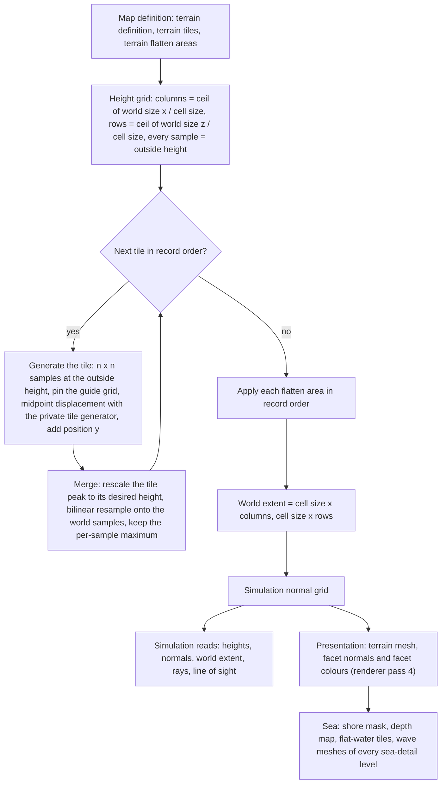
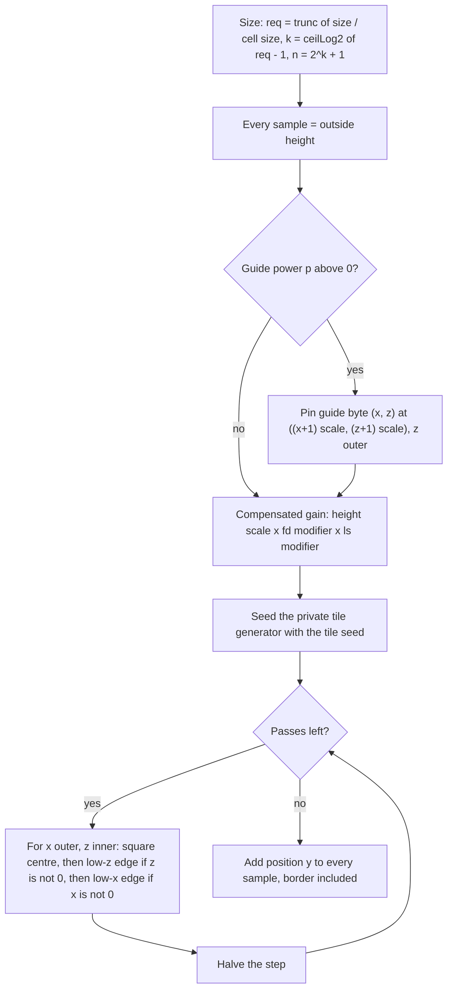

# Terrain

> Status: Engine baseline · Prefix: TER · ADRs: [ADR-0011](../../adr/0011-world-surface-rendering.md) · [ADR-0052](../../adr/0052-cpp23-language-standard.md) · [ADR-0059](../../adr/0059-content-build-and-validators.md) · [ADR-0060](../../adr/0060-content-identity-by-hash.md) · [ADR-0061](../../adr/0061-data-schemas-and-versioning.md) · [ADR-0069](../../adr/0069-test-framework.md) · Related: [World renderers](renderer/world_renderers.md) · [Maps: rules and conventions](../../reference/08_maps_and_level_design/rules_and_conventions.md) · [Map editor hooks](../../reference/08_maps_and_level_design/map_editor_hooks.md) · [Randomness and integrity](../../reference/12_simulation_model/07_randomness_and_integrity.md) · [Space, routing and physics](../../reference/12_simulation_model/05_space_routing_and_physics.md) · [Data schemas](data_schemas.md)

This component turns the terrain records of a map definition into the terrain that the simulation stands on and the renderer draws, precisely enough to re-implement the generator and reproduce its output bit for bit. The runtime model of a large world (generated at load or baked, streaming, content identity) is decided by the design phase (§8.3).

Notation used throughout: *r32*(*x*) rounds a binary64 value to the nearest binary32 value (ties to even) and widens it back to binary64; trunc(*x*) truncates toward zero; ⌊*x*⌋ and ⌈*x*⌉ are floor and ceiling; "tile space" is a tile's height scale before its peak rescale (§4.8); *X* and *Z* are the world extents of TER-150.

## 1 Responsibilities and boundaries

**TER-001** (MUST) The terrain component owns: the terrain definition, tile and flatten-area data as the generator reads them (§3); the generator (§4.3 to §4.9); the terrain height field (`TerrainField`) with its height grid, its simulation normal grid, its cell size, its column and row counts and its world extent; the read-only queries of §2.2; the per-triangle colour-ramp look-up (§4.12); and the sea derivations (§4.14). It owns no GPU resource and records no pass.

**TER-002** (MUST) The terrain is one regular height field: a world surface grid (`SurfaceGrid`) with its origin at (0, 0) and square cells of the cell size on both axes. It is generated once per match-world initialisation, at step 5 of [reference/12](../../reference/12_simulation_model/02_match_lifecycle_and_state_reset.md) table 2.4-A (R-SIM-016), from the terrain definition, the terrain tiles and the terrain flatten areas of the map definition ([rules and conventions](../../reference/08_maps_and_level_design/rules_and_conventions.md) R-MAP-080 to R-MAP-083). Nothing writes it afterwards: no simulation rule, presentation code, option change or tool other than the map editor's regeneration (§8.2) changes a sample (DEC-007, DEC-010).

**TER-003** (MUST) A terrain is a list of tiles. Each tile is an independent square fractal height map, produced by midpoint displacement (square and diamond steps) with its own private generator (R-SIM-609) and optionally pinned by a coarse guide grid of 8-bit heights. Each tile's highest sample is linearly rescaled to the tile's desired height, and the tile is resampled onto the world grid with a per-sample maximum, so a later tile can only raise terrain (DEC-025).

**TER-004** (MUST) Flatten areas, axis-aligned squares with five operations, are applied after all tiles; they are the only operation that can lower terrain. There is no smoothing pass between tiles: the only smoothing is the bilinear resampling of TER-121 and the smooth operation of TER-143.

**TER-005** (MUST) The sea surface lies at the height `ref.sim.physics.sea_level` (0 wu, [reference/12 space, routing and physics](../../reference/12_simulation_model/05_space_routing_and_physics.md) R-SIM-365) everywhere; a map has no water-level parameter. Every world sample that no tile raises stays at the outside height, the negative sea floor.

**TER-006** (MUST) The height field and the normal grid are simulation static data. They depend only on the terrain records of the map definition, with decimal values rounded as TER-066 states, and on the integer tile seeds. They never depend on the simulation generator, a presentation generator, a clock, a setting, the hardware or the history of earlier calls (R-SIM-710, DEC-246).

**TER-007** (MUST) The colour-ramp look-up, the shore mask, the depth map, the flat-water tile mask, the wave-mesh vertices and the coastline waves are presentation data: they never feed the simulation (R-SIM-601, DEC-007). The renderer owns their passes, pipeline-state entries and render keys ([world renderers](renderer/world_renderers.md) RND-130 to RND-148, ADR-0011); this component defines only the data and the formulae it derives them from, and never redefines a renderer key.

**TER-008** (MUST NOT) The terrain component does not draw from the simulation generator (`SimRng`) or from any presentation generator that another consumer shares (R-SIM-608); it does not read a clock, an option, the local team or any other local state; and it never writes simulation state other than its own height field and normal grid, which it writes only while generating them.

**TER-009** (MUST) The baseline runtime model is the reference's: every participant generates the height field when the map loads, from the tile records of its map definition, as TER-060 specifies. Whether Species generates at load, bakes the height field in the content build, streams it for a large world or identifies it by a content hash is decided by the design phase (DEC-246, DEC-247; §8.3). No reference terrain is reproduced: Species maps are authored new, and the generator specification also defines the look of a new map tool (DEC-025, DEC-063).

## 2 Interfaces

### 2.1 Interface sketch

```cpp
namespace species::terrain {

// Stored values carry meaning (they are the values in the map definition); keep the order.
enum class TileMethod : std::uint8_t { Average = 0, RandomPair = 1, CopyOne = 2 };
enum class FlattenOp  : std::uint8_t { Absolute = 0, Add = 1, Subtract = 2, Smooth = 3, Subtract2 = 4 };

struct TerrainTile {                         // TER-032; field order of R-MAP-081
  std::int32_t posX;  double posY;  std::int32_t posZ;
  std::int32_t size;
  double fractalDimension, heightScale, desiredHeight;
  TileMethod method;
  std::int32_t seed;
  double lowlandSmoothing;
  std::uint8_t guidePower;                   // p; 0 = no guide grid
  Grid2D<std::uint8_t> guide;                // (2^p - 1) x (2^p - 1), TER-036
};

struct TerrainFlattenArea {                  // TER-034
  Vec3 centre;                               // centre.y is the operand t
  double halfSize;
  FlattenOp op;
  double threshold;                          // T
};

struct TerrainDefinition {                   // TER-030; fields of R-MAP-080
  double cellSize;
  std::int32_t worldSizeX, worldSizeZ;
  double outsideHeight;
  float maxHeight;
  std::uint16_t landRampFile, shoreWaveGradientFile, seaTileFile;   // file numbers, 1 = map default
  std::vector<TerrainTile> tiles;
  std::vector<TerrainFlattenArea> flattenAreas;
};

template <class T> class SurfaceGrid {       // TER-038, TER-070 to TER-076
public:
  SurfaceGrid(double width, double height, double x0, double z0, double cellX, double cellZ, T outside);
  std::uint16_t Columns() const;  std::uint16_t Rows() const;
  T    At(std::int32_t i, std::int32_t j) const;           // outside value off the grid
  void Set(std::int32_t i, std::int32_t j, T value);       // ignored off the grid
  T    Sample(double x, double z) const;                   // bilinear, TER-073
  T    Nearest(double x, double z) const;                  // TER-075
  std::int32_t IndexX(double x) const;  std::int32_t IndexZ(double z) const;     // TER-074
  double PositionX(std::int32_t i) const;  double PositionZ(std::int32_t j) const;
  T    Highest() const;                                     // TER-076
};

class TerrainField {
public:
  static TerrainField Generate(const TerrainDefinition& definition);   // TER-060
  double Height(double x, double z) const;                  // TER-011
  double HeightAt(std::int32_t i, std::int32_t j) const;    // TER-012
  Vec3   Normal(double x, double z) const;                  // TER-013
  Vec3   NormalAt(std::int32_t i, std::int32_t j) const;    // TER-013
  double WorldSizeX() const;  double WorldSizeZ() const;    // TER-014
  std::uint16_t Columns() const;  std::uint16_t Rows() const;
  double CellSize() const;  double OutsideHeight() const;
  bool   IsInside(const Vec3& p) const;                     // TER-015
  std::optional<Vec3> CastRay(const Vec3& start, const Vec3& direction) const;   // TER-016 to TER-018
  bool   LineOfSight(const Vec3& from, const Vec3& to) const;                     // TER-019
  const SurfaceGrid<double>& Heights() const;
  const SurfaceGrid<Vec3>&   Normals() const;
};

// Presentation derivations (TER-007), built once per match world by the presentation side.
struct SeaMasks {                            // TER-196 to TER-199
  ImageRgba8 shoreMask;                      // 128 x 128 grey, row 0 = mask row 127
  SurfaceGrid<float> depth;                  // 1 = open sea, 0 = on or next to land
  Grid2D<bool> flatWaterTiles;               // 32 x 32
};
SeaMasks BuildSeaMasks(const TerrainField& field);

struct WaveVertex { Vec3 position; float depth; float shoreNoise; };
struct WaveMeshSource { double cell; std::vector<std::array<WaveVertex, 2>> pairs; };   // build order
WaveMeshSource SelectWaveVertexPairs(const TerrainField& field, const SeaMasks& masks,
                                     int seaDetail, FxRng& shoreNoise);               // TER-201

ColourRgba FacetColour(const ImageRgba8& ramp, float facetNormalY, const Vec3& centre,
                       float highest, FxRng& colourVariation);                       // TER-181

}  // namespace species::terrain
```

**TER-010** (MUST) `TerrainField::Generate` is a pure function of its definition. It runs on one thread, uses no shared mutable state and returns a complete field; no reader sees a partly generated field. After it returns, the field is immutable: every query is `const`, allocates nothing, makes no random draw and is safe for concurrent readers on any thread. The simulation reads every height and normal through the current match world's field and never keeps a copy or a reference beyond the match world's lifetime (DEC-011).

### 2.2 Queries used by gameplay

**TER-011** (MUST) `Height(x, z)` is the bilinear sample of the height grid (TER-073), with the edge semantics of TER-153. It is the terrain height of every simulation rule ([reference/12](../../reference/12_simulation_model/05_space_routing_and_physics.md) R-SIM-367 and R-SIM-369), of presentation and of audio.

**TER-012** (MUST) `HeightAt(i, j)` is the raw sample at column *i* and row *j*; an index outside the grid returns the outside height (TER-072).

**TER-013** (MUST) `Normal(x, z)` is the bilinear blend of the four corner normals of the simulation normal grid (TER-170), with the edge semantics of TER-153; the blend is **not** renormalised, so its length is below 1 where the corner normals differ. `NormalAt(i, j)` is the raw grid normal; an index outside the grid returns `ter.normal.outside` (0, 1, 0).

**TER-014** (MUST) `WorldSizeX()` and `WorldSizeZ()` return the world extents *X* and *Z* of TER-150. A match world that has no generated field reports `ter.query.ungenerated_world_size` (1 000 000 wu) on both axes and the outside height `ter.query.ungenerated_outside_height` (−20 wu).

**TER-015** (MUST) `IsInside(p)` holds exactly when 0 ≤ *p.x* < *X* and 0 ≤ *p.z* < *Z*.

**TER-016** (MUST) `CastRay(start, direction)` normalises the direction (TER-077) and computes the start cell (*i*₀, *j*₀) = (`IndexX`(*start.x*), `IndexZ`(*start.z*)). If 0 ≤ *i*₀ < columns and 0 ≤ *j*₀ ≤ rows (the second bound is inclusive), it walks the grid from the start (TER-017). Otherwise it intersects the horizontal projection of the ray with the two grid edges that face the ray, chosen by the signs of *direction.x* and *direction.z*, as segment–ray tests in the horizontal plane; if neither edge is hit there is no hit; otherwise it restarts the walk from the entry point, whose height is *start.y* + λ × *direction.y* with λ = (*entry.x* − *start.x*) ÷ *direction.x*. When *direction.x* is 0 that division is undefined, so λ is computed from the z components, (*entry.z* − *start.z*) ÷ *direction.z*, and no query produces a non-finite value (DEC-653).

**TER-017** (MUST) The grid walk tests the cells crossed by the ray in order along it, starting with the start cell. In each cell (*i*, *j*) it tests the cell's two triangles, first (*c*₀₀, *c*₀₁, *c*₁₀) and then (*c*₀₁, *c*₁₀, *c*₁₁), where *c*_ab is the height-grid vertex (*i* + *a*, *j* + *b*) at its world position; this is the same diagonal as the render mesh ([world renderers](renderer/world_renderers.md) RND-132). Each triangle test is the ray–triangle intersection of the maths library with the range `ter.query.ray_tri_range` (10¹⁰ wu), which bounds the length of the (*t*, *u*, *v*) vector and does not require *t* ≥ 0, so a hit behind the start can be reported (DEC-241 item 10). The first hit ends the walk and is the result. After a cell without a hit, the walk steps in z when the ray leaves the cell through its far z edge and in x otherwise, and it ends without a hit when it leaves the grid. The walk has one variant per sign quadrant of (*direction.x*, *direction.z*); a ray with a zero horizontal component visits only the column or the row it lies in (§8.1).

**TER-018** (MUST) `CastRay` serves the line-of-sight test (TER-019), the pointer's ground point on the input side ([reference/12](../../reference/12_simulation_model/05_space_routing_and_physics.md) R-SIM-387, [actions and bindings](../../reference/06_controls_camera_and_commands/actions_and_bindings.md) R-CTRL-058), the Transport, and the weapon rules that find a projectile's terrain hit with a ray ([weapons and projectiles](../../reference/04_supply_crates_powers_and_weapons/weapons_and_projectiles.md)). It tests only the terrain, never structures or actors.

**TER-019** (MUST) `LineOfSight(from, to)` is the terrain line-of-sight test: with *d* = normalise(*to* − *from*) and the margin *m* = `ter.query.los_margin` (20 wu), it casts the ray from *from* + *m* × *d* along *d*; with no hit the target is visible; with a hit at *h* it is visible exactly when |*h* − *from*| > |*to* − *from*| + *m*. The margin therefore applies at both ends. Only the terrain blocks the line; the Beam Dish link test ([reference/03](../../reference/03_buildings_and_world_objects/README.md)) and the bots ([reference/07](../../reference/07_bots/README.md)) use it.

The map editor's tile deletion and regeneration are hooks (§8.2).

## 3 Data model

The map schema that carries these records is [data schemas](data_schemas.md) (ADR-0061, ADR-0062); this section states what the generator reads.

### 3.1 Terrain definition

**TER-030** (MUST) The terrain definition (`TerrainDefinition`) holds the fields of table 3.1-A, as [rules and conventions](../../reference/08_maps_and_level_design/rules_and_conventions.md) R-MAP-080 lists them; a field that a map omits takes its default.

Table 3.1-A Terrain-definition fields as the generator reads them.

| Field | Type and rounding | Unit | When absent | Meaning |
|---|---|---|---|---|
| cell size | decimal, rounded once to binary32 (TER-066): 15.76 becomes 15.760000228881836 | wu per sample, both axes | `ref.map.terrain.cell_size_default` (12.0) | the spacing of the height samples; the renderer draws two triangles per cell (RND-132) |
| world size x, world size z | whole number, 32-bit signed | wu | `ref.map.terrain.world_size_default` (2 000) each | the requested extent; the real extent is TER-150 |
| outside height | decimal, rounded to binary32 | wu | `ref.map.terrain.outside_height_default` (−10) | the four roles of TER-031 |
| maximum height | decimal, rounded to binary32 and held as binary32 | wu | `ref.map.terrain.max_height_default` (0.0) | the colour-ramp normaliser only (TER-180); no other rule reads it |
| land colour ramp | a file number of `terrain.ramp` | — | file 1, the map default | the ramp of TER-040 |
| shore-wave gradient | a file number of `terrain.shore_wave_gradient` | — | file 1 | the wave colour table of TER-041 |
| sea tile | a file number of `terrain.sea_tile` | — | file 1 | the flat-sea texture of RND-142; the terrain derives nothing from it |

**TER-031** (MUST) The outside height is (a) the initial value of every world sample, (b) the initial value and the border level of every tile, (c) the base of every tile's peak rescale, and (d) the value that an integer read outside the height grid returns. The normal grid's outside value is `ter.normal.outside` (0, 1, 0).

### 3.2 Terrain tiles

**TER-032** (MUST) A terrain tile record (`TerrainTile`) holds the fields of table 3.2-A in this order (R-MAP-081). Every field is mandatory in a map definition. The tiles are kept, and generated, in record order. The record type's defaults equal the map editor's new-tile values ([map editor hooks](../../reference/08_maps_and_level_design/map_editor_hooks.md) R-MAP-326), except its size, `ter.tile.default_size` (256 wu).

Table 3.2-A Terrain-tile fields.

| # | Field | Type and rounding | Unit | Meaning |
|---|---|---|---|---|
| 1 | position x | 32-bit signed integer | wu | world x of the tile's low corner |
| 2 | position y | decimal, rounded to binary32 | wu, tile space | added to every tile sample after the displacement and before the peak rescale (TER-091 step 7, TER-122) |
| 3 | position z | 32-bit signed integer | wu | world z of the tile's low corner |
| 4 | size | 32-bit signed integer | wu | the edge length of the tile's square footprint on the world grid |
| 5 | fractal dimension *fd* | decimal, rounded to binary32 | — | the roughness exponent: the noise amplitude of a pass is proportional to (2560 × *h* ÷ *n*)^*fd* (TER-105); a larger value makes the coarse passes dominate, which gives smoother terrain, and the gain compensation 30.7 × e^(−6.5 × *fd*) roughly cancels the growth of the coarsest amplitude (DEC-324) |
| 6 | height scale *hs* | decimal, rounded to binary32 | — | the linear noise gain; 0 gives no noise, so the tile is the interpolation of its guide grid and border |
| 7 | desired height | decimal, rounded to binary32 | wu | the height that the tile's highest sample is mapped to (TER-122) |
| 8 | generation method | integer | `TileMethod` 0, 1 or 2 | 0 averages four parents, 1 averages a random opposite pair, 2 copies one random parent (TER-100); any other value is rejected (TER-112) |
| 9 | seed | 32-bit signed integer | — | the seed of the tile's private generator, applied at the start of every generation of the tile (TER-091 step 6) |
| 10 | lowland smoothing factor *ls* | decimal, rounded to binary32 | — | the exponent on the base height in the noise envelope 0.1 + 0.15 × \|*b*\|^*ls* (TER-105): a larger value keeps low ground flatter relative to high ground, and *ls* = 0 makes the envelope the constant 0.25; it also scales the gain by 15.353 × e^(−3.1 × *ls*) |
| 11 | guide-grid power *p* | integer, 0 or more | — | 0: no guide grid; above 0: a guide grid of *r* = 2^*p* − 1 points per side (TER-036) |
| 12 | guide grid | *r* × *r* unsigned 8-bit values, present only when *p* > 0 | wu, tile space | the pinned heights of TER-036 and TER-037 |

**TER-033** (MUST) Generation adds per-tile state that the map does not hold: the tile grid, a `SurfaceGrid<double>` of *n* × *n* samples with cell size 1, origin (0, 0) and the terrain's outside height as its outside value during generation, re-targeted to world space during the merge (TER-120); the compensated gain (TER-091 step 4); the tile's private generator state (TER-080); and the tile's outside height, which is set to the terrain's outside height before every generation of the tile.

### 3.3 Terrain flatten areas

**TER-034** (MUST) A terrain flatten area record (`TerrainFlattenArea`) holds the fields of table 3.3-A (R-MAP-083), in this order. Its size is mandatory; its flatten type and threshold are optional, and the threshold is read only when the type is present.

Table 3.3-A Flatten-area fields.

| # | Field | Type and rounding | Unit | When absent | Meaning |
|---|---|---|---|---|---|
| 1 | centre x | decimal, rounded to binary32 | wu | — | the centre of the square on x |
| 2 | centre y | decimal, rounded to binary32 | wu | — | the operand *t*: the target height (type 0), the amount added (type 1) or subtracted (types 2 and 4), the target level (type 3) |
| 3 | centre z | decimal, rounded to binary32 | wu | — | the centre of the square on z |
| 4 | size | decimal, rounded to binary32 | wu | — (a new area in the map editor takes `ref.map.editor.new_flatten_area.size`, R-MAP-327) | the **half**-width of the axis-aligned square |
| 5 | flatten type | integer | `FlattenOp` 0 to 4 | 0, Absolute | the operation of TER-143 |
| 6 | threshold *T* | decimal, rounded to binary32 | wu | `ref.map.terrain.flatten_threshold_default` (40.0) | the threshold of types 2, 3 and 4 |

**TER-035** (MUST) The flatten types are, by stored value: 0 Absolute, 1 Add, 2 Subtract, 3 Smooth, 4 Subtract2 (`FlattenOp`). The stored values carry meaning and keep this order; the map editor lists the types sorted by their display names (R-MAP-332).

### 3.4 Guide grid

**TER-036** (MUST) A guide-grid power *p* gives *r* = 2^*p* − 1 guide points per side; *p* = 0 means no guide grid. The cells are in row-major order with z outer and x inner: cell (*x*, *z*) is element *z* × *r* + *x*. Each cell holds one unsigned 8-bit value, 0 to 255, used directly as an absolute height in tile space, before the position-y shift and before the peak rescale. Setting a new power reallocates the grid and fills it with zeros. The authoring encoding of the cells in a map definition is the map schema's ([data schemas](data_schemas.md)). For a tile grid of *n* = 2^*k* + 1 samples per side, table 3.4-A gives the sizes.

Table 3.4-A Guide-grid sizes.

| *p* | *r* × *r* | Cells | Tile-sample spacing of the guide points |
|---|---|---|---|
| 1 | 1 × 1 | 1 | 2^(*k* − 1): the single point is the tile centre |
| 2 | 3 × 3 | 9 | 2^(*k* − 2) |
| 3 | 7 × 7 | 49 | 2^(*k* − 3) |
| 4 | 15 × 15 | 225 | 2^(*k* − 4) |
| 5 | 31 × 31 | 961 | 2^(*k* − 5) |

**TER-037** (MUST) Guide cell (*x*, *z*) pins tile sample ((*x* + 1) × 2^(*k* − *p*), (*z* + 1) × 2^(*k* − *p*)) (TER-091 step 3); the tile border is never a guide point. Because the first displacement pass uses the step 2^(*k* − *p*), the lattice of the guide points and the border is exactly the set of corners of that pass, so the displacement refines between the pinned points and never moves them: later passes write only midpoints. A guide value of 0 is a real height, above the negative border (TER-111).

### 3.5 Grids

**TER-038** (MUST) A world surface grid (`SurfaceGrid<T>`) is built from a width, a height, an origin (*x*₀, *z*₀), cell sizes *c*ₓ and *c*_z and an outside value. Its column count is ⌈width ÷ *c*ₓ⌉ and its row count ⌈height ÷ *c*_z⌉, each held as a 16-bit unsigned count; its inverse cell sizes 1 ÷ *c*ₓ and 1 ÷ *c*_z are computed once in binary64. Every element is set to the outside value at construction, so no element is ever read before it is written.

**TER-039** (MUST) A 2-D grid (`Grid2D<T>`) is a plain array of columns × rows elements without origin or cell size, with the index rules of TER-072; the guide grid and the flat-water tile mask are 2-D grids.

### 3.6 Rendering inputs

**TER-040** (MUST) A land colour ramp, one file of `terrain.ramp`, is an image of `ter.colour.ramp_size` × `ter.colour.ramp_size` (64 × 64) texels, read on the CPU from its cooked table (ADR-0018). Its x axis is the slope: column 0 is flat ground and column 63 vertical. Its y axis is the height, with the look-up row index counted from the **bottom** row of the image as viewed: row 0, the bottom row, is the highest terrain, and row 63, the top row, is sea level and below. The content build rejects a ramp of another size (DEC-015).

**TER-041** (MUST) A shore-wave gradient, one file of `terrain.shore_wave_gradient`, provides the wave colour table: the pixel row `rnd.sea.wave_table_row` (1) of [world renderers](renderer/world_renderers.md) RND-144, counted from the bottom row of the image as viewed (the second row from the bottom), one colour per pixel column. The number of colours is the image's width, 400 for the gradients of the asset manifest, and any width is accepted. Every colour is opaque (alpha 0 in the inverted style, RND-144, DEC-040).

**TER-042** (MUST) While the match's seasonal state is active, the renderer replaces the map's ramp, sea tile and shore-wave gradient by the seasonal files (RND-134, RND-142, RND-144; DEC-118). The seasonal state never changes a height, a normal or a sea mask.

**TER-043** (MUST) The terrain sets the scale of the renderer's wire-grid overlay: the stylised grid texture `fx.terrain_grid` is mapped once onto each height-field cell, with the grid coordinates (world *x* ÷ cell size, world *z* ÷ cell size), so its lines do not follow the triangle diagonals of TER-017 (RND-135). Whether the overlay is drawn along the triangle edges instead is DEC-326; the terrain data is the same either way.

### 3.7 Data products

**TER-044** (MUST) Generation and the presentation builds produce the data of table 3.7-A, with these lifetimes.

Table 3.7-A Terrain data products.

| Product | Type and grid | Lifetime | Consumers | Class |
|---|---|---|---|---|
| height grid | `SurfaceGrid<double>`, columns × rows, cell size, origin (0, 0), outside value the outside height | the match world | every simulation height read (actors, structures, physics, walkability, bots, weapons), the camera, audio, the sea derivations, the renderer | simulation |
| normal grid | `SurfaceGrid<Vec3>`, the same grid, outside value `ter.normal.outside` | the match world | bounce physics, the centipede, impacts, particles, the orientation of units, legs, structures and props to the ground | simulation (and presentation) |
| world extent *X*, *Z*, columns, rows, cell size | binary64 and 16-bit counts | the match world | `IsInside`, the edge rules, the spatial grids and route graphs ([reference/12](../../reference/12_simulation_model/05_space_routing_and_physics.md) R-SIM-304), the camera bounds, the fog, the sea plane | simulation |
| facet colours | one colour per terrain triangle (TER-181) | the renderer's terrain chunks | pass 4 (RND-134) | presentation |
| shore mask | 128 × 128 grey image (TER-197) | the match world | the flat sea layer, texture 1 (RND-142) | presentation |
| depth map | `SurfaceGrid<float>`, 128 × 128 over the sea plane (TER-198) | until the wave meshes of every sea-detail level are built | the wave-mesh vertex selection | presentation |
| flat-water tile mask | `Grid2D<bool>`, 32 × 32 (TER-199) | the match world | the flat sea layer (RND-141) | presentation |
| wave-mesh pairs | per sea-detail level: vertex pairs in build order with depth and shore noise (TER-201) | the match world | the wave update and pass 5b (RND-144, RND-145) | presentation |

## 4 Behaviour and algorithms

### 4.1 Pipeline

**TER-060** (MUST) `TerrainField::Generate` runs these steps in this order:

1. Create the height grid as `SurfaceGrid<double>`(world size x, world size z, origin (0, 0), cell size, cell size, outside height); every sample is the outside height.
2. For each tile in record order: set the tile's outside height to the terrain's; generate the tile (TER-091); merge it into the height grid (TER-120).
3. For each flatten area in record order: apply it (TER-140 to TER-144).
4. Set the world extent *X* = cell size × columns and *Z* = cell size × rows (TER-150).
5. Compute the simulation normal grid (TER-170).

From the finished field the presentation side then builds the terrain mesh and its facet normals ([world renderers](renderer/world_renderers.md) RND-132 to RND-134) with the facet colours of TER-181, the sea masks (TER-195 to TER-199) and the wave meshes (TER-200 to TER-203). Match-world initialisation then places every map-placed structure on the terrain at its (x, z) (R-SIM-016 step 7, R-SIM-367, R-MAP-102).



Caption: the terrain pipeline of one match-world initialisation; everything below "Simulation normal grid" on the presentation branch never feeds the simulation.

**TER-061** (MUST) Generation computes in IEEE-754 binary64 with rounding to nearest, ties to even: every expression is evaluated in the order written in this document, and every operation is rounded to binary64, with no fused multiply–add contraction, no reassociation, no extended-precision intermediate and no flush to zero. Where this document writes "binary32", the value is rounded to binary32 and widened again. This is the reference numeric model, the default of DEC-240; it reproduces the reference heights only when every participant's rounded transcendental results agree (TER-065, DEC-246 item 5).

**TER-062** (MUST) Two evaluation orders are kept exactly: the weights-first bilinear sum (TER-073), whose rewriting changes practically every terrain, and the sequential additions of the smooth operation (TER-143), whose rewriting changes every terrain with a smooth area acting above its threshold, 11 of the 57 reference map files (DEC-246 item 6).

### 4.2 Numeric primitives

**TER-065** (MUST) The generator uses the rounded functions of table 4.2-A. Each rounds the binary64 result of the maths library's function to binary32 (*r32*), as the reference model does (DEC-240, DEC-241); their arguments are binary64.

Table 4.2-A Rounded functions of the generator.

| Function | Definition | Used for |
|---|---|---|
| pow32(*x*, *y*) | *r32*(*x*^*y*), with pow32(0, 0) = 1 | the noise amplitude, the noise envelope, the tile size 2^*k* |
| exp32(*x*) | *r32*(e^*x*) | the two gain modifiers |
| log32(*x*) | *r32*(ln *x*) | log2r |
| sqrt32(*x*) | *r32*(√*x*) | normalisation (TER-077) |
| sin32(*x*) | *r32*(sin *x*) | the coastline waves (presentation; binary32 GPU arithmetic is acceptable, TER-205) |
| log2r(*x*) | log32(*x*) × *c*, with *c* = 1 ÷ log32(2) computed once in binary64 | ceilLog2 |
| ceilLog2(*x*) | trunc(⌈log2r(*x*)⌉), an integer | the tile size and the pass count |
| abs32(*b*) | \|*r32*(*b*)\|: the single-precision absolute value rounds its argument to binary32 first | the noise envelope |

For the reference content, every power result that lies within one binary64 unit in the last place of a binary32 rounding midpoint is an exact square, which rounds the same on every platform only if *x*^2.0 returns the exact square; no exponential or logarithm result lies that close (DEC-246 item 5).

**TER-066** (MUST) Every decimal field of the terrain records is parsed to binary64 by one platform-independent, correctly rounded parser and then rounded once to binary32 (DEC-241 item 12); the maximum height stays binary32. The rounding is observable: a tile at position z = 985 on a terrain of cell size 15.76 has 985 ÷ 15.760000228881836 = 62.4999991, so its footprint starts at world row trunc(62.9999991) = 62, whereas the unrounded 15.76 gives 62.5 and row 63, shifting the footprint by one world cell (vector set A, §7.2). Whole-number fields are 32-bit signed integers; the content build rejects malformed and out-of-range tokens (DEC-015).

**TER-067** (MUST) ceilLog2(*x*) equals the exact ⌈log₂ *x*⌉ for every integer 1 ≤ *x* < `ter.test.log2_check_limit` (70 000), exact powers of two included (test T3).

**TER-068** (MUST) The private tile generator computes in unsigned 32-bit integers that wrap modulo 2³² (TER-080); its 15-bit output equals the reference's signed 32-bit computation, whose overflow wraps.

**TER-070** (MUST) A grid's sample position is `PositionX`(*i*) = *i* × *c*ₓ + *x*₀ and `PositionZ`(*j*) = *j* × *c*_z + *z*₀, with the integer index converted to binary64.

**TER-071** (MUST) The conversion of a binary64 coordinate fraction to a sampler index truncates toward zero, so a value in (−1, 0) gives index 0, never ⌊*v*⌋ = −1 (TER-121, TER-230).

**TER-072** (MUST) An integer read `At`(*i*, *j*) whose column is outside [0, columns) or whose row is outside [0, rows) returns the grid's outside value, and `Set` with such an index does nothing. In the reference the indices are first reduced modulo 2^`ter.grid.index_bits` (2¹⁶) to unsigned 16-bit values; for every grid of at most `ter.grid.max_samples_per_side` (32 768) samples per side, which the content build enforces (TER-250), every index from −32 768 to 65 535 that lies outside the grid reads the outside value under both rules.

**TER-073** (MUST) `Sample`(*x*, *z*), the bilinear read of a grid, is:

```text
fx := (x - x0) * invX ;  fz := (z - z0) * invZ
i1 := trunc(fx) mod 2^16 ;  i2 := (i1 + 1) mod 2^16        # TER-071; the reduction is TER-072's
j1 := trunc(fz) mod 2^16 ;  j2 := (j1 + 1) mod 2^16
fx := fx - floor(fx) ;  fz := fz - floor(fz)               # taken before the index reset
if i1 >= columns: i1 := 0 ;  if i2 >= columns: i2 := 0      # the far-edge reset
if j1 >= rows:    j1 := 0 ;  if j2 >= rows:    j2 := 0
w11 := (1 - fx) * (1 - fz) ;  w12 := (1 - fx) * fz         # weights first, one product each
w21 := fx * (1 - fz)       ;  w22 := fx * fz
result := ((v(i1, j1) * w11 + v(i1, j2) * w12) + v(i2, j1) * w21) + v(i2, j2) * w22
```

The sum runs left to right. Evaluating v × (1 − fx) × (1 − fz) left to right instead rounds differently and changes the heights. For an index whose truncation is −1 or below the reference conversion is undefined; the reduction modulo 2¹⁶ states the result it has, the low 16 bits of the truncated integer. The edge consequences are TER-121 for tiles and TER-153 for the world grid.

**TER-074** (MUST) `IndexX`(*r*) = trunc((*r* − *x*₀) × *invX*) as a signed integer, so −0.5 gives 0; `IndexZ` likewise.

**TER-075** (MUST) `Nearest`(*x*, *z*) = `At`(⌊*x* × *invX*⌋, ⌊*z* × *invZ*⌋); it ignores the grid's origin, so it serves only grids with origin (0, 0). The terrain does not use it.

**TER-076** (MUST) `Highest`() starts with `At`(0, 0) and scans *z* from 0 to rows − 1 (outer) and *x* from 0 to rows − 1 (inner), the row count bounding both loops. On a square grid this is the highest sample of the grid. Tiles are always square, and so is every reference terrain; on a grid with more columns than rows the scan ignores the last columns, and with fewer columns it reads the outside value beyond the last column (§8.1).

**TER-077** (MUST) `Normalise`(*v*) computes *l* = *v.x* × *v.x* + *v.y* × *v.y* + *v.z* × *v.z*, summed left to right. If *l* > `ter.math.normalise_min_length_sq` (10⁻¹⁰), it multiplies each component by *s* = 1 ÷ sqrt32(*l*); otherwise the result is `ter.math.normalise_fallback` (0, 0, 1) (DEC-241 item 6).

**TER-078** (MUST) The cross product is *a* × *b* = (*a.y* *b.z* − *a.z* *b.y*, *a.z* *b.x* − *a.x* *b.z*, *a.x* *b.y* − *a.y* *b.x*), each component evaluated as written.

### 4.3 The private tile generator

**TER-080** (MUST) Each tile owns a private generator whose state is an unsigned 32-bit integer (TER-068). `Seed`(*s*) sets the state to *s* modulo 2³². `Next`() sets state := state × `ter.generator.lcg.multiplier` (214013) + `ter.generator.lcg.increment` (2531011), modulo 2³², and returns (state shifted right by `ter.generator.lcg.output_shift` (16) bits) AND `ter.generator.lcg.output_mask` (0x7FFF), a value from 0 to 32 767. `Signed`(*R*) returns (0.5 − `Next`() ÷ 32 767) × *R*, the divisor being the output mask's value: uniform over [−*R*/2, *R*/2], with `Next`() = 0 giving +*R*/2. The tile generator is independent of the simulation generator and of every presentation generator; nothing but the tile's own generation draws from it (R-SIM-609, DEC-242 item 5). Its algorithm is fixed by this rule because it determines the heights; the algorithm of the simulation generator is DEC-242.

**TER-081** (MUST) After `Seed`(1), the first eight `Next`() results are 41, 18467, 6334, 26500, 19169, 15724, 11478 and 29358 (test T1).

### 4.4 Tile generation

**TER-090** (MUST) A tile's generation reads the tile's fields (table 3.2-A), the terrain's cell size and the outside height, which is copied into the tile immediately before the generation (TER-060 step 2). The output depends on nothing else.

**TER-091** (MUST) A tile is generated by these steps, in this order:

1. **Size the tile grid.** *req* = trunc(size ÷ cell size), an integer divided by a binary64 value; *k* = ceilLog2(*req* − 1); *n* = trunc(pow32(2, *k*)) + 1, which is exact. The tile grid has *n* × *n* samples, cell size 1, origin (0, 0) and the outside height as its outside value.
2. **Initialise.** Every sample is the outside height.
3. **Pin the guide grid**, only when *p* > 0: *r* = 2^*p* − 1; *scale* = (*n* − 1) div (*r* + 1), an integer division, which is 2^(*k* − *p*) when *k* ≥ *p*. For *z* from 0 to *r* − 1 (outer) and *x* from 0 to *r* − 1 (inner): sample ((*x* + 1) × *scale*, (*z* + 1) × *scale*) := guide(*x*, *z*), the byte value as a binary64 height.
4. **Compensated gain.** *fdm* = `ter.generator.gain.fd_coefficient` (30.7) × exp32(`ter.generator.gain.fd_exponent` (−6.5) × *fd*); *lsm* = `ter.generator.gain.ls_coefficient` (15.353) × exp32(`ter.generator.gain.ls_exponent` (−3.1) × *ls*); *comp* := *hs*; *comp* := *comp* × *fdm*; *comp* := *comp* × *lsm*: two separate multiplications, in this order.
5. **Pass plan.** *iterations* = ceilLog2(*n*) − *p*, which is *k* + 1 − *p* because ⌈log₂(2^*k* + 1)⌉ = *k* + 1; *step* = (*n* − 1) shifted right by *p* bits, which is 2^(*k* − *p*).
6. **Midpoint displacement**, with *x* the **outer** loop and *z* the inner loop:

   ```text
   Seed(seed)                               # the tile's private generator, TER-080
   repeat iterations times:
       for x := 0; x < n - 1; x += step:
           for z := 0; z < n - 1; z += step:
               h := step >> 1
               mx := x + h ;  mz := z + h
               Square(mx, mz, h)            # the centre of the cell
               if z != 0: Diamond(mx, z, h) # the midpoint of the cell's low-z edge
               if x != 0: Diamond(x, mz, h) # the midpoint of the cell's low-x edge
       step := step >> 1
   ```

   Each `Square` and `Diamond` call computes a base value *b* from its parents (TER-100), adds Noise(*h*, *b*) (TER-105) and writes the sample.
7. **Height shift.** Every sample, the border included, with *x* outer and *z* inner: sample := sample + position y.

**TER-092** (MUST) These properties follow from TER-091, and an implementation keeps them:

- **The border never moves during step 6.** Edge midpoints on *x* = 0 and *z* = 0 are skipped explicitly, and midpoints on *x* = *n* − 1 and *z* = *n* − 1 are never visited, because they would belong to cells beyond the tile. After step 7 the whole border equals outside height + position y.
- **Every parent exists when it is read.** Because *z* ascends inside *x*, the square centres of the cell below (*x*, *z* − *step*) and of the cell to the left (*x* − *step*, *z*) are already written in the current pass, and no parent read falls outside the tile.
- **The final pass changes nothing but still draws.** When *step* = 1, *h* = 0: every call reads the sample itself, and Noise(0, *b*) is ±0 for *fd* > 0. The pass visits the samples with *x*, *z* < *n* − 1, row and column 0 included, and leaves them unchanged. Its draws do not matter, because nothing draws from the tile generator afterwards.
- **Determinism.** The output depends only on the tile's fields, the cell size (through *n*) and the outside height; re-seeding at step 6 makes every regeneration identical.
- **Call counts.** A pass with *c* = (*n* − 1) ÷ *step* cells per side makes *c*² square calls and 2*c*(*c* − 1) diamond calls.

**TER-093** (MUST) Table 4.4-A gives the pass plan for every combination of *k* and *p* up to 8 and 5: the number of passes, the first step, and the half-steps of the displacement passes without the final pass of half-step 0. A cell marked "—" (*p* > *k*) is the case of TER-111.

Table 4.4-A Pass plans (passes; first step; half-steps).

| *k* (*n*) | *p* = 0 | *p* = 1 | *p* = 2 | *p* = 3 | *p* = 4 | *p* = 5 |
|---|---|---|---|---|---|---|
| 3 (9) | 4; 8; 4, 2, 1 | 3; 4; 2, 1 | 2; 2; 1 | 1; 1; none | — | — |
| 4 (17) | 5; 16; 8, 4, 2, 1 | 4; 8; 4, 2, 1 | 3; 4; 2, 1 | 2; 2; 1 | 1; 1; none | — |
| 5 (33) | 6; 32; 16, 8, 4, 2, 1 | 5; 16; 8, 4, 2, 1 | 4; 8; 4, 2, 1 | 3; 4; 2, 1 | 2; 2; 1 | 1; 1; none |
| 6 (65) | 7; 64; 32, 16, 8, 4, 2, 1 | 6; 32; 16, 8, 4, 2, 1 | 5; 16; 8, 4, 2, 1 | 4; 8; 4, 2, 1 | 3; 4; 2, 1 | 2; 2; 1 |
| 7 (129) | 8; 128; 64, 32, 16, 8, 4, 2, 1 | 7; 64; 32, 16, 8, 4, 2, 1 | 6; 32; 16, 8, 4, 2, 1 | 5; 16; 8, 4, 2, 1 | 4; 8; 4, 2, 1 | 3; 4; 2, 1 |
| 8 (257) | 9; 256; 128, 64, 32, 16, 8, 4, 2, 1 | 8; 128; 64, 32, 16, 8, 4, 2, 1 | 7; 64; 32, 16, 8, 4, 2, 1 | 6; 32; 16, 8, 4, 2, 1 | 5; 16; 8, 4, 2, 1 | 4; 8; 4, 2, 1 |

The 445 tiles of the reference content use *n* = 9 (4 tiles), 17 (36), 33 (70), 65 (236), 129 (71) and 257 (28); their ratio (*n* − 1) ÷ *req* lies between 0.94 and 1.95, so a tile is sampled at roughly one to two tile samples per world cell.



Caption: the generation of one tile (TER-091).

### 4.5 Parents and the generation methods

**TER-100** (MUST) `Square`(*x*, *z*, *h*) has the parents **A** = (*x* − *h*, *z* − *h*), **B** = (*x* − *h*, *z* + *h*), **C** = (*x* + *h*, *z* − *h*) and **D** = (*x* + *h*, *z* + *h*). `Diamond`(*x*, *z*, *h*) has the parents **W** = (*x* − *h*, *z*), **E** = (*x* + *h*, *z*), **N** = (*x*, *z* + *h*) and **S** = (*x*, *z* − *h*). The base value and the draws of each method are those of table 4.5-A; the choice draw always comes before the noise draw.

Table 4.5-A Generation methods.

| Method | Square base | Diamond base | Draws per call, in order |
|---|---|---|---|
| 0 `Average` | (A + B + C + D) × 0.25, summed in that order | (W + E + S + N) × 0.25, summed W, E, S, N | 1: the noise |
| 1 `RandomPair` | if `Next`() AND 1 is 1: (A + D) × 0.5, else (B + C) × 0.5 | if `Next`() AND 1 is 1: (W + E) × 0.5, else (N + S) × 0.5 | 2: the choice, then the noise |
| 2 `CopyOne` | with *c* = `Next`() AND `ter.generator.method2.choice_mask` (0xFFFF): *c* below the first threshold of `ter.generator.method2.thresholds` (0x3FFF) gives A, below the second (0x7FFF) gives B, below the third (0xBFFF) gives C, otherwise D | the same thresholds give W, E, N, S | 2: the choice, then the noise |

**TER-101** (MUST) Method 2 keeps its bias (DEC-324). Because `Next`() never exceeds 0x7FFF, a choice from 0 to 16 382 selects A or W (probability 16 383 ÷ 32 768), 16 383 to 32 766 selects B or E (16 384 ÷ 32 768), 32 767 selects C or N (1 ÷ 32 768), and D or S is never selected. Square midpoints therefore copy almost only from the two low-x corners and diamond midpoints from the two x neighbours, which gives method-2 tiles a directional, streaky character along z. Whether the map editor also offers unbiased variants is DEC-324.

**TER-102** (MUST) Method 1's coin is bit 0 of the 15-bit output, which is bit 16 of the generator state.

### 4.6 Noise

**TER-105** (MUST) Noise(*h*, *b*) for the half-step *h* and the base value *b* is, in this order:

```text
L     := ter.generator.noise.length_scale * h / n          # 256.0 * h, then / n
R     := pow32(L * ter.generator.noise.length_multiplier, fd)    # L * 10.0
noise := (0.5 - Next() / 32767) * R                        # Signed(R), TER-080
noise := noise * comp
noise := noise * (ter.generator.noise.envelope_floor + pow32(abs32(b), ls) * ter.generator.noise.envelope_gain)
                                                           # 0.1 + pow32(|b|, ls) * 0.15
```

and the call writes *b* + noise. *L* measures the half-step as if the tile were 256 units wide; the amplitude *R*(*h*) = pow32(10 *L*, *fd*); the envelope *E*(*b*) = 0.1 + 0.15 × pow32(abs32(*b*), *ls*), with pow32(0, 0) = 1.

**TER-106** (SHOULD) The parameters have these effects, which follow from the formulae (DEC-324):

- **Roughness across scales.** Successive passes differ by the factor 2^(−*fd*) in amplitude, so *fd* behaves like a spectral exponent: a larger *fd* gives smoother terrain dominated by the coarsest pass, a smaller one more fine detail. This is the opposite of the usual meaning of a fractal dimension; the map editor labels the field accordingly ([map editor hooks](../../reference/08_maps_and_level_design/map_editor_hooks.md) R-MAP-330).
- **Gain compensation.** At the coarsest pass 10 *L* ≈ 1280, and 1280^*fd* × e^(−6.5 *fd*) ≈ e^(0.655 *fd*), so the fd modifier keeps the coarse amplitude within one order of magnitude whatever *fd* is. The ls modifier 15.353 × e^(−3.1 *ls*) likewise cancels the growth of \|*b*\|^*ls* for \|*b*\| ≈ e^3.1 ≈ 22 wu.
- **Height-dependent roughness.** *E* grows with \|*b*\|: samples whose tile-space height is near 0 get the 0.1 floor and stay smooth; high or deeply negative samples get more noise. Tiles start at the negative outside height and guide values are 0 or more, so "lowland" means tile-space heights near 0, not sea level after the rescale.
- **Absolute scale.** The peak rescale (TER-122) maps the tile's highest sample to its desired height, so what matters is the size of the noise relative to the guide values and position y, and the non-linear envelope.

Representative magnitude, from vector set A (§7.2), tile 2 (*n* = 65, *fd* = 1.2, *hs* = 1, *ls* = 1): *comp* = 0.00870004745734159; *R*(32) = pow32(1260.3077, 1.2000000477) = 5254.9917; *E*(−15.39) = 2.4085001; the first displacement, with the draw 41, is (0.5 − 41 ÷ 32 767) × 5254.9917 × 0.008700047 × 2.4085001 = +54.918937744622255 wu in tile space.

**TER-107** (MUST) In a pass of step *s*, the writes come in this order: for every multiple *x* of *s* below *n* − 1, ascending, and inside it for every multiple *z* of *s* below *n* − 1, ascending: the square centre (*x* + *s*/2, *z* + *s*/2); then the low-z edge (*x* + *s*/2, *z*) if *z* > 0; then the low-x edge (*x*, *z* + *s*/2) if *x* > 0. For methods 1 and 2 every call draws its choice before its noise. The vectors of §7.2 give the first writes of real tiles with every intermediate value.

### 4.7 Tile edge cases

**TER-110** (MUST) The generator gives the results of table 4.7-A in these cases.

Table 4.7-A Tile edge cases.

| Case | Result | In the reference content |
|---|---|---|
| *k* = *p*: the guide grid is as dense as the tile | *scale* = 1, every interior sample is a guide point; *iterations* = 1 with step 1, the pass that changes nothing: the tile is its guide grid inside a border at the outside height | 6 tiles |
| *heightScale* = 0 | *comp* = 0, every noise is ±0: the tile is the pure method-0, method-1 or method-2 interpolation of its guide points and border | 4 tiles |
| *heightScale* = 0, *p* = 0, position y > 0 | the tile is flat at outside height + position y; after the rescale it is a plateau at about the desired height over the whole footprint, a level-design technique | — |
| *ls* = 0 | *E*(*b*) = 0.25 for every *b* (pow32(*x*, 0) = 1, pow32(0, 0) included); the ls modifier is 15.353 | 50 tiles |
| *fd* = 0 | *R* = 1 in every pass, the final half-step-0 pass included (pow32(0, 0) = 1), so that pass adds noise of amplitude *comp* × *E* ÷ 2 to every sample with *x*, *z* < *n* − 1, **border row and column 0 included** | never (the smallest *fd* is 0.57) |
| *req* = 2 (size from 2 to under 3 cell sizes) | *k* = 0, *n* = 2, one pass that changes nothing: a flat tile | never |

**TER-111** (MUST) Two guide-grid cases have defined results that are not equivalent to the absence of a guide grid. With *p* > 0 and an all-zero guide grid, the guide points are pinned at height 0, above the negative border, which raises the tile's interior before any noise (vector set A, tiles 0 and 1). With *k* < *p*, *scale* is 0, so every guide value is written to sample (0, 0) and the last one (*x* = *z* = *r* − 1) remains; *iterations* ≤ 0, so there is no displacement, and the tile is flat at the outside height except that corner. The second case never occurs in the reference content.

**TER-112** (MUST) The content build rejects, with a diagnostic, a tile whose result the reference leaves undefined (DEC-015): a size below 2 cell sizes (*req* ≤ 1, where ceilLog2(0) is −∞ and its integer conversion is undefined); a generation method other than 0, 1 or 2 (the base value is never set); and a guide grid whose cell count is not *r*². None of these occurs in the reference content.

### 4.8 Composition of tiles

**TER-120** (MUST) A generated tile is merged into the height grid by:

```text
MergeTile(tile):
    posXi := trunc(posX / cellSize + ter.merge.index_rounding)    # + 0.5: the nearest world sample; TER-124 for negatives
    posZi := trunc(posZ / cellSize + ter.merge.index_rounding)
    numCells := trunc(size / cellSize)                           # world samples covered per side
    range := tile.Highest() - outside + ter.merge.range_epsilon   # after the position-y shift; + 0.001
    heightFactor := (desiredHeight - outside) / range
    # re-target the tile grid from tile-sample space to world space:
    tile.x0 := posX ;  tile.z0 := posZ
    tile.cellX := size / n ;  tile.cellZ := size / n              # divided by n, not by n - 1
    tile.invX := 1 / tile.cellX ;  tile.invZ := 1 / tile.cellZ
    for z := 0 .. numCells - 1:                                  # z outer
        wz := world.PositionZ(z + posZi)                         # an integer index, not reduced
        for x := 0 .. numCells - 1:
            wx := world.PositionX(x + posXi)
            h := tile.Sample(wx, wz)                             # TER-073, TER-121
            h := h - outside ;  h := h * heightFactor ;  h := h + outside
            if h > world.At(x + posXi, z + posZi):              # off the grid: the outside height
                world.Set(x + posXi, z + posZi, h)               # off the grid: dropped
```

The integers posX, posZ and size are converted to binary64 where they meet a binary64 operand; the cell size and the outside height are the terrain's rounded values.

**TER-121** (MUST) The tile sampler meets the cases of table 4.8-A, with *fx* = (*wx* − posX) ÷ tile cell and the same on z. Every case is reproduced exactly.

Table 4.8-A Tile-sampler cases.

| Case | Result | Reads in the 57 reference map files | Required |
|---|---|---|---|
| 0 ≤ *fx* < *n* − 1 | bilinear between tile columns ⌊*fx*⌋ and ⌊*fx*⌋ + 1 | almost every read | yes |
| −1 < *fx* < 0: the first world sample lies slightly before the tile origin, because posXi rounds to the nearest sample | truncation gives *i*1 = 0, *i*2 = 1, and the weight *fx* + 1 on column 1: the value is mirrored into the tile (at *fx* = −0.3 the result is 0.3 × column 0 + 0.7 × column 1) | 22 771 reads | **yes**: a sampler based on ⌊*fx*⌋ = −1 that clamps or returns the outside value gives different heights, and the difference survives the maximum wherever the tile border lies above the existing terrain |
| *fx* ≤ −1 | cannot occur for a tile with a non-negative origin: the first world sample lies at most half a world cell before the origin, and half a world cell is less than one tile cell, because cell size ÷ tile cell ≤ *n* ÷ *req* < 2 (*n* = 2^*k* + 1 with 2^*k* < 2 (*req* − 1)) | none | — |
| *fx* ≥ *n* − 1: the far edge of the footprint, because the tile's last sample lies at size × (*n* − 1) ÷ *n*, short of the footprint edge | *i*1 or *i*2 reaches *n* and is reset to column 0 (TER-073); columns 0 and *n* − 1 both hold the border value outside height + position y, so the result equals clamping to the border for every position y | 15 334 reads | its value: clamping to the border is equivalent; returning the bare outside height off the tile is not |

**TER-122** (MUST) The merge remaps every tile linearly about the outside height, so that its highest sample becomes its desired height and a sample at the outside height stays there: *h*_world = outside + (*h*_tile − outside) × (desired − outside) ÷ (highest − outside + `ter.merge.range_epsilon`); the epsilon (0.001) only prevents a division by zero for a flat tile. Consequences:

- the absolute output of TER-091 matters only through its shape; the desired height sets the tile's peak;
- the peak is measured **after** the position-y shift, so position y changes the relief, not the peak: the border moves to outside + position y × heightFactor, above the sea floor when position y > 0 (the whole footprint becomes a plinth) and below it when position y < 0 (the border never wins the maximum and the tile blends into the terrain already there), and the interior is compressed or stretched accordingly;
- the world peak can be lower than the desired height, because no world sample need coincide with the tile's highest sample (vector set A: tile 2 has the desired height 300 and the world maximum is 273.38014287056404).

**TER-123** (MUST) The composition follows these rules:

- **Per-sample maximum.** A tile can only raise world samples, and overlapping tiles combine by maximum, so the order of the tiles changes no height; the flatten areas come afterwards (R-MAP-082).
- **No smoothing between tiles.** The seams between overlapping tiles are creases of the maximum.
- **Footprint quantisation.** The footprint starts at the world sample nearest to (posX, posZ) and is trunc(size ÷ cell size) samples wide, so tile edges snap to the world grid, while the tile itself is sampled at its true, unsnapped position.

**TER-124** (MUST) A tile may hang off the map edge: its writes to samples outside the grid are dropped. The conversion of posX ÷ cell size + 0.5 (and the same on z) to an index truncates toward zero and is defined for values above −1. A tile whose footprint lies wholly outside the grid has no effect and is skipped; the reference content holds two such tiles, parked far outside their maps with a negative position y. The content build rejects a tile whose index value is −1 or below while its footprint overlaps the grid (DEC-015): the reference result is undefined there (the destination index wraps back onto the grid while the sampling coordinate does not, so the tile writes only its border value). No reference tile is in that situation; every on-map tile origin is at −1 wu or above.

### 4.9 Flatten areas

**TER-140** (MUST) A flatten area with centre (*cx*, *t*, *cz*) and half-width *s* visits the integer world samples *i* from *i*1 = `IndexX`(*cx* − *s*) + 1 to *i*2 − 1, with *i*2 = `IndexX`(*cx* + *s*) + 1, and *j* likewise on z with `IndexZ`. With truncation toward zero this is, for positive coordinates, the set of samples whose world position lies in (*cx* − *s*, *cx* + *s*] × (*cz* − *s*, *cz* + *s*]: an axis-aligned square of half-width *s*, hard-edged, with no falloff or blending at its boundary. The indices are not clamped: reads outside the grid return the outside height and writes there are dropped (TER-072).

**TER-141** (MUST) The areas are applied after all tiles, in record order. Within an area *z* is the outer loop and *x* the inner loop, and every update is written in place, so the neighbours at *x* − 1 and *z* − 1 are already updated when the smooth operation reads them.

**TER-142** (MUST) One area is applied by:

```text
ApplyFlattenArea(area):                       # t = centre y, T = threshold, s = half-width
    passes := ter.flatten.smooth_passes if op == Smooth else 1     # 2 for Smooth
    repeat passes times:
        for j := j1 .. j2 - 1:                  # z outer
            for i := i1 .. i2 - 1:              # x inner; writes are in place
                cur := At(i, j) ;  v := t        # Absolute writes t
                if   op == Add:       v := t + cur
                elif op == Subtract:  v := (cur - t) if cur > T else cur
                elif op == Subtract2: v := (cur - t) if cur < T else cur
                elif op == Smooth:
                    if cur > T:
                        v := cur * (t / cur)         # t / cur first, then the product
                        v := v + At(i - 1, j)        # one rounding per addition, in this order
                        v := v + At(i + 1, j)
                        v := v + At(i, j + 1)
                        v := v + At(i, j - 1)
                        v := v / ter.flatten.smooth_divisor     # 6.0
                    if v > cur: v := cur
                Set(i, j, v)
```

**TER-143** (MUST) Per sample, with *cur* the current height, the operations give the values of table 4.9-A.

Table 4.9-A Flatten operations.

| Value | Operation | New value | Passes | Use in the reference content |
|---|---|---|---|---|
| 0 | Absolute | *t* | 1 | levels pads to *t* from −26.0 to 68.2 wu |
| 1 | Add | *t* + *cur* | 1 | raises an area by 24.1 wu |
| 2 | Subtract | *cur* − *t* where *cur* > *T*, else *cur* | 1 | with *t* = 886.2 and *T* = 348.9, cuts a pit down to −537.05 wu, below the sea |
| 3 | Smooth | where *cur* > *T*: *v* = *cur* × (*t* ÷ *cur*), about *t* after two roundings, then the four neighbours W (*i* − 1), E (*i* + 1), N (*j* + 1) and S (*j* − 1) added **one at a time, starting from the centre term** (never *v* + (the sum of the neighbours)), then ÷ 6.0; elsewhere *v* = *t*; finally min(*v*, *cur*) | 2 | softens and lowers hilltops; one area of half-width 1000 wu uses *t* = 62.0 and *T* = 11.7 |
| 4 | Subtract2 | *cur* − *t* where *cur* < *T*, else *cur* | 1 | with *t* = 126.2 and *T* = 118.4, lowers everything below 118.4 wu by 126.2 wu |

**TER-144** (MUST) The smooth operation keeps its arithmetic, biases included (DEC-324): it never raises terrain (min(*v*, *cur*)); samples at or below *T* are capped at *t*, so with *t* ≥ *T* they are unchanged; samples above *T* become (*t* + the sum of the four neighbours) ÷ 6, five terms over a divisor of six, so a plateau of height *H* much above *t* is pulled down to about (*t* + 4*H*) ÷ 6 per pass, about 0.44 *H* plus *t* terms after the two passes, as well as smoothed. Whether the map editor also offers a true blur and a separate lowering operation is DEC-324.

**TER-145** (MUST) The order of the four additions matters: in the reference content, one smooth area makes 28 660 above-threshold evaluations in its two passes, and 3 635 of them give a different binary64 value when the neighbours are summed first (vector set C, §7.2).

### 4.10 World grid, outside height and edge semantics

**TER-150** (MUST) The world grid has the sizes of table 4.10-A.

Table 4.10-A World-grid sizes.

| Quantity | Rule |
|---|---|
| sample spacing | the cell size, rounded to binary32 (TER-066), on both axes |
| grid size | columns = ⌈world size x ÷ cell size⌉, rows = ⌈world size z ÷ cell size⌉ (TER-038) |
| world extent | *X* = cell size × columns, *Z* = cell size × rows, with the origin at (0, 0); vector set A: 2700 ÷ 15.760000228881836 = 171.32, so 172 samples and *X* = 2710.720039367676 wu |
| sample positions | sample (*i*, *j*) lies at world (*i* × cell size, *j* × cell size); the last sample lies at (columns − 1) × cell size, one cell short of the extent |

**TER-151** (MUST) The world extent sizes the simulation's spatial grids and route graphs ([reference/12](../../reference/12_simulation_model/05_space_routing_and_physics.md) R-SIM-304) and bounds the world clamp (R-SIM-366). It also sets the camera bounds, −`ref.sim.match_entry.camera_border` to *X* + `ref.sim.match_entry.camera_border` on both horizontal axes, the x extent serving for z as well ([camera](../../reference/06_controls_camera_and_commands/camera.md)); the fog range, from `rnd.fog.min_end` and `rnd.fog.edge_margin` ([view, lighting and fog](renderer/view_lighting_and_fog.md) RND-222); and the sea plane from (−*X*/2, −*Z*/2) to (1.5 *X*, 1.5 *Z*) (RND-140).

**TER-152** (MUST) The outside height plays the four roles of TER-031: both grids carry it as their outside value, the normal grid with `ter.normal.outside`.

**TER-153** (MUST) Because of TER-073, an interpolated read near or beyond the world grid's edges does **not** return the outside height. For the world grid (origin 0) with *fx* = *x* ÷ cell size, the read gives the results of table 4.10-B, and the same rules apply independently on z (rows).

Table 4.10-B Edge semantics of `Height` and `Normal`.

| Region of *fx* | Result |
|---|---|
| 0 ≤ *fx* < columns − 1 | bilinear inside the grid |
| columns − 1 ≤ *fx* < columns, the last cell | a blend of column columns − 1 and **column 0** (*i*2 is reset to 0) |
| columns ≤ *fx* < 65 536 | column 0 only (both indices are reset to 0) |
| *fx* ≥ 65 536 | the column given by the low 16 bits of the truncated index, an aliasing that needs coordinates beyond 589 000 wu at the smallest reference cell size |
| −1 < *fx* < 0 | *i*1 = 0, *i*2 = 1, with the weight *fx* + 1 on column 1; the result is discontinuous at *x* = 0 and approaches column 1 as *x* approaches 0 from below |
| *fx* ≤ −1 | column 0 only |

Off-map reads therefore return the terrain profile of row 0 and column 0. In every reference terrain every border sample is at or below sea level, so these rules alter only depths under water (for example a border maximum of −9.418 wu against an outside height of −27.89 wu) and never create land at the edge; every negative coordinate reads as sea, which is what restricts the Abductor's wander area (DEC-113). This reference behaviour is the default of DEC-246, which lets Species define off-map heights explicitly (item 7).

**TER-154** (MUST) The sea surface lies at `ref.sim.physics.sea_level` (TER-005) for every consumer: walkability rejects water at it ([reference/12](../../reference/12_simulation_model/05_space_routing_and_physics.md) R-SIM-335), actors swim and drown at it (R-SIM-365, R-SIM-370), the renderer sinks every terrain vertex below `rnd.terrain.sink_threshold` to `rnd.terrain.sink_height` (RND-133), the shore mask counts a height above it as land (TER-196), and the wave mesh rests at it (TER-201).

**TER-155** (MUST) Every reference terrain has sea along its whole border and on a large share of its samples, with the figures of [rules and conventions](../../reference/08_maps_and_level_design/rules_and_conventions.md) R-MAP-085 and DEC-247 item 6, so every bounded search for a sea or land position terminates there (DEC-014).

### 4.11 Simulation normals

**TER-170** (MUST) The simulation normal grid is a `SurfaceGrid<Vec3>` on the height grid's columns, rows, origin and cell size, with the outside value `ter.normal.outside`. It is computed once per generation, after the flatten areas, in binary64, with *c* the cell size and *h*(*i*, *j*) = `At`(*i*, *j*) of the height grid (off-grid reads give the outside height):

```text
for j := 0 .. rows - 1:                       # z outer
    for i := 0 .. columns - 1:                # x inner
        hN := h(i, j - 1) ;  hW := h(i + 1, j) ;  hE := h(i - 1, j) ;  hS := h(i, j + 1)
        if hN == hW and hE == hS and hN == hE:          # the centre is not compared
            normal(i, j) := ter.normal.outside           # (0, 1, 0)
            continue
        ctr := h(i, j)
        vN := (0, ctr - hN, c) ;   vW := (-c, ctr - hW, 0)
        vS := (0, ctr - hS, -c) ;  vE := ( c, ctr - hE, 0)
        nA := Normalise(vW x vN)               # TER-077, TER-078
        nB := Normalise(vE x vS)
        normal(i, j) := Normalise(nA + nB)     # component-wise sum
```

**TER-171** (MUST) The labels N, W, E and S name neighbours, not compass directions (W is the +x neighbour and E the −x neighbour). For a plane *h* = *a* × *x* + *b* × *z* both half-normals equal (−*a*, 1, −*b*) ÷ \|(−*a*, 1, −*b*)\|: the true upward normal, leaning downhill. Each half is normalised before the sum, so on curved ground the result weights the (+x, −z) and (−x, +z) one-sided gradients equally, whatever their magnitudes. An isolated spike or pit whose four neighbours are equal gets the up vector. `Normal`(*x*, *z*) blends four grid normals without renormalising (TER-013).

**TER-172** (MUST) The render facet normals are the renderer's (RND-134) and unrelated to the simulation normals, as table 4.11-A summarises; only the simulation normals feed the simulation.

Table 4.11-A Simulation normals and render normals.

| Aspect | Simulation normal grid | Render facet normals |
|---|---|---|
| defined at | every height sample | every terrain triangle |
| precision | binary64 | binary32 |
| input heights | the true heights | heights with vertices below `rnd.terrain.sink_threshold` sunk (RND-133) |
| smoothing | two normalised one-sided cross products | none: the facet normal |
| consumers | bounce physics, the centipede, impacts, particles, orientation to the ground | lighting and the slope axis of the colour ramp (TER-181) |
| simulation relevance | yes | no |

### 4.12 Colour-ramp look-up

**TER-180** (MUST) The colour look-up's height normaliser *highest* (binary32) is the maximum height when it is above 0, and otherwise `Highest`() of the height grid (TER-076). With a maximum height below the real peak, every height above the maximum height uses ramp row 0; in the reference content one map does this, with a maximum height of 200 wu against a peak of 238.0 wu.

**TER-181** (MUST) `FacetColour` gives each terrain triangle of the renderer's mesh (RND-132), in the mesh's build order, one colour from the map's land colour ramp (TER-040), using the render vertex positions after the sink of RND-133 and the triangle's facet normal of RND-134:

```text
(a, b, c) := the triangle's vertices: (p1, p2, q1) for the first triangle of a pair step,
             (p2, q1, q2) for the second                           # RND-132 notation
centre := (a + b + c) * ter.colour.centre_factor          # binary64, summed a, b, c; 0.33333, not 1/3
g      := binary32(facet normal y)                         # 1 = flat, 0 = vertical
u      := binary32(pow32(1 - g, ter.colour.slope_exponent))       # 0.4
hgt    := binary32(centre.y)
v      := binary32(1 - hgt / highest)
r0     := colourVariation.NextUint()                       # TER-185
colourVariation.Seed(uint32(trunc(centre.x)) OR (uint32(trunc(centre.z)) + r0))
v      := binary32(v + colourVariation.NextSigned(ter.colour.jitter_numerator / (max(hgt, 0) + ter.colour.jitter_offset)))
px     := clamp(trunc(u * ter.colour.ramp_size), 0, ter.colour.ramp_size - 1)
py     := clamp(trunc(v * ter.colour.ramp_size), 0, ter.colour.ramp_size - 1)
colour := ramp texel (px, py), py counted from the bottom row as viewed      # TER-040
```

The jitter is one draw, uniform over ±0.225 ÷ (max(hgt, 0) + 2). The sum inside the seed is taken modulo 2³². The renderer lights the facet with this colour and, in the inverted style, gives it alpha 0 (RND-134, RND-136, DEC-040).

**TER-182** (SHOULD) A ramp reads as follows, which artists of `terrain.ramp` follow ([art and audio briefs](../../assets/art_and_audio_briefs.md)):

- **x axis, slope.** Column 0 is flat ground and column 63 vertical; the exponent 0.4 stretches gentle slopes, with *u* = (1 − cos θ)^0.4 for a facet tilted by θ: 10° uses column 11, 30° column 28, 45° column 39, 60° column 48 and a vertical facet column 63.
- **y axis, height.** Row 0, the bottom row as viewed, is the highest terrain; row 63, the top row, is sea level and below (*v* ≥ 1 clamps there). Heights map linearly onto rows: row = trunc(64 × (1 − *h* ÷ *highest* + jitter)).
- **Jitter.** The colour variation blurs the bands vertically by up to ±0.1125 of the ramp (±7.2 rows) at sea level, decaying to ±0.0022 (±0.14 rows) at a height of 100 wu.

### 4.13 Colour-variation and shore-noise generators

**TER-185** (MUST) The colour pass of one renderer build owns one presentation generator instance (`FxRng`), never shared with another consumer or thread and unreachable from simulation code (R-SIM-608, DEC-013). It uses the algorithm of TER-080, with `FxRng::NextUint` = `Next`() and `FxRng::NextSigned`(*R*) = `Signed`(*R*), and is seeded with `ref.sim.match.presentation_seed` (1, [match lifecycle](../../reference/12_simulation_model/02_match_lifecycle_and_state_reset.md)) at the start of every build. Each triangle draws *r*0, re-seeds the instance from its centre and *r*0, and draws its jitter (TER-181), so the colours form a chain in build order. Every build of the same field, after device removal included, therefore gives the same colours. The colours are presentation and need not equal the reference's bit for bit (R-SIM-601); their distribution is the reference's. In the reference one shared generator serves the colours, audio, tree geometry and a service thread, so concurrent draws can change the colours, and a mid-match regeneration redraws them without re-seeding; neither happens here (TER-221).

**TER-186** (MUST) The shore noise of the wave mesh of each sea-detail level (TER-202) draws from its own copy of the colour instance, taken at the end of the colour pass, one draw per vertex in build order, as the reference's sea build continues the colour chain.

**TER-187** (MAY) A stateless function of the triangle or vertex position and the presentation seed may replace these chains if the design phase so decides (DEC-246 item 11); the distributions stay those of TER-181 and TER-202.

### 4.14 Sea derivations

All of this section is presentation and is rebuilt from the height field (TER-007); the renderer's passes are RND-140 to RND-148.

**TER-195** (MUST) The sea is built after the terrain mesh, in this order: (1) the sea masks: the shore mask (TER-196, TER-197), then the depth map (TER-198), then the flat-water tile mask (TER-199); (2) for each sea-detail level 1, 2 and 3 that the renderer builds (RND-448): the water cell (TER-200) and the wave-mesh vertex pairs with their depths and shore noise (TER-201, TER-202); then the depth map is released; (3) the wave colour table from the map's shore-wave gradient (TER-041). The wave heights and colours are evaluated once per rendered frame, never by the simulation (TER-204, TER-205, RND-145). At sea detail 0 no wave mesh exists and only the flat layer is drawn.

**TER-196** (MUST) The shore mask has `ter.sea.mask_size` (*S* = 128) × *S* pixels over the sea plane. With the pixel sizes *sX* = 2 *X* ÷ *S* and *sZ* = 2 *Z* ÷ *S* (binary32, exact because the division is by a power of two) and the offset *o* = `ter.sea.mask_land_offset` (32 pixels, the plane's margin of *X*/2), pixel (*x*, *z*) corresponds to the world point (*x* × *sX* − *o* × *sX*, *z* × *sZ* − *o* × *sZ*), so the plane [−*X*/2, 1.5 *X*) × [−*Z*/2, 1.5 *Z*) is covered. The land value of a pixel is 1 when *o* ≤ *x* < *S* − *o*, *o* ≤ *z* < *S* − *o* and `Height` at its world point is above `ref.sim.physics.sea_level`, and 0 otherwise. The mask is computed in binary32.

**TER-197** (MUST) The land values are blurred by the kernel *k*[0 to 10] = `ter.sea.blur_taps` (0.2, 0.3, 0.4, 0.5, 0.8, 1.0, 0.8, 0.5, 0.4, 0.3, 0.2), each divided by `ter.sea.blur_normaliser` (5.4, the sum of the taps), in scatter form: first horizontally, every pixel whose value is not within `ter.sea.blur_skip_tolerance` (10⁻⁶) of 0 adds value × *k*[*i*] to pixel (*x* + *i* − 5, *z*) for *i* from 0 to 10, contributions outside the image being dropped; then vertically, in the same form along z, on the result of the horizontal pass. Each blurred value *V* gives the grey level trunc(min(`ter.sea.mask_max` (255), *V* × `ter.sea.mask_gain` (855))), stored as an opaque grey texel of the shore-mask image at (*x*, *S* − 1 − *z*): the image is **vertically flipped**, so its row 0 (texture *v* = 0) holds mask row 127, at the edge *z* = 1.5 *Z*, in the orientation that RND-142 samples. The result is a soft "distance to the coast" mask, saturated at 255 on and near land and reaching 0 six pixels from a straight coast (one pixel is *X* ÷ 64 wu, so about 0.094 *X*).

**TER-198** (MUST) The depth map is a `SurfaceGrid<float>` of width 2 *X* and height 2 *Z*, with origin (−*X*/2, −*Z*/2), the cell size 2 *X* ÷ *S* on **both** axes (on a square terrain this gives *S* × *S* samples) and the outside value `ter.sea.depth_outside` (1.0). Its sample (*x*, *z*) is 1 − grey(*x*, *z*) ÷ 255, the grey level of mask pixel (*x*, *z*), read back from the flipped image: 1.0 is open sea and 0.0 is on or next to land.

**TER-199** (MUST) The flat-water tile mask is a `Grid2D<bool>` of (depth columns ÷ `ter.sea.flat_tile_ratio`) × (depth rows ÷ `ter.sea.flat_tile_ratio`), 32 × 32 tiles. Tile (*x*, *z*) is false, not drawn, exactly when all 16 depth samples of its block, columns 4*x* to 4*x* + 3 and rows 4*z* to 4*z* + 3, are at or above 1.0; it is stored at row 31 − *z*, the order in which RND-141 lays the tiles out.

**TER-200** (MUST) The water cell of sea-detail level *d* is *wc* = *d* × max(*X*, *Z*) ÷ `ter.sea.cell_divisor` (100), so the twice-size plane is 200, 100 or about 67 cells across at levels 1, 2 and 3 ([options and budgets](renderer/options_and_budgets.md) RND-448).

**TER-201** (MUST) The wave mesh of level *d* takes, for *zb* from 0 to trunc(2 *Z* ÷ *wc*) − 1 (outer) and *xb* from 0 to trunc(2 *X* ÷ *wc*) − 1 (inner), the vertex pair (*fx*, sea level, *fz*) and (*fx*, sea level, *fz* + *wc*) with *fx* = −*X*/2 + *xb* × *wc* and *fz* = −*Z*/2 + *zb* × *wc*. A pair is emitted when any of the six points (*fx* − *wc*, *fz*), (*fx*, *fz*), (*fx* + *wc*, *fz*), (*fx* − *wc*, *fz* + *wc*), (*fx*, *fz* + *wc*) and (*fx* + *wc*, *fz* + *wc*) is needed, where a point is needed unless `Height` there is above `ter.sea.vertex_land_limit` (4.0 wu) or the bilinear depth there is above `ter.sea.vertex_depth_limit` (0.999). The emitted pairs, in this order, form the triangles of RND-132 between consecutive emitted pairs (RND-144).

**TER-202** (MUST) Each emitted vertex carries its bilinear depth *d*ᵥ and, with *s* = 1 − *d*ᵥ, its shore noise (*s* + `NextSigned`(*s*) × `ter.sea.wave.shore_noise` (0.25)) × `ter.sea.wave.shore_brightening` (250), one draw per vertex at build time, the first vertex of a pair before the second (TER-186).

**TER-203** (MUST) The wave colour table holds the colours of TER-041, with *colours* entries.

**TER-204** (MUST) At presentation time *t*, the time that the renderer supplies (the smooth presentation time, RND-145), the wave tables are, with the amplitude scale *A* = `ter.sea.wave.amplitude_scale` (7.0) and the sizes `tableX` = trunc(2 *X* ÷ *wc* + `ter.sea.wave.table_margin` (2)) and `tableZ` likewise:

```text
for i := 0 .. tableX - 1:  x := i * wc       # measured from the plane origin (-X/2, -Z/2)
    waveX[i] := A * (1.2 * sin32(0.01 * x + 0.65 * t) + 0.9 * sin32(0.03 * x + 1.5 * t))
for i := 0 .. tableZ - 1:  z := i * wc
    waveZ[i] := A * (0.9 * sin32(0.02 * z + 0.75 * t) + 0.65 * sin32(0.03 * z + 1.85 * t))
```

The spatial frequencies, temporal frequencies and amplitudes of the two x terms are `ter.sea.wave.x_terms` (0.01, 0.65, 1.2 and 0.03, 1.5, 0.9) and of the two z terms `ter.sea.wave.z_terms` (0.02, 0.75, 0.9 and 0.03, 1.85, 0.65).

**TER-205** (MUST) The heights and colours of the pairs are, in build order, with the brightness scale *B* = `ter.sea.wave.brightness_scale` (4.0) and the mix weights `ter.sea.wave.colour_mix` (0.7 and 0.3):

```text
prevH1 := 0 ;  prevH2 := 0                    # before the first pair of the mesh
for each pair (v1, v2) with depths d1, d2 and shore noises n1, n2:
    ix := trunc((v1.x + X/2) / wc + ter.sea.wave.index_bias)      # + 0.1
    iz := trunc((v1.z + Z/2) / wc + ter.sea.wave.index_bias)
    v1.y := (waveX[ix] + waveZ[iz]) * d1
    b1   := (prevH1 + prevH2 + v1.y) * B * (1 - d1) + n1 ;  prevH1 := v1.y
    v2.y := (waveX[ix] + waveZ[iz + 1]) * d2
    b2   := (prevH2 + prevH1 + v2.y) * B * (1 - d2) + n2 ;  prevH2 := v2.y
    colour(v1) := table[clamp(trunc(0.7 * b2 + 0.3 * b1), 0, colours - 1)]
    colour(v2) := table[clamp(trunc(0.7 * b1 + 0.3 * b2), 0, colours - 1)]
```

*b*2 uses the updated prevH1. The colour index truncates toward zero, which biases it by half an entry towards the lower indices, the darker end of the reference gradients. The cross-mix of the two brightnesses softens the sawtooth of flat-shaded facets. The renderer evaluates each pair's predecessor from the same formulae, keeps duplicated join vertices at the heights of the vertices they duplicate, and assigns facet colours (RND-145); binary32 GPU arithmetic is acceptable for this presentation result.

**TER-206** (SHOULD) The waves are two travelling sinusoids per axis, with peak amplitudes of 7 × (1.2 + 0.9) = 14.7 wu along x and 7 × (0.9 + 0.65) = 10.85 wu along z, ±25.55 wu combined, scaled by the depth so that they vanish at the shore. The brightness is a wave-height proxy times the "shoreness" 1 − depth plus the per-vertex shore whitening, so deep water is dark and coasts are bright.

### 4.15 Lifecycle

**TER-220** (MUST) The terrain follows the lifecycle of table 4.15-A.

Table 4.15-A Terrain lifecycle.

| Event | Effect |
|---|---|
| match-world initialisation | step 5 generates the field (TER-060) and the sea renderer builds; step 7 places the map-placed structures on the terrain (R-SIM-016) |
| a presentation option change (sea, sky, structure or entity detail, inverted style) | nothing is regenerated or rebuilt: the field is unchanged, and the renderer selects among the meshes it built at initialisation (RND-031, RND-448) |
| device removal | the renderer rebuilds its buffers from the unchanged field (RND-034); the colour chain is re-seeded (TER-185), so the colours are unchanged |
| an edit in the map editor | the editor regenerates the field from the edited records (§8.2) |
| match-world teardown | the field, its grids, the sea masks and the wave meshes are released with the match world (DEC-011) |

**TER-221** (MUST) The height field is never regenerated during a match, and never under a different numeric environment (DEC-246 item 8, DEC-240). In the reference, applying graphics or other options in the middle of a match regenerates the field and the sea; the heights come out identical only because generation is a pure function and the numeric environment is unchanged, while the colours change because the colour chain is not re-seeded.

**TER-222** (MUST) Generation may run on a loader or job thread. That thread runs with the numeric environment of TER-061, set and asserted there (DEC-224 item 4), and no reader sees the field before generation completes (TER-010). In the reference the whole map load runs on one loader thread while the main thread draws the loading view. How Species loads and streams world content is DEC-226.

### 4.16 Conversions the output depends on

**TER-230** (MUST) Implementation-defined and undefined conversions shape the output; table 4.16-A states the Species rule for each.

Table 4.16-A Conversions and their rules.

| Construct | Where | In the reference content | Rule |
|---|---|---|---|
| binary64 to sampler index for −1 < *v* < 0: truncation gives 0 | tile sampler (TER-121) | yes, on 22 771 merge reads | reproduce exactly; never use ⌊*v*⌋ (TER-071) |
| binary64 to index for *v* ≤ −1, undefined; the reference keeps the low 16 bits | tile sampler; the start index of a parked tile | the sampler: never; parked tiles: 2, without effect | skip a tile wholly outside the grid; reject a partly overlapping one (TER-124) |
| a negative integer index reduced to unsigned 16 bits in `At` and `Set` | every grid | yes: neighbour reads at row and column 0, flatten areas at the edges | every index outside the grid is outside (TER-072) |
| the far-edge reset of `Sample` to column or row 0 | the tile sampler and the world queries | the tile sampler: yes, equivalent to clamping (TER-121); the world: only under water (TER-153) | reproduce for tiles (or clamp, which is equivalent); for the world, the reference rule is the default of DEC-246 |
| signed 32-bit overflow in the generator | the tile generator | yes, constantly | unsigned 32-bit arithmetic (TER-068) |
| the integer conversion of ceilLog2(0) = −∞ | tiles smaller than 2 cell sizes | no | reject at build (TER-112) |
| an unset base value for a method other than 0, 1 or 2 | `Square`, `Diamond` | no | reject at build (TER-112) |
| a guide grid with too few cells | the guide-grid decoder | no | reject at build (TER-112) |
| the single-precision absolute value of the base height | the noise envelope | yes, on every call | reproduce (TER-065) |
| binary32 rounding of decimal fields | the parser | yes; it moves footprints (TER-066) | reproduce (TER-066) |

### 4.17 Tuning table

Every value is a reference value adopted as the Species engine baseline (DEC-004). Values owned by other documents are cited by their keys and not repeated here: the map defaults `ref.map.terrain.*` ([rules and conventions](../../reference/08_maps_and_level_design/rules_and_conventions.md)), the editor values `ref.map.editor.*` ([map editor hooks](../../reference/08_maps_and_level_design/map_editor_hooks.md)), `ref.sim.physics.sea_level` ([space, routing and physics](../../reference/12_simulation_model/05_space_routing_and_physics.md)), `ref.sim.match.presentation_seed` and `ref.sim.match_entry.camera_border` ([match lifecycle](../../reference/12_simulation_model/02_match_lifecycle_and_state_reset.md)), and the renderer keys `rnd.terrain.*`, `rnd.sea.*` and `rnd.fog.*` ([world renderers](renderer/world_renderers.md), [view, lighting and fog](renderer/view_lighting_and_fog.md)).

| key | value | unit | range or notes | requirement | DEC |
|---|---|---|---|---|---|
| `ter.generator.lcg.multiplier` | 214013 | — | the generator step, modulo 2³² | TER-080 | DEC-242 |
| `ter.generator.lcg.increment` | 2531011 | — | | TER-080 | DEC-242 |
| `ter.generator.lcg.output_shift` | 16 | bits | | TER-080 | DEC-242 |
| `ter.generator.lcg.output_mask` | 0x7FFF | — | 32 767; also the divisor of `Signed` | TER-080 | DEC-242 |
| `ter.generator.gain.fd_coefficient` | 30.7 | — | fd modifier = 30.7 × exp32(−6.5 × *fd*) | TER-091 | DEC-324 |
| `ter.generator.gain.fd_exponent` | −6.5 | per unit of *fd* | | TER-091 | DEC-324 |
| `ter.generator.gain.ls_coefficient` | 15.353 | — | ls modifier = 15.353 × exp32(−3.1 × *ls*) | TER-091 | DEC-324 |
| `ter.generator.gain.ls_exponent` | −3.1 | per unit of *ls* | | TER-091 | DEC-324 |
| `ter.generator.method2.choice_mask` | 0xFFFF | — | applied to a 15-bit draw | TER-100, TER-101 | DEC-324 |
| `ter.generator.method2.thresholds` | 0x3FFF, 0x7FFF, 0xBFFF | — | A or W, B or E, C or N, otherwise D or S; D and S are never chosen | TER-100, TER-101 | DEC-324 |
| `ter.generator.noise.length_scale` | 256.0 | — | the half-step as if the tile were 256 units wide | TER-105 | |
| `ter.generator.noise.length_multiplier` | 10.0 | — | amplitude = pow32(10 × *L*, *fd*) | TER-105 | |
| `ter.generator.noise.envelope_floor` | 0.1 | — | the envelope at a base height of 0 (for *ls* > 0) | TER-105 | DEC-324 |
| `ter.generator.noise.envelope_gain` | 0.15 | — | × pow32(\|*b*\|, *ls*) | TER-105 | DEC-324 |
| `ter.merge.index_rounding` | 0.5 | samples | added before truncation: the nearest world sample | TER-120, TER-124 | |
| `ter.merge.range_epsilon` | 0.001 | wu | prevents a division by zero for a flat tile | TER-120, TER-122 | |
| `ter.flatten.smooth_passes` | 2 | passes | Smooth only; every other type makes 1 | TER-142, TER-143 | DEC-324 |
| `ter.flatten.smooth_divisor` | 6.0 | — | five terms over six | TER-142, TER-144 | DEC-324 |
| `ter.tile.default_size` | 256 | wu | the record type's default size; every map field is mandatory | TER-032 | |
| `ter.grid.index_bits` | 16 | bits | the reference index width; indices reduce modulo 2¹⁶ | TER-072, TER-073, TER-153 | DEC-246 |
| `ter.grid.max_samples_per_side` | 32 768 | samples | the content-build limit on columns and rows | TER-072, TER-250 | DEC-247 |
| `ter.math.normalise_min_length_sq` | 10⁻¹⁰ | wu² | below or at it, normalisation gives the fallback | TER-077 | DEC-241 |
| `ter.math.normalise_fallback` | (0, 0, 1) | unit vector | | TER-077 | DEC-241 |
| `ter.normal.outside` | (0, 1, 0) | unit vector | the normal grid's outside value and the flat-neighbourhood normal | TER-013, TER-031, TER-170 | |
| `ter.query.ungenerated_world_size` | 1 000 000 | wu | world size reported without a generated field | TER-014 | |
| `ter.query.ungenerated_outside_height` | −20 | wu | outside height reported without a generated field | TER-014 | |
| `ter.query.ray_tri_range` | 10¹⁰ | wu | range of the ray–triangle test in the grid walk | TER-017 | DEC-241 |
| `ter.query.los_margin` | 20 | wu | at both ends of the line of sight | TER-019 | |
| `ter.colour.ramp_size` | 64 | texels | the ramp's width and height; the look-up scale | TER-040, TER-181, TER-182 | |
| `ter.colour.centre_factor` | 0.33333 | — | not 1/3 | TER-181 | |
| `ter.colour.slope_exponent` | 0.4 | — | *u* = (1 − *g*)^0.4 | TER-181, TER-182 | |
| `ter.colour.jitter_numerator` | 0.45 | ramp fraction × wu | jitter range 0.45 ÷ (max(*h*, 0) + 2), uniform about 0 | TER-181, TER-182 | |
| `ter.colour.jitter_offset` | 2.0 | wu | | TER-181 | |
| `ter.sea.mask_size` | 128 | pixels per side | shore mask and depth map | TER-196, TER-197, TER-198 | |
| `ter.sea.mask_land_offset` | 32 | pixels | land window [32, 96) on both axes | TER-196 | |
| `ter.sea.blur_taps` | 0.2, 0.3, 0.4, 0.5, 0.8, 1.0, 0.8, 0.5, 0.4, 0.3, 0.2 | — | 11 taps centred on tap 5 | TER-197 | |
| `ter.sea.blur_normaliser` | 5.4 | — | the sum of the taps | TER-197 | |
| `ter.sea.blur_skip_tolerance` | 10⁻⁶ | — | pixels this close to 0 scatter nothing | TER-197 | DEC-241 |
| `ter.sea.mask_gain` | 855 | grey levels | × the blurred value | TER-197 | |
| `ter.sea.mask_max` | 255 | grey level | | TER-197 | |
| `ter.sea.depth_outside` | 1.0 | depth | the depth map's outside value; at or above it a sample is open sea | TER-198, TER-199 | |
| `ter.sea.flat_tile_ratio` | 4 | depth samples per tile side | 32 × 32 tiles | TER-199 | |
| `ter.sea.cell_divisor` | 100 | — | water cell = detail × max(*X*, *Z*) ÷ 100 | TER-200 | |
| `ter.sea.vertex_land_limit` | 4.0 | wu | a point above it is not needed | TER-201 | |
| `ter.sea.vertex_depth_limit` | 0.999 | depth | a point deeper than it is not needed | TER-201 | |
| `ter.sea.wave.shore_noise` | 0.25 | — | × the signed shore draw | TER-202 | |
| `ter.sea.wave.shore_brightening` | 250.0 | colour-table entries | | TER-202 | |
| `ter.sea.wave.table_margin` | 2 | entries | table size = trunc(2 × size ÷ cell + 2) | TER-204 | |
| `ter.sea.wave.amplitude_scale` | 7.0 | wu | | TER-204, TER-206 | |
| `ter.sea.wave.x_terms` | (0.01, 0.65, 1.2), (0.03, 1.5, 0.9) | (per wu, per s, —) | spatial frequency, temporal frequency, amplitude | TER-204 | |
| `ter.sea.wave.z_terms` | (0.02, 0.75, 0.9), (0.03, 1.85, 0.65) | (per wu, per s, —) | | TER-204 | |
| `ter.sea.wave.index_bias` | 0.1 | cells | added before truncation | TER-205 | |
| `ter.sea.wave.brightness_scale` | 4.0 | — | | TER-205 | |
| `ter.sea.wave.colour_mix` | 0.7, 0.3 | — | the other vertex's brightness weighs 0.7 | TER-205 | |
| `ter.test.log2_check_limit` | 70 000 | — | ceilLog2 is exact below it | TER-067 | |

## 5 Concurrency and performance budget

**TER-240** (MUST) Generation is linear in the work of its passes: a tile of *n* × *n* samples makes Σ (3*c*² − 2*c*) square and diamond calls over its passes (TER-092), each with one or two draws and one envelope power, plus one amplitude power per call; the merge reads trunc(size ÷ cell size)² world samples per tile; the normals make three square roots per sample. Generating all the reference terrains makes about 39.7 million power calls, about 0.6 million per terrain on average (DEC-247 item 10); the largest tile, 257 × 257 samples with *p* = 2, makes 261 112 calls.

**TER-241** (MUST) A height sample takes 8 bytes and a normal 24 bytes. The largest reference terrain, 334 × 334 samples, holds 0.89 MB of heights and 2.68 MB of normals (DEC-247 item 7). A tile grid exists only during its tile's generation and merge, at most 257 × 257 binary64 samples (0.53 MB) in the reference content. The sea masks take 64 KiB for the shore-mask image, 64 KiB for the depth map, which is released after the wave meshes are built (TER-195), and 1 024 flags for the flat-water tiles.

**TER-242** (MUST) Generation runs during match-world initialisation, outside every tick and frame budget: no tick runs and no command frame is taken until initialisation has finished (R-SIM-612). It never runs inside a simulation update slice or a rendered frame. The load budget and its progress reporting are DEC-226; the performance test T26 measures generation on the minimum CPU.

**TER-243** (MUST) `Height`, `HeightAt`, `Normal`, `NormalAt` and `IsInside` take constant time; `CastRay` and `LineOfSight` take time proportional to the number of cells the ray crosses. Every query runs concurrently with every other query on any thread (TER-010).

## 6 Failure modes, diagnostics and telemetry

**TER-250** (MUST) The content build validates every map's terrain records against the map schema (DEC-015, ADR-0059) and rejects, with a diagnostic naming the map and the record: a cell size that is not finite and above 0; a world size below 1 wu; a grid of more than `ter.grid.max_samples_per_side` (32 768) columns or rows (TER-072); a decimal field that is not finite; a whole-number field outside the 32-bit signed range; a tile smaller than 2 cell sizes, a generation method other than 0, 1 or 2, or a guide grid whose cell count is not (2^*p* − 1)² (TER-112); a tile whose start index is −1 or below while its footprint overlaps the grid (TER-124); a flatten type outside 0 to 4; a ramp whose size is not 64 × 64 (TER-040); and a land colour ramp, shore-wave gradient or sea tile file number that the asset manifest does not hold. It warns, without rejecting, about a tile with *k* < *p* (TER-111) and a tile whose footprint lies wholly outside the grid (TER-124).

**TER-251** (MUST) At run time, a terrain loader never passes a missing token on as a value, never hangs on malformed data and never stops the process: a map that fails validation is refused with a diagnostic (DEC-015). A missing ramp, sea tile or gradient file falls back to the map default, file 1 of its asset, with a diagnostic ([world renderers](renderer/world_renderers.md) §6).

**TER-252** (MUST) The canonical digest of a height grid is the SHA-256 of its samples encoded as little-endian binary64, rows in order (z outer) and columns in order within a row (x inner), never the in-memory layout (DEC-246 item 10, ADR-0060); the normal grid's digest encodes the three components of each normal in the order x, y, z. Logs show the first 16 hexadecimal digits, and every comparison uses all 32 bytes (ADR-0060).

**TER-253** (MUST) After every generation the terrain logs, in the terrain log category (ADR-0067): the map id, the grid size, the world extent, the tile and flatten-area counts, the lowest and highest sample, the share of samples above sea level, the grid digest of TER-252 and the generation time. A test build can also record a per-tile trace: one record per guide pin, per draw, per noise value and per write, with every intermediate value, in the order of TER-107 (the trace of §7.2).

**TER-254** (MUST) The terrain sends no telemetry of its own; its generation time is part of the load timing that the diagnostics component reports ([diagnostics, test and performance](diagnostics_test_and_performance.md)).

## 7 Acceptance tests

### 7.1 Tests

| Test | Kind | Checks | Requirements |
|---|---|---|---|
| T1 tile generator | unit | after `Seed`(1), the first eight `Next`() results are those of TER-081; `Signed`(*R*) gives +*R*/2 for a draw of 0 | TER-080, TER-081 |
| T2 decimal rounding | unit | the parser and *r32* give 15.76 → 15.760000228881836, −15.39 → −15.390000343322754, 1.2 → 1.2000000476837158, −26.13 → −26.1299991607666, 24.1 → 24.100000381469727 and 11.7 → 11.699999809265137 | TER-066 |
| T3 ceilLog2 | property | ceilLog2(*x*) equals the exact ⌈log₂ *x*⌉ for every integer from 1 to 69 999 | TER-065, TER-067 |
| T4 grid reads | unit | on a 4 × 3 grid with distinct values, `At` returns the outside value at columns −1, 4, 65 535 and −32 768 and at rows −1 and 3, and `Set` there changes nothing | TER-072 |
| T5 bilinear sampler | unit | `Sample` on the same grid gives, for each row of table 4.10-B, the blend that row states, and its weights-first sum differs from a left-to-right product form on a recorded case | TER-073, TER-153 |
| T6 highest scan | unit | on a 3 × 5 grid the scan covers columns 0 to 4 of rows 0 to 4, reading the outside value beyond column 2 | TER-076 |
| T7 set A derived values | unit | the values of table 7.2-B | TER-066, TER-091, TER-120, TER-122, TER-150 |
| T8 set A, method 0 trace | unit | the first ten events of tile 2 equal table 7.2-C; the tile makes 16 129 calls | TER-091, TER-092, TER-100, TER-105, TER-107 |
| T9 set A, method 1 trace | unit | the pins and first four calls of tile 0 equal table 7.2-D; the tile makes 261 112 calls and 1 044 457 events | TER-091, TER-100, TER-102 |
| T10 set B, method 2 trace | unit | the first five calls equal table 7.2-F; the tile makes 952 calls and 3 817 events, and its highest sample and height factor equal table 7.2-E | TER-091, TER-100, TER-101 |
| T11 set A result | unit | the world range and probe samples of table 7.2-B; 259 merge reads hit the case −1 < *fx* < 0 | TER-060, TER-120, TER-121, TER-122 |
| T12 set C, smooth sample | unit | the running sums and result of table 7.2-G, and the different neighbours-first result | TER-142, TER-143, TER-145 |
| T13 set D, flatten operations | unit | the five operations applied in order to a flat field give the blocks of table 7.2-H, including the in-place order of the smooth passes | TER-140 to TER-144 |
| T14 tile order | property | every permutation of the tiles of a random terrain without flatten areas gives the same digest | TER-123 |
| T15 normals | property | on a plane *h* = *a* *x* + *b* *z* every interior normal is (−*a*, 1, −*b*) ÷ \|(−*a*, 1, −*b*)\| within 10⁻⁶ (for *a* = 0.5, *b* = 0.25: (−0.4364357865767628, 0.8728715731535256, −0.2182178932883814)); a flat field and an isolated spike give (0, 1, 0); off-grid `NormalAt` gives (0, 1, 0); `Normal` between unequal corners is shorter than 1 | TER-013, TER-170, TER-171 |
| T16 validation | unit | each rejection and warning of TER-250 on a minimal map; a tile wholly outside the grid leaves every sample unchanged | TER-112, TER-124, TER-250 |
| T17 colour look-up | unit | with the jitter forced to 0, facets tilted by 10°, 30°, 45°, 60° and 90° read columns 11, 28, 39, 48 and 63; a facet at the normaliser height reads row 0 and one at sea level row 63; with a maximum height below the peak every higher facet reads row 0; over a large build every jitter at height 0 lies within ±0.1125 | TER-180, TER-181, TER-182 |
| T18 colour determinism | unit | two builds of one field, one of them while another thread draws from its own presentation generator, give identical facet colours and shore noise | TER-185, TER-186 |
| T19 sea masks | unit | for a square island on a square terrain: the mask is 255 on the island, falls to 0 six pixels beyond a straight coast and is stored flipped (image row 0 = mask row 127); depth = 1 − grey ÷ 255; a tile is false exactly when its 16 depths are at or above 1.0, at row 31 − *z* | TER-196 to TER-199 |
| T20 wave-mesh vertices | unit | the cells are 200, 100 and about 67 across at levels 1 to 3; the emitted pairs follow TER-201; every vertex makes one shore-noise draw | TER-200 to TER-202 |
| T21 wave formulae | unit | a CPU evaluation of TER-204 and TER-205 at fixed times equals the renderer's GPU wave update within its tolerance (RND test T6); the colour index truncates | TER-204, TER-205 |
| T22 golden grid digests | golden-hash | for every Species map, the digest of the generated height grid and of the normal grid equals the value that the content build recorded with the map asset; on a mismatch both grids are dumped, the first differing sample is located, and the terrain is regenerated one tile at a time to isolate the stage | TER-060, TER-061, TER-252 |
| T23 cross-build determinism | golden-hash | the digests of T22 are identical on at least two CPU generations of each of two x64 vendors and in every build that generates terrain (DEC-240 item 9) | TER-061, TER-065 |
| T24 immutability | property | the field's digest is unchanged after every presentation option change, after device removal and after a match of concurrent queries; no option change regenerates or rebuilds anything | TER-010, TER-220, TER-221 |
| T25 rays and line of sight | unit | a vertical ray hits the triangle of TER-017 under it; a ray starting outside the grid enters through the facing edge; a ray from outside with *direction.x* = 0 gives a finite entry; the line-of-sight margin applies at both ends | TER-016 to TER-019 |
| T26 performance | performance | on the minimum CPU, generation of a synthetic terrain at the reference envelope's maximum (334 × 334 samples, 25 tiles of 257 × 257 tile samples, 6 flatten areas) and of the largest Species map is timed and recorded against the load budget (DEC-226); memory matches TER-241 | TER-240, TER-241, TER-242 |

### 7.2 Vector sets

Each set is a self-contained parameter set. The expected values below are exact binary64 values, printed so that they parse back to the same value, and are checked by exact equality; they were produced by a conformance generator, an implementation of §4 written from this text alone, and every implementation is accepted only when it reproduces all of them. New vectors are produced the same way: the expected values of a new set come from the conformance generator kept with the test suite (ADR-0069), never from a reference map, whose shapes and digests are not reproduced (DEC-063).

**Vector set A** is a terrain of three tiles: world size 2700 × 2700 wu, cell size 15.76 wu, outside height −15.39 wu, maximum height absent (0), no flatten areas, and the tiles of table 7.2-A.

Table 7.2-A Set A tiles.

| Tile | Position x | Position y | Position z | Size | *fd* | *hs* | Desired height | Method | Seed | *ls* | *p* | Guide grid |
|---|---|---|---|---|---|---|---|---|---|---|---|---|
| 0 | 204 | −3.98 | 260 | 2264 | 1.20 | 4.00 | 220 | 1 | 269491 | 1.00 | 2 | 3 × 3, every cell 0 |
| 1 | 1274 | 1.57 | 132 | 1014 | 1.20 | 4.00 | 220 | 1 | 904945 | 1.00 | 2 | 3 × 3, every cell 0 |
| 2 | 1129 | 0.00 | 985 | 834 | 1.20 | 1.00 | 300 | 0 | 1 | 1.00 | 0 | — |

Table 7.2-B Set A derived values and result.

| Quantity | Tile 0 | Tile 1 | Tile 2 |
|---|---|---|---|
| *req* = trunc(size ÷ cell size) | 143 (143.65) | 64 (64.34) | 52 (52.92) |
| *k* = ceilLog2(*req* − 1), *n* | 8, 257 | 6, 65 | 6, 65 |
| guide points | at 64, 128, 192 (scale 64), all 0 | at 16, 32, 48 (scale 16), all 0 | none |
| passes, first step | 7, 64 | 5, 16 | 7, 64 |
| *comp* | 0.03480018982936636 | 0.03480018982936636 | 0.00870004745734159 |
| highest sample after the position-y shift | 11.67633525289311 | 27.39792619447322 | 39.5289374012995 |
| range = highest − outside + 0.001 | 27.067335596215866 | 42.78892653779597 | 54.91993774462225 |
| height factor | 8.696459963951211 | 5.501189662596465 | 5.742723194805618 |
| posXi = trunc(posX ÷ cell size + 0.5) | 13 (12.944 + 0.5) | 81 (80.84 + 0.5) | 72 (71.64 + 0.5) |
| posZi | 16 (16.497 + 0.5) | 8 (8.376 + 0.5) | **62** (62.4999991 + 0.5, TER-066) |
| numCells | 143 | 64 | 52 |
| tile cell = size ÷ *n* | 8.809338521400779 | 15.6 | 12.830769230769231 |
| square and diamond calls | 261 112 | 16 120 | 16 129 |

Terrain values: cell size 15.760000228881836 and outside height −15.390000343322754 after rounding; *fd* rounds to 1.2000000476837158, giving the fd modifier 0.012578859674977138, and *ls* = 1 gives the ls modifier 0.6916403936557471; the grid is 172 × 172 samples with the extent 2710.720039367676 wu. The heights range from −15.390000343322754 to 273.38014287056404, below tile 2's desired height of 300 because no world sample coincides with tile sample (32, 32) (TER-122). Probe samples: *h*(0, 0) = −15.390000343322754, *h*(43, 43) = 64.11465376675797, *h*(86, 86) = 99.71780778328521, *h*(129, 57) = 80.84683847539341. 259 merge reads hit the case −1 < *fx* < 0 of TER-121.

Table 7.2-C Set A, tile 2 (method 0, seed 1, *n* = 65, *p* = 0): the first ten calls. Pass 1 (step 64) has one cell; pass 2 (step 32) has four. Each call is one draw, one noise and one write, so the tile's 16 129 calls are 48 387 events.

| # | Call | Draw | Base | Noise | Written |
|---|---|---|---|---|---|
| 1 | Square(32, 32, 32) | 41 | −15.390000343322754 (the four corners) | +54.918937744622255 | 39.5289374012995, the tile's highest sample |
| 2 | Square(16, 16, 16) | 18467 | −1.6602659071671901 = (3 × outside + 39.5289374012995) ÷ 4 | −0.4416614889824001 | −2.1019273961495903 |
| 3 | Square(16, 48, 16) | 6334 | −1.6602659071671901 | +2.1302986002057267 | 0.47003269303853656 |
| 4 | Diamond(16, 32, 16) | 26500 | 5.626760588716423 = (W + E + S + N) ÷ 4 | −5.800023064758535 | −0.17326247604211176 |
| 5 | Square(48, 16, 16) | 19169 | −1.6602659071671901 | −0.5904718394818702 | −2.2507377466490603 |
| 6 | Diamond(32, 16, 16), the low-x edge of the cell at *x* = 32 | 15724 | 4.9465679787945245 | +0.3372408885970395 | 5.2838088673915635 |
| 7 | Square(48, 48, 16) | 11478 | −1.6602659071671901 | +1.0398706187680178 | −0.6203952883991724 |
| 8 | Diamond(48, 32, 16) | 29358 | 5.316951005732128 | −7.072397743527255 | −1.7554467377951273 |
| 9 | Diamond(32, 48, 16) | 26962 | 5.9971436156540285 | −6.421832127879571 | −0.4246885122255426 |
| 10 | Square(8, 8, 8) | 24464 | −12.067982106529463 | −4.0803875962216285 | −16.14836970275109 |

Table 7.2-D Set A, tile 0 (method 1, seed 269491, *n* = 257, *p* = 2, first step 64, half-step 32). The nine guide pins come first, at (64, 64), (128, 64), (192, 64), (64, 128), (128, 128), (192, 128), (64, 192), (128, 192) and (192, 192), each 0; then:

| # | Call | Choice draw and base | Noise draw and noise | Written |
|---|---|---|---|---|
| 1 | Square(32, 32, 32) | 28114, even: (B + C) ÷ 2 = (*h*(0, 64) + *h*(64, 0)) ÷ 2 = −15.390000343322754 | 13609: +7.16513913931825 | (32, 32) = −8.224861204004505 |
| 2 | Square(32, 96, 32) | 12878, even: (*h*(0, 128) + *h*(64, 64)) ÷ 2 = −7.695000171661377 | 28951: −16.901538996064705 | (32, 96) = −24.596539167726082 |
| 3 | Diamond(32, 64, 32) | 17157, odd: (W + E) ÷ 2 = (*h*(0, 64) + *h*(64, 64)) ÷ 2 = −7.695000171661377 | 20365: −5.354563557814331 | (32, 64) = −13.049563729475707 |
| 4 | Square(32, 160, 32) | 23403, odd: (A + D) ÷ 2 = (*h*(0, 128) + *h*(64, 192)) ÷ 2 = −7.695000171661377 | 14881: +2.020653458650265 | (32, 160) = −5.674346713011111 |

The tile makes 261 112 calls of four events each (choice draw, noise draw, noise, write) after its 9 pins: 1 044 457 events.

**Vector set B** is one method-2 tile on a terrain of world size 1000 × 1000 wu, cell size 20.0 wu and outside height −26.13 wu (−26.1299991607666 after rounding), no flatten areas: position (100, 0.0, 100), size 344 (so *req* = 17, *k* = 4, *n* = 17), *fd* 5.0, *hs* 1.0, desired height 391, method 2, seed 1, *ls* 1.0, *p* = 2, and the guide grid of table 7.2-E. Any cell size that gives 10 ≤ *req* ≤ 17 gives the same tile values.

Table 7.2-E Set B guide grid and tile values.

| Guide row | *x* = 0 (tile x 4) | *x* = 1 (tile x 8) | *x* = 2 (tile x 12) |
|---|---|---|---|
| *z* = 0 (tile z 4) | 0 | 0 | 255 |
| *z* = 1 (tile z 8) | 0 | 255 | 255 |
| *z* = 2 (tile z 12) | 0 | 255 | 0 |

*comp* = 1.6309778697705958e-13; 3 passes with the first step 4; 952 calls, 3 817 events with the 9 pins; the highest sample after the position-y shift is 263.7423632514278 and the height factor 1.4390076952556121.

Table 7.2-F Set B: the first five calls (first step 4, half-step 2).

| # | Call | Choice draw and parent | Noise draw and noise | Written |
|---|---|---|---|---|
| 1 | Square(2, 2, 2) | 41, below 0x3FFF: A = *h*(0, 0) = −26.1299991607666 | 18467: −0.10329567230285541 | (2, 2) = −26.233294833069458 |
| 2 | Square(2, 6, 2) | 6334: A = *h*(0, 4) = −26.1299991607666 | 26500: −0.5015553966171525 | (2, 6) = −26.631554557383755 |
| 3 | Diamond(2, 4, 2) | 19169, from 0x3FFF to below 0x7FFF: E = *h*(4, 4) = 0.0 | 15724: +0.0008134510092106354 | (2, 4) = 0.0008134510092106354 |
| 4 | Square(2, 10, 2) | 11478: A = *h*(0, 8) = −26.1299991607666 | 29358: −0.6432491962051347 | (2, 10) = −26.773248356971735 |
| 5 | Diamond(2, 8, 2) | 26962: E = *h*(4, 8) = 0.0 | 24464: −0.009966779196249498 | (2, 8) = −0.009966779196249498 |

**Vector set C** is one evaluation of the smooth operation: *t* = 62.0, *T* = 11.7, *cur* = 20.305899393655125 (above *T*), with the neighbours W = 6.921732493425324 and S = 2.4006731601979148, already rewritten earlier in the same pass, and E = 21.20888188060145 and N = 27.02387309504114, still at their merged heights.

Table 7.2-G Set C.

| Quantity | Value |
|---|---|
| *v* = *cur* × (*t* ÷ *cur*) | 61.99999999999999 |
| after + W, + E, + N, + S | 68.92173249342531, 90.13061437402676, 117.1544874690679, 119.55516062926581 |
| ÷ 6.0, written because it is below *cur* | **19.925860104877636** |
| the neighbours summed first (wrong) | 19.92586010487764 |

**Vector set D** applies five flatten areas, in this order, to a terrain of world size 120 × 120 wu, cell size 12 wu and outside height −10 wu with no tiles (10 × 10 samples, all −10): (1) Absolute, centre (60, 5, 60), half-width 20; (2) Add, centre (60, 24.1, 60), half-width 8; (3) Subtract, centre (60, 4, 60), half-width 20, threshold 10; (4) Subtract2, centre (60, 3, 60), half-width 20, threshold 6; (5) Smooth, centre (60, 1, 60), half-width 20, threshold 0.5. The half-width 20 covers columns and rows 4 to 6 (world 48 to 72); the half-width 8 covers only sample (5, 5).

Table 7.2-H Set D: samples (*i*, *j*) for *i*, *j* from 4 to 6 after each step; every other sample stays −10.

| After | Row *j* = 4 | Row *j* = 5 | Row *j* = 6 |
|---|---|---|---|
| (1) Absolute | 5, 5, 5 | 5, 5, 5 | 5, 5, 5 |
| (2) Add | 5, 5, 5 | 5, 29.100000381469727, 5 | 5, 5, 5 |
| (3) Subtract | 5, 5, 5 | 5, 25.100000381469727, 5 | 5, 5, 5 |
| (4) Subtract2 | 2, 2, 2 | 2, 25.100000381469727, 2 | 2, 2, 2 |
| (5) Smooth | −2.5, −2.0833333333333335, −2.5 | −2.0833333333333335, −0.9722222222222223, −1.3333333333333333 | −2.5, −1.3333333333333333, −3.611111111111111 |

The asymmetry of step (5) comes from the in-place order (TER-141): sample (4, 4) is (1 − 10 + 2 + 2 − 10) ÷ 6 = −2.5 in the first pass and is kept by the second, while sample (6, 6) reads its W and S neighbours after they were lowered.

### 7.3 Conformance procedure

1. Implement generation as a pure function from the terrain records to (columns, rows, cell size, binary64 samples) (TER-010, TER-060).
2. Pass the primitive tests T1 to T6.
3. Pass one tile per generation method and the flatten vectors: T7 to T13 (a test build's trace of TER-253 prints as many events as needed).
4. Pass T22 for every Species map, then T23.
5. Pass the normal-grid digests of T22, and the property tests T14, T15 and T24.

## 8 Open decisions

### 8.1 Decisions and architecture records

| Reference | Status | Where it applies |
|---|---|---|
| DEC-025 | Resolved | the generator look is kept: per-tile diamond-square with guide grids, max-composition and five flatten types (TER-003, TER-009) |
| DEC-063 | Dropped | no reference terrain, map shape or map identity is reproduced; vectors use anonymous parameter sets (TER-009, §7.2) |
| DEC-240 | Open | the numeric model of generation and its scope of bit-exactness (TER-061, TER-065, TER-221) |
| DEC-241 | Open | rounding, parsing, normalisation, tolerances and degenerate geometric queries (TER-017, TER-065, TER-066, TER-077, TER-197) |
| DEC-242 | Open | the simulation generator's algorithm; the private tile generator is fixed by TER-080 |
| DEC-246 | Open | the terrain runtime model, terrain content identity, off-map heights and stateless cosmetics (TER-009, TER-061, TER-153, TER-187, TER-221, TER-252) |
| DEC-247 | Open | terrain scale, large-world terrain and the grid-size limit (TER-009, TER-155, TER-240, TER-241) |
| DEC-226 | Open | loading, streaming and the load budget (TER-222, TER-242) |
| DEC-324 | Open | the parameter semantics, the method-2 bias and the smooth divisor; unbiased variants in the editor (TER-032, TER-101, TER-106, TER-144) |
| DEC-326 | Open | the grid overlay's pattern relative to the triangle edges (TER-043) |
| DEC-113 | Open | the off-map reads that make negative coordinates sea restrict the Abductor wander area (TER-153) |
| DEC-224 | Open | the numeric environment of the thread that generates (TER-222) |
| DEC-040 | Open | the inverted style's alpha (TER-041, TER-181) |
| DEC-045 | Open | the map editor (§8.2) |
| DEC-004, DEC-007, DEC-010, DEC-011, DEC-013, DEC-014, DEC-015, DEC-118, DEC-653, DEC-800 | Resolved | reference values as baseline; presentation never writes the field; no setting feeds it; per-match lifetime; presentation generators; bounded searches; build-time validation; the seasonal state; finite results; lossless writers |
| ADR-0011 | Accepted | the renderer draws the field in chunked static buffers with an edge-term overlay and GPU water; it accepts any producer of height and colour data |
| ADR-0060, ADR-0061, ADR-0059 | Accepted | content identity by SHA-256, the map schema and the content-build validators (TER-250, TER-252) |
| ADR-0069 | Proposed | unit, property, golden-hash and performance tests (§7) |

Two points have no register entry yet and keep the behaviour stated: the grid walk of a ray with a zero horizontal component (TER-017), whose reference handling is not established, so the walk visits the column or row the ray lies in; and the highest-sample scan on a non-square grid (TER-076).

### 8.2 Map-editor hooks

The map editor is designed fresh by the design phase (DEC-045); [map editor hooks](../../reference/08_maps_and_level_design/map_editor_hooks.md) records its reference behaviour. The terrain's part in it:

- **Regeneration.** The editor regenerates the field with this generator and its reference arithmetic, biases included, whenever a terrain-panel, tile-panel or flatten-area control changes a value, a tile is added, cloned or deleted, a seed is randomised from the clock, the map is scaled or a guide-grid resolution is applied (R-MAP-325 to R-MAP-335; TER-060). The editor stores only the records; whether a map tool bakes the field is DEC-246.
- **Guide-grid painting.** The painter edits the byte values of TER-036 (R-MAP-333, R-MAP-334).
- **Writer precision.** The reference text writer (R-MAP-385 to R-MAP-387) writes the world size as whole numbers and the cell size, outside height and maximum height with 2 decimals; a tile's position x, position z, size, method, seed and guide power as whole numbers, its position y, fractal dimension, height scale and lowland smoothing factor with 2 decimals and its desired height with no decimals, followed by its guide grid when the power is above 0; and every flatten area with all six fields, the centre, size and threshold with 1 decimal. Because decimal fields are rounded to binary32 on reading (TER-066) and to decimals on writing, a load and save cycle changes every value that has more decimals than the writer keeps, and the terrain with it; values that already have at most those decimals survive. Species writers are lossless (DEC-800).

### 8.3 Design-phase inputs

1. **Runtime model** (DEC-246): keep generation at load (the baseline), bake the height grid in the content build (binary32, or 16-bit quantised with a scale and an offset, with or without the normal grid), generate at run time in integer arithmetic with a counter-based generator, or deliver server-owned terrain chunks; and whether the bit-exact reproduction of TER-061 and TER-065 is needed at all, which it is only where participants generate their own field.
2. **Content identity** (DEC-246, DEC-204, ADR-0060): what the session handshake and the advertised session record compare: the digest of the baked grid (TER-252), of the terrain records, or of the whole map asset.
3. **Numeric model** (DEC-240, DEC-241): binary64 with binary32-rounded transcendental results (the baseline), strict binary64 with an own maths library, or fixed point, and the precision of stored heights and normals.
4. **Large world** (DEC-247, vision §6 item 6): a continuous world height field in chunks aligned with region boundaries; shared edge samples between chunks; how tiles and flatten areas that straddle chunk boundaries compose; grids beyond `ter.grid.max_samples_per_side` and the 16-bit index semantics of TER-072; coordinate precision far from the origin (binary64 or fixed point in the simulation, camera-relative binary32 in rendering); the memory per chunk and per region.
5. **Streaming** (DEC-226): loading terrain ahead of a region hand-over without blocking any region's tick, and the load budget of T26.
6. **Strategic zoom** (DEC-247 item 12, vision O9): coarse levels of detail of the height field in the same flat-shaded style, together with the renderer's level-of-detail scheme (ADR-0011, RND-138).
7. **Off-map heights** (DEC-246 item 7): keep the reference edge semantics of TER-153, or clamp, or return the outside height; the Abductor wander area depends on it (DEC-113).
8. **Cosmetic noise** (DEC-246 item 11): replace the colour and shore-noise chains by stateless functions of position (TER-187), which chunked or streamed colour builds need.
9. **Generator variants** (DEC-324): unbiased method-2 and smooth variants for new maps.
10. **Sea at world scale**: the shore mask (128 pixels over twice the map), the depth map and the wave cell (max(*X*, *Z*) ÷ 100 × detail) scale with the map; a world needs per-region or camera-following forms of them, together with the renderer's sea plane.
11. **Terrain change during play**: the reference terrain never changes after generation (TER-002); whether the world game changes terrain during play (for example craters or levelled building sites), which would make the field persisted, replicated world state (DEC-251).
