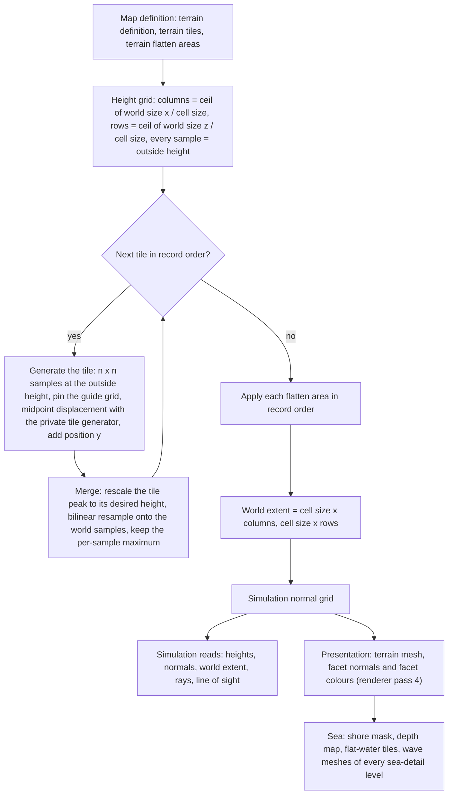
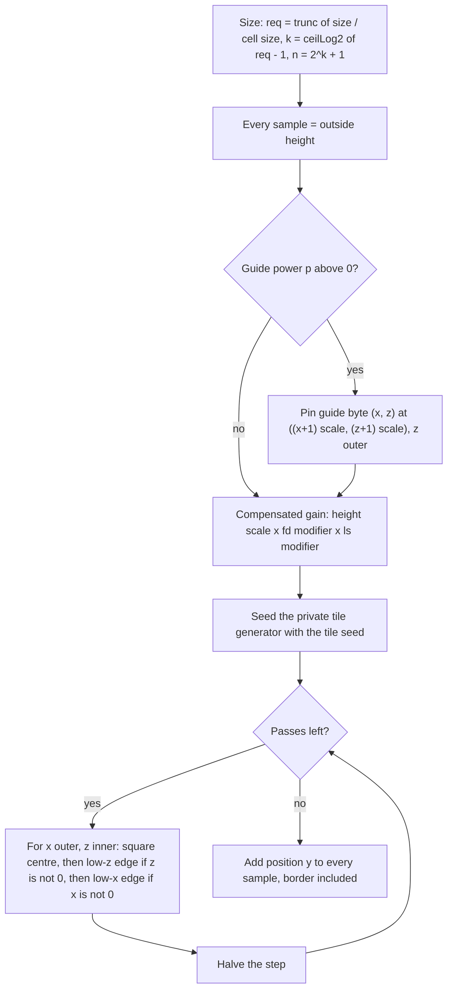

# Terrain

> Status: Engine baseline · Prefix: TER · ADRs: [ADR-0011](../../adr/0011-world-surface-rendering.md) · [ADR-0052](../../adr/0052-cpp23-language-standard.md) · [ADR-0059](../../adr/0059-content-build-and-validators.md) · [ADR-0060](../../adr/0060-content-identity-by-hash.md) · [ADR-0061](../../adr/0061-data-schemas-and-versioning.md) · [ADR-0069](../../adr/0069-test-framework.md) · Related: [World renderers](renderer/world_renderers.md) · [Maps: rules and conventions](../../reference/08_maps_and_level_design/rules_and_conventions.md) · [Map editor hooks](../../reference/08_maps_and_level_design/map_editor_hooks.md) · [Randomness and integrity](../../reference/12_simulation_model/07_randomness_and_integrity.md) · [Space, routing and physics](../../reference/12_simulation_model/05_space_routing_and_physics.md) · [Data schemas](data_schemas.md)

This component turns the terrain records of a map definition into the terrain that the simulation stands on and the renderer draws. It specifies the terrain definition data as the generator reads it, the fractal tile generator with its private random generators, the composition of tiles into one world height field, the five flatten operations, the world grid and its edge semantics, the simulation normals, the queries that gameplay uses, the colour-ramp look-up, and the sea derivations: the shore mask, the depth map, the flat-water tile mask, the wave-mesh vertices and the coastline wave formulae. The text is precise enough to re-implement the generator and reproduce its output bit for bit. The terrain runtime model of a large world (generated at load or baked, streaming, content identity) is decided by the design phase (§8.3).

Notation used throughout: *r32*(*x*) rounds a binary64 value to the nearest binary32 value (ties to even) and widens it back to binary64; trunc(*x*) truncates toward zero; ⌊*x*⌋ and ⌈*x*⌉ are floor and ceiling; "tile space" is a tile's height scale before its peak rescale (§4.8); *X* and *Z* are the world extents of TER-150.

## 1 Responsibilities and boundaries

**TER-001** (MUST) The terrain component owns: the terrain definition, tile and flatten-area data as the generator reads them (§3); the generator (§4.3 to §4.9); the terrain height field (`TerrainField`) with its height grid, its simulation normal grid, its cell size, its column and row counts and its world extent; the read-only queries of §2.2; the per-triangle colour-ramp look-up (§4.12); and the sea derivations (§4.14). It owns no GPU resource and records no pass.

**TER-002** (MUST) The terrain is one regular height field: a world surface grid (`SurfaceGrid`) with its origin at (0, 0) and square cells of the cell size on both axes. It is generated once per match-world initialisation, at step 5 of [reference/12](../../reference/12_simulation_model/02_match_lifecycle_and_state_reset.md) table 2.4-A (R-SIM-016), from the terrain definition, the terrain tiles and the terrain flatten areas of the map definition ([rules and conventions](../../reference/08_maps_and_level_design/rules_and_conventions.md) R-MAP-080 to R-MAP-083). Nothing writes it afterwards: no simulation rule, presentation code, option change or tool other than the map editor's regeneration (§8.2) changes a sample (DEC-007, DEC-010).

**TER-003** (MUST) A terrain is a list of tiles. Each tile is an independent square fractal height map, produced by midpoint displacement (square and diamond steps) with its own private generator (R-SIM-609) and optionally pinned by a coarse guide grid of 8-bit heights. Each tile's highest sample is linearly rescaled to the tile's desired height, and the tile is resampled onto the world grid with a per-sample maximum, so a later tile can only raise terrain (DEC-025).

**TER-004** (MUST) Flatten areas, axis-aligned squares with five operations, are applied after all tiles; they are the only operation that can lower terrain. There is no smoothing pass between tiles: the only smoothing is the bilinear resampling of TER-121 and the smooth operation of TER-143.

**TER-005** (MUST) The sea surface lies at the height `ref.sim.physics.sea_level` (0 wu, [reference/12 space, routing and physics](../../reference/12_simulation_model/05_space_routing_and_physics.md) R-SIM-365) everywhere; a map has no water-level parameter. Every world sample that no tile raises stays at the outside height, the negative sea floor.

**TER-006** (MUST) The height field and the normal grid are simulation static data. They depend only on the terrain records of the map definition, with decimal values rounded as TER-066 states, and on the integer tile seeds. They never depend on the simulation generator, a presentation generator, a clock, a setting, the hardware or the history of earlier calls (R-SIM-710, DEC-246).

**TER-007** (MUST) The colour-ramp look-up, the shore mask, the depth map, the flat-water tile mask, the wave-mesh vertices and the coastline waves are presentation data: they never feed the simulation (R-SIM-601, DEC-007). The renderer owns their passes, pipeline-state entries and render keys ([world renderers](renderer/world_renderers.md) RND-130 to RND-148, ADR-0011); this component defines only the data and the formulae it derives them from, and never redefines a renderer key.

**TER-008** (MUST NOT) The terrain component does not draw from the simulation generator (`SimRng`) or from any presentation generator that another consumer shares (R-SIM-608); it does not read a clock, an option, the local team or any other local state; and it never writes simulation state other than its own height field and normal grid, which it writes only while generating them.

**TER-009** (MUST) The baseline runtime model is the reference's: every participant generates the height field when the map loads, from the tile records of its map definition, as TER-060 specifies. Whether Species generates at load, bakes the height field in the content build, streams it for a large world or identifies it by a content hash is decided by the design phase (DEC-246, DEC-247; §8.3). No reference terrain is reproduced: Species maps are authored new, and the generator specification also defines the look of a new map tool (DEC-025, DEC-063).

## 2 Interfaces

### 2.1 Interface sketch

```cpp
namespace species::terrain {

// Stored values carry meaning (they are the values in the map definition); keep the order.
enum class TileMethod : std::uint8_t { Average = 0, RandomPair = 1, CopyOne = 2 };
enum class FlattenOp  : std::uint8_t { Absolute = 0, Add = 1, Subtract = 2, Smooth = 3, Subtract2 = 4 };

struct TerrainTile {                         // TER-032; field order of R-MAP-081
  std::int32_t posX;  double posY;  std::int32_t posZ;
  std::int32_t size;
  double fractalDimension, heightScale, desiredHeight;
  TileMethod method;
  std::int32_t seed;
  double lowlandSmoothing;
  std::uint8_t guidePower;                   // p; 0 = no guide grid
  Grid2D<std::uint8_t> guide;                // (2^p - 1) x (2^p - 1), TER-036
};

struct TerrainFlattenArea {                  // TER-034
  Vec3 centre;                               // centre.y is the operand t
  double halfSize;
  FlattenOp op;
  double threshold;                          // T
};

struct TerrainDefinition {                   // TER-030; fields of R-MAP-080
  double cellSize;
  std::int32_t worldSizeX, worldSizeZ;
  double outsideHeight;
  float maxHeight;
  std::uint16_t landRampFile, shoreWaveGradientFile, seaTileFile;   // file numbers, 1 = map default
  std::vector<TerrainTile> tiles;
  std::vector<TerrainFlattenArea> flattenAreas;
};

template <class T> class SurfaceGrid {       // TER-038, TER-070 to TER-076
public:
  SurfaceGrid(double width, double height, double x0, double z0, double cellX, double cellZ, T outside);
  std::uint16_t Columns() const;  std::uint16_t Rows() const;
  T    At(std::int32_t i, std::int32_t j) const;           // outside value off the grid
  void Set(std::int32_t i, std::int32_t j, T value);       // ignored off the grid
  T    Sample(double x, double z) const;                   // bilinear, TER-073
  T    Nearest(double x, double z) const;                  // TER-075
  std::int32_t IndexX(double x) const;  std::int32_t IndexZ(double z) const;     // TER-074
  double PositionX(std::int32_t i) const;  double PositionZ(std::int32_t j) const;
  T    Highest() const;                                     // TER-076
};

class TerrainField {
public:
  static TerrainField Generate(const TerrainDefinition& definition);   // TER-060
  double Height(double x, double z) const;                  // TER-011
  double HeightAt(std::int32_t i, std::int32_t j) const;    // TER-012
  Vec3   Normal(double x, double z) const;                  // TER-013
  Vec3   NormalAt(std::int32_t i, std::int32_t j) const;    // TER-013
  double WorldSizeX() const;  double WorldSizeZ() const;    // TER-014
  std::uint16_t Columns() const;  std::uint16_t Rows() const;
  double CellSize() const;  double OutsideHeight() const;
  bool   IsInside(const Vec3& p) const;                     // TER-015
  std::optional<Vec3> CastRay(const Vec3& start, const Vec3& direction) const;   // TER-016 to TER-018
  bool   LineOfSight(const Vec3& from, const Vec3& to) const;                     // TER-019
  const SurfaceGrid<double>& Heights() const;
  const SurfaceGrid<Vec3>&   Normals() const;
};

// Presentation derivations (TER-007), built once per match world by the presentation side.
struct SeaMasks {                            // TER-196 to TER-199
  ImageRgba8 shoreMask;                      // 128 x 128 grey, row 0 = mask row 127
  SurfaceGrid<float> depth;                  // 1 = open sea, 0 = on or next to land
  Grid2D<bool> flatWaterTiles;               // 32 x 32
};
SeaMasks BuildSeaMasks(const TerrainField& field);

struct WaveVertex { Vec3 position; float depth; float shoreNoise; };
struct WaveMeshSource { double cell; std::vector<std::array<WaveVertex, 2>> pairs; };   // build order
WaveMeshSource SelectWaveVertexPairs(const TerrainField& field, const SeaMasks& masks,
                                     int seaDetail, FxRng& shoreNoise);               // TER-201

ColourRgba FacetColour(const ImageRgba8& ramp, float facetNormalY, const Vec3& centre,
                       float highest, FxRng& colourVariation);                       // TER-181

}  // namespace species::terrain
```

**TER-010** (MUST) `TerrainField::Generate` is a pure function of its definition. It runs on one thread, uses no shared mutable state and returns a complete field; no reader sees a partly generated field. After it returns, the field is immutable: every query is `const`, allocates nothing, makes no random draw and is safe for concurrent readers on any thread. The simulation reads every height and normal through the current match world's field and never keeps a copy or a reference beyond the match world's lifetime (DEC-011).

### 2.2 Queries used by gameplay

**TER-011** (MUST) `Height(x, z)` is the bilinear sample of the height grid (TER-073), with the edge semantics of TER-153. It is the terrain height of every simulation rule ([reference/12](../../reference/12_simulation_model/05_space_routing_and_physics.md) R-SIM-367 and R-SIM-369), of presentation and of audio.

**TER-012** (MUST) `HeightAt(i, j)` is the raw sample at column *i* and row *j*; an index outside the grid returns the outside height (TER-072).

**TER-013** (MUST) `Normal(x, z)` is the bilinear blend of the four corner normals of the simulation normal grid (TER-170), with the edge semantics of TER-153; the blend is **not** renormalised, so its length is below 1 where the corner normals differ. `NormalAt(i, j)` is the raw grid normal; an index outside the grid returns `ter.normal.outside` (0, 1, 0).

**TER-014** (MUST) `WorldSizeX()` and `WorldSizeZ()` return the world extents *X* and *Z* of TER-150. A match world that has no generated field reports `ter.query.ungenerated_world_size` (1 000 000 wu) on both axes and the outside height `ter.query.ungenerated_outside_height` (−20 wu).

**TER-015** (MUST) `IsInside(p)` holds exactly when 0 ≤ *p.x* < *X* and 0 ≤ *p.z* < *Z*.

**TER-016** (MUST) `CastRay(start, direction)` normalises the direction (TER-077) and computes the start cell (*i*₀, *j*₀) = (`IndexX`(*start.x*), `IndexZ`(*start.z*)). If 0 ≤ *i*₀ < columns and 0 ≤ *j*₀ ≤ rows (the second bound is inclusive), it walks the grid from the start (TER-017). Otherwise it intersects the horizontal projection of the ray with the two grid edges that face the ray, chosen by the signs of *direction.x* and *direction.z*, as segment–ray tests in the horizontal plane; if neither edge is hit there is no hit; otherwise it restarts the walk from the entry point, whose height is *start.y* + λ × *direction.y* with λ = (*entry.x* − *start.x*) ÷ *direction.x*. When *direction.x* is 0 that division is undefined, so λ is computed from the z components, (*entry.z* − *start.z*) ÷ *direction.z*, and no query produces a non-finite value (DEC-653).

**TER-017** (MUST) The grid walk tests the cells crossed by the ray in order along it, starting with the start cell. In each cell (*i*, *j*) it tests the cell's two triangles, first (*c*₀₀, *c*₀₁, *c*₁₀) and then (*c*₀₁, *c*₁₀, *c*₁₁), where *c*_ab is the height-grid vertex (*i* + *a*, *j* + *b*) at its world position; this is the same diagonal as the render mesh ([world renderers](renderer/world_renderers.md) RND-132). Each triangle test is the ray–triangle intersection of the maths library with the range `ter.query.ray_tri_range` (10¹⁰ wu), which bounds the length of the (*t*, *u*, *v*) vector and does not require *t* ≥ 0, so a hit behind the start can be reported (DEC-241 item 10). The first hit ends the walk and is the result. After a cell without a hit, the walk steps in z when the ray leaves the cell through its far z edge and in x otherwise, and it ends without a hit when it leaves the grid. The walk has one variant per sign quadrant of (*direction.x*, *direction.z*); a ray with a zero horizontal component visits only the column or the row it lies in (see §8.1, new decision request).

**TER-018** (MUST) `CastRay` serves the line-of-sight test (TER-019) and the pointer's ground hit on the input side ([reference/12](../../reference/12_simulation_model/05_space_routing_and_physics.md) R-SIM-387). It tests only the terrain, never structures or actors.

**TER-019** (MUST) `LineOfSight(from, to)` is the terrain line-of-sight test: with *d* = normalise(*to* − *from*) and the margin *m* = `ter.query.los_margin` (20 wu), it casts the ray from *from* + *m* × *d* along *d*; with no hit the target is visible; with a hit at *h* it is visible exactly when |*h* − *from*| > |*to* − *from*| + *m*. The margin therefore applies at both ends. Only the terrain blocks the line; the Beam Dish link test ([reference/03](../../reference/03_buildings_and_world_objects/README.md)) and the bots ([reference/07](../../reference/07_bots/README.md)) use it.

The map editor's tile deletion and regeneration are hooks (§8.2).

## 3 Data model

The map schema that carries these records, with its authoring syntax, versions and validators, is [data schemas](data_schemas.md) (ADR-0061, ADR-0062). This section states what the generator reads from each field.

### 3.1 Terrain definition

**TER-030** (MUST) The terrain definition (`TerrainDefinition`) holds the fields of table 3.1-A, as [rules and conventions](../../reference/08_maps_and_level_design/rules_and_conventions.md) R-MAP-080 lists them; a field that a map omits takes its default.

Table 3.1-A Terrain-definition fields as the generator reads them.

| Field | Type and rounding | Unit | When absent | Meaning |
|---|---|---|---|---|
| cell size | decimal, rounded once to binary32 (TER-066): 15.76 becomes 15.760000228881836 | wu per sample, both axes | `ref.map.terrain.cell_size_default` (12.0) | the spacing of the height samples; the renderer draws two triangles per cell (RND-132) |
| world size x, world size z | whole number, 32-bit signed | wu | `ref.map.terrain.world_size_default` (2 000) each | the requested extent; the real extent is TER-150 |
| outside height | decimal, rounded to binary32 | wu | `ref.map.terrain.outside_height_default` (−10) | the four roles of TER-031 |
| maximum height | decimal, rounded to binary32 and held as binary32 | wu | `ref.map.terrain.max_height_default` (0.0) | the colour-ramp normaliser only (TER-180); no other rule reads it |
| land colour ramp | a file number of `terrain.ramp` | — | file 1, the map default | the ramp of TER-040 |
| shore-wave gradient | a file number of `terrain.shore_wave_gradient` | — | file 1 | the wave colour table of TER-041 |
| sea tile | a file number of `terrain.sea_tile` | — | file 1 | the flat-sea texture of RND-142; the terrain derives nothing from it |

**TER-031** (MUST) The outside height is (a) the initial value of every world sample, (b) the initial value and the border level of every tile, (c) the base of every tile's peak rescale, and (d) the value that an integer read outside the height grid returns. The normal grid's outside value is `ter.normal.outside` (0, 1, 0).

### 3.2 Terrain tiles

**TER-032** (MUST) A terrain tile record (`TerrainTile`) holds the fields of table 3.2-A in this order (R-MAP-081). Every field is mandatory in a map definition. The tiles are kept, and generated, in record order. The record type's defaults equal the map editor's new-tile values ([map editor hooks](../../reference/08_maps_and_level_design/map_editor_hooks.md) R-MAP-326), except its size, `ter.tile.default_size` (256 wu).

Table 3.2-A Terrain-tile fields.

| # | Field | Type and rounding | Unit | Meaning |
|---|---|---|---|---|
| 1 | position x | 32-bit signed integer | wu | world x of the tile's low corner |
| 2 | position y | decimal, rounded to binary32 | wu, tile space | added to every tile sample after the displacement and before the peak rescale (TER-091 step 7, TER-122) |
| 3 | position z | 32-bit signed integer | wu | world z of the tile's low corner |
| 4 | size | 32-bit signed integer | wu | the edge length of the tile's square footprint on the world grid |
| 5 | fractal dimension *fd* | decimal, rounded to binary32 | — | the roughness exponent: the noise amplitude of a pass is proportional to (2560 × *h* ÷ *n*)^*fd* (TER-105); a larger value makes the coarse passes dominate, which gives smoother terrain, and the gain compensation 30.7 × e^(−6.5 × *fd*) roughly cancels the growth of the coarsest amplitude (DEC-324) |
| 6 | height scale *hs* | decimal, rounded to binary32 | — | the linear noise gain; 0 gives no noise, so the tile is the interpolation of its guide grid and border |
| 7 | desired height | decimal, rounded to binary32 | wu | the height that the tile's highest sample is mapped to (TER-122) |
| 8 | generation method | integer | `TileMethod` 0, 1 or 2 | 0 averages four parents, 1 averages a random opposite pair, 2 copies one random parent (TER-100); any other value is rejected (TER-112) |
| 9 | seed | 32-bit signed integer | — | the seed of the tile's private generator, applied at the start of every generation of the tile (TER-091 step 6) |
| 10 | lowland smoothing factor *ls* | decimal, rounded to binary32 | — | the exponent on the base height in the noise envelope 0.1 + 0.15 × \|*b*\|^*ls* (TER-105): a larger value keeps low ground flatter relative to high ground, and *ls* = 0 makes the envelope the constant 0.25; it also scales the gain by 15.353 × e^(−3.1 × *ls*) |
| 11 | guide-grid power *p* | integer, 0 or more | — | 0: no guide grid; above 0: a guide grid of *r* = 2^*p* − 1 points per side (TER-036) |
| 12 | guide grid | *r* × *r* unsigned 8-bit values, present only when *p* > 0 | wu, tile space | the pinned heights of TER-036 and TER-037 |

**TER-033** (MUST) Generation adds per-tile state that the map does not hold: the tile grid, a `SurfaceGrid<double>` of *n* × *n* samples with cell size 1, origin (0, 0) and the terrain's outside height as its outside value during generation, re-targeted to world space during the merge (TER-120); the compensated gain (TER-091 step 4); the tile's private generator state (TER-080); and the tile's outside height, which is set to the terrain's outside height before every generation of the tile.

### 3.3 Terrain flatten areas

**TER-034** (MUST) A terrain flatten area record (`TerrainFlattenArea`) holds the fields of table 3.3-A (R-MAP-083), in this order. Its size is mandatory; its flatten type and threshold are optional, and the threshold is read only when the type is present.

Table 3.3-A Flatten-area fields.

| # | Field | Type and rounding | Unit | When absent | Meaning |
|---|---|---|---|---|---|
| 1 | centre x | decimal, rounded to binary32 | wu | — | the centre of the square on x |
| 2 | centre y | decimal, rounded to binary32 | wu | — | the operand *t*: the target height (type 0), the amount added (type 1) or subtracted (types 2 and 4), the target level (type 3) |
| 3 | centre z | decimal, rounded to binary32 | wu | — | the centre of the square on z |
| 4 | size | decimal, rounded to binary32 | wu | — (a new area in the map editor takes `ref.map.editor.new_flatten_area.size`, R-MAP-327) | the **half**-width of the axis-aligned square |
| 5 | flatten type | integer | `FlattenOp` 0 to 4 | 0, Absolute | the operation of TER-143 |
| 6 | threshold *T* | decimal, rounded to binary32 | wu | `ref.map.terrain.flatten_threshold_default` (40.0) | the threshold of types 2, 3 and 4 |

**TER-035** (MUST) The flatten types are, by stored value: 0 Absolute, 1 Add, 2 Subtract, 3 Smooth, 4 Subtract2 (`FlattenOp`). The stored values carry meaning and keep this order; the map editor lists the types sorted by their display names (R-MAP-332).

### 3.4 Guide grid

**TER-036** (MUST) A guide-grid power *p* gives *r* = 2^*p* − 1 guide points per side; *p* = 0 means no guide grid. The cells are in row-major order with z outer and x inner: cell (*x*, *z*) is element *z* × *r* + *x*. Each cell holds one unsigned 8-bit value, 0 to 255, used directly as an absolute height in tile space, before the position-y shift and before the peak rescale. Setting a new power reallocates the grid and fills it with zeros. The authoring encoding of the cells in a map definition is the map schema's ([data schemas](data_schemas.md)). For a tile grid of *n* = 2^*k* + 1 samples per side, table 3.4-A gives the sizes.

Table 3.4-A Guide-grid sizes.

| *p* | *r* × *r* | Cells | Tile-sample spacing of the guide points |
|---|---|---|---|
| 1 | 1 × 1 | 1 | 2^(*k* − 1): the single point is the tile centre |
| 2 | 3 × 3 | 9 | 2^(*k* − 2) |
| 3 | 7 × 7 | 49 | 2^(*k* − 3) |
| 4 | 15 × 15 | 225 | 2^(*k* − 4) |
| 5 | 31 × 31 | 961 | 2^(*k* − 5) |

**TER-037** (MUST) Guide cell (*x*, *z*) pins tile sample ((*x* + 1) × 2^(*k* − *p*), (*z* + 1) × 2^(*k* − *p*)) (TER-091 step 3); the tile border is never a guide point. Because the first displacement pass uses the step 2^(*k* − *p*), the lattice of the guide points and the border is exactly the set of corners of that pass, so the displacement refines between the pinned points and never moves them: later passes write only midpoints. A guide value of 0 is a real height, above the negative border (TER-111).

### 3.5 Grids

**TER-038** (MUST) A world surface grid (`SurfaceGrid<T>`) is built from a width, a height, an origin (*x*₀, *z*₀), cell sizes *c*ₓ and *c*_z and an outside value. Its column count is ⌈width ÷ *c*ₓ⌉ and its row count ⌈height ÷ *c*_z⌉, each held as a 16-bit unsigned count; its inverse cell sizes 1 ÷ *c*ₓ and 1 ÷ *c*_z are computed once in binary64. Every element is set to the outside value at construction, so no element is ever read before it is written.

**TER-039** (MUST) A 2-D grid (`Grid2D<T>`) is a plain array of columns × rows elements without origin or cell size, with the index rules of TER-072; the guide grid and the flat-water tile mask are 2-D grids.

### 3.6 Rendering inputs

**TER-040** (MUST) A land colour ramp, one file of `terrain.ramp`, is an image of `ter.colour.ramp_size` × `ter.colour.ramp_size` (64 × 64) texels, read on the CPU from its cooked table (ADR-0018). Its x axis is the slope: column 0 is flat ground and column 63 vertical. Its y axis is the height, with the look-up row index counted from the **bottom** row of the image as viewed: row 0, the bottom row, is the highest terrain, and row 63, the top row, is sea level and below. The content build rejects a ramp of another size (DEC-015).

**TER-041** (MUST) A shore-wave gradient, one file of `terrain.shore_wave_gradient`, provides the wave colour table: the pixel row `rnd.sea.wave_table_row` (1) of [world renderers](renderer/world_renderers.md) RND-144, counted from the bottom row of the image as viewed (the second row from the bottom), one colour per pixel column. The number of colours is the image's width, 400 for the gradients of the asset manifest, and any width is accepted. Every colour is opaque (alpha 0 in the inverted style, RND-144, DEC-040).

**TER-042** (MUST) While the match's seasonal state is active, the renderer replaces the map's ramp, sea tile and shore-wave gradient by the seasonal files (RND-134, RND-142, RND-144; DEC-118). The seasonal state never changes a height, a normal or a sea mask.

### 3.7 Data products

**TER-043** (MUST) Generation and the presentation builds produce the data of table 3.7-A, with these lifetimes.

Table 3.7-A Terrain data products.

| Product | Type and grid | Lifetime | Consumers | Class |
|---|---|---|---|---|
| height grid | `SurfaceGrid<double>`, columns × rows, cell size, origin (0, 0), outside value the outside height | the match world | every simulation height read (actors, structures, physics, walkability, bots, weapons), the camera, audio, the sea derivations, the renderer | simulation |
| normal grid | `SurfaceGrid<Vec3>`, the same grid, outside value `ter.normal.outside` | the match world | bounce physics, the centipede, impacts, particles, the orientation of units, legs, structures and props to the ground | simulation (and presentation) |
| world extent *X*, *Z*, columns, rows, cell size | binary64 and 16-bit counts | the match world | `IsInside`, the edge rules, the spatial grids and route graphs ([reference/12](../../reference/12_simulation_model/05_space_routing_and_physics.md) R-SIM-304), the camera bounds, the fog, the sea plane | simulation |
| facet colours | one colour per terrain triangle (TER-181) | the renderer's terrain chunks | pass 4 (RND-134) | presentation |
| shore mask | 128 × 128 grey image (TER-197) | the match world | the flat sea layer, texture 1 (RND-142) | presentation |
| depth map | `SurfaceGrid<float>`, 128 × 128 over the sea plane (TER-198) | until the wave meshes of every sea-detail level are built | the wave-mesh vertex selection | presentation |
| flat-water tile mask | `Grid2D<bool>`, 32 × 32 (TER-199) | the match world | the flat sea layer (RND-141) | presentation |
| wave-mesh pairs | per sea-detail level: vertex pairs in build order with depth and shore noise (TER-201) | the match world | the wave update and pass 5b (RND-144, RND-145) | presentation |

## 4 Behaviour and algorithms

### 4.1 Pipeline

**TER-060** (MUST) `TerrainField::Generate` runs these steps in this order:

1. Create the height grid as `SurfaceGrid<double>`(world size x, world size z, origin (0, 0), cell size, cell size, outside height); every sample is the outside height.
2. For each tile in record order: set the tile's outside height to the terrain's; generate the tile (TER-091); merge it into the height grid (TER-120).
3. For each flatten area in record order: apply it (TER-140 to TER-144).
4. Set the world extent *X* = cell size × columns and *Z* = cell size × rows (TER-150).
5. Compute the simulation normal grid (TER-170).

From the finished field the presentation side then builds the terrain mesh and its facet normals ([world renderers](renderer/world_renderers.md) RND-132 to RND-134) with the facet colours of TER-181, the sea masks (TER-195 to TER-199) and the wave meshes (TER-200 to TER-203). Match-world initialisation then places every map-placed structure on the terrain at its (x, z) (R-SIM-016 step 7, R-SIM-367, R-MAP-102).



Caption: the terrain pipeline of one match-world initialisation; everything below "Simulation normal grid" on the presentation branch never feeds the simulation.

**TER-061** (MUST) Generation computes in IEEE-754 binary64 with rounding to nearest, ties to even: every expression is evaluated in the order written in this document, and every operation is rounded to binary64, with no fused multiply–add contraction, no reassociation, no extended-precision intermediate and no flush to zero. Where this document writes "binary32", the value is rounded to binary32 and widened again. This is the reference numeric model, the default of DEC-240; it reproduces the reference heights only when every participant's rounded transcendental results agree (TER-065, DEC-246 item 5).

**TER-062** (MUST) Two evaluation orders change the heights when they are rewritten, and implementations keep them exactly: the weights-first bilinear sum (TER-073) and the sequential additions of the smooth operation (TER-143). Rewriting either changes the heights of about one terrain in six of the reference content (DEC-246 item 6).

### 4.2 Numeric primitives

**TER-065** (MUST) The generator uses the rounded functions of table 4.2-A. Each rounds the binary64 result of the maths library's function to binary32 (*r32*), as the reference model does (DEC-240, DEC-241); their arguments are binary64.

Table 4.2-A Rounded functions of the generator.

| Function | Definition | Used for |
|---|---|---|
| pow32(*x*, *y*) | *r32*(*x*^*y*), with pow32(0, 0) = 1 | the noise amplitude, the noise envelope, the tile size 2^*k* |
| exp32(*x*) | *r32*(e^*x*) | the two gain modifiers |
| log32(*x*) | *r32*(ln *x*) | log2r |
| sqrt32(*x*) | *r32*(√*x*) | normalisation (TER-077) |
| sin32(*x*) | *r32*(sin *x*) | the coastline waves (presentation; binary32 GPU arithmetic is acceptable, TER-205) |
| log2r(*x*) | log32(*x*) × *c*, with *c* = 1 ÷ log32(2) computed once in binary64 | ceilLog2 |
| ceilLog2(*x*) | trunc(⌈log2r(*x*)⌉), an integer | the tile size and the pass count |
| abs32(*b*) | \|*r32*(*b*)\|: the single-precision absolute value rounds its argument to binary32 first | the noise envelope |

For the reference content, every power result that lies within one binary64 unit in the last place of a binary32 rounding midpoint is an exact square, which rounds the same on every platform only if *x*^2.0 returns the exact square; no exponential or logarithm result lies that close (DEC-246 item 5).

**TER-066** (MUST) Every decimal field of the terrain records is parsed to binary64 by one platform-independent, correctly rounded parser and then rounded once to binary32 (DEC-241 item 12); the maximum height stays binary32. The rounding is observable: a tile at position z = 985 on a terrain of cell size 15.76 has 985 ÷ 15.760000228881836 = 62.4999991, so its footprint starts at world row trunc(62.9999991) = 62, whereas the unrounded 15.76 gives 62.5 and row 63, shifting the footprint by one world cell (vector set A, §7.2). Whole-number fields are 32-bit signed integers; the content build rejects malformed and out-of-range tokens (DEC-015).

**TER-067** (MUST) ceilLog2(*x*) equals the exact ⌈log₂ *x*⌉ for every integer 1 ≤ *x* < `ter.test.log2_check_limit` (70 000), exact powers of two included (test T3).

**TER-068** (MUST) The private tile generator computes in unsigned 32-bit integers that wrap modulo 2³² (TER-080); its 15-bit output equals the reference's signed 32-bit computation, whose overflow wraps.

**TER-070** (MUST) A grid's sample position is `PositionX`(*i*) = *i* × *c*ₓ + *x*₀ and `PositionZ`(*j*) = *j* × *c*_z + *z*₀, with the integer index converted to binary64.

**TER-071** (MUST) The conversion of a binary64 coordinate fraction to a sampler index truncates toward zero, so a value in (−1, 0) gives index 0, never ⌊*v*⌋ = −1 (TER-121, TER-230).

**TER-072** (MUST) An integer read `At`(*i*, *j*) whose column is outside [0, columns) or whose row is outside [0, rows) returns the grid's outside value, and `Set` with such an index does nothing. In the reference the indices are first reduced modulo 2^`ter.grid.index_bits` (2¹⁶) to unsigned 16-bit values; for every grid of at most `ter.grid.max_samples_per_side` (32 768) samples per side, which the content build enforces (TER-250), every index from −32 768 to 65 535 that lies outside the grid reads the outside value under both rules.

**TER-073** (MUST) `Sample`(*x*, *z*), the bilinear read of a grid, is:

```text
fx := (x - x0) * invX ;  fz := (z - z0) * invZ
i1 := trunc(fx) mod 2^16 ;  i2 := (i1 + 1) mod 2^16        # TER-071; the reduction is TER-072's
j1 := trunc(fz) mod 2^16 ;  j2 := (j1 + 1) mod 2^16
fx := fx - floor(fx) ;  fz := fz - floor(fz)               # taken before the index reset
if i1 >= columns: i1 := 0 ;  if i2 >= columns: i2 := 0      # the far-edge reset
if j1 >= rows:    j1 := 0 ;  if j2 >= rows:    j2 := 0
w11 := (1 - fx) * (1 - fz) ;  w12 := (1 - fx) * fz         # weights first, one product each
w21 := fx * (1 - fz)       ;  w22 := fx * fz
result := ((v(i1, j1) * w11 + v(i1, j2) * w12) + v(i2, j1) * w21) + v(i2, j2) * w22
```

The sum runs left to right. Evaluating v × (1 − fx) × (1 − fz) left to right instead rounds differently and changes the heights. For an index whose truncation is −1 or below the reference conversion is undefined; the reduction modulo 2¹⁶ states the result it has, the low 16 bits of the truncated integer. The edge consequences are TER-121 for tiles and TER-153 for the world grid.

**TER-074** (MUST) `IndexX`(*r*) = trunc((*r* − *x*₀) × *invX*) as a signed integer, so −0.5 gives 0; `IndexZ` likewise.

**TER-075** (MUST) `Nearest`(*x*, *z*) = `At`(⌊*x* × *invX*⌋, ⌊*z* × *invZ*⌋); it ignores the grid's origin, so it serves only grids with origin (0, 0). The terrain does not use it.

**TER-076** (MUST) `Highest`() starts with `At`(0, 0) and scans *z* from 0 to rows − 1 (outer) and *x* from 0 to rows − 1 (inner), the row count bounding both loops; a sample replaces the current highest only when it is strictly greater. On a square grid this is the highest sample of the grid. Tiles are always square, and so is every reference terrain; on a grid with more columns than rows the scan ignores the last columns, and with fewer columns it reads the outside value beyond the last column (§8.1, new decision request).

**TER-077** (MUST) `Normalise`(*v*) computes *l* = *v.x* × *v.x* + *v.y* × *v.y* + *v.z* × *v.z*, summed left to right. If *l* > `ter.math.normalise_min_length_sq` (10⁻¹⁰), it multiplies each component by *s* = 1 ÷ sqrt32(*l*); otherwise the result is `ter.math.normalise_fallback` (0, 0, 1) (DEC-241 item 6).

**TER-078** (MUST) The cross product is *a* × *b* = (*a.y* *b.z* − *a.z* *b.y*, *a.z* *b.x* − *a.x* *b.z*, *a.x* *b.y* − *a.y* *b.x*), each component evaluated as written.

### 4.3 The private tile generator

**TER-080** (MUST) Each tile owns a private generator whose state is an unsigned 32-bit integer (TER-068). `Seed`(*s*) sets the state to *s* modulo 2³². `Next`() sets state := state × `ter.generator.lcg.multiplier` (214013) + `ter.generator.lcg.increment` (2531011), modulo 2³², and returns (state shifted right by `ter.generator.lcg.output_shift` (16) bits) AND `ter.generator.lcg.output_mask` (0x7FFF), a value from 0 to 32 767. `Signed`(*R*) returns (0.5 − `Next`() ÷ 32 767) × *R*, the divisor being the output mask's value: uniform over [−*R*/2, *R*/2], with `Next`() = 0 giving +*R*/2. The tile generator is independent of the simulation generator and of every presentation generator; nothing but the tile's own generation draws from it (R-SIM-609, DEC-242 item 5). Its algorithm is fixed by this rule because it determines the heights; the algorithm of the simulation generator is DEC-242.

**TER-081** (MUST) After `Seed`(1), the first eight `Next`() results are 41, 18467, 6334, 26500, 19169, 15724, 11478 and 29358 (test T1).

### 4.4 Tile generation

**TER-090** (MUST) A tile's generation reads the tile's fields (table 3.2-A), the terrain's cell size and the outside height, which is copied into the tile immediately before the generation (TER-060 step 2). The output depends on nothing else.

**TER-091** (MUST) A tile is generated by these steps, in this order:

1. **Size the tile grid.** *req* = trunc(size ÷ cell size), an integer divided by a binary64 value; *k* = ceilLog2(*req* − 1); *n* = trunc(pow32(2, *k*)) + 1, which is exact. The tile grid has *n* × *n* samples, cell size 1, origin (0, 0) and the outside height as its outside value.
2. **Initialise.** Every sample is the outside height.
3. **Pin the guide grid**, only when *p* > 0: *r* = 2^*p* − 1; *scale* = (*n* − 1) div (*r* + 1), an integer division, which is 2^(*k* − *p*) when *k* ≥ *p*. For *z* from 0 to *r* − 1 (outer) and *x* from 0 to *r* − 1 (inner): sample ((*x* + 1) × *scale*, (*z* + 1) × *scale*) := guide(*x*, *z*), the byte value as a binary64 height.
4. **Compensated gain.** *fdm* = `ter.generator.gain.fd_coefficient` (30.7) × exp32(`ter.generator.gain.fd_exponent` (−6.5) × *fd*); *lsm* = `ter.generator.gain.ls_coefficient` (15.353) × exp32(`ter.generator.gain.ls_exponent` (−3.1) × *ls*); *comp* := *hs*; *comp* := *comp* × *fdm*; *comp* := *comp* × *lsm*: two separate multiplications, in this order.
5. **Pass plan.** *iterations* = ceilLog2(*n*) − *p*, which is *k* + 1 − *p* because ⌈log₂(2^*k* + 1)⌉ = *k* + 1; *step* = (*n* − 1) shifted right by *p* bits, which is 2^(*k* − *p*).
6. **Midpoint displacement**, with *x* the **outer** loop and *z* the inner loop:

   ```text
   Seed(seed)                               # the tile's private generator, TER-080
   repeat iterations times:
       for x := 0; x < n - 1; x += step:
           for z := 0; z < n - 1; z += step:
               h := step >> 1
               mx := x + h ;  mz := z + h
               Square(mx, mz, h)            # the centre of the cell
               if z != 0: Diamond(mx, z, h) # the midpoint of the cell's low-z edge
               if x != 0: Diamond(x, mz, h) # the midpoint of the cell's low-x edge
       step := step >> 1
   ```

   Each `Square` and `Diamond` call computes a base value *b* from its parents (TER-100), adds Noise(*h*, *b*) (TER-105) and writes the sample.
7. **Height shift.** Every sample, the border included, with *x* outer and *z* inner: sample := sample + position y.

**TER-092** (MUST) These properties follow from TER-091, and an implementation keeps them:

- **The border never moves during step 6.** Edge midpoints on *x* = 0 and *z* = 0 are skipped explicitly, and midpoints on *x* = *n* − 1 and *z* = *n* − 1 are never visited, because they would belong to cells beyond the tile. After step 7 the whole border equals outside height + position y.
- **Every parent exists when it is read.** Because *z* ascends inside *x*, the square centres of the cell below (*x*, *z* − *step*) and of the cell to the left (*x* − *step*, *z*) are already written in the current pass, and no parent read falls outside the tile.
- **The final pass changes nothing but still draws.** When *step* = 1, *h* = 0: every call reads the sample itself, and Noise(0, *b*) is ±0 for *fd* > 0. The pass visits the samples with *x*, *z* < *n* − 1, row and column 0 included, and leaves them unchanged. Its draws do not matter, because nothing draws from the tile generator afterwards.
- **Determinism.** The output depends only on the tile's fields, the cell size (through *n*) and the outside height; re-seeding at step 6 makes every regeneration identical.
- **Call counts.** A pass with *c* = (*n* − 1) ÷ *step* cells per side makes *c*² square calls and 2*c*(*c* − 1) diamond calls.

**TER-093** (MUST) Table 4.4-A gives the pass plan for every combination of *k* and *p* up to 8 and 5: the number of passes, the first step, and the half-steps of the displacement passes without the final pass of half-step 0. A cell marked "—" (*p* > *k*) is the case of TER-111.

Table 4.4-A Pass plans (passes; first step; half-steps).

| *k* (*n*) | *p* = 0 | *p* = 1 | *p* = 2 | *p* = 3 | *p* = 4 | *p* = 5 |
|---|---|---|---|---|---|---|
| 3 (9) | 4; 8; 4, 2, 1 | 3; 4; 2, 1 | 2; 2; 1 | 1; 1; none | — | — |
| 4 (17) | 5; 16; 8, 4, 2, 1 | 4; 8; 4, 2, 1 | 3; 4; 2, 1 | 2; 2; 1 | 1; 1; none | — |
| 5 (33) | 6; 32; 16, 8, 4, 2, 1 | 5; 16; 8, 4, 2, 1 | 4; 8; 4, 2, 1 | 3; 4; 2, 1 | 2; 2; 1 | 1; 1; none |
| 6 (65) | 7; 64; 32, 16, 8, 4, 2, 1 | 6; 32; 16, 8, 4, 2, 1 | 5; 16; 8, 4, 2, 1 | 4; 8; 4, 2, 1 | 3; 4; 2, 1 | 2; 2; 1 |
| 7 (129) | 8; 128; 64, 32, 16, 8, 4, 2, 1 | 7; 64; 32, 16, 8, 4, 2, 1 | 6; 32; 16, 8, 4, 2, 1 | 5; 16; 8, 4, 2, 1 | 4; 8; 4, 2, 1 | 3; 4; 2, 1 |
| 8 (257) | 9; 256; 128, 64, 32, 16, 8, 4, 2, 1 | 8; 128; 64, 32, 16, 8, 4, 2, 1 | 7; 64; 32, 16, 8, 4, 2, 1 | 6; 32; 16, 8, 4, 2, 1 | 5; 16; 8, 4, 2, 1 | 4; 8; 4, 2, 1 |

The 445 tiles of the reference content use *n* = 9 (4 tiles), 17 (36), 33 (70), 65 (236), 129 (71) and 257 (28); their ratio (*n* − 1) ÷ *req* lies between 0.94 and 1.95, so a tile is sampled at roughly one to two tile samples per world cell.



Caption: the generation of one tile (TER-091).

### 4.5 Parents and the generation methods

**TER-100** (MUST) `Square`(*x*, *z*, *h*) has the parents **A** = (*x* − *h*, *z* − *h*), **B** = (*x* − *h*, *z* + *h*), **C** = (*x* + *h*, *z* − *h*) and **D** = (*x* + *h*, *z* + *h*). `Diamond`(*x*, *z*, *h*) has the parents **W** = (*x* − *h*, *z*), **E** = (*x* + *h*, *z*), **N** = (*x*, *z* + *h*) and **S** = (*x*, *z* − *h*). The base value and the draws of each method are those of table 4.5-A; the choice draw always comes before the noise draw.

Table 4.5-A Generation methods.

| Method | Square base | Diamond base | Draws per call, in order |
|---|---|---|---|
| 0 `Average` | (A + B + C + D) × 0.25, summed in that order | (W + E + S + N) × 0.25, summed W, E, S, N | 1: the noise |
| 1 `RandomPair` | if `Next`() AND 1 is 1: (A + D) × 0.5, else (B + C) × 0.5 | if `Next`() AND 1 is 1: (W + E) × 0.5, else (N + S) × 0.5 | 2: the choice, then the noise |
| 2 `CopyOne` | with *c* = `Next`() AND `ter.generator.method2.choice_mask` (0xFFFF): *c* below the first threshold of `ter.generator.method2.thresholds` (0x3FFF) gives A, below the second (0x7FFF) gives B, below the third (0xBFFF) gives C, otherwise D | the same thresholds give W, E, N, S | 2: the choice, then the noise |

**TER-101** (MUST) Method 2 keeps its bias (DEC-324). Because `Next`() never exceeds 0x7FFF, a choice from 0 to 16 382 selects A or W (probability 16 383 ÷ 32 768), 16 383 to 32 766 selects B or E (16 384 ÷ 32 768), 32 767 selects C or N (1 ÷ 32 768), and D or S is never selected. Square midpoints therefore copy almost only from the two low-x corners and diamond midpoints from the two x neighbours, which gives method-2 tiles a directional, streaky character along z. Whether the map editor also offers unbiased variants is DEC-324.

**TER-102** (MUST) Method 1's coin is bit 0 of the 15-bit output, which is bit 16 of the generator state.

### 4.6 Noise

**TER-105** (MUST) Noise(*h*, *b*) for the half-step *h* and the base value *b* is, in this order:

```text
L     := ter.generator.noise.length_scale * h / n          # 256.0 * h, then / n
R     := pow32(L * ter.generator.noise.length_multiplier, fd)    # L * 10.0
noise := (0.5 - Next() / 32767) * R                        # Signed(R), TER-080
noise := noise * comp
noise := noise * (ter.generator.noise.envelope_floor + pow32(abs32(b), ls) * ter.generator.noise.envelope_gain)
                                                           # 0.1 + pow32(|b|, ls) * 0.15
```

and the call writes *b* + noise. *L* measures the half-step as if the tile were 256 units wide; the amplitude *R*(*h*) = pow32(10 *L*, *fd*); the envelope *E*(*b*) = 0.1 + 0.15 × pow32(abs32(*b*), *ls*), with pow32(0, 0) = 1.

**TER-106** (SHOULD) The parameters have these effects, which follow from the formulae (DEC-324):

- **Roughness across scales.** Successive passes differ by the factor 2^(−*fd*) in amplitude, so *fd* behaves like a spectral exponent: a larger *fd* gives smoother terrain dominated by the coarsest pass, a smaller one more fine detail. This is the opposite of the usual meaning of a fractal dimension; the map editor labels the field accordingly ([map editor hooks](../../reference/08_maps_and_level_design/map_editor_hooks.md) R-MAP-330).
- **Gain compensation.** At the coarsest pass 10 *L* ≈ 1280, and 1280^*fd* × e^(−6.5 *fd*) ≈ e^(0.655 *fd*), so the fd modifier keeps the coarse amplitude within one order of magnitude whatever *fd* is. The ls modifier 15.353 × e^(−3.1 *ls*) likewise cancels the growth of \|*b*\|^*ls* for \|*b*\| ≈ e^3.1 ≈ 22 wu.
- **Height-dependent roughness.** *E* grows with \|*b*\|: samples whose tile-space height is near 0 get the 0.1 floor and stay smooth; high or deeply negative samples get more noise. Tiles start at the negative outside height and guide values are 0 or more, so "lowland" means tile-space heights near 0, not sea level after the rescale.
- **Absolute scale.** The peak rescale (TER-122) maps the tile's highest sample to its desired height, so what matters is the size of the noise relative to the guide values and position y, and the non-linear envelope.

Representative magnitude, from vector set A (§7.2), tile 2 (*n* = 65, *fd* = 1.2, *hs* = 1, *ls* = 1): *comp* = 0.00870004745734159; *R*(32) = pow32(1260.3077, 1.2000000477) = 5254.9917; *E*(−15.39) = 2.4085001; the first displacement, with the draw 41, is (0.5 − 41 ÷ 32 767) × 5254.9917 × 0.008700047 × 2.4085001 = +54.918937744622255 wu in tile space.

**TER-107** (MUST) In a pass of step *s*, the writes come in this order: for every multiple *x* of *s* below *n* − 1, ascending, and inside it for every multiple *z* of *s* below *n* − 1, ascending: the square centre (*x* + *s*/2, *z* + *s*/2); then the low-z edge (*x* + *s*/2, *z*) if *z* > 0; then the low-x edge (*x*, *z* + *s*/2) if *x* > 0. For methods 1 and 2 every call draws its choice before its noise. The vectors of §7.2 give the first writes of real tiles with every intermediate value.

### 4.7 Tile edge cases

**TER-110** (MUST) The generator gives the results of table 4.7-A in these cases.

Table 4.7-A Tile edge cases.

| Case | Result | In the reference content |
|---|---|---|
| *k* = *p*: the guide grid is as dense as the tile | *scale* = 1, every interior sample is a guide point; *iterations* = 1 with step 1, the pass that changes nothing: the tile is its guide grid inside a border at the outside height | 6 tiles |
| *heightScale* = 0 | *comp* = 0, every noise is ±0: the tile is the pure method-0, method-1 or method-2 interpolation of its guide points and border | 4 tiles |
| *heightScale* = 0, *p* = 0, position y > 0 | the tile is flat at outside height + position y; after the rescale it is a plateau at about the desired height over the whole footprint, a level-design technique | — |
| *ls* = 0 | *E*(*b*) = 0.25 for every *b* (pow32(*x*, 0) = 1, pow32(0, 0) included); the ls modifier is 15.353 | 50 tiles |
| *fd* = 0 | *R* = 1 in every pass, the final half-step-0 pass included (pow32(0, 0) = 1), so that pass adds noise of amplitude *comp* × *E* ÷ 2 to every sample with *x*, *z* < *n* − 1, **border row and column 0 included** | never (the smallest *fd* is 0.57) |
| *req* = 2 (size from 2 to under 3 cell sizes) | *k* = 0, *n* = 2, one pass that changes nothing: a flat tile | never |

**TER-111** (MUST) Two guide-grid cases have defined results that are not equivalent to the absence of a guide grid. With *p* > 0 and an all-zero guide grid, the guide points are pinned at height 0, above the negative border, which raises the tile's interior before any noise (vector set A, tiles 0 and 1). With *k* < *p*, *scale* is 0, so every guide value is written to sample (0, 0) and the last one (*x* = *z* = *r* − 1) remains; *iterations* ≤ 0, so there is no displacement, and the tile is flat at the outside height except that corner. The second case never occurs in the reference content.

**TER-112** (MUST) The content build rejects, with a diagnostic, a tile whose result the reference leaves undefined (DEC-015): a size below 2 cell sizes (*req* ≤ 1, where ceilLog2(0) is −∞ and its integer conversion is undefined); a generation method other than 0, 1 or 2 (the base value is never set); and a guide grid whose cell count is not *r*². None of these occurs in the reference content.

### 4.8 Composition of tiles

**TER-120** (MUST) A generated tile is merged into the height grid by:

```text
MergeTile(tile):
    posXi := trunc(posX / cellSize + ter.merge.index_rounding)    # + 0.5: the nearest world sample; TER-124 for negatives
    posZi := trunc(posZ / cellSize + ter.merge.index_rounding)
    numCells := trunc(size / cellSize)                           # world samples covered per side
    range := tile.Highest() - outside + ter.merge.range_epsilon   # after the position-y shift; + 0.001
    heightFactor := (desiredHeight - outside) / range
    # re-target the tile grid from tile-sample space to world space:
    tile.x0 := posX ;  tile.z0 := posZ
    tile.cellX := size / n ;  tile.cellZ := size / n              # divided by n, not by n - 1
    tile.invX := 1 / tile.cellX ;  tile.invZ := 1 / tile.cellZ
    for z := 0 .. numCells - 1:                                  # z outer
        wz := world.PositionZ(z + posZi)                         # an integer index, not reduced
        for x := 0 .. numCells - 1:
            wx := world.PositionX(x + posXi)
            h := tile.Sample(wx, wz)                             # TER-073, TER-121
            h := h - outside ;  h := h * heightFactor ;  h := h + outside
            if h > world.At(x + posXi, z + posZi):              # off the grid: the outside height
                world.Set(x + posXi, z + posZi, h)               # off the grid: dropped
```

The integers posX, posZ and size are converted to binary64 where they meet a binary64 operand; the cell size and the outside height are the terrain's rounded values.

**TER-121** (MUST) The tile sampler meets the cases of table 4.8-A, with *fx* = (*wx* − posX) ÷ tile cell and the same on z. Every case is reproduced exactly.

Table 4.8-A Tile-sampler cases.

| Case | Result | Reads in the 57 reference map files | Required |
|---|---|---|---|
| 0 ≤ *fx* < *n* − 1 | bilinear between tile columns ⌊*fx*⌋ and ⌊*fx*⌋ + 1 | almost every read | yes |
| −1 < *fx* < 0: the first world sample lies slightly before the tile origin, because posXi rounds to the nearest sample | truncation gives *i*1 = 0, *i*2 = 1, and the weight *fx* + 1 on column 1: the value is mirrored into the tile (at *fx* = −0.3 the result is 0.3 × column 0 + 0.7 × column 1) | 22 771 reads | **yes**: a sampler based on ⌊*fx*⌋ = −1 that clamps or returns the outside value gives different heights, and the difference survives the maximum wherever the tile border lies above the existing terrain |
| *fx* ≤ −1 | cannot occur for a tile with a non-negative origin: the first world sample lies at most half a world cell before the origin, and half a world cell is less than one tile cell, because cell size ÷ tile cell ≤ *n* ÷ *req* < 2 (*n* = 2^*k* + 1 with 2^*k* < 2 (*req* − 1)) | none | — |
| *fx* ≥ *n* − 1: the far edge of the footprint, because the tile's last sample lies at size × (*n* − 1) ÷ *n*, short of the footprint edge | *i*1 or *i*2 reaches *n* and is reset to column 0 (TER-073); columns 0 and *n* − 1 both hold the border value outside height + position y, so the result equals clamping to the border for every position y | 15 334 reads | its value: clamping to the border is equivalent; returning the bare outside height off the tile is not |

**TER-122** (MUST) The merge remaps every tile linearly about the outside height, so that its highest sample becomes its desired height and a sample at the outside height stays there: *h*_world = outside + (*h*_tile − outside) × (desired − outside) ÷ (highest − outside + `ter.merge.range_epsilon`); the epsilon (0.001) only prevents a division by zero for a flat tile. Consequences:

- the absolute output of TER-091 matters only through its shape; the desired height sets the tile's peak;
- the peak is measured **after** the position-y shift, so position y changes the relief, not the peak: the border moves to outside + position y × heightFactor, above the sea floor when position y > 0 (the whole footprint becomes a plinth) and below it when position y < 0 (the border never wins the maximum and the tile blends into the terrain already there), and the interior is compressed or stretched accordingly;
- the world peak can be lower than the desired height, because no world sample need coincide with the tile's highest sample (vector set A: tile 2 has the desired height 300 and the world maximum is 273.38014287056404).

**TER-123** (MUST) The composition follows these rules:

- **Per-sample maximum.** A tile can only raise world samples, and overlapping tiles combine by maximum, so the order of the tiles changes no height; the flatten areas come afterwards (R-MAP-082).
- **No smoothing between tiles.** The seams between overlapping tiles are creases of the maximum.
- **Footprint quantisation.** The footprint starts at the world sample nearest to (posX, posZ) and is trunc(size ÷ cell size) samples wide, so tile edges snap to the world grid, while the tile itself is sampled at its true, unsnapped position.

**TER-124** (MUST) A tile may hang off the map edge: its writes to samples outside the grid are dropped. The conversion of posX ÷ cell size + 0.5 (and the same on z) to an index truncates toward zero and is defined for values above −1. A tile whose footprint lies wholly outside the grid has no effect and is skipped; the reference content holds two such tiles, parked far outside their maps with a negative position y. The content build rejects a tile whose index value is −1 or below while its footprint overlaps the grid (DEC-015): the reference result is undefined there (the destination index wraps back onto the grid while the sampling coordinate does not, so the tile writes only its border value). No reference tile is in that situation; every on-map tile origin is at −1 wu or above.
