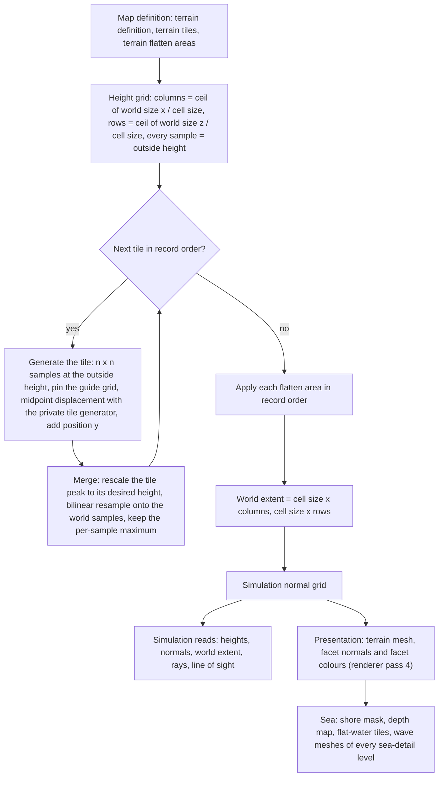

# Terrain

> Status: Engine baseline · Prefix: TER · ADRs: [ADR-011](../../../ADR/ADR-011-world-surface-rendering.md) · [ADR-052](../../../ADR/ADR-052-cpp23-language-standard.md) · [ADR-059](../../../ADR/ADR-059-content-build-and-validators.md) · [ADR-060](../../../ADR/ADR-060-content-identity-by-hash.md) · [ADR-061](../../../ADR/ADR-061-data-schemas-and-versioning.md) · [ADR-069](../../../ADR/ADR-069-test-framework.md) · Related: [World renderers](../renderer/world_renderers.md) · [Maps: rules and conventions](../../../reference/08_maps_and_level_design/rules_and_conventions.md) · [Map editor hooks](../../../reference/08_maps_and_level_design/map_editor_hooks.md) · [Randomness and integrity](../../../reference/12_simulation_model/07_randomness_and_integrity.md) · [Space, routing and physics](../../../reference/12_simulation_model/05_space_routing_and_physics.md) · [Data schemas](../data_schemas/README.md)

This component turns the terrain records of a map definition into the terrain that the simulation stands on and the renderer draws, precisely enough to re-implement the generator and reproduce its output bit for bit. The runtime model of a large world (generated at load or baked, streaming, content identity) is decided by the design phase (§8.3).

## Folder index

| File | Holds | Requirement IDs |
|---|---|---|
| [README.md](README.md) (this file) | responsibilities and boundaries, the interface sketch and the queries, the data model, the generation pipeline, the tuning table, budgets, failure modes, the acceptance tests and the open decisions | TER-001 to TER-062, TER-240 to TER-254 |
| [height_field_generation.md](height_field_generation.md) | §4.2 to §4.9: numeric primitives and grid reads, the private tile generator, tile generation, the generation methods, noise, tile edge cases, the composition of tiles, flatten areas; §7.2: the vector sets | TER-065 to TER-145 |
| [edges_normals_colours_and_sea.md](edges_normals_colours_and_sea.md) | §4.10 to §4.16: the world grid and its edge semantics, simulation normals, the colour-ramp look-up and its generators, the sea derivations, the lifecycle, the conversions the output depends on | TER-150 to TER-230 |

Section numbers are shared by the three files, so a reference such as §4.8 or §7.2 names one section of the folder.

Notation used throughout: *r32*(*x*) rounds a binary64 value to the nearest binary32 value (ties to even) and widens it back to binary64; trunc(*x*) truncates toward zero; ⌊*x*⌋ and ⌈*x*⌉ are floor and ceiling; "tile space" is a tile's height scale before its peak rescale (§4.8); *X* and *Z* are the world extents of TER-150.

## 1 Responsibilities and boundaries

**TER-001** (MUST) The terrain component owns: the terrain definition, tile and flatten-area data as the generator reads them (§3); the generator (§4.3 to §4.9); the terrain height field (`TerrainField`) with its height grid, its simulation normal grid, its cell size, its column and row counts and its world extent; the read-only queries of §2.2; the per-triangle colour-ramp look-up (§4.12); and the sea derivations (§4.14). It owns no GPU resource and records no pass.

**TER-002** (MUST) The terrain is one regular height field: a world surface grid (`SurfaceGrid`) with its origin at (0, 0) and square cells of the cell size on both axes. It is generated once per match-world initialisation, at step 5 of [reference/12](../../../reference/12_simulation_model/02_match_lifecycle_and_state_reset.md) table 2.4-A (R-SIM-016), from the terrain definition, the terrain tiles and the terrain flatten areas of the map definition ([rules and conventions](../../../reference/08_maps_and_level_design/rules_and_conventions.md) R-MAP-080 to R-MAP-083). Nothing writes it afterwards: no simulation rule, presentation code, option change or tool other than the map editor's regeneration (§8.2) changes a sample (DEC-007, DEC-010).

**TER-003** (MUST) A terrain is a list of tiles. Each tile is an independent square fractal height map, produced by midpoint displacement (square and diamond steps) with its own private generator (R-SIM-609) and optionally pinned by a coarse guide grid of 8-bit heights. Each tile's highest sample is linearly rescaled to the tile's desired height, and the tile is resampled onto the world grid with a per-sample maximum, so a later tile can only raise terrain (DEC-025).

**TER-004** (MUST) Flatten areas, axis-aligned squares with five operations, are applied after all tiles; they are the only operation that can lower terrain. There is no smoothing pass between tiles: the only smoothing is the bilinear resampling of TER-121 and the smooth operation of TER-143.

**TER-005** (MUST) The sea surface lies at the height `ref.sim.physics.sea_level` (0 wu, [reference/12 space, routing and physics](../../../reference/12_simulation_model/05_space_routing_and_physics.md) R-SIM-365) everywhere; a map has no water-level parameter. Every world sample that no tile raises stays at the outside height, the negative sea floor.

**TER-006** (MUST) The height field and the normal grid are simulation static data. They depend only on the terrain records of the map definition, with decimal values rounded as TER-066 states, and on the integer tile seeds. They never depend on the simulation generator, a presentation generator, a clock, a setting, the hardware or the history of earlier calls (R-SIM-710, DEC-246).

**TER-007** (MUST) The colour-ramp look-up, the shore mask, the depth map, the flat-water tile mask, the wave-mesh vertices and the coastline waves are presentation data: they never feed the simulation (R-SIM-601, DEC-007). The renderer owns their passes, pipeline-state entries and render keys ([world renderers](../renderer/world_renderers.md) RND-130 to RND-148, ADR-011); this component defines only the data and the formulae it derives them from, and never redefines a renderer key.

**TER-008** (MUST NOT) The terrain component does not draw from the simulation generator (`SimRng`) or from any presentation generator that another consumer shares (R-SIM-608); it does not read a clock, an option, the local team or any other local state; and it never writes simulation state other than its own height field and normal grid, which it writes only while generating them.

**TER-009** (MUST) The baseline runtime model is the reference's: every participant generates the height field when the map loads, from the tile records of its map definition, as TER-060 specifies. Whether Species generates at load, bakes the height field in the content build, streams it for a large world or identifies it by a content hash is decided by the design phase (DEC-246, DEC-247; §8.3). No reference terrain is reproduced: Species maps are authored new, and the generator specification also defines the look of a new map tool (DEC-025, DEC-063).

## 2 Interfaces

### 2.1 Interface sketch

```cpp
namespace Engine
{

// Stored values carry meaning (they are the values in the map definition); keep the order.
enum class TileMethod : std::uint8_t
{
  Average = 0,
  RandomPair = 1,
  CopyOne = 2
};
enum class FlattenOp : std::uint8_t
{
  Absolute = 0,
  Add = 1,
  Subtract = 2,
  Smooth = 3,
  Subtract2 = 4
};

struct TerrainTile // TER-032; field order of R-MAP-081
{
  std::int32_t posX;
  double posY;
  std::int32_t posZ;
  std::int32_t size;
  double fractalDimension;
  double heightScale;
  double desiredHeight;
  TileMethod method;
  std::int32_t seed;
  double lowlandSmoothing;
  std::uint8_t guidePower;    // p; 0 = no guide grid
  Grid2D<std::uint8_t> guide; // (2^p - 1) x (2^p - 1), TER-036
};

struct TerrainFlattenArea // TER-034
{
  Vec3 center; // center.y is the operand t
  double halfSize;
  FlattenOp op;
  double threshold; // T
};

struct TerrainDefinition // TER-030; fields of R-MAP-080
{
  double cellSize;
  std::int32_t worldSizeX;
  std::int32_t worldSizeZ;
  double outsideHeight;
  float maxHeight;
  std::uint16_t landRampFile; // file numbers, 1 = map default
  std::uint16_t shoreWaveGradientFile;
  std::uint16_t seaTileFile;
  std::vector<TerrainTile> tiles;
  std::vector<TerrainFlattenArea> flattenAreas;
};

template <typename T> class SurfaceGrid // TER-038, TER-070 to TER-076
{
public:
  SurfaceGrid(double _width, double _height, double _x0, double _z0, double _cellX, double _cellZ, T _outside);
  std::uint16_t Columns() const;
  std::uint16_t Rows() const;
  T At(std::int32_t _i, std::int32_t _j) const;         // outside value off the grid
  void Set(std::int32_t _i, std::int32_t _j, T _value); // ignored off the grid
  T Sample(double _x, double _z) const;                 // bilinear, TER-073
  T Nearest(double _x, double _z) const;                // TER-075
  std::int32_t IndexX(double _x) const;                 // TER-074
  std::int32_t IndexZ(double _z) const;
  double PositionX(std::int32_t _i) const; // TER-070
  double PositionZ(std::int32_t _j) const;
  T Highest() const; // TER-076
};

class TerrainField
{
public:
  static TerrainField Generate(const TerrainDefinition& _definition); // TER-060
  double Height(double _x, double _z) const;                          // TER-011
  double HeightAt(std::int32_t _i, std::int32_t _j) const;            // TER-012
  Vec3 Normal(double _x, double _z) const;                            // TER-013
  Vec3 NormalAt(std::int32_t _i, std::int32_t _j) const;              // TER-013
  double WorldSizeX() const;                                          // TER-014
  double WorldSizeZ() const;
  std::uint16_t Columns() const;
  std::uint16_t Rows() const;
  double CellSize() const;
  double OutsideHeight() const;
  bool IsInside(const Vec3& _p) const;                                           // TER-015
  std::optional<Vec3> CastRay(const Vec3& _start, const Vec3& _direction) const; // TER-016 to TER-018
  bool LineOfSight(const Vec3& _from, const Vec3& _to) const;                    // TER-019
  const SurfaceGrid<double>& Heights() const;
  const SurfaceGrid<Vec3>& Normals() const;
};

// Presentation derivations (TER-007), built once per match world by the presentation side.
struct SeaMasks // TER-196 to TER-199
{
  ImageRgba8 shoreMask;        // 128 x 128 grey, row 0 = mask row 127
  SurfaceGrid<float> depth;    // 1 = open sea, 0 = on or next to land
  Grid2D<bool> flatWaterTiles; // 32 x 32
};
SeaMasks BuildSeaMasks(const TerrainField& _field);

struct WaveVertex
{
  Vec3 position;
  float depth;
  float shoreNoise;
};
struct WaveMeshSource
{
  double cell;
  std::vector<std::array<WaveVertex, 2>> pairs; // build order
};
WaveMeshSource SelectWaveVertexPairs(const TerrainField& _field, const SeaMasks& _masks, int _seaDetail,
                                     FxRng& _shoreNoise); // TER-201

ColorRgba FacetColor(const ImageRgba8& _ramp, float _facetNormalY, const Vec3& _center, float _highest,
                     FxRng& _colorVariation); // TER-181

} // namespace Engine
```

**TER-010** (MUST) `TerrainField::Generate` is a pure function of its definition. It runs on one thread, uses no shared mutable state and returns a complete field; no reader sees a partly generated field. After it returns, the field is immutable: every query is `const`, allocates nothing, makes no random draw and is safe for concurrent readers on any thread. The simulation reads every height and normal through the current match world's field and never keeps a copy or a reference beyond the match world's lifetime (DEC-011).

### 2.2 Queries used by gameplay

**TER-011** (MUST) `Height(x, z)` is the bilinear sample of the height grid (TER-073), with the edge semantics of TER-153. It is the terrain height of every simulation rule ([reference/12](../../../reference/12_simulation_model/05_space_routing_and_physics.md) R-SIM-367 and R-SIM-369), of presentation and of audio.

**TER-012** (MUST) `HeightAt(i, j)` is the raw sample at column *i* and row *j*; an index outside the grid returns the outside height (TER-072).

**TER-013** (MUST) `Normal(x, z)` is the bilinear blend of the four corner normals of the simulation normal grid (TER-170), with the edge semantics of TER-153; the blend is **not** renormalised, so its length is below 1 where the corner normals differ. `NormalAt(i, j)` is the raw grid normal; an index outside the grid returns `ter.normal.outside` (0, 1, 0).

**TER-014** (MUST) `WorldSizeX()` and `WorldSizeZ()` return the world extents *X* and *Z* of TER-150. A match world that has no generated field reports `ter.query.ungenerated_world_size` (1 000 000 wu) on both axes and the outside height `ter.query.ungenerated_outside_height` (−20 wu).

**TER-015** (MUST) `IsInside(p)` holds exactly when 0 ≤ *p.x* < *X* and 0 ≤ *p.z* < *Z*.

**TER-016** (MUST) `CastRay(start, direction)` normalises the direction (TER-077) and computes the start cell (*i*₀, *j*₀) = (`IndexX`(*start.x*), `IndexZ`(*start.z*)). If 0 ≤ *i*₀ < columns and 0 ≤ *j*₀ ≤ rows (the second bound is inclusive), it walks the grid from the start (TER-017). Otherwise it intersects the horizontal projection of the ray with the two grid edges that face the ray, chosen by the signs of *direction.x* and *direction.z*, as segment–ray tests in the horizontal plane; if neither edge is hit there is no hit; otherwise it restarts the walk from the entry point, whose height is *start.y* + λ × *direction.y* with λ = (*entry.x* − *start.x*) ÷ *direction.x*. When *direction.x* is 0 that division is undefined, so λ is computed from the z components, (*entry.z* − *start.z*) ÷ *direction.z*, and no query produces a non-finite value (DEC-653).

**TER-017** (MUST) The grid walk tests the cells crossed by the ray in order along it, starting with the start cell. In each cell (*i*, *j*) it tests the cell's two triangles, first (*c*₀₀, *c*₀₁, *c*₁₀) and then (*c*₀₁, *c*₁₀, *c*₁₁), where *c*_ab is the height-grid vertex (*i* + *a*, *j* + *b*) at its world position; this is the same diagonal as the render mesh ([world renderers](../renderer/world_renderers.md) RND-132). Each triangle test is the ray–triangle intersection of the maths library with the range `ter.query.ray_tri_range` (10¹⁰ wu), which bounds the length of the (*t*, *u*, *v*) vector and does not require *t* ≥ 0, so a hit behind the start can be reported (DEC-241 item 10). The first hit ends the walk and is the result. After a cell without a hit, the walk steps in z when the ray leaves the cell through its far z edge and in x otherwise, and it ends without a hit when it leaves the grid. The walk has one variant per sign quadrant of (*direction.x*, *direction.z*); a ray with a zero horizontal component visits only the column or the row it lies in (see DEC-966 item 1).

**TER-018** (MUST) `CastRay` serves the line-of-sight test (TER-019), the pointer's ground point on the input side ([reference/12](../../../reference/12_simulation_model/05_space_routing_and_physics.md) R-SIM-387, [actions and bindings](../../../reference/06_controls_camera_and_commands/actions_and_bindings.md) R-CTRL-058), the Transport, and the weapon rules that find a projectile's terrain hit with a ray ([weapons and projectiles](../../../reference/04_supply_crates_powers_and_weapons/weapons_and_projectiles.md)). It tests only the terrain, never structures or actors.

**TER-019** (MUST) `LineOfSight(from, to)` is the terrain line-of-sight test: with *d* = normalise(*to* − *from*) and the margin *m* = `ter.query.los_margin` (20 wu), it casts the ray from *from* + *m* × *d* along *d*; with no hit the target is visible; with a hit at *h* it is visible exactly when |*h* − *from*| > |*to* − *from*| + *m*. The margin therefore applies at both ends. Only the terrain blocks the line; the Beam Dish link test ([reference/03](../../../reference/03_buildings_and_world_objects/README.md)) and the bots ([reference/07](../../../reference/07_bots/README.md)) use it.

The map editor's tile deletion and regeneration are hooks (§8.2).

## 3 Data model

The map schema that carries these records is [data schemas](../data_schemas/README.md) (ADR-061, ADR-062); this section states what the generator reads.

### 3.1 Terrain definition

**TER-030** (MUST) The terrain definition (`TerrainDefinition`) holds the fields of table 3.1-A, as [rules and conventions](../../../reference/08_maps_and_level_design/rules_and_conventions.md) R-MAP-080 lists them; a field that a map omits takes its default.

Table 3.1-A Terrain-definition fields as the generator reads them.

| Field | Type and rounding | Unit | When absent | Meaning |
|---|---|---|---|---|
| cell size | decimal, rounded once to binary32 (TER-066): 15.76 becomes 15.760000228881836 | wu per sample, both axes | `ref.map.terrain.cell_size_default` (12.0) | the spacing of the height samples; the renderer draws two triangles per cell (RND-132) |
| world size x, world size z | whole number, 32-bit signed | wu | `ref.map.terrain.world_size_default` (2 000) each | the requested extent; the real extent is TER-150 |
| outside height | decimal, rounded to binary32 | wu | `ref.map.terrain.outside_height_default` (−10) | the four roles of TER-031 |
| maximum height | decimal, rounded to binary32 and held as binary32 | wu | `ref.map.terrain.max_height_default` (0.0) | the colour-ramp normaliser only (TER-180); no other rule reads it |
| land colour ramp | a file number of `terrain.ramp` | — | file 1, the map default | the ramp of TER-040 |
| shore-wave gradient | a file number of `terrain.shore_wave_gradient` | — | file 1 | the wave colour table of TER-041 |
| sea tile | a file number of `terrain.sea_tile` | — | file 1 | the flat-sea texture of RND-142; the terrain derives nothing from it |

**TER-031** (MUST) The outside height is (a) the initial value of every world sample, (b) the initial value and the border level of every tile, (c) the base of every tile's peak rescale, and (d) the value that an integer read outside the height grid returns. The normal grid's outside value is `ter.normal.outside` (0, 1, 0).

### 3.2 Terrain tiles

**TER-032** (MUST) A terrain tile record (`TerrainTile`) holds the fields of table 3.2-A in this order (R-MAP-081). Every field is mandatory in a map definition. The tiles are kept, and generated, in record order. The record type's defaults equal the map editor's new-tile values ([map editor hooks](../../../reference/08_maps_and_level_design/map_editor_hooks.md) R-MAP-326), except its size, `ter.tile.default_size` (256 wu).

Table 3.2-A Terrain-tile fields.

| # | Field | Type and rounding | Unit | Meaning |
|---|---|---|---|---|
| 1 | position x | 32-bit signed integer | wu | world x of the tile's low corner |
| 2 | position y | decimal, rounded to binary32 | wu, tile space | added to every tile sample after the displacement and before the peak rescale (TER-091 step 7, TER-122) |
| 3 | position z | 32-bit signed integer | wu | world z of the tile's low corner |
| 4 | size | 32-bit signed integer | wu | the edge length of the tile's square footprint on the world grid |
| 5 | fractal dimension *fd* | decimal, rounded to binary32 | — | the roughness exponent: the noise amplitude of a pass is proportional to (2560 × *h* ÷ *n*)^*fd* (TER-105); a larger value makes the coarse passes dominate, which gives smoother terrain, and the gain compensation 30.7 × e^(−6.5 × *fd*) roughly cancels the growth of the coarsest amplitude (DEC-324) |
| 6 | height scale *hs* | decimal, rounded to binary32 | — | the linear noise gain; 0 gives no noise, so the tile is the interpolation of its guide grid and border |
| 7 | desired height | decimal, rounded to binary32 | wu | the height that the tile's highest sample is mapped to (TER-122) |
| 8 | generation method | integer | `TileMethod` 0, 1 or 2 | 0 averages four parents, 1 averages a random opposite pair, 2 copies one random parent (TER-100); any other value is rejected (TER-112) |
| 9 | seed | 32-bit signed integer | — | the seed of the tile's private generator, applied at the start of every generation of the tile (TER-091 step 6) |
| 10 | lowland smoothing factor *ls* | decimal, rounded to binary32 | — | the exponent on the base height in the noise envelope 0.1 + 0.15 × \|*b*\|^*ls* (TER-105): a larger value keeps low ground flatter relative to high ground, and *ls* = 0 makes the envelope the constant 0.25; it also scales the gain by 15.353 × e^(−3.1 × *ls*) |
| 11 | guide-grid power *p* | integer, 0 or more | — | 0: no guide grid; above 0: a guide grid of *r* = 2^*p* − 1 points per side (TER-036) |
| 12 | guide grid | *r* × *r* unsigned 8-bit values, present only when *p* > 0 | wu, tile space | the pinned heights of TER-036 and TER-037 |

**TER-033** (MUST) Generation adds per-tile state that the map does not hold: the tile grid, a `SurfaceGrid<double>` of *n* × *n* samples with cell size 1, origin (0, 0) and the terrain's outside height as its outside value during generation, re-targeted to world space during the merge (TER-120); the compensated gain (TER-091 step 4); the tile's private generator state (TER-080); and the tile's outside height, which is set to the terrain's outside height before every generation of the tile.

### 3.3 Terrain flatten areas

**TER-034** (MUST) A terrain flatten area record (`TerrainFlattenArea`) holds the fields of table 3.3-A (R-MAP-083), in this order. Its size is mandatory; its flatten type and threshold are optional, and the threshold is read only when the type is present.

Table 3.3-A Flatten-area fields.

| # | Field | Type and rounding | Unit | When absent | Meaning |
|---|---|---|---|---|---|
| 1 | centre x | decimal, rounded to binary32 | wu | — | the centre of the square on x |
| 2 | centre y | decimal, rounded to binary32 | wu | — | the operand *t*: the target height (type 0), the amount added (type 1) or subtracted (types 2 and 4), the target level (type 3) |
| 3 | centre z | decimal, rounded to binary32 | wu | — | the centre of the square on z |
| 4 | size | decimal, rounded to binary32 | wu | — (a new area in the map editor takes `ref.map.editor.new_flatten_area.size`, R-MAP-327) | the **half**-width of the axis-aligned square |
| 5 | flatten type | integer | `FlattenOp` 0 to 4 | 0, Absolute | the operation of TER-143 |
| 6 | threshold *T* | decimal, rounded to binary32 | wu | `ref.map.terrain.flatten_threshold_default` (40.0) | the threshold of types 2, 3 and 4 |

**TER-035** (MUST) The flatten types are, by stored value: 0 Absolute, 1 Add, 2 Subtract, 3 Smooth, 4 Subtract2 (`FlattenOp`). The stored values carry meaning and keep this order; the map editor lists the types sorted by their display names (R-MAP-332).

### 3.4 Guide grid

**TER-036** (MUST) A guide-grid power *p* gives *r* = 2^*p* − 1 guide points per side; *p* = 0 means no guide grid. The cells are in row-major order with z outer and x inner: cell (*x*, *z*) is element *z* × *r* + *x*. Each cell holds one unsigned 8-bit value, 0 to 255, used directly as an absolute height in tile space, before the position-y shift and before the peak rescale. Setting a new power reallocates the grid and fills it with zeros. The authoring encoding of the cells in a map definition is the map schema's ([data schemas](../data_schemas/README.md)). For a tile grid of *n* = 2^*k* + 1 samples per side, table 3.4-A gives the sizes.

Table 3.4-A Guide-grid sizes.

| *p* | *r* × *r* | Cells | Tile-sample spacing of the guide points |
|---|---|---|---|
| 1 | 1 × 1 | 1 | 2^(*k* − 1): the single point is the tile centre |
| 2 | 3 × 3 | 9 | 2^(*k* − 2) |
| 3 | 7 × 7 | 49 | 2^(*k* − 3) |
| 4 | 15 × 15 | 225 | 2^(*k* − 4) |
| 5 | 31 × 31 | 961 | 2^(*k* − 5) |

**TER-037** (MUST) Guide cell (*x*, *z*) pins tile sample ((*x* + 1) × 2^(*k* − *p*), (*z* + 1) × 2^(*k* − *p*)) (TER-091 step 3); the tile border is never a guide point. Because the first displacement pass uses the step 2^(*k* − *p*), the lattice of the guide points and the border is exactly the set of corners of that pass, so the displacement refines between the pinned points and never moves them: later passes write only midpoints. A guide value of 0 is a real height, above the negative border (TER-111).

### 3.5 Grids

**TER-038** (MUST) A world surface grid (`SurfaceGrid<T>`) is built from a width, a height, an origin (*x*₀, *z*₀), cell sizes *c*ₓ and *c*_z and an outside value. Its column count is ⌈width ÷ *c*ₓ⌉ and its row count ⌈height ÷ *c*_z⌉, each held as a 16-bit unsigned count; its inverse cell sizes 1 ÷ *c*ₓ and 1 ÷ *c*_z are computed once in binary64. Every element is set to the outside value at construction, so no element is ever read before it is written.

**TER-039** (MUST) A 2-D grid (`Grid2D<T>`) is a plain array of columns × rows elements without origin or cell size, with the index rules of TER-072; the guide grid and the flat-water tile mask are 2-D grids.

### 3.6 Rendering inputs

**TER-040** (MUST) A land colour ramp, one file of `terrain.ramp`, is an image of `ter.colour.ramp_size` × `ter.colour.ramp_size` (64 × 64) texels, read on the CPU as a `CpuTable` entry of the asset cache, never uploaded to the GPU (AST-072, ADR-017). Its x axis is the slope: column 0 is flat ground and column 63 vertical. Its y axis is the height, with the look-up row index counted from the **bottom** row of the image as viewed: row 0, the bottom row, is the highest terrain, and row 63, the top row, is sea level and below. The content build rejects a ramp of another size (DEC-015).

**TER-041** (MUST) A shore-wave gradient, one file of `terrain.shore_wave_gradient`, provides the wave colour table: the pixel row `rnd.sea.wave_table_row` (1) of [world renderers](../renderer/world_renderers.md) RND-144, counted from the bottom row of the image as viewed (the second row from the bottom), one colour per pixel column. The number of colours is the image's width, 400 for the gradients of the asset manifest, and any width is accepted. Every colour is opaque (alpha 0 in the inverted style, RND-144, DEC-040). The gradient is read on the CPU as a `CpuTable` entry, like the ramp (AST-072). The land colour ramp and the shore-wave gradient embedded in a custom map take the place of these files for that map only and reach the terrain component as CPU tables in the same form (AST-063).

**TER-042** (MUST) While the match's seasonal state is active, the renderer replaces the map's ramp, sea tile and shore-wave gradient by the seasonal files (RND-134, RND-142, RND-144; DEC-118). The seasonal state never changes a height, a normal or a sea mask.

**TER-043** (MUST) The terrain sets the scale of the renderer's wire-grid overlay: the stylised grid texture `fx.terrain_grid` is mapped once onto each height-field cell, with the grid coordinates (world *x* ÷ cell size, world *z* ÷ cell size), so its lines do not follow the triangle diagonals of TER-017 (RND-135). Whether the overlay is drawn along the triangle edges instead is DEC-326; the terrain data is the same either way.

### 3.7 Data products

**TER-044** (MUST) Generation and the presentation builds produce the data of table 3.7-A, with these lifetimes.

Table 3.7-A Terrain data products.

| Product | Type and grid | Lifetime | Consumers | Class |
|---|---|---|---|---|
| height grid | `SurfaceGrid<double>`, columns × rows, cell size, origin (0, 0), outside value the outside height | the match world | every simulation height read (actors, structures, physics, walkability, bots, weapons), the camera, audio, the sea derivations, the renderer | simulation |
| normal grid | `SurfaceGrid<Vec3>`, the same grid, outside value `ter.normal.outside` | the match world | bounce physics, the centipede, impacts, particles, the orientation of units, legs, structures and props to the ground | simulation (and presentation) |
| world extent *X*, *Z*, columns, rows, cell size | binary64 and 16-bit counts | the match world | `IsInside`, the edge rules, the spatial grids and route graphs ([reference/12](../../../reference/12_simulation_model/05_space_routing_and_physics.md) R-SIM-304), the camera bounds, the fog, the sea plane | simulation |
| facet colours | one colour per terrain triangle (TER-181) | the renderer's terrain chunks | pass 4 (RND-134) | presentation |
| shore mask | 128 × 128 grey image (TER-197) | the match world | the flat sea layer, texture 1 (RND-142) | presentation |
| depth map | `SurfaceGrid<float>`, 128 × 128 over the sea plane (TER-198) | until the wave meshes of every sea-detail level are built | the wave-mesh vertex selection | presentation |
| flat-water tile mask | `Grid2D<bool>`, 32 × 32 (TER-199) | the match world | the flat sea layer (RND-141) | presentation |
| wave-mesh pairs | per sea-detail level: vertex pairs in build order with depth and shore noise (TER-201) | the match world | the wave update and pass 5b (RND-144, RND-145) | presentation |

## 4 Behaviour and algorithms

### 4.1 Pipeline

**TER-060** (MUST) `TerrainField::Generate` runs these steps in this order:

1. Create the height grid as `SurfaceGrid<double>`(world size x, world size z, origin (0, 0), cell size, cell size, outside height); every sample is the outside height.
2. For each tile in record order: set the tile's outside height to the terrain's; generate the tile (TER-091); merge it into the height grid (TER-120).
3. For each flatten area in record order: apply it (TER-140 to TER-144).
4. Set the world extent *X* = cell size × columns and *Z* = cell size × rows (TER-150).
5. Compute the simulation normal grid (TER-170).

From the finished field the presentation side then builds the terrain mesh and its facet normals ([world renderers](../renderer/world_renderers.md) RND-132 to RND-134) with the facet colours of TER-181, the sea masks (TER-195 to TER-199) and the wave meshes (TER-200 to TER-203). Match-world initialisation then places every map-placed structure on the terrain at its (x, z) (R-SIM-016 step 7, R-SIM-367, R-MAP-102).



Caption: the terrain pipeline of one match-world initialisation; everything below "Simulation normal grid" on the presentation branch never feeds the simulation.

**TER-061** (MUST) Generation computes in IEEE-754 binary64 with rounding to nearest, ties to even: every expression is evaluated in the order written in this document, and every operation is rounded to binary64, with no fused multiply–add contraction, no reassociation, no extended-precision intermediate and no flush to zero. Where this document writes "binary32", the value is rounded to binary32 and widened again. This is the reference numeric model, the default of DEC-240; it reproduces the reference heights only when every participant's rounded transcendental results agree (TER-065, DEC-246 item 5).

**TER-062** (MUST) Two evaluation orders are kept exactly: the weights-first bilinear sum (TER-073), whose rewriting changes practically every terrain, and the sequential additions of the smooth operation (TER-143), whose rewriting changes every terrain with a smooth area acting above its threshold, 11 of the 57 reference map files (DEC-246 item 6).

The steps of the pipeline are specified in the other two files of this folder: [height-field generation](height_field_generation.md) §4.2 to §4.9 (numeric primitives, the private tile generator, tile generation, the generation methods, noise, tile edge cases, the composition of tiles, flatten areas), and [edges, normals, colours and sea](edges_normals_colours_and_sea.md) §4.10 to §4.16 (the world grid and its edges, simulation normals, the colour-ramp look-up and its generators, the sea derivations, the lifecycle, the conversions).

### 4.17 Tuning table

Every value is a reference value adopted as the Species engine baseline (DEC-004). Values owned by other documents are cited by their keys and not repeated here: the map defaults `ref.map.terrain.*` ([rules and conventions](../../../reference/08_maps_and_level_design/rules_and_conventions.md)), the editor values `ref.map.editor.*` ([map editor hooks](../../../reference/08_maps_and_level_design/map_editor_hooks.md)), `ref.sim.physics.sea_level` ([space, routing and physics](../../../reference/12_simulation_model/05_space_routing_and_physics.md)), `ref.sim.match.presentation_seed` and `ref.sim.match_entry.camera_border` ([match lifecycle](../../../reference/12_simulation_model/02_match_lifecycle_and_state_reset.md)), and the renderer keys `rnd.terrain.*`, `rnd.sea.*` and `rnd.fog.*` ([world renderers](../renderer/world_renderers.md), [view, lighting and fog](../renderer/view_lighting_and_fog.md)).

| key | value | unit | range or notes | requirement | DEC |
|---|---|---|---|---|---|
| `ter.generator.lcg.multiplier` | 214013 | — | the generator step, modulo 2³² | TER-080 | DEC-242 |
| `ter.generator.lcg.increment` | 2531011 | — | | TER-080 | DEC-242 |
| `ter.generator.lcg.output_shift` | 16 | bits | | TER-080 | DEC-242 |
| `ter.generator.lcg.output_mask` | 0x7FFF | — | 32 767; also the divisor of `Signed` | TER-080 | DEC-242 |
| `ter.generator.gain.fd_coefficient` | 30.7 | — | fd modifier = 30.7 × exp32(−6.5 × *fd*) | TER-091 | DEC-324 |
| `ter.generator.gain.fd_exponent` | −6.5 | per unit of *fd* | | TER-091 | DEC-324 |
| `ter.generator.gain.ls_coefficient` | 15.353 | — | ls modifier = 15.353 × exp32(−3.1 × *ls*) | TER-091 | DEC-324 |
| `ter.generator.gain.ls_exponent` | −3.1 | per unit of *ls* | | TER-091 | DEC-324 |
| `ter.generator.method2.choice_mask` | 0xFFFF | — | applied to a 15-bit draw | TER-100, TER-101 | DEC-324 |
| `ter.generator.method2.thresholds` | 0x3FFF, 0x7FFF, 0xBFFF | — | A or W, B or E, C or N, otherwise D or S; D and S are never chosen | TER-100, TER-101 | DEC-324 |
| `ter.generator.noise.length_scale` | 256.0 | — | the half-step as if the tile were 256 units wide | TER-105 | |
| `ter.generator.noise.length_multiplier` | 10.0 | — | amplitude = pow32(10 × *L*, *fd*) | TER-105 | |
| `ter.generator.noise.envelope_floor` | 0.1 | — | the envelope at a base height of 0 (for *ls* > 0) | TER-105 | DEC-324 |
| `ter.generator.noise.envelope_gain` | 0.15 | — | × pow32(\|*b*\|, *ls*) | TER-105 | DEC-324 |
| `ter.merge.index_rounding` | 0.5 | samples | added before truncation: the nearest world sample | TER-120, TER-124 | |
| `ter.merge.range_epsilon` | 0.001 | wu | prevents a division by zero for a flat tile | TER-120, TER-122 | |
| `ter.flatten.smooth_passes` | 2 | passes | Smooth only; every other type makes 1 | TER-142, TER-143 | DEC-324 |
| `ter.flatten.smooth_divisor` | 6.0 | — | five terms over six | TER-142, TER-144 | DEC-324 |
| `ter.tile.default_size` | 256 | wu | the record type's default size; every map field is mandatory | TER-032 | |
| `ter.grid.index_bits` | 16 | bits | the reference index width; indices reduce modulo 2¹⁶ | TER-072, TER-073, TER-153 | DEC-246 |
| `ter.grid.max_samples_per_side` | 32 768 | samples | the content-build limit on columns and rows | TER-072, TER-250 | DEC-247 |
| `ter.math.normalise_min_length_sq` | 10⁻¹⁰ | wu² | below or at it, normalisation gives the fallback | TER-077 | DEC-241 |
| `ter.math.normalise_fallback` | (0, 0, 1) | unit vector | | TER-077 | DEC-241 |
| `ter.normal.outside` | (0, 1, 0) | unit vector | the normal grid's outside value and the flat-neighbourhood normal | TER-013, TER-031, TER-170 | |
| `ter.query.ungenerated_world_size` | 1 000 000 | wu | world size reported without a generated field | TER-014 | |
| `ter.query.ungenerated_outside_height` | −20 | wu | outside height reported without a generated field | TER-014 | |
| `ter.query.ray_tri_range` | 10¹⁰ | wu | range of the ray–triangle test in the grid walk | TER-017 | DEC-241 |
| `ter.query.los_margin` | 20 | wu | at both ends of the line of sight | TER-019 | |
| `ter.colour.ramp_size` | 64 | texels | the ramp's width and height; the look-up scale | TER-040, TER-181, TER-182 | |
| `ter.colour.centre_factor` | 0.33333 | — | not 1/3 | TER-181 | |
| `ter.colour.slope_exponent` | 0.4 | — | *u* = (1 − *g*)^0.4 | TER-181, TER-182 | |
| `ter.colour.jitter_numerator` | 0.45 | ramp fraction × wu | jitter range 0.45 ÷ (max(*h*, 0) + 2), uniform about 0 | TER-181, TER-182 | |
| `ter.colour.jitter_offset` | 2.0 | wu | | TER-181 | |
| `ter.sea.mask_size` | 128 | pixels per side | shore mask and depth map | TER-196, TER-197, TER-198 | |
| `ter.sea.mask_land_offset` | 32 | pixels | land window [32, 96) on both axes | TER-196 | |
| `ter.sea.blur_taps` | 0.2, 0.3, 0.4, 0.5, 0.8, 1.0, 0.8, 0.5, 0.4, 0.3, 0.2 | — | 11 taps centred on tap 5 | TER-197 | |
| `ter.sea.blur_normaliser` | 5.4 | — | the sum of the taps | TER-197 | |
| `ter.sea.blur_skip_tolerance` | 10⁻⁶ | — | pixels this close to 0 scatter nothing | TER-197 | DEC-241 |
| `ter.sea.mask_gain` | 855 | grey levels | × the blurred value | TER-197 | |
| `ter.sea.mask_max` | 255 | grey level | | TER-197 | |
| `ter.sea.depth_outside` | 1.0 | depth | the depth map's outside value; at or above it a sample is open sea | TER-198, TER-199 | |
| `ter.sea.flat_tile_ratio` | 4 | depth samples per tile side | 32 × 32 tiles | TER-199 | |
| `ter.sea.cell_divisor` | 100 | — | water cell = detail × max(*X*, *Z*) ÷ 100 | TER-200 | |
| `ter.sea.vertex_land_limit` | 4.0 | wu | a point above it is not needed | TER-201 | |
| `ter.sea.vertex_depth_limit` | 0.999 | depth | a point deeper than it is not needed | TER-201 | |
| `ter.sea.wave.shore_noise` | 0.25 | — | × the signed shore draw | TER-202 | |
| `ter.sea.wave.shore_brightening` | 250.0 | colour-table entries | | TER-202 | |
| `ter.sea.wave.table_margin` | 2 | entries | table size = trunc(2 × size ÷ cell + 2) | TER-204 | |
| `ter.sea.wave.amplitude_scale` | 7.0 | wu | | TER-204, TER-206 | |
| `ter.sea.wave.x_terms` | (0.01, 0.65, 1.2), (0.03, 1.5, 0.9) | (per wu, per s, —) | spatial frequency, temporal frequency, amplitude | TER-204 | |
| `ter.sea.wave.z_terms` | (0.02, 0.75, 0.9), (0.03, 1.85, 0.65) | (per wu, per s, —) | | TER-204 | |
| `ter.sea.wave.index_bias` | 0.1 | cells | added before truncation | TER-205 | |
| `ter.sea.wave.brightness_scale` | 4.0 | — | | TER-205 | |
| `ter.sea.wave.colour_mix` | 0.7, 0.3 | — | the other vertex's brightness weighs 0.7 | TER-205 | |
| `ter.test.log2_check_limit` | 70 000 | — | ceilLog2 is exact below it | TER-067 | |

## 5 Concurrency and performance budget

**TER-240** (MUST) Generation is linear in the work of its passes: a tile of *n* × *n* samples makes Σ (3*c*² − 2*c*) square and diamond calls over its passes (TER-092), each with one or two draws and one envelope power, plus one amplitude power per call; the merge reads trunc(size ÷ cell size)² world samples per tile; the normals make three square roots per sample. Generating all the reference terrains makes about 39.7 million power calls, about 0.6 million per terrain on average (DEC-247 item 10); the largest tile, 257 × 257 samples with *p* = 2, makes 261 112 calls.

**TER-241** (MUST) A height sample takes 8 bytes and a normal 24 bytes. The largest reference terrain, 334 × 334 samples, holds 0.89 MB of heights and 2.68 MB of normals (DEC-247 item 7). A tile grid exists only during its tile's generation and merge, at most 257 × 257 binary64 samples (0.53 MB) in the reference content. The sea masks take 64 KiB for the shore-mask image, 64 KiB for the depth map, which is released after the wave meshes are built (TER-195), and 1 024 flags for the flat-water tiles.

**TER-242** (MUST) Generation runs during match-world initialisation, outside every tick and frame budget: no tick runs and no command frame is taken until initialisation has finished (R-SIM-612). It never runs inside a simulation update slice or a rendered frame. The load budget and its progress reporting are DEC-226; the performance test T26 measures generation on the minimum CPU.

**TER-243** (MUST) `Height`, `HeightAt`, `Normal`, `NormalAt` and `IsInside` take constant time; `CastRay` and `LineOfSight` take time proportional to the number of cells the ray crosses. Every query runs concurrently with every other query on any thread (TER-010).

## 6 Failure modes, diagnostics and telemetry

**TER-250** (MUST) The content build validates every map's terrain records against the map schema (DEC-015, ADR-059; see DEC-968 item 1) and rejects, with a diagnostic naming the map and the record: a cell size that is not finite and above 0; a world size below 1 wu; a grid of more than `ter.grid.max_samples_per_side` (32 768) columns or rows (TER-072); a decimal field that is not finite; a whole-number field outside the 32-bit signed range; a tile smaller than 2 cell sizes, a generation method other than 0, 1 or 2, or a guide grid whose cell count is not (2^*p* − 1)² (TER-112); a tile whose start index is −1 or below while its footprint overlaps the grid (TER-124); a flatten type outside 0 to 4; a ramp whose size is not 64 × 64 (TER-040); and a land colour ramp, shore-wave gradient or sea tile file number that the asset manifest does not hold. It warns, without rejecting, about a tile with *k* < *p* (TER-111) and a tile whose footprint lies wholly outside the grid (TER-124).

**TER-251** (MUST) At run time, a terrain loader never passes a missing token on as a value, never hangs on malformed data and never stops the process: a map that fails validation is refused with a diagnostic (DEC-015). A missing ramp, sea tile or gradient file falls back to the map default, file 1 of its asset, with a diagnostic ([world renderers](../renderer/world_renderers.md) §6).

**TER-252** (MUST) The canonical digest of a height grid is the SHA-256 of its samples encoded as little-endian binary64, rows in order (z outer) and columns in order within a row (x inner), never the in-memory layout (DEC-246 item 10, ADR-060); the normal grid's digest encodes the three components of each normal in the order x, y, z. Logs show the first 16 hexadecimal digits, and every comparison uses all 32 bytes (ADR-060).

**TER-253** (MUST) After every generation the terrain logs, in the terrain log category (ADR-067): the map id, the grid size, the world extent, the tile and flatten-area counts, the lowest and highest sample, the share of samples above sea level, the grid digest of TER-252 and the generation time. A Debug build can also record a per-tile trace: one record per guide pin, per draw, per noise value and per write, with every intermediate value, in the order of TER-107 (the trace of §7.2).

**TER-254** (MUST) The terrain sends no telemetry of its own; its generation time is part of the load timing that the diagnostics component reports ([diagnostics, test and performance](../diagnostics_test_and_performance.md)).

## 7 Acceptance tests

### 7.1 Tests

| Test | Kind | Checks | Requirements |
|---|---|---|---|
| T1 tile generator | unit | after `Seed`(1), the first eight `Next`() results are those of TER-081; `Signed`(*R*) gives +*R*/2 for a draw of 0 | TER-080, TER-081 |
| T2 decimal rounding | unit | the parser and *r32* give 15.76 → 15.760000228881836, −15.39 → −15.390000343322754, 1.2 → 1.2000000476837158, −26.13 → −26.1299991607666, 24.1 → 24.100000381469727 and 11.7 → 11.699999809265137 | TER-066 |
| T3 ceilLog2 | property | ceilLog2(*x*) equals the exact ⌈log₂ *x*⌉ for every integer from 1 to 69 999 | TER-065, TER-067 |
| T4 grid reads | unit | on a 4 × 3 grid with distinct values, `At` returns the outside value at columns −1, 4, 65 535 and −32 768 and at rows −1 and 3, and `Set` there changes nothing | TER-072 |
| T5 bilinear sampler | unit | `Sample` on the same grid gives, for each row of table 4.10-B, the blend that row states, and its weights-first sum differs from a left-to-right product form on a recorded case | TER-073, TER-153 |
| T6 highest scan | unit | on a 3 × 5 grid the scan covers columns 0 to 4 of rows 0 to 4, reading the outside value beyond column 2 | TER-076 |
| T7 set A derived values | unit | the values of table 7.2-B | TER-066, TER-091, TER-120, TER-122, TER-150 |
| T8 set A, method 0 trace | unit | the first ten events of tile 2 equal table 7.2-C; the tile makes 16 129 calls | TER-091, TER-092, TER-100, TER-105, TER-107 |
| T9 set A, method 1 trace | unit | the pins and first four calls of tile 0 equal table 7.2-D; the tile makes 261 112 calls and 1 044 457 events | TER-091, TER-100, TER-102 |
| T10 set B, method 2 trace | unit | the first five calls equal table 7.2-F; the tile makes 952 calls and 3 817 events, and its highest sample and height factor equal table 7.2-E | TER-091, TER-100, TER-101 |
| T11 set A result | unit | the world range and probe samples of table 7.2-B; 259 merge reads hit the case −1 < *fx* < 0 | TER-060, TER-120, TER-121, TER-122 |
| T12 set C, smooth sample | unit | the running sums and result of table 7.2-G, and the different neighbours-first result | TER-142, TER-143, TER-145 |
| T13 set D, flatten operations | unit | the five operations applied in order to a flat field give the blocks of table 7.2-H, including the in-place order of the smooth passes | TER-140 to TER-144 |
| T14 tile order | property | every permutation of the tiles of a random terrain without flatten areas gives the same digest | TER-123 |
| T15 normals | property | on a plane *h* = *a* *x* + *b* *z* every interior normal is (−*a*, 1, −*b*) ÷ \|(−*a*, 1, −*b*)\| within 10⁻⁶ (for *a* = 0.5, *b* = 0.25: (−0.4364357865767628, 0.8728715731535256, −0.2182178932883814)); a flat field and an isolated spike give (0, 1, 0); off-grid `NormalAt` gives (0, 1, 0); `Normal` between unequal corners is shorter than 1 | TER-013, TER-170, TER-171 |
| T16 validation | unit | each rejection and warning of TER-250 on a minimal map; a tile wholly outside the grid leaves every sample unchanged | TER-112, TER-124, TER-250 |
| T17 colour look-up | unit | with the jitter forced to 0, facets tilted by 10°, 30°, 45°, 60° and 90° read columns 11, 28, 39, 48 and 63; a facet at the normaliser height reads row 0 and one at sea level row 63; with a maximum height below the peak every higher facet reads row 0; over a large build every jitter at height 0 lies within ±0.1125 | TER-180, TER-181, TER-182 |
| T18 colour determinism | unit | two builds of one field, one of them while another thread draws from its own presentation generator, give identical facet colours and shore noise | TER-185, TER-186 |
| T19 sea masks | unit | for a square island on a square terrain: the mask is 255 on the island, falls to 0 six pixels beyond a straight coast and is stored flipped (image row 0 = mask row 127); depth = 1 − grey ÷ 255; a tile is false exactly when its 16 depths are at or above 1.0, at row 31 − *z* | TER-196 to TER-199 |
| T20 wave-mesh vertices | unit | the cells are 200, 100 and about 67 across at levels 1 to 3; the emitted pairs follow TER-201; every vertex makes one shore-noise draw | TER-200 to TER-202 |
| T21 wave formulae | unit | a CPU evaluation of TER-204 and TER-205 at fixed times equals the renderer's GPU wave update within its tolerance (RND test T6); the colour index truncates | TER-204, TER-205 |
| T22 golden grid digests | golden-hash | for every Species map, the digest of the generated height grid and of the normal grid equals the value that the content build recorded with the map asset; on a mismatch both grids are dumped, the first differing sample is located, and the terrain is regenerated one tile at a time to isolate the stage | TER-060, TER-061, TER-252 |
| T23 cross-build determinism | golden-hash | the digests of T22 are identical on at least two CPU generations of each of two x64 vendors and in the Debug and Release builds of every project that generates terrain (DEC-240 item 9) | TER-061, TER-065 |
| T24 immutability | property | the field's digest is unchanged after every presentation option change, after device removal and after a match of concurrent queries; no option change regenerates or rebuilds anything | TER-010, TER-220, TER-221 |
| T25 rays and line of sight | unit | a vertical ray hits the triangle of TER-017 under it; a ray starting outside the grid enters through the facing edge; a ray from outside with *direction.x* = 0 gives a finite entry; the line-of-sight margin applies at both ends | TER-016 to TER-019 |
| T26 performance | performance | on the minimum CPU, generation of a synthetic terrain at the reference envelope's maximum (334 × 334 samples, 25 tiles of 257 × 257 tile samples, 6 flatten areas) and of the largest Species map is timed and recorded against the load budget (DEC-226); memory matches TER-241 | TER-240, TER-241, TER-242 |

The vector sets that tests T7 to T13 use are [§7.2](height_field_generation.md#72-vector-sets) of the height-field generation document.

### 7.3 Conformance procedure

1. Implement generation as a pure function from the terrain records to (columns, rows, cell size, binary64 samples) (TER-010, TER-060).
2. Pass the primitive tests T1 to T6.
3. Pass one tile per generation method and the flatten vectors: T7 to T13 (the Debug-build trace of TER-253 prints as many events as needed).
4. Pass T22 for every Species map, then T23.
5. Pass the normal-grid digests of T22, and the property tests T14, T15 and T24.

## 8 Open decisions

### 8.1 Decisions and architecture records

| Reference | Status | Where it applies |
|---|---|---|
| DEC-025 | Resolved | the generator look is kept: per-tile diamond-square with guide grids, max-composition and five flatten types (TER-003, TER-009) |
| DEC-063 | Dropped | no reference terrain, map shape or map identity is reproduced; vectors use anonymous parameter sets (TER-009, §7.2) |
| DEC-240 | Open | the numeric model of generation and its scope of bit-exactness (TER-061, TER-065, TER-221) |
| DEC-241 | Open | rounding, parsing, normalisation, tolerances and degenerate geometric queries (TER-017, TER-065, TER-066, TER-077, TER-197) |
| DEC-242 | Open | the simulation generator's algorithm; the private tile generator is fixed by TER-080 |
| DEC-246 | Open | the terrain runtime model, terrain content identity, off-map heights and stateless cosmetics (TER-009, TER-061, TER-153, TER-187, TER-221, TER-252) |
| DEC-247 | Open | terrain scale, large-world terrain and the grid-size limit (TER-009, TER-155, TER-240, TER-241) |
| DEC-226 | Open | loading, streaming and the load budget (TER-222, TER-242) |
| DEC-324 | Open | the parameter semantics, the method-2 bias and the smooth divisor; unbiased variants in the editor (TER-032, TER-101, TER-106, TER-144) |
| DEC-326 | Open | the grid overlay's pattern relative to the triangle edges (TER-043) |
| DEC-113 | Open | the off-map reads that make negative coordinates sea restrict the Abductor wander area (TER-153) |
| DEC-224 | Open | the numeric environment of the thread that generates (TER-222) |
| DEC-040 | Open | the inverted style's alpha (TER-041, TER-181) |
| DEC-045 | Open | the map editor (§8.2) |
| DEC-966 | Open | the grid walk of a ray with a zero horizontal component and the highest-sample scan of a non-square grid (TER-017, TER-076) |
| DEC-967 | Resolved | reproducible colour chains and no regeneration of the height field during a match (TER-185, TER-186, TER-187, TER-221) |
| DEC-968 | Resolved | the content-build validation of terrain records (TER-112, TER-124, TER-250) |
| DEC-004, DEC-007, DEC-010, DEC-011, DEC-013, DEC-014, DEC-015, DEC-118, DEC-653, DEC-800 | Resolved | reference values as baseline; presentation never writes the field; no setting feeds it; per-match lifetime; presentation generators; bounded searches; build-time validation; the seasonal state; finite results; lossless writers |
| ADR-011 | Accepted | the renderer draws the field in chunked static buffers with a single-pass wire overlay and GPU water; it accepts any producer of height and colour data |
| ADR-060, ADR-061, ADR-059 | Accepted | content identity by SHA-256, the map schema and the content-build validators (TER-250, TER-252) |
| ADR-069 | Accepted | unit, property, golden-hash and performance tests on the Microsoft C++ Unit Test Framework (§7) |

### 8.2 Map-editor hooks

The map editor is designed fresh by the design phase (DEC-045); [map editor hooks](../../../reference/08_maps_and_level_design/map_editor_hooks.md) records its reference behaviour. The terrain's part in it:

- **Regeneration.** The editor regenerates the field with this generator and its reference arithmetic, biases included, whenever a terrain-panel, tile-panel or flatten-area control changes a value, a tile is added, cloned or deleted, a seed is randomised from the clock, the map is scaled or a guide-grid resolution is applied (R-MAP-325 to R-MAP-335; TER-060). The editor stores only the records; whether a map tool bakes the field is DEC-246.
- **Guide-grid painting.** The painter edits the byte values of TER-036 (R-MAP-333, R-MAP-334).
- **Writer precision.** The reference text writer (R-MAP-385 to R-MAP-387) writes the world size as whole numbers and the cell size, outside height and maximum height with 2 decimals; a tile's position x, position z, size, method, seed and guide power as whole numbers, its position y, fractal dimension, height scale and lowland smoothing factor with 2 decimals and its desired height with no decimals, followed by its guide grid when the power is above 0; and every flatten area with all six fields, the centre, size and threshold with 1 decimal. Because decimal fields are rounded to binary32 on reading (TER-066) and to decimals on writing, a load and save cycle changes every value that has more decimals than the writer keeps, and the terrain with it; values that already have at most those decimals survive. Species writers are lossless (DEC-800).

### 8.3 Design-phase inputs

1. **Runtime model** (DEC-246): keep generation at load (the baseline), bake the height grid in the content build (binary32, or 16-bit quantised with a scale and an offset, with or without the normal grid), generate at run time in integer arithmetic with a counter-based generator, or deliver server-owned terrain chunks; and whether the bit-exact reproduction of TER-061 and TER-065 is needed at all, which it is only where participants generate their own field.
2. **Content identity** (DEC-246, DEC-204, ADR-060): what the session handshake and the advertised session record compare: the digest of the baked grid (TER-252), of the terrain records, or of the whole map asset.
3. **Numeric model** (DEC-240, DEC-241): binary64 with binary32-rounded transcendental results (the baseline), strict binary64 with an own maths library, or fixed point, and the precision of stored heights and normals.
4. **Large world** (DEC-247, vision §6 item 6): a continuous world height field in chunks aligned with region boundaries; shared edge samples between chunks; how tiles and flatten areas that straddle chunk boundaries compose; grids beyond `ter.grid.max_samples_per_side` and the 16-bit index semantics of TER-072; coordinate precision far from the origin (binary64 or fixed point in the simulation, camera-relative binary32 in rendering); the memory per chunk and per region.
5. **Streaming** (DEC-226): loading terrain ahead of a region hand-over without blocking any region's tick, and the load budget of T26.
6. **Strategic zoom** (DEC-247 item 12, vision O9): coarse levels of detail of the height field in the same flat-shaded style, together with the renderer's level-of-detail scheme (ADR-011, RND-138).
7. **Off-map heights** (DEC-246 item 7): keep the reference edge semantics of TER-153, or clamp, or return the outside height; the Abductor wander area depends on it (DEC-113).
8. **Cosmetic noise** (DEC-246 item 11): replace the colour and shore-noise chains by stateless functions of position (TER-187), which chunked or streamed colour builds need.
9. **Generator variants** (DEC-324): unbiased method-2 and smooth variants for new maps.
10. **Sea at world scale**: the shore mask (128 pixels over twice the map), the depth map and the wave cell (max(*X*, *Z*) ÷ 100 × detail) scale with the map; a world needs per-region or camera-following forms of them, together with the renderer's sea plane.
11. **Terrain change during play**: the reference terrain never changes after generation (TER-002); whether the world game changes terrain during play (for example craters or levelled building sites), which would make the field persisted, replicated world state (DEC-251).
