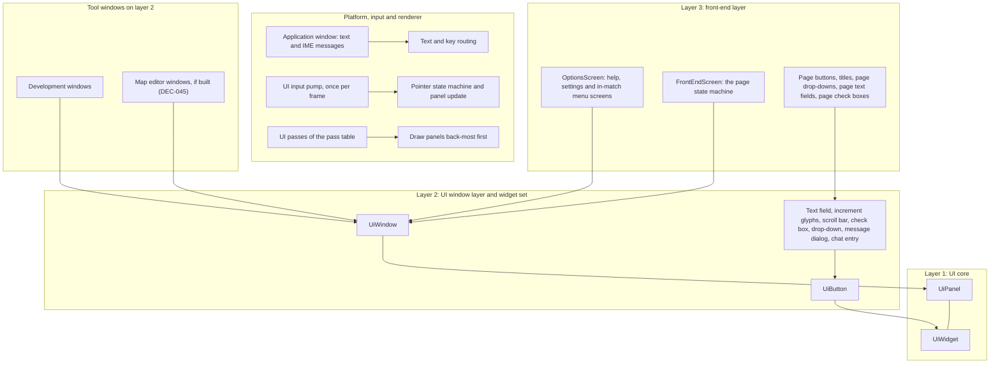
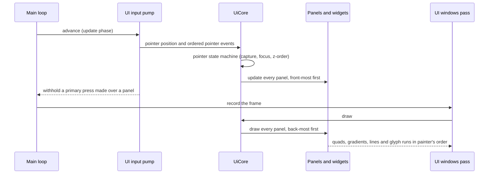

# UI framework

> Status: Engine baseline · Prefix: UI · ADRs: [ADR-030](../../../ADR/ADR-030-ui-framework-build-or-buy.md), [ADR-031](../../../ADR/ADR-031-batched-ui-rendering.md), [ADR-032](../../../ADR/ADR-032-ui-focus-graph-page-stack-and-input.md), [ADR-033](../../../ADR/ADR-033-ui-layout-scaling-and-dpi.md), [ADR-034](../../../ADR/ADR-034-text-rendering-and-glyph-cache.md), [ADR-063](../../../ADR/ADR-063-localisation.md), [ADR-064](../../../ADR/ADR-064-accessibility-baseline-xag.md), [ADR-028](../../../ADR/ADR-028-input-device-back-ends.md), [ADR-029](../../../ADR/ADR-029-input-event-model-and-binding-contract.md), [ADR-075](../../../ADR/ADR-075-application-window-and-dpi-awareness.md)

This folder specifies the Species UI framework: a retained, batched UI with typed widget handles, an explicit focus graph for gamepad and keyboard navigation, screen-fraction layout with DPI and UI scale, and text drawn from a glyph cache over licensed fonts. It is the engine baseline that every menu, dialog, options screen, lobby and HUD window of the reference library is built on.

## Documents of this folder

| Document | Scope | Requirement range |
|---|---|---|
| [README.md](README.md) (this file) | the framework's responsibilities, boundaries and layering; its integration into the frame; the folder index | UI-001 to UI-019 |
| [core_and_widgets.md](core_and_widgets.md) | the UI core (registration, hit testing, the pointer state machine, focus, keyboard and text routing, popups, update and draw order, tooltips); the standard window and button; the widget set (value-bound controls, text field, increment glyphs, scroll bar, check box, drop-down, message dialog, chat entry); value binding; the front-end widget family (options screen, page buttons, titles, highlight beam, fill boxes, page drop-downs, page text fields, page check boxes) | UI-020 to UI-159 |
| [layout_rendering_input_and_localisation.md](layout_rendering_input_and_localisation.md) | the layout systems and formulas, relayout, DPI and UI scale; UI rendering (the batched renderer, blend states, palette, text styles, font roles, glyph cache); keyboard, gamepad and pointer navigation; localisation integration (string look-up and fallback, input-mode variants, caption markup, font role per language, non-Latin text entry, the runtime language switch) | UI-160 to UI-299 |
| [pages_and_screen_recipes.md](pages_and_screen_recipes.md) | the page framework of the front-end screen (page host, page graph, page state machine, set-up and teardown, navigation on pages, page widgets), the widget and page catalogue, the screen recipes, the framework's concurrency and performance budget, and the framework defects as acceptance tests | UI-300 to UI-499 |

The front-end pages themselves (what each page shows and where it leads) are specified functionally in [reference/09_front_end_and_match_flow/](../../../reference/09_front_end_and_match_flow/README.md); the HUD and Power-slot overlays are drawn by the renderer ([entity_and_overlay_renderers.md](../renderer/entity_and_overlay_renderers.md) RND-377 to RND-379) with the content of [reference/06_controls_camera_and_commands/selection_and_power_slots.md](../../../reference/06_controls_camera_and_commands/selection_and_power_slots.md) R-CTRL-220 to R-CTRL-239.

## 1 Responsibilities and boundaries

**UI-001** (MUST) The UI framework is built in three layers, each depending only on the layers below it (diagram 1-A):

1. **UI core** (`UiCore`), with its panel base type (`UiPanel`) and button base type (`UiWidget`): the panel list and its z-order; typed handles for panels and widgets; focus; the pointer state machine with pointer capture, panel moving and resizing; keyboard and text routing to the focused panel and its text-edit target; the tooltip timer; popups; maximising. The UI core knows nothing about drawing styles ([core_and_widgets.md](core_and_widgets.md) §4.1 to §4.9).
2. **UI window layer**: the standard window (`UiWindow`) with its chrome, its navigation order for gamepad and keyboard, large-menu scaling and the value-control factory; the standard button (`UiButton`) with its highlight model and captions; and the widget set built on them: text field, increment glyphs, scroll bar, check box, drop-down, message dialog and chat entry ([core_and_widgets.md](core_and_widgets.md) §4.10 to §4.23).
3. **Front-end layer**: the options screen (`OptionsScreen`), the full-screen page with title bar, content boxes and an in-page dialog; the page widget family (page buttons, Back and close buttons, page titles, highlight beam, fill boxes, page drop-downs, page text fields and page check boxes) ([core_and_widgets.md](core_and_widgets.md) §4.24 to §4.30); and the front-end screen (`FrontEndScreen`), the whole front end as one full-screen window with its page state machine ([pages_and_screen_recipes.md](pages_and_screen_recipes.md)).

Tool-style windows (the development windows of the [diagnostics](../diagnostics_test_and_performance/README.md) component, and a map editor if the design phase builds one, DEC-045) are built on the UI window layer.

The framework is engine code in namespace `Engine`, except what is typed by the game's page catalogue or reads the match's presentation state: the front-end screen with its page ids and page framework, the HUD panels, and the front-end widget kinds that show a mode, a team colour or side, or a team slot are game-layer code in `Species`, built on the engine layers above (`AGENTS.md` R9; [pages_and_screen_recipes.md](pages_and_screen_recipes.md) §2 and table 3.3-A).

**UI-002** (MUST NOT) The UI framework never writes simulation state. It reads only the presentation state it is given (DEC-007), every player intent it produces leaves it as a player command of the command catalogue ([reference/12](../../../reference/12_simulation_model/06_teams_and_player_commands.md)), and an option widget bound to a shared match option only requests a change (§3, [core_and_widgets.md](core_and_widgets.md) §4.23). How the build enforces this boundary, and whether the UI reads per-tick snapshots, is the design phase's decision (DEC-222); until then the UI reads the read-only presentation view that DEC-222 option A describes and never includes a simulation header that grants write access.

**UI-003** (MUST NOT) The UI framework draws nothing directly to the GPU and owns no GPU resource of its own except the glyph-cache atlas pages, which it creates through the renderer's `Engine::GpuResourceFactory` ([renderer](../renderer/README.md) §2, ADR-078) and never through the device: widgets emit quads, gradients, lines and glyph runs into the batched UI stream ([layout_rendering_input_and_localisation.md](layout_rendering_input_and_localisation.md) §4.6; ADR-031), which the renderer records in its UI passes.

**UI-004** (MUST NOT) The UI framework does not own the window, the swap chain, the binding system or the string-table file format. The platform layer owns the application window and reports size, DPI and focus changes (ADR-075); the renderer owns presentation and the screen transition ([frame_graph_and_passes.md](../renderer/frame_graph_and_passes.md) RND-095); the input component owns devices, bindings and the input mode (ADR-029, [input](../input/README.md)); the data schemas own the string-table schema and its markup syntax ([data schemas](../data_schemas/README.md)).

**UI-005** (MUST) The UI core is one service with an explicit owner and lifetime, never reached through a process-wide global. Its owner is the client's composition root, which the design phase defines (DEC-221); until then the UI core lives for the process, from start-up to shutdown, and is passed by reference to the systems that open windows. Panels are owned by the UI core; widgets are owned by their panel; a scroll bar's helper object is owned by the window that created it.

Diagram 1-A — the three layers of the UI framework, the platform calls that drive them, and the tool windows built on the window layer.

## 2 Interfaces

**UI-006** (MUST) The UI is advanced once per main-loop iteration, in every loop (front end, match and map editor), by the UI input pump (`UiInputPump`), in the update phase and before any drawing (ADR-032). In a match the pump runs at the steps of the in-match loop that [reference/12](../../../reference/12_simulation_model/01_tick_timing_and_main_loop.md) R-SIM-581 gives (step 5 and step 11.5). One advance does, in order:

1. pass the pointer position and the frame's pointer events to the UI core: the position is that of the game pointer, which follows the mouse or the gamepad-emulated pointer; the primary button is `action.ui.pointer_held` with its down edge `action.ui.pointer_down`, and the secondary button is `action.ui.alt_pointer_down` ([reference/06](../../../reference/06_controls_camera_and_commands/actions_and_bindings.md) row M6). The pump delivers the frame's pointer events in their order, so a press and a release within one frame both reach the UI core (ADR-029);
2. run the UI core's update (the pointer state machine, then every panel's update; [core_and_widgets.md](core_and_widgets.md) §4.3 and §4.7);
3. when `action.ui.pointer_down` fired over any panel, withhold that press from the match actions for the rest of the frame, so the world does not also receive the click ([reference/06](../../../reference/06_controls_camera_and_commands/actions_and_bindings.md) row M6).

**UI-007** (MUST) Text input reaches the UI core as characters, never as keys: each character the application window receives (a Unicode scalar value, with the state of Shift, Ctrl and Alt) is routed to the focused panel ([core_and_widgets.md](core_and_widgets.md) §4.5). Committed input-method text arrives as characters in the same way, and the composition string is shown inline in the focused text field (ADR-028, ADR-032). Text input never passes through the binding graph.

**UI-008** (MUST) The UI is drawn in the UI windows pass of the ordered pass table (pass 19, [frame_graph_and_passes.md](../renderer/frame_graph_and_passes.md) RND-070), in a 2-D pixel space over the viewport with the origin at the top-left (RND-215), with blending on, no culling and no depth test or depth writes. Its place in the frame is: after the world markers (pass 16) and the hint overlay (pass 17); before the world cursor (pass 20), the chat (pass 21), the Power slots panel (pass 23), the 2-D block with the fade and the match HUD (passes 26 to 32), the paused banner (pass 33) and the screen transition with the present (pass 34). The match message (pass 13), the chat (pass 21), the match HUD (pass 28) and the paused banner (pass 33) draw their text in the UI framework's text styles ([layout_rendering_input_and_localisation.md](layout_rendering_input_and_localisation.md) §4.8).

**UI-009** (MUST) The UI core is initialised with the client-area size and DPI scale when it is created, and receives every later size and DPI change from the platform layer as a resize event (ADR-075); a resize never re-creates the UI core, a panel or a widget ([layout_rendering_input_and_localisation.md](layout_rendering_input_and_localisation.md) §4.4). Shutting the UI core down destroys every panel and, through each panel, every widget.

**UI-010** (MUST) The UI core answers two queries for the application loops: **windows on screen** is true when the panel list is not empty; **remove all windows** first, when a match is running, moves the pointer to the centre of the screen, and then removes the front-most panel until no panel remains.

**UI-011** (MUST) While the gamepad pointer emulation action `action.ui.show_cursor` is held, the south face button acts as the primary pointer button; this is the binding of [reference/06](../../../reference/06_controls_camera_and_commands/actions_and_bindings.md) row M6, which the UI consumes as `action.ui.pointer_down` and `action.ui.pointer_held`.

**Threading contract.** Every UI call runs on the main thread, which also runs the window message loop and the frame (ADR-075). The UI's state is never read or written by another thread; a worker thread that has a result for the UI (a loaded picture, a session list) hands it to the main thread through a queue that the owning view-model drains in its update. Glyph rasterisation for new glyphs runs on the main thread inside the UI's draw, and the atlas upload goes through the renderer's upload ring (ADR-034, ADR-008).

Diagram 2-A — one frame of the UI: input is handled in the update phase, and drawing only reads the state the update left.

## 3 Data model

**UI-012** (MUST) Panels and widgets are identified by typed handles with a generation count; a stale handle resolves to nothing, so an action on a removed panel or widget is a no-op. A panel or widget may carry a debug name, which is never used for look-up. Every caption, title and label is a Species string id ([layout_rendering_input_and_localisation.md](layout_rendering_input_and_localisation.md) §4.11), and every widget carries an accessible-name string id and a role, so screen narration can be added (ADR-064).

**UI-013** (MUST) Widget state that must survive a relayout lives in the view-model of the page or window that owns the widget, not in the widget (ADR-030): a value-bound widget holds a binding to its view-model field ([core_and_widgets.md](core_and_widgets.md) §4.23), so a resize, a DPI change, a scale-setting change or a language change never loses a value, a scroll position or a focus position.

The type, ownership and lifetime of every UI object are listed in [core_and_widgets.md](core_and_widgets.md) §3 and [layout_rendering_input_and_localisation.md](layout_rendering_input_and_localisation.md) §3. Page layouts, palettes, text styles and string tables are content records in the schemas of [data schemas](../data_schemas/README.md) (ADR-061).

## 4 Behaviour and algorithms

**UI-014** (MUST) The framework avoids by construction every window-core quirk and every framework defect that the decision register lists (DEC-102). The corrected rules are stated where each behaviour is specified: pointer capture and click on the pressed widget ([core_and_widgets.md](core_and_widgets.md) UI-031), repeats on explicit timers (UI-071, UI-077), relayout without state loss (UI-024), the maximise path (UI-041), Escape and Back that never apply a change (UI-064; [layout_rendering_input_and_localisation.md](layout_rendering_input_and_localisation.md) UI-217), literal display of message text (UI-090, UI-227), storage with no fixed capacity (UI-088, UI-127), disabled widgets that never act (UI-055, UI-106) and removal by identity (UI-025). The defects as must-not acceptance tests are in [pages_and_screen_recipes.md](pages_and_screen_recipes.md).

**UI-015** (MUST) The look of the UI keeps the reference token structure and blend modes: windows and buttons on an accent panel with a light-to-dark highlight gradient; front-end pages of glowing fill boxes with positive (green) and focus (red) captions over the animated backdrop; normal text additive, and outlines and shadows in the darkening ink mode ([layout_rendering_input_and_localisation.md](layout_rendering_input_and_localisation.md) §4.7 to §4.9; [visual_language.md](../renderer/visual_language.md) RND-403, RND-416, RND-425).

**UI-016** (MUST) Every screen of the framework is fully usable with the pointer alone, with the keyboard alone and with the gamepad alone, through one focus cursor that pointer hover and navigation share ([layout_rendering_input_and_localisation.md](layout_rendering_input_and_localisation.md) §4.10; ADR-032, ADR-064).

## 5 Concurrency and performance budget

**UI-017** (MUST) The UI meets the budget of [layout_rendering_input_and_localisation.md](layout_rendering_input_and_localisation.md) §5 (draw count, CPU time and vertex count of the busiest screen) and the page-level budget of [pages_and_screen_recipes.md](pages_and_screen_recipes.md). The UI stream is rebuilt every frame; no widget owns GPU memory.

## 6 Failure modes, diagnostics and telemetry

**UI-018** (MUST) No UI failure is fatal. A missing picture draws as its content-build placeholder; a missing string falls back per id to the base language (DEC-099); a stale handle is a no-op; a layout that does not fit applies its cell's overflow rule (ADR-033). Each of these is logged once per item in the UI log category (ADR-067), and Debug builds show a counter of them in the diagnostics overlay ([diagnostics, test and performance](../diagnostics_test_and_performance/README.md)). The detailed failure tables are in each document's §6.

## 7 Acceptance tests

**UI-019** (MUST) The framework passes the acceptance tests of every document of this folder. Folder-level tests:

| # | Kind | Test | Requirements |
|---|---|---|---|
| R1 | unit | A headless build of the simulation and a build with the UI linked produce the same per-tick state hashes for the same command stream; a UI build that includes a simulation write interface fails to compile. | UI-002 |
| R2 | unit | A press and a release delivered within one frame produce exactly one click on the widget under the pointer. | UI-006 |
| R3 | unit | A primary press over a window is not seen by the match actions in the same frame; a press outside every window is. | UI-006 |
| R4 | unit | Remove all windows during a match leaves no panel and places the pointer at the screen centre; at the front end the pointer does not move. | UI-010 |
| R5 | unit | A resize event changes the layout of every open panel without destroying a panel or widget, and every bound value, scroll position and focus position is unchanged. | UI-009, UI-013 |
| R6 | integration | Every page and options screen is driven to every widget with the pointer only, the keyboard only and the gamepad only. | UI-016 |
| R7 | unit | A handle kept after its widget was removed resolves to nothing, and a click sent to it does nothing. | UI-012 |

## 8 Open decisions

- **DEC-007** (Resolved): presentation never writes simulation state (UI-002).
- **DEC-102** (Resolved): the framework corrections by construction (UI-014).
- **DEC-099** (Resolved): per-id fallback to the base language (UI-018; [layout_rendering_input_and_localisation.md](layout_rendering_input_and_localisation.md) §4.11).
- **DEC-221** (Open): the composition root, service lifetimes and the application state machine; the UI core's owner and lifetime follow it (UI-005).
- **DEC-222** (Open): the simulation and presentation boundary; how the UI's read-only view of the match is enforced and fed (UI-002).
- **DEC-045** (Open): a map editor, whose windows would be tool windows of the UI window layer (UI-001).
- ADR-030 is Accepted (an own retained framework); ADR-034 is Proposed, and the default it names is the baseline of this folder.

**Design-phase inputs.**

1. The world game's HUD and its settlement-scale screens: which of them are pages of the front-end screen, which are tool windows, and which are HUD panels drawn in the renderer's HUD space (RND-377).
2. Whether menus are narrated (XAG 106); the accessible names of UI-012 exist either way (ADR-064).
3. The ranges of the UI-scale and text-scale settings and the high-contrast palette ([layout_rendering_input_and_localisation.md](layout_rendering_input_and_localisation.md) §8).
4. The owner and lifetime of the UI core in each process role (DEC-221), and whether the integrated server's lifetime affects any UI window.
