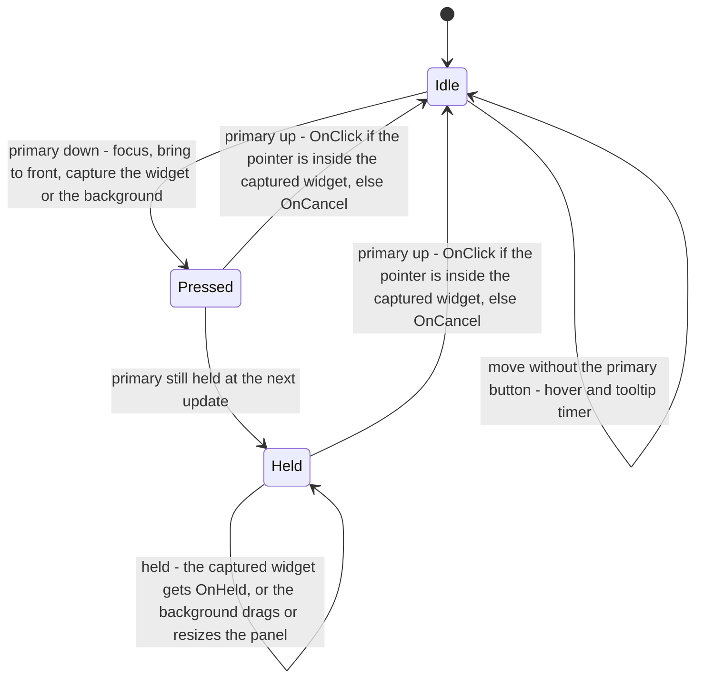
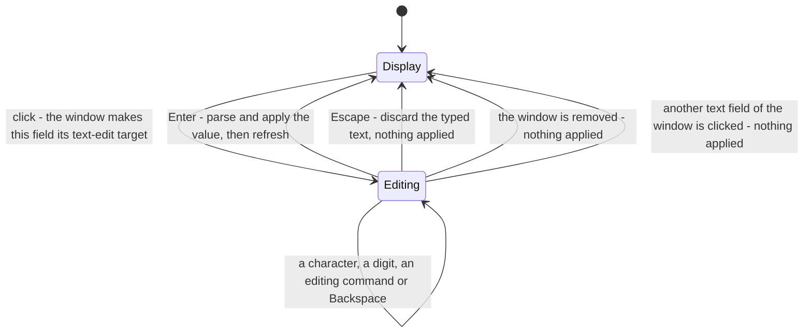

# UI core and widgets

> Status: Engine baseline · Prefix: UI · ADRs: [ADR-030](../../../ADR/ADR-030-ui-framework-build-or-buy.md), [ADR-031](../../../ADR/ADR-031-batched-ui-rendering.md), [ADR-032](../../../ADR/ADR-032-ui-focus-graph-page-stack-and-input.md), [ADR-033](../../../ADR/ADR-033-ui-layout-scaling-and-dpi.md), [ADR-034](../../../ADR/ADR-034-text-rendering-and-glyph-cache.md), [ADR-028](../../../ADR/ADR-028-input-device-back-ends.md), [ADR-063](../../../ADR/ADR-063-localisation.md), [ADR-064](../../../ADR/ADR-064-accessibility-baseline-xag.md) · Folder: [UI framework](README.md)

This document specifies the lower two layers of the UI framework and the widget family of the front-end layer: the UI core, the standard window and button, the widget set, value binding, the options screen and the page widgets. Layout formulas, the palette, text styles, navigation input and localisation are in [layout_rendering_input_and_localisation.md](layout_rendering_input_and_localisation.md); the page framework of the front-end screen is in [pages_and_screen_recipes.md](pages_and_screen_recipes.md).

**Notation.** W and H are the client-area width and height in pixels. *m*(v) is the menu size of a tool-window length v (UI-048). A **draw point** is the position a text draw is given; [layout_rendering_input_and_localisation.md](layout_rendering_input_and_localisation.md) UI-193 converts it into the glyph box. Colours are RGBA, either as bytes (0 to 255) or as fractions (0 to 1), as each palette key states. Times are seconds of real time, the real reading of the presentation clock, which keeps running while a match is paused and ignores game speed ([reference/12](../../../reference/12_simulation_model/01_tick_timing_and_main_loop.md) R-SIM-570, R-SIM-573; ADR-036, ADR-074; see DEC-951, DEC-955), unless a rule says otherwise.

## 1 Responsibilities and boundaries

**UI-020** (MUST) This document owns: the UI core (`UiCore`) with its panel base (`UiPanel`) and button base (`UiWidget`) types; the standard window (`UiWindow`) and button (`UiButton`) and their variants; the widget set (value-bound controls, text field, increment glyphs, scroll bar, check box, drop-down, message dialog, chat entry); the value-binding model; and the front-end widget family (the options screen `OptionsScreen`, page buttons, Back and close buttons, page titles, the highlight beam, fill boxes, page drop-downs, page text fields, page increment glyphs and page check boxes). What each front-end page holds is [reference/09_front_end_and_match_flow/](../../../reference/09_front_end_and_match_flow/README.md)'s; how pages are hosted and switched is [pages_and_screen_recipes.md](pages_and_screen_recipes.md)'s.

**UI-021** (MUST NOT) No widget reads input while it is drawn, and no draw changes widget, focus or view-model state: highlight decisions, focus moves caused by hover, Back handling, repeat stepping and roll-over sounds all happen in the update phase, and drawing only reads the state the update left (ADR-032, DEC-102).

## 2 Interfaces

C++23 interface sketch (declarations only). Every type lives in namespace `Engine`; `StringId` is a Species string id, `ColorRgba` the RGBA colour of the engine types, and `DrawContext` the handle to the batched UI stream ([layout_rendering_input_and_localisation.md](layout_rendering_input_and_localisation.md) §2).

```cpp
namespace Engine
{

struct PanelId // UI-012
{
  std::uint32_t index = 0;
  std::uint32_t generation = 0;
};
struct WidgetId
{
  std::uint32_t index = 0;
  std::uint32_t generation = 0;
};
struct PointF
{
  float x = 0;
  float y = 0;
};
struct SizeF
{
  float w = 0;
  float h = 0;
};
struct RectF
{
  float x = 0;
  float y = 0;
  float w = 0;
  float h = 0;
};

enum class PointerEventKind : std::uint8_t
{
  PrimaryDown,
  PrimaryUp,
  AltDown
};
struct PointerEvent
{
  PointerEventKind kind;
  PointF position;
};
struct TextInput
{
  char32_t character;
  bool shift = false;
  bool ctrl = false;
  bool alt = false;
};
enum class EditCommand : std::uint8_t // UI-067
{
  CaretLeft,
  CaretRight,
  CaretHome,
  CaretEnd,
  DeleteForward,
  SelectAll,
  Copy,
  Cut,
  Paste
};
using Callback = std::move_only_function<void()>;

class UiWidget // every widget derives from this type
{
public:
  virtual ~UiWidget() = default;
  virtual void Draw(DrawContext& _out, PointF _origin, bool _highlighted, bool _pressed) const {}
  virtual void OnPress() {}                       // primary down edge on this widget
  virtual void OnHeld(bool _pointerInside) {}     // every update while this widget holds the capture
  virtual void OnClick() {}                       // press and release on this widget (UI-031)
  virtual void OnCancel() {}                      // the capture ended outside this widget
  virtual void OnAltPress() {}                    // secondary down edge on this widget (UI-033)
  virtual void OnText(const TextInput& _input) {} // only while this widget is the text-edit target
  virtual void OnEdit(EditCommand _command) {}
  RectF rect;       // panel-relative
  StringId caption; // UI-012
  StringId accessibleName;
  bool inactive = false; // skipped by navigation, never acts
};

class UiPanel // every window derives from this type
{
public:
  virtual ~UiPanel() = default;
  virtual void Create() {}                                    // builds the widgets (UI-022 step 5)
  virtual void Remove() {}                                    // removes the widgets
  virtual void Update() {}                                    // once per frame (UI-042)
  virtual void Draw(DrawContext& _out, bool _hasFocus) const; // widgets oldest first (UI-043)
  virtual void OnText(const TextInput& _input);               // default: forward to the text-edit target (UI-038)
  virtual void OnEdit(EditCommand _command);
  virtual void OnBackgroundPointer(bool _down) {}             // a press or release on no widget
  WidgetId RegisterWidget(std::unique_ptr<UiWidget> _widget); // UI-025
  void RemoveWidget(WidgetId _widget);
  WidgetId WidgetAt(PointF _panelRelative) const; // UI-028
  void BeginTextEdit(WidgetId _widget);
  void EndTextEdit();
  WidgetId TextEditTarget() const;
  RectF rect;
  StringId title;
  bool movable = true;
  bool resizable = true;
};

class UiCore
{
public:
  void Resize(SizeF _clientSize, float _dpiScale);                              // UI-009
  PanelId RegisterPanel(std::unique_ptr<UiPanel> _panel, PanelId _parent = {}); // UI-022
  void RemovePanel(PanelId _panel);                                             // UI-023
  void BringToFront(PanelId _panel);
  void SetPanelPosition(PanelId _panel, PointF _position);
  void SetPanelSize(PanelId _panel, SizeF _size); // UI-024
  PanelId PanelAt(PointF _point) const;           // UI-027
  bool PointerInPanel(PanelId _panel) const;      // UI-029
  bool PointerInWidget(PanelId _panel, WidgetId _widget) const;
  void UpdatePointer(PointF _position, std::span<const PointerEvent> _events); // UI-030
  void Update();                                                               // UI-042
  void OnText(const TextInput& _input);                                        // UI-038
  void OnEdit(EditCommand _command);
  void Draw(DrawContext& _out) const;                     // UI-043
  PanelId RegisterPopup(std::unique_ptr<UiPanel> _panel); // UI-040
  void ClosePopup();
  void Maximize(PanelId _panel); // UI-041
  void Unmaximize();
  PanelId Focus() const;
  void SetFocus(PanelId _panel); // UI-036
  WidgetId HoverWidget() const;
  WidgetId CapturedWidget() const;
  bool IsTextEditing() const;   // UI-039
  bool WindowsOnScreen() const; // UI-010
  void RemoveAllWindows(bool _matchRunning);
  void SetTooltipHandler(std::move_only_function<void(PanelId, WidgetId)> _handler); // UI-045
  void Shutdown();
};

class UiWindow : public UiPanel // the standard window (§4.10 to §4.15)
{
public:
  float MenuSize(float _length) const; // UI-048
  void SetMenuSize(SizeF _size);
  RectF ClientRect() const;               // UI-047
  void AddToNavigation(WidgetId _widget); // UI-050
  void SetCursor(WidgetId _widget);
  void SetBackAction(WidgetId _widget);
  void SkipNextUpdate();
  bool closeable = true;
  bool locked = false;
  WidgetId AddValueControl(StringId _label, UiValueBinding& _binding, float _y, double _step, double _low, double _high,
                           Callback _onChange = {}, float _x = -1, float _w = -1); // UI-062
  void RemoveValueControl(WidgetId _field);
  WidgetId AddColorControl(StringId _label, ColorRgba& _rgba, float _y, Callback _onChange = {}, float _x = -1,
                           float _w = -1); // UI-063
};

class UiButton : public UiWidget // the standard button (§4.13)
{
public:
  virtual bool ConsumeScroll(int _direction) // UI-052
  {
    return false;
  }
  float fontSize = 11.0f; // ui.button.font_size
  bool centered = false;
  bool disabled = false;
};

// The widget set (§4.14 to §4.22) and the front-end family (§4.24 to §4.30).
class UiBorderlessButton;
class UiCloseButton;
class UiInsetPanel;
class UiTextField;
class UiIncrementGlyph;
class UiScrollBar;
class UiCheckBox;
class UiDropDown;
class UiDropDownList;
class UiDropDownOption;
class UiMessageDialog;
class UiChatEntry;
class UiChatField;
class OptionsScreen;
class PageButton;
class PageBackButton;
class ScreenCloseButton;
class PageTitle;
class PageDropDown;
class PageDropDownList;
class PageDropDownOption;
class PageTextField;
class PageIncrementGlyph;
class PageCheckBox;

class UiValueBinding // §4.23
{
public:
  virtual ~UiValueBinding() = default;
  virtual ValueType Type() const = 0;
  virtual std::u8string ToText() const = 0;            // UI-095
  virtual bool FromText(std::u8string_view _text) = 0; // false: the text does not parse
  virtual double Get() const = 0;                      // the confirmed value
  virtual void Set(double _requested) = 0;             // local: assigns; shared: requests
  virtual bool ClampsOnSet() const = 0;
};

} // namespace Engine
```

**Events.** The UI core raises a tooltip request (panel, widget) every update while the tooltip delay has passed (UI-045), and a cleared tooltip (no panel, no widget) when hover ends. Widgets raise their own callbacks (a value refresh, a click). Front-end widgets request the screen transition from the renderer through `InitializeTransition(duration, direction)` ([frame_graph_and_passes.md](../renderer/frame_graph_and_passes.md) RND-095) and trigger sound events of the match UI source ([reference/09](../../../reference/09_front_end_and_match_flow/screen_flow_and_match_setup.md) R-META-018).

**Threading contract.** Every interface of this document is called on the main thread only ([README](README.md) §2).

**UI-128** (MUST) The UI framework meets these obligations to the input router ([input](../input/README.md)):

1. at the end of each frame's UI update it supplies the frame gates (`FrameGates`) that the router reads at the start of the next frame: whether a UI window is open and whether a text entry, the chat input or a focused text field, is open (INP-156);
2. when a primary press lands on a UI window, the UI input pump calls `Suppress` for the match's use of it (INP-093, [README](README.md) UI-006), and on a frame in which `action.match.menu` makes the pump run a second time it calls `AdvanceRepeatPass` before that pass (INP-102);
3. it receives text characters with their Shift, Ctrl and Alt state, and the editing commands of the editing keys, from the router in event order (INP-112, INP-113; UI-038);
4. it draws a controller glyph over its darkening shadow, the shadow first (INP-080, [pages_and_screen_recipes.md](pages_and_screen_recipes.md) UI-464);
5. on `onModeChanged` it re-creates the Power slots panel variant while the panel is hidden (INP-152, UI-462), and every input-mode caption variant takes its mode from `Mode(player)` (INP-150, [layout_rendering_input_and_localisation.md](layout_rendering_input_and_localisation.md) UI-223).

**UI-129** (MUST) The UI host of the explainer player (`ExplainerPlayer`, [explainers, sprites and procedural animation](../animation_and_vfx/explainers_sprites_and_procedural_animation.md) VFX-104 to VFX-111) is the explainer panel, a HUD panel of the hint overlay ([pages_and_screen_recipes.md](pages_and_screen_recipes.md) UI-467). The panel lays the player out again on every screen, DPI or text-scale change (VFX-108) and has the player draw its frame into the batched UI stream with real time from the platform clock (VFX-107, VFX-109); the playback time is the player's own state, never widget or view-model state.

## 3 Data model

| Type | Owner | Lifetime | Notes |
|---|---|---|---|
| `UiCore` | the client's composition root (DEC-221) | the process | holds the panel list (index 0 is front-most), the focus, the hover widget, the captured widget, the pressed panel, the popup and the maximised panel |
| panel (`UiPanel` and subtypes) | `UiCore` | from registration to removal | holds its widget list (the newest registration first), its text-edit target, its title string id |
| widget (`UiWidget` and subtypes) | its panel | from registration to the panel's `Remove()` or `RemoveWidget()` | rectangle relative to its panel; caption and accessible-name string ids; inactive flag |
| navigation order | its `UiWindow` | until the window's `Remove()` | an ordered list of widget handles and a cursor index (UI-050) |
| scroll-bar helper (`UiScrollBar`) | the window that created it | until that window removes it | holds its window by handle (UI-074) |
| open drop-down list (`UiDropDownList`, `PageDropDownList`) | `UiCore` | while open; at most one of each kind exists | UI-084, UI-118 |
| value binding (`UiValueBinding`) | the widget when it is a local adaptor; the view-model otherwise | as its owner | UI-096 |
| view-model | the page or window that owns the widgets | as its page | holds every value that survives a relayout (UI-013) |

Panel and widget records carry no fixed-size text buffer: a caption is a string id, and a text value is a UTF-8 string with the maximum length its binding declares (DEC-801 item 5).

## 4 Behaviour and algorithms

### 4.1 Registration, automatic placement and z-order

**UI-022** (MUST) `RegisterPanel(panel, parent)` runs these steps:

1. Names play no part: two panels may carry the same debug name, and both are reachable through their handles.
2. When a parent is given and the panel's position is (0, 0), the panel is placed automatically near the parent. With r₁ and r₂ two draws of the presentation random fraction (`FxRng::NextUnit`, DEC-013) in [0, 1]:
   - left = W ÷ 2 − parent.x and above = H ÷ 2 − parent.y;
   - x = parent.x + parent.w × r₁ when left > w ÷ 2, otherwise parent.x − w × r₁;
   - y = parent.y + parent.h × r₂ when above > h ÷ 2, otherwise parent.y − (h ÷ 2) × r₂.
3. The panel is kept on screen: x = max(x, 0) and y = max(y, 0); then, when x + w > W, x = W − w, and when y + h > H, y = H − h. A panel larger than the screen therefore ends with a negative origin.
4. The panel becomes the front-most panel.
5. The panel builds its widgets (`Create()`).

Registration does not give focus; creating a standard window does (UI-036).

**UI-023** (MUST) `RemovePanel(panel)` unlinks the panel, resets the pressed-panel slot and the focus slot to none when either holds it, and destroys the panel. A stale handle is a no-op. `BringToFront(panel)` moves the panel to the front of the list; every primary press that lands on a panel does this (UI-031). `SetPanelPosition(panel, p)` moves the panel to p without clamping.

**UI-024** (MUST) `SetPanelSize(panel, size)` sets the size and lays the panel out again; its widgets keep their state, because every value they show lives in a binding or a view-model (ADR-033, DEC-102). A widget is rebuilt only when the layout data says that the widget set itself changes.

**UI-025** (MUST) `RegisterWidget(widget)` sets the widget's parent and places it at the front of the panel's widget list, so the newest widget receives input first and is drawn last. When the widget's bottom edge plus `ui.core.auto_grow_margin` (10 px) lies below the panel's height, the panel's height becomes that value and the panel is kept on screen (UI-022 step 3), so a window grows downwards to fit its content and is pushed up to stay on screen. `RemoveWidget(widget)` removes exactly the widget its handle names (DEC-102).

### 4.2 Hit testing

**UI-026** (MUST) Hit tests use inclusive rectangles: a point (px, py) is inside (x, y, w, h) when x ≤ px ≤ x + w and y ≤ py ≤ y + h, far edges included.

**UI-027** (MUST) `PanelAt(p)` returns the first panel, from the front of the list, whose rectangle contains p, or none.

**UI-028** (MUST) `WidgetAt(p)` returns the first widget, from the front of the panel's widget list (the newest registration), whose rectangle contains the panel-relative point p, or none. Of two overlapping widgets, the newer one receives input and is drawn on top (UI-043).

**UI-029** (MUST) `PointerInPanel(panel)` is true when `PanelAt(pointer)` is that panel. `PointerInWidget(panel, widget)` is true when the panel is the top panel under the pointer and the pointer is inside the widget's rectangle.

### 4.3 Pointer state machine and capture

**UI-030** (MUST) `UpdatePointer(position, events)` stores the new pointer position and then processes the frame's pointer events in order; when there is no event, it runs the move branch (UI-032) or the held branch (UI-034), as the primary button's state gives. Exactly one primary-button branch runs per event (diagram 4-A).

**UI-031** (MUST) **Press** (a primary down edge): the press position is recorded. When a panel lies under the pointer, it gets the focus, it is brought to the front and it becomes the pressed panel. When a widget of that panel lies under the pointer, it becomes the hover widget and the **captured widget**, and receives `OnPress()`. When no widget lies under the pointer, the hover widget becomes none, the panel receives `OnBackgroundPointer(true)`, and, when the panel is movable, the grab offset = pointer − the panel's origin is recorded. When no panel lies under the pointer, the focus becomes none. A **click** is a press and a release on the same widget: the captured widget receives `OnClick()` only when the release happens while the pointer is inside it (DEC-102, ADR-032).

**UI-032** (MUST) **Move** (no primary button held): only the focused panel is examined.

- A widget under the pointer that differs from the hover widget becomes the hover widget, and the tooltip time = now + `ui.core.tooltip_delay` (1.0 s); when it is the hover widget already and now is later than the tooltip time, a tooltip request is raised, every update while the hover lasts (UI-045).
- When no widget is under the pointer and the hover widget is not none, the hover widget becomes none and the tooltip is cleared.
- When no panel has the focus, the same reset applies.

Panels without the focus still show hover, because drawing uses `PointerInWidget` (UI-043).

**UI-033** (MUST) **Secondary press** (`action.ui.alt_pointer_down`): the widget under the pointer of the top panel receives `OnAltPress()`. No standard widget of this document acts on it; the focus, the z-order and the capture do not change.

**UI-034** (MUST) **Held** (the primary button held after a press): while the pressed panel exists,

1. when a widget holds the capture, it receives `OnHeld(pointerInside)` every update, where pointerInside is whether the pointer is inside it; a widget that repeats an action while held uses explicit timers (UI-071, UI-077), never the update count;
2. when the press began on the panel background, the resize test runs on the pointer position of the previous update: less than `ui.core.resize_band` (4 px) above or below the bottom edge, the new height = pointer y − panel y, and less than the same distance either side of the right edge, the new width = pointer x − panel x; when either applies and the panel is resizable, the new width is at least `ui.core.min_resize_width` (60 px), the new height at least `ui.core.min_resize_height` (40 px), and `SetPanelSize` applies them (UI-024);
3. otherwise, when the panel is movable, `SetPanelPosition(pointer − grab offset)`, with no clamping while dragging. A drag continues while the pointer passes over widgets: the panel background holds the capture (DEC-102).

**UI-035** (MUST) **Release** (a primary up edge): the pressed panel becomes none. When a widget holds the capture, it receives `OnClick()` when the pointer is inside it and `OnCancel()` otherwise, and the capture ends. When the press began on a panel background, the panel receives `OnBackgroundPointer(false)` and the popup closes (UI-040). When the press began outside every panel, the popup closes.



Diagram 4-A — the UI core's pointer state machine with capture. A click needs the press and the release on the same widget.

The consequences for widgets are:

- `OnPress()` is the edge of a press; `OnHeld()` is the held state; `OnClick()` is the action. A widget that acts on a click acts once per press.
- A drag of a widget, such as a scroll-bar thumb, continues while the widget holds the capture, wherever the pointer goes.
- Moving and resizing a panel start only when the press lands on the panel background.

### 4.4 Focus rules

**UI-036** (MUST) The focus changes only as follows:

| Event | Focus afterwards |
|---|---|
| a primary press on a panel | that panel, which also comes to the front |
| a primary press outside every panel | none |
| a standard window (`UiWindow`) is created | that window; it takes the focus when it is created, before it is registered |
| a standard window is destroyed | the front-most remaining panel, if any |
| the focused panel is removed | none, and then the rule above applies |
| `Maximize(panel)` | that panel |
| `SetFocus(panel)` | that panel; a stale handle gives none |

**UI-037** (MUST) Only the focused panel receives text input (UI-038), hover and tooltip tracking (UI-032) and navigation (UI-051). Drawing passes each panel whether it has the focus; the options screen (UI-102) and the front-end screen draw only while they have the focus, so at most one full-screen page is visible at a time. The one exception is the front-end screen, which also draws while the chat input window is open above it ([pages_and_screen_recipes.md](pages_and_screen_recipes.md) UI-337).

### 4.5 Keyboard and text routing

**UI-038** (MUST) `UiCore::OnText(input)` passes the character to the focused panel's `OnText()`, whose default forwards it to the panel's text-edit target, when it has one. `BeginTextEdit(widget)` sets the target and `EndTextEdit()` clears it. Editing commands (`EditCommand`: caret movement, delete forward, select all, copy, cut and paste) are routed the same way (ADR-032). The UI core has no tab order and no focus traversal of its own: moving between widgets is the standard window's navigation (§4.11).

**UI-039** (MUST) `IsTextEditing()` is true when a panel has the focus and that panel has a text-edit target. The match setup page uses it so that the chat action does not reopen the chat field while the player is typing, and the chat field uses it to choose between its prompt and the typed text (UI-093).

### 4.6 Popups and maximised panels

**UI-040** (MUST) `RegisterPopup(panel)` removes the current popup, records the new one and registers it. The popup closes on every primary release that does not land on a widget, panel backgrounds included, and on every press outside all panels, so a popup closes on any click that is not on a widget. No reference screen registers a popup; the drop-down lists have their own single list (UI-084).

**UI-041** (MUST) `Maximize(panel)` restores any previously maximised panel, saves the panel's rectangle, makes it the maximised panel, the pressed panel and the focused panel, and sets its position to (0, 0) and its size to W × H (UI-024). While a panel is maximised, only that panel is drawn; drawing it needs no callback, so the maximise path never dereferences a missing object (DEC-102). `Unmaximize()` restores the saved rectangle. No reference screen maximises a panel.

### 4.7 Update order

**UI-042** (MUST) `UiCore::Update()` calls `Update()` on every panel, from the front of the list to the back. The iteration runs over the list as it stood when the update began: a panel removed during the update is skipped, and no other panel is skipped because of it. The base `UiPanel::Update()` does nothing; the standard window's navigation runs there (§4.11).

### 4.8 Draw order

**UI-043** (MUST) `UiCore::Draw()` draws every panel from the back of the list to the front (painter's order), passing each whether it has the focus. A panel draws its widgets from the back of its widget list to the front, oldest registration first, so the newest widget is on top. Each widget is drawn with:

- highlighted = `PointerInWidget(panel, widget)`, or the widget is the panel's text-edit target;
- pressed = the panel has the focus, the primary button is held and the widget holds the capture.

**UI-044** (MUST) The base widget draws nothing; every visible widget is a subtype that draws itself.

### 4.9 Tooltips

**UI-045** (MUST) The UI core times tooltips: hovering the same widget of the focused panel for `ui.core.tooltip_delay` (1.0 s) raises a tooltip request every update until the hover ends (UI-032). The framework itself registers no tooltip handler, so no tooltip is shown; tooltip content is front-end design for the design phase (DEC-102, §8). The Power slots panel's tooltips are the panel's own ([reference/06](../../../reference/06_controls_camera_and_commands/selection_and_power_slots.md) R-CTRL-223), not this mechanism.

### 4.10 The standard window: creation, client rectangle and large-menu scaling

Every window of the framework derives from the standard window (`UiWindow`), and every widget from the standard button (`UiButton`); the scroll-bar track (UI-074) derives from the button base directly.

**UI-046** (MUST) Creating a standard window registers a close box (`UiCloseButton`, UI-060) at `ui.chrome.close_box` ((w − 12, 2), 10 × 10 px) in its iconised look. The close box is placed from the window's final width, after the window has its size, so it is never outside the window. Windows that do not call the base creation have no close box: the message dialog (UI-088), the options screens (UI-099), the front-end screen, the chat entry window (UI-091) and the open drop-down lists (UI-084, UI-118).

**UI-047** (MUST) A standard window's `Remove()` removes every widget, empties the navigation order, sets the cursor to 0 and ends any text edit. Its client rectangle is x from `ui.chrome.client_inset` (2 px) to w − 2 px and y from *m*(`ui.chrome.title_height` (15 px)) + 1 to h − 2 px.

**UI-048** (MUST) **Large-menu scaling.** When the large-menus setting is on (`ref.meta.settings.large_menus.default`, off; [reference/09](../../../reference/09_front_end_and_match_flow/options_localisation_and_hooks.md) R-META-449), a standard window's lengths scale with the screen height: scale = `ui.layout.large_menu_factor` (0.96) × H ÷ `ui.layout.large_menu_height` (460), *m*(v) = ⌊v × scale⌋, and `SetMenuSize(w, h)` sets the size to (w × scale, h × scale). With the setting off, *m*(v) = v and the scale is 1. The scale is 1.2522 at H = 600, 1.6028 at H = 768 and 2.2539 at H = 1080. The options screens and the front-end screen are sized to exactly W × H and are never scaled by this rule, so a full-screen page never extends past the screen (DEC-102). The UI-scale setting and the DPI scale apply on top ([layout_rendering_input_and_localisation.md](layout_rendering_input_and_localisation.md) UI-170).

**UI-049** (MUST) A standard window's title is its title string id, upper-cased with the case mapping of the current language ([layout_rendering_input_and_localisation.md](layout_rendering_input_and_localisation.md) UI-233). The title drawn is the window's own title (DEC-102).

### 4.11 Navigation in standard windows

The navigation order is the reference's ordering concept, kept as the default of the focus graph (ADR-032): its order gives each entry's up and down neighbours, with wrap-around, and the cycling order of the window.

**UI-050** (MUST) Every standard window holds:

| Field | Default | Meaning |
|---|---|---|
| navigation order | empty | the ordered widget handles that gamepad and keyboard navigation visit; a screen adds each navigable widget, in the order it chooses (opt-in) |
| cursor | 0 | the index in the navigation order of the navigation cursor |
| navigation moved | false | set when navigation moved the cursor in this update; it ends hover-highlight mode (UI-056) |
| skip next update | false | a one-shot: the next update returns at once and clears it |
| closeable | true | whether the close action triggers the back action |
| locked | false | when true, the update returns at once (navigation frozen) |
| back action | none | the widget whose `OnClick()` the close action invokes |

**UI-051** (MUST) A standard window's update runs every frame; navigation acts only on the focused window:

```text
Update():
  if locked: return
  navigationMoved = false
  if skipNextUpdate: skipNextUpdate = false; return
  if this window is not focused: return
  if navigation order is not empty:
    for direction in (+1 for action.menu.down, -1 for action.menu.up), each action that fired:
      w = navigation[cursor]                       # the cursor's own widget
      if w is not a UiButton or not w.ConsumeScroll(direction):
        navigationMoved = true
        candidate = cursor
        repeat at most navigation.size times:
          candidate = (candidate + direction) wrapped into [0, navigation.size)
          if navigation[candidate] is not inactive: cursor = candidate; break
        # when every entry is inactive the cursor stays where it is
  activate = action.menu.activate
             or (the application is at the front end and action.menu.front_end_activate)
  if activate and navigation[cursor] exists and is neither inactive nor disabled:
    navigation[cursor].OnClick()
  if closeable and action.menu.close fired and a back action is set:
    backAction.OnClick()
```

The scroll hook asks the cursor's own widget, and the search for the next active entry is bounded, so a window whose entries are all inactive never hangs (DEC-102). The actions and their bindings are [layout_rendering_input_and_localisation.md](layout_rendering_input_and_localisation.md) §4.10.

**UI-052** (MUST) `ConsumeScroll(direction)` is a hook through which a widget consumes an up or down move; the base returns false. A session-browser row uses it to scroll the list when the cursor is on its first or last visible row ([pages_and_screen_recipes.md](pages_and_screen_recipes.md)).

**UI-053** (MUST) `SetCursor(widget)` sets the cursor to the widget's index in the navigation order when the widget is in it, and leaves the cursor unchanged otherwise. When the cursor's widget lies inside a scrolling list, the list scrolls it into view (ADR-032).

### 4.12 Window chrome look

**UI-054** (MUST) A standard window draws, in this order, in screen pixels:

| Step | Primitive | Look |
|---|---|---|
| 1 body | one quad over the whole rectangle with the accent panel strip `uitex.panel_accent`, linear filtering, wrapping in both axes, u from 0 to `ui.chrome.body_repeat` (8) across the width and v from 0 to 1 down the height | `ui.palette.window_body_tint` (1, 1, 1, 0.96), alpha blend |
| 2 title bar | a quad from y to y + *m*(`ui.chrome.title_height`), with a vertical gradient | `ui.palette.accent_light` at the top to `ui.palette.accent_dark` at the bottom |
| 3 border | four lines of `ui.chrome.border_width` (2 px) on the edges of the rectangle | `ui.palette.accent_light` |
| 4 outer frame | a 1 px line loop from (x − 2, y − 2) to (x + w + 1, y + h + 1), that is `ui.chrome.frame_offset` (2 px) outside the rectangle | `ui.palette.frame_outer` |
| 5 title text | the window title (UI-049) in the caption role, ink mode, centred at x + w ÷ 2, draw point y + `ui.chrome.title_baseline` (9 px), or y + size ÷ 2 with large menus, at size *m*(`ui.chrome.title_size` (12)), drawn twice | `ui.palette.text_ink` |
| 6 widgets | the UI core's widget draw (UI-043) | — |

### 4.13 The standard button

**UI-055** (MUST) A standard button has a font size of `ui.button.font_size` (11), is not centred and not disabled when created. When created with an automatic size, its width is the caption's character count × `ui.button.auto_char_width` (7 px) + `ui.button.auto_padding` (9 px) and its height `ui.button.auto_height` (15 px); a caption left empty takes the text of the button's string id. A **disabled** button never acts: activation, clicks and value changes do nothing while it is disabled, and it draws in its disabled colours (DEC-102). A host action that is not permitted is a disabled button (DEC-243).

**UI-056** (MUST) **Highlight model.** Each update the button decides its highlight: when its window's navigation moved in this update, hover-highlight mode ends. When the pointer is inside the button and the input mode is keyboard and mouse ([layout_rendering_input_and_localisation.md](layout_rendering_input_and_localisation.md) UI-205), the first such update makes the button the window's cursor (`SetCursor`) and sets highlighted-this-frame and hover-highlight mode; when the pointer leaves, highlighted-this-frame is cleared. The button draws highlighted when it is in hover-highlight mode and the UI core's highlighted flag (UI-043) is set, or when it is its window's cursor entry. Pointer hover and the navigation cursor therefore share one visual state. Every standard button lives in a standard window.

**UI-057** (MUST) The standard button draws in one of three states:

| State | Background | Edges | Caption |
|---|---|---|---|
| normal | a quad of `ui.palette.button_fill` | 1 px: left and top `ui.palette.button_edge_light`, right and bottom `ui.palette.button_edge_dark` | `ui.palette.text_normal`, additive; disabled `ui.palette.text_disabled` |
| highlighted | a vertical gradient from `ui.palette.accent_light` to `ui.palette.accent_dark` | none | ink mode, `ui.palette.text_ink`, drawn twice; disabled `ui.palette.text_ink_disabled` |
| pressed | a vertical gradient from `ui.palette.accent_pressed_top` to `ui.palette.accent_pressed_bottom` | none | as highlighted |

**UI-058** (MUST) The caption is drawn in the body role at the button's font size, which large menus do not scale, at the draw point x + `ui.button.caption_inset` (5 px), or centred at x + w ÷ 2 when the button is centred, and y + `ui.button.caption_baseline` (7.5 px) + (h − size) ÷ 2.

### 4.14 Button variants

**UI-059** (MUST) The **borderless button** (`UiBorderlessButton`) is the base of the text field and of the drop-down option. Its automatic width is its caption's character count × `ui.button.auto_char_width` + `ui.button.auto_padding`, its height `ui.button.auto_height`, with no fallback caption. It draws pressed when it is its window's navigation cursor. Pressed, it draws the highlight gradient of UI-057 and its caption in ink mode with `ui.palette.text_ink`, twice. Otherwise it has no fill; when highlighted it draws 1 px edges, left and top `ui.palette.borderless_edge_light` and right and bottom black, and its caption in `ui.palette.text_normal` with a second pass in white at alpha `ui.button.borderless_glow_alpha` (0.5). Its caption is drawn at size *m*(font size) at the draw point y + `ui.button.borderless_baseline` (10 px). Making the hovered borderless button the cursor is the update-phase rule of UI-056, never a side effect of drawing (DEC-102).

**UI-060** (MUST) The **close box** (`UiCloseButton`) removes its window when clicked. Iconised, it draws a quad of `ui.palette.close_fill`, or `ui.palette.close_hot` while highlighted or pressed, with 1 px edges, left and top `ui.palette.close_edge` and right and bottom `ui.palette.button_edge_dark`; not iconised, it draws as a standard button. Tool windows use it, such as the network statistics window of the [diagnostics](../diagnostics_test_and_performance/README.md) component.

**UI-061** (MUST) The **inset panel** (`UiInsetPanel`) is a decorative recessed panel with no action: a quad of `ui.palette.inset_fill` with top and left edges black and right and bottom edges `ui.palette.inset_edge_light`. Tool windows use it.

### 4.15 Value-bound controls

**UI-062** (MUST) `AddValueControl(label, binding, y, step, low, high, onChange, x, w)` creates a labelled text field (§4.16) bound to a value of type bool, byte, integer, float, double or text; for a text binding, `high` is the text's maximum length. Its layout:

1. x defaults to `ui.value_control.x` (10 px) and w to the window width − 2 × x; the field is *m*(`ui.value_control.height` (15 px)) high;
2. the label is the text of the label's string id;
3. a text-type field spans w; a numeric field spans w − `ui.value_control.numeric_reserve` (37 px) and gets two increment glyphs (§4.17): a decrease glyph "<" with step −step at (field x + field width + `ui.value_control.glyph_gap_decrease` (5 px), y) and an increase glyph ">" with step +step at (field x + field width + `ui.value_control.glyph_gap_increase` (22 px), y), each `ui.value_control.glyph_size` (15 px) square;
4. `onChange` is invoked on every refresh of the field's value (UI-069).

`RemoveValueControl(field)` removes the field and both glyphs. A bool binding is a bool field: it is stepped and clamped as a bool, never as a byte (DEC-102).

**UI-063** (MUST) `AddColorControl(label, rgba, y, onChange, x, w)` creates a colour swatch widget bound to a colour, `ui.value_control.colour_reserve` (13 px) narrower than w (which defaults to the window width − x, with x defaulting to `ui.value_control.x`) and `ui.value_control.height` (15 px) high, a height that large menus do not scale for this widget. It serves tool windows; the colour-editing window that a swatch opens belongs to a map editor, which the design phase designs (DEC-045).

### 4.16 Text field

**UI-064** (MUST) The text field (`UiTextField`, a borderless button) edits its binding's value as text, following diagram 4-B:

- **Display → Editing**: a click makes the field its window's text-edit target (`BeginTextEdit`).
- **Editing → Display, applied**: Enter ends the edit, parses the text into the value (UI-068) and refreshes the field.
- **Editing → Display, cancelled**: Escape ends the edit, discards the typed text and shows the value again; nothing is applied (DEC-102, ADR-032).
- **Editing → Display, abandoned**: the window's `Remove()` ends the edit with nothing applied; a click on another text field of the same window makes that field the target, and this field's typed text is not applied.



Diagram 4-B — the text field's editing states.

**UI-065** (MUST) A text field holds a display buffer, a value type (none, byte, bool, integer, float, double or text), a binding and a refresh callback. A field binds exactly once: a second binding is a Debug-build error and is ignored. Its binding is either a local adaptor that the field owns or a shared binding that it does not own (§4.23). Numeric bindings have the default bounds `ui.field.default_bounds` (0 to 10 000) unless the caller gives others. Values convert to text as integers for byte, bool and integer types and with `ui.field.float_decimals` (2) decimal places for float and double types; text parses as a decimal number.

**UI-066** (MUST) Each character that reaches a text field (UI-038) does the following, in this order of tests; "a text-type field" is a field whose value type is text:

| Input | Effect |
|---|---|
| any character while the window has no text-edit target | ignored |
| Backspace | deletes the character before the caret, when there is one; a text-type field writes the value through and refreshes |
| Enter | applies the edit (UI-064) |
| Escape | cancels the edit (UI-064) |
| a digit 0 to 9 | inserted at the caret; a text-type field writes through and refreshes |
| an upper-case letter A to Z in a text-type field | inserted lower-cased unless Shift is held, so letters typed with Caps Lock alone become lower case (see DEC-952) |
| any other character, with Ctrl not held | inserted at the caret; this is how punctuation, lower-case letters and every non-Latin character arrive |
| any other character with Ctrl held | not inserted; Ctrl combinations are editing commands (UI-067) |
| after any insertion into a text-type field | the value is written through and the field refreshes |

A percent sign is an ordinary character: no text path of the UI reads formatting directives ([layout_rendering_input_and_localisation.md](layout_rendering_input_and_localisation.md) UI-227; DEC-102). A text-type field's value therefore changes, and its callback runs, on every keystroke.

**UI-067** (MUST) A text field being edited supports a caret that the caret commands move (left, right, start and end), deletion forward, selection of all text, and the clipboard (copy, cut and paste), with UTF-16 only at the Win32 boundary and UTF-8 inside; an input method's composition string is shown inline at the caret until it is committed or cancelled (ADR-032, ADR-028; [layout_rendering_input_and_localisation.md](layout_rendering_input_and_localisation.md) §4.15).

**UI-068** (MUST) Validation runs while typing and again when the edit is applied (ADR-032). A numeric field accepts any character while typing; on applying, the text is parsed, a value that does not parse leaves the stored value unchanged and the field shows it again, and a value that parses is clamped to the field's bounds before it is stored (DEC-102). A text value is limited to its binding's maximum length; characters beyond it are not inserted.

**UI-069** (MUST) Refreshing the field sets its display buffer to the value's text and invokes its callback. While the field is not being edited, it shows the bound value as it is now, so a change made elsewhere appears at the next update.

**UI-070** (MUST) The text field draws:

1. an edit well over the right `ui.field.well_fraction` (0.4) of its width: a quad of `ui.palette.well_fill`, top and left lines black, right and bottom lines `ui.palette.inset_edge_light`;
2. its label with the borderless look of UI-059, drawn highlighted while the field is being edited;
3. the value text in the body role at size *m*(`ui.text.default_size` (12)), right-aligned: its draw point is x + w − *m*(measured width + `ui.field.box_padding` (7 px)) + `ui.field.value_offset` (2 px), y + `ui.field.value_baseline` (10 px), with the width measured by the text layout (ADR-034);
4. while editing, the caret: a 1 px vertical line at the text's draw x + the measured advance of the text before the caret + `ui.field.value_offset`, from y + `ui.field.caret_margin` (2 px) to y + h − 2 px, visible while the fractional part of the time ÷ `ui.field.caret_blink_period` (1.0 s) is below `ui.field.caret_duty` (0.5).

### 4.17 Increment glyphs

**UI-071** (MUST) An increment glyph (`UiIncrementGlyph`) steps its text field's value by its step while it is held:

1. its press (`OnPress`) sets the start time = now − `ref.meta.option_controls.repeat_period` (0.1 s; [reference/09](../../../reference/09_front_end_and_match_flow/screen_flow_and_match_setup.md) R-META-047), so the first step happens at once;
2. each update while it holds the capture, the primary button is held and the pointer is inside it, the change is its step, × `ref.meta.option_controls.repeat_speedup` (5) while `action.menu.scroll_speedup` is held, and elapsed = now − start;
3. for byte, integer and bool values: while elapsed > the repeat period, the value += change, clamped to the bounds, and start += the repeat period, so the glyph steps 10 times a second whatever the frame rate (DEC-102).

**UI-072** (MUST) For float and double values the change is continuous and accelerating: while held, the value's rate of change is change × `ui.increment.float_gain` (0.2) × elapsed × `ui.increment.float_reference_rate` (60) per second, so after holding for e seconds the value has moved by change × 0.2 × 60 × e² ÷ 2, clamped to the bounds at every update. This is the reference curve at 60 updates per second, made independent of the frame rate (DEC-102; see DEC-951).

**UI-073** (MUST) The field refreshes after every update in which the glyph changed the value, so its callback runs then. The repeat ends when the capture ends, wherever the pointer is released (UI-035); pressing again starts it afresh.

### 4.18 Scroll bar

**UI-074** (MUST) A scroll bar (`UiScrollBar`) is a helper object, not a widget. It holds its window by handle and registers three widgets in that window:

| Widget | Rectangle, relative to the window | Behaviour |
|---|---|---|
| up arrow | (x, y, w, `ui.scroll.arrow_height` (18 px)) | steps by − the step size (UI-077) |
| track and thumb | (x, y + 18, w, h − 36) | thumb drag and paging (UI-078); derives from the button base directly |
| down arrow | (x, y + h − 18, w, 18) | steps by + the step size |

**UI-075** (MUST) The model holds the number of rows, the number of visible rows and the first visible row. Setting the first visible row gives 0 when rows ≤ visible rows, and otherwise clamps the value to [0, rows − visible rows]; changing it by d sets it to the current value + d; setting the rows or the visible rows clamps again. Every change of the first visible row goes through this rule, from any caller (DEC-102).

**UI-076** (MUST) The track draws a quad of `ui.palette.scroll_track` with an outline of `ui.palette.scroll_outline`. The thumb spans from the track top + h_t × first ÷ rows to the track top + min(h_t × (first + visible) ÷ rows, h_t − 1), where h_t is the track height, inset `ui.scroll.thumb_inset` (1 px) at the left and the top, in `ui.palette.scroll_thumb_pressed` while dragged, `ui.palette.scroll_thumb_hot` while highlighted and `ui.palette.scroll_thumb` otherwise. With no rows the thumb fills the track (DEC-102). An arrow draws as a standard button with the arrow art `cursor.pointer` inside it, inset `ui.scroll.arrow_inset` (5 %) on each side, flipped vertically for the up arrow, in white with the additive blend; the arrow's blend applies to its own batch only ([layout_rendering_input_and_localisation.md](layout_rendering_input_and_localisation.md) UI-183).

**UI-077** (MUST) An arrow steps once when it is pressed and then once every `ui.scroll.arrow_repeat_period` (1/60 s) of real time (ADR-074) while it holds the capture and the pointer is inside it, with no initial delay (DEC-102, ADR-032; see DEC-951).

**UI-078** (MUST) Track interaction:

- a press inside the thumb starts a drag with the grab offset = ⌊visible × (pointer y − thumb top) ÷ (thumb bottom − thumb top)⌋ rows; while the drag holds the capture, the first visible row = ⌊(pointer y − track top) ÷ h_t × rows⌋ − grab offset, set through UI-075;
- a click that did not start a drag pages: above the thumb by − visible rows, otherwise by + visible rows;
- the release ends a drag.

**UI-079** (MUST) Removing the scroll bar unregisters its three widgets. The window class that created the scroll bar owns it and destroys it.

### 4.19 Check box

**UI-080** (MUST) A check box (`UiCheckBox`) binds one bool value: a local bool or a local integer read as a bool, both owned, or a shared integer or a shared bool, not owned (§4.23). The first binding wins and later ones are ignored. A click toggles the value, except while the check box is disabled or inactive, when it does nothing (DEC-102). It can also be set directly, and reads unchecked while unbound.

**UI-081** (MUST) The check box draws:

1. highlighted: a quad of `ui.palette.accent_light` over its whole rectangle, alpha blend, and its caption in ink mode with colour alpha 0, so the glyphs darken the highlight; otherwise the caption in `ui.palette.text_normal`, additive;
2. the caption at the draw point x + `ui.button.caption_inset`, in the text row convention of [layout_rendering_input_and_localisation.md](layout_rendering_input_and_localisation.md) UI-165;
3. the box: side s = `ui.check.box_size` (0.75) × h, at x = the right edge − `ui.check.box_right` (1.5) × h and y = the top + (h − s) ÷ 2, filled with `ui.palette.check_box` and outlined in white, 1 px;
4. when checked, the tick `uitex.icon_check` tinted `ui.palette.check_tick`, inset `ui.check.tick_inset` (0.05) × h inside the box and `ui.check.tick_size` (0.65) × h square.

### 4.20 Drop-down

**UI-082** (MUST) A drop-down (`UiDropDown`, a standard button) holds a list of options, each a string id or a plain word with an integer value. `AddOption(word, value)` with no value gives the option the next value of the drop-down's counter, which advances in call order whatever the sorting; with sorting on, the option is inserted before the first existing option whose displayed text compares greater without regard to case (stable for equal texts), and otherwise it is appended. A sorted drop-down therefore lists alphabetically while its values follow insertion order. The counter starts at 0, and clearing the list empties it and resets the counter to 0 (see DEC-952).

**UI-083** (MUST) `Select(value)` makes the option with that value current, or no option when none has it; the caption becomes the option's text (its string id's text, or the plain word), or the drop-down's own label text when no option has the value; and the bound value is set to the value in either case (see DEC-952). `SelectByWord(word)` selects by word without regard to case. The selection value is −1 when no option is current, and the selection text is the current option's text, with a correct bounds check (DEC-102). Binding a value (owned local integer or shared integer) selects the bound value at once; a drop-down bound before its options exist shows its label until it is selected again.

**UI-084** (MUST) A click on a drop-down that is not disabled toggles its list; the list is open when the drop-down's list window (`UiDropDownList`) exists. Opening removes any other open list first, so at most one list is open. The list window is a standard window at (window x + drop-down x + drop-down w, window y + drop-down y), to the right of the drop-down; it is sized before it is registered, so the on-screen rule of UI-022 step 3 applies to its full size, and it has no close box (DEC-102). It takes the focus.

**UI-085** (MUST) The open list lays out its N options in columns: columns = 1 + ⌊(h × N) ÷ (H × `ui.dropdown.column_threshold` (0.8))⌋, where h is the drop-down's height, and per column = ⌈N ÷ columns⌉. Option i sits in column c = ⌊i ÷ per column⌋ and row r = i − c × per column, at (c × w + `ui.dropdown.option_margin` (2 px), (r + 1) × h), of size (w − 2 × 2 px, h), and is captioned with its option's text (DEC-102). Each option is added to the list's navigation order, and the option whose value is the current selection becomes the cursor. The list window is (w × columns, (per column + 1) × h); row 0 lies under its title bar.

**UI-086** (MUST) The list window runs the standard navigation and then closes itself when the window that owns the drop-down no longer exists. An option (`UiDropDownOption`, a borderless button) selects its value and closes the list when clicked, and draws pressed when it is the list's cursor.

**UI-087** (MUST) The closed drop-down draws as a standard button, highlighted while its list is open, with a white triangle at `ui.dropdown.arrow` ((w − 12, 5), (w − 3, 5), (w − 7, 9)).

### 4.21 Message dialog

**UI-088** (MUST) A message dialog (`UiMessageDialog`) shows a message of any number of lines, split at line breaks; it holds no fixed-size line store (DEC-102). Its width is the measured width of the longest line in the body role at `ui.message_dialog.measure_size` (13) + `ui.message_dialog.width_padding` (10 px), at least `ui.message_dialog.min_width` (100 px); its height is `ui.message_dialog.base_height` (65 px) + lines × `ui.message_dialog.line_height` (12 px), at least `ui.message_dialog.min_height` (85 px); the size goes through `SetMenuSize`, and the dialog is centred on the screen. It does not call the base creation, so it has no close box.

**UI-089** (MUST) The dialog has one close button captioned `ui.dialog.close`, *m*(`ui.message_dialog.button_size` (40 × 18 px)), centred horizontally at y = h − *m*(`ui.message_dialog.button_offset` (30 px)), with font size *m*(`ui.message_dialog.button_font` (11)); clicking it removes the dialog. The close button is the dialog's navigation entry and its back action, so a gamepad dismisses it with activate or close (DEC-102), and the dialog is a modal layer that owns the focus and Back until it is dismissed (ADR-032).

**UI-090** (MUST) The dialog draws the standard chrome and then each line i in the body role at the draw point (x + `ui.message_dialog.text_inset` (10 px), y + *m*(`ui.message_dialog.text_top` (32 px)) + i × *m*(`ui.message_dialog.line_height`)), size *m*(`ui.text.default_size`). The message text is drawn literally: a percent sign or brace in it is shown as written (DEC-102). Its callers pass a string id with named arguments, for example the screen-mode failure `ui.dialog.screen_mode_failed` ([reference/09](../../../reference/09_front_end_and_match_flow/options_localisation_and_hooks.md) R-META-423); where a caller places the dialog is that caller's rule.

### 4.22 Chat entry

The chat entry is the framework's free-text entry. The transport of chat lines and of name changes is the networking model's (DEC-200); what the front end does with a submitted line is [reference/09](../../../reference/09_front_end_and_match_flow/screen_flow_and_match_setup.md) R-META-101's.

**UI-091** (MUST) In a match, the chat entry window (`UiChatEntry`) is a standard window with no chrome that draws only its widgets; its font, scale, position and size are those of R-META-099 (`ref.meta.chat.match_font`, `ref.meta.chat.match_width`, `ref.meta.chat.margin`, `ref.meta.chat.input_line_height` and the scale keys there). It holds one chat field (`UiChatField`) that fills it, bound to the message text with the maximum length `ref.meta.chat.max_length` (255), and in a match the field starts editing at once. In a match the window closes itself as soon as it loses the focus. The chat is visible while the chat entry window exists.

**UI-092** (MUST) On the match setup page the chat field is a widget of the front-end screen at the place R-META-044 gives; `action.match.chat` starts editing it when no text edit is active and the chat was not toggled in this update ([reference/09](../../../reference/09_front_end_and_match_flow/screen_flow_and_match_setup.md) R-META-098).

**UI-093** (MUST) The chat field draws a black box at alpha `ref.meta.chat.input_alpha` with a white outline `ref.meta.chat.input_outline` wide, clipped to its rectangle by the scissor stack ([layout_rendering_input_and_localisation.md](layout_rendering_input_and_localisation.md) UI-181); its text is `ref.meta.chat.text_height` × its height high. While it is not being edited (`IsTextEditing()` is false for it) it shows `ui.chat.prompt` in grey `ref.meta.chat.prompt_grey`. Text wider than the box is right-aligned, so its end stays visible, and the caret is a 1 px line after the text that blinks with `ref.meta.chat.caret_period` ([reference/09](../../../reference/09_front_end_and_match_flow/screen_flow_and_match_setup.md) R-META-100).

**UI-094** (MUST) The chat field handles characters as a text field (UI-066). On Enter, when the chat was not toggled in this update, it hands the text to its owner, which acts by R-META-101 (a rename command or a chat line), clears the field, restarts editing on the match setup page or closes the window in a match, and sets its owner's chat-toggled-this-update flag.

### 4.23 Value binding

**UI-095** (MUST) Every editable widget reads and writes its value through a value binding (`UiValueBinding`), so the same widget edits a local value or a shared match option. A binding converts its value to and from text (UI-065) and gets and sets it as a number.

**UI-096** (MUST) The bindings are:

| Binding | Backing store | Set | Used by |
|---|---|---|---|
| local integer, float, double, byte, bool | a view-model field | assigns directly; the widget clamps (UI-068, UI-071) | value controls, check boxes, drop-downs, options pages |
| local integer read as bool | an integer view-model field | assigns 0 or 1 | check boxes |
| shared integer read as bool | a shared integer | forwards | check boxes |
| shared integer as text | a shared integer, text in and out | forwards | the port fields of the other options page ([reference/09](../../../reference/09_front_end_and_match_flow/options_localisation_and_hooks.md) R-META-444) |
| local text | a view-model text with its maximum length | assigns, truncating to the maximum length | text fields, the chat field |
| match option (integer, bool, map id) | get: the value the match setup's authority confirmed; set: a request to set the option to the value clamped to its bounds | requests only: the shown value changes when the confirmed value changes | the match setup page's drop-downs and check boxes (mode, bot mode, co-op mode, basic Supply crates, single round, requested map) |
| mode option | one entry of the mode option array of `ref.meta.setup.mode_option_slots` (64) entries; set requests that entry, clamped | requests only | the advanced options page ([reference/09](../../../reference/09_front_end_and_match_flow/screen_flow_and_match_setup.md) R-META-046, R-META-067) |
| player name | text of at most `ref.meta.player.name_max_length` (16) characters, truncating | also stores the name in the player-name setting and sends it when connected (R-META-052) | the player options page |
| session password | text of at most `ref.match.option.password_max_length` (16) characters ([reference/01](../../../reference/01_skirmish_rules_and_modes/README.md)), truncating | hands the password to the hosted session on the host (DEC-244) | the password field |

**UI-097** (MUST) A widget bound to a match option shows the confirmed value and sends the requested value (ADR-032), so a host's change appears when the authority confirms it, one round trip later in a networked session. A participant that is not the host does not see these controls; whether the authority rejects a request from such a participant is DEC-243's.

**UI-098** (MUST) A local binding's value lives in the view-model, never in the widget, so a widget can be rebuilt or laid out again without losing it (UI-013, UI-024).

### 4.24 The options screen

The options screen (`OptionsScreen`) is the full-screen page style of the help, settings and in-match screens. It and the page widgets below give every live menu its look: green and red captions in the title role on blurred, glowing fill boxes over the animated backdrop. The layout quantities lX, lY, lW, lH (left box), rX, rY, rW, rH (right box), the title bar, bw, bh, the button gap and the large, medium and small fonts are those of the page grid ([reference/09](../../../reference/09_front_end_and_match_flow/front_end_presentation.md) R-META-200, [layout_rendering_input_and_localisation.md](layout_rendering_input_and_localisation.md) UI-163).

**UI-099** (MUST) An options screen holds: draw the right box (false), draw one whole-width box (false), the dialog message (empty), dialog shown (false) and dialog success (false). It is created at exactly W × H at (0, 0), neither movable nor resizable (UI-048). Its base creation builds nothing and adds no close box; each screen calls it and then builds its own content.

**UI-100** (MUST) Each update: when its navigation order is not empty and no dialog is shown, the screen runs the standard navigation (UI-051); otherwise, when the dialog is shown and `action.menu.dismiss` fires ([layout_rendering_input_and_localisation.md](layout_rendering_input_and_localisation.md) UI-203), it hides the dialog, clears the message and unlocks its navigation.

**UI-101** (MUST) `ShowDialog(message, success)` stores the message, shows the dialog, locks the screen's navigation and stores whether it reports a success. The dialog draws a fill box (UI-115) of `ui.options_screen.dialog_size` (W ÷ 3 × H ÷ 3) centred on the screen; its header `ui.dialog.success` when it reports a success, or `ui.dialog.error` otherwise, in the title role at the medium size, at y = the box top + the small font size; and its message in the small font, wrapped to the box width by the text layout (UI-201), each line the small font high at a pitch of `ui.options_screen.dialog_line_pitch` (1.1) × the small font.

**UI-102** (MUST) An options screen draws only while it has the focus (UI-037), in this order:

1. the backdrop figure layer ([reference/09](../../../reference/09_front_end_and_match_flow/front_end_presentation.md) R-META-205);
2. the title bar as a fill box (UI-115);
3. the title `ui.title.game_name` at the large font, centred at the title bar's x + its width ÷ 2, at the draw point y = the title bar's y + `ui.options_screen.title_y` (0.2) × its height, first in the outline pass and then filled in `ui.palette.text_normal`;
4. the tagline `ui.title.tagline` at the medium font, one large-font line below the title;
5. the emblem `uitex.logo_emblem` of aspect `ref.meta.title.emblem_aspect` and height `ref.meta.title.emblem_height` × the title bar's height, with its top at the title bar's y + `ui.options_screen.emblem_top` (0.1) × its height, at x = the title bar's x + `ref.meta.title.emblem_inset` × its width, and mirrored at the right end ([reference/09](../../../reference/09_front_end_and_match_flow/front_end_presentation.md) R-META-207);
6. the content boxes: with one whole-width box, a fill box at (lX, lY) of the title bar's width and the left box's height; otherwise the left box, and the right box too when it is set;
7. the widgets (UI-043);
8. the dialog, when it is shown (UI-101).

**UI-103** (MUST) `AddMenuControl(label, type, binding, y, step, onChange, x, w, fontSize)` creates a page text field (UI-120) captioned by the label's string id, bound to the binding (not owned), at x (default `ui.value_control.x`) with width w (default the window width − 2 × x), `ui.menu_control.height` (30 px) high (callers then set their row height) and at the given font size. For a type other than text it adds two page increment glyphs (UI-124), "<" with step −step and ">" with step +step, each font size × font size, at (field x + field w − `ui.menu_control.decrease_offset` (4) × font size, y + font size ÷ 2) and (field x + field w − font size, y + font size ÷ 2). It returns the field, which the caller adds to the navigation order. The front-end screen builds its menu controls with the same rule.

**UI-104** (MUST) The screens built on the options screen are: the help-and-options window, the help-select window, the general help window, the mode help windows, the settings screen with its screen, graphics, sound and other options pages, the in-match menu, the leave confirmation and the gamepad-disconnected dialog. What each shows is [reference/09](../../../reference/09_front_end_and_match_flow/screen_flow_and_match_setup.md)'s (R-META-061 to R-META-066; [options_localisation_and_hooks.md](../../../reference/09_front_end_and_match_flow/options_localisation_and_hooks.md) R-META-410 to R-META-450) and [reference/11](../../../reference/11_tutorial_and_help.md)'s.

### 4.25 Page buttons

**UI-105** (MUST) A page button (`PageButton`) holds: a font size of `ui.page_button.font_size` (20), which callers normally set to the medium font; an alternative-colour flag (false); the inactive caption colour `ui.palette.fe_caption_inactive`; an animation state, cascading from its creation time, then popping, then finished; and a transition direction, +1 forward or −1 backward. The UI core holds, for the focused screen, the page widget that was last highlighted, for the roll-over cue (UI-110).

**UI-106** (MUST) The **base press** of a page button plays `sfx.ui.match_ui.menu_select` when its direction is +1, or `sfx.ui.match_ui.menu_back` when it is −1, and then starts a screen transition of `ref.meta.nav.transition_time` (1.0 s) in that direction (`InitializeTransition`, RND-095; [reference/09](../../../reference/09_front_end_and_match_flow/screen_flow_and_match_setup.md) R-META-016, R-META-018; DEC-316). Every button type of the page family runs the base press first and then its own action. An inactive or disabled page button neither plays a cue nor acts, and draws in its inactive colour (DEC-102, DEC-243).

**UI-107** (MUST) **Birth cascade.** With n = max(1, the size of the parent window's navigation order), y the button's screen y and t₀ its creation time: show time = t₀ + `ui.page_button.slide_time` (0.6 s) × y ÷ H, and flash time = t₀ + (`ui.page_button.flash_time` (5 s) ÷ n) × y ÷ H. While it is cascading, the button is drawn shifted left by (show time − now) × `ui.page_button.slide_speed` (0.1 × W per second) px, and, while now is also before the flash time, an additive box of `ui.palette.fe_flash` at alpha clamp(flash time − now, 0, `ui.page_button.flash_alpha_max` (0.9)) covers it. Lower buttons therefore appear later, top to bottom, and with few navigable buttons the flash lasts longer.

**UI-108** (MUST) A page button is highlighted by the rule of UI-056. While highlighted it draws a box of `ui.palette.fe_focus_band` over its rectangle with the alpha blend. Its caption is drawn in the title role, first in the outline pass (`ui.palette.text_outline`) and then filled in `ui.palette.fe_caption`, or `ui.palette.fe_caption_alt` with the alternative-colour flag, `ui.palette.fe_caption_focus` while highlighted, or the inactive colour while inactive; at x + `ui.page_button.caption_inset` (0.05) × w when left-aligned, or centred; in the text row convention (UI-165).

**UI-109** (MUST) **Pop.** At the first update in which now ≥ the show time, the cascade ends and the pop begins. For `ui.page_button.pop_time` (0.1 s) the caption is drawn once more in white at alpha 1 − t ÷ 0.1, t being the time since the pop began; a left-aligned button also draws a ghost of its caption at `ui.page_button.ghost_scale` (1.3) × its size at alpha `ui.page_button.ghost_alpha` (0.5) − t ÷ 0.1. The button is then finished.

**UI-110** (MUST) **Roll-over cue.** In its update, a page widget that is highlighted and is not the last highlighted page widget plays the menu-hover cue `sfx.ui.power_slots.icon_hover` ([reference/09](../../../reference/09_front_end_and_match_flow/screen_flow_and_match_setup.md) R-META-018), when a last highlighted widget existed, and becomes the last highlighted widget. Page buttons, page drop-downs, page text fields and page check boxes all follow this rule (DEC-102).

### 4.26 Back and close buttons

**UI-111** (MUST) A page Back button (`PageBackButton`) has a target page and the caption `ui.common.back`. Its click runs the base press (the menu-select cue and a forward transition), then plays the menu-back cue and starts a backward transition, which replaces the forward one, and then requests the change to its target page ([pages_and_screen_recipes.md](pages_and_screen_recipes.md); R-META-017). In gamepad input mode it also draws `glyph.pad.face_east`, at a size of its font size, at x + the measured caption width + `ui.page_back.glyph_offset` (60 px), + w ÷ 2 when centred. The page handles the close action in its update and clicks its Back button then; nothing polls input while drawing (ADR-032, DEC-102).

**UI-112** (MUST) A screen close button (`ScreenCloseButton`) closes an options screen: its click plays the menu-back cue, starts a backward transition of `ref.meta.nav.transition_time`, removes its screen and asks for a transition when the next page is shown. In gamepad input mode it draws the same east-face glyph. The close action reaches it through the standard navigation (closeable, back action; UI-051), because every options screen sets its Back or Cancel button as its back action ([reference/09](../../../reference/09_front_end_and_match_flow/screen_flow_and_match_setup.md) R-META-014). The in-match menu's close button is a screen close button.

### 4.27 Page titles, highlight beam and fill boxes

**UI-113** (MUST) A page title (`PageTitle`) draws the highlight beam (UI-114) behind it at (x, y + h ÷ 2, w, h), then its caption, upper-cased (UI-049), at `ui.page_title.size_factor` (1.5) × its font size, multiplied by w ÷ (the measured width × `ui.page_title.fit_margin` (1.05)) when the text is wider than w; first in the outline pass with `ui.palette.fe_title_outline`, then in ink mode with `ui.palette.fe_title_shadow`, centred, in the text row convention (UI-165). A page title is never in the navigation order.

**UI-114** (MUST) The **highlight beam** at (x, centre y, w, h) is a quad of `uitex.menu_highlight`, linearly filtered with mips and wrapping, w wide and h high around centre y, with the vertex colours `ui.palette.fe_beam_top` at the top and `ui.palette.fe_beam_bottom` at the bottom and the alpha blend, and an outline of `ui.palette.fe_beam_outline`.

**UI-115** (MUST) A **fill box** at (x, y, w, h) draws:

1. a darkening halo: four gradient quads `ui.fill_box.shadow_width` (0.01 × W) wide around the box, from `ui.palette.fe_box_shadow_edge` at the box edge to transparent black outside, in the ink state with alpha 0, so the destination is multiplied by one minus the colour: black at the edge, fading to unchanged outside ([frame_graph_and_passes.md](../renderer/frame_graph_and_passes.md) RND-058);
2. `uitex.fill_blur` tinted `ui.palette.fe_box_tint`, with u from 0 to w ÷ `ui.fill_box.blur_tile` (64 px) and v from 0 to 1, alpha blend;
3. `fx.glow_cloudy`, additive, tinted `ui.palette.fe_box_glow`, with the texture origin (−0.01 × t, −0.02 × t) and the extent (w ÷ W + 0.01 × sin t, h ÷ H + 0.02 × sin t), where (0.01, 0.02) is `ui.fill_box.glow_motion` and t the time in seconds, so the glow drifts slowly;
4. an outline `ui.fill_box.outline_width` (2 px) wide in `ui.palette.fe_box_outline`, additive, and a 1 px inner outline `ui.fill_box.inner_inset` (3 px) inside it in the same colour at alpha `ui.palette.fe_box_inner_alpha`.

### 4.28 Page drop-downs

**UI-116** (MUST) A page drop-down (`PageDropDown`, a drop-down) holds a no-background flag (false) and a cycle-mode flag (false). A click does nothing while it is inactive. In cycle mode a click selects the next option, wrapping from the last to the first, with no transition and no cue. Otherwise a click starts a forward transition, asks for a transition when the next page is shown, and opens or closes its list (UI-118).

**UI-117** (MUST) A page drop-down draws its row box, `ui.palette.fe_focus_band` while highlighted and `ui.palette.fe_row_band` otherwise (not drawn when the no-background flag is set and it is not highlighted); its label, the text of its label string id, at x + `ui.page_button.caption_inset` × w; and its current value, its caption, right-aligned at x + w − its font size and hidden while its list is open. Label and value are drawn in the outline pass and then in `ui.palette.fe_caption`, `ui.palette.fe_caption_focus` while highlighted, or `ui.palette.fe_caption_inactive` while inactive. It plays the roll-over cue (UI-110).

**UI-118** (MUST) The open page list (`PageDropDownList`) is a single full-screen list: opening one closes any other. It is registered at (0, 0) and lays out the n options in the left box: available = lH − `ui.page_dropdown.list_top` (1.8) × bh − `ui.page_dropdown.list_bottom` (1.5) × bh; columns = 1 + ⌊bh × n ÷ available⌋; per column = ⌈n ÷ columns⌉; option i sits in column c = ⌊i ÷ per column⌋ and row r = i − c × per column; its width w_o = ⌊bw ÷ columns⌋, its x = lX + c × w_o + (lW − w_o × columns) ÷ 2, after which its width becomes w_o × `ui.page_dropdown.option_width` (0.95); its y = lY + 1.8 × bh + (r + 1) × h × `ui.page_dropdown.row_pitch` (1.05), h being the drop-down's height. Each option is captioned with its option's text; the current option is highlighted beforehand and becomes the list's cursor. The list window is then sized W × H.

**UI-119** (MUST) The page list window is neither movable nor resizable. Its creation sets its title and adds a page title captioned with the drop-down's label. It draws whether or not it has the focus: the backdrop figure layer, the title bar as a fill box, the tagline, the mirrored emblems (UI-102 steps 4 and 5), the left box as a fill box and its widgets. Closing it clears the single list. A page list option (`PageDropDownOption`) runs, on a click, a backward transition and asks for a transition when the next page is shown, then selects its value and closes the list (UI-086). It draws the row box of UI-117, pressed for the current option, and its caption at x + `ui.page_button.caption_inset` × w with the draw point y = y + h ÷ 2, in the outline pass and then in `ui.palette.text_normal`, or `ui.palette.fe_caption_focus` while highlighted.

### 4.29 Page text fields and increment glyphs

**UI-120** (MUST) A page text field (`PageTextField`, a text field) holds a no-background flag and a second-style flag. While it is the navigation cursor and its type is not text, `action.menu.left` and `action.menu.right` apply its decrease and increase glyph's step to the value through its binding, clamped to the field's bounds (DEC-102).

**UI-121** (MUST) In its first style a page text field draws the row box of UI-117; its caption at x + `ui.page_button.caption_inset` × w, in the outline pass and then in `ui.palette.fe_caption`, or `ui.palette.fe_caption_focus` while highlighted; a text value right-aligned at x + w − its font size; a numeric value at `ui.page_field.number_scale` (0.8) × its font size, right-aligned at x + w − `ui.page_field.number_offset` (2) × its font size; and, while editing, a caret line `ui.page_field.caret_width` (5 px) wide at the fixed x + w − `ui.page_field.caret_offset` (0.95) × its font size, which does not follow the text and blinks as UI-070 states.

**UI-122** (MUST) In its second style, which only text types use, a page text field draws a box of `ui.palette.fe_text_box` with a white outline, its text centred in it, and a caret `ui.page_field.style2_caret_width` (3 px) wide after the centred text.

**UI-123** (MUST) A click starts editing a page text field only when its type is text. On Enter the field sets its window's skip-next-update flag (UI-050) before the base handling (UI-066), so where Enter also activates the cursor (UI-204), one key press does not do both. The field plays the roll-over cue (UI-110).

**UI-124** (MUST) A page increment glyph (`PageIncrementGlyph`) draws its "<" or ">" at its position in the title role, in the outline pass and then in `ui.palette.fe_caption`, or `ui.palette.fe_caption_focus` while highlighted or the cursor, and repeats as UI-071 states.

### 4.30 Page check boxes

**UI-125** (MUST) A page check box (`PageCheckBox`) draws the row box of UI-117; its caption in the title role at x + `ui.page_button.caption_inset` × w, in the outline pass and then in `ui.palette.fe_caption`, or `ui.palette.fe_caption_focus` while highlighted; and the box and tick of UI-081 items 3 and 4, with the tick tinted `ui.palette.fe_caption`. A click toggles it as UI-080 states, never while it is inactive. It plays the roll-over cue (UI-110).

## 5 Concurrency and performance budget

**UI-126** (MUST) The UI core's update and draw take time proportional to the number of panels and widgets: one front-to-back scan for hit tests, one front-to-back update pass and one back-to-front draw pass per frame. In steady state no frame allocates: widget lists, navigation orders and the batch builder reuse their storage. The draw-count, CPU and vertex budget of the busiest screen is [layout_rendering_input_and_localisation.md](layout_rendering_input_and_localisation.md) §5.

**UI-127** (MUST) No widget storage has a fixed capacity that player data or content can overflow (ADR-030): message lines, drop-down options, navigation orders and widget lists grow as needed, and text values are limited only by the maximum lengths their bindings declare (DEC-801).

All work is on the main thread (README §2).

## 6 Failure modes, diagnostics and telemetry

| Condition | Behaviour | Diagnostics | Requirement |
|---|---|---|---|
| an action on a stale panel or widget handle | nothing happens | Debug-build warning | UI-023, UI-025 |
| a panel larger than the screen | its origin becomes negative by the on-screen rule; full-screen pages are exactly the screen size | none | UI-022, UI-048 |
| every entry of a navigation order is inactive | the cursor stays; navigation never loops | none | UI-051 |
| a numeric entry that does not parse | the stored value is unchanged and shown again | none | UI-068 |
| a typed or stepped value outside the bounds | clamped to the bounds | none | UI-068, UI-071 |
| a scroll list with no rows | the thumb fills the track | none | UI-076 |
| a drop-down bound before its options exist | it shows its label until it is selected again | none | UI-083 |
| a text value at its maximum length | further characters are not inserted | none | UI-068 |
| a widget's caption string id missing in the current language | the base-language text is shown (DEC-099) | logged once per id | [layout_rendering_input_and_localisation.md](layout_rendering_input_and_localisation.md) UI-219 |
| a widget without an accessible-name string id | the content build rejects the layout | build error naming the layout and the widget | README UI-012 |
| a second binding of one widget | ignored | Debug-build error | UI-065, UI-080 |

The UI core counts, per frame, panels, widgets, clicks and cancelled presses for the development overlay of [diagnostics, test and performance](../diagnostics_test_and_performance/README.md); nothing is sent as telemetry.

## 7 Acceptance tests

| # | Kind | Test | Requirements |
|---|---|---|---|
| T1 | unit | With the presentation generator seeded and r₁ = r₂ = 0.5, a 200 × 100 child of a parent at (100, 100, 300, 200) on an 800 × 600 screen is placed at (250, 200); the same child of a parent at (600, 450, 100, 100) is placed at (500, 425). | UI-022 |
| T2 | unit | A 900 × 700 panel registered at (10, 10) on an 800 × 600 screen ends at (−100, −100); a 100 × 100 panel at (750, 580) ends at (700, 500). | UI-022 |
| T3 | unit | A widget whose bottom is at 95 in a panel 100 high grows the panel to 105; one whose bottom is at 85 leaves it at 100. | UI-025 |
| T4 | unit | A point on the far edge (x + w, y + h) of a panel hits it; a point one pixel further does not. Of two overlapping widgets, the later one is returned. | UI-026, UI-027, UI-028 |
| T5 | unit | Press on widget A and release on widget B: neither A nor B receives a click; A receives a cancel. Press and release on A: A receives exactly one click. Holding over A for 30 updates gives 30 held calls and no click. | UI-031, UI-034, UI-035 |
| T6 | unit | A background drag that crosses three widgets moves the panel by the full pointer motion and sends no press to the widgets. | UI-034 |
| T7 | unit | A background press 3 px above the bottom edge of a resizable panel and a drag to 10 px from the top gives a height of 40 px. | UI-034 |
| T8 | unit | Focus follows every row of UI-036; text sent while no panel has the focus reaches no widget. | UI-036, UI-037, UI-038 |
| T9 | unit | A widget hovered for 0.99 s raises no tooltip request; at 1.01 s it raises one per update; moving to another widget restarts the timer. | UI-032, UI-045 |
| T10 | unit | A panel removed by another panel's update in the same frame is not updated, and every other panel is updated exactly once. | UI-042 |
| T11 | unit | Maximise and unmaximise restore the panel's rectangle, and while maximised only that panel draws. | UI-041 |
| T12 | unit | Large-menu scale at H = 600, 768 and 1080 is 1.2522, 1.6028 and 2.2539 (to four decimals); *m*(15) at H = 1080 is 33. With large menus on, an options screen is still exactly W × H. | UI-048 |
| T13 | unit | Navigation: in an order of five entries with entries 1 and 2 inactive and the cursor at 0, down moves to 3, down again to 4, down again wraps to 0; with all five inactive, down leaves the cursor and returns. A widget that consumes the scroll is the cursor's own widget. | UI-051, UI-052 |
| T14 | unit | Activate on a disabled cursor entry does nothing; the close action with closeable false does nothing. | UI-051, UI-055 |
| T15 | unit | Text field: typing 1, 2, 3 and Enter in an integer field bound with bounds 0 to 100 stores 100; typing 5 and Escape stores nothing and shows the previous value; a text that does not parse leaves the value. | UI-064, UI-068 |
| T16 | unit | In a text field, A without Shift is stored as a, A with Shift as A, and a percent sign is stored and drawn as itself. | UI-066 |
| T17 | unit | An integer increment glyph held for 1.0 s at 30, 60 and 144 updates per second steps exactly 10 times; with the speed-up held each step is 5 × the step. A float glyph held for 1.0 s moves the value by 6 × the step at every frame rate, within 1 %. | UI-071, UI-072 |
| T18 | unit | Scroll model: rows 10, visible 4: setting 9 gives 6, setting −2 gives 0; rows 3, visible 4: any value gives 0; rows 0: the thumb fills the track. | UI-075, UI-076 |
| T19 | unit | A scroll arrow held for 0.5 s steps 31 times at 30 and at 144 updates per second (once on the press and once per 1/60 s). | UI-077 |
| T20 | unit | A disabled or inactive check box does not toggle on a click; an enabled one does. | UI-080 |
| T21 | unit | Drop-down: three options added sorted as c, a, b get the values 0, 1, 2 and list as a, b, c; 30 options of height 15 on a 600-high screen give 1 column; 40 give 2 columns of 20. The open list's options show their text, never a string id. | UI-082, UI-085 |
| T22 | unit | Message dialog: a three-line message is 65 + 36 = 101 px high; a 40-line message shows all 40 lines; a message containing a percent sign and braces draws them literally. The gamepad's activate and close both dismiss it. | UI-088, UI-089, UI-090 |
| T23 | unit | A widget bound to a match option shows the old value after a set until the confirmed value changes. | UI-096, UI-097 |
| T24 | golden-image | The standard window, the standard button in its three states, the text field while editing, the scroll bar, the check box and the closed drop-down, at 1280 × 720, match the reference images. | UI-054, UI-057, UI-070, UI-076, UI-081, UI-087 |
| T25 | unit | Page button cascade with t₀ = 0, H = 720, y = 360 and n = 5: the show time is 0.3 s and the flash time 0.5 s; at t = 0.1 s the offset is 0.2 × 0.1 × W px and the flash alpha 0.4; the pop starts at 0.3 s and ends at 0.4 s. | UI-107, UI-109 |
| T26 | unit | A disabled page button plays no cue, starts no transition and does nothing on activate. | UI-106 |
| T27 | unit | The roll-over cue plays once each time focus moves onto another page widget, page text fields included, and not on the first highlight of a screen. | UI-110 |
| T28 | unit | Page list layout with lH = 475.2, bh = 37.44, bw = 547.2 and 12 options of height 37.44: available = 351.648, columns = 2, per column = 6, and the option width is 273 × 0.95 = 259.35. | UI-118 |
| T29 | golden-image | An options screen with a dialog, a page with a page title over the highlight beam, page buttons mid-cascade, a page drop-down list, page text fields in both styles and a page check box match the reference images at 1920 × 1080. | UI-102, UI-107, UI-113 to UI-125 |
| T30 | unit | The gamepad's close action on an options screen clicks its back action in the update phase, also in a frame in which the screen is not drawn. | UI-100, UI-111, UI-112 |

## 8 Open decisions

- **DEC-102** (Resolved): the corrections by construction stated in UI-024, UI-031, UI-034, UI-041, UI-042, UI-046, UI-048, UI-049, UI-051, UI-055, UI-059, UI-062, UI-064, UI-068, UI-071, UI-072, UI-075, UI-076, UI-077, UI-080, UI-083, UI-084, UI-085, UI-088, UI-089, UI-090, UI-106, UI-110, UI-111, UI-119 and UI-120.
- **DEC-007** (Resolved) and **DEC-222** (Open): the UI never writes simulation state; a match-option binding only requests (UI-096; README UI-002).
- **DEC-243** (Open): lobby authority; which participant confirms a match-option request (UI-097), and the host action that is disabled while hosting is not permitted (UI-055).
- **DEC-244** (Open): the session password (UI-096).
- **DEC-316** (Open): the transition that the page widgets start (UI-106).
- **DEC-045** (Open): a map editor and its windows (UI-063, design-phase input 2).
- **DEC-013** (Resolved): automatic placement draws from the presentation generator (UI-022).
- **DEC-951** (Resolved): repeats and float increments on real time, independent of the frame rate (UI-072, UI-077).
- **DEC-952** (Open): reference behaviours kept as defaults: Caps Lock in text-type fields, automatic option values from 0, selecting an absent value (UI-066, UI-082, UI-083).

**Design-phase inputs.**

1. **Tooltips.** The UI core times tooltips (UI-045), but the framework shows none; whether Species has tooltips, and their look and content, is front-end design.
2. **Editor pages in the front-end style (hook).** The reference map editor builds three pages in the options-screen style: its hub page (`MapEditorHubPage`), a new-map page and a map file picker (`MapFilePicker`). Each is a full-screen options screen (UI-099) with a page title at the standard title place (R-META-201), page buttons stacked one button step apart in the medium font and added to the navigation order, and a screen close button as its back action at the standard Back place. The new-map page takes the map file name through a menu control (UI-103) and reports success or failure through the in-page dialog (UI-101) with the file name inserted as an argument. The file picker follows the file-list model of a tool-window file dialog on an options screen: a fixed number of rows in the title role, a selected-row fill (RGBA 191, 191, 255, 127; the tool-window file list uses 0.3, 0.3, 1.0, 0.5 as fractions), a scroll bar at the left box's right edge, and OK and Back buttons in the navigation order; its file rows are not in the navigation order, so a gamepad cannot pick a file. It lists the maps in the mounted packs, and the files of the map folder when the packs hold none; choosing a file writes the name into the hub page. Whether Species builds a map editor, and its UI, is DEC-045.
3. **Keyboard navigation bindings.** The reference binds the menu actions to the gamepad only; the keyboard defaults of [layout_rendering_input_and_localisation.md](layout_rendering_input_and_localisation.md) UI-204, bound in the input component's table 3.6-B, are the Species baseline that ADR-032 requires (DEC-950).
4. **Text-entry details for chat and names in the world game**: profanity filtering, length limits beyond the bindings' maximums, and whether chat is rate-limited, which depend on the networking and moderation decisions (DEC-200).

## 9 Tuning table

### 9.1 Keys owned by this document

All values are presentation values. Lengths are pixels at a DPI scale of 1 and a UI scale of 1 ([layout_rendering_input_and_localisation.md](layout_rendering_input_and_localisation.md) UI-168 to UI-170); "*m*" marks lengths that large menus scale.

| key | value | unit | range or notes | requirement | DEC |
|---|---|---|---|---|---|
| `ui.core.auto_grow_margin` | 10 | px | below the lowest widget | UI-025 | — |
| `ui.core.tooltip_delay` | 1.0 | s | hover time on one widget of the focused panel | UI-032, UI-045 | DEC-102 |
| `ui.core.resize_band` | 4 | px | strictly less than this distance from the bottom or right edge, on either side | UI-034 | — |
| `ui.core.min_resize_width` | 60 | px | | UI-034 | — |
| `ui.core.min_resize_height` | 40 | px | | UI-034 | — |
| `ui.chrome.close_box` | (w − 12, 2), 10 × 10 | px | position from the window's final width | UI-046 | DEC-102 |
| `ui.chrome.client_inset` | 2 | px | left, right and bottom; the top is below the title bar | UI-047 | — |
| `ui.chrome.title_height` | 15 | px, *m* | title bar | UI-047, UI-054 | — |
| `ui.chrome.body_repeat` | 8 | repeats of the strip across the width | v spans the height once | UI-054 | — |
| `ui.chrome.border_width` | 2 | px | | UI-054 | — |
| `ui.chrome.frame_offset` | 2 | px outside the rectangle | 1 px outer frame | UI-054 | — |
| `ui.chrome.title_baseline` | 9 | px below the top | draw point; y + size ÷ 2 with large menus | UI-054 | — |
| `ui.chrome.title_size` | 12 | px, *m* | drawn twice in ink mode | UI-054 | — |
| `ui.button.font_size` | 11 | px | not scaled by large menus | UI-055, UI-058 | — |
| `ui.button.auto_char_width` | 7 | px per character | automatic widget width | UI-055, UI-059 | — |
| `ui.button.auto_padding` | 9 | px | automatic widget width | UI-055, UI-059 | — |
| `ui.button.auto_height` | 15 | px | | UI-055, UI-059 | — |
| `ui.button.caption_inset` | 5 | px | caption draw point from the left | UI-058, UI-081 | — |
| `ui.button.caption_baseline` | 7.5 | px | draw point y = y + 7.5 + (h − size) ÷ 2 | UI-058 | — |
| `ui.button.borderless_baseline` | 10 | px | draw point below the top | UI-059 | — |
| `ui.button.borderless_glow_alpha` | 0.5 | alpha | second white caption pass while highlighted | UI-059 | — |
| `ui.value_control.x` | 10 | px | default x; the default width is the window width − 2 × x | UI-062, UI-063, UI-103 | — |
| `ui.value_control.height` | 15 | px, *m* | | UI-062, UI-063 | — |
| `ui.value_control.numeric_reserve` | 37 | px | taken from a numeric field for its glyphs | UI-062 | — |
| `ui.value_control.glyph_gap_decrease` | 5 | px right of the field | | UI-062 | — |
| `ui.value_control.glyph_gap_increase` | 22 | px right of the field | | UI-062 | — |
| `ui.value_control.glyph_size` | 15 | px | square | UI-062 | — |
| `ui.value_control.colour_reserve` | 13 | px | colour swatch narrower than its width | UI-063 | — |
| `ui.field.default_bounds` | 0 to 10 000 | value | numeric bindings without bounds | UI-065 | — |
| `ui.field.float_decimals` | 2 | decimal places | float and double text | UI-065 | — |
| `ui.field.well_fraction` | 0.4 | × the field width | right part | UI-070 | — |
| `ui.field.box_padding` | 7 | px | added to the measured value width | UI-070 | — |
| `ui.field.value_offset` | 2 | px | value draw point and caret | UI-070 | — |
| `ui.field.value_baseline` | 10 | px below the top | draw point | UI-070 | — |
| `ui.field.caret_margin` | 2 | px | above and below the caret line | UI-070 | — |
| `ui.field.caret_blink_period` | 1.0 | s | every caret of the framework blinks at this period | UI-070, UI-121 | — |
| `ui.field.caret_duty` | 0.5 | fraction of the period visible | first half | UI-070, UI-121 | — |
| `ui.increment.float_gain` | 0.2 | × change × elapsed | float and double glyphs | UI-072 | DEC-102 |
| `ui.increment.float_reference_rate` | 60 | updates per second | normalises the float curve | UI-072 | DEC-102 |
| `ui.scroll.arrow_height` | 18 | px | up and down arrows | UI-074 | — |
| `ui.scroll.thumb_inset` | 1 | px | left and top | UI-076 | — |
| `ui.scroll.arrow_inset` | 5 | % of the arrow on each side | arrow art | UI-076 | — |
| `ui.scroll.arrow_repeat_period` | 1/60 | s | no initial delay | UI-077 | DEC-102 |
| `ui.check.box_size` | 0.75 | × h | side of the box | UI-081, UI-125 | — |
| `ui.check.box_right` | 1.5 | × h from the right edge | box x | UI-081, UI-125 | — |
| `ui.check.tick_inset` | 0.05 | × h | inside the box | UI-081, UI-125 | — |
| `ui.check.tick_size` | 0.65 | × h | | UI-081, UI-125 | — |
| `ui.dropdown.column_threshold` | 0.8 | × H | a column holds at most this height | UI-085 | — |
| `ui.dropdown.option_margin` | 2 | px | on each side of an option | UI-085 | — |
| `ui.dropdown.arrow` | (w − 12, 5), (w − 3, 5), (w − 7, 9) | px | white triangle | UI-087 | — |
| `ui.message_dialog.measure_size` | 13 | px | font size for the width | UI-088 | — |
| `ui.message_dialog.width_padding` | 10 | px | | UI-088 | — |
| `ui.message_dialog.min_width` | 100 | px | | UI-088 | — |
| `ui.message_dialog.base_height` | 65 | px | | UI-088 | — |
| `ui.message_dialog.line_height` | 12 | px, *m* in drawing | per message line | UI-088, UI-090 | — |
| `ui.message_dialog.min_height` | 85 | px | | UI-088 | — |
| `ui.message_dialog.button_size` | 40 × 18 | px, *m* | close button | UI-089 | — |
| `ui.message_dialog.button_offset` | 30 | px, *m* | above the bottom edge | UI-089 | — |
| `ui.message_dialog.button_font` | 11 | px, *m* | | UI-089 | — |
| `ui.message_dialog.text_inset` | 10 | px | draw point x | UI-090 | — |
| `ui.message_dialog.text_top` | 32 | px, *m* | first line draw point | UI-090 | — |
| `ui.options_screen.dialog_size` | W ÷ 3 × H ÷ 3 | px | centred | UI-101 | — |
| `ui.options_screen.dialog_line_pitch` | 1.1 | × the small font | | UI-101 | — |
| `ui.options_screen.title_y` | 0.2 | × the title bar height | title draw point | UI-102 | — |
| `ui.options_screen.emblem_top` | 0.1 | × the title bar height | emblem top | UI-102 | — |
| `ui.menu_control.height` | 30 | px | callers set their row height | UI-103 | — |
| `ui.menu_control.decrease_offset` | 4 | × the font size from the field's right edge | the increase glyph is at 1 × | UI-103 | — |
| `ui.page_button.font_size` | 20 | px | callers normally set the medium font | UI-105 | — |
| `ui.page_button.slide_time` | 0.6 | s per screen height | show time | UI-107 | — |
| `ui.page_button.flash_time` | 5 | s per screen height, ÷ the navigable count | flash time | UI-107 | — |
| `ui.page_button.slide_speed` | 0.1 | × W per second remaining | shift during the cascade | UI-107 | — |
| `ui.page_button.flash_alpha_max` | 0.9 | alpha | | UI-107 | — |
| `ui.page_button.caption_inset` | 0.05 | × w | left-aligned page captions | UI-108, UI-117, UI-119, UI-121, UI-125 | DEC-102 |
| `ui.page_button.pop_time` | 0.1 | s | | UI-109 | — |
| `ui.page_button.ghost_scale` | 1.3 | × the caption size | left-aligned buttons | UI-109 | — |
| `ui.page_button.ghost_alpha` | 0.5 | alpha at the pop start | falls by t ÷ 0.1 | UI-109 | — |
| `ui.page_back.glyph_offset` | 60 | px after the caption | gamepad glyph | UI-111 | — |
| `ui.page_title.size_factor` | 1.5 | × the font size | | UI-113 | — |
| `ui.page_title.fit_margin` | 1.05 | × the measured width | shrink-to-fit | UI-113 | — |
| `ui.fill_box.shadow_width` | 0.01 | × W | darkening halo | UI-115 | — |
| `ui.fill_box.blur_tile` | 64 | px per repeat of `uitex.fill_blur` | | UI-115 | — |
| `ui.fill_box.glow_motion` | 0.01, 0.02 | per second (drift) and amplitude (wobble), u and v | `fx.glow_cloudy` | UI-115 | — |
| `ui.fill_box.outline_width` | 2 | px | | UI-115 | — |
| `ui.fill_box.inner_inset` | 3 | px | 1 px inner outline | UI-115 | — |
| `ui.page_dropdown.list_top` | 1.8 | × bh below lY | first option row | UI-118 | — |
| `ui.page_dropdown.list_bottom` | 1.5 | × bh | reserved at the bottom of the left box | UI-118 | — |
| `ui.page_dropdown.option_width` | 0.95 | × the column width | | UI-118 | — |
| `ui.page_dropdown.row_pitch` | 1.05 | × the drop-down height | | UI-118 | — |
| `ui.page_field.number_scale` | 0.8 | × the font size | numeric value | UI-121 | — |
| `ui.page_field.number_offset` | 2 | × the font size from the right edge | numeric value | UI-121 | — |
| `ui.page_field.caret_width` | 5 | px | first style | UI-121 | — |
| `ui.page_field.caret_offset` | 0.95 | × the font size from the right edge | fixed caret | UI-121 | — |
| `ui.page_field.style2_caret_width` | 3 | px | second style | UI-122 | — |

### 9.2 Keys cited here and defined elsewhere

| key | owner |
|---|---|
| `ui.layout.large_menu_factor`, `ui.layout.large_menu_height`, `ui.text.default_size`, every `ui.palette.*` key | [layout_rendering_input_and_localisation.md](layout_rendering_input_and_localisation.md) §9 |
| `ref.meta.layout.*` (the page grid), `ref.meta.title.emblem_aspect`, `ref.meta.title.emblem_height`, `ref.meta.title.emblem_inset` | [reference/09 front_end_presentation.md](../../../reference/09_front_end_and_match_flow/front_end_presentation.md) |
| `ref.meta.nav.transition_time`, `ref.meta.option_controls.repeat_period`, `ref.meta.option_controls.repeat_speedup`, `ref.meta.setup.mode_option_slots`, `ref.meta.player.name_max_length`, every `ref.meta.chat.*` key | [reference/09 screen_flow_and_match_setup.md](../../../reference/09_front_end_and_match_flow/screen_flow_and_match_setup.md) |
| `ref.meta.settings.large_menus.default` | [reference/09 options_localisation_and_hooks.md](../../../reference/09_front_end_and_match_flow/options_localisation_and_hooks.md) |
| `ref.match.option.password_max_length` | [reference/01](../../../reference/01_skirmish_rules_and_modes/README.md) |

### 9.3 String ids defined here

| String id | Text |
|---|---|
| `ui.dialog.close` | Close |
| `ui.dialog.error` | Something went wrong |
| `ui.dialog.success` | Done |

String ids cited from other documents: `ui.common.back`, `ui.title.game_name`, `ui.title.tagline`, `ui.chat.prompt`, `ui.dialog.screen_mode_failed` ([reference/09](../../../reference/09_front_end_and_match_flow/README.md)).
