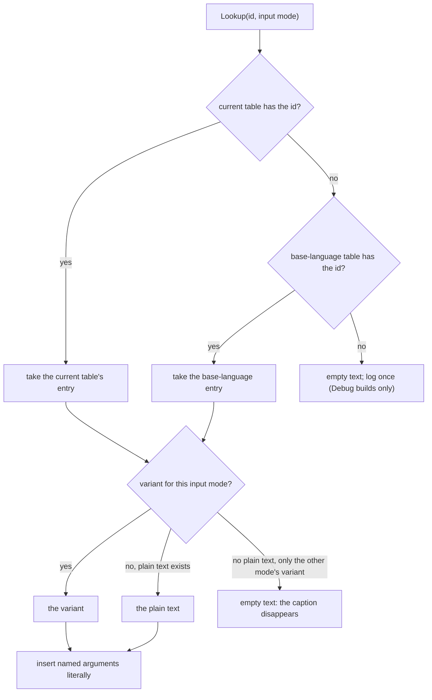
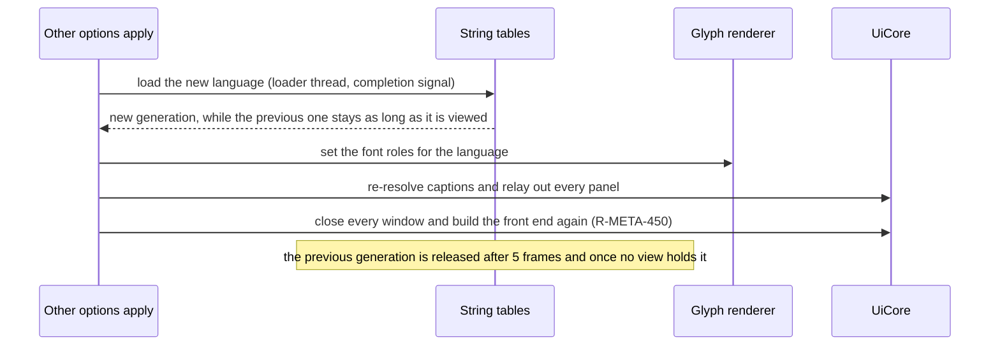

# UI layout, rendering, input and localisation

> Status: Engine baseline · Prefix: UI · ADRs: [ADR-031](../../../ADR/ADR-031-batched-ui-rendering.md), [ADR-032](../../../ADR/ADR-032-ui-focus-graph-page-stack-and-input.md), [ADR-033](../../../ADR/ADR-033-ui-layout-scaling-and-dpi.md), [ADR-034](../../../ADR/ADR-034-text-rendering-and-glyph-cache.md), [ADR-063](../../../ADR/ADR-063-localisation.md), [ADR-064](../../../ADR/ADR-064-accessibility-baseline-xag.md), [ADR-029](../../../ADR/ADR-029-input-event-model-and-binding-contract.md), [ADR-028](../../../ADR/ADR-028-input-device-back-ends.md), [ADR-075](../../../ADR/ADR-075-application-window-and-dpi-awareness.md), [ADR-005](../../../ADR/ADR-005-pipeline-state-catalogue.md) · Folder: [UI framework](README.md)

This document specifies how the UI framework lays out, draws, navigates and localises its widgets: the two layout systems and their formulas, DPI and scale settings and relayout; the UI pass, the batched UI renderer, the palette, text styles, font roles and the glyph cache; the navigation actions and rules for keyboard, gamepad and pointer; and the integration of the string tables. The widgets themselves are [core_and_widgets.md](core_and_widgets.md)'s, and the front-end page framework is [pages_and_screen_recipes.md](pages_and_screen_recipes.md)'s. Notation follows [core_and_widgets.md](core_and_widgets.md).

## 1 Responsibilities and boundaries

**UI-160** (MUST) This document owns: the layout functions of the framework and the tool-window layout values; the large-menu factor; the UI-scale, text-scale and DPI rules and relayout; the UI's use of the UI pass; the batched UI renderer's stream, batching and blend rules; the UI palette tokens and their reference values; text styles, the text draw point, font roles, the per-role spacing factors and the per-language horizontal scale; the glyph cache's tuning; the menu navigation actions the UI consumes and their navigation rules; and the string-table mechanism (look-up, fallback application, input-mode variants, markup expansion, widget use, case mapping, the font role per language, text entry of non-Latin text and the hand-over between tables at a language switch).

**UI-161** (MUST NOT) This document does not define: which languages ship and when a language is offered (DEC-099; [reference/09](../../../reference/09_front_end_and_match_flow/options_localisation_and_hooks.md) R-META-460 to R-META-463); the fallback policy, which is per string id to the base language `ref.meta.lang.base` (`en-GB`; DEC-099, R-META-464); the start-up language choice (R-META-465); the page-grid values, which [reference/09 front_end_presentation.md](../../../reference/09_front_end_and_match_flow/front_end_presentation.md) R-META-200 and R-META-201 own; the string-table schema and markup syntax ([data schemas](../data_schemas/README.md)); the binding grammar, the device back-ends and the input mode's source ([input](../input/README.md), ADR-029); the screen transition ([frame_graph_and_passes.md](../renderer/frame_graph_and_passes.md) RND-095, RND-096) and the HUD space (RND-377).

## 2 Interfaces

C++23 interface sketch (declarations only), in namespace `Engine`; the geometry types are those of [core_and_widgets.md](core_and_widgets.md) §2, and `InputMode` is the input component's (INP-150).

```cpp
namespace Engine
{

struct PageGrid // UI-163
{
  RectF title;
  RectF left;
  RectF right;
  float fontLarge = 0;
  float fontMedium = 0;
  float fontSmall = 0;
  float buttonWidth = 0;
  float buttonHeight = 0;
  float buttonGap = 0;
  bool wide = false;
};
PageGrid ComputePageGrid(SizeF _client);
float LargeMenuScale(float _clientHeight, bool _largeMenusOn); // UI-167

struct UiScaleState // UI-168
{
  float dpiScale = 1;
  float uiScale = 1;
  float textScale = 1;
};
float ToolWindowScale(const UiScaleState& _scale, float _largeMenuScale);                // UI-170
float FinalTextSize(float _layoutSize, const UiScaleState& _scale, float _clientHeight); // UI-171

enum class UiBlend : std::uint8_t // UI-180
{
  Alpha,
  Additive,
  Ink
};
struct UiVertex // UI-178
{
  float x; // pixels, origin top-left
  float y;
  float u;
  float v;
  std::uint32_t rgba;    // 8 bits per channel
  std::uint32_t texture; // texture or glyph-atlas page index
};

enum class FontRole : std::uint8_t // UI-195
{
  Caption,
  Body,
  Title
};
enum class TextPass : std::uint8_t
{
  Fill,
  Outline
};
enum class TextAlign : std::uint8_t
{
  Left,
  Center,
  Right
};
struct TextStyle // UI-189
{
  FontRole role = FontRole::Body;
  float size = 12.0f; // ui.text.default_size
  ColorRgba color;
  UiBlend blend = UiBlend::Additive;
  TextPass pass = TextPass::Fill;
};

class DrawContext // the batched UI stream (UI-177)
{
public:
  void Quad(RectF _rect, ColorRgba _color, UiBlend _blend);
  void TexturedQuad(RectF _rect, AssetId _texture, RectF _uv, ColorRgba _color, UiBlend _blend);
  void Gradient(RectF _rect, ColorRgba _top, ColorRgba _bottom, UiBlend _blend);
  void Line(PointF _from, PointF _to, float _widthPixels, ColorRgba _color, UiBlend _blend);
  void LineLoop(RectF _rect, float _widthPixels, ColorRgba _color, UiBlend _blend);
  void Text(PointF _drawPoint, std::u8string_view _text, const TextStyle& _style, TextAlign _align = TextAlign::Left);
  void PushScissor(RectF _rect); // UI-181
  void PopScissor();
};

class GlyphRenderer // ADR-034
{
public:
  float MeasureWidth(std::u8string_view _text, const TextStyle& _style) const; // UI-200
  void Draw(DrawContext& _out, PointF _drawPoint, std::u8string_view _text, const TextStyle& _style, TextAlign _align);
  void SetLanguage(LanguageTag _language);                  // UI-234
  void Prerasterize(std::span<const char32_t> _characters); // UI-198
};

// InputMode is the input component's (INP-150); the UI reads it from InputRouter::Mode (UI-205).

class TextView;   // keeps its table generation alive (UI-239)
class StringTable // UI-218
{
public:
  TextView Lookup(StringId _id, InputMode _mode) const;                                          // never shows a string id (UI-219)
  bool Exists(StringId _id) const;                                                               // UI-220
  std::u8string Format(StringId _id, InputMode _mode, const MessageArguments& _arguments) const; // UI-227
  LanguageTag Language() const;
};

} // namespace Engine
```

**Events consumed.** Resize and DPI change (platform layer, ADR-075); UI-scale and text-scale setting changes; input-mode change and binding change (input router, ADR-029); language change (the other options apply, R-META-448). Each marks the open panels for relayout (UI-172).

**Threading contract.** Layout, drawing and look-ups run on the main thread. A string table is loaded on the loader thread and handed to the main thread through a completion signal (DEC-221 item 4); once handed over it is read-only.

## 3 Data model

| Record | Contents | Owner, lifetime | Schema |
|---|---|---|---|
| page layout | widgets, their cells on the page grid, string ids, accessible names, focus neighbours, overflow rules, view-model bindings | content; loaded with its page | [data schemas](../data_schemas/README.md) (ADR-030, ADR-061) |
| palette | one colour per token of §4.7; a default palette and a high-contrast variant | content; process | data schemas |
| text style | font role, size, colour token, blend, pass | content or code | data schemas |
| font-role map | per language and role: the face and its fallback chain | content; replaced on a language switch | data schemas; assets `font.ui.*` |
| string table | per language (BCP 47 tag): id → plain text, keyboard-and-mouse variant, gamepad variant, after markup expansion | content; one generation per load, kept while viewed (UI-239) | data_schemas; assets `strings.*` |
| UI scale state | DPI scale, UI scale, text scale | the UI core; process | settings (DEC-100) |
| glyph cache | atlas pages and the glyph map | the glyph renderer; process; rebuilt after device removal | ADR-034 |

## 4 Behaviour and algorithms

### 4.1 Layout systems and the page grid

**UI-162** (MUST) The framework has two layout systems. Tool-style windows ([core_and_widgets.md](core_and_widgets.md) §4.10 to §4.21) are laid out in fixed pixels scaled by UI-170. Front-end pages and options screens are laid out in fractions of the client size, recomputed whenever a page is built or laid out again. HUD panels use the renderer's HUD space of `ref.ctrl.panel.canvas_height` (600) units high ([entity_and_overlay_renderers.md](../renderer/entity_and_overlay_renderers.md) RND-377; [reference/06](../../../reference/06_controls_camera_and_commands/selection_and_power_slots.md) R-CTRL-222), which one layout function converts to pixels together with the other two (ADR-033).

**UI-163** (MUST) `ComputePageGrid(W, H)` computes the page grid of [reference/09](../../../reference/09_front_end_and_match_flow/front_end_presentation.md) R-META-200 from its keys:

| Quantity | Formula |
|---|---|
| horizontal split | `ref.meta.layout.horizontal_split` × H |
| vertical split | `ref.meta.layout.vertical_split` × W |
| gap | `ref.meta.layout.gap` × the vertical split |
| outer edges | left = top = gap; right = W − gap; bottom = H − gap; wide when W ÷ H > `ref.meta.layout.widescreen_aspect`, and then left += `ref.meta.layout.widescreen_inset` × W and right −= the same |
| title bar | (left, top, right − left, horizontal split − gap ÷ 2 − top) |
| left box (lX, lY, lW, lH) | (left, horizontal split + gap ÷ 2, vertical split − gap ÷ 2 − left, bottom − lY) |
| right box (rX, rY, rW, rH) | (vertical split + gap ÷ 2, horizontal split + gap ÷ 2, right − rX, bottom − rY) |
| fonts | large `ref.meta.layout.font_large` × H; medium `ref.meta.layout.font_medium` × H; small `ref.meta.layout.font_small` × H |
| standard button | bw = `ref.meta.layout.button_width` × lW; bh = `ref.meta.layout.button_height` × medium; button gap = `ref.meta.layout.button_gap` × medium |

Worked values (pixels), which the acceptance tests use:

| Screen | Title bar (x, y, w, h) | Left box (x, y, w, h) | Right box (x, y, w, h) | Fonts large, medium, small | Button bw × bh, gap |
|---|---|---|---|---|---|
| 800 × 600 | 24.0, 24.0, 752.0, 120.0 | 24.0, 168.0, 444.0, 408.0 | 492.0, 168.0, 284.0, 408.0 | 57.00, 24.00, 13.20 | 399.6 × 31.20, 2.40 |
| 1024 × 768 | 30.7, 30.7, 962.6, 153.6 | 30.7, 215.0, 568.3, 522.2 | 629.8, 215.0, 363.5, 522.2 | 72.96, 30.72, 16.90 | 511.5 × 39.94, 3.07 |
| 1280 × 720 (wide) | 140.8, 38.4, 998.4, 129.6 | 140.8, 206.4, 608.0, 475.2 | 787.2, 206.4, 352.0, 475.2 | 68.40, 28.80, 15.84 | 547.2 × 37.44, 2.88 |
| 1920 × 1080 (wide) | 211.2, 57.6, 1497.6, 194.4 | 211.2, 309.6, 912.0, 712.8 | 1180.8, 309.6, 528.0, 712.8 | 102.60, 43.20, 23.76 | 820.8 × 56.16, 4.32 |

**UI-164** (MUST) Pages compose on the grid by these conventions:

1. the button column is centred in the left box at bx = lX + (lW − bw) ÷ 2;
2. the page title sits at the place of R-META-201 in the medium font, drawn at 1.5 × that size and shrunk to fit ([core_and_widgets.md](core_and_widgets.md) UI-113);
3. the first stacked row is at `ref.meta.layout.first_button_offset` below lY, and each further row one button step (bh + button gap) lower;
4. Back is anchored at lY + lH − `ref.meta.layout.back_offset` (2) × bh; an Apply and Back pair puts Apply at lY + lH − `ui.layout.apply_offset` (3) × bh and Back at lY + lH − 2 × bh;
5. compact rows: the options pages use rows of `ref.meta.option_controls.control_height` (0.65) × bh in the small font; the small controls of the match setup page are `ref.meta.setup.small_control_height` (0.66) × bh; the session browser's rows are `ui.layout.browser_row_height` (0.6) × bh high and `ui.layout.browser_row_width` (0.9) × the title bar's width wide (DEC-245);
6. the right box carries information panels (pictures, scrolling descriptions, the chat, status text), which are never in the navigation order;
7. map thumbnails take the size of [reference/08](../../../reference/08_maps_and_level_design/rules_and_conventions.md) R-MAP-022, and mode pictures the size of [reference/09](../../../reference/09_front_end_and_match_flow/screen_flow_and_match_setup.md) R-META-032.

**UI-165** (MUST) **Text row convention.** Text of size s in a row of height h at y is drawn at the draw point y + h ÷ 2 − s ÷ 2 + `ui.text.row_offset` (7 px), which with the draw offset of UI-193 places the top of the glyph box at y + h ÷ 2 − s ÷ 2: the text is centred vertically in its row.

### 4.2 Tool-window layout and large menus

**UI-166** (MUST) Tool windows are laid out as follows:

| Item | Rule |
|---|---|
| title bar | *m*(`ui.chrome.title_height`) high; client area as [core_and_widgets.md](core_and_widgets.md) UI-047 |
| close box | `ui.chrome.close_box` (UI-046) |
| automatic button size | characters × `ui.button.auto_char_width` + `ui.button.auto_padding` wide, `ui.button.auto_height` high (UI-055) |
| value control | UI-062 |
| row pitch | by convention about `ui.layout.tool_row_pitch` (17 px) from one row to the next; nothing enforces it |
| window height | grows to the lowest widget's bottom + `ui.core.auto_grow_margin` (UI-025) |
| placement | set by the caller before registration; a child left at (0, 0) is placed near its parent (UI-022 step 2); kept on screen at registration |
| scaling | every length through *m* (UI-048) and then the scale of UI-170 |

The development windows and the message dialog use this layout; no options screen does.

**UI-167** (MUST) `LargeMenuScale(H, on)` = `ui.layout.large_menu_factor` (0.96) × H ÷ `ui.layout.large_menu_height` (460) when the large-menus setting is on, and 1 otherwise ([core_and_widgets.md](core_and_widgets.md) UI-048). It is read at start-up and whenever the other options apply ([reference/09](../../../reference/09_front_end_and_match_flow/options_localisation_and_hooks.md) R-META-448 item 7, R-META-449 item 4). It applies to tool windows only; full-screen pages are laid out in screen fractions and do not change.

### 4.3 DPI, UI scale and text scale

**UI-168** (MUST) Two player settings scale the UI (ADR-033, ADR-064): the **UI scale** multiplies element sizes around their anchors, and the **text scale** multiplies text sizes. They default to `ui.scale.ui_default` (1.0) and `ui.scale.text_default` (1.0), at which every layout of this folder is the reference layout; their ranges are a design-phase input (§8).

**UI-169** (MUST) The platform layer reports the window's DPI scale (ADR-075). Line widths, borders, focus outlines and text-outline offsets are their pixel values × the DPI scale, rounded to whole pixels and at least 1 px; icons use the source size closest to their final pixel size; and every element rectangle is snapped to whole pixels after conversion (ADR-031). Layout reads the display size of UI art authored at 2x from `TextureSize`, which `AssetCache::Size` reports, never the stored pixel size ([asset pipeline](../asset_pipeline_and_resources.md) AST-024, AST-113). A UI element that needs a grey, recoloured or colour-replaced form of a picture uses a derived texture variant (`Derivation::Grayscale`, `ToColor` or `ReplaceColor`, AST-075), which the content build makes; the UI never processes a texture at run time.

**UI-170** (MUST) A tool-window length v in pixels becomes *m*(v) × the DPI scale × the UI scale. A front-end length is its fraction of W or H × the UI scale about its anchor; at a UI scale of 1 the page grid of UI-163 is unchanged. HUD lengths are the renderer's (RND-377).

**UI-171** (MUST) The final text size is the layout size × the text scale (× the UI scale where the element scales), clamped below by the accessibility minimum for the client height H: `ui.access.min_text_1080p` (9 px) × H ÷ 1080 for H ≤ 1080; linear between 9 px at 1080 and `ui.access.min_text_2160p` (19 px) at 2160; 19 px × H ÷ 2160 above (ADR-064). The glyph cache rasterises at the final size (UI-198), so text is never scaled as a bitmap. When a string or a scaled element does not fit its cell, the cell's overflow rule applies (wrap, shrink to the minimum, or scroll); the shrink-to-fit of page titles ([core_and_widgets.md](core_and_widgets.md) UI-113) is the shrink rule. A cell without a rule is reported by the layout validator for every language that overflows it (ADR-033).

### 4.4 Relayout

**UI-172** (MUST) A resize, a DPI change, a change of the UI scale or the text scale, a language change, an input-mode change and a binding change mark every open panel for relayout at the next update phase. Relayout recomputes positions and sizes from the layout data and re-resolves every bound caption; view-model state, scroll positions and the focus are untouched (ADR-033, ADR-030).

**UI-173** (MUST) When the client size changes from W × H to W′ × H′, every tool window keeps its size and moves so that its centre (cx, cy) becomes (cx × W′ ÷ W, cy × H′ ÷ H); full-screen pages lay themselves out again from the new size. The screen options apply of [reference/09](../../../reference/09_front_end_and_match_flow/options_localisation_and_hooks.md) R-META-422 then rebuilds the menus as that requirement states.

**UI-174** (MUST NOT) A size, window-mode or monitor change never re-creates the renderer, the UI core, a panel or a widget (ADR-075, ADR-012).

### 4.5 The UI pass and the front-end frame composition

**UI-175** (MUST) The UI is drawn in the UI windows pass (pass 19) at the window's native resolution, after the scene's resolve, tone mapping and brightness passes, independent of the scene's render scale and anti-aliasing; with HDR on, at the SDR reference white level (ADR-031, ADR-014). The other passes that draw UI text use the text styles of §4.8: the match message (pass 13, RND-074), the chat (pass 21, RND-075), the Power slots panel (pass 23, RND-378), the match HUD (pass 28, RND-379) and the paused banner (pass 33, RND-090).

**UI-176** (MUST) A front-end frame is composed in this order: the front-end controller's 3-D backdrop (the sky and its clouds, [reference/09](../../../reference/09_front_end_and_match_flow/front_end_presentation.md) R-META-210); then, in the UI pass, only the focused full-screen page (the front-end screen or an options screen): the backdrop figure layer, the title bar with its title and emblems, the content boxes, the page overlays, the widgets back-most first and the in-page dialog (R-META-204; [core_and_widgets.md](core_and_widgets.md) UI-102); after the UI pass, the pointer, the fades and the screen transition, and then the present (RND-095, RND-096).

### 4.6 The batched UI renderer

**UI-177** (MUST) Each frame the UI emits every visible primitive into one vertex stream in the renderer's upload ring, in painter's order (ADR-031, ADR-008). The stream is rebuilt every frame; no widget owns GPU memory.

**UI-178** (MUST) A UI vertex holds a position in pixels with the origin at the top-left (two floats), texture coordinates (two floats), a colour of 8 bits per channel and a texture or glyph-atlas page index, 24 bytes in all; the vertex shader reads the texture through the bindless heap (ADR-006).

**UI-179** (MUST) Consecutive primitives that share their blend state, their texture or atlas page and their scissor rectangle form one batch; a change of any of the three starts a new batch. Batching never reorders primitives, so blending stays exactly as painter's order gives it. Widget recipes order their primitives to keep batches long ([pages_and_screen_recipes.md](pages_and_screen_recipes.md)).

**UI-180** (MUST) The UI uses three blend states of the pipeline-state catalogue (ADR-005, ADR-031): **alpha** (source alpha, one minus source alpha; `Alpha`), **additive** (source alpha, one; `Additive`) and **ink** (source alpha, one minus source colour; `Ink`). An ink primitive with source alpha 0 has the arithmetic of the catalogue's `Darkening` state, the destination × (1 − source colour) ([frame_graph_and_passes.md](../renderer/frame_graph_and_passes.md) RND-058). Glyph coverage multiplies the colour and the alpha of a glyph quad, so text uses the same three states. Every result is clamped to [0, 1] per channel.

**UI-181** (MUST) The framework keeps a stack of scissor rectangles; each batch carries the intersection of the stack as its scissor rectangle. Clipped widgets (the chat field, scrolling lists and scrolling text) push their rectangle while they draw their content and pop it afterwards.

**UI-182** (MUST) A page transition samples the renderer's captured-frame target, which holds the last presented frame (RND-095); the UI never reads the back buffer.

**UI-183** (MUST) Every primitive states its own blend state, texture and scissor; nothing that one widget draws changes the state of the next primitive, so no blend or depth state leaks from one widget to another (DEC-102). The UI pass never tests or writes depth.

**UI-184** (MUST) The primitives are: solid and textured quads; vertical gradients, with one colour at the top and one at the bottom, interpolated; lines and line loops of a given width in pixels, emitted as quads and snapped so that a line of odd width covers whole pixels; and glyph quads from the glyph renderer.

### 4.7 Palette

**UI-185** (MUST) Every colour a widget draws, other than plain white and plain black, is a palette token ([core_and_widgets.md](core_and_widgets.md) §4.12 to §4.30). The window layer's tokens make a red glass panel with a steel-blue highlight gradient and dark red bevels; the front-end layer's make green captions that turn red under focus on blue-glowing fill boxes, with a green highlight beam behind page titles.

**UI-186** (MUST) Palettes are content data. The reference values of the tokens of UI-187 and UI-188, in §9.1, form the default palette. The Species art direction replaces the values token by token while keeping each token's role ([visual_language.md](../renderer/visual_language.md) RND-403; [art_and_audio_briefs.md](../../../assets/art_and_audio_briefs.md) §2). A high-contrast palette is a content variant in which every text token reaches a contrast of at least `ui.access.contrast_high` (7:1) against the background it is drawn on. The content build checks every palette against `ui.access.contrast_text` (4.5:1) for gameplay-relevant text and `ui.access.contrast_inactive` (3:1) for inactive elements, and the Species palette meets both (ADR-064); the reference values are checked and reported, not enforced (§6).

**UI-187** (MUST) The window-layer tokens are the following; their reference values are in §9.1:

| Role | Token |
|---|---|
| window body | `ui.palette.window_body_tint` |
| title-bar top, window border, button highlight top, check-box highlight | `ui.palette.accent_light` |
| title-bar bottom, highlight bottom | `ui.palette.accent_dark` |
| pressed button, top | `ui.palette.accent_pressed_top` |
| pressed button, bottom | `ui.palette.accent_pressed_bottom` |
| 1 px outer window frame | `ui.palette.frame_outer` |
| idle button | `ui.palette.button_fill` |
| button top and left bevel | `ui.palette.button_edge_light` |
| borderless button top and left bevel | `ui.palette.borderless_edge_light` |
| inset panel and edit well, right and bottom | `ui.palette.inset_edge_light` |
| bottom and right bevels | `ui.palette.button_edge_dark` |
| captions, additive | `ui.palette.text_normal` |
| disabled captions | `ui.palette.text_disabled` |
| captions on highlighted backgrounds and window titles, ink mode | `ui.palette.text_ink` |
| disabled captions on highlights, ink mode | `ui.palette.text_ink_disabled` |
| the outline pass | `ui.palette.text_outline` |
| text-field edit well | `ui.palette.well_fill` |
| inset panel | `ui.palette.inset_fill` |
| close box | `ui.palette.close_fill` |
| close box, highlighted or pressed | `ui.palette.close_hot` |
| close box top and left edge | `ui.palette.close_edge` |
| scroll track | `ui.palette.scroll_track` |
| scroll track outline | `ui.palette.scroll_outline` |
| thumb | `ui.palette.scroll_thumb` |
| thumb, highlighted | `ui.palette.scroll_thumb_hot` |
| thumb, dragged | `ui.palette.scroll_thumb_pressed` |
| check-box box | `ui.palette.check_box` |
| tick tint of the tool-window check box | `ui.palette.check_tick` |

**UI-188** (MUST) The front-end tokens are the following; their reference values are in §9.1:

| Role | Token |
|---|---|
| idle captions, page check-box ticks | `ui.palette.fe_caption` |
| focused and selected captions | `ui.palette.fe_caption_focus` |
| inactive captions | `ui.palette.fe_caption_inactive` |
| page buttons with the alternative-colour flag | `ui.palette.fe_caption_alt` |
| focused row background | `ui.palette.fe_focus_band` |
| unfocused row background | `ui.palette.fe_row_band` |
| page title outline pass | `ui.palette.fe_title_outline` |
| page title ink pass | `ui.palette.fe_title_shadow` |
| highlight beam, top | `ui.palette.fe_beam_top` |
| highlight beam, bottom | `ui.palette.fe_beam_bottom` |
| highlight beam outline | `ui.palette.fe_beam_outline` |
| fill-box body × `uitex.fill_blur` | `ui.palette.fe_box_tint` |
| fill-box glow × `fx.glow_cloudy`, additive | `ui.palette.fe_box_glow` |
| fill-box outline, additive | `ui.palette.fe_box_outline` |
| alpha of the fill-box inner outline | `ui.palette.fe_box_inner_alpha` |
| inner colour of the fill-box darkening halo | `ui.palette.fe_box_shadow_edge` |
| page-button birth flash, additive; its alpha is UI-107's | `ui.palette.fe_flash` |
| second-style text field, with a white outline | `ui.palette.fe_text_box` |

The backdrop's corner glow is `ref.meta.backdrop.glow_colour` of [reference/09](../../../reference/09_front_end_and_match_flow/front_end_presentation.md) R-META-205.

### 4.8 Text styles and blend modes

**UI-189** (MUST) A text style is a font role, a size in pixels (`ui.text.default_size`, 12 px, when none is given), a colour token, a blend (additive or ink) and a pass (fill or outline). The outline style and the fill style that other components cite are the outline pass in `ui.palette.text_outline` and the fill pass in the element's colour (RND-378, RND-379).

**UI-190** (MUST) **Normal text is additive**: the glyph coverage × the colour × the alpha is added to what lies behind it, so text brightens its background.

**UI-191** (MUST) **Ink text** uses the ink state: with a text colour c and alpha a, the result is c × a + destination × (1 − c). With alpha 0 (the outline idiom) or the alpha of `ui.palette.text_ink` (window captions on highlights), a glyph contributes little colour of its own and multiplies its background by (1 − c), so it darkens it. Front-end ink text is drawn over the menu highlight gradient and the fill boxes ([visual_language.md](../renderer/visual_language.md) RND-425). This blend arithmetic is the reference default; its on-screen look in the Species working colour space is the Open DEC-316, which also covers the page transition.

**UI-192** (MUST) The outline pass draws each glyph `ui.text.outline_copies` (8) times, offset by ±`ui.text.outline_offset` (1 px, × the DPI scale; UI-169) to the eight neighbouring positions, (±1, 0), (0, ±1) and (±1, ±1), in the ink state. The outline idiom used throughout the framework is: the outline pass in `ui.palette.text_outline`, which darkens a 1 px border around the glyphs, then the fill pass in the wanted colour. Text in the world, which the renderer draws, takes its outline offset from the renderer.

**UI-193** (MUST) **Draw point.** A text draw at the draw point (x, y) with size s places the top-left corner of its first glyph box, the em box of size s, at (x + `ui.text.draw_offset_x` (−3 px), y + `ui.text.draw_offset_y` (−7 px)); centred and right-aligned text applies its alignment to x, using the measured width (UI-200), before the offset. Every text position this folder states is a draw point. The offsets are tool-window lengths and scale as UI-170 states.

**UI-194** (MUST) **Draw variants.** The glyph renderer draws text:

1. in 2-D at a draw point, left-aligned, centred or right-aligned by its measured width; the justification form takes a number, below 0 for right-aligned, 0 for centred and above 0 for left-aligned;
2. in 2-D rotated by a quarter turn, reading upwards or reading downwards; the upward form draws no outline pass (see DEC-952);
3. in 3-D, facing the camera at a world position, with the depth test off, left-aligned, centred or right-aligned, with outline offsets of ±`ui.text.outline_offset_3d` (5 %) of the size; the centred and right-aligned forms shift the text by (the CJK horizontal scale × the count of characters at or above U+3000) × (the Latin horizontal scale × the count of the other characters) × 0.5 × the size, a product of the two terms, so text made only of Latin characters, or only of CJK characters, is drawn left-aligned (§8; see DEC-952);
4. in 3-D at a world position, oriented by a front and an up vector, with the depth test left on.

World-space text uses the same glyph quads and blend states as UI text, in the world passes that the renderer assigns (ADR-031).

### 4.9 Font roles, glyph cache and script coverage

**UI-195** (MUST) Text has three font roles (ADR-034), each drawn from a licensed font in the packs ([GameAssets](../../../assets/GameAssets.md) §17):

| Role | Used for | Face |
|---|---|---|
| caption (`FontRole::Caption`) | tool-window titles, the session-browser header, player names in rows, overlays | `font.ui.stylised` |
| body (`FontRole::Body`) | standard-button captions, field values, list rows, the chat, scrolling text, message dialogs, the frame-rate overlay | `font.ui.compact` |
| title (`FontRole::Title`) | front-end captions and titles | `font.ui.primary`, with `font.ui.primary_ja` and `font.ui.primary_ko` as its Japanese and Korean companions |

There are no bitmap font atlases ([reference/09](../../../reference/09_front_end_and_match_flow/options_localisation_and_hooks.md) R-META-474).

**UI-196** (MUST) Each role has a horizontal spacing factor that multiplies every glyph advance: caption `ui.font.spacing_caption` (1.0), body `ui.font.spacing_body` (0.91) and title `ui.font.spacing_title` (1.03).

**UI-197** (MUST) **Horizontal scale.** Glyphs are drawn narrower or wider than their height by a per-language horizontal scale. In every language written in Latin or Cyrillic, every character is drawn at `ui.text.horizontal_scale_latin` (0.6). In Japanese and Korean, characters at or above `ui.text.cjk_first_code_point` (U+3000) are drawn at `ui.text.horizontal_scale_cjk` (1.0), and characters below it keep 0.6, so Latin characters stay condensed inside CJK text ([reference/09](../../../reference/09_front_end_and_match_flow/options_localisation_and_hooks.md) R-META-475). The scale is a horizontal transform of the glyph run, applied when the run is laid out and when it is rasterised, so advances and glyph shapes agree (ADR-034). A glyph's advance is the font's shaped advance at size s × the horizontal scale × the role's spacing factor.

**UI-198** (MUST) The glyph cache follows ADR-034: text is laid out and shaped by DirectWrite; each glyph not yet cached is rasterised in grayscale at its final pixel size into an `R8_UNORM` atlas page through the upload ring; the cache key is the font face, the glyph index, the final pixel size, the horizontal scale and the sub-pixel x offset quantised to 1 ÷ `ui.glyph.subpixel_steps` (4) of a pixel. Atlas pages are `ui.glyph.page_size` (1024 × 1024 px) and at most `ui.glyph.page_count` (8) exist; when the cache is full, the least recently used page is cleared and reused. The common characters of the current language are rasterised during loading (R-META-479). Atlas pages are never block-compressed, and are rebuilt rather than restored after device removal (ADR-017, ADR-008).

**UI-199** (MUST) The faces cover at least: U+0020 to U+00FF (Latin-1), U+0410 to U+044F (Cyrillic) and U+20A0 to U+20AF (currency signs) in all three Latin faces; U+3000 to U+30FF (CJK punctuation and kana) and U+4E00 to U+9EFF (CJK ideographs) in `font.ui.primary_ja`; U+AC00 to U+D7FF (Hangul syllables) in `font.ui.primary_ko` ([asset manifest](../../../assets/asset_manifest.csv)). Every edition carries the currency signs. A content-build check walks every string table of every offered language and fails when a character is not covered by that language's font chain (ADR-034). System fonts are appended to the chain only for player-entered text.

**UI-200** (MUST) Text widths are measured by the text layout, with the spacing factor and the horizontal scale applied (ADR-034). Geometric rules that the reference states as a character count × a per-character width, such as the automatic widget size ([core_and_widgets.md](core_and_widgets.md) UI-055), stay geometric rules; wherever text must fit, align or place a caret, the measured width is used.

**UI-201** (MUST) Text wraps to its cell's width by the line breaking of the text layout: lines break at spaces and between CJK characters in `ui.text.cjk_break_range` (U+3000 to U+D7FF), as in the reference, and at every other break opportunity of the script.

**UI-202** (MUST) Text is shaped and kerned, bidirectional runs are ordered, and characters outside the Basic Multilingual Plane render like any other (ADR-034). Text is UTF-8 inside the engine and UTF-16 only at the DirectWrite and Win32 boundaries (ADR-063); no text is ever narrowed to an 8-bit form, so no character is replaced on its way to a widget.

### 4.10 Keyboard, gamepad and pointer navigation

**UI-203** (MUST) The UI consumes these actions. Their bindings belong to the input component: table 3.6-B of [input](../input/controls_and_default_bindings.md) is the one binding table of every `action.menu.*` action, and its table 3.6-A binds the match actions that also act on UI windows (ADR-029; [reference/06](../../../reference/06_controls_camera_and_commands/actions_and_bindings.md) R-CTRL-035, R-CTRL-047). This document states what each action means to the UI and its context rules:

| Action | Meaning and context | Consumer |
|---|---|---|
| `action.menu.up`, `action.menu.down` | move the navigation cursor; repeat while held (UI-216) | window navigation ([core_and_widgets.md](core_and_widgets.md) UI-051) |
| `action.menu.left`, `action.menu.right` | step a value; repeat while held | numeric page text fields (UI-120) |
| `action.menu.activate` | activate the navigation cursor | the click of the navigation cursor (UI-051) |
| `action.menu.front_end_activate` | as activate, only while the application is at the front end | as activate |
| `action.menu.close` | Back; its Esc binding applies only outside a match | the back action (UI-051, UI-111, UI-112) |
| `action.match.menu` | screen level: in a match it closes every window or opens the in-match menu ([reference/09](../../../reference/09_front_end_and_match_flow/screen_flow_and_match_setup.md) R-META-014, R-META-062); it leaves the map-editor loop | the application loops |
| `action.menu.dismiss` | dismiss a dialog | in-page dialogs (UI-100) and the gamepad-disconnected dialog (R-META-066) |
| `action.ui.pointer_down`, `action.ui.pointer_held` | the primary pointer button, also on the gamepad while `action.ui.show_cursor` is held | the UI core ([README](README.md) UI-006) |
| `action.ui.alt_pointer_down` | the secondary pointer button | the UI core (UI-033) |
| `action.ui.show_cursor` | gamepad pointer emulation while held | README UI-011 |
| `action.menu.scroll_speedup` | five-fold increment steps while held | UI-071 |
| `action.match.chat` | start editing the chat field when no text edit is active | the chat field on the match setup page (UI-092) |

**UI-204** (MUST) Every screen must be usable with the keyboard alone (ADR-032, ADR-064), so the menu actions have keyboard defaults beside their gamepad ones: the arrow keys for the four directions, Enter for `action.menu.activate` and Esc for `action.menu.close`, bound in table 3.6-B of the input component (see DEC-950). The UI applies the Esc binding of `action.menu.close` only outside a match; in a match Esc stays `action.match.menu`, which closes every window at once (R-META-014). The reference's own control scheme binds the menu actions to the gamepad only, and keyboard players navigate with the pointer; its alternative control set, which is never selected, holds the arrow keys and Enter given here (§8).

**UI-205** (MUST) The **input mode** is keyboard and mouse or gamepad, chosen by the input router from the device class used last, with the gamepad preferred when both are active in one frame (`InputRouter::Mode`, INP-150; ADR-029). It controls hover-to-cursor ([core_and_widgets.md](core_and_widgets.md) UI-056), the gamepad glyph hints (UI-111, UI-112), the string variants (UI-223) and the gamepad-disconnected dialog (R-META-066).

**UI-206** (MUST) Each standard window has one navigation order, chosen by its screen, and one cursor in it; only the focused window navigates (UI-050, UI-051).

**UI-207** (MUST) Down and up move the cursor to the next and the previous entry that is not inactive, wrapping at both ends; the cursor's own widget may consume the move (UI-052).

**UI-208** (MUST) Activate is the click of the cursor's widget, exactly what a pointer click does; an inactive or disabled widget does nothing (UI-051, UI-055).

**UI-209** (MUST) Back: on a closeable window with a back action, the close action clicks the back action (UI-051); options screens and the message dialog work this way. On a page of the front-end screen, the page handles the close action in its update and clicks its Back button (UI-111). Every full-screen window registers a Back button as its back action (R-META-014).

**UI-210** (MUST) Left and right change only a numeric page text field that is the cursor (UI-120). A drop-down in cycle mode changes only on activate, to its next value (UI-116).

**UI-211** (MUST) Pointer and gamepad share the cursor: in keyboard-and-mouse mode the hovered widget becomes the cursor (UI-056); a navigation move ends hover-highlight mode for that update, so the two never fight; a widget draws focused when it is hovered in hover-highlight mode or when it is the cursor.

**UI-212** (MUST) Text entry is modal per window: while a window has a text-edit target, every character goes to it (UI-038). Gamepad navigation keeps running, because gamepad buttons are not characters. The keyboard actions whose keys also edit text (the arrow keys and Enter) act on the field and not on the navigation while it is being edited. Enter in a page text field sets its window's skip-next-update flag (UI-123).

**UI-213** (MUST) Locks: a locked window does not navigate (its in-page dialog is shown, or a tutorial is launching, [reference/09](../../../reference/09_front_end_and_match_flow/screen_flow_and_match_setup.md) R-META-026); skip-next-update skips exactly one update (UI-050).

**UI-214** (MUST) An open drop-down list is the front-most window and has the focus; its own navigation order holds its options, with the current value as the cursor, and choosing an option closes it (UI-085, UI-118).

**UI-215** (MUST) When the cursor moves to a widget inside a scrolling list, the list scrolls so that the widget is visible (UI-053; ADR-032).

**UI-216** (MUST) The menu directions repeat while held through the binding graph's repeat condition, with an initial delay and a rate measured in real time on the platform clock (ADR-074, ADR-029), so menus keep repeating while a match is paused; the delay and the period are `inp.repeat.initial_delay` and `inp.repeat.period` of the [input](../input/README.md) component (INP-133; see DEC-951), so navigation repeats at the same rate at every frame rate.

**UI-217** (MUST) Back and Escape never apply a change: only an explicit confirmation does, such as the Apply button of an options page ([reference/09](../../../reference/09_front_end_and_match_flow/options_localisation_and_hooks.md) R-META-412 item 4) or Enter in a text field (UI-064) (ADR-032, DEC-102).

### 4.11 String look-up and fallback

**UI-218** (MUST) Every text a widget shows comes from the string table of the current language by its string id (ADR-063; R-META-460): `Lookup(id, mode)` returns the text of the id for the current input mode (UI-223).

**UI-219** (MUST) A string id that the current language's table lacks returns, per id, the text of the base language `ref.meta.lang.base` (DEC-099; R-META-464). No widget ever shows a string id as text. An id that the base language also lacks cannot pass the content build (ADR-059, DEC-015); if one reaches a Debug build through loose content, the look-up returns an empty text and the miss is logged once per id.

**UI-220** (MUST) `Exists(id)` is true when the current language or the base language has the id. Counts that come from data use it, such as the number of help pages of a mode and the lines of the credits page (R-META-471).

**UI-221** (MUST) A look-up returns a text view that stays valid while it is held (UI-239); there is no shared miss buffer that a later look-up overwrites, and look-ups never change the table, so concurrent readers are safe (DEC-102).

**UI-222** (MUST) The content build merges every string source of a language into one table per language, the assets `strings.en_gb`, `strings.fr_fr`, `strings.de_de`, `strings.it_it`, `strings.es_es`, `strings.pt_br`, `strings.ru_ru`, `strings.ja_jp` and `strings.ko_kr`. Two entries with the same id in one language are a build error (DEC-801 item 2). Ids are compared exactly, in the lower-case dotted form of the Species conventions. The coverage reports against the base language are R-META-462 and R-META-473's.

### 4.12 Input-mode variants and caption markup

**UI-223** (MUST) A string id may have a keyboard-and-mouse variant and a gamepad variant beside its plain text; in each input mode, the variant of that mode replaces the plain text. An id that has a variant only for the other mode and no plain text resolves to an empty text in this mode, so its caption disappears (R-META-468; ADR-063).

**UI-224** (MUST) A caption may contain: a passage that appears in one input mode only, with an alternative passage for the other; a **binding argument**, replaced by the key or button currently bound to an action, shown as the key's name or inline as its glyph (`glyph.pad.*`, `glyph.key.tab`), as a DirectWrite inline object (ADR-034); and another string by its id, expanded recursively. The markup is expanded when the table is built and again whenever the bindings change; a cycle of embedded ids is a build error. The syntax is the [data schemas](../data_schemas/README.md)' (R-META-468).

**UI-225** (MUST) An expanded text holds at most `ui.lang.max_expanded_length` (1 024 characters), a markup marker at most `ui.lang.max_marker_length` (64 characters) and a string id at most `ui.lang.max_id_length` (96 characters); the content build rejects a longer value and names its file, line and field (DEC-801 item 5).

**UI-226** (MUST) Widgets hold string ids, never copies of text. A change of the input mode re-resolves every bound caption at the next update, so every caption with variants switches with no page code involved (UI-172).

**UI-227** (MUST) Values inserted at run time are named arguments in ICU MessageFormat syntax, such as `{file}`, `{status}` or `{width}` (ADR-063; R-META-469). Argument values and texts are inserted literally: no character of them, a percent sign or a brace included, is ever read as a formatting directive (DEC-102, DEC-800 item 4).

### 4.13 How widgets use the string table

**UI-228** (MUST) A standard window's title is its title string id, upper-cased (UI-049, UI-233). An options screen and a page drop-down list draw `ui.title.game_name` in their title bars ([core_and_widgets.md](core_and_widgets.md) UI-102, UI-119); a page drop-down list's page title is its drop-down's label string id; the in-match menu's title is its own string id.

**UI-229** (MUST) A page drop-down's label and a menu control's caption are their label string ids (UI-103, UI-117); the help text of a focused option control is the string id that [reference/09](../../../reference/09_front_end_and_match_flow/screen_flow_and_match_setup.md) R-META-050 gives; a value control's label is a string id (UI-062). Most buttons use the same string id for their caption and their accessible name.

**UI-230** (MUST) A drop-down's closed caption, its tool-window list and its page list all show the option's text, the text of its string id or its plain word (UI-083, UI-085, UI-119).

**UI-231** (MUST) Values substituted into a caption, such as a file name or a status, are named arguments (UI-227), never search-and-replace placeholders.

**UI-232** (MUST) Every player-facing caption has a string id ([reference/09](../../../reference/09_front_end_and_match_flow/options_localisation_and_hooks.md) R-META-470); the captions of the development windows are the [diagnostics](../diagnostics_test_and_performance/README.md) component's.

**UI-233** (MUST) Upper-casing, as of window titles and page titles, uses the case mapping of the current language through ICU (ADR-063), never a process-wide locale setting.

### 4.14 Font role per language

**UI-234** (MUST) In Japanese and Korean every font role uses `font.ui.primary` with its companion, `font.ui.primary_ja` or `font.ui.primary_ko` (R-META-475), and the horizontal scale of UI-197; in every other language each role uses its own face (UI-195). Each role's face and fallback chain per language are built with the DirectWrite font fallback builder (ADR-034). Switching between a Japanese or Korean language and another language switches the role faces back. No Chinese table exists, so Chinese is not in the language set (R-META-475).

**UI-235** (MUST) Every edition carries the fonts of every language it offers; there is no per-edition packaging of glyph images.

### 4.15 Non-Latin text entry

**UI-236** (MUST) A text field accepts every character the platform delivers, so precomposed non-Latin characters are inserted as typed. Input-method composition is shown inline at the caret, and committed text arrives as characters (ADR-028, ADR-032; [core_and_widgets.md](core_and_widgets.md) UI-067).

**UI-237** (MUST) Caret movement, selection and the clipboard work in every text field (UI-067); the clipboard exchanges Unicode text at the Win32 boundary (ADR-063).

### 4.16 Runtime language switch

**UI-238** (MUST) When the other options apply switches the language ([reference/09](../../../reference/09_front_end_and_match_flow/options_localisation_and_hooks.md) R-META-466, R-META-448 item 5), the framework loads the new table, sets the font roles for the language (UI-234), re-resolves every bound caption and lays out every open panel again (UI-172). The apply then closes every window and builds the front-end screen, or the match view, again (R-META-450), so every caption is drawn in the new language.

**UI-239** (MUST) **Hand-over between tables.** Each loaded table is a generation with a reference count; the previous table stays valid while any text view of it is held, and at least `ui.lang.previous_table_frames` (5) frames after the switch, the reference lifetime; it is then released (DEC-099, DEC-221 item 8). A view never refers to a released table.



Diagram 4-A — string look-up: per-id fallback to the base language, then the input-mode variant, then literal arguments.



Diagram 4-B — the runtime language switch and the hand-over between string-table generations.

## 5 Concurrency and performance budget

**UI-240** (MUST) The busiest screen, the match setup page at 1920 × 1080 with the chat, a full slot list and an open page list, stays within: `ui.budget.draws` (32) draw calls in the UI pass; `ui.budget.vertices` (65 536) UI vertices; and `ui.budget.cpu_ms` (1.0 ms) of main-thread time for the UI's update and stream build together, on the minimum-specification CPU, in steady state, with every glyph already cached (ADR-031).

**UI-241** (MUST) Rasterising new glyphs is the one UI cost that varies with content; the common characters of the current language are rasterised during loading (UI-198) so that it does not occur in steady state. String tables are read-only after hand-over and are loaded on the loader thread (§2).

## 6 Failure modes, diagnostics and telemetry

| Condition | Behaviour | Diagnostics | Requirement |
|---|---|---|---|
| a string id missing in the current language | the base-language text | the content build lists every fallback id | UI-219 |
| a string id missing in every table (development content only) | an empty text | logged once per id | UI-219 |
| a character not covered by the language's fonts | the content build fails; at run time, player text falls back to system fonts | build error naming the table, the id and the code point | UI-199 |
| a cycle of embedded string ids, or an over-long text, marker or id | the content build fails | build error with file, line and field | UI-224, UI-225 |
| a cell whose text overflows with no overflow rule | drawn clipped to its cell | the layout validator lists the cell for each overflowing language | UI-171 |
| the glyph cache is full | the least recently used page is cleared and reused | counter in the development overlay | UI-198 |
| device removal | the atlas pages are rebuilt on first use | logged | UI-198 |
| a palette text token below its contrast minimum | the content build warns for the default palette and fails for the high-contrast palette | build message naming the token | UI-186 |
| the busiest screen exceeds a budget | nothing changes at run time | the performance test fails | UI-240 |

The UI counts draws, vertices, batches and glyphs rasterised per frame for the development overlay ([diagnostics, test and performance](../diagnostics_test_and_performance/README.md)); these counts are part of the opt-in performance telemetry set only if that set names them (ADR-066).

## 7 Acceptance tests

| # | Kind | Test | Requirements |
|---|---|---|---|
| L1 | unit | `ComputePageGrid` at 800 × 600, 1024 × 768, 1280 × 720 and 1920 × 1080 gives the worked values of UI-163, to 0.1 px. | UI-163 |
| L2 | unit | Large-menu scale with the setting on at H = 600, 768 and 1080 is 1.2522, 1.6028 and 2.2539; with it off, 1 at every height; a full-screen page's grid is the same with it on and off. | UI-167 |
| L3 | unit | The minimum text size is 6 px at H = 720, 9 px at 1080, 14 px at 1620, 19 px at 2160; a 4 px layout size at 1080 is drawn at 9 px; the small font of the page grid at 1080 (23.76 px) is unchanged. | UI-171 |
| L4 | unit | At DPI scale 2 a 1 px border is 2 px, a 2 px border is 4 px, and a tool window 200 px wide is 400 px wide; at DPI scale 1.25 a 1 px line is 1 px. | UI-169, UI-170 |
| L5 | unit | Resizing from 800 × 600 to 1600 × 1200 moves a 200 × 100 tool window centred at (400, 300) to be centred at (800, 600), still 200 × 100; a focused text field keeps its typed text and caret. | UI-172, UI-173 |
| L6 | unit | Primitives alpha, alpha, additive, alpha on one texture give three batches; a scissor change between two alpha primitives gives a new batch; the batch order equals the primitive order. | UI-179, UI-181 |
| L7 | golden-image | Ink text of colour 0.5 and alpha 0.5 over 0.8 reads 0.65; ink with alpha 0 and colour 1 over any value reads 0; additive white over 0.8 reads 1.0. | UI-180, UI-190, UI-191 |
| L8 | unit | An outlined glyph at (100, 100) emits eight outline quads offset by one pixel in the eight directions and then one fill quad. | UI-192 |
| L9 | unit | A 20 px text at the draw point (50, 50) has its glyph box top-left at (47, 43); in a 30 px row at y = 0, the text row convention places the box top at 5. | UI-165, UI-193 |
| L10 | unit | With a test face of uniform advances, the string "AB" at 20 px in body role is 2 × 20 × 0.6 × 0.91 px wide in en-GB; in ja-JP a kana character is 20 × 1.0 × 0.91 px wide and "AB" inside Japanese text keeps 0.6. | UI-196, UI-197 |
| L11 | unit | The coverage check fails for a table that holds U+0E01 when no face of its chain covers it, and passes for U+20AC in every language. | UI-199 |
| L12 | unit | An id missing in de-DE shows its en-GB text; an id missing everywhere shows an empty text in a Debug build and fails the content build. | UI-219 |
| L13 | unit | An id with only a gamepad variant shows that variant in gamepad mode and an empty text in keyboard-and-mouse mode; an id with plain text and a gamepad variant shows the plain text in keyboard-and-mouse mode. Switching the input mode changes a bound caption at the next update. | UI-223, UI-226 |
| L14 | unit | A caption with a binding argument shows the new key after the binding changes; an embedded id is expanded; a cycle of two ids fails the content build. | UI-224 |
| L15 | unit | A message formatted with an argument "100% {done}" shows exactly that text. | UI-227 |
| L16 | unit | After a language switch, a text view of the previous table taken before the switch still reads its text after 10 frames while held; the previous table is released in the first frame after both the view is released and 5 frames have passed. | UI-239 |
| L17 | integration | With the keyboard only, every widget of every page and options screen is reached and activated, and every screen is left with Esc; with the gamepad only, the same with the d-pad, the south and the east face buttons. | UI-203, UI-204, UI-206 to UI-214 |
| L18 | integration | On every options page, changing a value and leaving with Back or Esc leaves the stored settings unchanged. | UI-217 |
| L19 | unit | In a text field being edited, the arrow keys move the caret and do not move the navigation cursor; the gamepad d-pad still moves it. | UI-212 |
| L20 | performance | The busiest screen of UI-240 at 1920 × 1080 stays within the draw, vertex and CPU budgets over 600 frames. | UI-240 |
| L21 | unit | Every text token of the high-contrast palette reaches 7:1 against its background; the default palette's gameplay text reaches 4.5:1. | UI-186 |
| L22 | golden-image | The same reference strings in each offered language, including a right-to-left sample and a character outside the Basic Multilingual Plane in a text field, match their golden images. | UI-197, UI-198, UI-202 |

## 8 Open decisions

- **DEC-099** (Resolved): per-id fallback to the base language and offering only complete languages; the previous table's lifetime after a switch (UI-219, UI-239).
- **DEC-316** (Open): the look of ink text over the highlight gradient and the fill boxes, and the page transition (UI-191).
- **DEC-337** (Dropped): the code-point range that one glyph-atlas page of the reference claims; Species has no glyph atlases of that kind and uses its glyph cache (UI-198).
- **DEC-801** (Resolved): duplicate string ids and over-long values are build errors (UI-222, UI-225).
- **DEC-102** (Resolved): no state leaks between widgets, literal text, stable look-ups, Back that never applies (UI-183, UI-217, UI-221, UI-227).
- **DEC-221** (Open): the hand-over of resources by reference-counted generations rather than frame counts (UI-239).
- **DEC-245** (Open): the session browser, whose row geometry UI-164 item 5 gives.
- **DEC-050** (Open): a rebinding screen, which the binding argument of UI-224 follows when bindings change.
- **DEC-950** (Resolved): the keyboard defaults of the menu actions, bound in the input component's table 3.6-B (UI-204).
- **DEC-951** (Resolved): the menu repeat on real time (UI-216).
- **DEC-952** (Open): reference text-drawing behaviours kept as defaults (UI-194 items 2 and 3).
- ADR-034 is Proposed; its default is the text stack of §4.9.

**Design-phase inputs.**

1. The ranges of the UI-scale and text-scale settings, and whether the UI scale applies to the HUD space (ADR-033, ADR-064).
2. The Species palette and its high-contrast variant, token by token (UI-186); whether dim captions and inactive states need new values to meet 3:1.
3. Whether the new faces are monospaced: the reference glyphs are fixed-advance cells of width size × horizontal scale × spacing factor, and a face with uniform advances reproduces that look; the art brief asks for fixed-width numerals where the HUD counts.
4. The keyboard defaults of UI-204, and whether Esc should also close front-end pages inside a match's menus.
5. Whether right-to-left languages are offered; the text stack supports them (UI-202), but the page grid and the widgets are laid out left to right.
6. Chinese, which the reference code anticipates for the title face but for which no table exists (UI-234).
7. Cyrillic glyph design: in the reference all three faces carry one and the same Cyrillic glyph set, that of the stylised face, so Cyrillic text looks alike in every role; whether the Species faces share one Cyrillic design is an art-direction choice ([GameAssets](../../../assets/GameAssets.md) §17).
8. The centring of centred and right-aligned 3-D text (UI-194 item 3), which multiplies the CJK and Latin terms instead of adding them, so single-script 3-D labels are drawn left-aligned; whether Species keeps it depends on which world labels it draws (DEC-952).

## 9 Tuning table

### 9.1 Keys owned by this document

The palette tokens of UI-187 and UI-188 are the `ui.palette.*` rows; their values form the default palette (UI-186).

| key | value | unit | range or notes | requirement | DEC |
|---|---|---|---|---|---|
| `ui.layout.apply_offset` | 3 | × bh above the left box's bottom | Apply of an Apply and Back pair | UI-164 | — |
| `ui.layout.browser_row_height` | 0.6 | × bh | session browser rows and header | UI-164 | DEC-245 |
| `ui.layout.browser_row_width` | 0.9 | × the title bar's width | | UI-164 | DEC-245 |
| `ui.layout.tool_row_pitch` | 17 | px | a convention of tool windows, not enforced | UI-166 | — |
| `ui.layout.large_menu_factor` | 0.96 | — | scale = 0.96 × H ÷ 460 | UI-048, UI-167 | — |
| `ui.layout.large_menu_height` | 460 | px | | UI-048, UI-167 | — |
| `ui.scale.ui_default` | 1.0 | × | reproduces the reference layout; range a design-phase input | UI-168 | — |
| `ui.scale.text_default` | 1.0 | × | as above | UI-168 | — |
| `ui.access.min_text_1080p` | 9 | px at a client height of 1080 | proportional below 1080 | UI-171 | — |
| `ui.access.min_text_2160p` | 19 | px at a client height of 2160 | linear between 1080 and 2160; proportional above | UI-171 | — |
| `ui.access.contrast_text` | 4.5 | contrast ratio | gameplay-relevant text, every palette | UI-186 | — |
| `ui.access.contrast_inactive` | 3 | contrast ratio | inactive elements | UI-186 | — |
| `ui.access.contrast_high` | 7 | contrast ratio | text tokens of the high-contrast palette | UI-186 | — |
| `ui.text.row_offset` | 7 | px | text row convention | UI-165 | — |
| `ui.text.default_size` | 12 | px | text size when a style gives none | UI-070, UI-090, UI-189 | — |
| `ui.text.outline_copies` | 8 | glyph copies | the eight neighbouring offsets | UI-192 | — |
| `ui.text.outline_offset` | 1 | px × the DPI scale | | UI-192 | — |
| `ui.text.draw_offset_x` | −3 | px | draw point to glyph box | UI-193 | — |
| `ui.text.outline_offset_3d` | 5 | % of the text size | outline offsets of 3-D text | UI-194 | — |
| `ui.text.draw_offset_y` | −7 | px | draw point to glyph box | UI-193 | — |
| `ui.font.spacing_caption` | 1.0 | × advance | caption role | UI-196 | — |
| `ui.font.spacing_body` | 0.91 | × advance | body role | UI-196 | — |
| `ui.font.spacing_title` | 1.03 | × advance | title role | UI-196 | — |
| `ui.text.horizontal_scale_latin` | 0.6 | glyph width ÷ height | Latin and Cyrillic languages; characters below U+3000 in every language | UI-197 | — |
| `ui.text.horizontal_scale_cjk` | 1.0 | glyph width ÷ height | Japanese and Korean, characters from U+3000 | UI-197 | — |
| `ui.text.cjk_first_code_point` | U+3000 | code point | | UI-197 | — |
| `ui.text.cjk_break_range` | U+3000 to U+D7FF | code points | a line may break after these | UI-201 | — |
| `ui.glyph.subpixel_steps` | 4 | per pixel | sub-pixel x-offset quantisation | UI-198 | — |
| `ui.glyph.page_size` | 1024 × 1024 | px, `R8_UNORM` | Species baseline | UI-198 | — |
| `ui.glyph.page_count` | 8 | pages | least recently used page reused | UI-198 | — |
| `ui.lang.max_expanded_length` | 1 024 | characters | after markup expansion | UI-225 | DEC-801 |
| `ui.lang.max_marker_length` | 64 | characters | one markup marker | UI-225 | DEC-801 |
| `ui.lang.max_id_length` | 96 | characters | one string id | UI-225 | DEC-801 |
| `ui.lang.previous_table_frames` | 5 | frames | minimum life of the previous table after a switch | UI-239 | DEC-099 |
| `ui.budget.draws` | 32 | draw calls | UI pass, busiest screen; Species baseline | UI-240 | — |
| `ui.budget.vertices` | 65 536 | vertices | busiest screen; Species baseline | UI-240 | — |
| `ui.budget.cpu_ms` | 1.0 | ms per frame | update and stream build, minimum-specification CPU; Species baseline | UI-240 | — |
| `ui.palette.window_body_tint` | 1, 1, 1, 0.96 | RGBA, 0 to 1 | × `uitex.panel_accent`; window body | UI-187, UI-054 | — |
| `ui.palette.accent_light` | 199, 214, 220, 255 | RGBA8 | title-bar top, window border, button highlight top, check-box highlight | UI-187, UI-054, UI-057, UI-081 | — |
| `ui.palette.accent_dark` | 112, 141, 168, 255 | RGBA8 | title-bar bottom, highlight bottom | UI-187, UI-054, UI-057 | — |
| `ui.palette.accent_pressed_top` | 255, 255, 255, 255 | RGBA8 | pressed button, top | UI-187, UI-057 | — |
| `ui.palette.accent_pressed_bottom` | 162, 191, 208, 255 | RGBA8 | pressed button, bottom | UI-187, UI-057 | — |
| `ui.palette.frame_outer` | 42, 56, 82, 255 | RGBA8 | 1 px outer window frame | UI-187, UI-054 | — |
| `ui.palette.button_fill` | 107, 37, 39, 64 | RGBA8 | idle button | UI-187, UI-057 | — |
| `ui.palette.button_edge_light` | 100, 34, 34, 200 | RGBA8 | button top and left bevel | UI-187, UI-057 | — |
| `ui.palette.borderless_edge_light` | 100, 34, 34, 250 | RGBA8 | borderless button top and left bevel | UI-187, UI-059 | — |
| `ui.palette.inset_edge_light` | 100, 34, 34, 150 | RGBA8 | inset panel and edit well, right and bottom | UI-187, UI-061, UI-070 | — |
| `ui.palette.button_edge_dark` | 0.1, 0, 0, 1 | RGBA, 0 to 1 | bottom and right bevels | UI-187, UI-057, UI-060 | — |
| `ui.palette.text_normal` | 255, 255, 255, 255 | RGBA8 | captions, additive | UI-187, UI-057, UI-059, UI-081, UI-102, UI-119 | — |
| `ui.palette.text_disabled` | 128, 128, 128, 255 | RGBA8 | disabled captions | UI-187, UI-057 | — |
| `ui.palette.text_ink` | 255, 255, 150, 30 | RGBA8 | captions on highlighted backgrounds and window titles, ink mode | UI-187, UI-054, UI-057, UI-059, UI-191 | — |
| `ui.palette.text_ink_disabled` | 128, 128, 75, 30 | RGBA8 | disabled captions on highlights, ink mode | UI-187, UI-057 | — |
| `ui.palette.text_outline` | 1, 1, 1, 0 | RGBA, 0 to 1 | the outline pass | UI-187, UI-108, UI-189, UI-192 | — |
| `ui.palette.well_fill` | 0.1, 0, 0, 0.5 | RGBA, 0 to 1 | text-field edit well | UI-187, UI-070 | — |
| `ui.palette.inset_fill` | 0.05, 0, 0, 0.4 | RGBA, 0 to 1 | inset panel | UI-187, UI-061 | — |
| `ui.palette.close_fill` | 60, 37, 39, 64 | RGBA8 | close box | UI-187, UI-060 | — |
| `ui.palette.close_hot` | 160, 137, 139, 64 | RGBA8 | close box, highlighted or pressed | UI-187, UI-060 | — |
| `ui.palette.close_edge` | 0, 0, 150, 100 | RGBA8 | close box top and left edge | UI-187, UI-060 | — |
| `ui.palette.scroll_track` | 85, 93, 78, 255 | RGBA8 | scroll track | UI-187, UI-076 | — |
| `ui.palette.scroll_outline` | 187, 187, 187, 255 | RGBA8 | scroll track outline | UI-187, UI-076 | — |
| `ui.palette.scroll_thumb` | 65, 71, 120, 255 | RGBA8 | thumb | UI-187, UI-076 | — |
| `ui.palette.scroll_thumb_hot` | 55, 60, 120, 255 | RGBA8 | thumb, highlighted | UI-187, UI-076 | — |
| `ui.palette.scroll_thumb_pressed` | 50, 55, 120, 255 | RGBA8 | thumb, dragged | UI-187, UI-076 | — |
| `ui.palette.check_box` | 0.3, 0.3, 0.3, 1 | RGBA, 0 to 1 | check-box box | UI-187, UI-081, UI-125 | — |
| `ui.palette.check_tick` | 0.6, 1.0, 0.4, 1 | RGBA, 0 to 1 | tick tint of the tool-window check box | UI-187, UI-081 | — |
| `ui.palette.fe_caption` | 0.6, 1.0, 0.4, 1 | RGBA, 0 to 1 | idle captions, page check-box ticks | UI-188, UI-108, UI-117, UI-121, UI-124, UI-125 | — |
| `ui.palette.fe_caption_focus` | 1.0, 0.3, 0.3, 1 | RGBA, 0 to 1 | focused and selected captions | UI-188, UI-108, UI-117, UI-119, UI-121, UI-124, UI-125 | — |
| `ui.palette.fe_caption_inactive` | 0.5, 0.5, 0.5, 1 | RGBA, 0 to 1 | inactive captions | UI-188, UI-105, UI-117 | — |
| `ui.palette.fe_caption_alt` | 1.0, 1.0, 0.3, 1 | RGBA, 0 to 1 | page buttons with the alternative-colour flag | UI-188, UI-108 | — |
| `ui.palette.fe_focus_band` | 0.75, 0.75, 1.0, 0.5 | RGBA, 0 to 1 | focused row background | UI-188, UI-108, UI-117 | — |
| `ui.palette.fe_row_band` | 1, 1, 1, 0.1 | RGBA, 0 to 1 | unfocused row background | UI-188, UI-117 | — |
| `ui.palette.fe_title_outline` | 0.75, 1.0, 0.45, 1 | RGBA, 0 to 1 | page title outline pass | UI-188, UI-113 | — |
| `ui.palette.fe_title_shadow` | 1.0, 0.9, 0.9, 0 | RGBA, 0 to 1 | page title ink pass | UI-188, UI-113 | — |
| `ui.palette.fe_beam_top` | 0.6, 1.0, 0.4, 0.8 | RGBA, 0 to 1 | highlight beam, top | UI-188, UI-114 | — |
| `ui.palette.fe_beam_bottom` | 0.3, 0.5, 0.2, 0.7 | RGBA, 0 to 1 | highlight beam, bottom | UI-188, UI-114 | — |
| `ui.palette.fe_beam_outline` | 0, 0, 0, 0.5 | RGBA, 0 to 1 | highlight beam outline | UI-188, UI-114 | — |
| `ui.palette.fe_box_tint` | 0.8, 0.8, 1.0, 0.9 | RGBA, 0 to 1 | fill-box body × `uitex.fill_blur` | UI-188, UI-115 | — |
| `ui.palette.fe_box_glow` | 0.3, 0.6, 0.9, 0.4 | RGBA, 0 to 1 | fill-box glow × `fx.glow_cloudy`, additive | UI-188, UI-115 | — |
| `ui.palette.fe_box_outline` | 0.8, 0.7, 1.0, 0.8 | RGBA, 0 to 1 | fill-box outline, additive | UI-188, UI-115 | — |
| `ui.palette.fe_box_inner_alpha` | 0.4 | alpha | alpha of the fill-box inner outline | UI-188, UI-115 | — |
| `ui.palette.fe_box_shadow_edge` | 1, 1, 1, 0 | RGBA, 0 to 1 | inner colour of the fill-box darkening halo | UI-188, UI-115 | — |
| `ui.palette.fe_flash` | 1, 1, 1 | RGB, 0 to 1 | page-button birth flash, additive; its alpha is UI-107's | UI-188, UI-107 | — |
| `ui.palette.fe_text_box` | 10, 10, 10, 255 | RGBA8 | second-style text field, with a white outline | UI-188, UI-122 | — |

### 9.2 Keys cited here and defined elsewhere

| key | owner |
|---|---|
| `ref.meta.layout.*` | [reference/09 front_end_presentation.md](../../../reference/09_front_end_and_match_flow/front_end_presentation.md) R-META-200, R-META-201 |
| `ref.meta.backdrop.glow_colour` | [reference/09 front_end_presentation.md](../../../reference/09_front_end_and_match_flow/front_end_presentation.md) R-META-205 |
| `ref.meta.option_controls.control_height`, `ref.meta.setup.small_control_height` | [reference/09 screen_flow_and_match_setup.md](../../../reference/09_front_end_and_match_flow/screen_flow_and_match_setup.md) |
| `ref.meta.lang.base` | [reference/09 options_localisation_and_hooks.md](../../../reference/09_front_end_and_match_flow/options_localisation_and_hooks.md) |
| `ref.ctrl.panel.canvas_height` (the HUD space of RND-377) | [reference/06 selection_and_power_slots.md](../../../reference/06_controls_camera_and_commands/selection_and_power_slots.md) R-CTRL-222 |
| `ui.chrome.title_height`, `ui.chrome.close_box`, `ui.button.auto_char_width`, `ui.button.auto_padding`, `ui.button.auto_height`, `ui.core.auto_grow_margin` | [core_and_widgets.md](core_and_widgets.md) §9 |
| `inp.repeat.initial_delay`, `inp.repeat.period` (the repeat of the menu directions) | [input](../input/README.md) §4.18 |

String ids cited: `ui.title.game_name` ([reference/09](../../../reference/09_front_end_and_match_flow/front_end_presentation.md)). Asset ids cited: `font.ui.primary`, `font.ui.primary_ja`, `font.ui.primary_ko`, `font.ui.stylised`, `font.ui.compact`, `strings.en_gb`, `strings.fr_fr`, `strings.de_de`, `strings.it_it`, `strings.es_es`, `strings.pt_br`, `strings.ru_ru`, `strings.ja_jp`, `strings.ko_kr`, `uitex.panel_accent`, `uitex.fill_blur`, `fx.glow_cloudy`, `glyph.pad.*`, `glyph.key.tab`.
