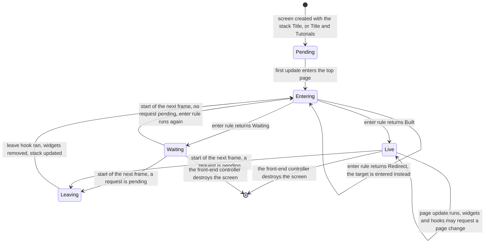
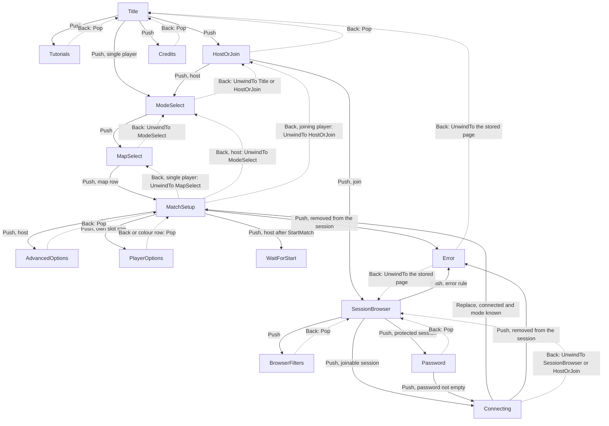
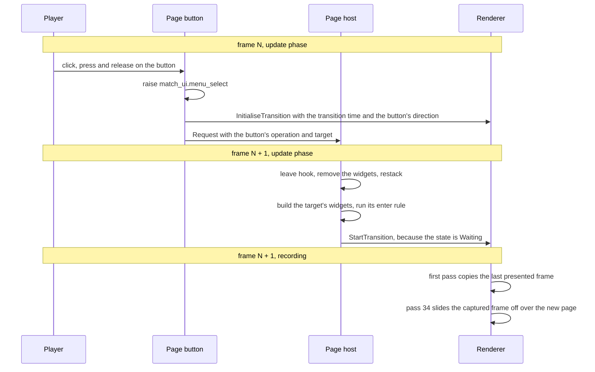
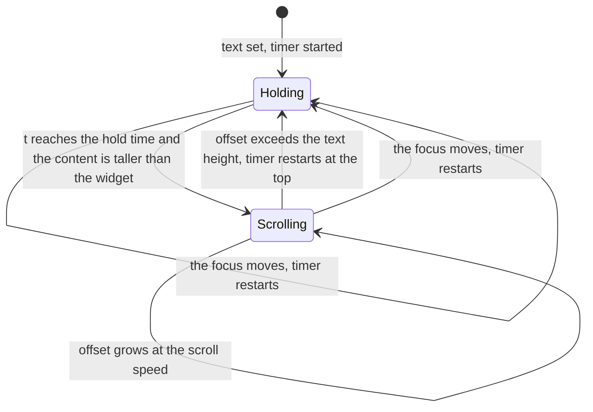

# Pages and screen recipes

> Status: Engine baseline · Prefix: UI · ADRs: [ADR-0030](../../../adr/0030-ui-framework-build-or-buy.md), [ADR-0031](../../../adr/0031-batched-ui-rendering.md), [ADR-0032](../../../adr/0032-ui-focus-graph-page-stack-and-input.md), [ADR-0033](../../../adr/0033-ui-layout-scaling-and-dpi.md), [ADR-0034](../../../adr/0034-text-rendering-and-glyph-cache.md), [ADR-0029](../../../adr/0029-input-event-model-and-binding-contract.md), [ADR-0036](../../../adr/0036-effect-events-and-presentation-clock.md), [ADR-0061](../../../adr/0061-data-schemas-and-versioning.md), [ADR-0062](../../../adr/0062-authoring-syntax-and-schema-language.md), [ADR-0063](../../../adr/0063-localisation.md), [ADR-0064](../../../adr/0064-accessibility-baseline-xag.md) · Folder: [UI framework](README.md) · Related: [Core and widgets](core_and_widgets.md) · [Layout, rendering, input and localisation](layout_rendering_input_and_localisation.md) · [Front end and match flow](../../../reference/09_front_end_and_match_flow/README.md)

This document specifies the page framework of the front-end screen and how every Species screen is built on the UI framework: the page ids and the page catalogue, the page host and its page stack, the page state machine with its per-frame order, page set-up and leaving, widget registration on pages, navigation on front-end pages, the page rendering conventions, the custom front-end widgets (scrolling text, image widgets, the colour and side picker, list rows, slot rows, the chat log and status widgets), the four screen recipes (a tool window, a full-screen options screen, a new front-end page and an in-match HUD panel), the page-level budget, and the framework defects as acceptance tests.

What each page shows and where it leads is specified functionally in [reference/09_front_end_and_match_flow/](../../../reference/09_front_end_and_match_flow/README.md); this document specifies the mechanism and cites those rules. The UI core, the standard window and the front-end widget family (page buttons, Back and close buttons, page titles, the highlight beam, fill boxes, page drop-downs, page text fields and page check boxes) are [core_and_widgets.md](core_and_widgets.md); the layout grid, the palette, the text styles and font roles, the navigation input and localisation are [layout_rendering_input_and_localisation.md](layout_rendering_input_and_localisation.md).

**Notation.** W and H are the client-area width and height in pixels. lX, lY, lW, lH are the left box, rX, rY, rW, rH the right box, bx, bw and bh the standard button, as [front_end_presentation.md](../../../reference/09_front_end_and_match_flow/front_end_presentation.md) R-META-200 and R-META-201 define them with the `ref.meta.layout.*` keys. Every time in this document is real time on the presentation clock (ADR-0036), in seconds; no rule of this document uses a simulation duration. A widget's rectangle is (x, y, w, h) in pixels, and "font" is its font size in pixels.

## 1 Responsibilities and boundaries

**UI-300** (MUST) This document owns: the page ids of the front-end screen and the page catalogue that maps them to the pages of reference/09 (§3.1); the page host, its page stack and the lifetime of the front-end screen (§3.2); the page state machine and the per-frame order of the front-end screen (§4.1); applying a navigation request, with page set-up and leaving (§4.2); widget registration on pages (§4.3); navigation on front-end pages (§4.4); the page rendering conventions (§4.5); the custom front-end widgets (§3.3, §4.6 to §4.9); the screen recipes (§4.10 to §4.13); the page-level budget (§5); and the defect regression suite of the whole UI framework (§7.2). It does not own what a page holds, the page flow or the match-setup rules ([reference/09](../../../reference/09_front_end_and_match_flow/README.md)), the widget base types and the front-end widget family ([core_and_widgets.md](core_and_widgets.md)), or the layout grid, palette, text styles, font roles and input actions ([layout_rendering_input_and_localisation.md](layout_rendering_input_and_localisation.md)).

**UI-301** (MUST NOT) No page, page hook or widget of this document writes simulation state. A page changes the match setup only by issuing player commands ([reference/12](../../../reference/12_simulation_model/06_teams_and_player_commands.md) R-SIM-450 to R-SIM-452), and it reads match state only from the read-only presentation view that the simulation publishes (DEC-007, DEC-008, DEC-222; [README](README.md) UI-002).

**UI-302** (MUST) A widget bound to a shared match-setup value sends a **request** and shows the **confirmed** value ([core_and_widgets.md](core_and_widgets.md) §4.23). Hiding or disabling a control on a page is never the only permission check: the match setup's authority validates every request, its sender's role and the value's range (DEC-243). A page shows the host's controls only to the host (R-META-076) as presentation, not as enforcement.

**UI-303** (MUST) The framework keeps these page patterns:

1. the screen-fraction layout grid of R-META-200, as data (ADR-0033);
2. a page is a full-screen panel built from a declarative widget list (§4.3; ADR-0030);
3. one navigation cursor shared by pointer hover and gamepad navigation, with hover moving the cursor only in pointer mode (§4.4; ADR-0032);
4. the split between the requested and the confirmed value of a shared match-setup option (UI-302);
5. captions that change with the input mode ([layout_rendering_input_and_localisation.md](layout_rendering_input_and_localisation.md));
6. the button entrance cascade ([core_and_widgets.md](core_and_widgets.md)), the map-row slide-in (R-META-039) and the page transition (§4.5), as presentation polish.

**UI-304** (MUST) The page framework is built on these Species mechanisms, each specified in the place named:

| Mechanism | Rule | Where |
|---|---|---|
| typed page ids and widget handles; names only for debugging and as string-id stems | pages are found by `PageId`, widgets by handle; a duplicate widget id is a content-build error | UI-320, UI-372; [README](README.md) UI-012 |
| an explicit page stack with a deferred switch | push, pop, replace, unwind and rebuild; a request takes effect at the start of the next frame; Back is a page-level handler whose default pops | UI-331, UI-350, UI-360 (ADR-0032) |
| a view-model per page and one for the screen | widgets bind to view-model fields; a relayout keeps every value; a page change builds the new page from its layout | UI-333, UI-334 (ADR-0030, ADR-0033) |
| a focus scope per page | the page's navigation order and its up, down, left and right neighbours are layout data; lists scroll the focused row into view | UI-380 to UI-384 (ADR-0032) |
| Back handled in the update phase | the menu-close action reaches the top layer's back handler whether or not its Back button is drawn | UI-383 (DEC-102) |
| modal layers | an open list, a message dialog, a confirmation and the gamepad-disconnected dialog own focus and Back while open | UI-336 (ADR-0032) |
| typed settings with change notification | options screens edit page copies of typed settings and apply them through the settings store, whose schema declares each setting's apply scope | UI-441, UI-442 |

The pointer capture, the repeat timers, the batched draw, the text service, the glyph cache and the string fallback that the same table of mechanisms needs are specified in [core_and_widgets.md](core_and_widgets.md) and [layout_rendering_input_and_localisation.md](layout_rendering_input_and_localisation.md).

**UI-305** (MUST) The front end is one full-screen front-end screen (`FrontEndScreen`) whose content is one page at a time: a single-window page flow with one match setup page shared by single-player set-up, the host's lobby and a joining player's lobby, and a ready-up step (DEC-026; R-META-003). The windows of R-META-004 open over it as separate layers (UI-336).

**UI-306** (MUST) Every Species screen is built by one of the four recipes of §4.10 to §4.13: development and editor tools as tool windows (recipe A); help, settings and in-match menu screens as full-screen options screens (recipe B); front-end pages as pages of the front-end screen (recipe C); in-match overlays as HUD panels (recipe D). The debug-panel library that ADR-0030 allows for development tools is never used for a player-facing screen.

## 2 Interfaces

C++23 interface sketch (declarations only). Every type is in namespace `species::ui`; `UiCore`, `UiWindow`, `UiButtonBase`, `WidgetId`, `RectF`, `StringId` and `DrawContext` are those of [core_and_widgets.md](core_and_widgets.md) §2.

```cpp
namespace species::ui {

// Page ids of the front-end screen (UI-320). The order of the enumerators carries no meaning.
enum class PageId : std::uint8_t {
    Title, Tutorials, HostOrJoin, ModeSelect, MapSelect, MatchSetup,
    AdvancedOptions, PlayerOptions, SessionBrowser, BrowserFilters,
    Password, Connecting, WaitForStart, Error, Credits,
    QuickMatch, Achievements, LeaderboardSelect, Leaderboard,      // hook pages, never reachable (UI-321)
};

enum class NavOp : std::uint8_t { Push, Pop, Replace, UnwindTo, Rebuild };           // UI-331
enum class TransitionDirection : std::int8_t { Backward = -1, None = 0, Forward = 1 };

struct NavRequest {                       // UI-350
    NavOp op = NavOp::Push;
    PageId target = PageId::Title;        // ignored by Pop and Rebuild
};

enum class EnterOutcome : std::uint8_t { Built, Waiting, Redirect };                 // UI-362
struct EnterResult { EnterOutcome outcome = EnterOutcome::Built; PageId redirectTo = PageId::Title; };

enum class FillBoxes : std::uint8_t { LeftOnly, LeftAndRight, TitleWidth };          // UI-323

class PageContext;                        // UI-311
class FrontEndViewModel;                  // UI-334
class WidgetBuilder;                      // builds widgets from a layout record (UI-370)
class HudContext;                         // a HUD panel's view of the presentation state (UI-460)

class FrontEndPage {                      // one per page id; built from its layout record (UI-323)
public:
    virtual ~FrontEndPage() = default;
    [[nodiscard]] virtual PageId Id() const noexcept = 0;
    [[nodiscard]] virtual EnterResult OnEnter(PageContext& ctx, PageId from) = 0;     // UI-361
    virtual void OnUpdate(PageContext& ctx) {}                                       // UI-352
    virtual void OnLeave(PageContext& ctx, PageId to) {}                             // UI-361
    [[nodiscard]] virtual std::optional<NavRequest> OnBack(PageContext& ctx);        // default: Pop (UI-383)
    virtual void DrawOverlay(const PageContext& ctx, DrawContext& out) const {}      // UI-392
};

class PageHost {                          // owned by the front-end screen (UI-330)
public:
    void Request(NavRequest request);                     // the last request of a frame wins (UI-351)
    void ApplyPending(PageContext& ctx);                  // step 1 of the per-frame order (UI-352)
    [[nodiscard]] PageId Current() const noexcept;
    [[nodiscard]] std::span<const PageId> Stack() const noexcept;   // bottom first
    [[nodiscard]] bool CurrentIsWaiting() const noexcept;
    void LockNavigation() noexcept;                        // UI-388
    [[nodiscard]] bool NavigationLocked() const noexcept;
};

class FrontEndScreen final : public UiWindow {            // the one full-screen window of the front end
public:
    [[nodiscard]] PageHost& Pages() noexcept;
    [[nodiscard]] FrontEndViewModel& Model() noexcept;    // UI-334
    void Update() override;                               // the per-frame order of UI-352
    void Draw(DrawContext&, bool hasFocus) const override;   // UI-337
};

// Recipe A (UI-430).
class ToolWindow : public UiWindow {
public:
    virtual void Build(WidgetBuilder& builder) = 0;       // runs when opened and when the widget set changes
    virtual void OnClose() {}                             // teardown side effects
};
struct ToolPlacement { float width = 0; float height = 0; PointF position{}; PanelId parent{}; };
template <class Tool, class... Args>
PanelId OpenToolOnce(UiCore& ui, const ToolPlacement& placement, Args&&... args);   // no second instance
template <class Tool> bool CloseTool(UiCore& ui);
[[nodiscard]] StringId ToolString(std::string_view item);  // the tool's string id ui.debug.<tool>.<item>

// Recipe D (UI-460).
class HudPanel {
public:
    virtual ~HudPanel() = default;
    virtual void Advance(HudContext& ctx) = 0;            // update phase: view-model and screen zones (UI-461)
    virtual void Draw(DrawContext& out) const = 0;        // reads only what Advance left
};

}  // namespace species::ui
```

**UI-310** (MUST) The page host is the only way to change the page of the front-end screen. Widgets, page hooks, the front-end controller and session events all call `PageHost::Request`; nothing writes the current page directly.

**UI-311** (MUST) A page reaches its environment only through its `PageContext`, which gives: the screen view-model (UI-334) and the page's own view-model; the match-setup view, which reads the confirmed match-setup state and turns requests into player commands (UI-301, UI-302); the settings store (`SettingsStore`, [platform_layer.md](../platform_layer.md)); the string table (`StringTable`, ADR-0063); the asset service for pictures and thumbnails ([asset_pipeline_and_resources.md](../asset_pipeline_and_resources.md)); the renderer's screen-transition control (UI-391); the cue sink of UI-315; the session services that a page starts and stops (UI-363); and the page host itself.

**UI-312** (MUST) **Events.** The page host raises `PageEntered{page, from}` after an enter rule returns `Built`, `PageLeft{page, to}` after a leave hook runs and `NavigationRejected{request, reason}` when a request is refused (UI-364). These events feed the UI diagnostics and the log (§6); no gameplay system subscribes to them.

**UI-313** (MUST) **Data contract.** Each page and each options screen has a layout record in the schema of [data_schemas.md](../data_schemas.md) (ADR-0061, authored as JSON validated by its schema, ADR-0062). A page record holds: the page id; a debug name; the fill boxes (UI-323); the initial focus; the widget entries of UI-370 in registration order; the navigation order; and the overlay and back behaviour the page's code declares. The content build validates every record (UI-372) and rejects the build on any failure.

**UI-314** (MUST) **Threading contract.** Every interface of this document runs on the main thread, in the UI's update phase or in its draw ([README](README.md) UI-006, ADR-0032). A page hook never blocks: a picture, a thumbnail or a session list that is not yet available arrives through a queue that the page's view-model drains in its update (DEC-226), and a page that needs data before it can be built returns `Waiting` (UI-362).

**UI-315** (MUST) Pages and widgets never play a sound directly. They raise the interface events of the match UI sound source, which the audio engine plays ([reference/10](../../../reference/10_audio_design/front_end_hud_voice_and_ambience.md) R-AUD-300; [audio_engine.md](../audio_engine.md)). The events that the screens of this document raise are:

| Event | Raised by | Rule | Asset |
|---|---|---|---|
| `match_ui.lobby_bed` | the front-end screen, once per screen, when the sound set has loaded | UI-352, R-META-019, R-AUD-321 | `amb.lobby_bed` |
| `match_ui.menu_select` | a page button's base press; a map-row press | R-META-016, R-META-018 | `sfx.ui.match_ui.menu_select` |
| `match_ui.menu_back` | a backwards base press; every Back button after its select cue | R-META-017, R-META-018 | `sfx.ui.match_ui.menu_back` |
| `match_ui.menu_hover` | focus moving onto a new focusable widget, text fields included | UI-389, R-AUD-300 | `sfx.ui.power_slots.icon_hover` |
| `match_ui.chat_message` | a chat line arriving on the match setup page | R-META-096 | `sfx.ui.match_ui.chat_message` |
| `match_ui.countdown_tick` | the grace countdown and the match clock of the match HUD | R-AUD-303, R-AUD-305 | `sfx.ui.match_ui.countdown_tick` |
| `match_ui.unit_select`, `match_ui.toggle_state` | a unit selected or toggled by a click in a match | R-CTRL-154, R-AUD-300 | `sfx.ui.match_ui.unit_select` |
| `match_ui.selection_circle` | a selection circle starting to grow | R-CTRL-155, R-AUD-300 | `sfx.ui.match_ui.selection_circle` |
| `match_ui.unit_highlight` | the cursor highlight moving to another object | R-AUD-300 | `sfx.ui.match_ui.unit_highlight` |
| `match_ui.error` | an invalid click in a match | R-AUD-300 | `sfx.ui.match_ui.error` |

The last five are raised by the match's input rules ([reference/06](../../../reference/06_controls_camera_and_commands/actions_and_bindings.md)) and the match HUD, which recipe D builds; this table names them so that a HUD panel built by the recipe uses the same events.

**UI-316** (MUST) The page host controls the screen transition only through the renderer's `InitialiseTransition(duration, direction)` and `StartTransition()` and its transition state ([frame_graph_and_passes.md](../renderer/frame_graph_and_passes.md) RND-095 to RND-098). The UI never reads or copies the presented image itself (ADR-0031).

## 3 Data model

### 3.1 Page ids and the page catalogue

**UI-320** (MUST) The front-end screen has exactly the page ids of table 3.1-A. Each id maps to one page of [screen_flow_and_match_setup.md](../../../reference/09_front_end_and_match_flow/screen_flow_and_match_setup.md) R-META-003, which specifies what the page holds and where it leads, or to a hook page of [options_localisation_and_hooks.md](../../../reference/09_front_end_and_match_flow/options_localisation_and_hooks.md). The enumeration is Species' own; its order carries no meaning. A page id's debug name appears in logs and diagnostics only.

Table 3.1-A — the page catalogue. "Entered by" and "Back" are the page-stack operations of UI-331; "Fill boxes" are those of R-META-208; the update and leave hooks are run by UI-352 and UI-361.

| Page id | Page and rules | Entered by | Back | Fill boxes | Per-frame update | Leave hook |
|---|---|---|---|---|---|---|
| `Title` | title page, R-META-022 to R-META-024 | the bottom of every stack | none: the page has no Back button | left only | the title-page update (R-META-023) and, during a tutorial launch, its steps (R-META-026) | — |
| `Tutorials` | tutorials page, R-META-025, R-META-026 | Push from `Title`; at the top of a fresh stack after a tutorial (UI-332) | Pop | left only | as `Title` | — |
| `HostOrJoin` | host-or-join page, R-META-027, R-META-028 | Push from `Title` | Pop | left only | — | — |
| `ModeSelect` | mode-select page, R-META-029 to R-META-033 | Push from `Title` (single player) or `HostOrJoin` (host) | UnwindTo `Title` in single player, else UnwindTo `HostOrJoin`; the local session ends (R-META-032, R-META-093) | left and right | the match-setup sync (UI-353) | — |
| `MapSelect` | map-select page, R-META-034 to R-META-042 | Push from `ModeSelect` | UnwindTo `ModeSelect` | left and right | the match-setup sync with the mode check (UI-353, UI-354) | — |
| `MatchSetup` | match setup page, R-META-043 to R-META-045, §2.20 to §2.24 | Push from `MapSelect`; Replace of `Connecting` | single player: UnwindTo `MapSelect`; host: UnwindTo `ModeSelect`; joining player: UnwindTo `HostOrJoin`, or UnwindTo `Title` after leaving while ready (R-META-092 to R-META-094) | left and right | the match setup update (readiness, R-META-087; leaving while ready, R-META-092; chat, R-META-095 to R-META-097), then the match-setup sync with the mode check (UI-353, UI-354) | — |
| `AdvancedOptions` | advanced options page, R-META-046 to R-META-050 | Push from `MatchSetup` (host) | Pop | left and right | the sudden-death control state (R-META-049) | — |
| `PlayerOptions` | player options page, R-META-051, R-META-052 | Push from `MatchSetup` (own slot row) | Pop, after the name rule (R-META-052) | left only | the match-setup sync (UI-353) | — |
| `SessionBrowser` | session browser page, R-META-053 (DEC-245) | Push from `HostOrJoin` | Pop | one box of the title bar's width | the session list rebuild (DEC-245 items 4 to 9; UI-421) | stops session discovery unless the next page is `Connecting`; discards the rows |
| `BrowserFilters` | browser filter page, R-META-053 | Push from `SessionBrowser` | Pop, after storing the filters (R-META-406 item 5) | left only | — | — |
| `Password` | password page, R-META-053 (DEC-244) | Push from `SessionBrowser` | Pop | left only | — | — |
| `Connecting` | connecting page, R-META-054 to R-META-056 | Push from `SessionBrowser` or `Password` | UnwindTo `SessionBrowser` when entered from it, else UnwindTo `HostOrJoin` (R-META-054) | left only | the connection status and the move to `MatchSetup` (R-META-055, R-META-056) | stops session discovery |
| `WaitForStart` | wait-for-start page, R-META-057 | Push from `MatchSetup` (host, after `StartMatch`) | none: the page has no Back button | left only | — | — |
| `Error` | error page, R-META-058, R-META-059 | Push by the error rule (R-META-058) | UnwindTo the stored back page, by default `Title` | left only | — | — |
| `Credits` | credits page, R-META-060 | Push from `Title` | Pop | left only | — | — |
| `QuickMatch` | hook: no page leads to it (R-META-028; DEC-249, DEC-050) | never | — | — | — | — |
| `Achievements` | hook: R-META-491, R-META-492 (DEC-047) | never | UnwindTo `Title` | left only | the row loader, which never completes (R-META-491) | discards the rows |
| `LeaderboardSelect` | hook: R-META-499 (DEC-047) | never | Pop | — | — | — |
| `Leaderboard` | hook: R-META-498, R-META-500, R-META-501 (DEC-047) | never | Pop | — | — | — |

**UI-321** (MUST) The hook pages `QuickMatch`, `Achievements`, `LeaderboardSelect` and `Leaderboard` are in the catalogue so that the design phase can design them on their entry points (DEC-047, DEC-050, DEC-249), but no widget, page hook or controller requests them: the page host refuses a request for a hook page (UI-364). The 15 reachable ids are the 15 specified pages of R-META-003 (`ref.meta.front_end.specified_pages`).

**UI-322** (MUST) The catalogue has no page for: the campaign and its prologue; a trial-edition single-player page, a trial upsell page or a credential page (DEC-333, DEC-248); an update notice (DEC-249); a page-based help menu or help page, because help is the help-and-options windows (R-META-061, [reference/11](../../../reference/11_tutorial_and_help.md)); a research page; a debug single-player page; and pages of removed online platforms. Of the reference's `ref.meta.front_end.live_pages` (18) live pages, the three outside the library are the credential page, the trial upsell page and the update notice (R-META-003).

**UI-323** (MUST) A page record (UI-313) gives, besides its widgets: the fill boxes that the screen draws behind the page (`FillBoxes`: the left box only, the left and the right box, or one box of the title bar's width, R-META-208), whose default is the left box only; the initial focus (UI-385); and whether the page has a back handler (table 3.1-A).

**UI-324** (MUST) Every page id of table 3.1-A has exactly one layout record and one `FrontEndPage` implementation, and the content build fails when one is missing or when a record names an unknown page id (UI-372).

### 3.2 The page host, the page stack and the lifetime of the front-end screen

**UI-330** (MUST) The front-end screen is a standard window ([core_and_widgets.md](core_and_widgets.md) `UiWindow`) that covers the client area from (0, 0) to (W, H), is not movable, not resizable and not closeable, and has no close box (R-META-008). Its geometry is the client area itself and never passes through large-menu scaling, so it is never larger than the screen (DT-15). It owns one page host, one screen view-model and the widgets of its current page.

**UI-331** (MUST) The page host keeps a **page stack** of page ids, bottom first; the top is the current page. The operations are:

| Operation | Effect on the stack |
|---|---|
| Push(p) | p is placed on top |
| Pop | the top is removed; the page beneath becomes current |
| Replace(p) | the top is replaced by p |
| UnwindTo(p) | entries above the nearest p are removed, so p becomes current; when p is not on the stack, the stack becomes (`Title`, p), or (`Title`) when p is `Title` |
| Rebuild | the stack is unchanged; the current page is left and entered again (UI-354) |

A page id appears on the stack at most once: a Push or a Replace whose target is already on the stack acts as UnwindTo of that target. The stack is never empty: a Pop on a stack of one entry is refused (UI-364).

**UI-332** (MUST) The front-end controller (`FrontEndController`) creates the front-end screen by the steps of R-META-007 and destroys it by R-META-010. A new screen's stack is (`Title`), or (`Title`, `Tutorials`) when the player returns from a tutorial (R-META-007 step 7); its first update enters the top page (UI-352). Destroying the screen removes the window and fades the screen out (R-META-010), except when the map editor is being entered in an editor build ([reference/08](../../../reference/08_maps_and_level_design/map_editor_hooks.md) R-MAP-305), where no fade-out starts. When the player returns from a match, a fresh screen is built: no page, widget or view-model state survives a match; only the settings store and the application's own state persist (R-META-011).

**UI-333** (MUST) A page's view-model is created when the page is entered and discarded when it is left; entering a page builds its widgets from its layout record and initialises its view-model by its enter rule. A relayout of the same page (a resize, a DPI or scale change, a language change; ADR-0033) keeps the view-model, every bound value, the scroll positions and the focus. State that must outlive a page lives in the screen view-model (UI-334), in the match-setup state, reached only through player commands (UI-301), or in the settings store.

**UI-334** (MUST) The screen view-model holds, for the life of the screen, every value that reference/09 keeps across pages: the single-player flag (R-META-022); the quick-start flag, the tutorial flag and the tutorial type (R-META-025); the local map choice (R-META-041); the highlighted mode and the pressed mode (R-META-030, R-META-031); the mode the current page was built for (R-META-031, R-META-043); the highlighted map (R-META-040); the requested colour and the previous request (R-META-043 step 6); the waiting-for-team flag (R-META-043 step 2); whether the player name has been sent (R-META-082); the error message and its back page (R-META-058); the chat log (R-META-096); the session password (R-META-046); the leaving-while-ready flag (R-META-092); whether `Connecting` was entered from `SessionBrowser` (R-META-054); and the navigation lock (UI-388). The browser filter settings are read from the settings store when the screen is created (R-META-452).

**UI-335** (MUST) These assets are resident before the first frame of the front end, so that no page change waits for a load: the gamepad glyphs `glyph.pad.face_south`, `glyph.pad.face_east`, `glyph.pad.shoulder_left`, `glyph.pad.shoulder_right`, `glyph.pad.shoulder_left_shadow` and `glyph.pad.shoulder_right_shadow`; the fill-box texture `ui.fill_blur`; the backdrop figure `sprite.worker.front` and wheel `ui.backdrop_wheel`; the beam strip `fx.beam_short`; and the cloud layer `fx.sky_cloud`. The mode cards are loaded when the mode-select page is set up (R-META-033), and the map thumbnails in the background (R-META-034, DEC-226).

**UI-336** (MUST) Windows that open over the front end, the help and options windows, the settings screen and its option screens (R-META-061), an open drop-down list, a message dialog, the leave confirmation, the chat input and the gamepad-disconnected dialog (R-META-004, R-META-066), are layers of the UI core's window stack above the front-end screen ([core_and_widgets.md](core_and_widgets.md) §4.1, R-META-015). The top layer has the focus and receives navigation and Back (ADR-0032). A modal layer (an open list, a message dialog, a confirmation, the gamepad-disconnected dialog) passes no input to any layer beneath it until it closes. The page stack of UI-331 lives inside the front-end screen and is unchanged by the layers above it.

**UI-337** (MUST) The front-end screen draws only while it has the focus or while the chat input window is open ([core_and_widgets.md](core_and_widgets.md) UI-037). An options screen or the open-list window above it draws the backdrop figure layer itself (R-META-205), and while a page drop-down list is open only the widget that owns the list is drawn of the page's widgets (R-META-204). When it draws, the screen draws, in order: the backdrop figure layer (R-META-205, `RenderBackdrop`); the title bar (R-META-207, `ui.title_wordmark`, `ui.logo_emblem`); the page's fill boxes (UI-323); the page overlays (UI-392); the widgets.

### 3.3 The front-end widget catalogue

**UI-340** (MUST) The pages are built from the front-end widget family of [core_and_widgets.md](core_and_widgets.md) (page buttons, Back and close buttons, page titles, page drop-downs, page text fields with their increment glyphs, page check boxes) and from the front-end widget kinds of table 3.3-A. Each kind is a subtype of the standard button or of a page button, as the table says; a page button's action (its target page, its stack operation and any view-model change) is data of its layout entry, executed by the page's view-model, not a subtype per action.

Table 3.3-A — the front-end widget kinds. "Base" is the base type of [core_and_widgets.md](core_and_widgets.md); "Pages" names where the kind appears.

| Kind | Base | Pages | Purpose | Rules |
|---|---|---|---|---|
| `ScrollingText` | standard button | `Credits`, `ModeSelect`, `MapSelect`, `MatchSetup` (single player), `AdvancedOptions` | clipped, word-wrapped text that scrolls by itself | UI-400 to UI-406 |
| `ModeDescription`, `MapDescription`, `OptionDetails` | `ScrollingText` | `ModeSelect`; `MapSelect` and `MatchSetup`; `AdvancedOptions` | the text of the highlighted mode, map or focused option, set every update from the view-model | UI-402, R-META-032, R-META-042, R-META-050 |
| `StaticImage` | standard button | any page | a picture given by asset id | UI-410 |
| `ModePicture`, `MapThumbnail`, `HelpPicture` | standard button | `ModeSelect` and `MatchSetup`; `MapSelect` and `MatchSetup`; help windows | a picture chosen every update from the view-model | UI-411 |
| `ColourPickerRow` | page button | `PlayerOptions` | one colour or side choice with its swatch | UI-415 to UI-419 |
| `ModeRow` | page button | `ModeSelect` | one mode, with its complexity badge `ui.difficulty_badge` | R-META-030, R-META-031 |
| `MapRow` | standard button | `MapSelect` | one map of the current mode, in columns, with its slide-in | UI-422, R-META-036 to R-META-041 |
| `MapListHeader` | standard button | `MapSelect` | the column header strip | R-META-037 |
| `SessionRow` | page button | `SessionBrowser` | one session of the list | UI-420, UI-421 (DEC-245) |
| `SessionListHeader` | standard button | `SessionBrowser` | the column header of the session list | DEC-245 item 8 |
| `LobbySlotRow` | page button | `MatchSetup` | one player slot | UI-424, R-META-078, R-META-079 |
| `KickControl` | standard button | `MatchSetup` (host) | removes a remote human from the session | UI-425, R-META-089 |
| `SlotOpenControl` | standard button | `MatchSetup` (host) | opens or closes an empty slot | R-META-090 (DEC-079) |
| `PrimaryButton` | page button | `MatchSetup` | Play in single player, Ready in multiplayer | R-META-044, R-META-085, R-META-086 |
| `MapNameLabel` | page button | `MatchSetup` | the chosen map's name over the highlight beam; its press does nothing | R-META-044 |
| `ChatLog` | standard button | `MatchSetup` (multiplayer) | the match setup chat | UI-423, R-META-097 |
| `ConnectionStatus` | standard button | `Connecting` | the connection state with its animated dots | R-META-055 |
| `TextLabel` | standard button | any page | a plain, shadowed, centred or right-aligned label from a string id | UI-426 |

The match-setup Back buttons of single player, the host and a joining player, the name-applying Back of `PlayerOptions` and the filter-saving Back of `BrowserFilters` are Back buttons ([core_and_widgets.md](core_and_widgets.md)) whose back handler is the page's (table 3.1-A). The password page's connect button is a page button whose action is R-META-053's. The map metadata that map rows show is the map catalogue's ([reference/08](../../../reference/08_maps_and_level_design/rules_and_conventions.md) R-MAP-011).

**UI-341** (MUST) The library specifies no widget for: a credential field, credential status, a key-paste button or a trial key (DEC-248, DEC-333); a trial upsell or a store link (DEC-333); an update notice, an update runner or a website link (DEC-249); a message of the day (DEC-249, R-META-024); an "any map" or "any mode" row; a quick-match button (R-META-028); a spectator request (R-META-091); an add-bot button (R-META-045); a campaign or prologue launcher; a master-volume slider on a page (the sound options own it, R-META-433); or an achievement row beyond the hook of R-META-492. The map-editor entry of an editor build is a page button of the title page that opens the map editor hub page (`MapEditorHubPage`; [reference/08](../../../reference/08_maps_and_level_design/map_editor_hooks.md) R-MAP-301, R-MAP-305), and is absent from every player build.

**UI-342** (MUST) Every field of every widget kind has a defined default when the widget is built from a layout entry that does not set it; no widget field is ever left without a value (DT-27).

## 4 Behaviour and algorithms

### 4.1 The page state machine and the per-frame order

**UI-350** (MUST) A navigation request names a stack operation and, except for Pop and Rebuild, a target page (UI-331). The page host holds at most one pending request: a request made while another is pending replaces it, so when several are made in one frame the last one wins.

**UI-351** (MUST) A request takes effect at step 1 of the front-end screen's update in the next frame, `ui.pages.switch_delay_frames` (1) frame after the frame in which it was made, whatever made it: a pointer click, the activate action, the menu-close action, a page update hook or a session event (ADR-0032). A page is therefore never left while it is handling input, and a page change appears one frame after the request on every input device.

**UI-352** (MUST) While the front-end screen exists, its update runs once per frame in the UI's update phase ([README](README.md) UI-006), in this order:

1. **Page switch.** When a request is pending, the page host applies it (UI-360). Otherwise, when the current page is waiting (UI-362), the host enters it again.
2. **Lobby bed.** When the lobby bed has not been started for this screen and the audio engine reports that the sound set has loaded, the screen raises `match_ui.lobby_bed` once (R-META-009, R-META-019; [reference/10](../../../reference/10_audio_design/front_end_hud_voice_and_ambience.md) R-AUD-321).
3. **Navigation.** The navigation of §4.4 runs when all of these hold: the screen has the focus; the navigation is not locked (UI-388); the current page's navigation order is not empty; the chat input is not visible and was not toggled in this update (R-META-095); and no text field of the page confirmed its entry in this update (UI-387).
4. **Page update.** The current page's update hook runs (table 3.1-A), unless the page is waiting.

Layout and drawing follow the update and only read the state it left ([core_and_widgets.md](core_and_widgets.md) UI-021).

**UI-353** (MUST) The **match-setup sync** is the update step that keeps the participant's name and colour requests current on `ModeSelect`, `MapSelect`, `MatchSetup` and `PlayerOptions`, by R-META-082: it substitutes the preferred or the next available colour for a request that another slot holds, outside co-op and Siege, and it issues `SetColour` and `SetTeamName` only on `MatchSetup` and `PlayerOptions` and while a tutorial is starting. The title-page update performs the same requests during a tutorial launch (R-META-026).

**UI-354** (MUST) On `MapSelect` and `MatchSetup`, after the match-setup sync, the page compares the mode it was built for with the match setup's confirmed mode. When both are set and they differ, it requests Rebuild: at the next frame the page's leave hook runs and its enter rule runs again with the page itself as `from`. A rebuild is not a page change: the stack is unchanged and the page's own enter rules decide what is kept (R-META-043).

**UI-355** (MUST) A Push, Replace or UnwindTo request whose target is already the current page does nothing: no hook runs and nothing is rebuilt. A transition initialised by the press that made such a request stays waiting (RND-098) and starts at the next page change.



Caption: Diagram 4-A — the page state machine of the front-end screen (UI-350 to UI-362). A rebuild (UI-354) passes through Leaving and Entering with the same page.

### 4.2 Applying a navigation request: leaving and entering pages

**UI-360** (MUST) Applying a pending request runs these steps in order:

1. **Validate.** A request is refused when its target is not a page id of the catalogue, when its target is a hook page (UI-321), or when it is a Pop on a stack of one entry (UI-364). A refused request changes nothing.
2. **Resolve.** The new stack is computed by UI-331, and the page to enter, `to`, is its top.
3. **Leave.** The current page's leave hook runs with `to` (UI-363), and `PageLeft` is raised.
4. **Remove.** Text editing on the screen ends; every widget of the page, its navigation order and its scroll bar are removed; the page's view-model is discarded.
5. **Restack.** The new stack takes effect.
6. **Enter.** The widgets of `to` are built from its layout record (§4.3) and its enter rule runs with `from`, the page that was current before step 5. During its enter rule a page can therefore return to its caller and set itself up by where it came from (R-META-043 steps 3, 6 and 7; R-META-054).
7. **Transition.** When the menu has been created (R-META-007 step 9) and the renderer's transition state is `Waiting`, the host calls `StartTransition()` (UI-391).
8. **Geometry.** The screen's rectangle is set to (0, 0, W, H) again (UI-330).
9. **Focus.** The navigation cursor moves to the page's initial focus (UI-385).
10. **Report.** When the enter rule returned `Built`, `PageEntered` is raised.

**UI-361** (MUST) A page's enter rule builds its view-model and may change its widgets after they are built: it fills dynamic lists, sets captions that depend on the session's role, marks widgets inactive and starts text editing (UI-386). Its leave hook stops what it started. Neither hook issues a navigation request that takes effect at once: a request made by a hook is pending until the next frame (UI-351).

**UI-362** (MUST) An enter rule returns one of three outcomes:

1. **Built**: the page is live, and its update hook runs from step 4 of the same frame.
2. **Waiting**: the data the page needs has not arrived, such as a confirmed mode or a team slot. The page shows only what its enter rule built. At step 1 of every later frame in which no request is pending, the host removes the page's widgets and runs the enter rule again with the same `from`, until it returns Built; the page's update hook does not run while it waits. `MapSelect` waits while a mode press is pending and the modes differ (R-META-035), and `MatchSetup` waits for a map and a team slot or the spectator flag (R-META-043 step 2).
3. **Redirect** to a page p: the entering page's widgets are removed, the entering page is taken off the stack, and p is entered at once by UnwindTo(p) with the same `from`. `MatchSetup` redirects to `MapSelect` when it is entered from `MapSelect` with a stale mode (R-META-043 step 3).

**UI-363** (MUST) These pages have leave hooks:

| Page | Leave hook |
|---|---|
| `SessionBrowser` | stops the session-discovery listener unless `to` is `Connecting`, and discards the session rows (DEC-245) |
| `Connecting` | stops the session-discovery listener |
| `Achievements` | discards the achievement rows (R-META-492) |

No other page has one. A page that starts a service, a timer or a listener stops it in its leave hook (UI-450 step 3).

**UI-364** (MUST) A refused request is written to the UI log with its operation, its target and the reason, `NavigationRejected` is raised, and the current page stays as it was. No step of the page host reads a table by a page id before the id is validated (DT-30).



Caption: Diagram 4-B — the page graph of the front-end screen with the stack operation of every edge; solid edges enter a page, dotted edges are back handlers (table 3.1-A). The screen flow itself, with every condition, is [screen_flow_and_match_setup.md](../../../reference/09_front_end_and_match_flow/screen_flow_and_match_setup.md) diagram 3-A.



Caption: Diagram 4-C — one page change with its transition (UI-351, UI-360, UI-391; RND-095, RND-096).

### 4.3 Widget registration on pages

**UI-370** (MUST) Every widget of a page is one entry of the page's layout record, and the page's enter rule builds the entries in record order, which is the registration order of [core_and_widgets.md](core_and_widgets.md) UI-025. Each entry gives, in five groups:

1. **Kind and construction data**: the widget kind ([core_and_widgets.md](core_and_widgets.md), table 3.3-A) and what the kind needs: a caption string id for a page button, a fixed target page for a Back button that has one, an asset id for a static image, a string id for a text label, a colour id or "none" for a colour picker row, a row index for a list row.
2. **Identity and place**: the widget id, unique within the page; the rectangle, in the units of the layout grid (R-META-200, ADR-0033); the caption string id; an optional tooltip string id, which nothing shows ([core_and_widgets.md](core_and_widgets.md) UI-045).
3. **Appearance and behaviour fields**: the font size; inactive (drawn greyed, skipped by navigation, never acting); centred; and the flags of its kind: no background and cycle mode for page drop-downs, shadow and centred for text labels, border for pictures, the alternate box style for page text fields, and the backwards transition direction for cancel-like buttons.
4. **Binding** ([core_and_widgets.md](core_and_widgets.md) §4.23): a shared match-setup option, for page drop-downs and check boxes that edit the match setup; a local integer or boolean of the view-model, for local controls; or a typed text value with its maximum length, for page text fields: the session password at most `ref.match.option.password_max_length` (16) characters, the player name at most `ref.meta.player.name_max_length` (16) and a chat line at most `ref.meta.chat.max_length` (255).
5. **Navigation**: whether the widget is in the page's navigation order, and its place there. Titles, pictures, information panels, status widgets and the chat log are never in it; every other widget that acts is.

**UI-371** (MUST) A widget id serves debugging, the derivation of the help-text string id of an option control (R-META-050, keyed by the option) and accessible names (ADR-0064). Widgets are reached at run time only by their handles ([README](README.md) UI-012).

**UI-372** (MUST) The content build validates every page and options-screen layout record, and fails on: a widget id that occurs twice in one page (DEC-801); a caption, tooltip or accessible-name string id that the base language lacks (DEC-099); an asset id that the asset manifest lacks; a navigation entry that is not focusable, or a focusable widget that is in no navigation order; an initial focus that is not in the navigation order; a focus neighbour that does not exist (ADR-0032); a binding to a field that the page's view-model does not declare; a page id of the catalogue without a record, or a record whose page id the catalogue lacks (UI-324).

**UI-373** (MUST) A standard page follows the skeleton of R-META-201: the page title at (lX + `ref.meta.layout.title_inset`, lY + `ref.meta.layout.title_inset`, lW − 2 × `ref.meta.layout.title_inset`, `ref.meta.layout.title_height` × bh) in the medium font; stacked buttons centred in the left box at bx, the first at `ref.meta.layout.first_button_offset` below lY and each further one a button step lower; Back at y = lY + lH − `ref.meta.layout.back_offset` × bh; and the right box's information panels outside the navigation order.

**UI-374** (MUST) A page that shows a list that changes while the page is open, such as the session list, binds a list widget to a collection of its view-model in which each entry has a stable identity. The page update creates a row for each new entry and removes the row of each entry that has gone, by identity; new rows enter the navigation order before the Back button, which always stays the last entry (DEC-102). The row count of the list's scroll bar is the collection's size (UI-421).

### 4.4 Navigation on front-end pages

The front-end screen's navigation is the standard window's ([core_and_widgets.md](core_and_widgets.md) UI-050 to UI-053) with the page rules below. The actions `action.menu.up`, `action.menu.down`, `action.menu.activate`, `action.menu.front_end_activate` and `action.menu.close` and their bindings are those of [layout_rendering_input_and_localisation.md](layout_rendering_input_and_localisation.md).

**UI-380** (MUST) Navigation acts only while the front-end screen has the focus and its navigation is not locked (UI-388), and only in step 3 of the screen's update (UI-352). While a layer is above the screen, navigation and Back belong to that layer (UI-336).

**UI-381** (MUST) `action.menu.down` and `action.menu.up` move the cursor to the next and the previous entry of the page's navigation order, wrapping around and skipping inactive entries; when every entry is inactive the cursor stays and the step ends ([core_and_widgets.md](core_and_widgets.md) UI-051). The page's authored up and down neighbours, when its layout gives any, take precedence over the order (ADR-0032). On a focused page drop-down in cycle mode, the left and right actions step its value instead of moving the cursor (R-META-044).

**UI-382** (MUST) `action.menu.activate`, and `action.menu.front_end_activate` while the participant is at the front end, act on the cursor's widget exactly as a click on it does, unless the widget is inactive or disabled.

**UI-383** (MUST) The front-end screen is not closeable (UI-330), so its Back is a page rule: when `action.menu.close` fires in step 3, the screen runs the current page's back handler (table 3.1-A), which acts as a click on the page's Back button: the Back button's cues and backwards transition (R-META-016, R-META-017), then the page's navigation request. The back handler runs in the update phase whether or not the page's Back button is drawn, so Back works while the button is hidden, covered or unfocused (DEC-102, DT-19). A page without a back handler (`Title`, `WaitForStart`) ignores the action. On an open drop-down list, `action.menu.close` closes the list and keeps the current value (UI-336).

**UI-384** (MUST) A focused row inside a scrolling list is kept in view. When `action.menu.down` fires with the cursor on the last visible row and more entries below, the list scrolls by one row and the cursor stays on the row position; when `action.menu.up` fires with the cursor on the first visible row and the list scrolled, the list scrolls back by one row. The cursor's own widget decides this through its scroll hook ([core_and_widgets.md](core_and_widgets.md) UI-052), and the scroll position is always set through the scroll bar's clamped setter ([core_and_widgets.md](core_and_widgets.md) UI-075), so it stays within 0 to max(0, rows − visible rows) (DT-05, DT-20).

**UI-385** (MUST) A page's initial focus is the first entry of its navigation order, unless its layout record names another: the match setup page's initial focus is its primary button (R-META-044).

**UI-386** (MUST) A page that declares an entry field starts editing it when the page is built: the password page starts editing its password field at once. The match setup chat field starts editing on `action.match.chat` (R-META-095). Leaving a page ends every edit on it (UI-360 step 4).

**UI-387** (MUST) When a page text field applies its entry on Enter, the rest of that update's navigation is skipped ([core_and_widgets.md](core_and_widgets.md) UI-050, "skip next update"), so the Enter that applied the entry does not also activate the cursor's widget.

**UI-388** (MUST) The navigation lock is set when a tutorial is launched from the tutorials page (R-META-025, R-META-026) and lasts until the front-end screen is destroyed. While it is set, the cursor does not move, no widget of the page acts and Back is ignored; the page hooks still run, so the tutorial launch completes (R-META-023).

**UI-389** (MUST) Pointer and gamepad share one cursor (ADR-0032). In pointer mode, hovering a focusable widget moves the cursor to it; in gamepad mode, only navigation moves the cursor, and no widget reacts to hover, the kick control and the map rows included. Any gamepad navigation switches the input mode to gamepad (ADR-0029). Each time the cursor moves onto a new focusable widget, in either mode, the screen raises `match_ui.menu_hover` (R-AUD-300), for page text fields as for every other widget (DT-16).

### 4.5 Page rendering conventions and animations

**UI-390** (MUST) Every text of a front-end page is drawn twice, first in the outline style and then in the fill style of [layout_rendering_input_and_localisation.md](layout_rendering_input_and_localisation.md). Page buttons and page titles use the title role; rows, the chat log and scrolling text use the body role; the session list header, the slot rows and the page overlays use the compact role (the font roles of [layout_rendering_input_and_localisation.md](layout_rendering_input_and_localisation.md)). Captions take the front-end caption colours of that document's palette by state: the caption colour when idle, the focused-caption colour when focused or selected, the inactive-caption colour when inactive, the alternate caption colour for body-role buttons; rows draw the focus band while focused and the row band otherwise; page titles draw their outline pass in the title-outline colour.

**UI-391** (MUST) **Page transition.** A page button's base press, and every Back button and back handler, initialise the renderer's screen transition with the duration `ref.meta.nav.transition_time` (1.0 s) and the button's direction: `Forward` by default, `Backward` for Back buttons, back handlers, colour picker rows and buttons whose layout entry sets the backwards direction (R-META-016, R-META-017, UI-419). The page host starts the transition after it applies the page change (UI-360 step 7); a window opened from a page button starts it when it is created (UI-443 step 6). The transition always shows the last presented frame (DEC-316; RND-095), and its curve and drawing are RND-096, with the curve value c = `rnd.transition.curve_gain` × f. As a derived reading of RND-096, the captured page is entirely off the screen once c reaches 1, a little over a quarter of the way through the transition; with `Forward` it shrinks and leaves to the left, with `Backward` it grows and leaves to the right.

**UI-392** (MUST) A page draws its overlays through its `DrawOverlay`, after its fill boxes and before its widgets (UI-337): the blinking captions of `SessionBrowser` while its list is empty (R-META-209) and the loading caption of the `Achievements` hook page (R-META-491), each with the blink of `ref.meta.blink.on_alpha`, `ref.meta.blink.on_time` and `ref.meta.blink.off_alpha`.

**UI-393** (MUST) Every animation of the pages runs on the presentation clock in real seconds (ADR-0036) and is independent of the frame rate. The page animations, each specified where the table says, are:

| Animation | Rule |
|---|---|
| the page-button entrance cascade and its flash | [core_and_widgets.md](core_and_widgets.md), the page button |
| the map-row slide-in and its flash | R-META-039 (`ref.meta.map_select.slide_delay`, `ref.meta.map_select.slide_distance`) |
| the slot-row flash when a slot's kind changes | R-META-079 (`ref.meta.slot.flash_time`) |
| the achievement-row slide-in (hook page) | R-META-492 (`ref.meta.achievement.row_slide_speed`) |
| the connecting dots | R-META-055 (`ref.meta.connect.dot_period`, `ref.meta.connect.max_dots`) |
| the blinking captions | R-META-209 |
| the caret blink of text fields and of the chat field | [core_and_widgets.md](core_and_widgets.md) §4.16; R-META-100 (`ref.meta.chat.caret_period`) |
| the page transition | UI-391; RND-096 |
| the backdrop figure's breathing, its echoes and the turning wheel, with the detail switch | R-META-205, R-META-206 |
| scrolling text | UI-404 |

### 4.6 Scrolling text

**UI-400** (MUST) A scrolling text widget (`ScrollingText`) draws a text in the body role at its font size, clipped to its rectangle through the clip stack ([layout_rendering_input_and_localisation.md](layout_rendering_input_and_localisation.md); ADR-0031). The pages use it for the credits (R-META-060), the mode description (R-META-032), the map description on `MapSelect` and on the single-player `MatchSetup` (R-META-042, R-META-044) and the option details (R-META-046).

**UI-401** (MUST) With the widget's rectangle (x, y, w, h) and its font size s, the layout is:

| Quantity | Formula |
|---|---|
| line gap g | ⌊`ui.scroll_text.line_gap` × s⌋ |
| top margin m | ⌊`ui.scroll_text.top_margin` × h⌋; when that is less than s, m = `ui.scroll_text.min_top_margin` × s |
| left margin | `ui.scroll_text.left_margin` × w |
| wrap width | `ui.scroll_text.wrap_width` × w |

The text is word-wrapped at the wrap width with the widths that the glyph cache measures (ADR-0034); the line breaks of the text are kept.

**UI-402** (MUST) The wrapped lines are cached and wrapped again only when the text, the wrap width, the font size or the language changes. The mode description, the map description and the option details set their text from the view-model in every update; an unchanged text keeps its wrapping.

**UI-403** (MUST) A line whose text starts with "-" is a heading: it is drawn without the dash at `ref.meta.credits.heading_scale` (1.25) × s.

**UI-404** (MUST) With n wrapped lines, the content height is ⌊`ui.scroll_text.top_margin` × h⌋ + n × g. When the content height is at most h, the text does not scroll. Otherwise, with t the time since the widget's scroll timer started, the scroll offset is 0 while t < `ui.scroll_text.hold_time` (1.5 s) and `ui.scroll_text.scroll_speed` (30 px/s) × (t − `ui.scroll_text.hold_time`) after it; once the offset exceeds n × g, so that the whole text has scrolled above its starting top, the timer restarts, the text is back at its top and holds again, in an endless loop (diagram 4-D).

**UI-405** (MUST) Unless the widget's layout entry marks it independent of focus, its scroll timer restarts whenever the cursor of its window moves to another widget, so a description starts again from its top when the focus moves.

**UI-406** (MUST) Line i, counted from 0, is drawn at the draw point (x + the left margin, y + m + i × g − the scroll offset), first in `ui.scroll_text.outline_colour` and then in `ui.scroll_text.fill_colour`. A line that lies entirely outside the rectangle emits nothing; a line that crosses an edge is clipped.



Caption: Diagram 4-D — the scrolling text cycle (UI-404, UI-405); content that fits the widget stays in Holding.

### 4.7 Image widgets

**UI-410** (MUST) A static image (`StaticImage`) draws the picture of its asset id as one quad over its whole rectangle, tinted white and alpha-blended, sampled with linear filtering from its top mip level, and then a white outline unless its border flag is off. When the picture does not exist at run time, which only a custom map's thumbnail can cause (R-MAP-022), only the outline is drawn. A widget refers to its picture by asset handle and owns no copy of a path or a name.

**UI-411** (MUST) The mode picture, the map thumbnail and the help picture choose their picture in every update from the screen view-model and draw as a static image with its outline:

1. **Mode picture** (`ModePicture`): the `help.mode_card` of the highlighted mode on `ModeSelect` and in single player, otherwise of the match setup's mode (R-META-032, R-META-044).
2. **Map thumbnail** (`MapThumbnail`): the thumbnail of the focused map row's map or, when no map row has the focus, of the chosen map (R-META-037, R-META-042, R-META-044; the thumbnails of [reference/08](../../../reference/08_maps_and_level_design/rules_and_conventions.md) R-MAP-022).
3. **Help picture** (`HelpPicture`): the picture of the help page shown ([reference/11](../../../reference/11_tutorial_and_help.md)).

No picture widget draws a trial-edition overlay (DEC-333).

### 4.8 The colour and side picker

**UI-415** (MUST) `PlayerOptions` holds one colour picker row (`ColourPickerRow`) per colour id 0 to 7, in id order, or in Siege one row per side: random (no colour), attackers (`ref.sim.team.siege_attacker_colour_id`) and defenders (`ref.sim.team.siege_defender_colour_id`) (R-META-051). A row is identified by its colour id or by "none".

**UI-416** (MUST) The page computes whether each row is **taken** once per update, in its update hook, by one rule that both drawing and pressing use (DEC-102, DT-18): the rule of R-META-080 as it applies when a row is drawn, in which only used slots count and the local slot never counts:

1. **Siege:** count the used slots other than the local slot that are on the row's side. On a 3-player map the defender side is taken at a count of at least `ref.match.colour.siege_3p_defender_limit` and the attacker side at a count of `ref.match.colour.siege_3p_attacker_limit`; on any other map a side is taken at a count of at least the player count ÷ `ref.match.colour.siege_side_divisor`.
2. **Co-op:** the colour is not a valid co-op colour ([reference/01](../../../reference/01_skirmish_rules_and_modes/README.md) R-MODE-015).
3. **Otherwise:** a used slot other than the local slot holds the colour.

The random row is never taken.

**UI-417** (MUST) A taken row is inactive from the same update: it is drawn as taken in that frame, the cursor skips it, and a press on it does nothing. A press therefore acts on the availability that the player saw.

**UI-418** (MUST) A row draws, with its rectangle (x, y, w, h): a background of white at alpha `ref.meta.colour_row.background_alpha`, or `ref.meta.colour_row.focus_background` while it is focused or pressed; its caption at x + `ref.meta.colour_row.caption_x` × w, in the caption colour, in the focused-caption colour while the row is pressed, and in the inactive-caption colour while it is taken; and its swatch at (x + `ref.meta.colour_row.swatch_x` × w, y + `ui.picker.swatch_top` × h), `ref.meta.colour_row.swatch_width` × w ÷ 4 wide and `ref.meta.colour_row.swatch_height` × h high, shaded horizontally from its colour at the left to black at the right. Its colour is the team colour of its id ([reference/12](../../../reference/12_simulation_model/06_teams_and_player_commands.md) R-SIM-415), grey `ref.meta.slot.no_colour_grey` for the random row and grey `ref.meta.colour_row.taken_grey` while taken (R-META-080, R-META-083). A row is **pressed** when the local slot already holds its colour.

**UI-419** (MUST) Pressing a row that is not inactive sets the requested colour to the row's colour id, or to none for the random row; outside Siege and co-op it also stores that colour in the preferred-colour setting and saves the settings file. It then initialises a `Backward` transition (UI-391) and requests Pop, back to `MatchSetup` (R-META-081). It raises no select cue. The colour request reaches the match setup through the match-setup sync (UI-353), never from the row itself.

### 4.9 Lists and the other front-end widgets

**UI-420** (MUST) Session row r shows the session at index r + the first visible row of the list's scroll bar. The session list shows `ui.pages.browser_visible_rows` (13) rows (DEC-245 item 8). Its row's scroll hook (UI-384) consumes `action.menu.down` on the last visible row when a session lies below it, and `action.menu.up` on the first visible row when the first visible row is above 0, and moves the first visible row by one through the scroll bar's clamped setter (DT-05, DT-20).

**UI-421** (MUST) The session rows follow UI-374: they are created and removed by session identity as the list changes, and they enter the navigation order before Back. The list's scroll bar has `ui.pages.browser_visible_rows` visible rows, the same number as the rows shown (DT-22), and its row count is the number of sessions in the list. The order, the filters and the content of the rows are DEC-245's (items 5 to 9).

**UI-422** (MUST) Map rows share one row base: its background ignores hover in gamepad mode (UI-389), and its columns are at x + `ref.meta.map_select.column_name` × w, x + `ref.meta.map_select.column_play_time` × w and x + `ref.meta.map_select.column_players` × w (R-META-038). A row that shows a co-op column places it at the players column + `ui.map_row.coop_column_offset` × w, and a difficulty column a further `ui.map_row.difficulty_column_offset` × w to the right; the map-select page of R-META-038 shows neither. The map name slides in by R-META-039.

**UI-423** (MUST) The chat log (`ChatLog`) is drawn in the body role at the font of R-META-044, with its lines `ui.chat_log.line_step` × the font apart and the box, wrap width, colours and top margin of R-META-097.

**UI-424** (MUST) A lobby slot row (`LobbySlotRow`) takes its caption from R-META-078 and its look from R-META-079. Bot rows and unused rows are inactive, set in the page update, so the cursor skips them. Pressing the local player's own row requests Push of `PlayerOptions`; pressing any other row does nothing (R-META-044).

**UI-425** (MUST) The kick control (`KickControl`) follows R-META-089 and shows `cursor.unavailable`; like every widget, it ignores hover in gamepad mode (UI-389).

**UI-426** (MUST) A text label (`TextLabel`) draws its string id plain, shadowed, centred or right-aligned, as its layout entry sets; each of these flags is off unless the entry sets it (UI-342).

**UI-427** (MUST) The connection status (`ConnectionStatus`) shows the lines of R-META-055 for the participant's connection state, with the connecting dots of `ref.meta.connect.dot_period` and `ref.meta.connect.max_dots`.

### 4.10 Recipe A: a tool window

A tool window is the pattern of the development windows ([diagnostics_test_and_performance.md](../diagnostics_test_and_performance.md)) and of the windows of a map editor, if the design phase builds one (DEC-045). The sketch below shows the shape of one; its names are examples.

```cpp
// Recipe A sketch: a development tool window. The names are examples.
struct ExampleToolModel {                         // the window's state; widgets only bind to it
    float strength = 1.0f;
    bool  preview  = true;
};

class ExampleToolWindow final : public ToolWindow {
public:
    explicit ExampleToolWindow(ExampleToolModel& model);
    void Build(WidgetBuilder& b) override {       // runs when opened and when the widget set changes
        b.Title(ToolString("title"));             // the tool's string ids: ui.debug.<tool>.<item>
        b.Button(ToolString("apply")).OnClick([this] { Apply(); });
        b.FloatControl(ToolString("strength"), model_.strength, {.step = 0.1, .low = 0.0, .high = 10.0})
         .OnChange([this] { RefreshPreview(); });  // the callback reacts to an edit
        b.CheckBox(ToolString("preview"), model_.preview);
    }
    void OnClose() override;                      // teardown side effects
private:
    ExampleToolModel& model_;
};

// The opener: opens the window only when it is not open yet, so it can be called any number of times.
void OpenExampleTool(UiCore& ui, ExampleToolModel& model, PanelId parent) {
    OpenToolOnce<ExampleToolWindow>(ui, ToolPlacement{.width = kExampleWidth, .parent = parent}, model);
}
```

**UI-430** (MUST) A tool window (`ToolWindow`) is a standard window that the opener creates and registers ([core_and_widgets.md](core_and_widgets.md) UI-022). It follows these rules:

1. **One instance.** Each tool window class is opened through `OpenToolOnce`, which finds an open instance of the class by its handle and opens a new one only when there is none, so every opener is idempotent. `CloseTool` removes it by handle. Its title is its own string id, which the window shows ([core_and_widgets.md](core_and_widgets.md) UI-049; DT-07).
2. **Size first.** The width, and optionally the height and the position, are set before the window is registered. Its height grows to fit its content ([core_and_widgets.md](core_and_widgets.md) UI-025), registration keeps it on the screen, and a parent window gives it a place near the parent (UI-022 steps 2 and 3).
3. **Build.** Every widget is built in `Build`, which runs when the window opens and whenever the set of widgets itself changes. A resize lays the window out again without building it again ([core_and_widgets.md](core_and_widgets.md) UI-024). Code keeps widget handles, never references to widgets, from one build to the next.
4. **Behaviour.** A widget's action is a callback on the window's view-model: a click, or a held action on its explicit repeat timer. The framework never runs the action of an inactive or disabled widget (DEC-102), so an action does not test for it.
5. **Binding.** Value controls for integers, floats and colours ([core_and_widgets.md](core_and_widgets.md) UI-062, UI-063), text fields, check boxes and drop-downs bind to view-model fields, with an optional change callback that reacts to an edit.
6. **Lists.** A list that changes rebuilds its rows from the view-model by identity (UI-374).
7. **Closing.** The close box or `CloseTool` closes the window; its teardown side effects run in `OnClose`.

**UI-431** (MUST) A tool window is never a page of the front-end screen and never opens in a player build unless its owner document says so: the development windows exist in development builds only ([diagnostics_test_and_performance.md](../diagnostics_test_and_performance.md)), and the map editor's windows only in an editor build ([reference/08](../../../reference/08_maps_and_level_design/map_editor_hooks.md) R-MAP-301).

### 4.11 Recipe B: a full-screen options screen

**UI-440** (MUST) The help-and-options window, the help selection, general help and mode help windows, the settings screen and its screen, graphics, sound and other options pages, the in-match menu and the leave confirmation are full-screen options screens (`OptionsScreen`, [core_and_widgets.md](core_and_widgets.md)): full-screen, fixed and not resizable, laid out in the left box, with their Back button as their back action, so `action.menu.close` invokes it ([core_and_widgets.md](core_and_widgets.md) UI-051; R-META-014, R-META-061, R-META-063, R-META-064, R-META-410, R-META-411).

**UI-441** (MUST) Every setting that an options screen edits is a typed entry of the preferences schema ([data_schemas.md](../data_schemas.md)), with its key, type, default from the one defaults table (DEC-100), range and **apply scope**: immediate, a renderer reconfiguration, or a restart. The settings store (`SettingsStore`, [platform_layer.md](../platform_layer.md)) notifies the readers of a setting when it changes, so an applied setting reaches every reader at once; a reader that keeps a copy of a setting refreshes it on the notification, and no reader polls the store per frame for a change.

**UI-442** (MUST) An options page follows R-META-412: it copies its settings into its view-model when it opens; its controls edit only the copies; its apply button is inactive, and drawn greyed, while every copy that the page compares equals the stored value, decided in the update, never while drawing; the apply action writes the copies, saves the settings file, applies each changed setting by its apply scope and re-reads the copies; Back closes the page and discards the copies, and never applies a change (ADR-0032).

**UI-443** (MUST) An options screen is built in these steps:

1. Derive from `OptionsScreen` with the screen's title string id; copy every setting the screen edits into its view-model (UI-442).
2. In its build, take the left box, the font sizes and the button sizes of R-META-200; place the buttons at bx = lX + (lW − bw) ÷ 2; add a page title at the title place of R-META-201; for each setting add one control of R-META-413: a page drop-down in cycle mode for a short choice list, a full list for a long one, a page check box (`ui.icon_check`), a slider or a number field; register each and add it to the navigation order. Option rows are `ref.meta.option_controls.control_height` × bh high and use the small font, as on the advanced and player options pages.
3. Add the apply button of UI-442. Its effects per page are those of the page's owner: the screen options apply reconfigures the renderer, rebuilds every window and opens the screen options again (R-META-422); the graphics options apply follows R-META-427; the other options apply rebuilds the windows when the language or large menus change (R-META-448, R-META-450).
4. Add a Back button at y = lY + lH − `ref.meta.layout.back_offset` × bh and make it the window's back action.
5. Draw the right box or the whole screen behind the page when the page's layout asks for it; show an error as a message dialog layer, which owns the focus and Back until it is dismissed (UI-336).
6. Open the screen from a page button: the button's base press raises the select cue and initialises the transition (UI-391), the screen is registered as a new layer above the page (UI-336), and the screen starts the transition when it is created.
7. Readers of the settings react to the change notification of UI-441, so a setting with the immediate scope takes effect in the next frame without a rebuild.

**UI-444** (MUST) The options screens are open to further settings by data: a new setting is one schema entry (UI-441) and one control entry in a page's layout record, with no new widget type. Whether the Species options add the settings that players commonly expect, among them vertical synchronisation, anti-aliasing, gamma, separate volumes, key rebinding and the UI-scale and text-scale settings of ADR-0033, is DEC-044; the reference option set has none of them, and the UI-scale and text-scale settings of ADR-0033 exist in the framework either way.

### 4.12 Recipe C: a new front-end page

**UI-450** (MUST) A new page of the front-end screen is added in these steps:

1. **Catalogue.** Add a page id to `PageId` and to table 3.1-A, and add its layout record (UI-313). The content build checks that every page id has exactly one record and one implementation (UI-324).
2. **Enter rule.** Implement `OnEnter`: lay the page out on the grid of R-META-200 with the skeleton of UI-373; add the page title; add the widgets by the five groups of UI-370; add a Back button with its back handler: Pop to return to the caller, which `from` names during the enter rule, or UnwindTo a named page; keep the right box's information panels (scrolling text, pictures) out of the navigation order.
3. **Hooks.** Add an update hook when the page polls something: a session event, a list or a timer. Add a leave hook when the page starts a service, a timer or a listener that must stop when the page is left (UI-363).
4. **Look.** Declare the page's fill boxes when they are not the left box only (UI-323), and draw its overlays in `DrawOverlay` (UI-392).
5. **Ways in.** Give a page button of another page an action whose target is the new page and whose operation is Push, Replace or UnwindTo; its press is the base press, which raises the cue and initialises the transition (R-META-016), and then the request (UI-350).
6. **State.** Keep every value that must outlive the page in the screen view-model, in the match setup through player commands, or in the settings store (UI-333); the page's own view-model is discarded when the page is left.
7. **Data that arrives later.** When the page needs data that arrives over the session, such as a confirmed mode or a team slot, return `Waiting` from the enter rule until it has arrived (UI-362), as `MapSelect` and `MatchSetup` do.

**UI-451** (MUST) A page record is authored as JSON under the schema of [data_schemas.md](../data_schemas.md) (ADR-0062). The record below is illustrative: the credits page (R-META-060), whose fields are those of UI-313 and UI-370; the schema's own field names are data_schemas.md's.

```json
{
  "page": "credits",
  "fill_boxes": "left_only",
  "initial_focus": "back",
  "widgets": [
    { "id": "title", "kind": "page_title", "place": "standard_title",
      "caption": "ui.credits.title", "navigation": false },
    { "id": "text", "kind": "scrolling_text", "place": "ref.meta.credits.text_box",
      "text": "credits_text", "role": "body", "font": "small", "navigation": false },
    { "id": "back", "kind": "back_button", "place": "standard_back",
      "caption": "ui.common.back", "back": { "op": "pop" }, "navigation": true }
  ]
}
```

**UI-452** (MUST) A page that a feature of DEC-050 adds (a key-rebinding page, a control-help panel, objective cards, a spectator view or a quick match) is added by this recipe or by recipe D, on the entry points that reference/09 and reference/06 record ([options_localisation_and_hooks.md](../../../reference/09_front_end_and_match_flow/options_localisation_and_hooks.md), [reference/06](../../../reference/06_controls_camera_and_commands/actions_and_bindings.md) R-CTRL-034); until the design phase decides, the `QuickMatch` hook page stays unreachable (UI-321).

### 4.13 Recipe D: an in-match HUD panel

**UI-460** (MUST) A HUD panel (`HudPanel`) is an overlay of the match that is not a window: it holds no focus of its own, draws through the batched UI stream in the HUD space of [entity_and_overlay_renderers.md](../renderer/entity_and_overlay_renderers.md) RND-377 in its pass of the pass table (the Power slots panel in pass 23, the match HUD in pass 28), and advances once per frame in the UI's update phase, after the UI input pump ([README](README.md) UI-006). It reads only the presentation view of the match (UI-301) and issues player intent only as commands.

**UI-461** (MUST) A HUD panel's pointer-reachable elements are **screen zones** (R-CTRL-223). A panel produces its zones in its advance from its view-model, never while drawing (DEC-102, ADR-0032); the set produced in one frame is the set that hit testing and navigation use from the next frame, so a zone takes effect one frame after it appears, as R-CTRL-223 states.

**UI-462** (MUST) The Power slots panel (`PowerSlotsPanel`) is built by this recipe with the content of R-CTRL-220 to R-CTRL-239. Its power bar is clickable and shows one slot per unit of the team's capacity, the occupied slots first and then the empty slots drawn with `icon.hud.slot_empty` (DEC-083; R-CTRL-226, R-CTRL-230); it generates one "select Power" zone per bar slot in navigation group 2 (R-CTRL-225), and the bar stays selectable by the slot keys and the gamepad (DEC-083). The zone of each Power is its position in the slot order of R-CTRL-230, the reference order; when DEC-556 adopts stable slot positions, each Power keeps the zone of the slot it was granted in and each number key selects the same zone until the Power ends. The cycling hint shows `glyph.key.tab` in keyboard and pointer mode and `glyph.pad.shoulder_left` in gamepad mode (R-CTRL-234); Power icons draw over the darkening halo `icon.hud.icon_halo` (R-CTRL-238); the discard button `icon.hud.slot_discard` belongs to the overlay screen that a match never shows (R-CTRL-231).

**UI-463** (MUST) The Launch Race status panel is a HUD panel without zones, with the frame `icon.hud.launch_panel` and the damage overlay `icon.hud.launch_panel_damaged` and the content of [options_localisation_and_hooks.md](../../../reference/09_front_end_and_match_flow/options_localisation_and_hooks.md) R-META-505 to R-META-510.

**UI-464** (MUST) A controller glyph that a HUD panel or a caption shows ([layout_rendering_input_and_localisation.md](layout_rendering_input_and_localisation.md), input-mode caption markup) is drawn over its darkening shadow: the face buttons `glyph.pad.face_south`, `glyph.pad.face_east`, `glyph.pad.face_west` and `glyph.pad.face_north` over `glyph.pad.face_shadow`; the shoulder buttons `glyph.pad.shoulder_left` and `glyph.pad.shoulder_right` over `glyph.pad.shoulder_left_shadow` and `glyph.pad.shoulder_right_shadow`; the triggers `glyph.pad.trigger_left` and `glyph.pad.trigger_right` over `glyph.pad.trigger_shadow`. The shadow is drawn first, in the ink blend, and then the glyph.

**UI-465** (MUST) No screen built by these recipes draws the pointer: the world cursor (`WorldCursor`) draws it, with `cursor.world` as the standard pointer ([reference/06](../../../reference/06_controls_camera_and_commands/cursor_and_markers.md) R-CTRL-350). The pointer-arrow image `cursor.pointer` appears only as the scroll-bar arrows ([core_and_widgets.md](core_and_widgets.md) §4.18) and as the selection arrows, which a match does not draw (R-CTRL-375).

**UI-466** (MUST) A HUD panel that a feature of DEC-050 adds, such as objective cards or on-screen control help for gamepad players, is built by this recipe; its content and its entry points are the design phase's.
