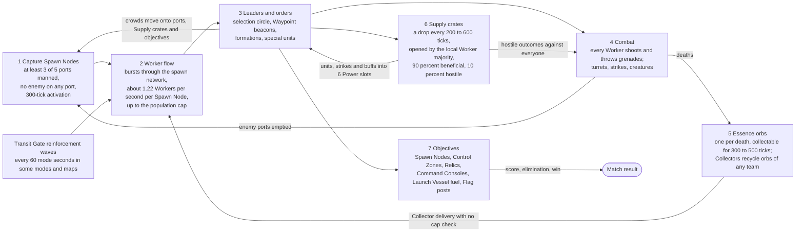
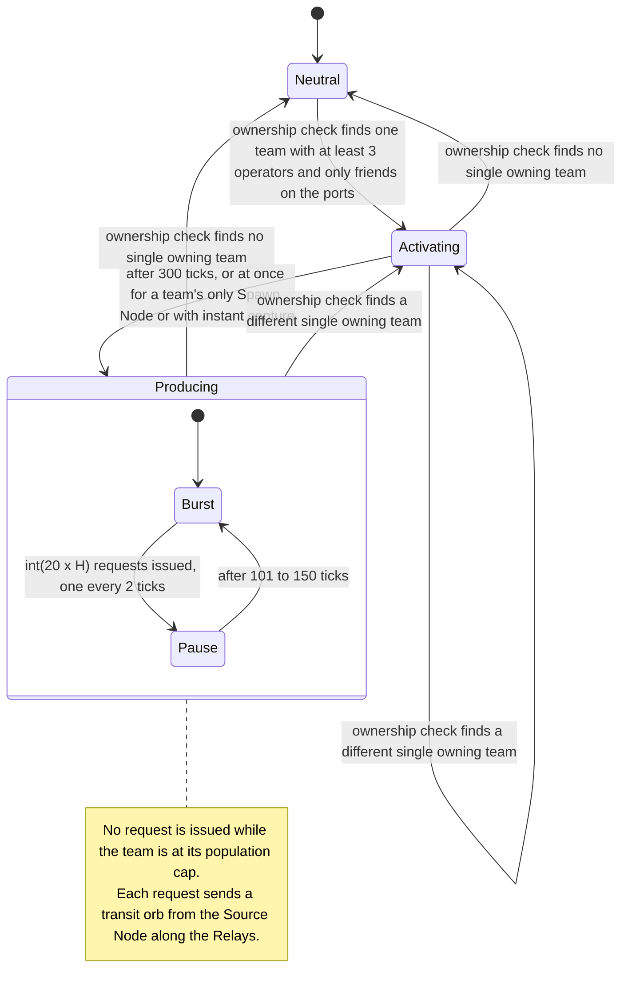
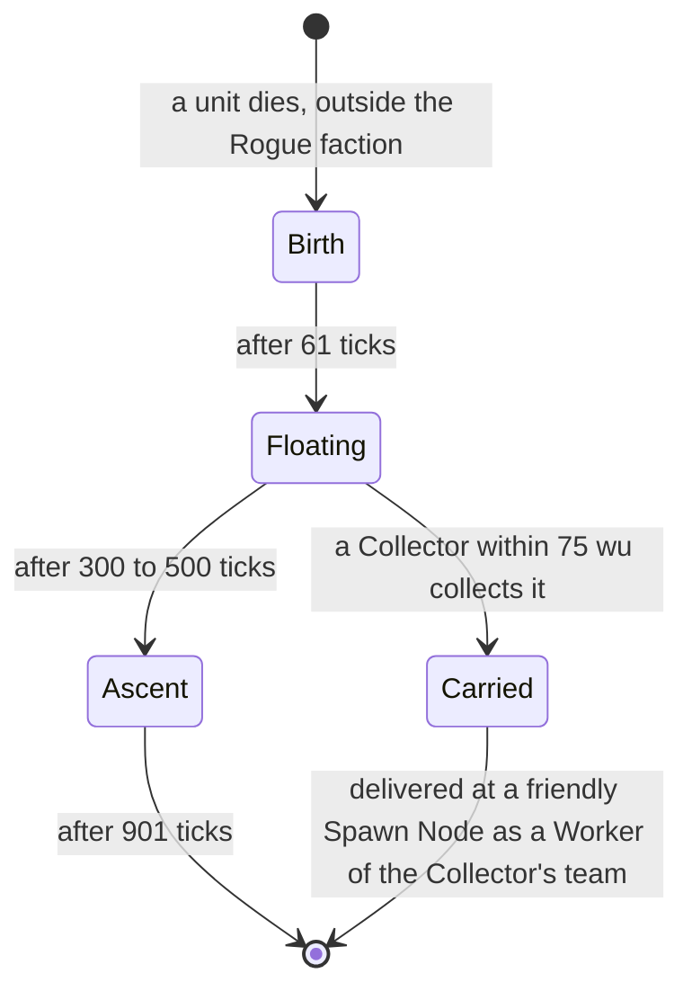
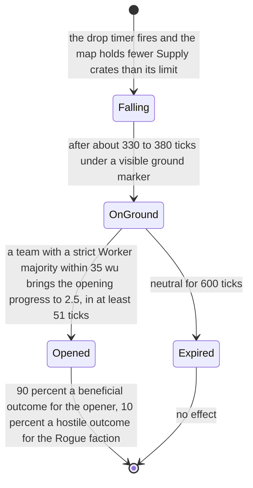
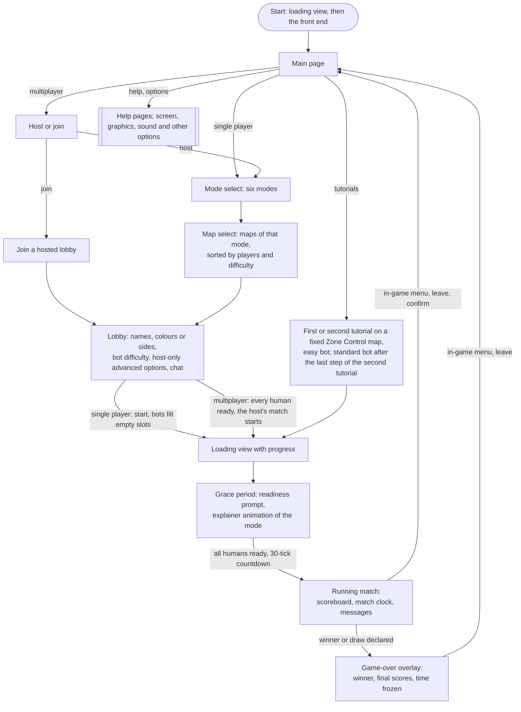

# Reference overview

> Status: Reference · Prefix: R-VIS · Related: [Skirmish rules and modes](01_skirmish_rules_and_modes/README.md) · [Units](02_units/README.md) · [Buildings and world objects](03_buildings_and_world_objects/README.md) · [Supply crates, powers and weapons](04_supply_crates_powers_and_weapons/README.md) · [Population flow](05_population_flow.md) · [Controls, camera and commands](06_controls_camera_and_commands.md) · [Bots](07_bots.md) · [Maps and level design](08_maps_and_level_design/README.md) · [Front end and match flow](09_front_end_and_match_flow/README.md) · [Audio design](10_audio_design.md) · [Tutorial and help](11_tutorial_and_help.md) · [Simulation model](12_simulation_model/README.md) · [Decision register](../decisions/README.md)

## 1 Purpose and player experience

This overview states the reference game's core loop, what makes the reference distinctive, the scope of a match, the player's verbs, the match flow seen by the player, and the vocabulary a player meets. Every mechanic it names is specified in full by its owning document (§7); this overview restates the rules and values that define the loop, so that a reader can understand the reference from this one page.

### 1.1 Pitch

The reference game is a real-time strategy game for 2 to 4 players in which nobody builds units. Each side's army is a crowd of small, self-willed soldiers, the Workers, that pours continuously out of the Spawn Nodes the side holds, so the whole game is a fight over territory that converts into a flow of bodies. Players never order a single soldier. They draw a circle around part of their crowd and send it somewhere, or they promote one Worker to a Leader, which becomes a Waypoint beacon for passing Workers or the head of a marching formation.

At default settings a Supply crate parachutes onto the map every 200 to 600 ticks (20–60 s). The side that crowds it first opens one of 31 outcomes: airstrikes, Missile Barrages, Transports, turrets, crowd buffs, groves, creatures and changes of game speed. One opening in ten is a hostile event for everybody.

Six modes put different objects at the centre of the same crowd-and-territory rules: Spawn Nodes (Spawn Control), Control Zones (Zone Control), carried Relics (Relic Run), a timed Core Device and the Command Consoles that disarm it (Siege), a Launch Vessel that must be fuelled and boarded (Launch Race), and chains of Flag posts (Flag Chain). Matches are short, with default time limits of 5 to 15 match-clock minutes. They read well from a distance in a flat-shaded, glowing wireframe look on a black background (DEC-029), and they can be played against bots that see everything but have no other advantage.

### 1.2 The reference core loop at a glance

The reference is a crowd-and-territory game with no build queue and no currency (R-VIS-001). Armies are populations produced by held Spawn Nodes: a Spawn Node is captured with at least 3 of its 5 ports manned and no enemy on any port, activates 300 ticks after it changes owner, and produces Workers in bursts and pauses up to a per-team population cap. Workers act on their own; Leaders serve as signposts and formation leaders. Supply crates open to outcomes that are 90 % beneficial and 10 % hostile and feed six Power slots per team. Six modes run on one rules skeleton. Bots play on a node graph with perfect information and no other advantage. The open decision on this loop is DEC-001.

A team's strength is therefore the territory it holds over time, minus its losses, up to its population cap. The player's skill lies in directing flows of bodies, not in producing them. Figure 1 (§3) draws the loop; §2.6 to §2.11 state its rules.

### 1.3 Distinctive mechanics

The table lists the mechanics that give the reference its character, with the role each plays and the document that specifies it. The rules themselves are in §2 and in the owning documents.

| Mechanic | Reference rule (summary) | Role in play | Specified in |
|---|---|---|---|
| Population-flow economy | No build queue and no currency; the army is the Workers that held territory produces, capped per team | Defines the reference's identity | [05](05_population_flow.md) |
| Spawn Node capture | A single team with at least 3 operators on the 5 ports and no enemy on any port; ownership re-evaluated every 20–30 ticks | Readable, contestable territory | [05](05_population_flow.md) |
| Activation delay | 300 ticks after an ownership change; skipped for a team's only Spawn Node and with the instant-capture map option | Prevents capture flip-flop farming and protects a team's last Spawn Node | [05](05_population_flow.md) |
| Burst and pause production | One request every 2 ticks for int(20 × H) requests, then a pause of 101–150 ticks; transit orbs travel along Relays in at most 10h + 1 ticks for h hops (11 for the first hop, 10 for each further hop) and are discarded if the Spawn Node has turned neutral | A rhythmic, visible reinforcement flow | [05](05_population_flow.md) |
| Autonomous Workers | Every Worker re-plans every 10–20 ticks among ports, Supply crates, Relics, Launch Vessels, Leaders and threats, and fights on its own | Crowds do useful local work without micro-management | [02](02_units/worker.md) |
| Leaders | Promote a Worker; set it as a Waypoint beacon (a conveyor for idle Workers within 100 wu) or a formation (up to 90 Workers gathered within 150 wu) | The strategic verb set | [06](06_controls_camera_and_commands.md), [02](02_units/leader_and_formations.md) |
| Selection circle and crowd orders | Hold the primary button to grow a circle of up to 100 wu at 100 wu/s; the secondary button gives the destination; at least 10 ticks between crowd orders | Simple, physical crowd control | [06](06_controls_camera_and_commands.md) |
| Direct control only for special units | Strike team, Transport, Collector, Builder, turret and Beam Dish | Micro-management stays rare and meaningful | [06](06_controls_camera_and_commands.md) |
| Supply crate timing and catch-up placement | Drop interval U(0.5, 1.5] × the drop-rate option; at most one Supply crate per 500 wu of map width; placement weighted towards lower-scoring teams | A wildcard that also helps the trailing side | [04](04_supply_crates_powers_and_weapons/crates_and_powers.md) |
| Opening by local majority | A strict majority within 35 wu; at least 51 ticks with 50 or more Workers; a neutral Supply crate expires after 600 ticks | Forces converging fights | [04](04_supply_crates_powers_and_weapons/crates_and_powers.md) |
| 90/10 outcome split | Hostile outcomes are events against everyone, owned by the Rogue faction | Risk on every Supply crate | [04](04_supply_crates_powers_and_weapons/crates_and_powers.md) |
| Six Power slots, lost when full | 6 slots, 2 while eliminated; every pending, placed or running power occupies one | Hoarding tension | [06](06_controls_camera_and_commands.md), [04](04_supply_crates_powers_and_weapons/crates_and_powers.md) |
| Transit Gate reinforcement waves | Every 60 mode seconds; 40 Workers per owned Transit Gate in Launch Race and Flag Chain; Transport, turret and airstrike variants | Pacing in the objective modes | [05](05_population_flow.md) |
| Essence loop | One Essence orb per death, collectable for 300–500 ticks; a Collector recycles orbs into its own team's Workers | Combat feeds the economy | [05](05_population_flow.md) |
| One rules skeleton, six territory variants | Spawn Nodes, Control Zones, carried Relics, the Core Device with its Command Consoles, the Launch Vessel with its fuel chain, chains of Flag posts | Variety on one rule set | [01](01_skirmish_rules_and_modes/README.md) |
| Ready-up barrier | World frozen; a 30-tick countdown once every human is ready, restarted if anyone withdraws readiness | Every participant starts from the same state | [01](01_skirmish_rules_and_modes/README.md) |
| Leaver replaced by a bot | A human who leaves during a match is replaced by a bot at once | No slot goes dead | [01](01_skirmish_rules_and_modes/README.md) |
| Bots | Node graph, priority fields, a dispatcher in which only friendly nodes release troops, Leader conveyors, one handler per power, one strategy per mode; difficulty is tempo (200, 101 or 11 ticks) and randomness (100 %, 50 % or 0 %); perfect information and no other advantage | Fair-feeling opponents | [07](07_bots.md) |
| Lobby option set and per-map overrides | 39 option definitions; map options for reinforcements, Transports, turrets, instant capture, Beam Dish rules, the Visitor faction, the airstrike threshold, excluded Supply crate outcomes and population caps | The tuning surface of every mode | [01](01_skirmish_rules_and_modes/README.md), [08](08_maps_and_level_design/rules_and_conventions.md) |
| Start positions remapped at load | A map's team column is a map position, remapped to the match teams at load; one map serves 2 to 4 players | Map reuse | [03](03_buildings_and_world_objects/README.md), [08](08_maps_and_level_design/rules_and_conventions.md) |
| Free camera | Cursor-follow pan at 250 wu/s (1,000 wu/s with the speed modifier); zoom narrows the field of view from 60° to 15°; one camera view per player slot at match start | A readable view of the crowd | [06](06_controls_camera_and_commands.md) |
| Visual language | Flat facets, additive glow on black, darkening layers, black fog, 8 team colours, sprite cards scaled with distance | A distinctive look at crowd scale | [renderer visual language](../architecture/components/renderer/visual_language.md) |
| Audio binding model | (source, event) pairs resolve to layered blocks with friend and foe variants, sample groups, generative loops and an altitude crossfade | Data-driven audio | [10](10_audio_design.md) |
| Onboarding helpers | Contextual hints (a suspicion counter for stray clicks, a hint to hold the speed modifier while panning) and explainer animations during ready-up | Teaches the game without a campaign | [11](11_tutorial_and_help.md) |

### 1.4 Player-facing glossary

Every concept a player meets, in Species terms. The [glossary](../glossary/a_to_l.md) holds the full term list of the library.

#### 1.4.1 Factions, people and the economy

| Term | What it is for the player | Defined in |
|---|---|---|
| Species | The game. Its tagline is new text (`ui.title.tagline`) | [09](09_front_end_and_match_flow/README.md) |
| Worker | The basic unit: a small, flat soldier with a laser and grenades; 50 health, 20 wu/s; never built and never ordered one at a time | [02](02_units/worker.md) |
| Leader | A Worker promoted by the player; never fights; acts as a Waypoint beacon or leads a formation | [02](02_units/leader_and_formations.md), [06](06_controls_camera_and_commands.md) |
| Waypoint beacon | A Leader order that redirects every idle Worker of its team passing within 100 wu | [06](06_controls_camera_and_commands.md) |
| formation | A block of up to 90 Workers marching in front of a Leader, in rows of 6 to 15 | [06](06_controls_camera_and_commands.md) |
| selection circle | The growing circle, up to 100 wu, drawn with the primary button to gather Workers | [06](06_controls_camera_and_commands.md) |
| Essence orb | The green orb a dead unit leaves; floats for 300–500 ticks, can be collected by Collectors, then ascends | [02](02_units/essence_orbs.md), [05](05_population_flow.md) |
| Spawn Node | The capturable structure with 5 ports that produces Workers for its owner | [03](03_buildings_and_world_objects/economy_and_spawn_objects.md), [05](05_population_flow.md) |
| Source Node, Relays | The invisible source and the beam network of the spawn network, along which new Workers travel to the Spawn Nodes | [03](03_buildings_and_world_objects/economy_and_spawn_objects.md) |
| port, operator | A slot on a structure that a Worker occupies to operate or capture it; the Worker in it is its operator | [03](03_buildings_and_world_objects/README.md) |
| activation delay | The 300 ticks before a newly captured Spawn Node produces | [05](05_population_flow.md) |
| population cap | The per-team limit on bodies that stops production | [05](05_population_flow.md) |
| Catch-up bonus | A lobby option that enlarges the production bursts of a team far behind on Spawn Nodes, but only while no Spawn Node on the map is neutral | [05](05_population_flow.md) |
| Transit Gate | A fixed gate that releases reinforcement waves for its owner | [03](03_buildings_and_world_objects/mode_objects.md), [05](05_population_flow.md) |
| reinforcement wave | A timed Transit Gate wave of Workers, Transports, turrets or airstrikes, with an on-screen countdown | [05](05_population_flow.md) |
| Rogue faction | The hostile bot faction that owns the hostile Supply crate outcomes, Hives, Spitter Plants and hostile workers | [01](01_skirmish_rules_and_modes/README.md), [04](04_supply_crates_powers_and_weapons/crates_and_powers.md) |
| Visitor faction | The faction that the Abductor outcome brings, in team slot 5 | [02](02_units/creatures_and_hazards.md) |
| Bot | A computer opponent that fills an empty slot; one difficulty (easy, standard or hard) applies to all bots of a match | [07](07_bots.md) |
| co-op | Two alliances of two players sharing a colour family, on maps that allow it | [01](01_skirmish_rules_and_modes/README.md) |

#### 1.4.2 Units and structures a player controls or fights over

| Term | What it is for the player | Defined in |
|---|---|---|
| Strike team | 3 directly controlled Troopers with lasers and grenades that live 600 ticks | [02](02_units/strike_team.md) |
| Transport | A troop carrier that loads and unloads Workers | [02](02_units/transport.md) |
| Collector | A flying collector that turns any team's Essence orbs into Workers of its own team | [02](02_units/collector.md) |
| Builder | A hovering Essence-orb collector; on the reference maps the orbs it collects reach no destination (DEC-085) | [02](02_units/builder.md) |
| turret (gun, rocket and flame types) | A capturable or crate-placed turret, captured by occupying its 4 ports, aimed and fired directly by its owner | [03](03_buildings_and_world_objects/defences_and_props.md) |
| Beam Dish | A teleport between linked dishes, aimed by its owner | [03](03_buildings_and_world_objects/defences_and_props.md) |
| Solar Array | An energy source captured by occupation; feeds the fuel chain in Launch Race and, through the energy grid, Barrier Emitters | [03](03_buildings_and_world_objects/mode_objects.md) |
| Barrier Emitter, wall | Barriers: a Barrier Emitter is switched by energy; a wall is breached by the Siege Breach Charge | [03](03_buildings_and_world_objects/defences_and_props.md) |
| tree | Scenery that burns; the grove outcomes release or consume Essence orbs | [03](03_buildings_and_world_objects/defences_and_props.md) |

#### 1.4.3 Mode objectives

| Mode | Objective objects the player meets | Defined in |
|---|---|---|
| Spawn Control | Spawn Nodes; a team is eliminated after 30 mode seconds without one | [spawn_control](01_skirmish_rules_and_modes/spawn_control.md) |
| Zone Control | Control Zones, each owned by the team with the most Workers inside | [zone_control](01_skirmish_rules_and_modes/zone_control.md) |
| Relic Run | Relics carried by groups of Workers into the team's Relic Base | [relic_run](01_skirmish_rules_and_modes/relic_run.md) |
| Siege | The defenders' Core Device and its countdown, the Command Consoles that disarm it, the Breach Charge that breaches walls, and the attacker and defender sides | [siege](01_skirmish_rules_and_modes/siege.md) |
| Launch Race | The team's Launch Vessel, its fuel depot and the fuel chain powered by Solar Arrays, the 100 passenger seats, and the Launch Vessel status panel | [launch_race](01_skirmish_rules_and_modes/launch_race.md) |
| Flag Chain | Flag posts raised by Workers in a connected chain towards an enemy's Home post, and warnings that a base is under attack | [flag_chain](01_skirmish_rules_and_modes/flag_chain.md) |
| All modes | grace period, ready, sudden death, elimination, rank messages, the one-minute warning and the draw: the pre-match freeze and ready-up; the tie-break after time-up; hard elimination (Spawn Control, Flag Chain) and the soft eliminated state that drives the Comeback Bonus | [01](01_skirmish_rules_and_modes/README.md) |

#### 1.4.4 Supply crates, powers and the outcome families

| Term | What it is for the player | Defined in |
|---|---|---|
| Supply crate | The falling, bubble-wrapped box that the local Worker majority opens; its arrival is announced with new text (`crate.drop_announce`) | [04](04_supply_crates_powers_and_weapons/crates_and_powers.md) |
| beneficial and hostile outcome | 90 % of openings give the opener a useful reward; 10 % start a hostile event against everyone | [04](04_supply_crates_powers_and_weapons/crates_and_powers.md) |
| Power | A granted unit or ability waiting in a Power slot to be placed | [06](06_controls_camera_and_commands.md) |
| Power slots | The 6 slots of a team, 2 while it is eliminated; a full set shows new text (`ui.power_slots.full`) | [06](06_controls_camera_and_commands.md) |
| Comeback Bonus | Free random powers every 450 ticks for an eliminated team; full slots show new text (`ui.power_slots.comeback_full`) | [04](04_supply_crates_powers_and_weapons/crates_and_powers.md) |
| starting powers | 0 to 3 random powers at match start, in Spawn Control and Zone Control | [04](04_supply_crates_powers_and_weapons/crates_and_powers.md) |
| basic-crates option | A lobby option that limits Supply crates to the 7 basic outcomes and disables the hostile outcomes | [04](04_supply_crates_powers_and_weapons/crates_and_powers.md) |

The 31 outcomes fall into the nine families of Table 2 (§2.14).

### 1.5 Conventions of this overview

- Distances are in world units (`wu`). Simulation durations are in ticks; seconds are derived display values at normal game speed. The reference tick rate is defined in [reference/12](12_simulation_model/README.md).
- The values in this overview restate the values of the owning documents. Each value has a tuning key in §4; the owning document's key is authoritative, and a difference between the two is a defect of this overview.
- Player-facing text is new text keyed by Species string ids; this overview names an id only where the ledger already defines it.

## 2 Rules

### 2.1 The reference core loop and its baseline

**R-VIS-001** (MUST) The reference has no build queue and no currency. A team's army is the population of Workers that the Spawn Nodes it holds produce, plus the special units it receives as granted powers (R-VIS-092); territory creates the army and combat destroys it (see DEC-001).

**R-VIS-002** (MUST) A Spawn Node is captured by a single team with at least `ref.vis.spawn_node.capture_operators` (3) operators on its `ref.vis.spawn_node.ports` (5) ports and no enemy on any port, starts producing `ref.vis.spawn_node.activation_delay` (300 ticks) after an ownership change, and produces in bursts and pauses up to the team's population cap, as R-VIS-060 to R-VIS-066 state (DEC-001, DEC-018).

**R-VIS-003** (MUST) Workers fight and re-plan on their own. The player steers crowds, never single Workers, and promotes Workers to Leaders that act as Waypoint beacons and formation leaders (R-VIS-090, R-VIS-110 to R-VIS-112; DEC-030, DEC-031).

**R-VIS-004** (MUST) Supply crates open to outcomes that are `ref.vis.crate.beneficial_share` (90 %) beneficial and `ref.vis.crate.hostile_share` (10 %) hostile, and beneficial outcomes feed the `ref.vis.power_slots.count` (6) Power slots of a team (R-VIS-077, R-VIS-078; DEC-021, DEC-033).

**R-VIS-005** (MUST) The six match modes share one rules skeleton and differ only in their territory unit and their score (R-VIS-130, R-VIS-131; DEC-017).

**R-VIS-006** (MUST) Bots play on a node graph with perfect information and no other advantage (R-VIS-140 to R-VIS-144; DEC-022).

**R-VIS-007** (MUST) Every rule and value that a reference document states is the reference behaviour, and no requirement depends on a comparison with another edition or build of the reference (DEC-005). Every reference tuning value is kept as the starting tuning baseline (DEC-004). A reference behaviour that looks accidental and that no Resolved decision corrects is specified as an explicit rule with a named tuning key or constant (DEC-006).

**R-VIS-008** (MUST) The look is flat-shaded facets with additive glow on a black background, darkening layers and black fog, `ref.vis.scope.team_colours` (8) team colours, and small figures drawn as camera-facing sprite cards that scale with distance. All art is authored new (DEC-029).

**R-VIS-009** (MUST) Game rules fire (source, event) pairs and data decides what plays: each pair resolves to layered sound blocks with friend and foe variants, sample groups, generative looping ambience and an ambience crossfade driven by camera altitude (DEC-027).

### 2.2 Scope: the six match modes

**R-VIS-010** (MUST) The reference has exactly `ref.vis.scope.mode_count` (6) match modes, listed here in the reference enumeration order: Spawn Control, Zone Control, Relic Run, Siege, Launch Race and Flag Chain. A seventh, debug-only mode is not specified (DEC-058).

**R-VIS-011** (MUST) **Spawn Control.** Teams own Spawn Nodes. A team that owns none for `ref.vis.mode.spawn_control.elimination_delay` (30 mode seconds, 330 ticks) is eliminated. The match ends when one team is left standing, or on score at time-up. The time-limit option `ref.vis.mode.spawn_control.time_limit` runs from 0 to 60 match-clock minutes with a default of 10, and 0 means no time limit. Play is free-for-all for 2 to 4 players, with 2v2 co-op on the maps that allow it. Complexity label: simple.

**R-VIS-012** (MUST) **Zone Control.** Teams hold Control Zones. The match ends on score at time-up and never by elimination. The time-limit option `ref.vis.mode.zone_control.time_limit` runs from 1 to 60 match-clock minutes with a default of 5. Play is free-for-all for 2 to 4 players, with 2v2 co-op on the maps that allow it. Complexity label: simple.

**R-VIS-013** (MUST) **Relic Run.** Teams carry Relics into their own Relic Base, for `ref.vis.mode.relic_run.delivery_points` (1 point) per delivery. The match ends on score at time-up. The time-limit option `ref.vis.mode.relic_run.time_limit` runs from 1 to 60 match-clock minutes with a default of 10. Play is free-for-all for 2 to 4 players, with co-op on the map that allows it. Complexity label: medium.

**R-VIS-014** (MUST) **Siege.** The attackers must capture every Command Console linked to the defenders' Core Device before it detonates. The match ends when the Core Device is destroyed, and the attackers win, or when it detonates, and the defenders win. Siege has no time-limit option: the Core Device's countdown, which the map sets to `ref.vis.mode.siege.core_device_timer` (900 or 1,200 mode seconds, about 990 or 1,320 s), is the longest a match can last. Play is 1v1, 1v2 or 2v2, and some maps force co-op. Complexity label: medium.

**R-VIS-015** (MUST) **Launch Race.** Each team refuels its Launch Vessel through a fuel chain powered by Solar Arrays, loads `ref.vis.mode.launch_race.passengers` (100) Workers and launches. The first Launch Vessel to climb above a height of `ref.vis.mode.launch_race.launch_height` (600 wu) wins. Launch Race has no time-limit option. Play is free-for-all for 2 to 4 players. Complexity label: hard.

**R-VIS-016** (MUST) **Flag Chain.** A team eliminates an enemy by capturing a connected chain of Flag posts into that enemy's Home post. The match ends when one team is left standing, or at time-up on Flag posts held plus `ref.vis.mode.flag_chain.elimination_weight` (10) points per elimination. The time-limit option `ref.vis.mode.flag_chain.time_limit` runs from 0 to 60 match-clock minutes with a default of 15, and 0 means no time limit. Play is free-for-all for 2 to 4 players. Complexity label: hard.

**R-VIS-017** (MUST) A time-limit option counts minutes of the match clock, which advances once per mode second (R-VIS-051); a match-clock minute is therefore 60 mode seconds.

**R-VIS-018** (MUST) Match setup shows each mode's complexity label (simple, medium or hard) as R-VIS-011 to R-VIS-016 assign it. The label text is new text, owned by reference/09.

**R-VIS-019** (MUST) The match options comprise `ref.vis.scope.option_definitions` (39) option definitions, plus the lobby settings and the per-map overrides for reinforcements, Transports, turrets, instant capture, Beam Dish rules, the Visitor faction, the airstrike threshold, excluded Supply crate outcomes and population caps (DEC-017, DEC-073).

Table 1 summarises R-VIS-011 to R-VIS-016.

| Mode | Objective | Ends by | Time-limit option (default) | Players | Complexity |
|---|---|---|---|---|---|
| Spawn Control | Own Spawn Nodes; a team without one for 30 mode seconds is eliminated | Last team standing, or score at time-up | 0–60 min (10); 0 = none | Free-for-all 2–4; 2v2 co-op on 2 maps | simple |
| Zone Control | Hold Control Zones | Score at time-up, never elimination | 1–60 min (5) | Free-for-all 2–4; 2v2 co-op on 3 maps | simple |
| Relic Run | Carry Relics into the own Relic Base, 1 point each | Score at time-up | 1–60 min (10) | Free-for-all 2–4; co-op on 1 map | medium |
| Siege | Capture every Command Console linked to the defenders' Core Device before it detonates | Core Device destroyed (attackers win) or detonation (defenders win) | None; the Core Device countdown of 900 or 1,200 mode seconds | 1v1, 1v2, 2v2; co-op forced on 4 maps | medium |
| Launch Race | Refuel the Launch Vessel with Solar Array energy, load 100 Workers, launch | First Launch Vessel above 600 wu | None | Free-for-all 2–4 | hard |
| Flag Chain | Capture a connected chain of Flag posts into an enemy's Home post to eliminate it | Last team standing, or Flag posts plus 10 per elimination at time-up | 0–60 min (15); 0 = none | Free-for-all 2–4 | hard |

*Table 1 — The six match modes. Minutes are match-clock minutes.*

### 2.3 Scope: maps and player counts

**R-VIS-020** (MUST) Match setup lists `ref.vis.scope.maps_total` (49) maps: `ref.vis.scope.maps_spawn_control` (9) for Spawn Control, `ref.vis.scope.maps_zone_control` (9) for Zone Control, `ref.vis.scope.maps_relic_run` (9) for Relic Run, `ref.vis.scope.maps_siege` (8) for Siege, `ref.vis.scope.maps_launch_race` (7) for Launch Race and `ref.vis.scope.maps_flag_chain` (7) for Flag Chain. Every map is authored new, and no reference map name, shape or layout is carried (DEC-063). Reference/08 owns the distribution of maps per mode and per player count.

**R-VIS-021** (MUST) By each map's declared player count, `ref.vis.scope.maps_2p` (22) of the 49 maps are for 2 players, `ref.vis.scope.maps_3p` (15) for 3 players and `ref.vis.scope.maps_4p` (12) for 4 players.

**R-VIS-022** (MUST) Every map is a square world of `ref.vis.scope.map_side` (2,000 to 7,000 wu) on a side.

**R-VIS-023** (MUST) `ref.vis.scope.maps_with_cap` (47) of the 49 maps set a map population cap within `ref.vis.scope.map_population_cap` (1,400 to 2,000). The other `ref.vis.scope.maps_without_cap` (2), a 4-player Spawn Control co-op map and a 4-player Zone Control co-op map, set none (DEC-079, DEC-454).

**R-VIS-024** (MUST) `ref.vis.scope.maps_with_spawn_nodes` (32) of the 49 maps contain Spawn Nodes.

**R-VIS-025** (MUST) The co-op-capable maps are `ref.vis.scope.coop_maps_spawn_control` (2) for Spawn Control, `ref.vis.scope.coop_maps_zone_control` (3) for Zone Control, `ref.vis.scope.coop_maps_relic_run` (1) for Relic Run, `ref.vis.scope.coop_maps_siege` (4, each forcing co-op) for Siege, `ref.vis.scope.coop_maps_launch_race` (0) for Launch Race and `ref.vis.scope.coop_maps_flag_chain` (0) for Flag Chain (DEC-034).

**R-VIS-026** (MUST) Maps that declare no mode, and development, test and benchmark maps, are never listed in match setup and are not specified (DEC-334).

**R-VIS-027** (MUST) A map's team column is a map position, remapped to the match teams at load, so one map serves 2 to 4 players (DEC-025, DEC-560).

### 2.4 Scope: who is in every match

**R-VIS-030** (MUST) Every match has `ref.vis.scope.team_slots` (6) team slots. Slots 0 to 3 are player slots, of which a map uses slots 0 to its declared player count minus 1. Slot `ref.vis.scope.rogue_slot` (4) is the Rogue faction, which owns the hostile Supply crate outcomes and the creatures they bring. Slot `ref.vis.scope.visitor_slot` (5) is the Visitor faction, which the Abductor outcome brings.

**R-VIS-031** (MUST) The Rogue faction and the Visitor faction are created as bot teams in every match, and each has one bot controller (DEC-558).

**R-VIS-032** (MUST) At match start the host fills every empty player slot with a bot team (DEC-450). One bot difficulty, easy, standard or hard, applies to every bot team of the match.

**R-VIS-033** (MUST) A human who leaves during a match is replaced immediately by a bot that takes over the team. No mode treats a leaving player as eliminated (DEC-035).

**R-VIS-034** (MUST) Players choose among `ref.vis.scope.team_colours` (8) team colours. In Siege the colour is the side: green for the defenders and red for the attackers.

### 2.5 Scope: features present only as hooks

These features exist in the reference only as hooks. The owning documents record what the hooks contain; this overview states only that each one is a hook.

**R-VIS-040** (MUST) The reference has no reachable map editor and no front-end entry to one, and matches use only the listed maps. The map editor, its editor windows and custom-map handling exist only as hooks, which reference/08 records (DEC-045).

**R-VIS-041** (MUST) The rules evaluate `ref.vis.scope.achievement_conditions` (12) achievement conditions, but no achievement is ever awarded, achievement progress is never stored and the achievements page cannot be reached. Two of the conditions depend on map-index data that is not part of the packaged data. The conditions are hooks, which reference/09 and reference/01 record (DEC-047, DEC-332).

**R-VIS-042** (MUST) No music plays in the reference. The audio engine has a complete music system and music event bindings, but no reachable trigger exists, the music tracks are not part of the packaged data, and a triggered track would fail an assertion. Reference/10 records these hooks (DEC-049).

**R-VIS-043** (MUST) Leaderboards exist only as front-end pages, with no data source and no back end. Reference/09 records them (DEC-047).

**R-VIS-044** (MUST) There is no post-match results screen. The results appear only in the in-match game-over overlay, and leaving the match rebuilds the front end's main page (DEC-048).

### 2.6 Core loop: clock and match start

**R-VIS-050** (MUST) The simulation advances in ticks at the reference tick rate of `ref.vis.clock.tick_rate` (10 ticks per game second), which reference/12 defines. Game speed changes how many ticks run per real second and never the length of a tick (DEC-039). The per-second rates of this overview are derived at normal game speed.

**R-VIS-051** (MUST) A mode second is `ref.vis.clock.mode_second` (11 ticks, 1.1 s). The mode rules evaluate score, elimination, time-up and sudden death once per mode second, and the match clock counts mode seconds, so it runs 10 % slower than game time (DEC-002, DEC-003).

**R-VIS-052** (MUST) A match starts in its grace period. The world is held at its start state and the match clock is frozen until every human is ready; then a countdown of `ref.vis.match.grace_countdown` (30 ticks, 3.0 s) runs, and it restarts if anyone withdraws readiness (DEC-036). Supply crate drops are not suspended during the grace period (DEC-116).

**R-VIS-053** (MUST) At match start every Spawn Node and Solar Array that a team owns has one operating Worker of that team in each of its ports, `ref.vis.match.start_operators` (5) per such structure, and the team also receives the instant units that the map gives it.

**R-VIS-054** (MUST) The core loop of Figure 1 is the same in all six modes; only the objectives at its end change (R-VIS-081, R-VIS-131).

### 2.7 Core loop: capture and production

**R-VIS-060** (MUST) A Spawn Node belongs to a single team when at least `ref.vis.spawn_node.capture_operators` (3) of that team's operating Workers occupy its `ref.vis.spawn_node.ports` (5) ports and every other occupant is a friend of that team. Ownership is re-evaluated every `ref.vis.spawn_node.ownership_period` (20–30 ticks, 2.0 + U[0,1) s) (DEC-018).

**R-VIS-061** (MUST) After an ownership change a Spawn Node waits `ref.vis.spawn_node.activation_delay` (300 ticks, 30 s) before it produces. The delay is skipped when the new owner owns exactly one Spawn Node, and on maps that set the instant-capture option (DEC-002).

**R-VIS-062** (MUST) Each owned, active Spawn Node whose team is below its population cap issues one production request every `ref.vis.spawn_node.request_interval` (2 ticks, 0.2 s) for int(`ref.vis.spawn_node.burst_requests` × H) requests, which is 20 at H = 1 and 38 at H = 1.9, and then pauses for `ref.vis.spawn_node.pause` (101–150 ticks, 10 + U[0,5) s) before the next burst (DEC-002, DEC-018).

**R-VIS-063** (MUST) With these rules one active Spawn Node yields a mean of `ref.vis.spawn_node.mean_output` (about 1.22 Workers per second) at H = 1 and `ref.vis.spawn_node.mean_output_catch_up` (about 1.90 Workers per second) at H = 1.9, so a team's income is linear in the number of Spawn Nodes it holds.

**R-VIS-064** (MUST) The Catch-up bonus multiplier H is 1 + the Catch-up bonus option ÷ 100, which is 1.9 at the default option value `ref.vis.catch_up.option_default` (90 %), when no Spawn Node on the map is neutral and the average Spawn Node count of the other teams in use exceeds `ref.vis.catch_up.deficit_ratio` (1.5) × the team's own count; that average includes the Rogue and Visitor factions and uses integer division. Otherwise H is 1. H is always 1 on maps that disable the bonus and when the option is 0 or not set (DEC-073, DEC-081).

**R-VIS-065** (MUST) Each production request takes a transit orb from the invisible Source Node and routes it along the Relays of the spawn network to the requesting Spawn Node. A transit of h hops takes at most 10h + 1 ticks: `ref.vis.spawn_network.first_hop` (11 ticks) for the first hop and `ref.vis.spawn_network.further_hop` (10 ticks) for each further hop, so a new Worker appears at the door about one second per hop after its request. The new Worker belongs to whoever owns the Spawn Node when the orb arrives; an orb that arrives at a Spawn Node that has turned neutral is discarded (DEC-002, DEC-455).

**R-VIS-066** (MUST) A team's population cap is the map population cap ÷ the map's declared player count, by integer division; in Siege the cap is split between the defenders and the attackers. The cap counts every body of the team that is not inside an actor group, the team's bot controller, Transports, Leaders and creature eggs included. A team at its cap issues no production requests (DEC-079, DEC-453).

**R-VIS-067** (MUST) In Launch Race, Flag Chain and Siege, and on any map that sets the reinforcement option, each owned Transit Gate releases a reinforcement wave every `ref.vis.transit_gate.wave_interval` (660 ticks, 60 mode seconds, 66 s). In Launch Race and Flag Chain a wave is `ref.vis.transit_gate.wave_workers` (40) Workers per owned Transit Gate; a wave can also bring Transports, turrets or airstrikes. Transit Gates advance once per tick on every map (DEC-065).

### 2.8 Core loop: orders and combat

**R-VIS-068** (MUST) While the player holds the primary button on empty ground, a selection circle grows at `ref.vis.selection.growth_rate` (10 wu per tick, 100 wu/s) up to a radius of `ref.vis.selection.max_radius` (100 wu) (DEC-032).

**R-VIS-069** (MUST) A team issues crowd orders at most once per `ref.vis.orders.crowd_interval` (10 ticks, 1.0 s) (DEC-032).

**R-VIS-070** (MUST) A Leader set as a Waypoint beacon redirects every idle Worker of its team that passes within `ref.vis.leader.beacon_radius` (100 wu). A Leader in formation gathers the Workers within `ref.vis.leader.formation_join_radius` (150 wu), up to `ref.vis.leader.formation_size` (90) members (DEC-031).

**R-VIS-071** (MUST) A Worker has `ref.vis.worker.health` (50) health and moves at `ref.vis.worker.speed` (2 wu per tick, 20 wu/s). It fires a laser that deals `ref.vis.worker.laser_damage` (20–39) damage at a range of about `ref.vis.worker.laser_range` (90 wu) with a reload of `ref.vis.worker.laser_reload` (30 ticks, 3 s), and it throws grenades (DEC-030).

**R-VIS-072** (MUST) Every Worker takes part in combat, shooting and throwing grenades, alongside turrets, strikes and creatures. Every death feeds the Essence-orb step of the loop, and a Spawn Node whose enemy operators have been killed returns to the capture step (Figure 1).

### 2.9 Core loop: Essence orbs

**R-VIS-073** (MUST) Every death leaves one Essence orb, except a death in the Rogue faction (DEC-084). An Essence orb is born over `ref.vis.essence_orb.birth` (61 ticks, about 6 s), floats and can be collected for `ref.vis.essence_orb.float` (300–500 ticks, 30–50 s), then ascends for `ref.vis.essence_orb.ascent` (901 ticks, about 90 s) and is gone (DEC-002).

**R-VIS-074** (MUST) A Collector collects floating Essence orbs of any team within `ref.vis.collector.radius` (75 wu), holds up to `ref.vis.collector.capacity` (100) of them, and delivers `ref.vis.collector.delivery_rate` (one per tick) at a friendly Spawn Node, each as a Worker of the Collector's team, with no population-cap check and no activation check (DEC-080, DEC-453).

### 2.10 Core loop: Supply crates and powers

**R-VIS-075** (MUST) Supply crates drop at intervals of `ref.vis.crate.drop_factor` (U(0.5, 1.5]) × the drop-rate option, whose default `ref.vis.crate.drop_rate_default` (40 s) gives 200 to 600 ticks. At most int(map width ÷ `ref.vis.crate.width_per_crate`) Supply crates, one per 500 wu of map width, are on the map at once (DEC-021).

**R-VIS-076** (MUST) A Supply crate on the ground opens for the team that holds a strict majority of the Workers within `ref.vis.crate.open_radius` (35 wu). Each tick adds min(`ref.vis.crate.open_rate_max`, n × `ref.vis.crate.open_rate_per_worker`) to its opening progress, that is min(0.05, n ÷ 1,000), where n is the majority team's Worker count within that radius, and the Supply crate opens when the progress reaches `ref.vis.crate.open_threshold` (2.5). With `ref.vis.crate.full_rate_workers` (50) or more Workers it opens after `ref.vis.crate.min_open_time` (51 ticks, 5.1 s) at the earliest. A Supply crate that stays neutral expires after `ref.vis.crate.neutral_expiry` (600 ticks, 60 s) with no effect (DEC-006, DEC-021).

**R-VIS-077** (MUST) An opened Supply crate draws its outcome with `ref.vis.crate.beneficial_share` (90 %) probability uniformly from the valid beneficial outcomes, for the opening team, and with `ref.vis.crate.hostile_share` (10 %) probability uniformly from the hostile outcomes, created for the Rogue faction. The draw is a bounded selection over an explicit candidate list (DEC-014, DEC-021).

**R-VIS-078** (MUST) Each team has `ref.vis.power_slots.count` (6) Power slots, or `ref.vis.power_slots.eliminated` (2) while it counts as eliminated. Every pending, placed or running power occupies one slot, and a power granted while every slot is full is lost (DEC-033).

**R-VIS-079** (MUST) While a team counts as eliminated and has a free Power slot, the Comeback Bonus grants it a random power every `ref.vis.comeback.interval` (450 ticks, 45 s). The Comeback Bonus is on by default (DEC-073).

### 2.11 Core loop: objectives and match end

**R-VIS-080** (MUST) When the rules declare a winner or a draw, game speed eases to 0 over `ref.vis.match.end_speed_ramp` (21 ticks) and stays locked at 0, and the game-over overlay appears (DEC-038).

**R-VIS-081** (MUST) The objectives that close the loop are, by mode: Spawn Nodes (Spawn Control), Control Zones (Zone Control), Relics (Relic Run), the Command Consoles of the Core Device (Siege), the fuel and passengers of the Launch Vessel (Launch Race) and Flag posts (Flag Chain). They produce the score, the eliminations and the result of the match (R-VIS-131).

### 2.12 Worker autonomy and granted powers

**R-VIS-090** (MUST) Each Worker on the ground that is not burning runs its own prioritised task search every `ref.vis.worker.task_search_period` (10–20 ticks, 1–2 s), staggered across Workers: it mans a port, opens a Supply crate, carries a Relic, boards a Launch Vessel, follows a Leader, fights or flees. A crowd left alone therefore keeps doing useful local work (DEC-030).

**R-VIS-091** (MUST) Every Worker in a match is a soldier with a laser and grenades, because the match research level of Workers is fixed at `ref.vis.worker.research_level` (4) (DEC-115).

**R-VIS-092** (MUST) Special units and weapons reach a team only as granted powers: from Supply crates, reinforcement waves, the Comeback Bonus, starting powers and the map's instant units. The player can select, place and cancel a granted power, but can never create one.

The Spawn Node economy behind these rules is §2.7 and §2.9: territory is mainly Spawn Nodes, income is linear in the Spawn Nodes held (R-VIS-063), a trailing team can produce bursts of 38 instead of 20 requests through the Catch-up bonus only once no Spawn Node is neutral (R-VIS-064), the population cap stops production (R-VIS-066), Transit Gates add timed waves in the objective modes (R-VIS-067), and the essence loop closes the economy, because a Collector, a Supply crate unit, turns any team's Essence orbs into Workers of its own team (R-VIS-074). Reference/03 specifies the structures of the spawn network.

### 2.13 Leaders, formations and direct control

**R-VIS-110** (MUST) Players move crowds in two ways only: by gathering Workers with the selection circle and sending them, or through Leaders. A gathered group walks to the destination given with the secondary button and is then released from the selection.

**R-VIS-111** (MUST) The secondary button on a single own Worker, while nothing is selected, promotes it to a Leader. A Leader never fights.

**R-VIS-112** (MUST) The secondary button elsewhere sets the selected Leader as a Waypoint beacon: every idle Worker of the team that passes within `ref.vis.leader.beacon_radius` (100 wu) picks up the order and walks the route, which turns a Spawn Node's output into a conveyor. The secondary button on the Leader itself switches it into formation: a marching block of up to `ref.vis.leader.formation_size` (90) Workers, in rows of `ref.vis.leader.formation_row` (6 to 15), that forms in front of it (DEC-031).

**R-VIS-113** (MUST) Direct control exists only for the special units and structures: the Strike team, the Transport, the Collector, the Builder, turrets and the Beam Dish (DEC-008).

**R-VIS-114** (MUST) A player can demote a selected Leader back to a Worker and, as a separate action, scrap one of its own units. The cancel action never kills a Leader (DEC-086).

### 2.14 Supply crates, the strategic wildcard

**R-VIS-120** (MUST) In Spawn Control, Zone Control and Relic Run the default, score-weighted placement mode drops Supply crates near structures of lower-scoring teams, which makes Supply crates a built-in catch-up lever (DEC-114).

**R-VIS-121** (MUST) A Supply crate floats down for about `ref.vis.crate.fall_time` (330–380 ticks, 33–38 s) under a visible ground marker before it lands, so that every side can converge on it.

**R-VIS-122** (MUST) There are `ref.vis.crate.outcome_count` (31) outcomes. On a map that excludes none, the beneficial pool holds `ref.vis.crate.beneficial_set` (26) outcomes, each drawn with a probability of about `ref.vis.crate.beneficial_type_chance` (3.462 %) per opening, and the hostile pool holds `ref.vis.crate.hostile_list` (7) outcomes, each drawn with a probability of about `ref.vis.crate.hostile_type_chance` (1.429 %). A debug-only outcome and the inactive rewards are not specified (DEC-057).

**R-VIS-123** (MUST) A beneficial outcome either acts at once or becomes a targetable power in a Power slot, as the delivery column of Table 2 states for each outcome.

**R-VIS-124** (MUST) A map can exclude outcomes, and hostile outcomes ignore a map's exclusions (DEC-107). The basic-crates option limits drops to the `ref.vis.crate.basic_types` (7) basic outcomes and disables the hostile pool. Spawn Control and Zone Control can grant each team `ref.vis.crate.starting_powers` (0 to 3) starting powers. Eliminated teams receive Comeback Bonus grants (R-VIS-079; DEC-021).

**R-VIS-125** (MUST) The 31 outcomes form the nine families of Table 2, with the delivery and the pool stated there. The crowd buffs act for `ref.vis.crate.buff_duration` (300 ticks, 30 s) on Workers within `ref.vis.crate.buff_radius` (70 wu); Reinforcements releases `ref.vis.crate.reinforcements` (50 to 99) Workers at the Supply crate; a Missile Barrage carries `ref.vis.crate.missile_barrage_warheads` (10) barrage missiles; and Rocket Troops makes every Worker of the opening team throw rockets instead of grenades for the rest of the match.

**R-VIS-126** (MUST) The Strike team outcome grants a Strike team of `ref.vis.strike_team.size` (3) directly controlled Troopers with lasers and grenades, which lives `ref.vis.strike_team.lifetime` (600 ticks, 60 s). A turret, whether placed by a turret outcome or standing on the map, is captured by occupying its `ref.vis.turret.ports` (4) ports and is aimed and fired directly by its owner.

| Family | Members | Delivery | Pool |
|---|---|---|---|
| Unit grants (4) | Strike team, Transport, Collector, Builder | power | beneficial |
| Strikes (4) | airstrike, Firebomb Run, Missile Barrage (10 barrage missiles), meteor shower | power | beneficial |
| Turrets (3) | gun turret, rocket turret, flame turret | power | beneficial |
| Crowd buffs, 300 ticks within 70 wu (4) | Shield, Convert, Speed Boost, Fury | power | beneficial |
| Population (2) | Reinforcements (50 to 99 Workers at the Supply crate), Spawn Surge | immediate | beneficial |
| Team weapon upgrade (1) | Rocket Troops: every Worker of the opening team throws rockets instead of grenades for the rest of the match | immediate, permanent | beneficial |
| Global modifiers (4) | Supply Storm, Frenzy, Time Dilation, Time Rush | immediate | beneficial |
| Groves and broods (4) | Essence Grove, Blight Grove, Hive, Brood | immediate or power | beneficial; Blight Grove and Hive are also hostile |
| Hostile-only events (5) | Swarm, Allegiance Scrambler, Sickness, Abductor, Spitter Plants | immediate; owned by the Rogue faction, except the Abductor, which brings the Visitor faction | hostile |

*Table 2 — The 31 Supply crate outcomes in nine families. Reference/04 gives the enumeration order and the behaviour of every outcome, and its counter-play matrix.*

### 2.15 One rules skeleton, six objectives

**R-VIS-130** (MUST) All six modes run on one rules skeleton, held in one match-rules object: the world updates every tick; the mode rules evaluate score, elimination, time-up and sudden death once per mode second; then a winner is declared (R-VIS-080; DEC-017).

**R-VIS-131** (MUST) The modes differ in their territory unit and their score, as Table 3 states.

| Mode | Territory unit and objective objects | Score |
|---|---|---|
| Spawn Control | Spawn Nodes: the spawn network itself | Owned Spawn Nodes, either current or accumulated per mode second, by the score-mode option |
| Zone Control | Control Zones | By the score-mode option: zones owned, zone population, final population, or an all-zones bonus |
| Relic Run | Relics (carryable structures) and Relic Bases | +1 per delivery |
| Siege | Core Device, Command Consoles, Transit Gates, Breach Charge, walls and bot objectives | Defence time in mode seconds |
| Launch Race | Launch Vessel, fuel depot, fuel pump, fuel line, Solar Arrays on the energy grid, Transit Gates | ⌊fuel⌋ + passengers + ⌊height⌋ |
| Flag Chain | Flag posts (drawn with a cloth flag), Home posts, Transit Gates | A status code during play; at time-up, Flag posts held + 10 × eliminations |

*Table 3 — Territory unit and score per mode. Reference/03 specifies the objects; reference/01 specifies the scoring.*

### 2.16 Bots with perfect information and no other advantage

**R-VIS-140** (MUST) A bot team is an ordinary team slot plus one invisible, immortal bot controller that runs inside the simulation (DEC-022, DEC-311).

**R-VIS-141** (MUST) The bot controller occupies one body of its team's population cap (R-VIS-066; DEC-079).

**R-VIS-142** (MUST) A bot thinks through a graph of bot navigation nodes that carry per-team priorities. A dispatcher walks idle Workers to the best linked node, and only friendly nodes release troops. The bot uses Leaders as Waypoint beacons and as formation leaders. `ref.vis.bot.power_handlers` (19) power handlers place every granted power. Per-mode logic covers the Siege objective chains, Launch Race logistics and Flag Chain zone pins (DEC-022).

**R-VIS-143** (MUST) One difficulty applies to every bot team of a match (R-VIS-032). The easy bot re-thinks every `ref.vis.bot.period_easy` (200 ticks, 20 s), with frozen priorities and random moves (`ref.vis.bot.random_easy`, 100 %); the standard bot re-thinks every `ref.vis.bot.period_standard` (101 ticks, 10 s) and moves half at random (`ref.vis.bot.random_standard`, 50 %); the hard bot re-thinks every `ref.vis.bot.period_hard` (11 ticks, 1.1 s) and is always greedy (`ref.vis.bot.random_hard`, 0 %). Difficulty changes tempo and focus, never information (DEC-022).

**R-VIS-144** (MUST) Bots have no resource, population, damage, speed or vision advantage. Their structural advantages are perfect information, an unlimited command rate, per-Worker targeting and a Transport self-destruct that human players cannot trigger (DEC-022).

### 2.17 The player's verbs

**R-VIS-150** (MUST) The player acts through the thirteen verbs R-VIS-151 to R-VIS-163, with the default bindings stated there; reference/06 gives the full binding reference with Species action ids. Every verb except Look, chat and the in-game menu reaches the simulation as a player command or as continuous control state and takes effect at the next tick (DEC-008, DEC-023).

**R-VIS-151** (MUST) **Look**: pan, raise and lower, aim, zoom and look around. Keyboard and mouse: W, A, S and D or the arrow keys pan, with Shift for four times the speed; Q and E or the mouse wheel raise and lower; mouse movement aims; Z or the middle button zooms while held; F2 looks around. Pad: left stick, triggers, right stick and right-stick click. The free camera pans at `ref.vis.camera.pan_speed` (250 wu/s), or `ref.vis.camera.pan_speed_fast` (1,000 wu/s) with Shift, and zooming narrows the field of view from `ref.vis.camera.fov_default` (60°) to `ref.vis.camera.fov_zoom` (15°) while held. Each map has a start camera view and one camera view per player slot, and at match start the camera cuts to the start view and then to the player's view. Look is local and never reaches the simulation, except that the look-around state also steers a directly controlled Strike team and is sent as world-space control state (DEC-008, DEC-024).

**R-VIS-152** (MUST) **Gather** a crowd: hold the left mouse button on empty ground, or hold A on the pad. The selection circle grows (R-VIS-068), and the team's Workers inside it become the selection.

**R-VIS-153** (MUST) **Send** a crowd: the right mouse button on a destination, with Ctrl for a straight route, or X on the pad. The selected Workers walk there; Workers sent onto a Transport within `ref.vis.verbs.transport_board_radius` (30 wu) board it; and the selection is released.

**R-VIS-154** (MUST) **Promote** a Leader: the right mouse button on an own Worker while nothing is selected, or X on the pad. The Worker becomes a Leader, which is then selected.

**R-VIS-155** (MUST) **Direct** a Leader: the right mouse button elsewhere sets it as a Waypoint beacon, or, in formation, marches the formation there; the right mouse button on the Leader turns formation on or off; Shift with the right mouse button makes the Leader walk there itself. Pad: X or A.

**R-VIS-156** (MUST) **Select** a unit or structure: the left mouse button on an own Strike team, Transport, Collector, Builder, Leader, turret or Beam Dish, or A on the pad. Selecting a turret or a Beam Dish switches the camera to its aiming mode.

**R-VIS-157** (MUST) **Pick** a power: keys 1 to 9, Tab or ] for the next power and [ for the previous one, a click on the power bar, or the right and left shoulder buttons on the pad. The picked power becomes current. The power bar is clickable and shows empty slots (DEC-083).

**R-VIS-158** (MUST) **Place or fire** a power: the left mouse button on the ground while a power is pending, or A on the pad. The unit spawns, or the strike fires, at that point, subject to the targeting rules of reference/06.

**R-VIS-159** (MUST) **Cancel or scrap**: C, or Y on the pad, ends the current power; with nothing selected it scraps the own unit under the cursor. Demoting a Leader is a separate action, and cancel never kills a Leader (R-VIS-114; DEC-086).

**R-VIS-160** (MUST) **Drive** a special unit. Strike team: the left button held moves it, the right button held fires lasers, and both buttons together throw a grenade. Transport: the right button moves it, Shift with the right button moves it and deploys, and the right button on the Transport loads or unloads it. Turret: aim with the cursor and hold to fire. Collector and Builder: the right button moves them. Pad: sticks and triggers. Driving is continuous control state sampled every tick (DEC-023).

**R-VIS-161** (MUST) **Let go**: Space, or B on the pad, deselects everything and returns the camera to free movement.

**R-VIS-162** (MUST) **Ready**: Space during the grace period, or A or B on the pad, toggles the team's ready flag. The countdown of R-VIS-052 starts when every human is ready.

**R-VIS-163** (MUST) **Talk, pause and menu**: Enter opens chat; Pause pauses the match, and only when no remote human takes part (DEC-038); Esc opens the in-game menu, which is the only way out of a match. Pad: Start opens the in-game menu.

### 2.18 Match flow from the player's perspective

**R-VIS-170** (MUST) The front end is a single full-screen menu window of `ref.vis.scope.front_end_pages` (18) live pages over a persistent animated background, with the screen flow of Figure 5. The main page leads to single-player play, multiplayer play, the tutorials, and the help and options pages; the options are grouped into screen, graphics, sound and other options (DEC-026).

**R-VIS-171** (MUST) Against bots, the single-player entry leads through mode select and map select to the lobby, where the start action fills every empty slot with a bot team.

**R-VIS-172** (MUST) For online and local-network play, the host picks a mode and a map and opens a lobby that other players join; the host's match starts automatically once every human in the lobby is ready. How sessions are found and joined, and who validates lobby changes, are design-phase topics (DEC-243, DEC-245).

**R-VIS-173** (MUST) In the lobby the host sets the mode parameters (time limit, Catch-up bonus, Supply crate drop rate and placement mode, Comeback Bonus, sudden death, starting powers and the mode-specific values), the basic-crates option, co-op, a password and the bot difficulty. Every player sets a name and a colour, or in Siege a side.

**R-VIS-174** (MUST) Two tutorials, directed by help tabs, run on two fixed Zone Control maps, one for 2 players and one for 3 players, against an easy bot. No Supply crates drop until the last step of the second tutorial, which switches on basic Supply crates with random placement and the standard bot (DEC-051, DEC-110).

**R-VIS-175** (MUST) A loading view appears between the front end and the match and shows progress (DEC-026).

**R-VIS-176** (MUST) During the grace period the world is frozen. The player sees a prompt to signal readiness and then, while waiting, a count of the humans who are ready out of all humans, together with an explainer animation of the mode. The countdown of R-VIS-052 starts only when every human is ready and restarts if anyone withdraws readiness (DEC-036, DEC-037).

**R-VIS-177** (MUST) A running match shows a scoreboard at the top left, the match clock at the top centre, counting mode seconds, the reinforcement-wave and Comeback Bonus counters, Supply crate timers, an announcement when the local team's rank changes, and a warning when `ref.vis.match.final_minute_warning` (one match-clock minute) of the time limit remains.

**R-VIS-178** (MUST) At the end of a match time freezes; the match-end sound plays, then the win or loss sound; and the game-over overlay shows the winner, or that the match is a draw, with a final score list in every mode except Flag Chain and single-round Siege (DEC-066). There is no front-end results page (R-VIS-044; DEC-048).

**R-VIS-179** (MUST) During a running match, Esc and the leave action of the in-game menu, after a confirmation, return the player to the main page. From the game-over overlay, Esc and the leave action return the player to the main page.

**R-VIS-180** (MUST) Map select lists the maps of the chosen mode, sorted by player count and difficulty (DEC-314).

**R-VIS-181** (MUST) Contextual hints teach the controls during play, including a hint triggered by a suspicion counter of stray clicks and a hint to hold the speed modifier while panning, and an explainer animation of the mode plays during ready-up; reference/11 specifies every hint. All hint text and explainer art are new (DEC-037).

## 3 States and flows

### 3.1 The core loop

The loop is the same in all six modes; only the objective box at the end changes (R-VIS-054). Rates are means at normal game speed.

*Figure 1 — The reference core loop: territory becomes a flow of Workers, orders turn the flow into fights over ports, Supply crates and objectives, and deaths feed the essence loop (R-VIS-054 to R-VIS-081).*

### 3.2 Spawn Node ownership and production

*Figure 2 — Spawn Node ownership and the burst and pause production cycle (R-VIS-060 to R-VIS-066).*

### 3.3 Essence orb lifetime

*Figure 3 — The life of an Essence orb (R-VIS-073, R-VIS-074).*

### 3.4 Supply crate lifecycle

*Figure 4 — The life of a Supply crate (R-VIS-075 to R-VIS-077, R-VIS-121).*

### 3.5 Match flow

*Figure 5 — The match flow seen by the player, from start-up through the lobby and the match back to the main page (R-VIS-170 to R-VIS-180).*

## 4 Tuning table

Every value in this table restates a value of the document that owns the mechanic, named in each group heading. The owning document's tuning key is authoritative; a difference is a defect of this overview (§1.5). Ticks are simulation ticks; seconds are derived at normal game speed.

### 4.1 Clock and match start (owners: reference/12, reference/01)

| key | value | unit | range or notes | requirement | DEC |
|---|---|---|---|---|---|
| `ref.vis.clock.tick_rate` | 10 | ticks per game second | the reference tick rate; tick period 0.1 s (`ref.sim.tick_period` in reference/12) | R-VIS-050 | DEC-227 |
| `ref.vis.clock.mode_second` | 11 | ticks | 1.1 s; mode rules evaluate and the match clock advances once per mode second | R-VIS-051, R-VIS-017 | DEC-002, DEC-003 |
| `ref.vis.match.grace_countdown` | 30 | ticks | 3.0 s; restarts if a human withdraws readiness; owner key `ref.match.grace_period` | R-VIS-052, R-VIS-162, R-VIS-176 | DEC-002, DEC-036 |
| `ref.vis.match.start_operators` | 5 | Workers per owned Spawn Node or Solar Array | one operating Worker per port | R-VIS-053 | — |
| `ref.vis.match.end_speed_ramp` | 21 | ticks | game speed eases to 0 and is locked | R-VIS-080 | DEC-038 |
| `ref.vis.match.final_minute_warning` | 1 | match-clock minute | 60 mode seconds of the time limit remaining | R-VIS-177 | — |

### 4.2 Modes (owner: reference/01)

| key | value | unit | range or notes | requirement | DEC |
|---|---|---|---|---|---|
| `ref.vis.scope.mode_count` | 6 | modes | Spawn Control, Zone Control, Relic Run, Siege, Launch Race, Flag Chain | R-VIS-010 | DEC-017, DEC-058 |
| `ref.vis.mode.spawn_control.elimination_delay` | 30 | mode seconds | 330 ticks without a Spawn Node | R-VIS-011 | DEC-002 |
| `ref.vis.mode.spawn_control.time_limit` | 10 | match-clock minutes | option range 0–60; 0 = no time limit | R-VIS-011 | DEC-073 |
| `ref.vis.mode.zone_control.time_limit` | 5 | match-clock minutes | option range 1–60 | R-VIS-012 | DEC-073 |
| `ref.vis.mode.relic_run.time_limit` | 10 | match-clock minutes | option range 1–60 | R-VIS-013 | DEC-073 |
| `ref.vis.mode.relic_run.delivery_points` | 1 | point per delivered Relic | | R-VIS-013 | — |
| `ref.vis.mode.siege.core_device_timer` | 900 or 1,200 | mode seconds | set by the map; about 990 or 1,320 s | R-VIS-014 | DEC-002 |
| `ref.vis.mode.launch_race.passengers` | 100 | Workers | passenger seats of a Launch Vessel | R-VIS-015 | — |
| `ref.vis.mode.launch_race.launch_height` | 600 | wu | the first Launch Vessel above it wins | R-VIS-015 | — |
| `ref.vis.mode.flag_chain.time_limit` | 15 | match-clock minutes | option range 0–60; 0 = no time limit | R-VIS-016 | DEC-073 |
| `ref.vis.mode.flag_chain.elimination_weight` | 10 | points per elimination | time-up score = Flag posts held + 10 × eliminations | R-VIS-016 | — |
| `ref.vis.scope.option_definitions` | 39 | match option definitions | plus the lobby settings and the per-map overrides | R-VIS-019 | DEC-017, DEC-073 |

### 4.3 Maps (owner: reference/08)

| key | value | unit | range or notes | requirement | DEC |
|---|---|---|---|---|---|
| `ref.vis.scope.maps_total` | 49 | maps | listed in match setup | R-VIS-020 | DEC-063 |
| `ref.vis.scope.maps_spawn_control` | 9 | maps | | R-VIS-020 | — |
| `ref.vis.scope.maps_zone_control` | 9 | maps | | R-VIS-020 | — |
| `ref.vis.scope.maps_relic_run` | 9 | maps | | R-VIS-020 | — |
| `ref.vis.scope.maps_siege` | 8 | maps | | R-VIS-020 | — |
| `ref.vis.scope.maps_launch_race` | 7 | maps | | R-VIS-020 | — |
| `ref.vis.scope.maps_flag_chain` | 7 | maps | | R-VIS-020 | — |
| `ref.vis.scope.maps_2p` | 22 | maps | by declared player count | R-VIS-021 | — |
| `ref.vis.scope.maps_3p` | 15 | maps | by declared player count | R-VIS-021 | — |
| `ref.vis.scope.maps_4p` | 12 | maps | by declared player count | R-VIS-021 | — |
| `ref.vis.scope.map_side` | 2,000–7,000 | wu | square worlds | R-VIS-022 | — |
| `ref.vis.scope.maps_with_cap` | 47 | maps | maps that set a map population cap | R-VIS-023 | DEC-079 |
| `ref.vis.scope.maps_without_cap` | 2 | maps | one 4-player Spawn Control and one 4-player Zone Control co-op map | R-VIS-023 | DEC-079 |
| `ref.vis.scope.map_population_cap` | 1,400–2,000 | bodies per map | divided among the teams (R-VIS-066) | R-VIS-023, R-VIS-066 | DEC-079 |
| `ref.vis.scope.maps_with_spawn_nodes` | 32 | maps | | R-VIS-024 | — |
| `ref.vis.scope.coop_maps_spawn_control` | 2 | maps | 2v2 | R-VIS-025 | DEC-034 |
| `ref.vis.scope.coop_maps_zone_control` | 3 | maps | 2v2 | R-VIS-025 | DEC-034 |
| `ref.vis.scope.coop_maps_relic_run` | 1 | map | | R-VIS-025 | DEC-034 |
| `ref.vis.scope.coop_maps_siege` | 4 | maps | co-op forced | R-VIS-025 | DEC-034 |
| `ref.vis.scope.coop_maps_launch_race` | 0 | maps | | R-VIS-025 | — |
| `ref.vis.scope.coop_maps_flag_chain` | 0 | maps | | R-VIS-025 | — |

### 4.4 Teams and hooks (owners: reference/01, reference/12, reference/09)

| key | value | unit | range or notes | requirement | DEC |
|---|---|---|---|---|---|
| `ref.vis.scope.team_slots` | 6 | team slots | slots 0–3 players, 4 Rogue faction, 5 Visitor faction; owner key `ref.sim.max_teams` | R-VIS-030 | — |
| `ref.vis.scope.rogue_slot` | 4 | slot index | | R-VIS-030 | DEC-082 |
| `ref.vis.scope.visitor_slot` | 5 | slot index | | R-VIS-030 | DEC-082 |
| `ref.vis.scope.team_colours` | 8 | colours | in Siege the colour is the side | R-VIS-008, R-VIS-034 | DEC-029 |
| `ref.vis.scope.achievement_conditions` | 12 | conditions | evaluated, never awarded | R-VIS-041 | DEC-047 |
| `ref.vis.scope.front_end_pages` | 18 | live pages | one full-screen menu window | R-VIS-170 | DEC-026 |

### 4.5 Spawn Nodes, spawn network and population (owner: reference/05)

| key | value | unit | range or notes | requirement | DEC |
|---|---|---|---|---|---|
| `ref.vis.spawn_node.ports` | 5 | ports | | R-VIS-002, R-VIS-060 | DEC-018 |
| `ref.vis.spawn_node.capture_operators` | 3 | Workers | minimum operators of the owning team; every other occupant a friend | R-VIS-002, R-VIS-060 | DEC-018 |
| `ref.vis.spawn_node.ownership_period` | 20–30 | ticks | 2.0 + U[0,1) s between ownership checks | R-VIS-060 | DEC-002 |
| `ref.vis.spawn_node.activation_delay` | 300 | ticks | 30 s; skipped for a team's only Spawn Node and with instant capture | R-VIS-002, R-VIS-061 | DEC-002 |
| `ref.vis.spawn_node.request_interval` | 2 | ticks | 0.2 s between production requests in a burst | R-VIS-062 | DEC-002 |
| `ref.vis.spawn_node.burst_requests` | 20 | requests | burst = int(20 × H): 20 at H = 1, 38 at H = 1.9 | R-VIS-062 | DEC-081 |
| `ref.vis.spawn_node.pause` | 101–150 | ticks | 10 + U[0,5) s; mean 125.5 ticks | R-VIS-062 | DEC-002 |
| `ref.vis.spawn_node.mean_output` | ≈ 1.22 | Workers per second | derived from the tick counts at H = 1 | R-VIS-063 | DEC-018 |
| `ref.vis.spawn_node.mean_output_catch_up` | ≈ 1.90 | Workers per second | derived from the tick counts at H = 1.9 | R-VIS-063 | DEC-081 |
| `ref.vis.catch_up.option_default` | 90 | % | H = 1 + option ÷ 100 = 1.9; 0 or not set gives H = 1 | R-VIS-064 | DEC-073, DEC-081 |
| `ref.vis.catch_up.deficit_ratio` | 1.5 | × own Spawn Nodes | the other teams' average must exceed it; no Spawn Node may be neutral | R-VIS-064 | DEC-081 |
| `ref.vis.spawn_network.first_hop` | 11 | ticks | first Relay hop of a transit orb | R-VIS-065 | DEC-002, DEC-455 |
| `ref.vis.spawn_network.further_hop` | 10 | ticks | each further hop; at most 10h + 1 ticks for h hops | R-VIS-065 | DEC-455 |
| `ref.vis.transit_gate.wave_interval` | 660 | ticks | 60 mode seconds, 66 s | R-VIS-067 | DEC-002, DEC-065 |
| `ref.vis.transit_gate.wave_workers` | 40 | Workers per owned Transit Gate | Launch Race and Flag Chain | R-VIS-067 | DEC-065 |
| `ref.vis.essence_orb.birth` | 61 | ticks | about 6 s | R-VIS-073 | DEC-002 |
| `ref.vis.essence_orb.float` | 300–500 | ticks | 30–50 s; collectable | R-VIS-073 | DEC-002 |
| `ref.vis.essence_orb.ascent` | 901 | ticks | about 90 s | R-VIS-073 | DEC-002 |
| `ref.vis.collector.radius` | 75 | wu | collects Essence orbs of any team | R-VIS-074 | DEC-080 |
| `ref.vis.collector.capacity` | 100 | Essence orbs | | R-VIS-074 | DEC-080 |
| `ref.vis.collector.delivery_rate` | 1 | Essence orb per tick | no population-cap or activation check | R-VIS-074 | DEC-002, DEC-453 |

### 4.6 Workers, Leaders and orders (owners: reference/02, reference/06)

| key | value | unit | range or notes | requirement | DEC |
|---|---|---|---|---|---|
| `ref.vis.worker.health` | 50 | health | | R-VIS-071 | DEC-030 |
| `ref.vis.worker.speed` | 2 | wu per tick | 20 wu/s | R-VIS-071 | DEC-030 |
| `ref.vis.worker.laser_damage` | 20–39 | damage per hit | | R-VIS-071 | DEC-030 |
| `ref.vis.worker.laser_range` | ≈ 90 | wu | | R-VIS-071 | DEC-030 |
| `ref.vis.worker.laser_reload` | 30 | ticks | 3 s | R-VIS-071 | DEC-030 |
| `ref.vis.worker.research_level` | 4 | research level | fixed in matches | R-VIS-091 | DEC-115 |
| `ref.vis.worker.task_search_period` | 10–20 | ticks | 1–2 s, staggered across Workers | R-VIS-090 | DEC-030 |
| `ref.vis.selection.growth_rate` | 10 | wu per tick | 100 wu/s while the button is held | R-VIS-068 | DEC-032 |
| `ref.vis.selection.max_radius` | 100 | wu | | R-VIS-068 | DEC-032 |
| `ref.vis.orders.crowd_interval` | 10 | ticks | 1.0 s minimum between a team's crowd orders | R-VIS-069 | DEC-032 |
| `ref.vis.leader.beacon_radius` | 100 | wu | idle Workers passing a Waypoint beacon | R-VIS-070, R-VIS-112 | DEC-031 |
| `ref.vis.leader.formation_join_radius` | 150 | wu | | R-VIS-070 | DEC-031 |
| `ref.vis.leader.formation_size` | 90 | Workers | maximum formation members | R-VIS-070, R-VIS-112 | DEC-031 |
| `ref.vis.leader.formation_row` | 6–15 | Workers per row | | R-VIS-112 | DEC-031 |
| `ref.vis.verbs.transport_board_radius` | 30 | wu | Workers sent onto a Transport within it board | R-VIS-153 | — |
| `ref.vis.camera.pan_speed` | 250 | wu/s | presentation clock | R-VIS-151 | DEC-024 |
| `ref.vis.camera.pan_speed_fast` | 1,000 | wu/s | with Shift held (four times the speed) | R-VIS-151 | DEC-024 |
| `ref.vis.camera.fov_default` | 60 | degrees | vertical field of view | R-VIS-151 | DEC-024 |
| `ref.vis.camera.fov_zoom` | 15 | degrees | while zoom is held | R-VIS-151 | DEC-024 |

### 4.7 Supply crates and powers (owner: reference/04)

| key | value | unit | range or notes | requirement | DEC |
|---|---|---|---|---|---|
| `ref.vis.crate.drop_rate_default` | 40 | s (option value) | default of the drop-rate option; drop interval 200–600 ticks | R-VIS-075 | DEC-021 |
| `ref.vis.crate.drop_factor` | (0.5, 1.5] | factor of the drop-rate option | uniform draw | R-VIS-075 | DEC-021 |
| `ref.vis.crate.width_per_crate` | 500 | wu of map width | at most int(map width ÷ 500) Supply crates at once | R-VIS-075 | DEC-021 |
| `ref.vis.crate.fall_time` | ≈ 330–380 | ticks | about 33–38 s under a visible ground marker | R-VIS-121 | — |
| `ref.vis.crate.open_radius` | 35 | wu | strict Worker majority within it | R-VIS-076 | DEC-021 |
| `ref.vis.crate.open_rate_per_worker` | 0.001 | progress per Worker per tick | n ÷ 1,000 | R-VIS-076 | — |
| `ref.vis.crate.open_rate_max` | 0.05 | progress per tick | reached at 50 Workers | R-VIS-076 | — |
| `ref.vis.crate.open_threshold` | 2.5 | progress | | R-VIS-076 | — |
| `ref.vis.crate.full_rate_workers` | 50 | Workers | | R-VIS-076 | DEC-021 |
| `ref.vis.crate.min_open_time` | 51 | ticks | 5.1 s at 50 or more Workers | R-VIS-076 | DEC-006, DEC-021 |
| `ref.vis.crate.neutral_expiry` | 600 | ticks | 60 s; no effect | R-VIS-076 | DEC-021 |
| `ref.vis.crate.beneficial_share` | 90 | % | uniform over the valid beneficial outcomes | R-VIS-004, R-VIS-077 | DEC-021 |
| `ref.vis.crate.hostile_share` | 10 | % | uniform over the hostile outcomes, for the Rogue faction | R-VIS-004, R-VIS-077 | DEC-021 |
| `ref.vis.crate.outcome_count` | 31 | outcomes | nine families (Table 2) | R-VIS-122 | DEC-021, DEC-057 |
| `ref.vis.crate.beneficial_set` | 26 | outcomes | on a map that excludes none | R-VIS-122 | DEC-021 |
| `ref.vis.crate.hostile_list` | 7 | outcomes | Blight Grove, Hive and the five hostile-only events | R-VIS-122 | DEC-021 |
| `ref.vis.crate.beneficial_type_chance` | 3.462 | % per opening | 90 % ÷ 26 | R-VIS-122 | — |
| `ref.vis.crate.hostile_type_chance` | 1.429 | % per opening | 10 % ÷ 7 | R-VIS-122 | — |
| `ref.vis.crate.basic_types` | 7 | outcomes | the basic-crates option; disables the hostile pool | R-VIS-124 | DEC-021 |
| `ref.vis.crate.starting_powers` | 0–3 | powers per team | Spawn Control and Zone Control | R-VIS-124 | DEC-021 |
| `ref.vis.crate.buff_duration` | 300 | ticks | 30 s; Shield, Convert, Speed Boost, Fury | R-VIS-125 | — |
| `ref.vis.crate.buff_radius` | 70 | wu | | R-VIS-125 | — |
| `ref.vis.crate.reinforcements` | 50–99 | Workers | released at the Supply crate | R-VIS-125 | DEC-453 |
| `ref.vis.crate.missile_barrage_warheads` | 10 | barrage missiles | | R-VIS-125 | — |
| `ref.vis.strike_team.size` | 3 | Troopers | | R-VIS-126 | — |
| `ref.vis.strike_team.lifetime` | 600 | ticks | 60 s | R-VIS-126 | — |
| `ref.vis.turret.ports` | 4 | ports | captured by occupation | R-VIS-126 | — |
| `ref.vis.power_slots.count` | 6 | Power slots | every pending, placed or running power occupies one | R-VIS-004, R-VIS-078 | DEC-033 |
| `ref.vis.power_slots.eliminated` | 2 | Power slots | while the team counts as eliminated | R-VIS-078 | DEC-033 |
| `ref.vis.comeback.interval` | 450 | ticks | 45 s; on by default | R-VIS-079 | DEC-002, DEC-073 |

### 4.8 Bots (owner: reference/07)

| key | value | unit | range or notes | requirement | DEC |
|---|---|---|---|---|---|
| `ref.vis.bot.period_easy` | 200 | ticks | 20 s between decisions | R-VIS-143 | DEC-022 |
| `ref.vis.bot.period_standard` | 101 | ticks | 10 s between decisions | R-VIS-143 | DEC-022 |
| `ref.vis.bot.period_hard` | 11 | ticks | 1.1 s between decisions | R-VIS-143 | DEC-022 |
| `ref.vis.bot.random_easy` | 100 | % | random moves, frozen priorities | R-VIS-143 | DEC-022 |
| `ref.vis.bot.random_standard` | 50 | % | | R-VIS-143 | DEC-022 |
| `ref.vis.bot.random_hard` | 0 | % | always greedy | R-VIS-143 | DEC-022 |
| `ref.vis.bot.power_handlers` | 19 | handlers | one per power kind that a bot places | R-VIS-142 | DEC-022 |

## 5 Edge cases and interactions

| Situation | Behaviour | Requirements |
|---|---|---|
| A Spawn Node changes owner while transit orbs are travelling to it | Each orb arrives as a Worker of the team that owns the Spawn Node on arrival; an orb that arrives at a neutral Spawn Node is discarded | R-VIS-065 |
| A team captures its only Spawn Node | No activation delay: the Spawn Node produces at once | R-VIS-061 |
| A map sets the instant-capture option | No Spawn Node on that map waits for the activation delay | R-VIS-061 |
| Any Spawn Node on the map is neutral | The Catch-up multiplier H is 1 for every team, however far behind | R-VIS-064 |
| The Catch-up bonus option is 0 or not set, or the map disables it | H is 1 | R-VIS-064 |
| A team is at its population cap | Its Spawn Nodes issue no production requests; Collector deliveries still add Workers | R-VIS-066, R-VIS-074 |
| A bot team counts its population | Its bot controller occupies one body of the cap | R-VIS-066, R-VIS-141 |
| A map sets no population cap | Production on the two 4-player co-op maps without a cap is not limited, because no Population Limiter takes effect on any reference map (DEC-454) | R-VIS-023, R-VIS-066 |
| A Rogue faction unit dies | It leaves no Essence orb | R-VIS-073 |
| A Collector reaches a friendly Spawn Node that is still activating | It delivers anyway: there is no activation check | R-VIS-074 |
| Two teams have equal Worker counts at a Supply crate | Neither holds a strict majority, so the crate does not open for either | R-VIS-076 |
| A Supply crate is opened while every Power slot of the opener is full | A beneficial power is lost | R-VIS-078 |
| A team counts as eliminated | It has 2 Power slots and receives a Comeback Bonus power every 450 ticks while a slot is free | R-VIS-078, R-VIS-079 |
| The basic-crates option is on | Only the 7 basic outcomes drop, and no hostile outcome occurs | R-VIS-124 |
| A map excludes outcomes | The exclusions apply to beneficial outcomes; hostile outcomes ignore them | R-VIS-124 |
| The Abductor outcome occurs | The Visitor faction (slot 5) enters the match | R-VIS-030 |
| Time Dilation or Time Rush changes game speed | Ticks keep their length; only the number of ticks per real second changes | R-VIS-050 |
| A human leaves during a match | A bot takes over the team at once; the team is not eliminated | R-VIS-033 |
| A human withdraws readiness during the countdown | The 30-tick countdown restarts | R-VIS-052, R-VIS-176 |
| Supply crates during the grace period | Drops are not suspended | R-VIS-052 |
| A remote human takes part | Pause is not available | R-VIS-163 |
| A player presses cancel with a Leader selected | The Leader is not killed; demotion is a separate action | R-VIS-114, R-VIS-159 |
| A Flag Chain or Siege match ends | The game-over overlay shows no final score list | R-VIS-178 |
| A match ends | No results page follows; leaving returns to the main page | R-VIS-044, R-VIS-179 |

## 6 Acceptance criteria

| Id | Given | When | Then | Requirements |
|---|---|---|---|---|
| AC-01 | A neutral Spawn Node whose 5 ports hold 3 Workers of team A and no other occupant; team A owns another Spawn Node | The next ownership check runs | Team A owns the Spawn Node, and its first production request comes no earlier than 300 ticks later | R-VIS-060, R-VIS-061 |
| AC-02 | The same situation, but team A owns no other Spawn Node | The ownership check makes team A the owner | Production starts without the 300-tick delay | R-VIS-061 |
| AC-03 | A Spawn Node with 3 Workers of team A and 1 Worker of an enemy team B on its ports | Ownership checks run | Neither team owns it | R-VIS-060 |
| AC-04 | An active Spawn Node of a team below its cap, H = 1 | A burst runs | Exactly 20 requests are issued 2 ticks apart, then a pause of 101 to 150 ticks follows | R-VIS-062 |
| AC-05 | A single active Spawn Node at H = 1, uncapped, over 100,000 ticks | Production runs | The mean output is 1.22 ± 0.05 Workers per second; at H = 1.9 it is 1.90 ± 0.05 | R-VIS-063 |
| AC-06 | Catch-up option 90 %, a 2-player map with 7 Spawn Nodes, team A holding 1 | Team B holds 5 and one Spawn Node is neutral; then team B holds 6 | Team A's H is 1 while a Spawn Node is neutral, and 1.9 once team B holds 6 (average 6 ÷ 3 = 2 over team B and the Rogue and Visitor factions) | R-VIS-064 |
| AC-07 | A Spawn Node 3 Relay hops from the Source Node | A request is issued | The new Worker appears no later than 31 ticks after the request | R-VIS-065 |
| AC-08 | A transit orb in flight to a Spawn Node | The Spawn Node turns neutral before the orb arrives | The orb is discarded and no Worker appears | R-VIS-065 |
| AC-09 | A 4-player map with a population cap of 2,000, and a 3-player map with a cap of 1,400 | Caps are computed | The per-team caps are 500 and 466 | R-VIS-066 |
| AC-10 | A bot team | Its population is counted | The count includes its bot controller | R-VIS-066, R-VIS-141 |
| AC-11 | Launch Race with a team owning 2 Transit Gates | 660 ticks pass after a wave | The next wave releases 80 Workers | R-VIS-067 |
| AC-12 | The primary button held on empty ground | 5 ticks and then 15 ticks pass | The selection circle radius is 50 wu, then 100 wu, and grows no further | R-VIS-068 |
| AC-13 | A team issues a crowd order | It issues another crowd order 5 ticks later | The second order has no effect; an order 10 ticks after the first is executed | R-VIS-069 |
| AC-14 | A Leader set as a Waypoint beacon | An idle Worker of its team passes at 99 wu, another at 101 wu | Only the first picks up the order | R-VIS-070, R-VIS-112 |
| AC-15 | A Leader switched into formation with 120 Workers within 150 wu | The formation forms | It has 90 members in rows of 6 to 15 | R-VIS-070, R-VIS-112 |
| AC-16 | A Worker dies outside the Rogue faction | Ticks pass with no Collector nearby | Its Essence orb is born for 61 ticks, floats for 300 to 500 ticks, ascends for 901 ticks and is removed | R-VIS-073 |
| AC-17 | A Collector carrying 10 Essence orbs of an enemy team reaches a friendly Spawn Node of a team at its cap | Delivery runs | 10 Workers of the Collector's team appear over 10 ticks | R-VIS-074 |
| AC-18 | Default drop-rate option, map width 3,000 wu | Many drop intervals are sampled | Every interval lies in 200 to 600 ticks, and at most 6 Supply crates are on the map at once | R-VIS-075 |
| AC-19 | A Supply crate on the ground with 50 Workers of team A and 10 of team B within 35 wu | Ticks pass | It opens for team A after 51 ticks and not earlier | R-VIS-076 |
| AC-20 | A Supply crate that no team holds a strict majority at | 600 ticks pass | It expires with no effect | R-VIS-076 |
| AC-21 | One million openings on a map that excludes no outcome | Outcomes are tallied | 90 ± 0.1 % are beneficial; each beneficial outcome occurs 3.462 ± 0.1 % of the time and each hostile outcome 1.429 ± 0.1 % | R-VIS-077, R-VIS-122 |
| AC-22 | A team holding 6 pending powers | It opens a Supply crate with a beneficial power outcome | The power is lost | R-VIS-078 |
| AC-23 | An eliminated team with a free Power slot, Comeback Bonus on | 900 ticks pass | It has received 2 Comeback Bonus powers, 450 ticks apart, and holds no more than 2 | R-VIS-078, R-VIS-079 |
| AC-24 | A running match at normal speed | The rules declare a winner | Game speed reaches 0 after 21 ticks, stays at 0, and the game-over overlay appears | R-VIS-080 |
| AC-25 | A rule timer of 30 mode seconds | It starts | It fires 330 ticks later | R-VIS-051, R-VIS-011 |
| AC-26 | Two humans in the grace period, both ready | One withdraws readiness during the countdown, then readies again | The 30-tick countdown restarts from its beginning | R-VIS-052 |
| AC-27 | Any match | It starts | It has 6 team slots, with the Rogue faction in slot 4 and the Visitor faction in slot 5, both bot teams with one bot controller each | R-VIS-030, R-VIS-031 |
| AC-28 | A 4-player map with two humans | The match starts | Slots 2 and 3 are bot teams of the lobby's single bot difficulty | R-VIS-032 |
| AC-29 | A running match with a human-controlled team | The human leaves | A bot controls the team from the next tick, and the team is not eliminated | R-VIS-033 |
| AC-30 | Bots of each difficulty | Their decision ticks are recorded | Decisions come every 200, 101 and 11 ticks for the easy, standard and hard bot | R-VIS-143 |
| AC-31 | A selected Leader | The player presses cancel | The Leader stays alive; the separate demote action turns it back into a Worker | R-VIS-114, R-VIS-159 |
| AC-32 | Granted powers in the Power slots | The player clicks a power on the power bar | That power becomes current | R-VIS-157 |
| AC-33 | Match setup | The map lists are opened per mode | They hold 9, 9, 9, 8, 7 and 7 maps, 49 in total | R-VIS-020 |
| AC-34 | Any reference match | It ends | The game-over overlay appears, and leaving it returns to the main page without a results page | R-VIS-044, R-VIS-178, R-VIS-179 |
| AC-35 | Workers sent with the secondary button onto a Transport 25 wu from the destination | They arrive | They board the Transport | R-VIS-153 |

## 7 Dependencies

**Reference documents.** This overview summarises them; each owns the full specification of its topic.

| Topic | Owning document |
|---|---|
| Match skeleton, teams, timers, elimination, sudden death, scoring | [01_skirmish_rules_and_modes/README.md](01_skirmish_rules_and_modes/README.md) |
| The six modes | [spawn_control.md](01_skirmish_rules_and_modes/spawn_control.md), [zone_control.md](01_skirmish_rules_and_modes/zone_control.md), [relic_run.md](01_skirmish_rules_and_modes/relic_run.md), [siege.md](01_skirmish_rules_and_modes/siege.md), [launch_race.md](01_skirmish_rules_and_modes/launch_race.md), [flag_chain.md](01_skirmish_rules_and_modes/flag_chain.md) |
| Workers, Leaders and formations, Strike teams, Transports, Collectors, Builders, Essence orbs, creatures and hazards | [02_units/](02_units/README.md): [worker.md](02_units/worker.md), [leader_and_formations.md](02_units/leader_and_formations.md), [strike_team.md](02_units/strike_team.md), [transport.md](02_units/transport.md), [collector.md](02_units/collector.md), [builder.md](02_units/builder.md), [essence_orbs.md](02_units/essence_orbs.md), [creatures_and_hazards.md](02_units/creatures_and_hazards.md) |
| Spawn network, mode objects, defences and props | [03_buildings_and_world_objects/](03_buildings_and_world_objects/README.md): [economy_and_spawn_objects.md](03_buildings_and_world_objects/economy_and_spawn_objects.md), [mode_objects.md](03_buildings_and_world_objects/mode_objects.md), [defences_and_props.md](03_buildings_and_world_objects/defences_and_props.md) |
| Supply crate lifecycle, outcomes, pools, powers and weapons | [04_supply_crates_powers_and_weapons/](04_supply_crates_powers_and_weapons/README.md): [crates_and_powers.md](04_supply_crates_powers_and_weapons/crates_and_powers.md), [weapons_and_projectiles.md](04_supply_crates_powers_and_weapons/weapons_and_projectiles.md) |
| Capture, production, Catch-up bonus, transit, population cap, reinforcement waves, essence loop | [05_population_flow.md](05_population_flow.md) |
| Controls, bindings, selection, orders, Power slots, direct control, camera | [06_controls_camera_and_commands.md](06_controls_camera_and_commands.md) |
| Bots | [07_bots.md](07_bots.md) |
| Map design rules, match options per map, map distribution, map-editor hooks | [08_maps_and_level_design/](08_maps_and_level_design/README.md): [rules_and_conventions.md](08_maps_and_level_design/rules_and_conventions.md), [map_editor_hooks.md](08_maps_and_level_design/map_editor_hooks.md) |
| Screen flow, match setup, loading, options, achievement and leaderboard hooks | [09_front_end_and_match_flow/](09_front_end_and_match_flow/README.md): [screen_flow_and_match_setup.md](09_front_end_and_match_flow/screen_flow_and_match_setup.md), [options_localisation_and_hooks.md](09_front_end_and_match_flow/options_localisation_and_hooks.md) |
| Audio events, mix and music hooks | [10_audio_design.md](10_audio_design.md) |
| Tutorials, hints and explainer animations | [11_tutorial_and_help.md](11_tutorial_and_help.md) |
| Tick rate, mode second, update order, teams and player commands | [12_simulation_model/](12_simulation_model/README.md): [01_tick_timing_and_main_loop.md](12_simulation_model/01_tick_timing_and_main_loop.md), [06_teams_and_player_commands.md](12_simulation_model/06_teams_and_player_commands.md) |

**Engine components.** The visual language of R-VIS-008 is specified in [renderer/visual_language.md](../architecture/components/renderer/visual_language.md), which builds on ADR-0009 (instanced crowds, sprite cards and shadows), ADR-0013 (working colour space and blending) and ADR-0020 (flat shading and team tint). The audio binding model of R-VIS-009 is implemented by [audio_engine.md](../architecture/components/audio_engine.md); the free camera of R-VIS-151 by [camera_and_sequences.md](../architecture/components/camera_and_sequences.md); the player verbs of §2.17 by [input.md](../architecture/components/input.md); the front end of §2.18 by [ui_framework/](../architecture/components/ui_framework/README.md).

**Assets.** This overview cites no asset id; the owning documents cite the assets of each mechanic from [assets/asset_manifest.csv](../assets/asset_manifest.csv).

**Glossary.** [glossary/a_to_l.md](../glossary/a_to_l.md) and [glossary/m_to_z.md](../glossary/m_to_z.md) define every Species term used here.

## 8 Open decisions

The behaviour that §2 specifies is the reference default for each open decision below.

| DEC | Topic | Requirements |
|---|---|---|
| DEC-001 | The reference core loop: whether it is kept, extended or replaced beyond skirmish | R-VIS-001, R-VIS-002 |
| DEC-003 | Length of the mode second after playtest | R-VIS-051 |
| DEC-045 | Map editor | R-VIS-040 |
| DEC-047 | Achievements, statistics and leaderboards | R-VIS-041, R-VIS-043 |
| DEC-048 | Post-match results screen | R-VIS-044, R-VIS-178 |
| DEC-049 | Music | R-VIS-042 |
| DEC-051 | Tutorials and presentation timelines | R-VIS-174 |
| DEC-066 | Multi-round Siege | R-VIS-178 |
| DEC-079 | Per-team population cap | R-VIS-023, R-VIS-066, R-VIS-141 |
| DEC-080 | Collector collection of any team's Essence orbs | R-VIS-074 |
| DEC-081 | Catch-up bonus curve | R-VIS-064 |
| DEC-084 | Rogue faction outside the essence economy | R-VIS-073 |
| DEC-107 | Hostile outcomes: ownership and exclusion filtering | R-VIS-124 |
| DEC-110 | Second tutorial start condition | R-VIS-174 |
| DEC-114 | Position of score-weighted Supply crate drops | R-VIS-120 |
| DEC-115 | Fixed match research levels | R-VIS-091 |
| DEC-116 | Supply crates during the grace period | R-VIS-052 |
| DEC-227 | Simulation tick rate | R-VIS-050 |
| DEC-243 | Lobby authority and the match-setup state | R-VIS-172 |
| DEC-245 | Session discovery and the session browser | R-VIS-172 |
| DEC-311 | Bot controller as a target | R-VIS-140 |
| DEC-314 | Map list order under ties | R-VIS-180 |
| DEC-450 | Start positions and the colours of bot and unused slots | R-VIS-032 |
| DEC-453 | Population-cap enforcement points and uncapped sources | R-VIS-066, R-VIS-074 |
| DEC-454 | Population Limiter as a fallback cap | R-VIS-023 |
| DEC-455 | Same-tick advance and the exact spawn-network transit time | R-VIS-065 |
| DEC-558 | Bot controller of the Rogue and Visitor factions | R-VIS-031 |

**Resolved decisions applied in §2:** DEC-002 (integer tick timers and the 11-tick mode second), DEC-004 (reference tuning values as the baseline), DEC-005 (the reference library is the specification of record), DEC-006 (quirks kept as explicit rules), DEC-008 (player intent only as commands and control state), DEC-014 (bounded selection), DEC-017 (one rules skeleton), DEC-018 (population flow), DEC-021 (Supply crates), DEC-022 (bots), DEC-023 (controls and commands), DEC-024 (camera), DEC-025 (maps), DEC-026 (front end and match flow), DEC-027 (audio binding model), DEC-029 (visual language), DEC-030 (Worker autonomy and armament), DEC-031 (Leader signposts and formations), DEC-032 (selection circle and crowd-order interval), DEC-033 (six Power slots), DEC-034 (co-op alliances), DEC-035 (leaver replaced by a bot), DEC-036 (ready-up barrier), DEC-037 (onboarding helpers), DEC-038 (pause and the speed ramp), DEC-039 (game speed as tick scheduling), DEC-065 (Transit Gates advance once per tick), DEC-073 (typed match options), DEC-082 (the Rogue and Visitor factions never win), DEC-083 (clickable power bar), DEC-086 (separate demote and scrap actions), DEC-560 (start positions as typed map records).

**Not specified (Dropped):** the single-player campaign and its narrator (DEC-052); the debug-only mode (DEC-058); the debug-only Supply crate outcome and the inactive rewards (DEC-057); development, test and benchmark maps (DEC-334); reference map shapes and identities (DEC-063); trial-edition gating and credential keys (DEC-333); and the contents of other editions and packaged archives of the reference (DEC-332).
